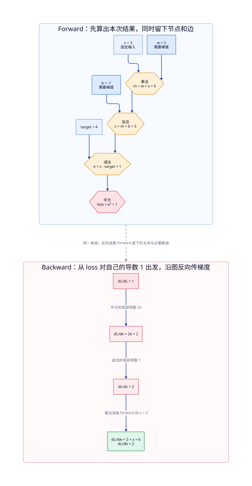
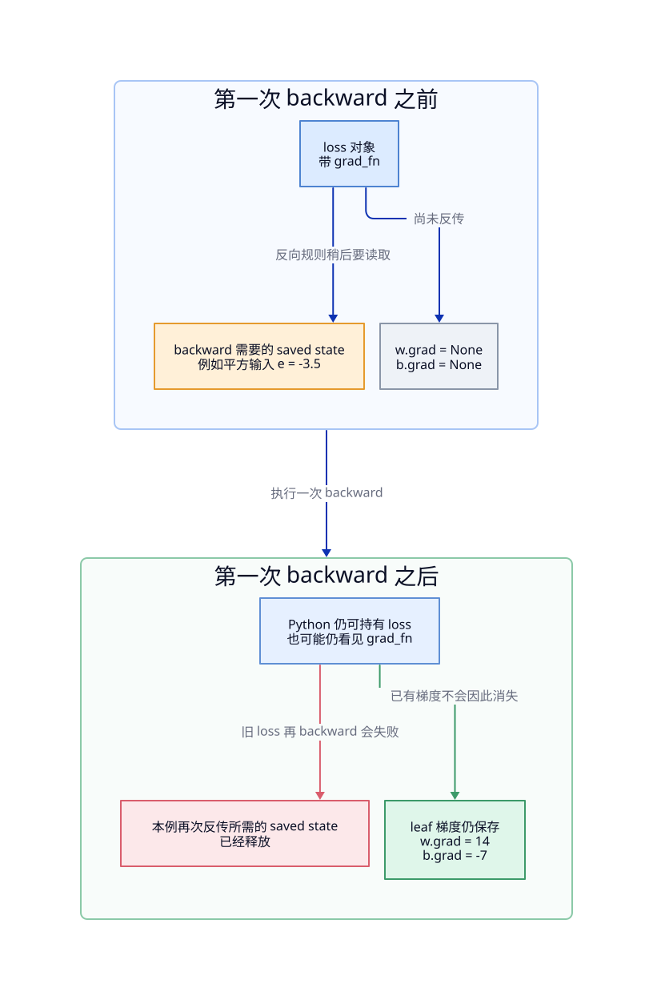
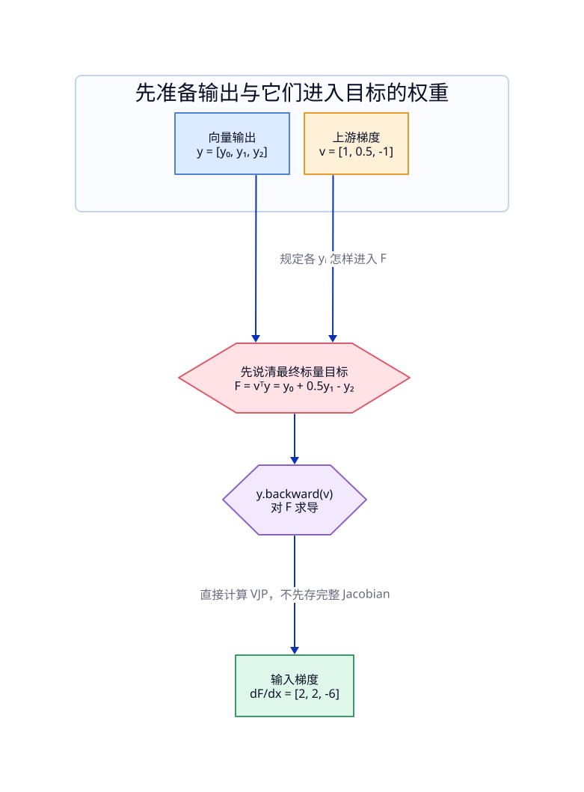
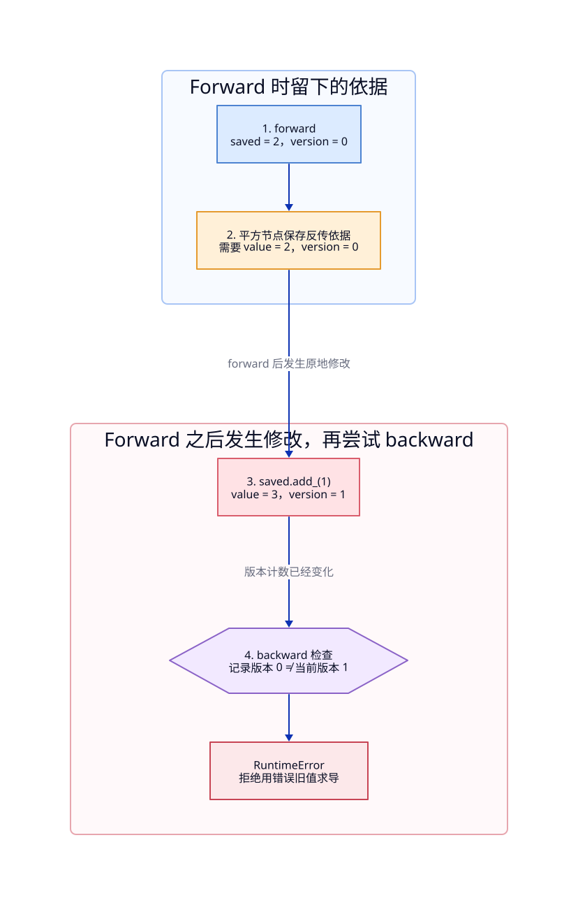

# AI Infra Theory T11：Autograd、Graph Lifetime 与 Gradient Accumulation

> 版本：2026-10-26，按三遍审计补齐计算图、生命周期、向量目标与版本冲突的可视关系；R3继续沿“目标、记录、旧值”三条边界推进
> 前置：T4、T9、T10
> 建议投入：约 5~7 个有效小时
> 固定产出：`autograd_inspect.py`
> 学习节奏：R1三路梯度对照 → R2累积/清理与生命周期 → R3先说清求导目标，再划定记录范围并保护backward所需旧值；前两轮完成后各暂停

---

# Part 1：PyTorch 怎样把 T4 的 chain rule 自动执行

## 0. 从一个三行计算开始

**今天让PyTorch替你执行一次已经会手算的求导。** 然后查清两件事：计算关系记在哪里，求出的梯度又放在哪里。

最终程序仍是`autograd_inspect.py`。它复用T4的数值检查思路，不再造一套求导框架。

T8里，你已经亲手写出`gradients()`。训练循环拿它返回的dW/db更新参数。

模型变深以后，手工连接整条梯度公式很容易漏掉路径或求和。我们希望只写forward，再让框架沿本次实际执行的运算应用链式法则。

**这堂课仍只需你已经会的乘加、平方和链式法则。** T10管理W、b，T11让框架计算同一个梯度；第一次多层神经网络留到T12，不是本课前置。

T10已经比较过同一个计算的两种执行方式。普通执行可以留下求导记录；放进`inference_mode()`后，数值仍能算出，但这次不记录求导关系。

那一课只回答“这次要不要记”。**T11继续追问：记录里连着什么？`backward()`怎样沿它把梯度送回w和b？结果最后放在哪里？**

Dropout与`train/eval`不参与本课主问题。本课不重做T10的模式实验。

沿同一个脚本分段完成：

| 阶段 | 这次解决什么问题 | 停在哪里 |
|---|---|---|
| R1，§0～§8 | 手算、有限差分与autograd是否得到同一个梯度？相同参数再求一次后保存处怎样变化？ | Reading Gate，先检阅真实预测与结果 |
| R2，§9～§11 | 怎样清理旧梯度？为什么旧loss所需的保存状态与`.grad`寿命不同？ | §11后的停止点；中间节点梯度只作补充观察 |
| R3，§12以后 | 一次backward还需要说清哪些边界：最终目标是什么、哪段计算要记录、反向依赖的旧值能否被改？ | 完成同一脚本的最终收口 |

阶段划分只分散阅读负担，不增加第二份程序，也不要求你先写训练器。

先用一条能手算的小链，看看这个需求怎样落地：

```python
import torch

x = torch.tensor(3.0)
w = torch.tensor(2.0, requires_grad=True)
b = torch.tensor(-1.0, requires_grad=True)

z = w * x + b
loss = (z - 4.0) ** 2
```

Forward values：

```text
z = 5
loss = 1
```

这三个动作依次是：先乘加得到预测，再减真实值，最后把误差平方。求导目标仍然是固定x和真实值时的loss对w、b的偏导，和T4同一问题。

```text
w -- 乘以固定x --> 中间乘积 -- 加b --> z -- 减真实值 --> 误差 -- 平方 --> loss
```

T4 手推：

$$
\frac{\partial L}{\partial w}=6,
\qquad
\frac{\partial L}{\partial b}=2
$$

现在执行：

```python
loss.backward()
```

PyTorch会把这两个梯度写入`w.grad`与`b.grad`。

**调用`backward()`求导，读取`.grad`取出结果。**

这一步没有修改w和b本身的数值。这就是autograd（自动求导）在本例中完成的工作。

现在问题变成：loss里只有一个数值1，程序怎么知道它来自哪些运算？又该把6和2分别交给谁？

下面先沿刚才的乘加和平方找回这条来路，再介绍用来查看它的属性。

## 1. Tensor 多出来的 autograd metadata

T9 已经把 Tensor 拆成：

```text
storage + dtype + device + shape + stride + offset
```

现在重新看这一行：

```python
z = w * x + b
```

若PyTorch只计算出数值`5`，forward结束后就只剩一个孤立结果。

将来执行`loss.backward()`时，程序还需要知道两件事：`5`由哪些运算产生，梯度应该送回哪些输入。

参与operation的Tensor需要gradient时，PyTorch不能只算出output value。

它还要留下一条最小的“来路记录”：

```text
这个 output 由哪一种 operation 产生
它依赖哪些前驱 values
反向经过该 operation 时需要哪条 derivative rule
```

这条来路记录会随着 forward 一站一站连接起来。到 `loss` 产生时，PyTorch 已经拥有一张只覆盖本次实际计算路径的 graph。

这张记录运算关系的图叫computation graph（计算图）。

它不是脱离运行过程的静态网络图。它记录的是**这一次forward实际执行过的运算节点与依赖关系**。



> **读图：** 上半部分从`w、x、b`算到`loss`，并留下“谁由谁产生”的边。
>
> 下半部分从`loss`对自己的导数1出发，沿同一条链反向传播。
>
> 平方节点读取误差1，乘法节点读取固定输入3，最后得到`dL/dw=6`和`dL/db=2`。

先沿图抓住两件事：**forward既算数值，也建立来路；backward沿来路反向应用每个节点的局部求导规则。**

§4会直接打印一个结果属性，看PyTorch怎样把其中一个反向节点暴露出来。

接下来依次查清：**哪些输入要求梯度？中间结果和原始参数怎样区分？结果怎样连回前一步？** 每个属性第一次出现时，都先看具体值，再解释它的作用。

## 2. `requires_grad` 决定是否追踪关系

```python
w = torch.tensor(2.0, requires_grad=True)
```

先把`w`与固定输入`x`放在一起打印：

```python
print("w.requires_grad =", w.requires_grad)
print("x.requires_grad =", x.requires_grad)
print("w.grad =", w.grad)
```

第一次backward之前，输出是：

```text
w.requires_grad = True
x.requires_grad = False
w.grad = None
```

这三行先说明：

- `w.requires_grad = True`：后续运算需要为`w`保留求导关系。
- `x.requires_grad = False`：`x`只是本例的固定输入，不要求计算loss对它的梯度。
- `w.grad = None`：现在还没调用`backward()`，因此还没有梯度结果写入。

`requires_grad`是Tensor上的一个布尔属性。它回答的是：**后续计算是否需要为这个Tensor追踪求导关系。**

当参与运算的Tensor需要梯度，而且程序处于grad-enabled mode（允许记录求导关系的执行状态）时，autograd会记录本次运算。

一个普通Tensor也能要求梯度，不必先放进`nn.Module`。

## 3. Leaf 与 non-leaf 从哪里来

`w`、`b`由用户直接创建。它们不是某个differentiable operation的result，因此是leaf Tensors（叶子张量）。

`z`与`loss`是运算结果，因此是non-leaf（非叶子）。直接打印：

```python
print("w.is_leaf =", w.is_leaf)
print("z.is_leaf =", z.is_leaf)
print("loss.is_leaf =", loss.is_leaf)
```

输出是：

```text
w.is_leaf = True
z.is_leaf = False
loss.is_leaf = False
```

默认情况下，backward把结果写到需要梯度的leaf的`.grad`。

中间节点的梯度会参与计算和传播，但默认不长期保存在自己的`.grad`里。这里先分清“参与求导”和“保存结果的位置”。

先观察框架默认把结果放在哪里。调试需要保留中间节点梯度时，§11再加入对应调用；R1暂时保持默认行为。

## 4. `grad_fn`：`grad`是梯度，`fn`是函数

我们现在想回答一个具体问题：**`w`、`z`和`loss`分别是由什么产生的？**

先拆开名字：

- `grad`是gradient（梯度）的缩写。
- `fn`是function（函数）的缩写。

所以`grad_fn`字面可以读成gradient function（梯度函数）。

它不是`.grad`里已经算出的梯度数值。先打印三种结果，再看这里的“函数”具体指什么：

直接打印这个属性：

```python
print("w.grad_fn =", w.grad_fn)
print("z.grad_fn =", z.grad_fn)
print("loss.grad_fn =", loss.grad_fn)
```

一次代表性输出是：

```text
w.grad_fn = None
z.grad_fn = <AddBackward0 object at 0x...>
loss.grad_fn = <PowBackward0 object at 0x...>
```

对象地址`0x...`每次运行可能不同。名称后面的数字也可能随PyTorch版本变化。当前先读前面的三个核心结果。

### 4.1 `w.grad_fn`为什么是`None`

`w`是你直接创建的leaf。它不是某个已记录运算的输出，因此没有“创建w的反向节点”。

所以：

```text
w.grad_fn -> None
```

### 4.2 `z.grad_fn`为什么显示`AddBackward0`

`z`由这一行产生：

```python
z = w * x + b
```

产生`z`的最后一步是加法。因此它打印出一个`AddBackward0`对象。

这个对象是autograd graph中的一个node（节点）。backward走到这里时，它负责按加法的求导规则，把上游梯度继续传给加法两侧。

### 4.3 `loss.grad_fn`为什么显示`PowBackward0`

`loss`的最后一步是平方：

```python
loss = (z - 4.0) ** 2
```

所以它指向`PowBackward0`。backward从`loss`开始时，会先执行这个平方对应的反向规则，再继续走向误差和`z`。

现在可以正式定义这个属性：

> **`grad_fn`是Tensor上的一个属性。**
>
> 若这个Tensor由autograd记录的运算产生，它会指向负责该运算反向传播的节点。
>
> 若它不是某个已记录运算的输出，`grad_fn`就是`None`。

它有两个实际用途：

1. 检查这个结果是否连在求导图上。
2. 看出产生这个结果的最后一种已记录运算。

它不会打印整张图，也不是梯度数值。整张图还包含其他节点和连接；真正求出的leaf梯度要在`backward()`之后读取`.grad`。

## 5. Scalar `backward()` 为什么隐含 seed 1

我们要问的是“`loss`对更早的`w、b`怎样变化”。反向传播必须先从终点出发，而`loss`对它自己的导数就是1：

若 loss 是 scalar：

$$
\frac{\partial L}{\partial L}=1
$$

所以：

```python
loss.backward()
```

不额外传参数的`loss.backward()`，等价于先放入“`loss`变化1份”这个起点。

反向过程再沿图向前面的对象求导。这个起点叫scalar seed（标量起始梯度）`1`。

这与 T4 完全相同。Autograd 自动化的是 chain-rule bookkeeping，不是发明另一套微积分。

## 6. 一次forward产生一批中间对象

`w`、`b`是你准备反复使用的参数对象。`z`、`loss`只属于刚才这次计算。

下一次重新执行乘加和平方，会得到新的结果，也会建立一批新的求导记录。

R1会在**不更新参数**的前提下重新forward，再做一次backward。两次求的是同一点的相同偏导。

这样可以只观察`.grad`的保存行为。至于旧loss能否再次反传，留到§10单独实验。

# Part 2：Round1，同一点的三路对照与两次新计算

## 7. 程序用途：让三条 gradient path 在同一点对质

文件：`autograd_inspect.py`

今天不是只调用一次 `.backward()`。完整程序让同一个 scalar loss 走三条彼此独立的路径：

```text
fixed x, y, w, b
        |
        +-> manual chain rule --------+
        |                             |
        +-> T4 finite difference -----+-> compare same dL/dw, dL/db
        |                             |
        +-> PyTorch autograd ---------+
```

三者角色不同：

| Path | 当前角色 | 是否依赖 PyTorch backward |
|---|---|---|
| manual derivative | 数学 reference | 否 |
| finite difference | 只重复 forward 的 numerical oracle | 否 |
| autograd | framework 的 chain-rule implementation | 是 |

这里求的是：

$$
\nabla_{w,b}L(w,b;x,y)
$$

也就是loss对$w,b$的gradient。$x,y$在这次检查中保持固定。

`loss.backward()`是被检查的framework path。

finite difference提供独立的数值参照。manual result帮助定位哪一条路径不一致。

对象地图：

```text
w, b：requires-grad leaf parameters，persistent values
x, y：fixed input / target
z, loss：本次 forward 产生的 temporary non-leaf Tensors
grad_fn / saved state：autograd 为本次 backward 留下的来路记录
w.grad / b.grad：backward保存leaf梯度的位置
```

下面的 fixed case 是这张三路图共同使用的输入，不是第四套实验。

R1换一组值，避免照抄§0的手算答案。固定scalar（标量，只有一个数）case如下，使用float64减少数值差分的舍入影响：

```python
x = torch.tensor(-2.0, dtype=torch.float64)
w = torch.tensor(1.5, dtype=torch.float64, requires_grad=True)
b = torch.tensor(0.5, dtype=torch.float64, requires_grad=True)

z = w * x + b
loss = (z - 1.0) ** 2
```

数值检查仍使用同一个目标函数：传入一组候选w、b，返回对应的scalar loss。

其中x=-2、真实值1保持固定。一个普通NumPy/Python函数可以写成：

```python
def fixed_loss(parameters):
    w_value, b_value = parameters
    return float((w_value * (-2.0) + b_value - 1.0) ** 2)
```

把`[1.5,0.5]`交给T4已经通过的数值梯度检查器。沿原来的实际签名复用，不重写差分循环。

解析梯度由你手算，PyTorch结果来自`.backward()`。三条路径比较的是同一点、同一个平方损失；这里不引入T7的半MSE系数。

运行前手写预测：

```text
w/z/loss 的 is_leaf
w/z/loss 的 requires_grad
w/z/loss 的 grad_fn 是否为 None
第一次 backward 后 w.grad、b.grad
不修改参数、不清理.grad，第二次重新forward/backward后.grad会怎样变化
```

## 8. Round1 observable contract

R1只证明三件事：

1. autograd与手算、有限差分在同一点得到相同梯度；
2. 第一次backward把leaf梯度保存到`w.grad`和`b.grad`；
3. 不清理保存位置，再做一次新的forward/backward，第二份梯度会累加进去。

下面的Phase A/B只是给这三条结论留下证据，不是又增加两组新知识。

Phase A：

```text
打印 metadata
用 T4 手推 gradient
用 T4 finite difference 检查同一点
执行 autograd backward
三条 gradient paths 对齐
```

Phase B：

```text
不清理 w.grad / b.grad
重新 forward 得到 new_loss
再次 backward
先写下.grad变化的预测，再运行并记录真实结果
```

本轮不调用optimizer，不对w/b赋新值，也不主动清理`.grad`。

你比较的是“相同参数又求一次导数后，保存处怎样变”，不是训练一步后的新梯度。具体数值核对留在闸门后。

三路单次梯度使用`rtol=1e-5, atol=1e-7`。差分epsilon先沿用T4的`1e-5`。

Tensor可以用`torch.testing.assert_close`比较。也可以先取`.item()`，再做普通数值比较。

shape与`is_leaf/requires_grad`等离散结果必须精确相等。

运行：

```bash
python3 -B autograd_inspect.py
```

全部通过后可打印`T11 ROUND1 CHECKS PASS`。意外异常或数值不符时，程序必须非零退出。

使用普通Python运行，避免`-O`删除assert。求导模型与真实观察由你完成；机械检查脚手架可以委托。

### Reading Gate

到这里暂停。先提交：

```text
metadata prediction vs actual
manual / finite-difference / autograd 三路 gradient
两次新的forward/backward后.grad变化的记录
```

Round1通过后先读§9～§11，解释并整理本轮已经观察到的梯度，再暂停。向量输出与其他执行边界留R3。

---

# Part 3：Round2，先整理梯度与保存状态的生命周期

## 9. `.grad` 默认累加，不是覆盖

先核对R1：预测值为-2.5，误差为-3.5，loss为12.25。单次梯度是：

$$
\frac{\partial L}{\partial w}=2(-3.5)(-2)=14,
\qquad
\frac{\partial L}{\partial b}=2(-3.5)=-7.
$$

第一次backward后，打印结果应是：

```text
w.grad = tensor(14., dtype=torch.float64)
b.grad = tensor(-7., dtype=torch.float64)
```

参数不变，再做一次新的forward/backward：

```text
w.grad = tensor(28., dtype=torch.float64)
b.grad = tensor(-14., dtype=torch.float64)
```

两次计算得到的单次偏导相同。变化发生在保存结果时：第二次结果加到了原有`.grad`上。

这叫gradient accumulation（梯度累积）。

Autograd用加法汇总梯度。同一个leaf可能从多条路径收到梯度贡献；训练程序也可能故意跨多次backward累积结果。

如果下一次需要的是新的单次梯度，就先清理旧结果。本课仍直接操作你已经认识的两个参数：

```python
w.grad = None
b.grad = None
```

当前先用`None`清理。重新forward/backward后，结果应恢复为单次的14和-7。

零Tensor也能把数值清成0，但“没有grad”和“grad恰好为零”并不总是同一种状态。精确差别留到T13。

T12接入参数更新时，会用优化器统一清理多个参数的梯度。这里先把“旧结果留下了，下一次会加上去”这件事看清，不提前创建优化器。

## 10. Gradient lifetime 与 graph lifetime 不同

现在单独观察旧loss。新建一组参数，并计算一次本课的平方损失：

```python
old_x = torch.tensor(-2.0, dtype=torch.float64)
old_w = torch.tensor(1.5, dtype=torch.float64, requires_grad=True)
old_b = torch.tensor(0.5, dtype=torch.float64, requires_grad=True)

old_z = old_w * old_x + old_b
old_loss = (old_z - 1.0) ** 2

old_loss.backward()
old_loss.backward()  # 不重新forward，故意复用同一个old_loss
```

第二次调用会失败。代表性错误开头是：

```text
RuntimeError: Trying to backward through the graph a second time ...
```

完整英文可能随版本变化。当前要读懂的事实是：第一次backward以后，这条平方链再次反传所需的保存状态已经释放。

`old_loss`这个Python对象仍然存在，`old_loss.grad_fn`也可能还能打印出来。

消失的不是整个Python对象，而是再次反传需要读取的部分保存状态。

有些简单图不依赖这些中间值，可能允许再次backward。因此本课只对这条固定平方链下结论。

第一次 backward 后：

```text
forward graph 的一次性 saved state 通常释放
leaf .grad 仍然存在并继续累加
```



> **读图：** 左边是第一次backward之前。反向节点仍持有本例所需的saved state（保存状态），leaf的`.grad`尚为空。
>
> 右边是backward之后。旧`loss`仍可能存在，但再次反传所需的保存状态已经释放；`w.grad`与`b.grad`则继续存在。

所以：

```text
“旧 loss 不能再 backward”
!=
“w.grad 已经消失”
```

这是两个 lifetime。T11 必须分别观察，不能把报错都归成“graph 没了”。

`retain_graph=True`能延长反传保存状态的使用时间，但这次并不需要它。

正常训练每轮本来就要根据新参数重新forward。保留旧图是特定需求的工具，不是处理所有报错的默认动作。

## 11. 补充观察：Non-leaf gradient 计算了，但默认不保存

R2的主问题到§10已经闭环。你已经会清理leaf的旧梯度，也已经分开`.grad`与反传保存状态的寿命。

这里不增加新的核心门槛。只补看一个现象：中间节点的梯度参与了链式法则，却默认不留在自己的`.grad`中。

链式法则必须先算$\partial L/\partial z$，才能继续算$\partial L/\partial w$。

所以`z`的gradient确实参与了backward。

但 backward 后：

```python
z.grad is None
```

通常仍成立，因为 non-leaf `.grad` 默认不 retain。调用：

```python
z.retain_grad()
```

只改变 observation/storage policy，不改变 chain-rule result。

用一组新参数重算R1的同一条链。在`loss.backward()`之前调用`z.retain_grad()`。

随后应看到：

```text
z.grad = tensor(-7., dtype=torch.float64)
w.grad = tensor(14., dtype=torch.float64)
b.grad = tensor(-7., dtype=torch.float64)
```

`z.grad`保存的是loss对z的导数。它仍会继续乘上z对w、b的局部导数，因此leaf梯度没有改变。

### Round2停止点：先守住两条核心证据

继续运行同一份`autograd_inspect.py`，保留R1段，核心只追加前两组观察：

1. 清理w.grad/b.grad，重新forward/backward，恢复为单次梯度14和-7。
2. 对本课平方链复用同一个旧loss，确认第二次backward抛出RuntimeError；同时检查第一次留下的leaf梯度仍在。

若想把“中间梯度确实算过”变成可见证据，再做`retain_grad()`补充项。检查`z.grad=-7`，同时确认w、b仍是14和-7。

**这一项帮助观察，不是R2通过的阻塞条件，也不要求背API。**

预期失败只捕获那一次backward。没抛错就让检查失败。

其他异常和数值不符仍以非零退出。正常完成可打印`T11 ROUND2 CHECKS PASS`。

```bash
python3 -B autograd_inspect.py
```

**到这里先停，核对R2后再继续。**

现在已经能区分参数值、`.grad`和一次反传需要的中间保存状态。下一轮才改变求导目标和执行环境。

# Part 4：Round3，把求导请求说完整，再守住记录边界

R1、R2已经回答了“记录怎样建立、梯度放在哪里、什么时候清理”。现在还差三个连续问题：

```text
输出不止一个数
-> 最终到底对哪个scalar目标求导？

目标已经明确
-> 哪些计算应该连进这次求导记录，哪些只需要数值？

记录已经建立
-> backward依赖的forward旧值还能不能被原地改掉？
```

这不是并排学习一组新API。它们共同规定一次反向计算能否回答**正确的问题**：目标要明确，路径要按用途记录，路径依赖的旧值要保持有效。

## 12. 多个输出时，先说明最终对哪个标量求导

**向量输出里有多个数，不能直接假装它们已经共同组成一个最终分数。**

调用backward之前，先说清楚这些输出怎样合成你真正关心的scalar目标。

若：

```python
x = torch.tensor([1.0, 2.0, 3.0], requires_grad=True)
y = x ** 2
```

`y`不是scalar。单写：

```python
y.backward()
```

会得到类似下面的错误：

```text
RuntimeError: grad can be implicitly created only for scalar outputs
```

原因很具体：`y`有三个输出，但PyTorch不知道它们怎样组成你最终关心的一个分数。

先把最终问题说清楚。假设我们真正关心的是这三个输出的加权和：

$$
F=y_0+0.5y_1-y_2.
$$

这已经是一个scalar objective（标量目标）。分别对三个输入求导，结果是`[2,2,-6]`。

权重向量`[1,0.5,-1]`说明每个`y`分量怎样影响最终目标。它就是这次的upstream gradient（上游梯度）。

到这里，`[1,0.5,-1]`已经不是突然出现的API参数。它明确规定了三个输出怎样进入最终目标。

PyTorch允许直接把这个向量交给`y.backward`。这等价于对上面的加权和求导：

```python
v = torch.tensor([1.0, 0.5, -1.0])
y.backward(v)
```



> **读图：** `v`先规定`y0、y1、y2`怎样组成标量`F`。
>
> 反向过程再求`F`对输入的梯度。`y.backward(v)`只是省去显式写出`F`的等价调用。

这类计算先用上游梯度加权各输出，再把结果送回输入。它叫vector-Jacobian product（向量-雅可比乘积，VJP）：

$$
v^T J
$$

本例：

$$
\frac{\partial y_i}{\partial x_i}=2x_i
$$

所以：

$$
\frac{\partial(v^Ty)}{\partial x}
=
v\odot 2x
$$

这里的J是Jacobian（雅可比矩阵）。第i行第j列记录`y`的第i项对`x`的第j项的偏导。

本例J的对角线是2、4、6，其余为0。`v`按1、0.5、-1加权这三行，结果就是`[2,2,-6]`。

反向求导可以直接计算这个加权结果，无需先把整个J存成一张矩阵。

先能从这个加权和说清调用含义，再记VJP这个缩写。对照两种写法时分别新建输入Tensor，或清理梯度并重新forward，避免把累积误认为数值不同。

## 13. 目标明确以后，再决定哪里需要留下求导记录

先不要把`no_grad`、`detach`与`inference_mode`当成三个并排名词。它们对应三个不同的实际动作：

```text
no_grad：作用于接下来的一小段计算
detach：作用于一个已经算出的结果
inference_mode：作用于一整段纯预测执行边界
```

| 当前场景 | 需要的动作 |
|---|---|
| 下一小段计算只要数值，不想把它接进求导路径 | 在`no_grad`范围里执行这段计算 |
| 一个结果已经带着旧求导路径，但要把数值交给日志或后处理 | 对这个结果调用`detach()` |
| 整个请求就是纯预测，不会再回到训练求导 | 用T10已经学过的`inference_mode()`包住整段预测 |

三者都可能得到相同数值，但改变的是**哪段关系被记录、哪个结果还连接旧图，以及这个结果后面准备怎样使用**。下面仍用同一个乘法逐个比较。

### 13.1 接下来只算数值，怎样暂时不记来路

假设一个参数接下来只用于输出数值，暂时不需要对这段计算求导。先用乘法而非新模型观察：

```python
source = torch.tensor(2.0, requires_grad=True)

# 不使用with：数值为6，同时留下source -> tracked的求导关系
tracked = source * 3.0

assert torch.is_grad_enabled()
with torch.no_grad():
    assert not torch.is_grad_enabled()
    untracked = source * 3.0

# 离开缩进范围后，恢复进入前的求导设置
assert torch.is_grad_enabled()
tracked_again = source * 4.0

assert tracked.requires_grad
assert not untracked.requires_grad
assert tracked_again.requires_grad
assert untracked.item() == tracked.item() == 6.0
```

**no_grad（不记录求导关系）**让`with`范围内的新运算不进入求导图。

乘法仍然执行，所以`untracked`仍是6。省掉的是这次乘法对应的求导记录。

`source`本身仍要求梯度。离开缩进范围后，普通计算恢复原来的规则。

### 13.2 已经算好的结果，怎样交出一个不连旧记录的Tensor

这次保留刚才的tracked，取得它的数值视图：

```python
detached = tracked.detach()
assert not detached.requires_grad
assert detached.data_ptr() == tracked.data_ptr()
```

**detach（分离求导关系）**处理的是一个已经算好的结果。它返回新的Tensor包装对象，这个新对象不再连接原求导历史。

原`tracked`仍保留自己的记录。两者共享数值storage，这与T9的共享对象模型相同。

如果后续还要修改数值，并要求两个结果互不影响，再用`tracked.detach().clone()`取得独立快照。

### 13.3 整个请求都是纯预测时，复用T10的`inference_mode`

T10已经用它处理纯预测。现在用同一个source验证本次操作也不记录求导：

```python
with torch.inference_mode():
    inference_value = source * 3.0
assert not inference_value.requires_grad
assert inference_value.item() == 6.0
```

T10已经比较过“写与不写`inference_mode`”的结果。两种方式都能得到预测值；差别在于是否保留本次求导记录。

这里再补一层：**inference_mode（推理执行模式）**还会减少部分自动求导跟踪，例如新建推理Tensor的版本与视图跟踪。

因此它适合包住完整的纯预测请求。

若结果还要回到后续训练路径，就不能随意替换这三个操作。先判断你在处理“一小段计算”“一个已有结果”，还是“整段纯预测”。

它仍不切换Module的train/eval状态，T10的两个开关结论保持。

这里不用新建Module，就能观察三种操作各自作用于“一段计算”还是“一个已有结果”。

## 14. 记录已经建立，backward依赖的旧值还能改吗

即使目标和记录范围都正确，backward有时仍需要forward时的旧值。

如果旧值在backward前被原地修改，记录仍指向同一个对象，但里面的数已经变了。继续求导就可能得到错误结果。

Version tracking（版本跟踪）会记录已保存Tensor是否被原地修改；PyTorch据此检测许多这类问题并抛错：

```text
needed Tensor saved during forward
-> in-place mutation increments version
-> backward sees version mismatch
-> RuntimeError
```



> **读图：** forward时，平方节点记住“数值2、版本0”。
>
> 随后`add_`把同一对象改成“数值3、版本1”。backward发现版本不同，因此拒绝使用已经变化的对象。

用独立对象做一次，不污染R1参数：

```python
saved = torch.tensor([2.0], requires_grad=True)
square_loss = (saved ** 2).sum()
with torch.no_grad():
    saved.add_(1.0)
square_loss.backward()  # 本例故意触发RuntimeError
```

代表性错误中会出现：

```text
RuntimeError: one of the variables needed for gradient computation
has been modified by an inplace operation ...
```

平方的反传需要原来的2，但存储已改成3。

`no_grad`只让修改不被记录为新求导操作，并不让已保存的旧值恢复。实验只在最后这次backward周围捕获预期错误。

这不表示所有in-place operation都必然错误。

但在训练correctness尚未证明时，不要只为少一次allocation就使用它。先让profiler证明这项优化值得做。

# Part 5：Round3收口与AI Infra连接

## 15. Round3具体追加什么

保留R1的三路数值对照，以及R2的梯度清理和旧loss寿命检查。若做过`retain_grad()`补充观察，也保留它。

本轮只向同一份`autograd_inspect.py`追加三组证据：

1. **目标边界**：单独观察向量输出缺少上游梯度的错误，再用新对象比较显式向量与加权标量目标，两者均得到`[2,2,-6]`。
2. **记录边界**：用独立`source`比较默认计算、`no_grad`、`detach`和`inference_mode`。
   检查数值相同而求导连接不同，并验证`with`退出后恢复原设置。
3. **旧值边界**：保存平方反传需要的旧值后原地修改它，确认那一次backward失败。

每组少量断言即可。动态分支是主闭环后的补充解释，§17/18是内存与服务连接，不再各布置一份实验，也不要求你实现训练器或显存分析器。

本课新增的四张图只负责解释同一脚本里的对象关系，不增加画图、学习D2或另写可视化程序的任务。

## 16. Failure discipline

Expected failures：

```text
本课平方链第一次反传后，不重新forward就对同一loss再次backward
本课向量输出不给上游梯度就调用backward
本课平方反传需要的旧值，在反传前被原地修改
```

只在故意失败的那一次调用周围捕获`RuntimeError`。确认错误来自当前操作，但不要求跨版本逐字匹配完整英文消息。

若没有抛错，就让检查失败。其他意外错误保持非零退出。三组错误使用独立对象，不把前一次失败的状态带进下一次实验。

正常完成：

```text
T11 AUTOGRAD INSPECT PASS
```

## 17. Training memory 为什么大于 parameter bytes

训练时 memory 不只有 parameters：

```text
参数数值
参数.grad
为反向计算保存的中间值
求导关系记录
算子计算所需的临时工作空间
```

本课还没创建优化器。T12接入自动更新后，它也可能保存自己的历史状态。

这里先从已经见过的`.grad`和中间保存值理解：模型参数之外，还会有反传需要的内存。

纯推理不需要为本次forward建立反传记录，也不会产生新梯度。

若对象已经训练过，已有`.grad`和其他训练状态不会因为进入inference_mode就自动释放。

模型变大以后，可以少保存一部分activation（前向产生、反向可能需要的中间Tensor）。反传时再重新计算，用额外计算换取更低的内存占用。

这种方法叫activation checkpointing（激活检查点）。本课只保留这条未来联系，不实现它。

## 18. 与 serving 的连接

Inference boundary：

```text
model.eval()
with torch.inference_mode():
    output = model(input)
```

其目的不只是“代码更快”：

```text
不建立训练 graph
不保留 backward activations
不产生 parameter gradients
明确 execution lifecycle
```

若serving path意外开启gradient tracking，functional output可能仍正确。

但memory、latency与lifetime都可能恶化。

### 18.1 补充观察：同一函数走不同分支，记录也跟着改变

核心任务到这里已经闭环。下面只帮助你理解“graph记录本次实际执行”，不增加必做实验：

```python
def branch(x: torch.Tensor) -> torch.Tensor:
    if x.item() > 0:
        return x * x
    return -x

positive = torch.tensor(2.0, requires_grad=True)
negative = torch.tensor(-2.0, requires_grad=True)

positive_result = branch(positive)
negative_result = branch(negative)

print("positive grad_fn =", positive_result.grad_fn)
print("negative grad_fn =", negative_result.grad_fn)
```

代表性输出会分别包含`MulBackward0`与`NegBackward0`。地址和数字后缀仍可能变化。

输入不同，Python走过的branch也不同。forward只为本次实际执行的路径建立graph。

这叫dynamic eager graph（动态即时计算图）。

这种方式允许普通Python control flow参与模型计算，但每次forward也需要处理相应的构图工作。

Inference serving可能使用`inference_mode`、compile/capture或专用runtime减少相关成本。

这些都不是T11的新任务。

## 19. 资料

本课正文是主教材，**没有额外必看视频**。选看安排沿阶段停止点，不提前对照R1的预测答案：

- R1检阅后：李沐第 [07课《自动求导》](https://www.bilibili.com/video/BV1KA411N7Px/)。
  只对照同一条计算怎样留下关系、再把梯度传回参数。到本地R2停止点仍先暂停，不跟着视频提前扩展模型。
- 需要一份更短的代码对照时：选看[AIInfraGuide §2 自动微分](https://caomaolufei.github.io/AIInfraGuide/prerequisites/%E6%A8%A1%E5%9D%97%E4%B8%80-%E5%89%8D%E7%BD%AE%E7%9F%A5%E8%AF%86/pyroch/pytorch%E6%A1%86%E6%9E%B6%E5%85%A5%E9%97%A8/#2-%E8%87%AA%E5%8A%A8%E5%BE%AE%E5%88%86autograd)的§2.1～§2.3。
  它适合复看计算图、`backward()`和梯度累积。网页中的“backward只能对标量调用”是入门简化；本课§12会补上向量输出与上游梯度。
- §12向量目标讲清后：同课答疑部分只用于查当前遇到的梯度调用疑问，不另开必看任务。
- 需要计算图的第二种解释时，选看吴恩达 [P68 计算图](https://www.bilibili.com/video/BV1owrpYKEtP?p=68)。
  [P67 导数](https://www.bilibili.com/video/BV1owrpYKEtP?p=67)只在需要唤起微积分时复习；P69更大神经网络示例留到T12以后。
- [PyTorch Autograd tutorial](https://docs.pytorch.org/tutorials/beginner/basics/autogradqs_tutorial.html)
- [`Tensor.backward`](https://docs.pytorch.org/docs/stable/generated/torch.Tensor.backward.html)

本课四张技术图的`.d2`源文件与SVG都保存在`images/`。

它们可由本地[D2图形工具说明](../../reference_materials/diagram_tools/README.md)复现。

这是教材维护信息。学习T11不要求掌握D2。

T4已经掌握的微积分不重听。视频用于把手推对象映射到PyTorch，不要求补完整ML/DL课程。

闸门后若想看一个更小的实现，可选读本地[InfraTech mini_dl_framework][mini-dl]。

只看其中的`Tensor.__mul__`与`Tensor.backward`。

前者把局部导数写成回调，后者按依赖顺序反向调用。它只用于帮助理解，不包含PyTorch完整的存储版本与生命周期检查，也不要求你另写自动求导引擎。

接口事实仍以[官方autograd mechanics](https://docs.pytorch.org/docs/stable/notes/autograd.html)为准。

[mini-dl]: ../../reference_materials/ai_infra/InfraTech/deeplearning_framework/mini_dl_framework.ipynb

## 20. 通过标准

```text
能解释 leaf/non-leaf/grad_fn/.grad
manual、finite difference、autograd 三路 gradient 对齐
能独立证明 accumulation 与 reset
能区分 graph lifetime 和 grad lifetime
能解释 vector backward 是 VJP
能用“目标、记录、旧值”三条边界解释Round3的三个实验
能说明 training/inference memory 差异
```

不要求读 autograd engine 源码，不实现 autodiff framework，不做 GPU profiler。

## 21. 压缩记忆

**整课结束后，请自己整理笔记。** 留下三份状态各放什么、旧loss为何不能直接复用，以及一个你真正卡过的例子即可；已有等价笔记可复用，不重抄代码。

```text
forward execution 建 graph
backward 从 scalar seed 1 反向应用 local rules
leaf .grad 默认累加
graph saved state 与 .grad 有不同 lifetime
non-leaf gradient 会计算但默认不 retain
vector output 必须先对应一个明确的 scalar objective
记录范围和 saved value 都会影响 backward 是否有正确依据
inference 不需要训练 graph
```
