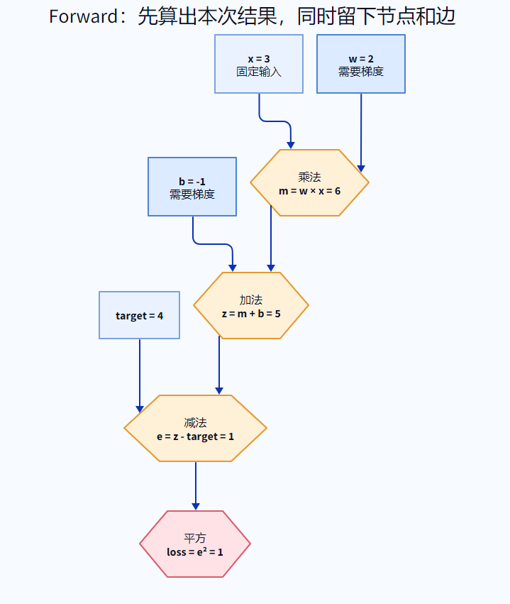

# R1

## 要解决的问题

> 怎么求出 gradient

## api

```python
import torch

x = torch.tensor(3.0)
w = torch.tensor(2.0, requires_grad=True)
b = torch.tensor(-1.0, requires_grad=True)

z = w * x + b
loss = (z - 4.0) ** 2
print("before:", w.grad, b.grad)

backward_result = loss.backward()

print("backward return:", backward_result)
print("after:", w.grad, b.grad)
print("parameter values:", w.item(), b.item())
```

调用 `loss.backward()` 后，我们可以在 `w.grad,b.grad` 这两个属性里，找到 loss 对 w,b 的梯度。

## forward

> forward 既算出最后的 loss，也建立来路。

PyTorch 会给参与运算并且需要梯度的 Tensor 保留，来路记录。从参数，到 loss，会形成一个 computation graph。



## backward

> 从 loss 出发，走到 leaf，然后利用 chain rule 求得导数。

Forward 里先有：

$$
m=w\times x
$$

这是一个“乘法”节点。

所以 backward 的时候，会出现：

$$
\boxed{\text{MulBackward0}}
$$

它负责回答：

> 已经知道 $\frac{\partial L}{\partial m}$ 了，那怎么继续算  
> $\frac{\partial L}{\partial w}$ 和 $\frac{\partial L}{\partial x}$？

因为：

$$
m=wx
$$

所以：

$$
\frac{\partial m}{\partial w}=x
$$

$$
\frac{\partial m}{\partial x}=w
$$

于是：

$$
\frac{\partial L}{\partial w}
=
\frac{\partial L}{\partial m}
\frac{\partial m}{\partial w}
=
\frac{\partial L}{\partial m}\cdot x
$$

这就是 `MulBackward0` 做的事。


| Forward做了什么 | 产生的Tensor | 这个结果的`grad_fn` | Backward走到这里时做什么                                     |
| --------------- | ------------ | ------------------- | ------------------------------------------------------------ |
| `w * x`         | `product`    | `MulBackward0`      | 用乘法的局部导数，把梯度传给`w`；本例会读取`x=3`             |
| `product + b`   | `z`          | `AddBackward0`      | 把上游梯度分别传给`product`和`b`                             |
| `z - 4.0`       | `error`      | `SubBackward0`      | 把梯度传回`z`；常数4不需要保存梯度。我们已经有 loss 对 error 的导数，那么在 backward 的时候，能得到 loss 对 z 的导数。因为 error 对 z 的导数好求。 |
| `error ** 2`    | `loss`       | `PowBackward0`      | 读取forward时的`error`，乘上局部导数`2 * error`。这样会得到 loss 对 error 的导数 |

## `requires_grad` 决定是否需要对其记录路

> 就是如果 loss 需要求对某个参数的梯度，那么其 `requires_grad` 需要为 True，这样 Pytorch 才会为其追踪求导关系，并且记录来路。

- `w.requires_grad = True`：后续运算需要为`w`保留求导关系。
- `x.requires_grad = False`：`x`只是本例的固定输入，不要求计算loss对它的梯度。

## Leaf, non-leaf

`w`、`b`由用户直接创建。它们不是某个可求导运算产生的结果，因此是leaf Tensors（叶子张量）。

`z`与`loss`是运算结果，因此是non-leaf（非叶子）。直接打印：

```python
print("w.is_leaf =", w.is_leaf)
print("z.is_leaf =", z.is_leaf)
print("loss.is_leaf =", loss.is_leaf)
```

输出是：

```text
w.is_leaf = True
z.is_leaf = False
loss.is_leaf = False
```

默认情况下，**backward把结果写到需要梯度的leaf的`.grad`**。

## grad_fn

> **`grad_fn`是Tensor上的一个属性。**
>
> 如果这个 Tensor 由 forward 过程中，某一步的运算得到，那么 grad_fn 就会指向 backward 中对应的节点。

`z`由这一行产生：

```python
z = w * x + b
```

产生`z`的最后一步是加法。因此它的 `grad_fn` 是一个`AddBackward0`对象。

这个对象是autograd graph中的一个node（节点）。backward走到这里时，它负责按加法的求导规则，把上游梯度继续传给加法两侧。

# R2

## `.grad` 默认累加

R1 的单次梯度是：

```text
w.grad = 14
b.grad = -7
```

参数不变，再做一次新的 forward/backward：

```text
w.grad = 28
b.grad = -14
```

两次单次梯度相同。第二份结果被加到已有 `.grad` 上。

这叫 gradient accumulation（梯度累积）。

如果下一次只需要一份新梯度，先清理：

```python
w.grad = None
b.grad = None
```

重新 forward/backward 后，结果恢复为 `14` 和 `-7`。

## 一次 forward 只能对应一次 backward

```python
old_x = torch.tensor(-2.0, dtype=torch.float64)
old_w = torch.tensor(1.5, dtype=torch.float64, requires_grad=True)
old_b = torch.tensor(0.5, dtype=torch.float64, requires_grad=True)

old_z = old_w * old_x + old_b
old_loss = (old_z - 1.0) ** 2

old_loss.backward()
old_loss.backward()  # 不重新 forward，故意复用同一个 old_loss
```

第二次调用会抛出 `RuntimeError`。代表性开头是：

```text
Trying to backward through the graph a second time ...
```

> 因为，旧图为 backward 保存的中间状态，会在一次 backward 后释放。

# R3

## 调用 backward 时需要是 scalar 或者给权重

假设：

```python
x = torch.tensor([1.0, 2.0, 3.0], requires_grad=True)
y = x ** 2
```

`y` 有三个数。直接调用：

```python
y.backward()
```

会失败，因为 PyTorch 不知道三个输出怎样组成你最终关心的一个目标。

假设真正关心：

$$
F=y_0+0.5y_1-y_2
$$

权重向量是：

```python
v = torch.tensor([1.0, 0.5, -1.0])
```

两种写法表达同一个问题。下面分别新建对象，避免第一次 backward 消耗的图影响第二次：

> 要么，最后是一个 scalar 调用 backward
>
> 要么，是 Tensor 调用 backward 并且我们提供每个输出的权重
>
> 也就是，
> $$
> \frac{\partial F}{\partial y_i}=v_i,
> $$

```python
# 写法一：先显式组成 scalar
x1 = torch.tensor([1.0, 2.0, 3.0], requires_grad=True)
y1 = x1 ** 2
F = y1[0] + 0.5 * y1[1] - y1[2]
F.backward()
print(x1.grad)

# 写法二：直接提供每个输出的上游权重
x2 = torch.tensor([1.0, 2.0, 3.0], requires_grad=True)
y2 = x2 ** 2
y2.backward(v)
print(x2.grad)
```

两种写法都得到：

```text
x.grad = [2, 2, -6]
```

这个“用向量加权各输出，再把结果传回输入”的计算叫 VJP（vector-Jacobian product，向量-雅可比乘积）。

先理解加权标量目标，再记 VJP 这个名字。

## 哪些计算需要留下求导关系

三种常见动作解决三个不同场景：

| 场景                               | 动作                           |
| ---------------------------------- | ------------------------------ |
| 接下来一小段计算只要数值           | `with torch.no_grad():`        |
| 已有结果要交给不需要旧图的后续代码 | `result.detach()`              |
| 整个请求都是纯预测                 | `with torch.inference_mode():` |

用同一个输入观察：

```python
source = torch.tensor(2.0, requires_grad=True)

tracked = source * 3.0

with torch.no_grad():
    untracked = source * 3.0

detached = tracked.detach()

with torch.inference_mode():
    inference_value = source * 3.0
```

四个结果的数值都是 `6`。

区别在求导关系：

```text
tracked.requires_grad         = True
untracked.requires_grad       = False
detached.requires_grad        = False
inference_value.requires_grad = False
```

`no_grad` 管接下来这段运算。`detach` 管一个已经算好的结果。`inference_mode` 管完整的纯预测边界。

## backward 需要的旧值，不能被随意更改

```python
saved = torch.tensor([2.0], requires_grad=True)
square_loss = (saved ** 2).sum()

with torch.no_grad():
    saved.add_(1.0)

square_loss.backward()
```

`saved` 被随意修改了，但是 `square_loss` 的反向传播，在计算导数的时候，需要用到原来的 `2`。

PyTorch 检测到这个值在 forward 后被改过，因此抛出 `RuntimeError`.

```text
forward 为 backward 保存了旧值
-> backward 结束前，这些值不能被随意原地修改
```

