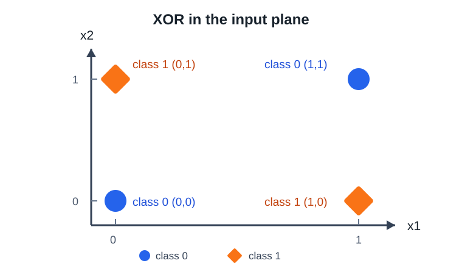
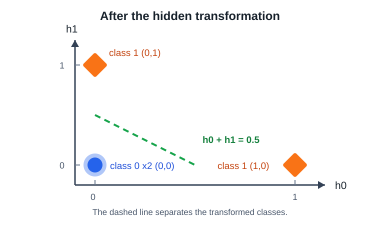

# AI Infra Theory T12：MLP（多层感知机）训练、检查点与独立推理

> 版本：2026-11-03，按 T11 学习者主线重排
> 前置：T8、T10、T11
> 当前状态：T1～T11 与 Theory Gate 1 已通过；T12 尚未学习或验收
> 建议投入：约 7～10 个有效小时
> 固定产出：`mlp_train_and_infer.py`

**今天只解决一件事：一层 Linear（线性层）分不开 XOR（异或）时，怎样让模型产生新的表示，并把这组模型真正训练、保存和恢复。**

整课分成三轮：

```text
R1：先看 Linear 怎样分类、为什么 XOR 分不开，再改变表示并完成训练、保存与全新对象加载
R2：盯住一次更新，分清 parameter（参数）、.grad（梯度槽位）与 optimizer（优化器）分别何时变化
R3：分清“恢复同一预测”和“继续原训练”各自需要哪些状态
```

---

# Part 1：Round1，从一条直线为什么不够开始

## 0. `Linear(2,2)` 到底怎样决定类别

先看本课真正使用的分类器输出。

一条输入有两个特征：

$$
x=(x_1,x_2)
$$

`Linear(2,2)` 会为它算出两个 logit（类别原始分数）：

$$
z_0=w_0^Tx+b_0
$$

$$
z_1=w_1^Tx+b_1
$$

每一项对应一个类别：

```text
z0 -> 模型对 class 0 的分数
z1 -> 模型对 class 1 的分数
```

预测时选择分数更大的类别。例如：

```text
logits = [-0.7, 1.2]

1.2 > -0.7
-> prediction = class 1
```

所以两类的判断规则是：

```text
z1 > z0 -> class 1
z0 > z1 -> class 0
```

两边恰好相等的位置，既不偏向 class 0，也不偏向 class 1：

$$
z_1=z_0
$$

把两个 Linear 公式移到一边：

$$
(w_1-w_0)^Tx+(b_1-b_0)=0
$$

输入只有 $x_1,x_2$ 两个维度。展开以后就是：

$$
a_1x_1+a_2x_2+c=0
$$

这在二维平面上是一条直线。

```text
直线一边：z1 > z0 -> class 1
直线另一边：z0 > z1 -> class 0
```

**这就是“一层 Linear 只能给出一条直线分类边界”的由来。**

你在 logistic regression（逻辑回归）里还见过另一种写法：先算一个分数 $s$，再经过 sigmoid（二分类概率映射）。常用阈值是 $0.5$：

$$
s=w_1x_1+w_2x_2+b
$$

$$
\operatorname{sigmoid}(s)\ge 0.5
\Longleftrightarrow
s\ge 0
$$

它的边界同样是 $s=0$，仍是一条直线。本课代码使用两个 logits 和交叉熵，不改成单 logit；这里仅用旧知识接起几何直觉。

## 1. XOR 为什么过不了这条直线

XOR（异或）的规则是：两个二进制输入不同时属于 class 1，相同时属于 class 0。

```text
(0,0) -> class 0
(0,1) -> class 1
(1,0) -> class 1
(1,1) -> class 0
```



图 1：class 0 占据左下和右上，class 1 占据左上和右下。同一类别的两个点互为对角点。

一条直线只能把平面切成两个半平面。

若它想把两个 class 1 点放在同一侧，这一侧也包含两点之间的中点：

$$
\frac{(0,1)+(1,0)}{2}=(0.5,0.5)
$$

若它又想把两个 class 0 点放在另一侧，另一侧也应该包含这两个点的中点：

$$
\frac{(0,0)+(1,1)}{2}=(0.5,0.5)
$$

同一个位置不可能同时位于直线两侧。

**真正的障碍是：一层 Linear 能表达的分类区域不够。** 延长训练或只调整学习率，都不会把一条直线变成 XOR 需要的分类区域。

现在问题自然变成：再接一层 Linear，会不会得到更复杂的边界？

## 2. 两次 Linear 为什么仍然只是一条直线

先让第一层产生一组中间数值：

$$
h=xA+a
$$

再让第二层产生两个类别分数：

$$
z=hB+c
$$

把第一式代入第二式：

$$
z=(xA+a)B+c
$$

整理：

$$
z=x(AB)+(aB+c)
$$

$AB$ 仍是一份权重，$aB+c$ 仍是一份偏置。

```text
Linear
-> Linear
-> 仍可合并成一个 Linear
```

所以只增加矩阵数量并没有改变模型能画出的边界。

我们真正缺的是：**在两层之间加入一种不能被并回 Linear 的数值规则。**

## 3. 先让四个点换一种表示

暂时不记术语。先给每个输入算两个新数：

$$
h_0=\max(0,x_1-x_2)
$$

$$
h_1=\max(0,x_2-x_1)
$$

把四个点逐个代入。

### 3.1 `(0,0)`

```text
h0 = max(0, 0-0) = 0
h1 = max(0, 0-0) = 0

(0,0) -> (0,0)
```

### 3.2 `(0,1)`

```text
h0 = max(0, 0-1) = 0
h1 = max(0, 1-0) = 1

(0,1) -> (0,1)
```

### 3.3 `(1,0)`

```text
h0 = max(0, 1-0) = 1
h1 = max(0, 0-1) = 0

(1,0) -> (1,0)
```

### 3.4 `(1,1)`

```text
h0 = max(0, 1-1) = 0
h1 = max(0, 1-1) = 0

(1,1) -> (0,0)
```

现在两类变成：

```text
class 0 -> (0,0)
class 0 -> (0,0)

class 1 -> (0,1)
class 1 -> (1,0)
```



图 2：两个 class 0 点都来到原点；两个 class 1 点位于坐标轴上。直线 $h_0+h_1=0.5$ 已经可以把两类分开。

刚才真正起作用的不是“层数变多”，而是输入的表示发生了变化。

到这里再给这些动作命名：

- $(h_0,h_1)$ 是 hidden representation（隐藏表示）：输入经过中间计算后得到的一组新特征。
- $\max(0,x)$ 是 ReLU（修正线性单元）：负数变成零，非负数保持不变。
- 这种让整体不再等价于一次 Linear 的规则叫 nonlinear activation（非线性激活）。
- `Linear -> ReLU -> Linear` 组成的前馈模型叫 MLP（multi-layer perceptron，多层感知机）。

“隐藏”只表示这组数位于输入和最终输出之间。训练数据没有直接给它标准答案；它会为了最终分类结果而被学习出来。

手工构造的两个特征只负责建立直觉。正式模型从随机参数出发，自行学到一组能完成分类的中间表示，不把上述差值公式写死。

## 4. 把这条计算写成 `TinyMLP`

先不要看一批输入。只看一条：

```text
x = [1,0]
```

它有两个特征：$x_1=1$，$x_2=0$。

### 4.1 两个输入数怎样变成八个中间数

你已经会算一个线性结果：

$$
u=w_1x_1+w_2x_2+b.
$$

第一层想得到八个结果，就把这类计算做八次。

每次使用自己的一组 weight（权重）和 bias（偏置）：

| 结果 | $(w_1,w_2)$ | $b$ | 代入 $x=[1,0]$ | 得到 |
|---|---:|---:|---:|---:|
| $u_0$ | $(1,0)$ | 0 | $1\times1+0\times0$ | 1 |
| $u_1$ | $(0,1)$ | 0 | $0\times1+1\times0$ | 0 |
| $u_2$ | $(1,1)$ | 0 | $1\times1+1\times0$ | 1 |
| $u_3$ | $(-1,0)$ | 0 | $-1\times1+0\times0$ | -1 |
| $u_4$ | $(0,-1)$ | 0 | $0\times1-1\times0$ | 0 |
| $u_5$ | $(-1,1)$ | 0 | $-1\times1+1\times0$ | -1 |
| $u_6$ | $(2,0)$ | 0 | $2\times1+0\times0$ | 2 |
| $u_7$ | $(0,2)$ | 0 | $0\times1+2\times0$ | 0 |

把八次结果按顺序排起来：

```text
输入：         [1,0]
第一层输出：   [1,0,1,-1,0,-1,2,0]
```

这就是 `nn.Linear(2,8)` 做的事：

- `2` 表示每条输入带两个数。
- `8` 表示这一层为同一条输入算出八个数。

后面代码里的 `hidden_dim=8`，指的就是这八个中间数。

上表的参数只用于演示计算。正式训练时，八组 weight 和 bias 都由模型学习。

### 4.2 ReLU 不改变数量，只改变数值

ReLU 逐个处理刚才的八个数。负数变成零，非负数保持：

```text
Linear 输出： [1,0,1,-1,0,-1,2,0]
ReLU 输出：   [1,0,1, 0,0, 0,2,0]
```

现在仍有八个中间数。

### 4.3 八个中间数怎样变成两个类别分数

最终只有两个类别，所以第二层要算两个分数。

它再次使用同一种线性计算。只是这一次，每个结果都要读取八个输入数。

为了看清动作，假设第二层暂时这样算：

```text
linear2.weight =
[
  [1,0,1,0,0,0,0,0],
  [0,0,0,0,0,0,1,0],
]
linear2.bias = [0,-1]

class 0 score = u0 + u2
              = 1 + 1
              = 2

class 1 score = u6 - 1
              = 2 - 1
              = 1
```

于是这条输入最终得到：

```text
logits = [2,1]
```

class 0 的分数更大，所以模型把这条输入判断为 class 0。

一条输入的完整路径现在是：

```text
[1,0]
  ↓ Linear(2,8)：八组参数各算一个数
[1,0,1,-1,0,-1,2,0]
  ↓ ReLU：负数变成零
[1,0,1, 0,0, 0,2,0]
  ↓ Linear(8,2)：两组参数各算一个类别分数
[2,1]
```

### 4.4 现在再推广到 $B$ 行

如果一次送入 $B$ 条数据，就把它们排成 $B$ 行：

```text
inputs =
[
  [1,0],  <- 第1条输入
  [0,1],  <- 第2条输入
  ...
]
```

同一组模型参数分别处理每一行。它不会把不同行混在一起。

每行先从两个数变成八个数，再从八个数变成两个类别分数：

```text
输入                [B, 2]
  ↓ Linear(2, 8)
中间结果            [B, 8]
  ↓ ReLU
中间结果            [B, 8]
  ↓ Linear(8, 2)
类别分数 logits     [B, 2]
```

$B$ 表示这次有多少条输入。$8$ 表示每条输入在中间保留多少个数。

### 4.5 为什么第一层的 weight 是 `[8,2]`

第一层要算八个结果，所以需要八组 weight。

每个结果都读取两个输入数，所以每组有两个 weight：

```text
linear1.weight =
[
  [w00,w01],  <- 负责算 u0
  [w10,w11],  <- 负责算 u1
  ...
  [w70,w71],  <- 负责算 u7
]

shape = [8,2]
```

**weight 的每一行负责算出一个输出数。**

因此 PyTorch 的 `nn.Linear(in_features, out_features)` 保存：

```text
weight [out_features,in_features]
bias   [out_features]
```

放回本课的两层：

```text
linear1.weight [8,2]
linear1.bias   [8]
linear2.weight [2,8]
linear2.bias   [2]
```

第一层的每一行 weight 用两个输入数算一个中间数。

第二层的每一行 weight 用八个中间数算一个类别分数。

### 4.6 `TinyMLP` 接收什么，返回什么

现在把刚才的三步计算装进一个模型对象：

```text
inputs [B,2]
-> linear1
-> ReLU
-> linear2
-> logits [B,2]
```

`TinyMLP.__init__()` 的作用是创建并保存这三层。

`TinyMLP.forward(inputs)` 的作用是让输入依次经过三层。它返回 `[B,2]` logits。

这个返回值只包含每行的两个类别分数。`forward()` 不负责计算 loss，不选择最终类别，也不更新参数。

构造 `nn.Linear` 时，PyTorch 会随机生成初始 weight。为了让本课每次从同一组初始参数开始，在构造模型之前调用：

```python
torch.manual_seed(2026)
```

它给随机数生成器设置可复现的起点。它不会训练模型，也不会改变已经构造完成的层；因此必须放在 `TinyMLP(...)` 之前。

现在创建模型和四行数据：

```python
import torch
from torch import nn


class TinyMLP(nn.Module):
    def __init__(self, input_dim: int, hidden_dim: int, class_count: int) -> None:
        super().__init__()
        self.linear1 = nn.Linear(input_dim, hidden_dim)
        self.activation = nn.ReLU()
        self.linear2 = nn.Linear(hidden_dim, class_count)

    def forward(self, inputs: torch.Tensor) -> torch.Tensor:
        hidden = self.linear1(inputs)
        activated = self.activation(hidden)
        return self.linear2(activated)


features = torch.tensor(
    [[0.0, 0.0], [0.0, 1.0], [1.0, 0.0], [1.0, 1.0]],
    dtype=torch.float32,
)
labels = torch.tensor([0, 1, 1, 0], dtype=torch.long)

torch.manual_seed(2026)
model = TinyMLP(input_dim=2, hidden_dim=8, class_count=2)
logits = model(features)

print(logits)
print(logits.shape)
```

四行输入得到四行 logits：

```text
features [4,2]
-> model
-> logits [4,2]
```

模型刚随机创建，此时不要求预测正确。我们还缺一个数来回答：**当前这四行分数到底错了多少？**

## 5. 从 logits 得到一个可以求导的 loss

假设某一行的真实类别是 class 0，但模型给出：

```text
logits = [0.2, 1.1]
```

它更偏向 class 1，所以这次判断是错的。

训练不能只得到“错了”这句话。它需要一个 scalar（标量）衡量整批预测有多错，后面才能从这个数向参数求梯度。这个数叫 loss（损失）。

T8 已经用过 cross entropy（交叉熵）。这里让 PyTorch 接收所有 logits 和真实标签：

```python
criterion = nn.CrossEntropyLoss()
loss = criterion(logits, labels)

print(loss)
print(loss.shape)  # torch.Size([])，一个 scalar Tensor
```

这次调用的对象关系是：

```text
logits [B,C]：每行 C 个原始类别分数
labels [B]：每行的正确类别编号
-> CrossEntropyLoss
-> scalar loss
```

`labels` 的 dtype（数据类型）是 `torch.long`，每个值都在 `[0,C)` 内。

不要先手动 softmax：

```python
# 不要这样做
loss = criterion(torch.softmax(logits, dim=-1), labels)
```

`CrossEntropyLoss` 直接接收原始 logits，并在内部完成稳定计算。预测类别时才可以直接比较 logits：

```python
predictions = torch.argmax(logits, dim=1)
```

`dim=1` 表示在每一行的两个类别分数中寻找最大项。返回值是形状 `[B]` 的类别编号，不是另一组概率。

现在已有 scalar loss。T11 已经会用 `loss.backward()` 算梯度，但参数值仍不会自动改变。

## 6. 谁真正修改 parameters

T11 的 `backward()` 会把 gradient（梯度）写入各 parameter（参数）的 `.grad`。

```text
loss.backward()
-> .grad 有了数值
-> parameter value 还没变
```

现在需要一个对象读取这些 `.grad`，再按更新规则修改所有 parameters。这个对象叫 optimizer（优化器）。

本课先用 AdamW，并显式关闭 weight decay（权重衰减）：

```python
learning_rate = 0.03
optimizer = torch.optim.AdamW(
    model.parameters(),
    lr=learning_rate,
    weight_decay=0.0,
)
```

一次 iteration（迭代，也就是一次参数更新）按下面顺序执行：

```python
optimizer.zero_grad(set_to_none=True)
logits = model(features)
loss = criterion(logits, labels)
loss.backward()
optimizer.step()
```

逐行看它做了什么：

```text
zero_grad  -> 清掉上一轮的 gradients
forward    -> 用当前 parameters 算 logits
loss       -> 把本轮错误压成一个 scalar
backward   -> 把 gradients 写入 .grad
step       -> 读取 .grad，修改 parameters
```

`step()` 修改参数以后，旧 logits 和旧 loss 仍代表更新前的模型。下一轮必须重新 forward，才能让新参数产生新的分数和新的求导关系。

## 7. 把一次更新封装成可以调用的训练函数

文件：`mlp_train_and_infer.py`

§6 只走了一次参数更新。现在需要把同样的五个动作重复多次，并把训练是否改善的证据交还给调用者。

`train_model()` 只承担两个任务：

```text
任务1：对传入的同一个 model 连续执行 steps 次参数更新
任务2：返回每次更新所使用的 scalar loss，供调用者观察训练过程
```

先看它怎样被调用。这里按学习顺序先看用途；真正写进 Python 文件时，`train_model()` 的定义要放在这段调用之前：

```python
loss_history = train_model(
    model=model,
    features=features,
    labels=labels,
    learning_rate=0.03,
    steps=1200,
)
```

调用结束后有两个结果：

```text
model
-> 仍是传入的同一个模型对象
-> 里面的 parameters 已被更新

loss_history
-> 普通 Python list
-> 长度等于 steps
-> 每个元素是一次 forward 得到的 loss 数值
```

**函数返回的列表不是训练后的模型。训练结果保留在传入的 `model` 对象里；列表只保存观察训练过程所需的 loss 历史。**

例如只运行三次时，返回值可能像下面这样：

```text
[0.72, 0.65, 0.58]
```

这些数字只是格式示例，不是本课固定实测值。`loss_history[0]` 是第一次更新使用的 loss，`loss_history[1]` 是第二次更新使用的 loss。

现在再看函数接口：

```python
def train_model(
    model: TinyMLP,
    features: torch.Tensor,
    labels: torch.Tensor,
    learning_rate: float,
    steps: int,
) -> list[float]:
    ...
```

每个输入在本函数中的用途是：

| 输入 | 本函数怎样使用 |
|---|---|
| `model` | forward、接收 gradients，并被 optimizer 原地更新 |
| `features` | 每次 forward 使用的 `[B,2]` 输入；函数不修改它 |
| `labels` | 每次计算 loss 使用的 `[B]` 正确类别；函数不修改它 |
| `learning_rate` | 创建 AdamW 时作为 `lr` |
| `steps` | 决定执行多少次完整参数更新，本课固定为正整数 |

返回类型 `list[float]` 表示：返回一个列表，列表中的每一项都是普通 Python 浮点数。

函数内部按这条路径工作：

```text
切换到 training mode
-> 创建 criterion 和 optimizer
-> 建立空的 loss_history
-> 重复 steps 次：
     zero_grad
     forward
     loss
     把本次 loss 的普通数值放入 loss_history
     backward
     optimizer.step
-> 返回 loss_history
```

`model.train()` 只把模型切换到训练模式，并不会替你执行这些更新。当前 `TinyMLP` 只有 Linear 和 ReLU，它们在 train/eval 下数值规则相同；这里仍显式切换模式，让这条函数明确属于训练路径。

每次记录：

```python
loss_history.append(float(loss.item()))
```

`.item()` 从只有一个数的 loss Tensor 中取出 Python 数值。这样列表不会长期保存每一轮的计算图。

第 $k$ 项记录的是第 $k$ 次 `optimizer.step()` 之前、用于计算本次 gradient 的 loss。最后一次更新完成后，若要取得更新后模型的最终 logits 和 final loss，调用者要再 forward 一次。

先使用固定起步配置：

```text
CPU / float32
构造 model 前：torch.manual_seed(2026)
hidden_dim = 8
AdamW：lr = 0.03，weight_decay = 0.0
updates = 1200
```

调用者可以这样检查返回值和更新后的模型：

```python
parameter = next(model.parameters())
before = parameter.detach().clone()

loss_history = train_model(
    model,
    features,
    labels,
    learning_rate=0.03,
    steps=1200,
)

assert len(loss_history) == 1200
assert not torch.equal(parameter, before)

model.eval()
with torch.inference_mode():
    final_logits = model(features)
    final_loss = nn.CrossEntropyLoss()(final_logits, labels)
    final_predictions = final_logits.argmax(dim=1)
```

训练函数返回后，重新 forward，再检查：

```text
loss_history 中所有数值都 finite
final logits 和 final loss 都 finite
final loss 明显低于 loss_history[0]
final_predictions 与 labels 完全相同
至少一组 parameter 的数值确实发生变化
```

finite（有限数值）指不是 `NaN`、正无穷或负无穷。可以用：

```python
assert torch.isfinite(loss).item()
assert torch.isfinite(logits).all()
```

要保存训练前的 parameter 数值，必须复制一份独立快照：

```python
parameter = next(model.parameters())
before = parameter.detach().clone()
```

只写 `before = parameter` 会让两个名字仍指向同一个 parameter，不能证明前后发生了变化。

R1 故意不让 `train_model()` 返回 optimizer。当前目标是得到可预测的 model；R3 再解释为什么这足以恢复推理，却不足以恢复完全相同的训练轨迹。

这里的四行数据只用于证明训练机制闭环。真实泛化需要独立 validation（验证）数据，留到 T13 再处理。

## 8. 旧对象消失后，文件能否恢复同一预测

`train_model()` 已经把学到的参数留在当前 `model` 里。但这些数值现在只活在本进程的内存中：进程结束，`model` 对象也会消失。

这一节只解决一个问题：

> 能否把当前模型学到的数值写进文件，再把它们装入一个全新的模型对象，让同一输入得到同一组 logits？

先得到保存前的参考输出：

```python
model.eval()
with torch.inference_mode():
    reference_logits = model(features).clone()
    reference_predictions = reference_logits.argmax(dim=1)
```

然后保存 model state（模型状态）：

```python
checkpoint_path = "tiny_mlp_state.pt"
state = model.state_dict()
torch.save(state, checkpoint_path)
```

这行里实际有两个动作：

```text
model.state_dict()
-> 返回“状态名字 -> Tensor”的映射
-> 不会自己写文件

torch.save(state, checkpoint_path)
-> 把收到的状态对象写到指定文件
-> 成功时返回 None
```

所以文件里保存的是模型状态数值，不是正在运行的 `model` 对象。

这份 checkpoint（检查点）只保存模型状态。要证明文件真的可用，必须构造 fresh model（全新模型对象），不能继续拿原对象做预测：

```python
loaded_model = TinyMLP(input_dim=2, hidden_dim=8, class_count=2)
loaded_state = torch.load(
    checkpoint_path,
    map_location="cpu",
    weights_only=True,
)
load_result = loaded_model.load_state_dict(loaded_state, strict=True)
assert load_result.missing_keys == []
assert load_result.unexpected_keys == []
loaded_model.eval()

with torch.inference_mode():
    loaded_logits = loaded_model(features)
    loaded_predictions = loaded_logits.argmax(dim=1)
```

按对象流向读这段代码：

```text
TinyMLP(...)
-> 创建一个结构相同、参数数值尚未恢复的 loaded_model

torch.load(...)
-> 从文件读回“状态名字 -> Tensor”的映射
-> 返回 loaded_state，不会自动修改 loaded_model

loaded_model.load_state_dict(loaded_state, strict=True)
-> 按名字把数值装入已经存在的 loaded_model
-> 修改的是 loaded_model 的 parameter state
-> 返回装载诊断；本例保存为 load_result

loaded_model.eval()
-> 切换这个模型的执行模式
-> 还没有计算 logits

loaded_model(features)
-> 才真正使用恢复后的参数计算 loaded_logits
```

这里有两个不同结果：`torch.load()` 的返回值是 `loaded_state`；`load_state_dict()` 的主要效果是修改现有的 `loaded_model`，返回的 `load_result` 只负责报告缺失或意外名字。它不会返回另一个模型对象。

最后核对：

```python
assert tuple(loaded_logits.shape) == (4, 2)
assert torch.equal(reference_predictions, labels)
assert torch.equal(loaded_predictions, labels)
assert loaded_logits.requires_grad is False
torch.testing.assert_close(
    loaded_logits,
    reference_logits,
    rtol=1e-5,
    atol=1e-6,
)
```

这条证据链说明：

```text
原 model 学会 XOR
-> state_dict 写入文件
-> fresh model 按名字装回状态
-> 同一输入得到同一组 logits
```

`strict=True` 要求文件里的名字与 fresh model 现有状态逐项匹配。模型结构、输入特征含义和 class 编号规则仍由程序提供，它们不在这份 `state_dict` 里。

## 9. R1 交付与停止点

运行：

```bash
python3 -B mlp_train_and_infer.py
```

通过时打印：

```text
T12 TRAIN LOAD INFER PASS
```

R1 只需要三类证据：

```text
学习：initial/final loss、四点 prediction、parameter before/after
恢复：checkpoint path、fresh model strict load、logits close
推理：loaded prediction 正确、output.requires_grad == False
```

### R1 停止点

到这里暂停。先独立完成 training、save、fresh load 与 inference（推理）的闭环。

完成后再进入 R2。R2 不重写模型，只观察你这份程序里一次更新的状态变化。

---

# Part 2：Round2，一次更新究竟改了什么

R1 已经证明模型能学会。现在只盯住一次 iteration：

> parameter、`.grad` 和 optimizer 分别在什么时候变化？

## 10. 让同一个 parameter 走完一次更新

在训练循环里选中一次 iteration。开始前保存 parameter 数值：

`model.parameters()` 可以依次访问模型登记的 parameters。这里用 `next(...)` 只取第一项作为观察样本；它通常是 `linear1.weight`，并不代表训练只更新这一项。

```python
parameter = next(model.parameters())
before = parameter.detach().clone()
```

然后逐步执行：

```python
optimizer.zero_grad(set_to_none=True)
assert parameter.grad is None

logits = model(features)
loss = criterion(logits, labels)
torch.testing.assert_close(parameter, before)

loss.backward()
assert parameter.grad is not None
torch.testing.assert_close(parameter, before)

optimizer.step()
assert not torch.equal(parameter, before)
```

观察结果是：

```text
zero_grad：.grad 被清理，parameter value 不变
forward/loss：建立本轮计算关系，parameter value 不变
backward：.grad 得到数值，parameter value 不变
step：读取 .grad 与 optimizer state，parameter value 改变
```

这就是一次训练更新中三类状态的分工：

```text
parameter -> 模型当前会怎样计算
.grad     -> 本轮 loss 要求 parameter 往哪里改
optimizer -> 根据 gradient 和自身规则执行修改
```

## 11. 为什么下一轮必须重新 forward

`optimizer.step()` 已把 parameter 改成新值。

旧 `logits`、旧 `loss` 和旧 graph（计算图）都来自更新前的参数。它们不会因为 parameter 后来变化而自动重新计算。

所以下一轮必须重新开始：

```text
new parameter values
-> new forward
-> new logits / loss / graph
-> backward
-> next step
```

反复对同一个旧 `loss` 调用 `backward()`，既没有使用新参数，也会遇到 T11 已经学过的旧图保存状态问题。它不等于训练了多轮。

## 12. 怎样判断整段训练在改善

不要要求每一步 loss 都严格下降。AdamW、有限精度和学习率都可能带来局部波动。

本课使用四项证据：

```text
所有 loss、logits 和 parameters 保持 finite
final loss 明显低于 initial loss
四个 XOR predictions 全部正确
至少一组 parameter 在训练前后发生变化
```

这些证据共同回答“训练确实完成了更新并学会四点”。单独打印一条下降的 loss 不够。

### R2 停止点

能用自己的话说清下面三句，就结束 R2：

```text
backward 改 .grad，不改 parameter value
step 读取 .grad 并改 parameter value
下一轮 forward 读取更新后的 parameter
```

---

# Part 3：Round3，进程结束后要恢复什么

假设程序在第 600 次更新后退出。内存里的 model 和 optimizer 对象都消失了。

现在可能有两个目标：

```text
目标 A：重新得到同一预测
目标 B：从第 601 次更新继续原训练
```

它们需要的状态不同。

## 13. 恢复同一预测

R1 已经走过这条链：

```text
构造同结构 fresh model
-> load model state
-> eval
-> inference_mode
-> 同一输入
-> logits 与保存前 close
```

这条路径需要：

```text
model state
能够重建同一结构的代码和配置
相同的输入处理规则
相同的 class 编号含义
```

预测请求本身没有 labels。Labels 只在评估时用于计算 accuracy（准确率）。

## 14. 继续原训练还缺什么

AdamW 不只读取当前 gradient。它还保存以前更新形成的历史统计。

若只恢复 model，再创建一个全新的 optimizer：

```text
当前预测可以相同
optimizer 历史却从空状态重新开始
```

因此，resume training（继续训练）的 checkpoint 通常还需要：

```text
optimizer state
current progress（例如已经更新到第几步）
learning-rate scheduler state（若使用了自动调整学习率的计划）
random generator state（需要复现随机过程时）
```

T12 不要求实现完整续训。这里只需要分清两条路径：

```text
推理恢复 -> model state + 结构与输入约定
训练恢复 -> 上述内容 + optimizer / progress / random state
```

## 15. 为什么训练状态比推理状态更多

训练时会同时存在：

```text
parameter values
parameter gradients
optimizer state
backward 需要的中间值
```

纯推理仍需要 parameters、本次输出和算子临时空间，但不需要 gradient、optimizer 历史或 backward 保存值。

这不是内存 benchmark（基准测量）。它先建立一张状态账：每份状态由谁拥有、服务哪条路径、什么时候可以不再保留。

### R3 停止点

能解释下面这句话，就结束 R3：

```text
model-only checkpoint 可以恢复同一预测，
但不承诺恢复完全相同的下一步训练轨迹。
```

---

# Part 4：收口

## 16. 三条执行路径

Training（训练）：

```text
features + labels
-> model.train()
-> forward with graph
-> loss
-> backward
-> optimizer.step()
```

Evaluation（评估）：

```text
features + labels
-> model.eval()
-> inference_mode
-> predictions
-> metrics
```

Inference（推理）：

```text
request features
-> fresh model + loaded state
-> eval + inference_mode
-> logits / prediction
```

三条路径复用同一个模型结构，但输入、额外状态和最终消费者不同。

## 17. T12 核心验收

必须成立：

```text
能从两个 logits 推出二维直线分类边界
能解释 XOR 为什么不是一条直线可以分开
能说明两次 Linear 为什么仍可合并
能用四点变换解释 ReLU 怎样产生新的隐藏表示
能闭合 zero_grad -> forward -> loss -> backward -> step
训练后四个 XOR points 全部预测正确
fresh model strict load 后 logits 与 reference close
能区分预测恢复与训练恢复需要的状态
```

程序正常通过时 exit 0；意外异常或断言失败时非零退出。

T12 的停止边界是这份 CPU 小模型。真实数据集、GPU 训练、DataLoader、学习率调度、完整续训程序和生产性能测量都留在后续对应问题中。

## 18. 它怎样接到 AI Infra

这份 TinyMLP 提供四样后续会继续使用的东西：

```text
可执行 model
可加载 artifact（模型产物）
固定 inputs
可比较 outputs
```

以后做 CPU 算子、编译、量化或 serving runtime（推理服务运行时）时，可以让新路径读取同一份 artifact，再用固定 inputs 对照 outputs。

因此，这份程序首先是 correctness reference（正确性参照），不是性能结论。

训练与推理的状态分账也会继续出现：

```text
parameter bytes
gradient bytes
optimizer-state bytes
selected activation bytes
```

这些数值本体之和不等于进程或 GPU 的真实峰值。严肃的性能测量留给后续阶段。

## 19. 核心完成后的选读

下面三项不影响 T12 通过。只在主闭环完成后，选择真正有疑问的一项。

### 19.1 SGD 与 AdamW

从同一份初始 model state 开始，分别创建 optimizer，再比较是否学会以及大致需要多少 steps。学习率不同意味着比较的是两组完整配置，不能把差异全部归因于 optimizer 名字。

### 19.2 ReLU 与 GELU

GELU（Gaussian error linear unit，高斯误差线性单元）是一种平滑的非线性激活。替换 ReLU 后，output shape 和 parameter count 不变，但中间值、gradient 和训练轨迹可能变化。本课不展开激活函数大全。

### 19.3 Full-batch 与 mini-batch

当前四个点一次全部参与更新，叫 full-batch（全量批次）。mini-batch（小批次）会把 dataset 分开，每个 batch 分别更新一次。

```text
epoch：完整遍历一次 training dataset
iteration / step：处理一个 batch 并更新一次
batch size：每个 step 使用的 sample 数量
```

T12 不要求实现 DataLoader。批次大小对梯度噪声、更新次数、activation memory 和 device utilization 的影响留到真实数据与性能场景。

## 20. 资料与可选实践

正文承担第一次完整讲解，没有额外必看视频。

若对隐藏表示仍需要第二种讲法，在 §3～§4 后选看：

- 吴恩达 [P38～P44 neural network 与 forward](https://www.bilibili.com/video/BV1owrpYKEtP?p=38)
- 李沐 [10 多层感知机](https://www.bilibili.com/video/BV1hh411U7gn/)

核心完成后才按需对照：

- 吴恩达 [P45～P49 code / forward](https://www.bilibili.com/video/BV1owrpYKEtP?p=45)
- 吴恩达 [P57～P59 activation](https://www.bilibili.com/video/BV1owrpYKEtP?p=57)
- 李沐 [14 模型初始化与激活函数](https://www.bilibili.com/video/BV1u64y1i75a/)
- [PyTorch optimization tutorial](https://docs.pytorch.org/tutorials/beginner/basics/optimization_tutorial.html)

T12 与经典 Ex3/Ex4 都通过，且系统主线没有正确性阻塞问题时，可以按 [Kaggle 入门实践](../../ML/Kaggle入门实践.md) 选做 Digit Recognizer。

时间上限为 4～6 小时。只用小型 MLP 完成检查点重新加载与批量推理，不临时扩展卷积网络、数据增强或刷榜。它不是 T12 通过前置。

## 21. 压缩记忆

**整课完成后，请自己做笔记。** 最终笔记应当能保留这条主干：

```text
两个 logits 比大小
-> 相等处是一条直线边界
-> XOR 的两类分别占据两条对角线，直线分不开
-> 两次 Linear 仍可合并
-> ReLU 改变中间表示，使两类重新可分
-> backward 写 gradient
-> optimizer.step 修改 parameter
-> 更新后重新 forward
-> model state 让 fresh model 恢复同一预测
-> 继续训练还需要 optimizer 与进度状态
```
