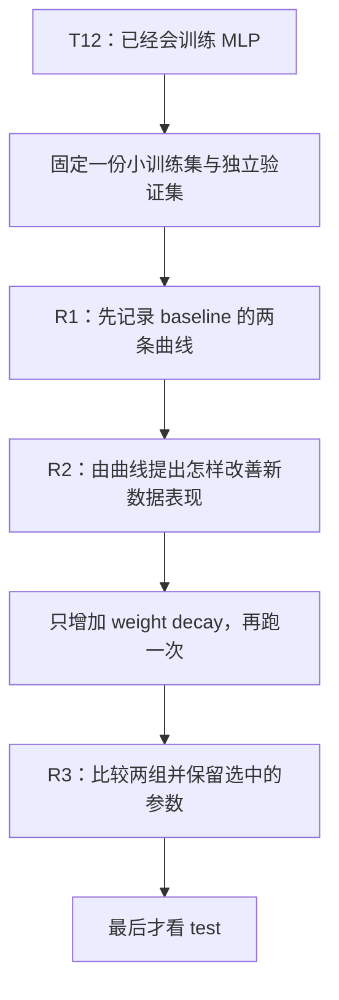
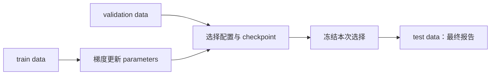
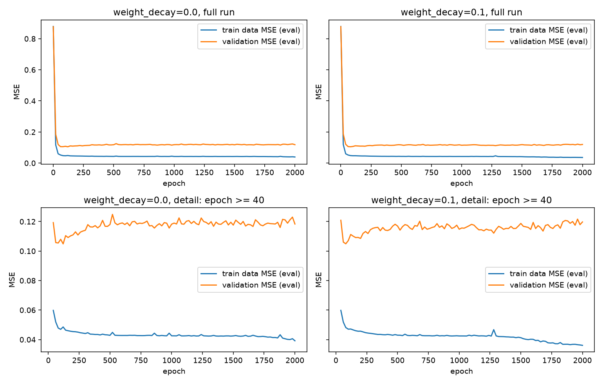
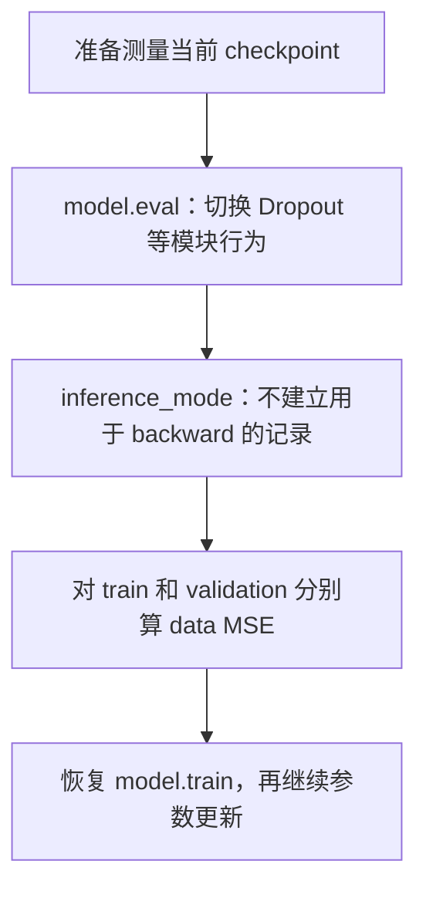

# AI Infra Theory T13：Generalization（泛化）、Regularization（正则化）与实验纪律

> 版本：2026-11-11，按已通过 T12 的真实实现再次校准
> 前置：T12 正式通过，能独立组织 MLP training / inference flow
> 当前状态：T1~T12与Theory Gate 1已通过；T13 R1于2026-11-11以98/100正式通过，下一步R2
> 建议投入：约 5~7 个有效小时，按每天 30~60 分钟拆开
> 代码目录名：`t13_generalization`
> 固定产出：`overfit_observation.py`
> 阅读节奏：R1观察 baseline（基线）。
> R2从实际曲线推出 weight decay（权重衰减）、公平比较和 checkpoint（训练时刻的状态快照）。
> R3完成对照、恢复选中模型并最后使用 test。补充区随后选读。
> 环境：[ENVIRONMENT.md](../ENVIRONMENT.md) 中的 Python 3.12 + CPU PyTorch

# Part 1：问题、对象与观察方法

## 0. T13 从什么问题出发

T12 已经让一个 MLP 完成训练、保存参数并恢复预测。T13 只多问一个问题：

> training loss 一直下降，能不能据此认定这个 model 对新数据也越来越好？

先看一组具体记录。假设训练集只有 24 条带噪声的测量数据；下面的数字用于说明问题，不是你当前代码或参考实现的实测。MSE（Mean Squared Error，均方误差）越小，表示这批数据上的平均平方误差越小：

**Epoch（训练轮次）指的是：让模型把整个训练集用来训练一遍；训练了几次**。

```text
epoch 100:  train MSE = 0.40, validation MSE = 0.50
epoch 600:  train MSE = 0.12, validation MSE = 0.22
epoch 2000: train MSE = 0.03, validation MSE = 0.41
```

从 epoch 600 到 2000，optimizer 确实把训练误差从 `0.12` 降到了 `0.03`，但 validation 误差从 `0.22` 升到了 `0.41`。继续训练让模型更适合原来的 24 条记录，却没有让它更适合另一批独立记录。

于是今天要写的 `overfit_observation.py` 不再只打印最后一次 loss，而是完成这一条连续实验：



R1 只先取得两条曲线，不要求保存最佳参数。曲线真的提出问题以后，R2 才引入 weight decay；R3 遇到“训练结束后怎样拿回中途更好的参数”时，再正式讲 checkpoint。

本课只做一组小型 CPU controlled experiment（受控实验）：先得到 baseline，再只改变 weight decay。最后如实回答这次改变有没有改善 validation。

最终还要说明这些证据能支持到哪里。大型 dataset、GPU、DataLoader 与分布式训练留给后续真实需求。

## 1. 先看同一个 model 在两个地方发生了什么

先不要背术语，只读刚才那次变化：从 epoch 600 继续训练到 2000，24 条训练记录上的 MSE 继续下降，另一批没有参与参数更新的记录却变差。

所以“training loss 下降”只回答：

> 当前 parameters 越来越适合这份 training data。

它没有回答：

> 同一组 parameters 遇到新的、来自同一任务的数据时，是否也更好。

T13 的第一个新对象只从这个缺口产生：Validation data 用来观察新数据上的变化。R1 先把这条曲线跑出来，不提前保存状态，也不先讨论怎样改善它。

等曲线真的出现“train 继续改善，validation 没有一起改善”，后面的 weight decay、参数选择和 test 才依次进入。

实现上仍复用 T12 的 `forward -> loss -> backward -> optimizer.step`、`eval()`、`inference_mode()` 和 `state_dict`。本课只把输出改成一个实数，用 MSE 衡量回归误差。

## 2. Generalization：不只是把见过的数据做对

### 2.1 给刚才看到的行为命名

**Generalization（泛化）：** model 对没有参与训练的新样本的表现。新样本来自与任务目标一致的数据来源。

**Overfitting（过拟合）：** model 对有限训练数据适应得过强，训练表现继续改善，却没有换来相应的新样本表现；有时后者反而变差。

**Underfitting（欠拟合）：** 在当前任务和评价尺度下，model 连训练数据中的主要规律都没能充分表达或学到。例如只用直线去拟合明显弯曲的关系。

刚才 `train 继续下降、validation 反而回升`，就是本课要观察的过拟合现象。一个孤立 loss 数字不够：训练误差很大，也可能是训练没完成或代码有错；两条曲线只有轻微波动，也不能自动判成严重过拟合。

### 2.2 为什么 training loss 不够

训练时最小化的是已有N条样本的平均损失：

$$
L_{\mathrm{train}}(\theta)=\frac1N\sum_{i=1}^{N}\ell(f_\theta(x_i),y_i).
$$

真正关心的是同一任务未来样本上的平均表现。有限训练集不能完整代表那个来源；optimizer也只会降低交给它的training loss。Validation/test用未参与参数更新的有限样本，帮助我们估计新数据表现，但它们也不是“未来所有数据”的完整答案。

## 3. Train、Validation、Test 分别参与什么

先只看**同一次训练里的同一个 model**。它不是同时变出三个模型，而是沿时间不断修改自己的参数：

| 训练时刻 | 这一刻的参数 | validation MSE |
|---:|---|---:|
| epoch 20 | $W_{20}, b_{20}$ | 0.18 |
| epoch 40 | $W_{40}, b_{40}$ | 0.12 |
| epoch 60 | $W_{60}, b_{60}$ | 0.15 |

每完成一段训练，train data 都参与梯度计算，把参数从上一组改成下一组。Validation data 不修改参数，只拿当前这组参数做一次检查。

上面的 validation 数字告诉我们 epoch 40 表现最好。但 model 继续训练到 epoch 60 后，内部已经装着 $W_{60}, b_{60}$，不是 $W_{40}, b_{40}$。

R1 只把这些时刻和分数记进 history。R3 真正需要取回 epoch 40 时，才必须把那一刻的参数状态保存下来。

因此本课每份数据具体做这些事：

| 数据 | 这次怎样使用 |
|---|---|
| train | 每轮计算MSE并更新参数；记录时也测一遍同一时刻的train MSE |
| validation | 每隔20轮比较一次当前参数；决定保存哪一时刻，以及两组配置选谁 |
| test | 全部选择结束、恢复选定参数后，才做最终评估 |

**验证集帮助我们比较已经训练出来的参数状态，但不参与求梯度；测试集仍留到全部选择结束。** 这就是T8的数据职责在本课的延续。



这和 C++ 单元测试中的 `test` 含义不完全相同。ML 的 test set 是一份数据，不是 `assert` 的集合；你的程序仍然需要独立的 correctness checks。

本课使用三个独立抽样得到的数据集，来自同一个生成规则。不能把同一条记录复制到另一个数组，就声称它变成了“没见过的数据”。

## 4. 今天具体观察什么程序

文件名固定为：

```text
overfit_observation.py
```

它不是训练一个实用产品，而是一个小型实验程序：

> 让同一个 MLP 在小训练集上反复学习，定期记录它对训练集和验证集的误差；之后只改变 regularization 设置，比较两次实验。

### 4.1 固定数据：趋势 + 噪声

输入是一个实数 $x$，输出规则为：

$$
x\sim\mathrm{Uniform}(-1,1)
$$

$$
y=\sin(3x)+0.3x+\epsilon,
\qquad
\epsilon\sim\mathcal{N}(0,0.3^2)
$$

`Uniform` 是均匀分布；$\epsilon$ 是每个样本独立抽取的噪声。这里给你生成公式是为了固定实验，不是让程序直接用这个公式代替 MLP 预测。

下面是可直接使用的数据准备函数，不是训练实现。这里把一份独立的数据划分称为 split（数据划分）：

```python
import numpy as np
import torch


def make_split(seed, count):
    """生成一份独立的回归数据；返回两个 float32 Tensor，shape 均为 [count, 1]。"""
    rng = np.random.default_rng(seed)
    x = rng.uniform(-1.0, 1.0, size=(count, 1)).astype(np.float32)
    noise = rng.normal(0.0, 0.3, size=(count, 1)).astype(np.float32)
    y = (np.sin(3.0 * x) + 0.3 * x + noise).astype(np.float32)
    return torch.from_numpy(x), torch.from_numpy(y)
```

小例子：

```python
# 接在上面的定义后面运行：同一个 seed 从头生成同一份 split。
x, y = make_split(1301, 24)
print(x.shape, y.shape)
print(x.dtype, y.dtype)
```

应看到：

```text
torch.Size([24, 1]) torch.Size([24, 1])
torch.float32 torch.float32
```

`default_rng(seed)` 创建独立的 NumPy random-number generator，即伪随机数生成器。这里每个 split 从自己的 seed 开始；调用这个函数不会依赖全局 `np.random` 已经被消耗了多少次。

固定三份数据：

| split | seed | 样本数 | 使用时点 |
|---|---:|---:|---|
| train | 1301 | 24 | 每次参数更新 |
| validation | 1302 | 256 | 记录曲线、选择 |
| test | 1303 | 256 | 最终选择结束后 |

**三个 split 都带同样标准差的噪声。** 如果 train 带噪声而 validation 使用完全无噪声标签，就改变了比较口径。

今天不需要额外标准化：输入范围已经固定在 $[-1,1]$。数据预处理的泄漏问题放在后面解释。

### 4.2 固定模型与训练设置

| 项目 | 本课设置 |
|---|---|
| model | `Linear(1,64) -> ReLU -> Linear(64,64) -> ReLU -> Linear(64,1)` |
| device / dtype | CPU / `torch.float32` |
| model seed | 构造 model 之前 `torch.manual_seed(13)` |
| batch | full batch（一次更新使用全部 24 个训练样本） |
| updates | 2000 次 |
| learning rate | `0.01` |
| optimizer | `torch.optim.AdamW` |
| baseline weight decay | **显式传入 `0.0`** |
| 记录时点 | epoch 0，以及每完成 20 次更新以后 |
| 曲线指标 | 同一个参数时刻、eval 模式的 train MSE 和 validation MSE |

本课一次 update 恰好看完全部 training set，所以一次 update 对应一个 epoch。`epoch=0` 表示还没更新，不是“已经训练了一轮”。

这里直接承接你已经通过的T12真实实现，不再重新提供一组选择题。你的T12最终代码是：

```text
自定义 TinyMLP(nn.Module)
-> linear1
-> ReLU
-> linear2

AdamW(lr=0.03, weight_decay=0.0)
```

T13继续使用“自定义Module保存层、`forward()`按顺序连接”的组织方式，也继续使用AdamW。

变化来自今天换成了标量回归实验：输入从2维变成1维，输出从两个class logits变成一个预测值，并且固定增加第二个hidden Linear。因此不能把T12的`TinyMLP`类原封不动拿来用；应按同一种写法建立本课的regression model。

本课baseline固定使用`AdamW(..., lr=0.01, weight_decay=0.0)`。`0.0`仍然显式写出，不能依赖默认值。

R2的受控比较继续使用同一种model、同一初始state与同一个learning rate，只把`weight_decay`从`0.0`改为`0.1`。AdamW为什么适合承载这次比较，等曲线提出问题后在§10.2解释。

### 4.3 MSE：这个数实际计算了什么

现在把开头使用的 MSE 正式写成公式：

$$
\mathrm{MSE}
=
\frac{1}{N}
\sum_{i=1}^{N}
(\hat y_i-y_i)^2
$$

$\hat y_i$ 是预测值，$y_i$ 是标签。对本课的 `[N,1]` 输出，`nn.MSELoss()` 默认对全部元素取均值，正好等于上式。

它没有T7/Ex1的`1/2`因子，因此同一误差下数值会是半MSE的两倍。这里让`nn.MSELoss`与autograd成对计算，不混用手写的另一套梯度。比较两次run时始终采用同一个MSE，保留T7已经修正过的系数经验。

接口关系只有三步：

```text
criterion(prediction, target) -> scalar loss Tensor
loss.backward()              -> 写入参数 gradients
loss.item()                  -> Python 数值，用于记录
```

prediction与target都必须是`[N,1]`。`[N,1]`与`[N]`相减可能广播成`[N,N]`，此时程序算的是不同样本之间的大量两两误差，不是逐样本误差。

因此在损失入口检查：

```python
# prediction 和 target 是当前这次 forward 的结果与对应标签。
assert prediction.shape == target.shape
```

官方查证：[PyTorch MSELoss](https://docs.pytorch.org/docs/stable/generated/torch.nn.MSELoss.html)。

## 5. 两条曲线必须拿同一把尺子量

先规定测量口径，是为了让你后面看到的差异有意义，不是提前替你解释曲线。

每次记录时，parameters 必须是同一个时刻的。分别对 train / validation 做：

```text
eval 模式
不记录用于 backward 的 graph
完整 split 的 mean data MSE
```

**Data MSE：只衡量预测与标签之间的误差。** 后面即使加入正则化，两条曲线也继续记这个数，不把额外 penalty 混进其中一条。

你可以把 T12 的 inference 片段复用成测量函数。这个函数只做一件事：**用当前 model 测一份完整 split，返回一个 Python `float` MSE。**

它接收 model、输入 `x` 和标签 `y`。它会临时切到 eval 行为，不建立反向记录，不修改 parameters，也不执行 optimizer；离开时恢复调用前的 train/eval 状态。R1 先把返回值放进 history 并画曲线；R3 再复用同一个数判断哪一刻值得保存。

```python
import torch
from torch import nn

def evaluate_mse(model: nn.Module, x: torch.Tensor, y: torch.Tensor) -> float:
    if x.shape != y.shape:
        raise ValueError("x and y must have matching [N, 1] shapes")

    previous_mode = model.training
    model.eval()
    try:
        with torch.inference_mode():
            prediction = model(x)
            if prediction.shape != y.shape:
                raise ValueError("prediction and target must have the same shape")
            return nn.functional.mse_loss(prediction, y).item()
    finally:
        model.train(previous_mode)


model = nn.Linear(1, 1)
x = torch.tensor([[0.0], [1.0]])
y = torch.tensor([[0.0], [2.0]])
print(evaluate_mse(model, x, y))
```

参数随机初始化，所以此例不规定具体 MSE。它只示范：**测量返回一个数，不更新参数；测量结束后还能继续训练。** `finally`保证中途抛错时也恢复原模式。

为什么不直接把 training loop 内的 loss 当作 train 曲线？那个 loss 可能来自更新前的参数；后面有 Dropout 时，还可能来自训练模式下的随机 forward。拿它和更新后、eval 模式的 validation loss 比较，会混入另一种差异。

画图只是把 history 变成可读证据，不是新算法。SSH环境使用非交互后端，分别画train/validation两列并保存：

```python
import matplotlib
matplotlib.use("Agg")
import matplotlib.pyplot as plt

fig, ax = plt.subplots()
ax.plot(epochs, train_mse, label="train MSE")
ax.plot(epochs, val_mse, label="validation MSE")
ax.set(xlabel="epoch", ylabel="MSE")
ax.legend()
fig.savefig("out/curves.png", dpi=140)
plt.close(fig)
```

这些 API 已够你把 T12 的训练能力转成观察程序。不需要再搭一套实验框架。

# Part 2：先取得 baseline 证据，再进入 Round2

## 6. Round1：独立完成 baseline

### 6.1 程序用途与第一版交付

现在在 `t13_generalization` 里编写 `overfit_observation.py`。

**第一版只回答：同一个模型越训练越久，训练集和验证集的误差怎样分别变化？** 用§4给定的24条训练记录更新模型，每20次更新测量两份数据，再把结果画成两条线。下面先看整课路线；当前只实现baseline这一段，第二组训练留在R3：

```text
fixed generation rule + three independent seeds
-> train / validation / test splits

fixed model/config/initial state
-> baseline training updates
-> periodic eval-mode train/validation MSE
-> history rows
-> CSV + curves
-> 找到 lowest-validation record 对应的时点

Round1 evidence
-> 再只改变 regularization setting
-> 用同一 measurement protocol 比较
```

Round1 只跑 baseline，所以 test split、regularization 和 winner restore 暂不进入第一版 control flow。先取得两条可信曲线，再解释和干预。

训练部分可以整理成一个 helper，但先说清它为什么存在。

R1可以让它接收一个已经恢复到共同initial state的model、train/validation数据和`weight_decay`。它在内部新建optimizer，更新传入model，并定期调用`evaluate_mse()`。

这一版只有两条结果通道：

```text
状态通道：传入model的parameters被原地更新，调用结束后停在最后一次update
证据通道：返回history，供CSV、曲线和最低validation记录查询
```

如果你选择把它命名为 `train_and_measure()`，调用点应能读出这个关系：

```python
history = train_and_measure(
    model=baseline_model,
    train_data=(train_x, train_y),
    validation_data=(validation_x, validation_y),
    weight_decay=0.0,
)
```

调用结束后，`baseline_model` 已经停在第 2000 次更新后的参数；`history` 则是从 epoch 0 到 2000 的测量记录。函数名和容器仍由你决定，这段调用只是把“修改了谁、返回了什么、返回值接下来给谁用”钉清楚。

它不读取test，也不复用另一轮optimizer。R3才会在validation改善时深拷贝best state；不要让R1提前承担还没有出现的checkpoint保存问题。若返回`list`，要在代码中让每一项的含义可见，不能只靠位置猜。

第一版只做 baseline：

- 使用第 4 节的固定数据、模型、seed、AdamW 与 `weight_decay=0.0`。
- 完成 2000 次 full-batch 更新；记录 epoch 0 和每 20 次更新后的两种 MSE。
- 将记录保存到 `out/history.csv`，画出 `out/curves.png`。
- 打印初始、最后与“记录中最低 validation MSE 对应”的 epoch / train MSE / validation MSE。
- 暂不使用 test set，不加入 regularization，不要求保存最佳权重。

`run` 表示一次完整实验运行。History 的每一项至少保存这些字段，随后再写进 CSV：

```text
run,weight_decay,epoch,train_mse,val_mse
```

第一版 `run` 可以全部为 `baseline`。目录由程序创建。你决定具体函数、类与组织方式，没有隐藏命名要求；R1只需让“谁更新model、谁只测量、谁消费history”清楚可见。R3加入checkpoint时，再明确谁保存它。

`CSV` = Comma-Separated Values（逗号分隔值）。写文件只是机械输出，可直接使用 Python 标准库：

```python
import csv
from pathlib import Path

Path("out").mkdir(exist_ok=True)
with open("out/example.csv", "w", newline="", encoding="utf-8") as file:
    writer = csv.writer(file)
    writer.writerow(["epoch", "mse"])
    writer.writerow([0, 0.75])
```

直接沿用[统一理论环境](../ENVIRONMENT.md)中的 Python 和已安装包。在自己的代码目录运行：

```bash
python3 -B overfit_observation.py
```

### 6.2 Round1 如何算完成

程序成功运行，参数确实经过更新，数据和预测 shapes 正确，记录值有限且 MSE 非负，图和 CSV 对应。初始、最后和最低 validation 记录能追溯到同一份 history。

程序检查通过后输出：

```text
BASELINE CHECKS PASS
```

这行只表示**实验程序与记录的基本检查通过**，不表示“model 泛化良好”。

未预期异常或 assertion failure 应保留非零退出码，不捕获后打印 PASS。这里直接用普通 `python` 运行，不使用会删除 `assert` 的 `python -O`。

然后用自己的两条曲线回答一句：

> 哪一段训练里，训练集改善了，验证集有没有一起改善？我的依据是哪些记录？

可以直接口述、在图上标注或写几行 note，不需要复制每一行 loss。曲线如果和预想不同，也如实提交，由检阅区分配置问题、实现错误和正常实验差异。

### 到这里暂停：先提交 Round1

闸门保护的是**你的首次观察与解释**，不是要求你从零发明 optimizer。闸门前已给出数据来源、指标、接口、运行方式与产出。

下一节先回到你自己的 curve：哪一段 train 继续下降，validation 却没有一起改善？后面的 weight decay 和 checkpoint 选择，都用来回答这条曲线已经提出的问题。若实际曲线与示例不同，就沿自己的记录解释，不先套参考结论。

---

## 7. Round2 第一步：你的 model 在对什么变得更好

先回到自己画的图，不急着加东西。

当前 R1 的真实 baseline 已经给出这条证据：

| 时点 | epoch | train MSE | validation MSE |
|---|---:|---:|---:|
| 初始 | 0 | 0.929628 | 0.836038 |
| 最低 validation 记录 | 160 | 0.048386 | 0.101535 |
| 最后 | 2000 | 0.028581 | 0.121651 |

从 epoch 160 继续训练到 2000，train MSE 继续下降，validation MSE 却比最低记录更高。R2 就从这段实际变化出发，不需要先套参考曲线。

当前程序使用固定 seed 2026；§15 的表格是 seed 13 的教材参考，两者不要求得到相同数字。R2 的公平性由两组恢复同一份 initial state 保证，因此继续使用当前 seed 即可。

R1 的每条 history 目前保存 `epoch / train_mse / validation_mse`。加入第二个 run 时，再在合并输出处补上 `run` 与 `weight_decay`，让同一份 CSV 能区分两组记录；不需要重写已经通过的测量函数。

### 7.1 看一段变化，而不是只看最后一行

假设同一份 model 训练到后期：

```text
train MSE 继续下降
validation MSE 已经停滞，甚至回升
```

这意味着 optimizer 仍在完成它的工作：把已有训练数据拟合得更好。但这种改善没有转化为独立验证数据上的改善。

在本课固定同分布数据、相同测量口径下，这是过拟合的观察证据。单个 epoch 的小波动还不够，最好比较若干连续记录或明确的早期/后期 checkpoint。

相反，如果 train / validation 都很高：

- 可能模型表达能力不够，即 underfitting。
- 也可能训练没收敛；`convergence`，收敛，在这里指优化过程逐渐稳定到较低损失附近。
- 还可能数据、shape 或更新过程有 bug。

先分清“没有把训练问题解好”和“训练解得不错，但新数据不好”。Regularization 主要针对后者，不是所有 loss 问题的通用修复。

### 7.2 可选直觉：为什么小训练集容易出现这种差异

§7.1 已经足够进入 baseline 与 weight decay。下面两小节只帮助解释曲线，第一次学习可以先跳到 §8，不把它们当作两个新任务。

本课 target 有两部分：

```text
稳定的函数关系
+ 每条测量记录独有的随机噪声
```

train 只有 24 个点，model 有较多可调参数。继续优化时，它可以进一步适应这些训练点的局部偏差。validation 的噪声是独立抽取的，那些偏差不会自动重现。

但不要简化成“参数比样本多就一定不行”。泛化还受数据结构、架构、优化和正则化影响；本课只观察这一种小样本实验，不下普遍定理。

另一个重要直觉：即使预测器准确返回无噪声趋势，面对新样本的独立噪声，期望 MSE 仍为噪声方差：

$$
\mathbb{E}[\epsilon^2]=0.3^2=0.09
$$

这是本课生成假设下的**期望值**，不是有限 validation set 每次测量的硬下界，也不是要求程序断言必须大于 `0.09`。

### 7.3 可选辨别：“差距变小”也可能是假进步

定义观察用的 generalization gap（泛化差距）：

$$
\mathrm{gap}
=
L_{\mathrm{validation}}-L_{\mathrm{train}}
$$

它是一种有限样本估计，不是总体风险的精确差值。

如果 regularization 把 train MSE 从 `0.02` 推高到 `0.20`，validation MSE 仍为 `0.20`，gap 是变小了，但验证表现没有改善。比较的核心仍是 validation 指标本身，而不是想办法让两条线靠近。

## 8. Baseline：比较必须有一条可追溯的起点

**Baseline：基线。** 用来比较的明确参考配置。不是“随便先跑一下”，也不是永远最简单的算法。

本课 baseline 的含义是：

```text
固定 MLP + 固定数据 + 固定初始化 + 固定 optimizer/lr/budget
+ weight_decay=0.0
```

接下来改变 `weight_decay`，其余保持一致。这样你才能把结果联系到本次改变，而不是同时换数据、模型、初始化和训练时长后猜原因。

`Hyperparameter`（超参数）指由实验者设定、不是这次 backward 直接学出的配置，例如 learning rate、训练轮数和 weight decay coefficient。它不是“更高级的 parameter”。

“保持一致”不等于模型最后的 parameters 一致；后者正是这次实验允许产生的变化。

## 9. Regularization：改变模型愿意采用哪一种解

**Regularization：正则化。** 在这里指通过约束、惩罚或训练时扰动等方式，改变学习过程对不同解的偏好，减少对有限训练数据偶然细节的依赖。

今天先只改变一件事：**在参数更新中加入按参数大小收缩的作用。** 这叫weight decay（权重衰减）。接下来先看清它怎样改变update，再用同一份数据检验这次改变有没有帮助。

其他方法保留在主实验之后的补充区。这样，提出“要试weight decay”以后，就继续把这次比较做完。它不增加新数据，也不保证validation一定下降；本课不开展参数搜索。

## 10. 从 L2 penalty 到 weight decay

### 10.1 先看普通梯度下降下的关系

`Penalty`（惩罚项）是放进优化目标的额外代价。考虑：

$$
J(\theta)
=
L_{\mathrm{data}}(\theta)
+
\frac{\lambda}{2}\lVert\theta\rVert_2^2
$$

$\lambda$ 控制惩罚强度；$\lambda=0$ 时没有这项。平方范数是所选参数的平方和，本课不重讲范数课程。

为什么求导以后会多出 $\lambda\theta$？先只看一个标量参数 $\theta_j$：

$$
R(\theta_j)=\frac{\lambda}{2}\theta_j^2
$$

对它求导：

$$
\frac{\partial R}{\partial\theta_j}
=
\frac{\lambda}{2}\cdot2\theta_j
=
\lambda\theta_j
$$

向量 $\theta$ 中的每一个分量都按同一规则求导，所以整项的 gradient 是：

$$
\nabla_\theta
\left(
\frac{\lambda}{2}\lVert\theta\rVert_2^2
\right)
=
\lambda\theta
$$

总目标由 data loss 和 penalty 相加，因此总 gradient 也相加：

$$
\nabla J(\theta)
=
\nabla L_{\mathrm{data}}(\theta)
+
\lambda\theta
$$

现在才把它放进普通梯度下降。这里先不带 momentum 或自适应缩放：

$$
\theta_{t+1}
=
\theta_t
-
\eta\left(
\nabla L_{\mathrm{data}}(\theta_t)+\lambda\theta_t
\right)
$$

整理得到：

$$
\theta_{t+1}
=
(1-\eta\lambda)\theta_t
-
\eta\nabla L_{\mathrm{data}}(\theta_t)
$$

$\eta$ 是 learning rate。更新除了沿 data gradient 移动，还包含一项按当前参数比例收缩的作用。这解释了 `decay` 这个名字。

用开头的具体数字检查一次。若 $\theta_t=2$、$\eta=0.1$、$\lambda=0.2$，并暂时令 data gradient 为0：

$$
\theta_{t+1}
=
(1-0.1\times0.2)\times2
=
1.96
$$

即使 data gradient 没有推动它，这个参数也向0靠近了一点。

这里说的是**更新中的收缩项**，不是断言参数总范数每一步都下降；data gradient 可能把参数往相反方向推。

接回T8时再对齐系数。你写过`weights_gradient += regularization/N * weights`，对应目标里的$\lambda_8\lVert W\rVert_F^2/(2N)$。

本节写成$\lambda\lVert\theta\rVert_2^2/2$。在同一组参数、普通梯度下降的对照里，两者满足$\lambda=\lambda_8/N$。

符号都写成lambda不代表数值可以直接照搬。下一节使用AdamW时，还要区分“加进目标的L2项”和“单独施加的衰减”。

官方补充，可选：[D2L：Weight Decay](https://d2l.ai/chapter_linear-regression/weight-decay.html)。

### 10.2 为什么本课特意使用 AdamW

Adam类方法维护历史梯度统计，再调整各参数方向的更新尺度。若把$\lambda\theta$直接加进gradient，它也参与那些统计；因此不能把上一节普通SGD的等价关系直接搬过来。

**AdamW** 是使用 decoupled weight decay 的 Adam 变体。`Decoupled`（解耦）指衰减项不混入 Adam 的梯度历史统计。

用 $u_t$ 表示 Adam 根据 data gradients 算出的自适应更新方向，本课只需理解：

$$
\theta_{t+1}
=
(1-\eta\lambda)\theta_t-\eta u_t
$$

因此本课：

- baseline 与 regularized run 都用 AdamW，不同时更换 optimizer。
- baseline 显式 `weight_decay=0.0`；AdamW 默认值不是零。
- 对照组用 `weight_decay=0.1`。
- loss 仍只计算 data MSE，不手动再加一份 L2 penalty。

这是一次受控比较，不是把 `0.1` 推荐给所有任务。为了减少变量，本课让所有可训练参数都参与衰减，包含 bias；实际大模型常对不同参数组采用不同策略，今天不展开。

官方依据：[PyTorch AdamW](https://docs.pytorch.org/docs/stable/generated/torch.optim.AdamW.html)，以及 [Decoupled Weight Decay Regularization](https://arxiv.org/abs/1711.05101)。

### 10.3 一个能把衰减单独看见的小实验

下面不训练 model，只隔离出“零 data gradient 时参数是否仍会变化”：

```python
import torch
from torch import nn

parameter = nn.Parameter(torch.tensor([2.0], dtype=torch.float64))
optimizer = torch.optim.AdamW([parameter], lr=0.1, weight_decay=0.2)

# 显式提供零 gradient，而不是没有 gradient。
parameter.grad = torch.zeros_like(parameter)
optimizer.step()

print(parameter.item())  # 1.96
torch.testing.assert_close(
    parameter,
    torch.tensor([1.96], dtype=torch.float64),
    rtol=0.0,
    atol=1e-12,
)
```

因为：

$$
2.0\times(1-0.1\times0.2)=1.96
$$

这里特意使用**零 gradient Tensor**。在 PyTorch optimizer 中，`grad=None` 表示该参数没有本次更新所需的梯度，AdamW 会跳过这个参数；不能用 `None` 冒充零梯度来验证衰减。

小实验不是本课的独立设计难点，可以直接运行。真正要自己完成的是两次训练的公平比较与结果解释。

### Round2 中间暂停：先看清衰减改了哪一步

读完§7～§10先停一下。现在只需把自己的baseline曲线与参数更新接起来：训练误差变小，并不自动代表新数据表现改善；weight decay则在更新中加入按参数比例收缩的作用。

已有曲线和§10.3的小例子足够支持这一层理解，**不要求此时再训练一组模型或提交新文件。** 这是阅读暂停点，不是新增正式验收闸门。

现在还缺一个答案：加了衰减，validation真的更好吗？下一段先安排两次公平的run，再决定各自保留哪一刻的参数；R3就按这个方案执行。

## 11. Round2 第二步：怎样让第二次 run 只改变 weight decay

如果第二次连初始参数都换了，最后的差异就同时来自两个变化。**先保留同一份初始state，再让两组各自从它出发。**

本课最终做两个 run：

| 项目 | baseline | regularized |
|---|---:|---:|
| 数据、结构、初始 parameters | 相同 | 相同 |
| AdamW learning rate | 0.01 | 0.01 |
| updates | 2000 | 2000 |
| weight decay | 0.0 | 0.1 |
| 评价口径 | eval data MSE | eval data MSE |

固定同样的 seed 是一种方式，但更加直接的配对依据是：

> 保存一份 initial state，两次 model 都从它恢复，各自创建全新的 optimizer。

T10 已经学过 state_dict；这里出现一个与 T1 view/copy 很像的细节。

```python
import copy
import torch
from torch import nn

source = nn.Linear(1, 1)
snapshot = copy.deepcopy(source.state_dict())

with torch.no_grad():
    source.weight.add_(1.0)

print(torch.equal(snapshot["weight"], source.weight))  # False
```

`copy.deepcopy` 是深拷贝。仅写 `snapshot = source.state_dict()`，字典中的 Tensor 与当前模块状态共享底层存储；后续训练可能让所谓 snapshot 一起变。

保存 initial state 与 best state 都需要真正保留那个时刻的数值，或者当时就用 `torch.save` 序列化到文件。

另外，不能把 baseline 训练完的 model 接着当 regularized run 的起点，也不能沿用旧 optimizer 的 Adam 历史状态。那样比较的是“在已经训练过的状态上接着练”，不是本课两种配置的从头比较。

官方查证：[PyTorch Saving and Loading Models：best model state 的注意事项](https://docs.pytorch.org/tutorials/beginner/saving_loading_models.html)。

## 12. 最低 validation checkpoint，不等于最后 checkpoint

先回到 §3 的同一次训练：

| epoch | validation MSE | 当前 model 内的参数 |
|---:|---:|---|
| 20 | 0.18 | $W_{20}, b_{20}$ |
| 40 | 0.12 | $W_{40}, b_{40}$ |
| 60 | 0.15 | $W_{60}, b_{60}$ |

最低 validation MSE 出现在 epoch 40。

但训练走到 epoch 60 时，model 已经被更新成 $W_{60}, b_{60}$。只记住“epoch 40 的分数是0.12”，并不能让参数自动退回 epoch 40。

**Checkpoint（检查点）就是某个训练时刻真正保存下来的 model state。** 它保存的是那一刻的参数数值，不只是 epoch 编号或一行 MSE。

这也解释了 R1 和 R3 的区别：

```text
R1
-> history 记录 epoch 与 MSE
-> 能说出哪一行 validation 最低
-> 还没有保留那一行对应的参数

R3
-> validation 创下更低值时，深拷贝当时的 state_dict
-> 后面即使 model 继续更新，best state 仍保持原值
-> 训练结束后可以把真正选中的参数装回 model
```

本课在每次记录时观察 validation MSE，并预先规定：

```text
从记录过的测量时刻中选择 validation MSE 最低者
若完全相同，选较早的 epoch
```

“记录过的”很重要。每隔20个epoch才测量一次，就只能在这些测量时刻之间选择，不能声称找到了全部2000个epoch中的精确最优点。

你会得到两个不同问题的答案：

1. **固定预算结果：** 都训练到 epoch 2000，哪一组的 train / validation MSE 怎样？
2. **按 validation 选择结果：** 各自最低测量时刻所保存 checkpoint 的 validation MSE 怎样？

不要把 baseline 最后一轮，和 regularized 最佳轮次直接摆在一起，然后把差异全归功于 weight decay；两边使用了不同选择规则。

今天两组都完成固定的2000次更新，再从记录中选择状态。训练没有因为epoch 40暂时最好就提前停止；“选择checkpoint”和“提前结束训练”的术语区别放在补充B3。

选择结束后，把选定 state 存盘、在新 model object 中恢复。用 validation 数据复测，确认保存与恢复没改变对应数值，再对保留的 test set 做最终报告。

本课不要求再写一套 fresh-process CLI；T12 已练过那件事。这里的新对象恢复足以检查本次 checkpoint 数值是否正确保存。

把两组各自最好的validation记录再作比较，就能选出本次最终采用的配置，下面简称winner（选中的配置）。到这里，实验方案已经接通：

**同一起点训练两组 → 各自按validation选状态 → 两组之间仍按validation选winner → 恢复winner → 最后评估test。**

Test结果出来以后，不再回头换配置或换checkpoint。

# Part 3：完成比较与收口

## 13. Round3：把第一版打磨成完整观察程序

仍然只改 `overfit_observation.py`，不再复制一套训练代码。

R1已经交付三层`TinyMLP`、baseline训练、三字段history、CSV和曲线。后半真正要加的功能是：**从同一初始状态跑一次衰减对照，给两组记录补run配置，保存验证选择的参数，再恢复它做最终评估。** R1的正确循环、`evaluate_mse()`和绘图继续复用；snapshot等重复检查可委托，不要求为每个审计名词另造函数。

在 R1 的基础上加入：

1. 从相同 initial state 分别训练 baseline 与 `weight_decay=0.1`，两组各自有全新 optimizer。
2. 用同一套测量函数记录两组 train / validation curves；报告各自最后一行，以及 validation 最低的测量时刻。
3. 保存真正的最佳状态。按两组各自最低 validation MSE 选择本次最终配置；完全相同时固定优先 baseline，组内同分选较早 epoch。
4. 在新 model object 中恢复选定状态，先核对 validation 指标，再评估保留的 test set；不根据 test 结果回去换赢家。

这四步只回答同一个问题：**在当前数据、初始化和训练预算下，weight decay有没有改善validation表现？** Dropout小实验和扩展讨论都不参与本次winner选择，也不列入核心PASS。

这些是用途与可观察行为，不规定你的内部函数签名。两个 run 的循环可以共用函数，代码怎样组织由你决定。

最终文件保持少量：

```text
overfit_observation.py
out/history.csv
out/curves.png
out/selected_model.pt
```

配置信息、选中 run/epoch、versions 和最终 test MSE 打印到终端即可；愿意额外保存 JSON 也可以，不作为通关所需的新工程。

画两组实验时，使用相同坐标尺度，图例写清是 train 还是 validation。若为了看后期细节局部放大，标清 epoch 范围，保留完整曲线或原始 CSV。

如果正则化没有改善，交付内容就是**正确程序 + 没改善的证据 + 合理解释边界**，不用不停调参直到它看起来有效。

## 14. 本次验收到底核对什么

### 14.1 程序正确性：可以形成自动检查

只保留直接对应本课风险的检查：

| 要检查的事情 | 合适证据 |
|---|---|
| regression 输入输出一致 | prediction 与 target 均为 `[N,1]`、float32 |
| 两次实验公平起步 | 初始 state 对应 Tensor 数值一致；optimizer 是新对象 |
| train / validation 记录同口径 | 同一参数时刻，eval，纯 data MSE；不在评估函数内更新参数 |
| 历史记录没有混乱 | 每组包含 0~2000、间隔 20 的 101 条记录，值有限且非负 |
| snapshot 真正保存了数值 | 新对象恢复后的 validation MSE 与选择时记录吻合 |

检查snapshot时，先记录选择那一刻的validation MSE；恢复后用**同一份validation输入**再算一次，检查两次数值接近。不一致就先查是否只保存了仍共享数据的`state_dict`。这样能直接指出检查的对象、调用和失败含义。

checkpoint 复测使用 float32，建议比较：

```python
# recorded_mse 与 restored_mse 是同一 checkpoint、同一 validation split 的两次测量。
import math

assert math.isclose(
    restored_mse,
    recorded_mse,
    rel_tol=1e-5,
    abs_tol=1e-6,
)
```

这组 tolerance 用于**保存/恢复的一致性检查**，不是用于宣称两种模型效果统计显著不同。

全部程序检查成功，最后输出：

```text
T13 CHECKS PASS
```

普通未预期失败必须非零退出。这个 PASS 的宾语是 **checks**，不是论文结论。

### 14.2 理解验收：用自己的实验说话

不要求再机械回答一页问题。检阅时，code、图、几行说明或口述组合起来，覆盖这四点即可：

1. 找出一段实际训练区间，说明 train 改善有没有换来 validation 改善。
2. 解释 weight decay 改了更新的哪个部分，以及本次观察是否支持它有帮助。
3. 指出最终采用的run与epoch，并说明新对象恢复后的validation指标怎样对上原记录。
4. 说明你没有用 test 做什么，以及一份 split / 一个 seed 的结论不能推广到哪里。

若没看到明确过拟合，就检查配置、测量口径与更新是否一致；没有实现错误时如实记“本次证据不足”，检阅时据此确定是否只需一个有针对性的补充观察，而不是伪造曲线或扣成“不理解正则化”。

参考数字不是 oracle。这里的 `oracle`（独立判断依据）用于 shape、数据隔离、状态恢复等程序性质；验证集是泛化表现的统计估计，不是能证明模型永远正确的判官。

## 15. 一张参考曲线：用来练读图，不用来抄结论

下面是本教材参考实现实际跑出的结果。它放在观察闸门之后；你自己的 CSV 才是验收你的程序的证据。



图中两种颜色都是 eval 模式下的 data MSE，不含额外正则项。完整纵轴保留了初始损失；下排放大 epoch 40 之后的变化。

本次参考记录，seed 13。它只用于练习读图；你已经通过的 R1 使用 seed 2026，因此具体 epoch 与 MSE 不应逐项相同：

| run | 时点 | train MSE | validation MSE |
|---|---|---:|---:|
| baseline | 最低被记录 validation，epoch 120 | 0.04855 | 0.10486 |
| baseline | 最后，epoch 2000 | 0.03918 | 0.11833 |
| weight decay 0.1 | 最低被记录 validation，epoch 80 | 0.04816 | 0.10493 |
| weight decay 0.1 | 最后，epoch 2000 | 0.03608 | 0.11974 |

可以支持的叙述：

> baseline 从较早 checkpoint 训练到最后，train MSE 更低了，validation MSE 却更高。这支持本次设置下后期过拟合的观察。
>
> 加入 weight decay 0.1 没有在这个 seed 下改善最后或最低被记录的 validation MSE。不能把“使用了正则化”写成“正则化有效”。

再看预先固定的三种初始化的**最后 epoch validation MSE**：

| seed | baseline | weight decay 0.1 |
|---:|---:|---:|
| 13 | 0.11833 | 0.11974 |
| 23 | 0.14611 | 0.11759 |
| 33 | 0.11645 | 0.11544 |

这提示作用与初始化有关，不能只选 seed 23 来宣称“稳定提升”。而且三次里各自最低被记录的 validation MSE 都很接近；“最终轮次改善”与“选好 checkpoint 后改善”不是一回事。

这些数字不是强制预期输出；更换版本或实现细节可能改变具体轨迹。配套原始记录与验证环境见 [reference_evidence.md](reference_evidence.md)。没有把参考实验的 test 结果提前提供给你。

## 16. 资料只在对应疑问出现时使用

正文已经给出本课的完整实验链。需要第二种解释时再定向选择：

- 曲线不会读：看[李沐 11：模型选择、过拟合和欠拟合](https://www.bilibili.com/video/BV1kX4y1g7jp/)。
- weight decay 的更新仍不清楚：看[李沐 12：权重衰退](https://www.bilibili.com/video/BV1UK4y1o7dy/)。
- train/validation/test 的角色仍混淆：看[吴恩达 P71～P72](https://www.bilibili.com/video/BV1owrpYKEtP?p=71)。
- 主实验完成后想看另一种 regularization：再看[李沐 13：丢弃法](https://www.bilibili.com/video/BV1Y5411c7aY/)。

本课曲线横轴是 epoch。有些资料把“learning curve”用于训练集大小横轴，读图时先确认横轴，不套用名称下的所有结论。

## 17. 这课怎样服务 AI Infra 主线

系统组件的性能对比要固定 workload、配置与测量口径；模型实验也一样。否则“优化以后变好了”可能来自换了题目、换了起点或选择了更有利的记录。

具体到 inference：

- 最终部署的是选定checkpoint的数值，而不是训练循环结束时恰好留在model里的那组参数。
- 复用T10～T12的`eval()`与`inference_mode()`边界；有模式差异的其他层见后面的可选例子。
- 一个训练得到的 checkpoint，必须连同选择依据和评估口径理解，不能只凭训练 loss 选来部署。
- 模型 MSE 与服务吞吐/延迟是不同指标；更快的 inference 不自动意味着预测质量更好。

本课完成的是这条认识：

> training loss 告诉我怎样拟合已有数据；独立数据与受控实验，才帮助我判断这种改变对目标任务有没有价值。

T13 之后仍按理论总规划推进。T14 是 CNN/ResNet 模块，时间紧时允许按规划延期；T15~T16 的 token/mask 与 attention 是后续 inference 桥梁，不因本课实验而扩展成长期调参项目。

理论规划另安排了Titanic实践：等T13与经典Ex5都正式通过后，再按[ML/Kaggle入门实践](../../ML/Kaggle入门实践.md)完成固定切分、预处理与一次受控改进，最多6小时。它有自己的数据和教程，不塞进这次R1/R3，也不以排行榜名次验收；条件未满足时先按当前主线推进。

# 补充阅读：主实验完成以后再展开

**核心课收口后，请自己整理笔记。** 用自己的两条曲线和最终选择解释“这次衰减是否有帮助”，保留真实结果；已有等价记录可以复用。

**读到这里，baseline → weight decay → checkpoint → test的核心实验已经完成。** 后面保留另一种正则化和实验纪律的扩展解释，可按疑问选读，不增加T13核心通过条件。正文已有的数据隔离、固定配置和test只用一次等规则仍须执行。

## A1. 另一种regularization：Dropout到底丢掉了什么

Weight decay改变参数更新。现在换一个问题：如果训练时让部分中间特征暂时不可用，模型会怎样计算？下面用一个小例子观察这个机制，不重开模型对照实验。

### A1.1 丢的是本次 forward 的 activation

T12 中，hidden layer 输出的中间数值叫 activation。Dropout 在训练时对其中一些元素置零：

```text
hidden activation
-> 本次抽取的随机 mask
-> 部分元素为零，其余按比例放大
-> 下一层
```

`Mask`：掩码，用来表示哪些位置保留、哪些位置屏蔽。这里不是 attention mask，后者留给后面的 token/attention 模块。

对一个固定 activation $h$，取 $0\le p<1$：

$$
m\sim\mathrm{Bernoulli}(1-p),
\qquad
h'=\frac{m}{1-p}h
$$

- 以概率 $p$，$m=0$，这个位置输出零。
- 以概率 $1-p$，$m=1$，这个位置输出 $h/(1-p)$。

因此：

$$
\mathbb{E}[h'\mid h]=h
$$

`Inverted dropout`：把补偿缩放放在训练时做的 Dropout 实现方式。PyTorch 的普通 `nn.Dropout` 使用这种方式；eval 时直接保持输入数值，不再额外乘一次保留概率。

这个期望等式只针对被 Dropout 处理的 activation。不能据此推出“经过后面所有 nonlinear layers，训练输出的期望一定等于 eval 输出”。

Dropout 不会删除 model 参数，也不会让保存下来的参数文件自动缩小。下一次 forward 会重新抽 mask，被置零的位置不是永久消失了。

官方补充：[D2L：Dropout](https://d2l.ai/chapter_multilayer-perceptrons/dropout.html)；接口查证：[PyTorch Dropout](https://docs.pytorch.org/docs/stable/generated/torch.nn.Dropout.html)。

### A1.2 一个小例子，直接看到 train / eval 差别

```python
import torch
from torch import nn

torch.manual_seed(13)
dropout = nn.Dropout(p=0.5)
x = torch.ones(12)

dropout.train()
train_output = dropout(x)
print("train:", train_output)

dropout.eval()
eval_output = dropout(x)
print("eval:", eval_output)
```

你应理解的输出规则：

```text
train：每个元素为 0 或 2，具体 mask 是抽样结果
eval ：12 个 1
```

不要要求 12 个位置里一定恰好 6 个为零。概率不是每次有限抽样的配额。

本课 `p=0.5` 只是为了让缩放容易看清，不是推荐对照训练也必须用这个概率。若以后把 Dropout 加到 MLP，常放在 hidden activation 后：

```text
Linear -> ReLU -> Dropout -> 下一层 Linear
```

这是主实验后的可选机制观察，不要求额外训练第三组Dropout模型，也不影响`T13 CHECKS PASS`。

若选择运行这个例子，只核对上述取值与eval结果。零元素数量不要求精确一半，两次mask也不保证不同；固定的逐元素位置不是检查依据。

### A1.3 为什么它可能有帮助

如果每次都能依赖同一组隐藏特征，model 可能对训练样本形成过于专门的组合。Dropout 让某些特征在不同训练 forward 中临时不可用，促使学习过程在扰动下仍能完成任务。

这是一种直觉，不是“模型一定学得更好”的证明。随机扰动过强也可能让训练困难或欠拟合。是否有效仍要看合适的独立数据，而不是看代码里有没有 `nn.Dropout`。

## A2. 用Dropout重看`eval`与`no_grad`的区别

T10已经用Dropout观察过这两个开关；T12的Linear/ReLU在train与eval下使用相同数值规则。这里把旧观察接到刚讲的随机丢弃机制，不作为新的主实验。

| 设置 | Dropout 行为 | autograd 对新操作的记录 |
|---|---|---|
| `train()`，通常的 grad mode | 随机置零并缩放 | 在输入/参数需要梯度时记录 |
| `train()` + `no_grad()` | **仍随机置零并缩放** | 不记录 |
| `eval()`，通常的 grad mode | identity，保持输入数值 | 仍可能记录其他需要梯度的操作 |
| `eval()` + `inference_mode()` | identity | 不记录，并关闭更多相关跟踪开销 |

`Identity`：恒等映射，即输出数值与输入数值相同，不是“返回一个全零 Tensor”。

自己给上一节例子增加一次观察：

```python
# 接在上一节例子后面：no_grad 并不会把 train 切成 eval。
dropout.train()
with torch.no_grad():
    output = dropout(x)
print("train + no_grad:", output)  # 仍是 0 或 2
```

所以普通模型评估需要同时明确两种边界：



这里讲的是普通确定性评估；有意在推理时启用 Dropout 进行不确定性估计属于别的实验，不是本课默认路径。

## B1. Data leakage（数据泄漏）：验证数据如何悄悄参与训练

原本想保留用于独立评估的信息，提前影响了训练或模型选择，就发生了 data leakage。它会让我们对未来效果作出过于乐观的判断。

不只“把 test labels 传给 backward”才算：

- 同一条记录或同一来源的高度重复记录同时出现在 train / validation。
- 用包含 validation / test 的全部数据计算标准化统计，再训练。
- 反复查看 test score，直到选出 test 表现最好的配置。
- 先看所有时间段的未来信息，再评价过去时点能否预测未来。

一个与你已学知识直接相关的例子：

```text
正确：只在 train 上算 mean/std
     -> 用这同一组统计变换 train / validation / test

不是：用全部数据算 mean/std
     -> 再声称 validation/test 从未影响训练准备
```

本课固定输入范围，不需要这个 transform；这里只建立可迁移的边界。

validation 本来就参与选择，所以大量调参也可能逐渐迎合 validation。test 的价值是**在选择结束后保留一份尚未被这种选择使用的检查**，不是一个换个名字的 validation。

后面若处理同用户记录、时间序列或网页重复内容，split 方法需要匹配真实预测场景。本课独立同分布抽样的方案不能不加思考地照搬。

## B2. Random seed（随机种子）与 reproducibility（可复现性）：固定了什么，没固定什么

Random seed 为伪随机数生成器指定起始状态。

Reproducibility 指在说明清楚代码、配置、数据与环境条件后，让别人能重做同样的实验并核对结果。

这两者不是同义词。

本课涉及两个独立来源：

```text
NumPy Generator：产生 data / noise
PyTorch RNG：初始化 model；如果使用 Dropout，也产生 mask
```

`torch.manual_seed(13)` 不会替 `np.random.default_rng(...)` 设置 seed。已经存在的 NumPy Generator 也不会因为你设置另一个全局 seed 就自动重置。

同一 seed 下，若前面多构造一个随机初始化模块，PyTorch 的随机序列已经被多消耗一段，后面的 model 不一定还有同一组初始参数。第11节的共同initial state比“我记得两处都写了seed”更直接。

在同一机器、版本和 CPU 设置下重复运行时，你应该能够解释结果是否一致。

固定 seed 不承诺跨 PyTorch 版本、不同平台或 CPU/GPU 的 bitwise equality（逐位相同）。PyTorch 的确定性算法选项也不能消除所有跨环境差异。[官方 reproducibility 说明](https://docs.pytorch.org/docs/stable/notes/randomness.html)。

本课记录一次 Python / NumPy / PyTorch 版本、seed、配置即可，不另写环境长报告。可以在程序开头固定 `torch.set_num_threads(1)`；这是限制 CPU 运算线程数，帮助小实验减少环境变化，不是“训练只能单线程”的规则。

有余力时，可**事先决定**再跑初始化 seeds `23`、`33`，保留全部结果。这只扩大了对初始化波动的观察；仍然是同一组 train/validation split，没有证明换数据也一定有效。

## B3. 选 checkpoint 与 early stopping（提前停止）的区别

Early stopping 用验证表现决定何时结束训练。例如，预先规定连续若干次记录没有改善就停止，不再花预算完成剩余更新。

本课两组都跑完2000次更新，然后从记录中选最佳状态，做的是checkpoint selection（检查点选择）。它能选出要部署的参数，但没有节省本次训练时间。两种方法共享validation选择依据，执行过程不同；本课不再增加提前停止实现。
