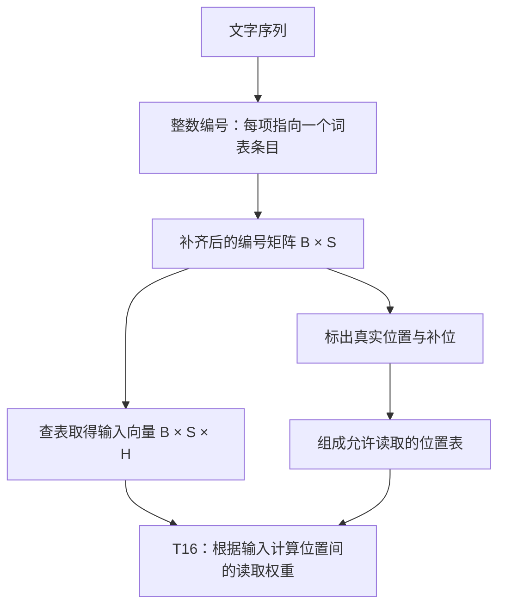

# AI Infra Theory T15：从文字到输入向量，再规定哪些位置可以互相读取

> 版本：2026-11-11，按已通过T13的真实进度与现行教学规则完成三遍复检
> 当前状态：T1～T13与Theory Gate 1已通过；T14按规划延期，下一步T15 R1。T15尚未学习或验收。

- **前置**：T3的广播、T6的softmax、T9的Tensor，以及T10～T13的模型使用经验；T14可按规划延期。
- **唯一代码产出**：`embedding_and_mask.py`，目录名为`t15_embedding_mask`。
- **阅读节奏**：R1完成§1～§8后暂停；R2继续§9～§15，在原程序中补上读取规则。
- **环境与用时**：[统一环境](../ENVIRONMENT.md)，Python 3.12与CPU PyTorch；约5～7个有效小时，可以分次完成，不新增依赖。

上面的前置是正式学到本课时应具备的能力。当前T13已经完成，T14按规划延期；T15现在正式成为下一模块。这里直接复用已经通过的Tensor、Module和训练/推理对象认识，不重做T13的曲线、weight decay或checkpoint实验。

[TOC]

## 0. 今天把两句话交给后面的模型计算

**今天写一个小程序：把两条长短不同的文字序列变成一批输入向量，再明确每个位置允许读取哪些位置。** 最后得到两份东西：输入向量，以及一张允许读取的布尔表。

先看今天实际使用的数据：

```text
第一条：我 / 喜欢 / 系统
第二条：学习 / 推理
```

T8里，一行输入就是一条样本，整批输入是`[B,D]`：B条样本，每条D个特征。文字多了一层：**一条样本里还有多个有先后顺序的位置，每个位置都需要自己的向量。**

所以今天要走通的是：

```text
两条文字序列
-> 每个文字单位取得一个整数编号
-> 较短序列补齐，组成 [B,S] 的编号矩阵
-> 每个编号查出一个H维向量，得到 [B,S,H]
-> 记录哪些位置是真实内容、哪些是补位
-> 规定每个位置可以读取哪些来源位置
```

S是这批补齐后的序列长度，H是每个位置的向量宽度。**S数位置，H数一个位置里的特征。** 后面会用具体数值把这三个轴逐个接起来。

T16才负责计算“一个位置怎样从其他位置取得上下文”。T15先准备它要消费的数据和读取规则。你本课不用造完整语言模型，也不需要下载文本数据集。

带着四个问题往下读：

1. 文字为什么先编号，编号又为什么还要变成向量？
2. 两句话长度不同，怎样放进同一个矩形Tensor？
3. 补位和未来位置分别造成什么问题，为什么需要两种限制？
4. 一张布尔表怎样真正改变softmax的结果？



图中两条支路来自同一批编号。向量说明“这个位置装什么数”，允许读取表说明“哪些来源位置可以参与后续计算”。**这张图是本课与下一课的交接，不要求现在实现图里的T16计算。**

---

# R1：先让文字成为一批可以计算的数据

## 1. 先决定一句话分成哪些单位

计算机收到的是字符串`"我喜欢系统"`。如果后面的计算要逐个位置处理它，我们得先决定：一个位置放一个字，还是放一个词？

本课直接采用已经切好的结果：

```python
tokens_a = ["我", "喜欢", "系统"]
tokens_b = ["学习", "推理"]
```

这里每个字符串就是一个**token（词元，模型逐个处理的文字单位）**。把原文字切成这些单位，叫**tokenization（分词或词元切分）**。

**token的边界由切分规则决定。** 在另一套规则里，`"喜欢"`可以拆成两个字；有的模型还使用词的一部分。我们今天固定使用上面两份列表，让注意力留在“切好以后怎样进入模型”。

本课的序列就是有顺序的token列表。交换`"我"`与`"系统"`的位置，得到的是另一条序列。列表下标记录这个先后关系。

中文字符串不能靠空格自动得到本课的切分结果。两份列表就是完整实验数据，不用自己实现中文分词器。[D2L：文本预处理](https://zh.d2l.ai/chapter_recurrent-neural-networks/text-preprocessing.html)

## 2. 给文字编号，编号只负责找到同一个条目

后面的Tensor计算使用数值。我们先给每一种token安排一个固定编号：

| 编号 | 条目 | 本课用途 |
|---|---|---|
| 0 | `<pad>` | 给较短序列补位置 |
| 1 | `<unk>` | 表示当前表里没有的文字单位 |
| 2 | 我 | 普通token |
| 3 | 喜欢 | 普通token |
| 4 | 系统 | 普通token |
| 5 | 学习 | 普通token |
| 6 | 推理 | 普通token |

这张固定条目表叫**vocabulary（词表）**；编号叫**token ID（词元编号）**。`<pad>`中的pad来自padding，表示补位；unk来自unknown，表示未知。

在程序里使用这同一张表：

```python
token_to_id = {
    "<pad>": 0,
    "<unk>": 1,
    "我": 2,
    "喜欢": 3,
    "系统": 4,
    "学习": 5,
    "推理": 6,
}
PAD_ID = 0
UNK_ID = 1

ids_a = [token_to_id.get(token, UNK_ID) for token in tokens_a]
ids_b = [token_to_id.get(token, UNK_ID) for token in tokens_b]
unknown_ids = [token_to_id.get("缓存", UNK_ID)]

assert ids_a == [2, 3, 4]
assert ids_b == [5, 6]
assert unknown_ids == [1]
```

`dict.get(key, default)`是Python字典查询：找到就返回对应编号，没找到就返回这里的`UNK_ID`。它保持词表不变，不会临时给新词分配一个超出模型范围的编号。

**编号是条目的地址，不是语义大小。** `"系统"`编号为4、`"我"`编号为2，不表示系统是我的两倍，也不表示编号相邻的两个词意思更近。

这和你的KV查找有一层熟悉的关系：整数让我们稳定地找同一项。接下来还需要决定：找到这一项以后，究竟拿什么数去计算？

## 3. 为什么还要给每个编号配一个向量

T8的线性模型读取一行特征，再计算分数。如果直接把token ID当成一个实数特征，模型便会把人为安排的编号大小带进计算。

我们希望每个token拥有一组可以调整的数。例如，用4个数描述一个token：

```text
我   -> [ 0.2, -0.1,  0.4, 0.0]
喜欢 -> [-0.3,  0.5,  0.1, 0.2]
系统 -> [ 0.6,  0.2, -0.2, 0.3]
```

这些数目前只是演示值。一个维度不必人为命名成“技术程度”或“感情程度”。**训练可以通过下游任务的误差调整这些数，使它们成为有用的输入表示。** 本课只检查怎样取得它们，不训练这张表。

把词表中每一项的向量排成一张矩阵：

$$
E\in\mathbb{R}^{V\times H}
$$

V是词表条目数，本课为7；H是每个向量的维数，先取4。矩阵的第r行，就是编号r对应的向量。

**embedding（嵌入）在这里就是“用编号取得对应的数值向量”**；保存所有向量的E叫embedding table（嵌入表）。

给第一条序列`[2,3,4]`查表：

$$
[2,3,4]\quad\longrightarrow\quad
\begin{bmatrix}E_{2,:}\\E_{3,:}\\E_{4,:}\end{bmatrix}
$$

结果是`[3,4]`：3个位置，每个位置4个数。**编号选择行，向量宽度来自表的列数。**

补充理解，不影响R1：也可以先把编号写成长度V、只有对应位置为1的向量，再乘E来选择同一行。这叫**one-hot（独热编码）**。本课直接查表，不把one-hot另开成一项实现任务。

同一个编号在这一步总是取同一行。句子中的位置仍由数组下标保留；让向量包含上下文、或把位置显式送进模型，是后续课程要继续解决的问题。

## 4. 用nn.Embedding把查表动作跑通

现在需要一个对象拥有E，并根据传入编号取回对应行。PyTorch的`nn.Embedding`正好承担这个动作。

下面是一个可独立运行的小例子。表里的数由我们指定，便于逐行核对：

```python
import torch
from torch import nn

embedding = nn.Embedding(num_embeddings=7, embedding_dim=4, padding_idx=0)
table = torch.arange(28, dtype=torch.float32).reshape(7, 4) / 10
table[0].zero_()
with torch.no_grad():
    embedding.weight.copy_(table)

single_ids = torch.tensor([2, 3, 4], dtype=torch.long)
single_vectors = embedding(single_ids)

assert single_vectors.shape == (3, 4)
torch.testing.assert_close(single_vectors, table[single_ids])
print(single_vectors)
```

你会看到第2、3、4行的值按这个顺序出现。例如第2行是`[0.8,0.9,1.0,1.1]`。这里的数字方便核对行号，不代表训练后的语言含义。

再回头看调用里的三个参数：

| 参数或对象 | 在这个例子里指什么 |
|---|---|
| `num_embeddings=7` | 有7行可以查询，有效编号为0～6 |
| `embedding_dim=4` | 每次取得4个浮点数 |
| `embedding.weight` | 这个Module拥有的`[7,4]`参数矩阵 |
| `padding_idx=0` | 将第0行标为补位行；本层反向传播不会为它累积更新梯度 |
| `single_ids` | 整数索引，本课统一使用`torch.long` |
| `single_vectors` | 本次查表得到的浮点Tensor，输入形状后面增加一维4 |

新建的`Embedding`默认把补位行初始化为0。手工覆盖参数时，仍由写入者决定它的值，所以例子明确把`table[0]`清零。
**`padding_idx`管理这一行的嵌入行为，后面的读取规则仍要另外传递。** [PyTorch 2.14：Embedding](https://docs.pytorch.org/docs/2.14/generated/torch.nn.Embedding.html)

`torch.no_grad()`在这个小例子里只用于给参数赋演示值。它复用T11的执行边界，不是在这里启动训练。T15主实验可以继续使用这张固定表，让数值判据保持清楚。

## 5. 两条序列长度不同，先把位置补成矩形

第一条有3个编号，第二条只有2个：

```text
[2,3,4]
[5,6]
```

普通稠密Tensor的每一行必须同宽。我们选择在第二条右边补一个0：

```text
token_ids =
[[2,3,4],
 [5,6,0]]
```

**padding（填充或补位）就是用约定的特殊条目，把不同长度的序列补到当前批次的共同长度。** 本课固定采用right padding（右侧补位），S取这批中最长序列的长度。

0在这里是`<pad>`的编号，不是字符串结束符。读取真实长度也不能依靠C/C++里`\0`的习惯。

原长度要同时留下：

```text
lengths = [3,2]
```

这一组长度告诉我们：第二条只有前两个位置是原始内容，最后一个位置只是为了组成矩形。

这项机械补齐可以直接交给框架，不必手写复杂的数据整理器：

```python
from torch.nn.utils.rnn import pad_sequence

sequences = [
    torch.tensor(ids_a, dtype=torch.long),
    torch.tensor(ids_b, dtype=torch.long),
]
token_ids = pad_sequence(sequences, batch_first=True, padding_value=PAD_ID)
lengths = torch.tensor([len(ids_a), len(ids_b)], dtype=torch.long)

assert token_ids.tolist() == [[2, 3, 4], [5, 6, 0]]
assert lengths.tolist() == [3, 2]
```

`pad_sequence`接收这些一维Tensor，返回补齐后的新Tensor；原列表中的两条序列保持原长度。
`batch_first=True`让第一个轴放批次，因此结果是`[B,S]`，不是`[S,B]`。[PyTorch：pad_sequence](https://docs.pytorch.org/docs/2.14/generated/torch.nn.utils.rnn.pad_sequence.html)

## 6. 从一条[3,4]，到一批[2,3,4]

现在让同一个embedding对象查询整个编号矩阵：

```python
batch_vectors = embedding(token_ids)
assert batch_vectors.shape == (2, 3, 4)
torch.testing.assert_close(batch_vectors, table[token_ids])
```

展开来看：

```text
第0条：E[2]、E[3]、E[4]
第1条：E[5]、E[6]、E[0]
```

因此三个轴的含义是：

| 轴 | 当前大小 | 一个下标选中了什么 |
|---|---|---|
| B，batch size（批次大小） | 2 | 第几条序列 |
| S，sequence length（序列长度） | 3 | 这条序列的第几个位置，包括补位 |
| H，embedding dimension（嵌入维数） | 4 | 这个位置的第几个特征 |

`batch_vectors[1,0]`选中第二条的第一个位置，返回`"学习"`对应的4个数。

写成一般关系，就是：

$$
I:[B,S],\qquad E:[V,H]
$$

$$
X_{b,s,h}=E_{I_{b,s},h},\qquad X:[B,S,H]
$$

本课H只是向量宽度。后续讲义有时会把它称为hidden size（隐藏表示宽度）；这个名字不意味着你今天已经增加了一层神经网络。

最后用布尔值记下哪些编号是真实内容：

```python
valid = token_ids.ne(PAD_ID)
assert valid.tolist() == [[True, True, True], [True, True, False]]
assert torch.equal(valid.sum(dim=1), lengths)
```

`ne`表示not equal，即逐元素“不等于”。这里返回`[B,S]`的bool Tensor：**True表示原始token，False表示补位。**

这张表目前只是在记录事实，还没有改变任何后续计算。R2会接着问：怎样让读取这些位置的算子真正使用它？

## 7. R1程序具体怎样写

文件放在Ubuntu的这个目录，使用已有统一环境：

```bash
mkdir -p ~/code/system-learning/ai-theory/t15_embedding_mask
cd ~/code/system-learning/ai-theory/t15_embedding_mask
```

R1只需要新增一个整理函数。原因很具体：两条编号列表长度不同，不能直接组成普通稠密Tensor；embedding和R2又都需要同一个矩形编号表。

调用者会这样使用它：

```python
token_ids, lengths = make_batch([[2, 3, 4], [5, 6]])
```

它接收已经编码好的编号列表，返回两份新数据：

```text
token_ids = [[2,3,4],
             [5,6,0]]   # [B,S]，交给embedding和R2

lengths   = [3,2]       # [B]，保留补齐前的真实长度
```

函数不修改调用者传入的列表，也不创建embedding参数。机械补齐可以使用刚讲过的`pad_sequence`，不用自己写补齐循环。

用途、调用者、返回值和状态影响都明确以后，接口才写成：

```python
def make_batch(sequences: list[list[int]]) -> tuple[torch.Tensor, torch.Tensor]:
    ...
```

本课传入的原始序列只含真实编号1～6，0由函数补入。B与每条原始长度都必须大于0。具体非法输入与英文报错在§16集中列出；首版先跑通本节的正常数据。

现在在`embedding_and_mask.py`里完成这一条路径：

1. 保存§2的固定词表，编码两条token列表，额外确认未知token得到1。
2. 实现`make_batch`，得到上面的`token_ids`与`lengths`。
3. 创建`nn.Embedding(7,4,padding_idx=0)`，装入§4的固定表。
4. 对整批编号查表，核对每个位置确实取得对应编号的那一行。
5. 得到`valid`，打印编号、长度、输入向量shape和真实位置表。

**R1得到的是一批向量和真实位置记录。** 先让这条数据路径独立跑通，读取规则留给下一阶段。

## 8. R1停在这里

运行：

```bash
python3 embedding_and_mask.py
```

正常结束时打印`T15 R1 PASS`。在PASS之前，需要已经检查编号矩阵为`[[2,3,4],[5,6,0]]`，长度为`[3,2]`，向量shape为`[2,3,4]`，以及查表数值与真实位置表都正确。

能指着`batch_vectors[1,0]`说出它来自哪一行，就可以先提交R1检阅。R2继续使用同一批编号和向量，只增加“哪些来源位置可以被读取”这一层规则。

---

# R2：把“真实位置”和“允许读取”接起来

## 9. 补位向量是0，为什么还会影响结果

R1的第二条序列只有两个真实位置。第三个0向量只为补齐形状，后面的计算应当知道它不属于正文。

先看一个你已经会的计算。某个位置准备从三个来源位置分配读取权重，得到分数：

```text
来源0：2
来源1：1
来源2：0，恰好是补位
```

如果直接对`[2,1,0]`做softmax，最后一项仍有正概率，因为`exp(0)=1`。它不仅获得权重，还进入了分母，改变前两项的比例总量。

**“补位向量为0”和“这个位置不参与读取权重”是两个动作。** 前者决定向量里放什么数，后者决定哪些位置进入归一化。我们现在需要的是后者。

这个例子先假设读取分数已经有了，用来讲清屏蔽的作用。T16才从输入向量推导这些分数怎样算出来；今天先把屏蔽做清楚。

## 10. 先看清一张位置分数表的行和列

如果三个位置都要读取其他位置，就各需要一行分数：

```text
                   来源位置j
                 0    1    2
当前读取位置i 0   a    b    c
             1   d    e    f
             2   g    h    k
```

第i行表达“位置i准备从哪些位置取信息”；第j列对应“作为信息来源的位置j”。每一行的softmax沿最后一个轴计算，即**在来源位置之间分配总和为1的权重**。

这一点沿用T6的归一化方法，但候选对象变了：T6一行的候选是类别，本例一行的候选是序列中的来源位置。它们的维数不能混用。

三条轴分别表示批次、读取位置、来源位置，整批分数形状为`[B,S,S]`。两个S大小相同，职责不同，后面判断下标时始终用i与j区分。

在注意力计算里，读取位置常叫**query position（查询位置）**，来源位置常叫**key position（被读取的位置）**。本节只借这两个名字区分行列，下一课再建立它们对应的向量。

## 11. 第一条规则：来源不能是补位

第二条序列的真实位置表是：

```text
valid[1] = [True, True, False]
```

不管当前是哪一行，来源位置2都是补位。因此应把**整列2**排除：

```text
              来源0 来源1 来源2
读取位置0       1     1     0
读取位置1       1     1     0
读取位置2       1     1     0
```

这里1表示允许，0表示屏蔽。**padding mask（补位掩码）用真实位置记录，排除补出来的信息来源。** mask在这里就是一张决定哪些元素允许参与计算的布尔表。

同一批里，每条序列补位位置不同，所以这份规则要保留B轴。R1给出的`valid`是`[B,S]`；为了让同一条序列的来源规则复用到每个读取行，需要把它表示成`[B,1,S]`。

中间那个大小1的轴对应“读取位置”。广播时，它会把同一份来源规则复制到这条序列的每一行。这里先确定目标shape和轴的职责；具体怎样在PyTorch里插入这一维，留给R2实现。

读取位置2本身也是补位，它的输出随后不作为正文结果使用。本课先保留整张矩形，在验证归一化时只检查`valid=True`的读取行。这样“哪些来源可读”和“哪些输出位置有业务意义”仍然分开。

## 12. 第二条规则：预测后文时，当前位置只能使用已有前缀

现在先不考虑补位，回到完整的`我 / 喜欢 / 系统`。

想象一个练习：给出`"我"`，让模型预测下一个token是`"喜欢"`。如果计算`"我"`这个位置时，允许直接读取后面已经写出的`"喜欢"`，训练过程就把答案提前交给了模型。

逐个位置看，当前位置需要的范围是：

```text
位置0：可以读位置0
位置1：可以读位置0、1
位置2：可以读位置0、1、2
```

**causal mask（因果掩码）规定：当前位置i只能读取j≤i的来源。** 它保护“根据已经出现的前缀预测后文”这个任务。

允许表是：

```text
              来源0 来源1 来源2
读取位置0       1     0     0
读取位置1       1     1     0
读取位置2       1     1     1
```

对角线允许，因为位置i的输入token已经给出；它参与预测的是后面的token。这个约定与“预测当前位置自己的未知token”不同，先明确目标，才能判断对角线要不要保留。

把这张表画在矩阵上，允许位置组成包含对角线的左下三角。PyTorch的`torch.tril(input)`会保留下三角、清掉上三角。
你可以用它构造这张`[S,S]`布尔表。先根据上面的3×3结果写断言，再决定具体Tensor写法。[PyTorch：tril](https://docs.pytorch.org/docs/2.14/generated/torch.tril.html)

同一个S下，这条先后规则不依赖句子内容，可以供批次里的多条序列共用。它与padding mask解决的是不同问题：**真实内容也可能在未来，已有位置也可能是补位。**

这里以decoder-only（只使用解码式结构的语言模型）的前缀预测任务为目标。允许读取整个输入的其他任务可以选择另一套规则；本课不把因果限制说成所有文本模型都必须采用的规则。[D2L：Transformer中的解码器遮蔽](https://zh.d2l.ai/chapter_attention-mechanisms/transformer.html)

## 13. 同时满足两条规则，才允许读取

回到第二条`学习 / 推理 / <pad>`。先按两条限制逐格判断：

- 位置0读位置1：来源是真的，但它在未来，所以不允许。
- 位置1读位置0：来源是真的，也没有越过当前位置，所以允许。
- 位置2读位置2：没有越过当前下标，但来源是补位，所以不允许。

把两张允许表做逻辑“与”，结果就是：

```text
第二条的组合结果：
[[1,0,0],
 [1,1,0],
 [1,1,0]]
```

一般条件写成：

$$
A_{b,i,j}=\bigl(j<L_b\bigr)\land\bigl(j\le i\bigr)
$$

$L_b$是第b条原始长度；$\land$是逻辑与，两边都为真才允许。这里只按本课右侧补位、原始序列非空的条件推导。

已经知道各轴含义后，再把两张表接起来。实现必须让下面三种shape对齐：

```text
key_allowed       [B,1,S]：每条序列的来源有效性，沿读取行复用
causal_allowed    [1,S,S]：每对位置的先后关系，沿批次复用
结果allowed       [B,S,S]：每条序列、每个读取位置、每个来源位置
```

组合动作是逐格逻辑“与”。本节已经给出第二条序列的完整结果和一般条件；R2由你把这两个已知对象写成PyTorch广播，而不是从一行成品表达式照抄。

**本课所有`allowed`变量统一采用True=允许、False=屏蔽。** 这条语义与变量一起传递，不能只记它是一个bool Tensor。

## 14. 把允许表变成实际的概率限制

先做一行可手算的实验。假设某行分数为`[2,100,0]`，中间位置被屏蔽。即使它分数最大，也应当完全不参与本行权重。

允许的两个来源指数权重为$e^2$与$e^0$，所以我们要得到：

$$
\left[\frac{e^2}{e^2+1},\ 0,\ \frac{1}{e^2+1}\right]
\approx[0.880797,0,0.119203]
$$

具体动作是：**在softmax之前，把禁止位置的分数替换为负无穷。** 因为$e^{-\infty}=0$，它既不会取得权重，也不会给分母增加正权重。

```python
toy_scores = torch.tensor([2.0, 100.0, 0.0], dtype=torch.float64)
toy_allowed = torch.tensor([True, False, True])
masked_scores = toy_scores.masked_fill(~toy_allowed, float("-inf"))
toy_probabilities = torch.softmax(masked_scores, dim=-1)
expected = torch.tensor([0.8807970779778823, 0.0, 0.11920292202211755],
                        dtype=torch.float64)
torch.testing.assert_close(toy_probabilities, expected)
assert toy_scores.tolist() == [2.0, 100.0, 0.0]
```

`~toy_allowed`把允许表取反，得到“需要替换”的位置。`masked_fill`按True位置填入指定值，返回新Tensor；不带下划线的这个调用保留原分数。
[PyTorch：masked_fill](https://docs.pytorch.org/docs/2.14/generated/torch.Tensor.masked_fill.html)

这里仍然沿`dim=-1`做softmax。扩展到`[B,S,S]`时，它就是最后那个“来源位置”轴。

若只把禁止分数改成0，它还会贡献`exp(0)=1`。若先softmax再把禁止概率清零，留下的允许概率通常又不再和为1。**屏蔽位置必须从这一行的归一化候选中排除。**

### 14.1 为什么本课要求原始序列非空、使用右侧补位

如果一整行都被改成负无穷，普通softmax无法从中得到合法分布；在本课PyTorch路径里会得到NaN。

本课每条序列至少有一个真实token，而且都从位置0开始放。于是每个读取行至少还能看到真实位置0，避免出现这种整行被屏蔽的情况。

补位读取行仍然可能算出一组权重。**它只是矩形里的中间结果，不代表这条句子多出了有效文字。** 核对正文输出或以后计算损失时，要用`valid`识别真正有意义的读取行；不能把这些补位行混进正文统计。

未来若改成左侧补位、允许空序列或拼接多段请求，要重新设计整行无有效来源时的处理。今天先把已经声明的范围实现正确，不增加一套通用mask框架。

## 15. 在原程序里完成R2，不另写一套模型

保留R1的词表、`make_batch`、embedding对象和查表断言。现在缺的是一个函数：它读取R1的编号矩阵，为后面的分数矩阵生成“哪些来源允许进入softmax”的布尔表。

调用者会把返回值交给§14的`masked_fill`。函数不修改编号矩阵，也不改词表、embedding参数或长度；它只创建当前批次的读取规则。

输入、输出和使用位置明确以后，接口写成：

```python
def make_allowed_mask(token_ids: torch.Tensor, causal: bool) -> torch.Tensor:
    ...
```

它接收R1函数产生的`[B,S]`编号矩阵，返回`[B,S,S]`的bool允许表。`causal=False`时只排除补位来源；`causal=True`时再限制`j<=i`。

先把一个结果说清：第二条长度2、补齐长度3时，`causal=False`应得到三行相同的`[True,True,False]`；改成True才得到§13的下三角组合结果。**这个开关改变读取规则，不改变词表、向量和真实长度。**

### 15.1 R2只证明三件事

第一，允许表本身符合规则。分别调用`make_allowed_mask(..., False)`与`make_allowed_mask(..., True)`：前者只排除补位来源，后者还排除未来来源。

第二，这张表真的改变概率。把禁止分数改成负无穷后，禁止位置概率为0；每个真实读取行的允许概率和为1。

第三，程序没有写死第一批的2、3或4。换用下面这组三条序列，并把embedding宽度H改为5；mask只由编号位置决定，不应随H变化。

第二批编号固定为：

```python
extra_sequences = [[2], [3, 4, 5, 6], [5, 6]]
```

它会产生`B=3,S=4`、原长度`[1,4,2]`。B与S不同，能帮助发现把批次轴误当位置轴的广播错误。H改成5只影响embedding表和输出宽度，不应改变mask。

### 15.2 不靠shape猜正确，要按每个格子的含义核对

对这批的每一个b、i、j，先判断：j是否小于原长度？若开启因果限制，再判断j是否不大于i。这个逐格条件是检查依据，可以用一个很短的循环与向量化结果比较。

演示分数不需要来自真实注意力模型。令每个`[S,S]`格子的分数都是0，就能清楚地看到：允许的来源均分概率，禁止的来源为0。例如第二批的长度4序列，读取行2应为`[1/3,1/3,1/3,0]`。

在你的`make_allowed_mask`完成后，可以这样检查一批结果：

```python
allowed = make_allowed_mask(token_ids, causal=True)
scores = torch.zeros(allowed.shape, dtype=torch.float64)
probabilities = torch.softmax(scores.masked_fill(~allowed, float("-inf")), dim=-1)
valid = token_ids.ne(PAD_ID)

assert torch.isfinite(probabilities).all()
assert torch.equal(probabilities[~allowed], torch.zeros_like(probabilities[~allowed]))
torch.testing.assert_close(probabilities.sum(dim=-1)[valid],
                           torch.ones_like(probabilities.sum(dim=-1)[valid]))
```

**上面证明的是屏蔽与归一化符合规则，逐格条件负责证明允许表本身正确。** 两者都要有，不能用“我屏蔽了自己生成的mask，所以结果一定对”代替规则检查。

脚手架和重复断言可以由Codex补充；你需要能说明每个轴是谁、某一格为什么允许，以及这次概率检查在证明什么。程序成功时最后打印`T15 EMBEDDING AND MASK PASS`，任一检查失败则保留异常并以非零退出。

---

## 16. 必要的输入检查放在对应入口

R1正常路径已经建立后，再给`make_batch`补这三类检查。它们是本课为了固定实验范围采用的约定：

| 输入情况 | 应做什么 | 可参考的英文报错 |
|---|---|---|
| `sequences=[]` | 抛`ValueError` | `sequences must be non-empty` |
| 包含空序列，例如`[[2],[]]` | 抛`ValueError` | `sequences must not contain empty sequences` |
| 原始编号不是整数，或不在1～6，例如0、7、-1 | 抛`ValueError` | `token ids must be integers in [1, vocab_size)` |

未知文字已经在编码时变成1，属于合法的真实位置。0只由整理函数补入；这样`token_ids != 0`才能可靠地区分正文与补位。

`make_allowed_mask`在本课只接收`make_batch`的合法输出，`causal`由调用者传True或False，不要求再写一套通用Tensor验证库。Embedding自身的dtype/越界错误不吞掉，也不临时取模或截断编号。

失败时不要只打印报错后继续打印PASS。这个原则直接复用你在服务器检阅里已经处理过的“失败结果不能伪装成成功”，不新增异常恢复框架。

## 17. 这些对象在AI Infra里各占什么位置

先看同一批请求的一条实际数据路径：服务收到两条文本，编码器给出不同长度的编号；batch整理器补齐形状；模型查表取得向量；后续算子按允许表读取位置。

这里有三种不同寿命的对象：

| 对象 | 谁持有、保留多久 | 本课形状 |
|---|---|---|
| 词表与embedding参数 | 模型侧跨多批输入复用；两者编号对应关系必须一致 | 词表V项，参数`[V,H]` |
| 编号、长度、输入向量 | 当前批次的数据；不因下一批内容变化而重建模型参数 | `[B,S]`、`[B]`、`[B,S,H]` |
| 补位/允许表 | 描述当前输入的有效位置和读取规则 | `[B,S]`、本例的`[B,S,S]` |

如果保存同一份embedding参数，却在加载时给文字换了一套编号，就会查到错误的行。**词表的编号规则必须与模型参数配套保存和使用。** 本课把词表固定在脚本里，没有新增保存格式作业。

接着用T9的`numel()*element_size()`算数据量。首批V=7、H=4、B=2、S=3时：

| 选中的Tensor | dtype | 逻辑数据字节数 |
|---|---|---|
| embedding表 | float32 | `7*4*4 = 112` |
| 编号矩阵 | long，即int64 | `2*3*8 = 48` |
| 查表输出 | float32 | `2*3*4*4 = 96` |
| 显式组合允许表 | bool | `2*3*3*1 = 18` |

这些是选中Tensor的逻辑数据量，不是进程峰值。长度数组、演示分数、框架分配与其他中间结果还没有都列进这张表。

这批实际只有5个真实位置，却用了6个矩形位置，其中1/6为补位。长度差距变大时，空位置会更多。**布尔屏蔽能保证读取语义正确，但不会自动让所有稠密算子跳过补位计算。**

显式`[B,S,S]`表的格子数随S平方增长。T15先用它把规则观察清楚；以后再研究怎样用长度、规则标志或更紧凑的组织方式表达同样限制。现在不把小实验升级成高性能batch调度器，也不把字节估算当作已测瓶颈。

还有一个直接的边界：你在Mini Redis里管理的是原始bytes；这里的token数量由切分规则决定。**同一段文本的字节数、字符数与token数，需要分别计算。**

## 18. 核心完成后的补充与资料

### 18.1 接框架时，再核对True的含义

本课自己的`allowed`统一用True表示允许，因此调用`masked_fill(~allowed, ...)`。
未来接注意力API时，要按那个接口的约定转换。

例如，接收“禁止表”的接口会把True理解成屏蔽。此时本课的`[True,True,False]`要先取反成`[False,False,True]`。
等T16真正接注意力算子时，再分别核对：

- [SDPA布尔约定](https://docs.pytorch.org/docs/2.14/generated/torch.nn.functional.scaled_dot_product_attention.html)
- [MultiheadAttention布尔约定](https://docs.pytorch.org/docs/2.14/generated/torch.nn.modules.activation.MultiheadAttention.html)

### 18.2 需要第二种解释时再读

正文已经给足本课必需内容，没有额外必看视频。

- 想再看文字怎样编号：读李沐[52《文本预处理》](https://www.bilibili.com/video/BV1Fo4y1Q79L)，
  或D2L[8.2.2～8.2.3](https://zh.d2l.ai/chapter_recurrent-neural-networks/text-preprocessing.html)。只对照切分、词表和未知项。
- 想再理解为什么只能使用前缀：读李沐[53《语言模型》](https://www.bilibili.com/video/BV1ZX4y1F7K3/)中的语言模型部分，
  或D2L[8.3.1](https://zh.d2l.ai/chapter_recurrent-neural-networks/language-models-and-dataset.html)。读到“根据已出现的token预测下一个”就停。
- 想把编号与输入矩阵再串一次：查[AIInfraGuide阅读映射](../../reference_materials/ai_infra/AIInfraGuide_阅读映射.md)中的T15小节。本课查表已经运行后再选看，不新增同构作业。

视频沿用规划里已核对的节号，不虚构精确时间戳。API行为以本课引用的PyTorch 2.14官方文档为准；没有为了写T15改变你的Python环境。

## 19. 收口：把这四个问题接回自己的程序

代码、注释与口述可以相互补足，不重复写一套答题文件：

1. 把两个普通token的编号交换，却不交换embedding表的行，会发生什么？为什么编号大小不能当语义大小？
2. `[B,S]`到`[B,S,H]`时新增的H从哪里来？第二批把H改成5，为什么mask不变？
3. 为什么padding mask要排除来源列，而causal mask还要看读取行i与来源列j的先后？
4. 为什么屏蔽发生在softmax前？本课怎样避免整行没有有效来源，又怎样识别补位读取行？

本课最终交付只有同一个`embedding_and_mask.py`：保留R1数据与查表，加入两种读取规则，用逐格条件和概率检查证明它们生效，正常结束时打印最终PASS。

**整课完成后，请你亲自整理本课笔记。** 可以写在`T15_note.md`或已有等价笔记中，只留下你真正新增的理解、卡住的地方和一两个关键矩阵，不用重抄程序。笔记由你自己写，Codex不代写。

T16将接过`[B,S,H]`输入，回答本课暂时留出的那个问题：**位置之间的读取分数究竟怎样从输入向量算出来？** 到那时再推导这些分数，并计算读取内容汇总后的向量。
