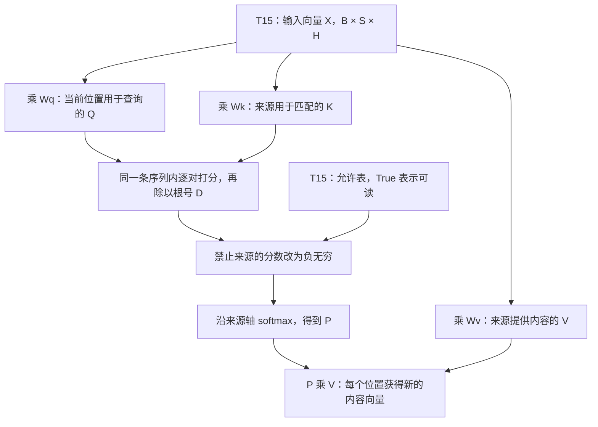

# AI Infra Theory T16：一个位置怎样读到其他位置的内容

> 版本：2026-11-11，按T13通过后的真实进度校准
> 当前状态：T1～T13和Theory Gate 1已通过；T14延期，当前下一步T15 R1；T16尚未学习或验收。

- **接着谁学**：[T15](../T15/T15.md)的输入向量和允许读取表。使用T3的矩阵乘、T6的softmax和T9的Tensor，不要求先完成可延期的T14。
- **唯一代码产出**：`single_head_attention.py`，目录`t16_single_head_attention`。
- **分两次走通**：R1先处理一条序列，算出每个位置的新向量；R2在同一个程序接入批次和T15的mask，再验证位置隔离。
- **环境**：[统一环境](../ENVIRONMENT.md)中的CPU PyTorch即可；约5～7个有效小时，可分次完成。本课不安装依赖，不训练语言模型。

[TOC]

## 0. 今天让一个位置的输出，真正带上其他位置的信息

**今天写一个计算：给定一条序列的输入向量，让每个位置按不同的权重汇总其他位置的内容，得到自己的新向量。** 权重由当前输入算出来，再受T15那张允许表限制。

T15把`我 / 喜欢 / 系统`变成了三行向量。到查表这一步，`系统`拿到的仍是词表中固定的一行；同一个编号出现在另一句话里，查表结果也一样。

现在希望它的后续表示能受到句子中其他位置影响。最直接的动作是：**从其他位置各取一些内容，混合成一个新向量。** 这份混合结果就是本课要算的东西。

先只看一次汇总。三个来源提供的内容是：

```text
来源0：[10,  0]
来源1：[ 0, 20]
来源2：[30, 40]
```

假设当前位置给它们的权重是`[0.25, 0.25, 0.5]`，就得到：

$$
0.25[10,0]+0.25[0,20]+0.5[30,40]=[17.5,25].
$$

这是你已经会的向量线性组合。新问题只有一个：**这三个权重怎样根据输入产生，而不是由我们手填？**

这些数字是便于手算的演示值，不是训练后词义的测量结果。本课证明计算关系正确，不声称随机参数已经理解中文。

带着四个问题往下读：

1. 同一批输入，怎样同时提供“我要找什么”和“我能提供什么”？
2. 位置之间的匹配分数怎样变成读取比例，比例又怎样作用到内容上？
3. T15的补位与前缀限制怎样进入这条计算，怎样证明它真的隔开了信息？
4. 最后得到的是哪种向量，哪些中间结果会随着序列变长迅速增大？

---

# R1：先把一条序列的读取和汇总算通

## 1. 每个位置需要自己的读取比例

刚才用一组比例，就得到一个新向量。如果三个位置都使用完全相同的比例，它们收到的混合内容也完全一样。

但不同位置可能需要不同信息。我们想让位置0有自己的比例，位置1也有自己的比例，而这些比例能随着输入变化。

先把完整动作排出来：

```text
选定当前位置i
-> 将它与每个来源位置j比较，得到一行分数
-> 把这一行分数变成和为1的权重
-> 按权重汇总来源位置的内容
-> 得到当前位置i的新向量
```

对所有位置都做一遍，就得到一条新序列。**attention（注意力）在这里就是：根据当前查询与各来源的匹配程度，给来源内容分配权重并汇总。**

我们先把“比较”和“拿内容”分开。下一节只解决比较怎样进行；内容向量先沿用开头的三行。

## 2. 比较时，需要两边都拿出能比较的数

假设当前位置拿出两个数`[1,0]`，三个来源分别拿出：

```text
当前位置用于比较的向量：[1,0]

来源0用于比较的向量：[1,0]
来源1用于比较的向量：[0,1]
来源2用于比较的向量：[0,0]
```

我们选用已经学过的点积：对应分量相乘再相加。

$$
[1,0]\cdot[1,0]=1,\qquad
[1,0]\cdot[0,1]=0,\qquad
[1,0]\cdot[0,0]=0.
$$

于是当前位置得到一行分数`[1,0,0]`。这套比较规则下，来源0分数更高。若当前位置的比较向量换成`[0,1]`，分数就变成`[0,1,0]`，读取倾向随之改变。

现在给这两个角色取名字：

- **query（查询向量，记作q）**：当前位置拿来与各来源比较的向量。
- **key（键向量，记作k）**：每个来源拿出来参与比较的向量。
- **score（匹配分数）**：一次`q·k`得到的标量。

这里的key沿用了“用于匹配”的意思，但它不是Mini Redis里做精确查找的字符串key。**这次对每个来源都打分，后面可以同时混合多个来源的内容。**

点积是本课采用的评分方法；匹配也可以有其他计算方式。点积的大小同时受方向与模长影响，不等于已经归一化的余弦相似度。我们只要求后续训练能利用这套可计算的规则，而不是给每个向量维度规定一个自然语言含义。

## 3. 用来匹配的数，和真正取回的内容分开

来源0刚才用`[1,0]`参与比较，但我们希望从它取回的内容可以是`[10,0]`。来源1也类似：比较用`[0,1]`，提供内容用`[0,20]`。

**value（值向量，记作v）就是一个来源在被读取时提供的内容。** 匹配决定读多少，value决定读到什么。

因此，一个来源位置现在有两份表示：

```text
key：和当前位置的query计算分数
value：乘上读取权重，进入最终汇总
```

为什么不强制key和value一样？因为“适合用于匹配的特征”和“值得传给下游的内容”可以有不同的表达。把两者分开，模型就能分别学习它们。后面你会看到，它们都由同一份输入变换而来，不需要另一套数据集。

## 4. 分数已经有了，怎样真的取回一行内容

继续使用分数`[1,0,0]`。T6已经解决了“任意实数分数变成非负、和为1的比例”这个问题：沿这一行做softmax。

令$e=\exp(1)$，得到：

$$
p=\left[\frac{e}{e+2},\frac{1}{e+2},\frac{1}{e+2}\right]
\approx[0.5761,0.2119,0.2119].
$$

这里一项对应一个**来源位置**。T6多分类时一项对应一个类别，计算方法相同，候选对象不同。

再按这些比例取内容：

$$
y=\frac{e}{e+2}[10,0]
+\frac{1}{e+2}[0,20]
+\frac{1}{e+2}[30,40].
$$

所以：

$$
y=\left[\frac{10e+30}{e+2},\frac{60}{e+2}\right]
\approx[12.1194,12.7165].
$$

下面只运行这一行汇总，观察分数、比例、输出三者的关系：

```python
import torch

scores = torch.tensor([1.0, 0.0, 0.0], dtype=torch.float64)
values = torch.tensor([[10.0, 0.0], [0.0, 20.0], [30.0, 40.0]],
                      dtype=torch.float64)
probabilities = torch.softmax(scores, dim=-1)
output = probabilities @ values

e = torch.exp(torch.tensor(1.0, dtype=torch.float64))
expected = torch.stack(((10 * e + 30) / (e + 2), 60 / (e + 2)))
torch.testing.assert_close(output, expected)
print(probabilities)
print(output)
```

`[3] @ [3,2] -> [2]`把三行value混合成一行。**输出是新的内容向量；权重表只是产生它的中间结果。**

这一步也没有调用T5的随机抽样器。我们使用所有允许来源的value做加权和，并非随机选一个来源。固定输入与参数后，本课计算是确定的。

## 5. q、k、v都从已有输入向量算出来

到这里，读取过程已经走通了，但前面的q、k、v都是我们直接给出的。真正接到T15时，手里只有每个位置的输入向量$x_i$。

你在T8已经会`x @ W + b`。这里沿用同一动作，只是为三个职责各准备一组权重。本课先省略偏置：

$$
q_i=x_iW_q,\qquad k_i=x_iW_k,\qquad v_i=x_iW_v.
$$

如果$x_i$含H个数，三个权重矩阵都取`[H,D]`，就分别得到D个数。D是这次读取使用的向量宽度，可以与输入宽度H不同。

**projection（投影）在本课指这次可学习的线性变换。** 它把原输入改写成适合查询、匹配或传递内容的表示；不要求是几何里的正交投影，也不保证D一定小于H。

这些权重如何变得有用？在完整模型训练中，后面的预测误差会沿这条计算反向传播，更新$W_q,W_k,W_v$。本课只做前向计算与数值核对，不新增训练任务。

同一条序列里的每个位置都使用相同的三组参数。**参数跨位置复用，计算出的q、k、v随当前位置的输入变化。**

query、key、value都来自同一条输入序列，这种形式就叫**self-attention（自注意力）**。这里的self说明数据来自同一组输入，不是说每个位置只能读取自己。[D2L：自注意力§10.6.1](https://zh.d2l.ai/chapter_attention-mechanisms/self-attention-and-positional-encoding.html)

## 6. 为什么点积后还要除以根号D

前面用D=2的小向量，分数范围很容易观察。若D变成几百，每个点积就累加几百项；仅仅因为维度变大，分数的波动也可能变大。

而softmax对分数差很敏感。比如`[1,0,0]`还有较分散的权重，`[10,0,0]`已经几乎把全部权重给第一项。比例过早接近0或1，会使不少方向上的梯度很小。

用一个简化假设估计尺度：q和k的各分量相互独立，均值0、方差1。每个乘积的方差是1，D项相加后：

$$
\operatorname{Var}\left(\sum_{d=1}^{D}q_dk_d\right)=D.
$$

因此点积的标准差是$\sqrt D$。除以它后，方差回到1这个量级：

$$
s_{ij}=\frac{q_i\cdot k_j}{\sqrt D}.
$$

这就是 **scaled dot-product attention（缩放点积注意力）** 里的缩放。它用来减轻维度增加带来的分数尺度问题。独立、单位方差是说明动机的假设；真实训练中的Q/K不必严格满足，缩放也不保证所有输入都数值稳定。[原论文§3.2.1及脚注1](https://arxiv.org/html/1706.03762v7#S3.SS2.SSS1)

**分母取q与k进行点积的宽度D。** 它不是序列长度S，也不是batch大小B。T6的稳定softmax仍然需要：缩放控制点积尺度，softmax减最大值控制指数计算，两者分工不同。

## 7. 将一行读取扩成整条序列

现在把每个位置的q按行排起来，得到Q。K和V也按相同位置顺序排列：

$$
X:[S,H],\qquad W_q,W_k,W_v:[H,D]
$$

$$
Q=XW_q,\quad K=XW_k,\quad V=XW_v,\qquad Q,K,V:[S,D].
$$

我们要让每一行q与每一行k比较。矩阵乘法正好一次完成：

$$
S_c=QK^T/\sqrt D,\qquad S_c:[S,S].
$$

这里用$S_c$表示分数矩阵，避免把它与序列长度S混为一谈。第i行第j列是“读取位置i对来源位置j的分数”：

$$
(S_c)_{ij}=\frac{\sum_{d=1}^{D}Q_{id}K_{jd}}{\sqrt D}.
$$

**沿每一行的来源轴做softmax**，得到读取比例P，再乘V：

$$
P=\operatorname{softmax}(S_c,\text{最后一轴}),\qquad Y=PV.
$$

为什么第二个乘法恰好是加权和？看输出的一个数：

$$
Y_{id}=\sum_{j=1}^{S}P_{ij}V_{jd}.
$$

固定输出位置i和内容分量d，沿来源j累加。它就是§4那一次汇总，只是对所有i、d同时执行。

```text
Q [S,D] @ K.T [D,S]  -> [S,S]：每个位置对每个来源打分
P [S,S] @ V   [S,D]  -> [S,D]：每个位置汇总一行D维内容
```

到这里再回头记公式才有意义：**先决定“从谁那里取多少”，再把这些内容相加。** 本课只有这样一组读取计算，称为single-head（单头）；多组并行的组织方式留T17。

## 8. R1用这一组固定矩阵，走完从X到Y

在Ubuntu已有环境中建立本课目录：

```bash
mkdir -p ~/code/system-learning/ai-theory/t16_single_head_attention
cd ~/code/system-learning/ai-theory/t16_single_head_attention
```

文件是`single_head_attention.py`。先放入这组数据，便于把每一步和手算对上：

```python
import math
import torch

X = torch.eye(3, dtype=torch.float64)
Wq = torch.tensor([[math.sqrt(2), 0.0],
                   [0.0, math.sqrt(2)],
                   [0.0, 0.0]], dtype=torch.float64)
Wk = torch.tensor([[1.0, 0.0], [0.0, 1.0], [0.0, 0.0]],
                  dtype=torch.float64)
Wv = torch.tensor([[10.0, 0.0], [0.0, 20.0], [30.0, 40.0]],
                  dtype=torch.float64)
```

这里S=3、H=3、D=2。X的每一行分别选择参数矩阵的一行，故Q=Wq、K=Wk、V=Wv。Wq中的$\sqrt2$是为了让缩放后的分数保持简单，方便核对，不是初始化建议。

你要得到的分数表是：

```text
缩放后的scores：
[[1,0,0],
 [0,1,0],
 [0,0,0]]
```

前两行权重分别偏向来源0、来源1；第三行分数相同，三个来源均分。于是输出应为：

$$
Y=\begin{bmatrix}
(10e+30)/(e+2)&60/(e+2)\\
40/(e+2)&(20e+40)/(e+2)\\
40/3&20
\end{bmatrix}.
$$

### 8.1 你现在具体实现什么

先写一个函数，完成§5～§7已经推导的动作：

```python
def single_head_attention(
    inputs: torch.Tensor,
    wq: torch.Tensor,
    wk: torch.Tensor,
    wv: torch.Tensor,
    allowed: torch.Tensor | None = None,
) -> tuple[torch.Tensor, torch.Tensor]:
    ...
```

R1只使用二维`inputs:[S,H]`，三个参数均为`[H,D]`，`allowed`保持None，即允许所有来源。按顺序返回`(output, probabilities)`，形状分别为`[S,D]`和`[S,S]`。Q/K/V和分数可以作为函数局部变量打印，不要求造返回结果类。

先计算三份线性变换，再算点积并缩放，沿最后一轴softmax，最后汇总V。**输入和参数保持原值，返回的是本次计算的新结果。** 本课不创建优化器，也不在函数里更新参数。

参数方向特意沿用你T8的`X @ W`。你在T10笔记里已注意到：`nn.Linear(H,D)`保存的weight是`[D,H]`，实际使用其转置。本课直接传`[H,D]`矩阵，不使用Linear对象；若以后改成Linear，需要将这里的W转置后赋给它，不能原样抄进去。

### 8.2 怎样知道首版真的算对了

先逐步核对Q/K/V和上面的分数表，再比较输出。用手算表达式构造期望值，不要再次调用自己的函数生成“标准答案”。

```python
e = math.e
expected_output = torch.tensor([
    [(10 * e + 30) / (e + 2), 60 / (e + 2)],
    [40 / (e + 2), (20 * e + 40) / (e + 2)],
    [40 / 3, 20.0],
], dtype=torch.float64)
output, probabilities = single_head_attention(X, Wq, Wk, Wv)
torch.testing.assert_close(output, expected_output, rtol=1e-10, atol=1e-10)
torch.testing.assert_close(probabilities.sum(dim=-1),
                           torch.ones(3, dtype=torch.float64))
assert output.shape == (3, 2)
assert probabilities.shape == (3, 3)
print("T16 R1 PASS")
```

运行`python3 single_head_attention.py`。上面的数值关系成立，且你能解释一个`P[i,j]`和一个`Y[i,d]`怎样得到，就可以提交R1。

**先停在这里。** 这是完成首条计算路径后的暂停，不要求继续写批次检查。函数名和内部组织可以不同；只要对象、shape、数值关系和独立参照对应得上，就不需要为了贴合教程改写正确实现。

---

# R2：接回T15，让每条序列只读允许的位置

## 9. T15留下的两份数据，现在都有了去处

R1用人为构造的X证明计算过程。真正接上T15时，X来自embedding查表，形状是`[B,S,H]`；允许表则是`[B,S,S]`。

**每条序列各做自己的读取，batch里的不同序列之间不交换内容。** 参数Wq/Wk/Wv由整批共用。



图里的两条输入分别控制“有些什么内容”和“可以从哪些位置读取”。输出仍按原来的批次与位置排列，下游模型可以继续处理这些向量。本课停在这次汇总，不接词表预测头。

## 10. 多一个B轴，计算对象没有换

整批线性变换的形状是：

$$
[B,S,H]@[H,D]\longrightarrow[B,S,D].
$$

每条序列得到一份Q/K/V。接着只交换K最后两个轴：

```text
K                       [B,S,D]
K.transpose(-2,-1)      [B,D,S]
Q @ K.transpose(-2,-1)  [B,S,S]
```

`transpose(-2,-1)`返回交换最后两个轴的Tensor视图，保持K原来的逻辑形状不变。B轴留在原处，因此第b条的Q只与第b条的K相乘。不要用三维Tensor的`.T`来表达这个动作。

最后沿来源轴做softmax，再汇总：

$$
P_{b,i,:}=\operatorname{softmax}\bigl((S_c)_{b,i,:}\bigr),
\qquad Y_{b,i,d}=\sum_jP_{b,i,j}V_{b,j,d}.
$$

你T6遇到过“到底对哪个dimension做softmax”的疑问。这里答案固定为**最后一轴，也就是同一个读取位置面前的S个来源**。不是跨B归一化，也不是跨D归一化。

R2把原函数扩展到二维或三维输入即可；二维结果保留，不再造第二份attention函数。使用最后两个轴做点积与转置，可以让两种输入沿同一条主链运行。

## 11. 在分配比例之前，先拿掉不允许的来源

T15的允许表统一采用True=允许。本课保持这个含义：

```python
masked_scores = scores.masked_fill(~allowed, float("-inf"))
probabilities = torch.softmax(masked_scores, dim=-1)
```

这两行放在缩放之后、汇总V之前。`masked_fill`返回新Tensor，不原地改写原scores或allowed。没有传allowed时跳过屏蔽，沿R1的路径继续。

以第一条长度3的序列为例，因果规则允许：

```text
位置0：[1,0,0]
位置1：[1,1,0]
位置2：[1,1,1]
```

位置0只有一个允许来源，所以它的比例必为`[1,0,0]`，输出恰好等于`V[0]`。位置1只混合V的前两行；位置2才可以混合全部三行。

第二条只有两个真实token，右侧补位以后，组合允许表为：

```text
[[1,0,0],
 [1,1,0],
 [1,1,0]]
```

最后一列是补位来源，对所有读取行都关闭。最后一行本身是补位读取位置，虽然仍会产生数值，但**它的输出不算正文内容**；沿用T15的valid表选择真实输出行。本课不额外把这行设成0，避免把来源屏蔽与输出过滤混成同一件事。

这也解释了两种检查为什么不同：`P[~allowed]==0`检查禁止来源没贡献；`output[valid]`选出的是要交给正文处理的结果。

### 11.1 一整行都不允许时怎么办

softmax需要至少一个候选来源。若一行分数全是负无穷，普通softmax会产生NaN。

T15的非空序列、右侧补位、保留对角线保证每一行至少可读真实位置0。为了让这个新函数的调用错误也清楚，本课额外采用一个简单约定：**传入的allowed若有全False行，在softmax之前抛出ValueError。**

可以用`allowed.any(dim=-1).all()`判断。这里any先检查每行有没有至少一个True，all再要求所有行都满足。错误信息可以写`each query row must allow at least one source`。

这是本课函数主动拒绝输入的规则，不声称所有框架API都这样处理。不要将NaN改成0后继续报PASS，也不需要为左补位和空序列另造方案。

## 12. 用一批不相等的轴长，验证没有混淆位置

R2继续使用同一个文件。先复用T15已经通过的整理与mask函数，不重写词表或再交一份T15作业。

若T15脚本暂时没有便于导入的入口，本课可先用下面的等价夹具连接。它只准备数据，不是另一种分词/embedding任务：

```python
token_ids = torch.tensor([[2, 3, 4], [5, 6, 0]], dtype=torch.long)
table = torch.arange(28, dtype=torch.float64).reshape(7, 4) / 10
table[0].zero_()
batch_inputs = table[token_ids]
valid = token_ids.ne(0)
causal = torch.tril(torch.ones(3, 3, dtype=torch.bool))
allowed = valid[:, None, :] & causal[None, :, :]

batch_wq = torch.tensor([[1., 0.], [0., 1.], [0.5, -0.5], [-0.5, 0.25]],
                        dtype=torch.float64)
batch_wk = torch.tensor([[0.5, 0.], [0., -0.5], [1., 0.5], [0.25, 1.]],
                        dtype=torch.float64)
batch_wv = torch.tensor([[1., 0.], [0., 1.], [1., -1.], [0.5, 0.5]],
                        dtype=torch.float64)
```

现在B=2、S=3、H=4、D=2。不同轴并不全相等，更容易暴露转置位置、缩放分母和输出宽度写错的问题。

调用扩展后的函数，应返回`output:[2,3,2]`、`probabilities:[2,3,3]`。先比较每条序列单独调用的结果与整批对应切片，证明B只是把两次独立计算并排放在一起。

然后做下面三个小实验。**每个实验先保留原结果，再只改指定对象，最后比较指定行。**

| 想证明什么 | 只改什么 | 应看见什么 |
|---|---|---|
| 未来内容不能影响已有前缀 | 复制输入，把第一条的位置2加上`[3,-2,1,4]`，参数和allowed保持 | 第一条位置0、1的output不变 |
| 补位内容不能影响正文 | 复制输入，把第二条的补位行改成`[7,-3,2,5]`，仍沿用原allowed | 第二条前两个真实位置的output不变；不比较补位输出行 |
| 不同序列不会互相混合 | 只改第二条的真实输入 | 第一条全部output不变 |

为什么这些结论成立？本课projection逐位置计算，修改来源j只会改变该位置的Q/K/V。对于未改动且禁止读取j的行，query保持，j的分数又被屏蔽，汇总时便不会收到它的value。

上面是**当前这一次attention计算**的隔离关系。后续若输入向量已经被其他未遮蔽的操作混入未来信息，单独给本层加mask不能抹掉那次泄漏。

再补一个方向相反的确定例子，避免“输出总是常量”的错误程序碰巧通过隔离检查：使用§8的单位X，把Wq和Wk都置0。开启含对角线的因果mask后，位置0输出V0，位置1输出`(V0+V1)/2`，位置2输出三行V的平均值。

此时把X的第0行乘2，Q/K仍全0，V0从`[10,0]`变为`[20,0]`。位置1的输出第一项应增加5，位置2应增加`10/3`。**允许来源发生变化，汇总确实随之变化。**

这些是几组围绕同一主链的证据，不是新功能。重复断言与循环可以由Codex补，你需要能解释改了谁、谁应变化、为什么。

## 13. 再用一条独立计算路径核对数值

只看shape、行和为1以及屏蔽项为0，还不能证明value乘对了。我们再为同一组输入提供一个小规模reference（参照计算）。

逐行版本可以这样组织，继续放在同一个脚本的检查部分：

```text
先计算每条输入对应的q、k、v
对每个b、读取行i：
    对每个允许的来源j，逐分量累加 q[b,i,d] * k[b,j,d]
    除以sqrt(D)
    只对允许来源做稳定softmax
    对每个输出分量d，累加 p[j] * v[b,j,d]
把逐行结果与向量化结果比较
```

稳定softmax复用T6：先减去本行允许分数的最大值，再exp、除总和。可以在checker中用NumPy写这段，或用PyTorch标量/循环写；**不要求把同一主算法用两种框架各交一份产品代码。** 这段参照追求清楚，不追求快。

比较的对象明确为相同X、三组W、allowed下的**完整P与完整Y**。本课固定CPU float64，用`rtol=1e-10, atol=1e-10`。另外跑`B=3,S=4,H=5,D=3`、长度`[1,4,2]`的一批温和数值，避免第一组尺寸掩盖硬编码。

### 13.1 框架也有这个计算，可以作为第三份核对

自己的主链和逐行参照已经一致后，可再调用PyTorch的 **SDPA（scaled dot-product attention，缩放点积注意力算子）**。它接收已经算好的Q/K/V，并完成缩放、屏蔽、归一化和汇总。

下面只展示核对调用，Q/K/V来自§12同一组输入与参数：

```python
import torch.nn.functional as F

q = batch_inputs @ batch_wq
k = batch_inputs @ batch_wk
v = batch_inputs @ batch_wv
framework_output = F.scaled_dot_product_attention(
    q, k, v, attn_mask=allowed, dropout_p=0.0, is_causal=False,
)
our_output, _ = single_head_attention(
    batch_inputs, batch_wq, batch_wk, batch_wv, allowed,
)
torch.testing.assert_close(our_output, framework_output,
                           rtol=1e-10, atol=1e-10)
```

这里返回的只有output，不包含P，也不替你计算输入投影。bool mask的True表示允许，与本课一致。因果条件已经写进allowed，所以`is_causal=False`；`dropout_p=0.0`保证本次不随机丢掉权重。[PyTorch 2.14：SDPA接口](https://docs.pytorch.org/docs/2.14/generated/torch.nn.functional.scaled_dot_product_attention.html)

这一小段是可选交叉核对，不要求学习框架内部实现。通过条件仍是你自己的计算与独立依据一致，不能只调用SDPA替代主练习。

## 14. 函数只接本课这些输入，错误也讲清楚

首版计算已经成立后，再把下面的检查放在入口。统一抛`ValueError`并说明哪个对象有问题，不要求检查顺序的排列测试。

| 对象 | 本课接收范围 | 不满足时说明什么 |
|---|---|---|
| inputs | CPU float64，二维`[S,H]`或三维`[B,S,H]`，各维非空 | 输入应有位置轴、特征轴，批次轴可选 |
| wq/wk/wv | CPU float64，二维且共同形状`[H,D]`，D>0 | 输入宽度须匹配，三个投影的本课输出宽度须相同 |
| 数值 | 上述输入和参数全部为有限值，即没有NaN或正负Inf | 出现非有限值就拒绝，不把它送入softmax |
| allowed | None，或同设备bool，形状恰为对应的`[S,S]`/`[B,S,S]` | 本课接收已组合的完整允许表，不由attention函数猜广播含义 |
| 允许来源 | 每一行至少有一个True | 全False行按§11.1拒绝 |

正常调用者传Tensor；本课不额外做Python列表转换器。检查失败时不修改任何输入。计算得到的Q/K/V和缩放后scores也应保持有限；若有限但极大的输入仍使乘法溢出，同样报告`ValueError`，不要让后续NaN冒充有效输出。合法屏蔽引入的负无穷在这项检查之后发生。

把错误检查限制在这些实际使用的边界即可。不增加空序列恢复、任意精度或自动设备搬运的通用框架。真实注意力可以让value宽度不同于query/key，本课按原规划统一为D；将来扩展时再改接口，不把教学简化当作数学定律。

## 15. 现在回到AI Infra：计算中究竟保存了哪些大对象

你已经沿X算出了Y，再看资源就有具体对象了。

三组W是参数，跨输入批次复用。Q/K/V、分数、P和Y是本次计算产生的Tensor。它们不是三份永久复制的词表。

本课显式保存分数和P，是为了看清每一行。它们各有`B*S*S`个数，而Q/K/V各有`B*S*D`个数。

假设B=1、S=1024，若分数使用float32，仅这一张表的逻辑数据量就是：

$$
1\times1024\times1024\times4=4\ \mathrm{MiB}.
$$

S翻倍到2048，同一张表变成16 MiB。若分数和P都独立保留，两个对象分别占这么多逻辑字节。本课检查使用float64，相同shape的逻辑字节数还要乘2。

**这说明显式位置对表的容量随S平方增长。** 它不是进程峰值的完整测量；其他Tensor、临时结果、分配器与训练保存值都可能占空间。优化实现也可能不把整张表写到内存，因此不能推广成所有attention都必须占这两张完整表。

计算量同样可以从两次乘法读出来：`QK^T`有S×S对位置，每对累加D项；`PV`再按来源累加。因此这两段主计算随`B*S*S*D`增长。输入投影另有`B*S*H*D`量级的工作，不能从账里消失。

今天先留下这些可解释的对象与规模。真正测延迟、定位瓶颈与优化，按后续规划进行；不能由大O或字节数直接宣称某个实现已经更快。

## 16. 资料按当前疑问选读

正文已给出本课必需推导。下面用于第二解释，不并行增加整套课程：

| 当前疑问 | 对应材料 | 停在哪里 |
|---|---|---|
| 为什么查询决定读取比例 | 李沐[64《注意力机制》](https://www.bilibili.com/video/BV1264y1i7R1/) | 看查询、来源与加权汇总的关系；不重做另一个项目 |
| 点积和缩放还想再看一次 | 李沐[65《注意力分数》](https://www.bilibili.com/video/BV1Tb4y167rb/)；[D2L§10.3](https://zh.d2l.ai/chapter_attention-mechanisms/attention-scoring-functions.html) | 只读点积评分与屏蔽；加性注意力不是本课新增实现 |
| 为什么叫self-attention | 李沐[67《自注意力》](https://www.bilibili.com/video/BV19o4y1m7mo/)；D2L§10.6.1 | 对齐Q/K/V来源；位置编码与多头留后续 |
| 自己的单头计算已完成，想看另一种说明 | [AIInfraGuide本地映射](../../reference_materials/ai_infra/AIInfraGuide_阅读映射.md)的T16行 | 按映射选读Q/K/V、shape和缩放，完整源码放在独立实现之后 |

## 17. 收口：同一个程序，保留两段证据

R2结束时保留R1手算检查，再加入批次逐行参照、允许表、信息隔离与必要输入拒绝。成功才打印`T16 SINGLE HEAD ATTENTION PASS`，任一断言失败保留异常、非零退出。

本课主要实现由你写，重复checker可以委托。没有要求另写模型类、训练器或性能测试。学习证据可以由代码、已有注释和口述共同提供，不重复抄题。

最后只检查这五个理解：

1. Q/K/V从谁算出来，为什么匹配用的K和被汇总的V要分开？
2. `scores[b,i,j]`和`output[b,i,d]`分别是什么？softmax为什么沿最后轴？
3. 为什么除以根号D？这个说明依赖什么简化假设？
4. 修改未来位置或补位内容后，哪些输出必须不变？哪些行不能拿来比较？
5. 输出是上下文向量，还是一个token编号？哪张中间表随S平方变大？

**整课结束，请你亲自做T16笔记。** 已有笔记就补新增理解、卡点和关键推导；没有则自行建`T16_note.md`。笔记不由Codex代写，不增加固定篇幅要求。

T17才把多组读取合并，并接后续变换，继续构成Transformer组件。本课只交付单头主链；位置编码、KV Cache与快速算子不抢在这里展开。
