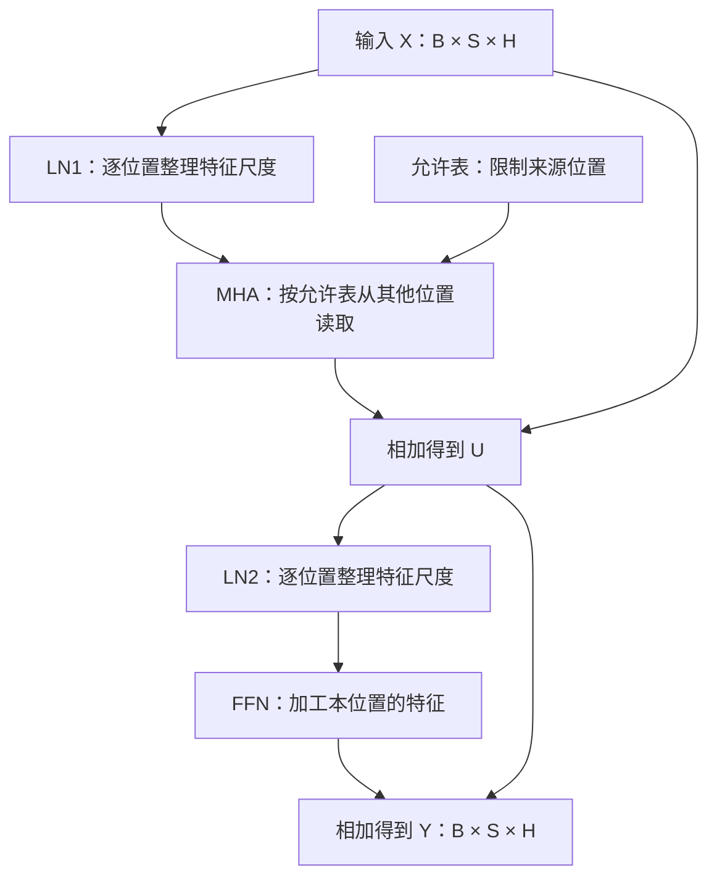

# AI Infra Theory T17：保留多组读取结果，再更新每个位置的表示

> 2026-10-23起草，2026-10-25按真实进度对齐，尚未学习或验收。当前T1～T10和Theory Gate 1已通过，下一模块T11，Theory Gate 2未通过。本稿是后续准备，不提前排入当前学习。

- **接着谁学**：T16的单头读取主链、T10的Module、T12的两层非线性变换，以及T9的reshape/transpose。正式进入前按理论规划核对Theory Gate 2；T14仍可延期。
- **唯一代码产出**：`transformer_block_reference.py`，目录`t17_transformer_block`。
- **两个阶段**：R1完成多组读取的拆分、计算与合并后暂停；R2复用它，做一个保持`[B,S,H]`形状的表示更新组件。
- **环境与节奏**：[统一CPU环境](../ENVIRONMENT.md)，float64小矩阵即可，约7～9个有效小时，可分次完成。不训练模型、不安装新依赖。

[TOC]

## 0. 今天的输出仍是一排向量，但每一行经过两次更新

**今天造一个组件：输入一批位置向量，先从其他位置取得信息，再加工每个位置自己的特征，最后返回同样形状的新向量。** 它可以成为下一层相同组件的输入。

先接住[T16](../T16/T16.md)已经建立的动作：一个位置给不同来源打分，得到一行比例，再按比例汇总V。例如有两个来源：

```text
来源0的内容：[10, 0]
来源1的内容：[0,20]
```

若一次读取的比例是`[0.8,0.2]`，结果为`[8,4]`；另一套比例是`[0.2,0.8]`，结果为`[2,16]`。

现在希望**同时保留这两种读取结果**。先把它们并排放下，得到`[8,4,2,16]`，再让后面的线性变换决定怎样使用这四个数。

这就是R1的新增量。原来的单次读取公式保留，我们只增加“几组一起做，怎样排数据、怎样合起来”。这些比例是说明用途的假设值；真正程序里的比例仍由各组Q/K计算，不由人指定语义角色。

整课沿四个问题推进：

1. 多组读取为什么需要不同参数，拆出来的每个轴分别代表谁？
2. 几组结果怎样合并成同一个位置的向量，而不把位置与组号混在一起？
3. 取得新信息后，怎样保留旧表示，并继续处理本位置的特征？
4. 怎样让处理分支面对较可控的数值尺度，再把它们接成一个可复用组件？

R1只回答前两个问题。R2开始时再引出后两个问题，不先把归一化、残差和MLP塞进首版对象。

---

# R1：同一个位置，保留几组不同的读取结果

## 1. 多做几次读取，哪里必须不同

如果把T16原函数用完全相同的X和W调用两次，两份结果也相同。这样只重复计算，没有获得新的读取方式。

我们真正想做的是：同一份X，分别经过两套查询、匹配和内容变换：

```text
X -> 第0组Wq/Wk/Wv -> 第0组读取比例 -> 第0组内容结果
X -> 第1组Wq/Wk/Wv -> 第1组读取比例 -> 第1组内容结果
```

**一个head（头）就是这样一组独立参数产生的读取计算。** 同一层同时做多组，再组合它们的结果，就叫multi-head attention（多头注意力，简称MHA）。

独立参数允许它们学到不同表示和读取比例，但不保证每个头天然分工为“语法头”“指代头”。本课用固定参数核对计算，不给未经训练的头编造语言功能。

每个头都接收**完整的输入特征**。接下来为了组织计算，会拆分“投影后的输出”，并不是先把原输入切成互不相见的几段。

## 2. 先固定一组能看清的维度

沿用T16的H表示输入向量宽度，另用N表示头数，避免把H一会儿当宽度、一会儿当head数量：

| 符号 | 本课例子 | 含义 |
|---|---|---|
| B | 2 | 两条序列 |
| S | 3 | 每条补齐后有三个位置 |
| H | 4 | 每个位置有四个输入特征 |
| N | 2 | 同时进行两组读取 |
| D | 2 | 每个头的Q/K/V宽度 |

本课选择`H=N*D`，即`D=H//N`。因此构造组件时要求H能被N整除。这个选择让几组结果拼回后恰好恢复H宽，便于接后续组件；不是注意力数学上唯一允许的尺寸。

对第n个头，三个权重仍是T16熟悉的`[H,D]`：

$$
Q^{(n)}=XW_q^{(n)},\quad
K^{(n)}=XW_k^{(n)},\quad
V^{(n)}=XW_v^{(n)}.
$$

每个结果形状都是`[B,S,D]`。对每个头分别调用T16那条计算，当然能实现多头。我们先把它作为**逐头参照**，再学习怎样让一次批量矩阵运算同时完成这些头。

## 3. 几组参数可以并排放进同一张矩阵

两套查询参数分别为`[4,2]`。把它们沿列拼接：

$$
W_q^{\mathrm{all}}=[W_q^{(0)}\;W_q^{(1)}]:[4,4].
$$

一次计算`X @ Wq_all`，前两个输出特征属于头0，后两个属于头1。两组都读到了X的全部四个特征，只是使用不同的列权重。

K和V各自也这样组织。注意这里仍是三张不同矩阵：Wq_all、Wk_all、Wv_all。我们没有把Q/K/V三种职责混成同一组参数。

代码可以用三个`nn.Linear(H,H,bias=False)`分别持有它们。先跑一个查询投影的小例子，核对方向：

```python
import torch
from torch import nn

inputs_demo = torch.arange(24, dtype=torch.float64).reshape(2, 3, 4) / 10
query_layer = nn.Linear(4, 4, bias=False, dtype=torch.float64)
weight_math = torch.arange(16, dtype=torch.float64).reshape(4, 4) / 20
with torch.no_grad():
    query_layer.weight.copy_(weight_math.T)
query_flat = query_layer(inputs_demo)
torch.testing.assert_close(query_flat, inputs_demo @ weight_math)
assert query_flat.shape == (2, 3, 4)
```

你T10笔记里特别记过这个方向：**Linear保存的weight是`[输出宽度,输入宽度]`，数学写法`X @ W`里的W则是`[输入宽度,输出宽度]`。** 这次两维恰好都为4，也不能因此忽略转置；数值比较会发现方向写反。

## 4. 拆头是在给特征分组，不是在重新排列文字

现在每个位置的投影结果有四个数。我们规定前两个归头0，后两个归头1。

先不用真实计算结果，用带编号的数据把排列看清：

```python
tagged = torch.tensor([[
    [0., 1., 10., 11.],
    [2., 3., 12., 13.],
    [4., 5., 14., 15.],
]], dtype=torch.float64)
grouped = tagged.reshape(1, 3, 2, 2)
heads = grouped.transpose(1, 2)
assert heads.shape == (1, 2, 3, 2)
assert heads[0, 0].tolist() == [[0., 1.], [2., 3.], [4., 5.]]
assert heads[0, 1].tolist() == [[10., 11.], [12., 13.], [14., 15.]]
```

两步分别做了什么？

```text
[B,S,H]
-> reshape为[B,S,N,D]：每个位置的H个特征，分成N组，每组D个
-> transpose为[B,N,S,D]：把头轴移到位置轴前，便于每个头处理一整条序列
```

第二步没有把位置0换成位置1。它改变的是索引轴的排列。此时`heads[b,n,i,d]`表示第b条、第n头、第i位置的第d个特征。

为什么只reshape成`[B,N,S,D]`不行？它会按原线性顺序重新分组，而那个顺序仍然是“位置0全部头，然后位置1全部头”。上面编号会因此串组。

**先拆特征，再交换轴。** 返回结果可以共享原storage；这里不原地修改任何输入。T9的布局知识现在有了一个直接用途：shape对上，还需要下标确实指向你想要的数。

## 5. 每个头分别打分，比例不能跨头归一化

Q/K/V现在都是`[B,N,S,D]`。最后两个轴仍然是“位置、特征”，所以T16的点积方式保持：

$$
S_c=QK^{T_{-2,-1}}/\sqrt D,\qquad S_c:[B,N,S,S].
$$

$T_{-2,-1}$只表示交换最后两个轴，代码就是`k.transpose(-2,-1)`。前面的B和N各自标识一组独立计算。

每个`S_c[b,n,i,j]`对应一件明确的事：**第b条序列的第n个头，读取位置i对来源位置j的分数。**

然后沿最后一个来源轴softmax，得到P。同一个位置在不同头里各有一行比例，每一行分别和为1。不要跨N归一化，那会变成让不同读取组互相竞争份额。

本课多个头服从同一套来源限制。T15/T16的`allowed:[B,S,S]`在中间加一个轴：

```text
allowed[:,None,:,:] -> [B,1,S,S]
广播到每个头        -> 对应[B,N,S,S]
```

True仍表示允许；缩放后、softmax前，把禁止分数换成负无穷。每行至少一个允许来源的规则继续保留，补位读取行仍不当成有效正文输出。

最后每个头做`P @ V`，得到`[B,N,S,D]`。原来一条序列只有一份内容汇总，现在每个位置有N份。

## 6. 拼回同一位置的所有头，再决定怎样混合它们

头0、头1已经各自读完了。我们想让下游看到的是：

```text
位置0：[头0在位置0的结果，头1在位置0的结果]
位置1：[头0在位置1的结果，头1在位置1的结果]
位置2：[头0在位置2的结果，头1在位置2的结果]
```

所以先交换回`[B,S,N,D]`，再合并最后两个轴：

```python
merged = heads.transpose(1, 2).contiguous().view(1, 3, 4)
torch.testing.assert_close(merged, tagged)
```

这段继续使用§4的编号Tensor，只验证拆分与合并互为逆操作。真正计算时，把heads换成每头的attention结果。

`contiguous()`必要时把数据按当前逻辑轴顺序重新排好，随后`view`合并N、D。它不是“无论如何都复制”；是否需要复制取决于当前布局。也可用`reshape`允许必要复制，但不能直接跳过交换轴。

拼接只是把结果并排存放，还没有让头0与头1的特征发生混合。例如开头的`[8,4,2,16]`，可乘：

$$
W_o=\begin{bmatrix}
1&0&0&0\\
0&1&0&0\\
1&0&1&0\\
0&1&0&1
\end{bmatrix},
\qquad [8,4,2,16]W_o=[10,20,2,16].
$$

前两个输出特征把两组内容相加，后两个暂时保留第二组。真实Wo由训练学习，不固定成这张演示表。

**output projection（输出投影）就是拼接后的这次线性变换。** 本课用`nn.Linear(H,H,bias=False)`持有Wo，使MHA的最终输入输出都为`[B,S,H]`。[原论文§3.2.2](https://arxiv.org/html/1706.03762v7#S3.SS2.SSS2)

到这里，一次多头读取的完整路径才闭合：

```text
输入 -> 三次投影 -> 拆头 -> 各头打分/屏蔽/汇总
     -> 合并同一位置的各头结果 -> 输出投影
```

## 7. R1实际写什么，怎样接回T16

在Ubuntu已有环境创建本课目录：

```bash
mkdir -p ~/code/system-learning/ai-theory/t17_transformer_block
cd ~/code/system-learning/ai-theory/t17_transformer_block
```

在`transformer_block_reference.py`中实现`MultiHeadSelfAttention`。它是一个Module，持有四个无偏置Linear：`q_proj`、`k_proj`、`v_proj`和`out_proj`。

这四个对象在`__init__`创建一次。`forward`只用它们计算本批输出，不在每次调用时重新初始化参数。首版不含norm、FFN或残差；R2再增加外层组件。

使用形式如下，类体由你完成：

```python
torch.manual_seed(20261023)
attention = MultiHeadSelfAttention(model_dim=4, num_heads=2).to(dtype=torch.float64)
inputs = torch.arange(24, dtype=torch.float64).reshape(2, 3, 4) / 10
valid = torch.tensor([[True, True, True], [True, True, False]])
allowed = valid[:, None, :] & torch.ones(3, 3, dtype=torch.bool).tril()[None]
output, probabilities = attention(inputs, allowed)
assert output.shape == (2, 3, 4)
assert probabilities.shape == (2, 2, 3, 3)
```

返回顺序仍与T16一样：`(output, probabilities)`。区别只在P多了头轴，且输出投影恢复了H宽。T17入口统一接三维输入，不扩大成任意rank通用库。

### 7.1 怎样逐头复用上一课作参照

你的T16函数接的是原X和数学方向的`[H,D]`权重。给第n个头取参数时，先明确这件事：**Linear的每一行对应一个输出特征，所以一个头占它的D行。**

第n个头对应的数学权重为：

```python
start = n * head_dim
stop = start + head_dim
wq_head = attention.q_proj.weight[start:stop, :].T
wk_head = attention.k_proj.weight[start:stop, :].T
wv_head = attention.v_proj.weight[start:stop, :].T
```

每份都是`[H,D]`。用同一个inputs、同一个allowed逐头调用T16函数，得到N个`[B,S,D]`结果。沿最后轴`torch.cat(...,dim=-1)`拼成`[B,S,H]`，再过同一个`out_proj`，与新的向量化MHA输出比较。

每头P则用`torch.stack(...,dim=1)`组成`[B,N,S,S]`再比较。cat沿已有特征轴拼接；stack创建头轴，这两个返回形状不同。

T16若还没有方便导入的入口，可在本课checker中保留一份逐头计算参照；**不改你的T16文件来迁就本课，也不把T16函数改成接四维输入。** 正式进入时优先适配你已通过的真实签名。

### 7.2 本轮收在哪里

用CPU float64、`rtol=1e-10, atol=1e-10`比较完整output与完整P。再核对禁止来源概率为0，各头每行和为1，以及§4的编号拆合关系。

额外换`B=3,S=4,H=6,N=3,D=2`、长度`[1,4,2]`，输入和参数取温和数值，复用相同逐头参照。这样不能靠所有轴恰好一样大掩盖广播错误。

运行`python3 transformer_block_reference.py`，检查成立后打印`T17 R1 PASS`。

**到这里暂停。** 能解释一个头怎样从完整输入取得自己的Q/K/V、合并后一个特征来自谁，就可以提交R1。R1通过后再按真实代码校准后半，不把提前稿当成你已经写过的实现。

---

# R2：把读取结果接成一次完整的表示更新

## 8. 读到了新内容，原来的表示还要不要保留

R1返回的是读取、组合后的新内容。若直接用它替换X，原来的每个位置都必须依赖这个变换重新表达自己。

另一种安排是保留X，让新计算只负责提供一次增量。假设某个位置原来为`[1,2,3,4]`，新分支给出`[0.1,-0.2,0,0.5]`，相加后就是`[1.1,1.8,3,4.5]`。

**residual connection（残差连接）就是保留输入直达相加处，再把分支计算的结果加上去。** 在本课先写为：

$$
U=X+\operatorname{MHA}(X).
$$

这也解释了R1为什么把输出投影回H：参与相加的两个Tensor都要对应同一批、同一位置、同一宽度，不能依靠偶然广播把错误shape加起来。

如果分支输出全0，U就恰好等于X。训练时也存在一条直达的梯度路径，有助于组织更深的更新；这不保证任意参数、任意深度都一定好训练。

这里不要求学过T14。即使延期CNN/ResNet，你也能从这次向量相加直接理解残差。

## 9. 分支将反复读取这些向量，先控制送进去的尺度

原输入加上分支结果以后，不同位置的数值范围可能不同。比如一行是`[1,3,5,7]`，另一行是`[101,103,105,107]`：分量间的差异相同，但整体偏移不同。

我们希望处理分支能先看一份尺度较可控的特征，同时保留原X走直达路径。一个常用做法是：**对每个位置自己的H个特征，减去这行平均值，再按这行波动大小缩放。**

先拿第一行手算：均值为4，偏差为`[-3,-1,1,3]`。偏差平方的平均值为5，故归一化结果是：

$$
\frac{[-3,-1,1,3]}{\sqrt{5+\epsilon}}
\approx[-1.3416,-0.4472,0.4472,1.3416].
$$

第二行减去自己的均值104以后，偏差也相同。这两行因此给分支提供相同的标准化表示，而它们原来的X仍分别保留在直达路径里。

这叫 **LayerNorm（层归一化）**。在本课，它处理的是一个位置内部的特征，不是把一句话的所有位置混在一起算统计量。

## 10. LayerNorm具体算谁，又保存什么

对固定的b、i，输入这一行有H个数。先计算：

$$
\mu_{b,i}=\frac1H\sum_{h=1}^{H}X_{b,i,h},\qquad
\sigma^2_{b,i}=\frac1H\sum_{h=1}^{H}(X_{b,i,h}-\mu_{b,i})^2.
$$

再逐项处理：

$$
L_{b,i,h}=\gamma_h\frac{X_{b,i,h}-\mu_{b,i}}{\sqrt{\sigma^2_{b,i}+\epsilon}}+\beta_h.
$$

先不要把这条公式当成另一批新对象：均值与方差是本次输入算出的临时量；epsilon是避免零分母的小常数；gamma和beta则让模型在归一化以后，还能学习每个特征的缩放与平移。

本课用`eps=1e-5`，gamma初始全1、beta初始全0。方差除以H，不用样本方差的H-1。加epsilon、再经过可学习仿射变换后，输出并不保证始终严格均值0、方差1。

下面把一个实例完整跑通：

```python
row = torch.tensor([[1., 3., 5., 7.]], dtype=torch.float64)
norm = nn.LayerNorm(4, eps=1e-5, dtype=torch.float64)
normalized = norm(row)
mu = row.mean(dim=-1, keepdim=True)
variance = ((row - mu) ** 2).mean(dim=-1, keepdim=True)
manual = (row - mu) / torch.sqrt(variance + 1e-5)
torch.testing.assert_close(normalized, manual)
assert normalized.shape == row.shape
```

`nn.LayerNorm(4)`创建持有4个gamma、4个beta的对象；调用时返回新的同shape Tensor，不改row。换成`[B,S,4]`输入后，仍只沿最后四个特征计算。每个位置用自己的均值/方差，gamma/beta跨位置复用。

它在train和eval中都使用当前输入的统计量，没有需要从历史batch累积的running mean。这里的train/eval知识承接T10，不要求先学T14的可选BatchNorm。[PyTorch 2.14：LayerNorm](https://docs.pytorch.org/docs/2.14/generated/torch.nn.LayerNorm.html)

现在，把§8的分支入口换成归一化后的输入，直达路径不动：

$$
U=X+\operatorname{MHA}(\operatorname{LN}_1(X)).
$$

读这条式子时先找两条路：X直接到相加处；另一路先整理尺度，再读取其他位置。LN1表示第一份LayerNorm参数，并非第一条序列。

## 11. 从其他位置取回信息后，还需要加工本位置的特征

现在U已经包含读取更新。但在每个位置内部，我们还希望能将这些特征组合起来，形成非线性的新表示。

这正好复用T12已经学过的两层结构：先从H个特征变成F个中间特征，经过ReLU，再回到H个特征。

$$
\operatorname{FFN}(u)=\operatorname{ReLU}(uW_1+b_1)W_2+b_2.
$$

**FFN是feed-forward network（前馈网络）**；这里具体就是逐位置的两层MLP。W1为`[H,F]`，W2为`[F,H]`。F是中间宽度，本课示例取8，不是词表大小。

关键区别在于：attention沿S轴把不同位置的内容汇总；**这段FFN对每一行单独做特征变换，参数仍由所有行共享。** 它本身不会去读另一行。

先看一个真实调用，理解它返回什么：

```python
ffn_demo = nn.Sequential(
    nn.Linear(4, 8, dtype=torch.float64),
    nn.ReLU(),
    nn.Linear(8, 4, dtype=torch.float64),
)
ffn_inputs = torch.tensor([[[1., -2., 3., 0.]]], dtype=torch.float64)
ffn_output = ffn_demo(ffn_inputs)
assert ffn_output.shape == (1, 1, 4)
```

`Sequential`按列出的顺序调用三个子模块。第一个Linear只作用于最后特征轴，所以扩到`[B,S,H]`也无需把序列展成一长行。

为什么中间保留ReLU？两次纯线性变换仍可合成一次，这一点沿用T12，不重新证明。我们现在要的是获得新特征组合的非线性能力。

和读取分支一样，FFN也只提供一次更新。先对U做另一份LayerNorm，再加回U：

$$
Y=U+\operatorname{FFN}(\operatorname{LN}_2(U)).
$$

LN1、LN2是两个独立对象，拥有不同的gamma/beta。第二次处理的输入是已经完成attention更新的U，不是最初X。

## 12. 两次更新连起来，才是本课的block

到这里，把两条已经讲通的更新接起来：

$$
U=X+\operatorname{MHA}(\operatorname{LN}_1(X)),
$$
$$
Y=U+\operatorname{FFN}(\operatorname{LN}_2(U)).
$$

**Transformer block（Transformer基本计算块）** 在本课就是这个可重复使用的组件：先做跨位置的信息读取更新，再做逐位置的特征加工更新，输入输出均为`[B,S,H]`。



图中横跨分支的直达线保存原表示，相加点接收的是增量。只有MHA使用允许表；LN和FFN分别处理单个位置，不重新决定谁能读谁。

同样形状的Y可以继续交给下一个block。T18再把多个block接到文字输入、位置信息和词表分数输出之间。今天没有预测下一个token，也不把这一个随机初始化组件称为已训练语言模型。

这是一种**自注意力计算块**。搭配本课因果允许表时，它适合接后续decoder-only路径；这里没有另一条编码器输入，也没有交叉注意力。论文和框架还有其他排列方式，下一节只辨认与你看到的结构有关的区别。

## 13. pre-norm与post-norm，只辨认操作放在哪里

本课先归一化，再送进处理分支：

```text
pre-norm（前置归一化）：x + branch(LN(x))
```

另一种排列是在分支与输入相加后再归一化：

```text
post-norm（后置归一化）：LN(x + branch(x))
```

这里branch就是attention或FFN这样的处理分支。两种结构的运算顺序不同，通常不会给出相同数值。原始Transformer论文采用后置形式；本课固定前置形式，便于明确观察保留输入的直达路径。

一个简单区别：若分支为0，前置结构输出x；后置结构输出LN(x)。这个判断可以直接从公式读出，不需要另写第二个block。

框架中`norm_first=True`表达类似的前置选择；不能看见接口默认值就认为自己的顺序错了。[PyTorch：TransformerEncoderLayer的norm_first](https://docs.pytorch.org/docs/2.14/generated/torch.nn.TransformerEncoderLayer.html)

**本课只实现前置LayerNorm版本。** 训练稳定性差异和架构取舍留后续，不扩成两种结构的训练对照。

## 14. R2怎样升级同一个程序

保留R1的`MultiHeadSelfAttention`和逐头参照。新增外层`TransformerBlock`，它持有四个成员：

| 成员 | 创建什么 | 在本轮负责什么 |
|---|---|---|
| `attention` | 你已完成的MHA对象 | 读取其他位置 |
| `norm1` | `nn.LayerNorm(H,eps=1e-5)` | 整理attention分支输入 |
| `norm2` | 另一份`nn.LayerNorm(H,eps=1e-5)` | 整理FFN分支输入 |
| `ffn` | `Linear(H,F) -> ReLU -> Linear(F,H)` | 本位置特征变换，两个Linear保留bias |

`forward(inputs,allowed)`按§12两次更新返回`(output,probabilities)`。P就是本次attention使用的`[B,N,S,S]`比例，返回它仅为了观察，不重新计算第二遍attention。

第一次运行这个新对象：

```python
torch.manual_seed(20261023)
block = TransformerBlock(model_dim=4, num_heads=2, ffn_dim=8).to(dtype=torch.float64)
block.eval()
with torch.inference_mode():
    block_output, block_probabilities = block(inputs, allowed)
assert block_output.shape == inputs.shape
assert block_probabilities.shape == (2, 2, 3, 3)
```

inputs、allowed复用§7那批。本课无Dropout；eval不是关闭梯度的开关，关闭记录仍由inference_mode负责。这些行为沿用T10/T11，不另设复习作业。

外层创建的是一个新的block实例，内部attention参数也是新初始化的。**R1旧实例仍保留用来做原检查；新block的参考计算必须读取新block自己的参数。** 不要把两个独立随机初始化对象的输出拿来要求相等。

只在关键点记录一次shape：两次norm输入输出、每头结果、合并结果、两次残差相加及FFN中间层。可以用局部断言或检查器观察，不要求增加trace框架或返回一长串中间对象。

## 15. 检查整块，先问每个检查在证明什么

以下继续在同一个文件完成，机械断言可以委托。R1已经通过的拆头/合并/逐头参照保持，不重写。

### 15.1 对照同一参数下的整条计算

检查器用手算公式实现逐行LayerNorm，逐头参照实现attention，读取block.ffn两个Linear的真实weight/bias做两次线性变换和ReLU，再按§12完成两次相加。

比较这个参照与block输出，输入、参数、eps、mask都必须一致。使用CPU float64和`rtol=1e-10, atol=1e-10`。这同时检查“组件算得对”和“组件顺序接得对”。

### 15.2 让两个处理分支都输出0，直达路径必须留下

复制一个专用测试block，把`attention.out_proj.weight`清零；再将FFN最后Linear的weight和bias清零。其他参数不动，然后对原inputs运行。

预期完整output等于inputs。这里attention无输出bias，所以清零out_proj.weight就让该分支为0；FFN有bias，必须同时清零最后bias。

这是对残差相加位置的强检查。用`copy.deepcopy`创建测试副本，不修改正常block，也不要用全0输入来做这个实验，那样漏掉直达路径也可能碰巧输出0。

### 15.3 对整个block重新验证前缀与batch隔离

保留原结果，只改第一条序列最后一个真实位置的输入。原allowed保持，第一条前两个位置的输出应不变。

为什么R1之外还要测一次？因为R2加入了norm和FFN。如果误把LayerNorm写成沿`[S,H]`一起统计，前面位置就可能通过归一化读到后面位置，哪怕attention的mask完全正确。

再只改第二条的补位输入，第二条真实输出应不变；只改第二条真实输入，第一条输出应不变。补位自身的输出不参与这个“不变”判断。

### 15.4 重复调用，参数与输入不应悄悄变化

运行前保留inputs、allowed和参数副本，连续两次调用同一block。两次结果应一致，输入、允许表和参数保持原值。

这证明forward没有重新初始化参数或原地改写调用者数据。它不是跨机器、跨版本的全局可复现承诺。

以上检查都在攻击本课的一条主链：**同一位置保留原表示，并且只从允许来源得到更新。** 不为每个测试再造一个功能。

## 16. 入口检查保持小而明确

先完成正常计算，再给公开入口补必要检查：

| 场景 | 本课处理 |
|---|---|
| H或N不是正整数，或H不能被N整除 | 构造时抛ValueError，说明维度或头数不合法 |
| F不是正整数 | block构造时抛ValueError |
| inputs不是`[B,S,H]`，B/S为空或最后宽度不匹配 | forward前抛ValueError |
| inputs或参数含NaN/Inf | 抛ValueError；“有限”说的是数值，不是参数个数 |
| allowed不是同设备bool `[B,S,S]`，或有全False行 | 抛ValueError；沿用T16完整允许表规则 |

本课输入、模型参数统一CPU float64；不支持自动dtype/device转换。新建实例后显式`.to(dtype=torch.float64)`，再开始检查。错误信息写清哪个对象不合法，不要求同一输入同时违反多条规则时的错误优先级测试。

参数与正常输入用温和数值。若有限大数仍让中间计算出现NaN/Inf，报告ValueError，不将它修成0后继续打印PASS；attention中合法的负无穷屏蔽分数要与算术溢出分开判断。

现成LayerNorm、Linear和ReLU可以使用。**自己要实现的是多头的数据组织与两次更新的连接**，不要求重写框架所有算子。`nn.MultiheadAttention`或完整Transformer层只能作额外交叉核对，不能取代主练习。

## 17. RMSNorm：已有主链之后，再辨认一种更简的尺度处理

核心block先完成，不为了下面这段重写它。按规划，本课还需要认识RMSNorm做了什么，后续读模型时才不会把所有norm都当同一个公式。

刚才LayerNorm先减均值，再缩放。若只希望按整行数值的大小缩放，可以先平方、取平均、开方：这就是**RMS，root mean square（均方根）**。

对`[1,3,5,7]`，平方平均是`(1+9+25+49)/4=21`。于是一种处理为：

$$
\operatorname{RMSNorm}(x)_h=\gamma_h\frac{x_h}{\sqrt{\frac1H\sum_kx_k^2+\epsilon}}.
$$

**RMSNorm（均方根归一化）按均方根缩放每行特征，不减去这行均值。** 对这个全正输入，结果仍全正，所以它不把输出中心移到0。

可以用一个独立小例子核对，不修改block：

```python
rms = nn.RMSNorm(4, eps=1e-5, dtype=torch.float64)
rms_result = rms(row)
rms_manual = row / torch.sqrt((row ** 2).mean(dim=-1, keepdim=True) + 1e-5)
torch.testing.assert_close(rms_result, rms_manual)
assert (rms_result > 0).all()
```

row仍是§10的那一行。这里gamma初始全1，PyTorch这个模块没有额外beta，eps显式指定为1e-5。[PyTorch 2.14：RMSNorm](https://docs.pytorch.org/docs/2.14/generated/torch.nn.RMSNorm.html)

本节要求能解释与LayerNorm的区别；小例子可运行加深理解，不要求新增第二个block或训练性能对比。使用哪一种归一化属于模型结构选择，不能仅凭少一步减均值就声称实际推理一定快多少。

## 18. AI Infra视角：头数、参数和中间结果分别怎样增长

先看本课固定`H=N*D`的前提。四个attention线性层各有H×H个参数，所以一共`4H²`。H固定而N变化时，每头D相应变化，**这些参数并不会简单乘以头数**。

但是显式保存的P有`B*N*S*S`个数。H固定时增加N，P的逻辑数据量仍会增加。这和参数数量是两本不同的账。

Q/K/V各有`B*N*S*D=B*S*H`个数。合并、转置和连续化则可能涉及额外数据移动；T9的布局语义能帮助你找到该观察的地方，但是否成为瓶颈仍要测量。

再把block其余部分加进参数账：两次FFN线性层有`2HF+F+H`个参数，两份LayerNorm合计4H。总数是：

$$
4H^2+2HF+F+5H.
$$

代入本课H=4、F=8，得到156个参数；float64逻辑参数量1248 bytes。可用`sum(p.numel() for p in block.parameters())`核对。这个数不包含激活、临时结果或框架开销，也不是进程内存峰值。

这些估算只服务于“哪个对象多大”的理解。本课不测吞吐，不优化kernel，不把教材参考实现包装成高性能Transformer。

## 19. 参考资料和最终收口

本课正文给足必学内容，资料只作第二解释：

| 什么时候看 | 材料 | 范围 |
|---|---|---|
| 单头主链已会，想再看多头组织 | 李沐[67《自注意力》](https://www.bilibili.com/video/BV19o4y1m7mo/)、[68《Transformer》](https://www.bilibili.com/video/BV1Kq4y1H7FL/)中的多头注意力代码部分 | 对照拆头与合并，不重做另一份完整作业 |
| 本课block已经跑通 | 同一68的Transformer结构部分；[AIInfraGuide本地映射](../../reference_materials/ai_infra/AIInfraGuide_阅读映射.md)T17～T18行 | 识别attention、残差、norm与FFN；材料的额外编码器/解码器结构不变成当前任务 |
| 想核对公式和API细节 | 正文中的原论文、LayerNorm/RMSNorm官方文档 | 按本课已遇到的问题读，不要求全文论文精读 |

最终仍只有`transformer_block_reference.py`：保留R1数值参照，在R2加入完整block与§15检查，成功后打印`T17 TRANSFORMER BLOCK PASS`。没有训练集下载、模型训练或第二个产品文件。

收口时用自己的程序回答五个问题即可，代码、注释和口述可以共同作为证据：

1. 为什么每个头接收完整X，却能使用不同的读取比例？
2. 从`[B,S,H]`拆到`[B,N,S,D]`，又合回去，哪一步交换轴、哪一步合并特征？
3. LN、attention、FFN分别在哪个轴上使用其他元素？谁会跨位置读取？
4. 为什么本课两条处理分支都为0时，整个block必须返回原输入？
5. H固定而头数增加时，参数量和显式P的容量为什么不按同一种方式变化？

**整课结束，请你亲自做T17笔记。** 记新增理解、真实卡点和一张自己能解释的数据流即可，不重复抄整份检查清单；已有等价笔记就补齐，不由Codex代写。

T18再把这个组件接到token输入、位置信息和最终logits之间。本课不提前实现位置编码、KV Cache、训练循环或完整生成服务。

提前稿只能按已经确认的前置设计，不能假装已看过你的T16代码。T16正式通过后或实际进入T17时，按届时实现与反馈再校准；R1通过后也要定向检查完整R2。T17是进阶准备，不新增Week16首批C++/后台试投门槛，不提前固定Week16后的实际课表。
