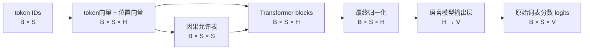

# AI Infra Theory T18：把 token IDs 一路送到 logits

> 版本：2026-11-04，按 T11 学习者主线复检
> 当前状态：T1～T12与Theory Gate 1已通过，下一模块T13；T18尚未学习或验收，Theory Gate 2尚未通过。

- **接着谁学**：正式进入本课前，先完成T15的编号/允许表和T17的`TransformerBlock`。T14仍可延期。
- **唯一代码产出**：`decoder_only_forward.py`，目录`t18_decoder_forward`。
- **两个阶段**：R1让一条序列完整走到词表分数；R2再升级为两层和批次输入，并验证前缀与批次隔离。
- **环境与边界**：[统一CPU环境](../ENVIRONMENT.md)，float64小矩阵即可。不训练模型，不生成token，不实现后续生成缓存，不做性能结论。

[TOC]

## 0. 今天只接通一条路

**今天造一个tiny model：输入token编号，输出每个位置对应的整张词表分数。**

前面三课已经分别造好了这条路的中段：

```text
T15：token IDs、补齐位置、因果允许表
T16：一组attention读取
T17：多组读取 + 两次残差更新，输入输出都是[B,S,H]
```

现在还缺两端：

```text
左端：整数编号怎样变成T17能处理的H维向量？
右端：最后的H维向量怎样变成词表中每个token的分数？
```

本课沿同一批token完成：



图中的V是词表大小。整条路走完后，每个位置都有V个数。

这些数仍是logits（原始类别分数），不是probabilities（概率）。T19才处理概率和选token。

---

# R1：让一条序列第一次完整走到词表分数

## 1. T17的block还不能直接接整数编号

先用T15已经认识的极小词表：

| ID | token |
|---:|---|
| 0 | `<pad>` |
| 1 | `<unk>` |
| 2 | `<bos>` |
| 3 | `我` |
| 4 | `喜欢` |
| 5 | `AI` |
| 6 | `<eos>` |

第一条输入是：

```python
token_ids = torch.tensor([[2, 3, 4]], dtype=torch.long)
```

它表示：

```text
位置0：<bos>
位置1：我
位置2：喜欢
```

T17的block接收`[B,S,H]`浮点向量，不能把`[1,3]`整数矩阵直接交进去。

T15已经解决第一半：token embedding（token嵌入）按编号查表，让每个编号取得一行H维向量。

```python
token_embedding = nn.Embedding(
    num_embeddings=7,
    embedding_dim=4,
    padding_idx=0,
    dtype=torch.float64,
)
token_vectors = token_embedding(token_ids)
assert token_vectors.shape == (1, 3, 4)
```

现在每个位置都有四个浮点特征，可以进入block。

但还缺一件事：同一个token出现在位置0和位置2时，查到的是同一行token向量。模型还需要知道它这次位于哪一个位置。

## 2. 给每个位置再查一行位置向量

本课采用最容易看清的数据路径：再建一张表，表的第i行表示位置i。

```python
position_embedding = nn.Embedding(
    num_embeddings=8,
    embedding_dim=4,
    dtype=torch.float64,
)
position_ids = torch.arange(3).unsqueeze(0)
position_vectors = position_embedding(position_ids)
assert position_ids.tolist() == [[0, 1, 2]]
assert position_vectors.shape == (1, 3, 4)
```

这里的`position_ids`不是文字编号。它们只表示当前列位于第0、1、2个位置，并由另一张表查询。

**position embedding（位置嵌入）就是为位置编号保存的向量表。** 本课把token向量与位置向量逐项相加：

```python
hidden = token_vectors + position_vectors
assert hidden.shape == (1, 3, 4)
```

两张表都输出H维，才能让每个位置得到一行新的H维表示。相加后，这行数同时携带“这里是什么token”和“它在第几个位置”。

位置表是模型参数，创建一次后由每次forward读取。`position_ids`则是本次调用产生的临时索引。

## 3. 让这批向量经过T17的block

T15还给出了因果允许表。对三个真实位置：

```python
valid = token_ids.ne(0)
causal = torch.ones(3, 3, dtype=torch.bool).tril()
allowed = valid[:, None, :] & causal[None, :, :]

assert allowed.tolist() == [[
    [True,  False, False],
    [True,  True,  False],
    [True,  True,  True ],
]]
```

现在把`hidden`和`allowed`交给已经通过的T17组件：

```python
block_output, probabilities = block(hidden, allowed)
assert block_output.shape == (1, 3, 4)
assert probabilities.shape == (1, 2, 3, 3)
```

每个位置只从自己和前面的允许来源取得信息。block内部做attention、逐位置FFN和两次残差相加，但输出仍是`[B,S,H]`。

这条始终保持H宽、不断接收增量更新的数据路径，常叫residual stream（残差主流）。它不是一种新Tensor类型；这里就是从embedding结果开始，连续穿过各个block的那份`hidden`。

## 4. 最后一个block之后，再整理一次每行特征

T17使用前置LayerNorm：每个处理分支在计算前先看归一化后的输入，然后把结果加回残差主流。

因此最后一个block返回的`block_output`是相加后的残差结果，不是“刚刚已经做完最终归一化”的输出。

本课在送入词表输出层前再调用一次独立的LayerNorm：

```python
final_norm = nn.LayerNorm(4, eps=1e-5, dtype=torch.float64)
normalized = final_norm(block_output)
assert normalized.shape == (1, 3, 4)
```

这就是final norm（最终归一化）。它不读取其他位置，也不改变B、S、H。

这里使用LayerNorm，与T17核心实现保持一致。RMSNorm是另一种模型选择，放到核心完成后辨认，不要求另写第二个model。

## 5. 每个位置只有H个数，还不能和V个token逐一比较

现在位置2只有四个特征：

```text
normalized[0,2]：长度H=4
```

下一步需要为词表中的七个token各给一个分数：

```text
token 0的分数
token 1的分数
...
token 6的分数
```

所以需要一次`H -> V`的线性变换：

```python
lm_head = nn.Linear(4, 7, bias=False, dtype=torch.float64)
logits = lm_head(normalized)

assert logits.shape == (1, 3, 7)
assert logits[0, 2].numel() == 7
```

**LM head（语言模型输出层）负责把每个位置的H维表示映到V个词表分数。** `Linear`保留前面的B、S轴，只把最后一轴从H换成V。

`logits[0,2,5]`表示：第一条序列读到位置2为止时，模型给词表ID 5的原始分数。

这七个数：

- 可以是负数；
- 不要求位于0到1；
- 不要求总和为1；
- 还没有决定最终选哪个token。

因此不要在T18的model内部先做softmax。T19会把同一行logits交给不同的概率与选择策略。

## 6. 哪一行是在回答“下一个token是什么”

当这种结构使用next-token objective（下一token训练目标）时，位置i的输出用来预测位置i后面的token。

对当前输入：

| 读取到的位置 | 已看见的前缀 | 这一行logits用于评分 |
|---:|---|---|
| 0 | `<bos>` | 下一个token |
| 1 | `<bos> 我` | 下一个token |
| 2 | `<bos> 我 喜欢` | 接下来还未输入的token |

所以`logits[0,2]`是一整行“下一个token候选分数”。

本课的随机初始化模型没有学会语言，它的高分token没有语义价值。我们只证明forward的数据流与位置隔离正确，不把随机输出叫预测质量。

## 7. 到这里再给整条结构命名

当前模型只有一条token表示流：

```text
token/position vectors
-> causal self-attention block
-> final norm
-> LM head
-> logits
```

它没有另一套encoder输出，也没有cross-attention（交叉注意力）去读取编码器结果。

**decoder-only Transformer（仅解码器Transformer）在本课就是只沿因果自注意力block处理前缀，并输出词表分数的模型。** “decoder-only”说明结构只有这条解码路径，不表示它已经包含生成循环或缓存。

## 8. R1实际写什么

在Ubuntu已有环境创建本课目录：

```bash
mkdir -p ~/code/system-learning/ai-theory/t18_decoder_forward
cd ~/code/system-learning/ai-theory/t18_decoder_forward
cp ../t17_transformer_block/transformer_block_reference.py decoder_only_forward.py
```

复制的是你已经通过的T17实现。不要修改原T17文件，也不要重新手写多头attention。

在新文件中保留`MultiHeadSelfAttention`和`TransformerBlock`，再新增`TinyDecoderOnly`。R1的对象只持有：

| 成员 | 本轮作用 |
|---|---|
| `token_embedding` | token ID查成H维向量，`padding_idx=0` |
| `position_embedding` | 位置ID查成H维向量，最多支持`max_seq_len`个位置 |
| `block` | 一个已经会用的T17 block |
| `final_norm` | 最后整理每个位置的H个特征 |
| `lm_head` | 把H维映到V个logits，`bias=False` |

`forward(token_ids)`读取本次编号和model中已经登记的参数，返回`[B,S,V]` logits。返回值交给后续loss或T19的token选择使用。

它不修改编号、参数，不执行采样，也不训练model。T17的attention probabilities仍可在局部调试时观察，不把一长串中间对象变成model的正式输出。

公开调用保持小而明确：

```python
model = TinyDecoderOnly(
    vocab_size=7,
    max_seq_len=8,
    model_dim=4,
    num_heads=2,
    ffn_dim=8,
).to(dtype=torch.float64)

model.eval()
with torch.inference_mode():
    logits = model(token_ids)

assert logits.shape == (1, 3, 7)
```

### 8.1 R1的参照怎样证明接线正确

在model外部，用同一model的成员按正文顺序再走一次：

```text
token_embedding(token_ids)
+ position_embedding(position_ids)
-> block(..., allowed)
-> final_norm
-> lm_head
```

将参照结果与`model(token_ids)`逐项比较。这里检查的是外层forward有没有漏步骤、换顺序或用错成员；T17内部计算不重复验收。

再保留三条直接证据：

1. 输入`token_ids`在调用前后不变。
2. 输出shape为`[1,3,7]`且全部有限。
3. 在同一参数、同一输入、eval与inference mode下重复调用，logits相同。

成功后打印`T18 R1 TOKEN TO LOGITS PASS`。

**到这里暂停。** 你应能沿一个具体位置说清：编号从哪张表取得向量，位置向量加在哪里，block返回什么，LM head为什么输出七个数。

---

# R2：把同一条路升级为两层和批次输入

## 9. 一个block的输出可以直接成为下一个block的输入

R1的block输入和输出都是`[B,S,H]`。所以第二个block不需要新的数据格式：

```text
hidden0 -> block0 -> hidden1 -> block1 -> hidden2
```

两个block必须是两个独立对象。它们结构相同，但各自拥有自己的attention、norm和FFN参数。

如果把普通Python list装进Module，PyTorch不会按Module成员的方式管理其中对象。我们需要它们随整个model一起出现在`parameters()`、`state_dict()`和`.to(...)`中。

这时才引入`nn.ModuleList`（模块列表）：

```python
self.blocks = nn.ModuleList([
    TransformerBlock(model_dim, num_heads, ffn_dim)
    for _ in range(num_layers)
])
```

**ModuleList（模块列表）保存一组按顺序访问、同时被外层Module正式登记的子模块。** forward按顺序调用：

```python
for block in self.blocks:
    hidden, _ = block(hidden, allowed)
```

本轮把R1的`self.block`替换成`self.blocks`，构造参数新增`num_layers`。类定义变了以后重新创建model；旧的一层实例不会自动获得第二层，也不拿两次随机初始化对象要求输出相等。

本课最终使用`num_layers=2`。不写通用层数调度器，也不增加跨层参数共享。

## 10. 同一model接收右侧补齐的两条序列

沿用T15的PAD规则：

```python
token_ids = torch.tensor([
    [2, 3, 4, 5],
    [2, 6, 0, 0],
], dtype=torch.long)
lengths = torch.tensor([4, 2], dtype=torch.long)
```

forward内部从S生成一份位置编号：

```python
position_ids = torch.arange(S, device=token_ids.device).unsqueeze(0)
```

位置向量shape为`[1,S,H]`，与token向量`[B,S,H]`相加时沿B轴复用。每条序列的位置0都使用同一份位置0参数。

随后按T15规则生成：

```text
valid   [B,S]
allowed [B,S,S]，True表示允许读取
```

每个block都使用同一份allowed。补位列不会成为正文位置的信息来源；补位行仍可能产生logits，但它们不是这条序列的有效输出。

完整shape现在是：

| 对象 | shape | 这一行代表什么 |
|---|---|---|
| `token_ids` | `[B,S]` | 每个位置的token编号 |
| `hidden` | `[B,S,H]` | token与位置相加后的表示，以及后续残差主流 |
| `allowed` | `[B,S,S]` | 每个读取位置允许使用哪些来源位置 |
| `hidden` after each block | `[B,S,H]` | 同shape的下一层输入 |
| `logits` | `[B,S,V]` | 每个位置对V个token的原始分数 |

这张表是已经走通路径后的压缩，不替代前面的具体调用。

## 11. 每条序列要从自己的最后一个真实位置取分数

第一条长度为4，最后真实位置是3。第二条长度为2，最后真实位置是1。

不能统一取`logits[:,-1]`。第二条的最后一行属于补位位置。

```python
batch_indices = torch.arange(token_ids.shape[0])
last_indices = lengths - 1
next_token_logits = logits[batch_indices, last_indices]

assert next_token_logits.shape == (2, 7)
torch.testing.assert_close(next_token_logits[0], logits[0, 3])
torch.testing.assert_close(next_token_logits[1], logits[1, 1])
```

`next_token_logits[b]`是第b条前缀接下来一个token的V个候选分数。

本课停在这里。不要在model里argmax、softmax或随机抽样；这些操作改变的是如何使用logits，属于T19。

## 12. R2的检查都在证明同一条forward没有串线

下面不是一组新功能，而是从不同位置攻击同一条数据路径。

### 12.1 逐层参照

在model外部使用同一成员：两张embedding相加，依次调用`blocks[0]`和`blocks[1]`，再做final norm与LM head。

比较完整`[B,S,V]`结果。这样能发现forward漏掉第二层、重复使用同一层或把final norm放错位置。

### 12.2 后面的token不能改变前面的logits

保留原输入与结果，只把第一条最后一个token从5改成6，其他内容、参数与长度不变。

预期：

```text
第一条位置0～2的logits不变
第一条位置3可以变化
第二条所有真实位置logits不变
```

前两项证明因果前缀没有读未来；最后一项证明两条batch没有互相读取。

### 12.3 两个block都属于model状态

检查`state_dict()`中同时出现`blocks.0.`和`blocks.1.`开头的名字。

这证明两个对象被外层Module登记。它不证明计算顺序，所以仍需要§12.1的数值参照。

### 12.4 forward不改输入和参数

调用前保留token IDs和参数副本。两次调用后，输入与参数保持原值，logits一致。

这里证明的是纯forward行为，不是跨设备、跨版本或训练随机性的总承诺。

## 13. 正常路径完成后，只保留必要入口检查

T18接收T15已经整理好的右侧补齐输入，不重造通用验证框架。

| 场景 | 本课处理 |
|---|---|
| `token_ids`不是非空二维long Tensor | 抛`ValueError`，说明需要`[B,S]`编号矩阵 |
| S大于`max_seq_len` | 抛`ValueError`，说明位置表不够长 |
| 编号小于0或大于等于V | 抛`ValueError`，不取模、不截断 |
| 某条序列全是PAD，或PAD后又出现真实token | 抛`ValueError`；本课只接非空、右侧补齐输入 |
| `num_layers`不是1或2 | 构造时抛`ValueError`；保持tiny model范围 |

H、N、F和block内部输入仍由T17检查。模型与浮点参数统一CPU float64；token IDs和position IDs保持long。

不为多条同时非法的输入规定复杂错误优先级。先保证正常forward和四组核心证据成立。

## 14. T18核心通过标准

最终`decoder_only_forward.py`保留T17组件，加入两层`TinyDecoderOnly`和本课检查。正常运行打印：

```text
T18 DECODER FORWARD PASS
```

核心PASS需要同时满足：

1. 能从`[B,S]` token IDs得到`[B,S,V]` logits。
2. 能逐步说明token向量、位置向量、block、final norm和LM head分别补了什么。
3. 完整结果与同参数的逐层参照一致。
4. 改未来token不影响已有前缀；改一条序列不影响另一条。
5. 能从每条序列最后一个真实位置取得`[B,V]`，且明确它仍不是概率或选中的token。

机械断言和重复脚手架可以委托，但你需要能说明每条oracle为何成立。完成后再由实际实现定向决定是否补错误用例，不提前扩成框架测试套件。

---

## 15. 核心完成后，用AI Infra视角看这些对象

本课第一次把模型参数和一次forward的中间对象放进同一条路径：

| 对象 | 谁长期持有 | 是否随输入长度变化 |
|---|---|---|
| token/position embedding权重 | model | 否；尺寸由V、最大位置数和H决定 |
| 两个block与final norm参数 | model | 否；由层数和宽度决定 |
| LM head权重 | model | 否；本课shape为`[V,H]` |
| token IDs、allowed、hidden、attention结果、logits | 本次forward | 是；含B或S的轴随请求变化 |

这张表帮助以后问：哪些对象加载一次长期驻留，哪些对象每次请求产生，哪些中间量会随上下文长度增长。

T18只建立对象账和数据流。没有测量内存峰值、latency或throughput，也没有证明任何kernel更快。

## 16. 三种真实模型差异，放在核心以后辨认

### 16.1 位置也可以不采用加法表

本课用learned position embedding（可学习位置嵌入），因为它能直接复用T15的查表动作并清楚显示`[B,S,H]`怎样形成。

有些模型使用RoPE（旋转位置编码），把位置信息作用到attention的Q/K，而不是在第一层加一张位置向量表。进入真实模型源码时再按具体结构学习；T18核心不同时实现两套位置方案。

### 16.2 final norm也可能使用RMSNorm

若真实模型把T17的LayerNorm换成RMSNorm，final norm通常也按该模型结构选择。你只需先辨认它是否减均值、保存哪些参数；不把这个差异扩成第二份forward作业。

### 16.3 LM head可以与token embedding共享权重

有些模型让输入embedding表与输出投影使用同一份权重，称为weight tying（权重绑定）。本课保持两个独立参数对象，先把数据流讲清。

这三项都是架构选择。它们不改变本课最重要的外部关系：

```text
token IDs -> hidden states -> vocab logits
```

## 17. 参考资料怎样使用

正文足够完成核心任务。资料只在对应问题已经出现后使用：

| 什么时候看 | 材料 | 只看什么 |
|---|---|---|
| T17 block已完成，准备接完整路径 | [AIInfraGuide本地阅读映射](../../reference_materials/ai_infra/AIInfraGuide_阅读映射.md)的T17～T18行 | 对照decoder block与完整Transformer对象位置，不复制外部完整实现 |
| 想核对PyTorch成员行为 | [Embedding](https://docs.pytorch.org/docs/2.14/generated/torch.nn.Embedding.html)、[ModuleList](https://docs.pytorch.org/docs/2.14/generated/torch.nn.ModuleList.html)、[Linear](https://docs.pytorch.org/docs/2.14/generated/torch.nn.Linear.html)、[LayerNorm](https://docs.pytorch.org/docs/2.14/generated/torch.nn.LayerNorm.html) | 核对输入输出shape和模块登记，不按API目录重学 |
| 完整主线已跑通，想对照decoder架构 | [GPT-2技术报告§2.3](https://cdn.openai.com/better-language-models/language_models_are_unsupervised_multitask_learners.pdf)、李沐[68《Transformer》](https://www.bilibili.com/video/BV1Kq4y1H7FL/) | 识别前置归一化、最后归一化和层堆叠；编码器—解码器额外路径不变成本课任务 |

两条基准课程没有完整覆盖本课的decoder-only forward。不要把视频68当成T18的逐行答案，也不要在独立产出前复制完整框架代码。

## 18. 最终收口

学完以后，脑中应只剩这条主干：

```text
token IDs
-> token向量 + 位置向量
-> 因果允许表约束下的多个Transformer blocks
-> final norm
-> LM head
-> 每个位置的词表logits
-> 取最后真实位置，交给T19决定怎样使用
```

请用自己的程序回答五个问题：

1. token embedding与position embedding分别用什么编号查哪张表，为什么结果可以相加？
2. 两个block之间传递的对象是什么，shape为什么保持`[B,S,H]`？
3. `lm_head`把哪一轴从H变成V，`logits[b,i,j]`具体表示什么？
4. 为什么第二条补齐序列不能直接取`logits[:,-1]`？
5. 为什么T18已经完成模型forward，却仍没有完成token生成？

**整课结束，请你亲自做T18笔记。** 一张从token IDs到logits的数据流、关键shape和你真正卡住的地方就够了；不抄整份测试表，也不由Codex代写。

T19将接过最后真实位置的logits，比较greedy、temperature和sampling。它改变如何使用分数，不重新计算T18前面的model forward。
