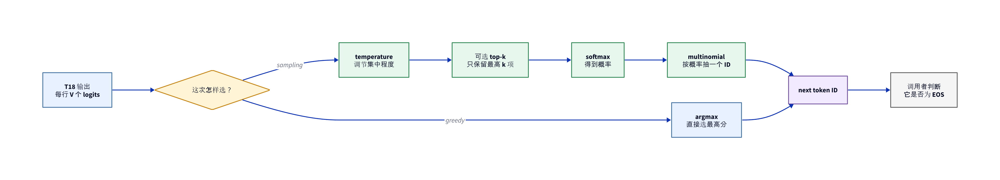

# AI Infra Theory T19：从一行 logits 选出下一个 token

> 当前状态：T1～T11与Theory Gate 1已通过，下一模块T12；T19尚未学习或验收，Theory Gate 2尚未通过。

- **前置**：完成T5的categorical sampling（分类采样）、T6的stable softmax（稳定Softmax）和T18的decoder forward。
- **唯一代码产出**：`sampling_methods.py`，目录`t19_token_sampling`。
- **两个阶段**：R1比较greedy与完整分类采样；R2只增加top-k，并把批次与EOS边界接清楚。
- **环境与边界**：[统一CPU环境](../ENVIRONMENT.md)，使用PyTorch float64小Tensor。不训练模型，不写完整生成循环，不实现KV Cache，不做质量或性能结论。

[TOC]

## 0. 今天只完成最后一个动作

**T18已经给出每条序列最后真实位置的词表分数。今天把这一行分数变成一个next token ID（下一个token编号）。**

T18的输出是：

```text
last_logits：[B,V]

B：这批有多少条序列
V：词表里有多少个候选token
```

每一行有V个logits（原始词表分数）。它们表示模型对V个候选token的相对倾向，但还没有替调用者选出答案。

今天只沿下面这条路走：



读图时从左向右看。上路永远选最高分；下路先形成一份概率分布，再随机抽一次。两条路最后都只返回每行一个token ID。

图由本课的[D2源文件](assets/t19_sampling_path.d2)生成，只表达本课对象流，不代表完整生成服务。

---

# Part 1：Round1，同一行 logits 为什么会有两种选法

## 1. 固定一行模型输出

继续使用T18的七项词表：

| ID | token |
|---:|---|
| 0 | `<pad>` |
| 1 | `<unk>` |
| 2 | `<bos>` |
| 3 | `我` |
| 4 | `喜欢` |
| 5 | `AI` |
| 6 | `<eos>` |

假设T18最后返回：

```python
import torch

logits = torch.tensor(
    [[-4.0, -3.0, -5.0, 0.0, 1.0, 2.0, 0.5]],
    dtype=torch.float64,
)

assert logits.shape == (1, 7)
```

这一行可以逐项读成：

```text
ID 3“我”     的score是0.0
ID 4“喜欢”   的score是1.0
ID 5“AI”     的score是2.0
ID 6“<eos>”  的score是0.5
```

最高分是ID 5。现在先问最直接的问题：如果这次只想拿最高分候选，应该做什么？

## 2. 永远选最高分，就是 greedy

对词表维调用`argmax`：

```python
greedy_ids = torch.argmax(logits, dim=-1)

assert greedy_ids.shape == (1,)
assert greedy_ids.tolist() == [5]
```

这条规则每次都会返回ID 5。相同logits会得到相同结果。

**greedy decoding（贪心解码）就是每一步直接选择当前最高分token。** 本课的`greedy_next_token()`只封装这次`argmax`，不负责继续生成后面的token。

Greedy解决了“给我一个确定答案”。但它完全没有使用其余候选之间的概率差异。

## 3. 想按相对倾向随机选择，就接回T5与T6

另一种需求是：高分token更常被选中，但其他仍有概率的token也可以偶尔出现。

这时不能直接把logits交给随机抽样。T5的categorical sampler（分类采样器）需要一份合法概率：

$$
p_i \ge 0,
\qquad
\sum_i p_i=1
$$

T6已经解决了转换：

```text
logits
-> stable softmax
-> categorical probabilities
-> 抽出一个category ID
```

在本课中，PyTorch的`torch.softmax()`负责产生概率，`torch.multinomial()`负责按每行概率抽一个ID：

```python
probabilities = torch.softmax(logits, dim=-1)
next_ids = torch.multinomial(probabilities, num_samples=1).squeeze(-1)

assert probabilities.shape == (1, 7)
assert next_ids.shape == (1,)
```

`next_ids`是这一次random draw（随机抽取）的结果。它可能是5，也可能是其他ID；一次结果不等于整份distribution（分布）。

## 4. 先能采样，再产生“我想让它更集中”的需求

刚才的概率由原logits直接得到。现在调用者提出新要求：

```text
模型最喜欢ID 5。
我仍然想采样，
但希望概率更集中在高分候选上。
```

或者反过来：

```text
我希望分布更平，
让较低分候选获得更多机会。
```

这时才需要temperature（温度）。它是softmax之前用于缩放logits差距的正数：

$$
p_i(T)=
\frac{\exp(z_i/T)}
{\sum_j \exp(z_j/T)},
\qquad T>0
$$

对同一行固定logits：

| temperature | ID 3 | ID 4 | ID 5 | ID 6 | 直观结果 |
|---:|---:|---:|---:|---:|---|
| 0.5 | 0.015219 | 0.112452 | 0.830916 | 0.041369 | 更集中在最高分ID 5 |
| 1.0 | 0.077937 | 0.211854 | 0.575880 | 0.128496 | 原始softmax分布 |
| 2.0 | 0.141012 | 0.232490 | 0.383311 | 0.181063 | 更平，低分项机会增加 |

表中没有列出的ID 0～2仍有很小的非零概率，整行总和仍是1。

因为$T$是正数，除以$T$不会改变logit的大小顺序：ID 5仍然最高。它改变的是差距经softmax后有多集中。

本课明确拒绝`temperature <= 0`。Greedy是单独的确定性规则，不把`temperature=0`伪装成它。

## 5. R1要实现的三个函数

现在对象链已经完整，才给接口：

```python
import torch


def temperature_probabilities(
    logits: torch.Tensor,
    temperature: float = 1.0,
) -> torch.Tensor:
    ...


def greedy_next_token(logits: torch.Tensor) -> torch.Tensor:
    ...


def sample_next_token(
    logits: torch.Tensor,
    *,
    temperature: float = 1.0,
    generator: torch.Generator | None = None,
) -> torch.Tensor:
    ...
```

三个函数只接受本课的窄输入：

```text
logits必须是CPU float64 Tensor
shape必须是[B,V]
B和V都必须大于0
每个logit必须是finite value（有限值）
temperature必须是有限正数
```

返回对象分别是：

| 函数 | 返回shape | 返回的对象 |
|---|---:|---|
| `temperature_probabilities` | `[B,V]` | 每行非负、和为1的概率 |
| `greedy_next_token` | `[B]` | 每行最高分token ID |
| `sample_next_token` | `[B]` | 每行按当前概率抽出的一个token ID |

`sample_next_token()`内部先调用`temperature_probabilities()`，再把明确的概率交给`torch.multinomial()`。这样不会把“原始logits也能作为非负权重使用”混进本课的对象链。

## 6. R1证据不是“某一次恰好抽到AI”

### 6.1 确定路径

```python
assert greedy_next_token(logits).tolist() == [5]

probabilities = temperature_probabilities(logits, temperature=1.0)
assert probabilities.shape == logits.shape
assert torch.all(probabilities >= 0.0)
assert torch.allclose(
    probabilities.sum(dim=-1),
    torch.ones(1, dtype=torch.float64),
)
```

### 6.2 大量抽样只验证频率接近概率

先固定概率，再从同一行抽50000次：

```python
generator = torch.Generator(device="cpu").manual_seed(2026)
probabilities = temperature_probabilities(logits, temperature=1.0)

draws = torch.multinomial(
    probabilities[0],
    num_samples=50_000,
    replacement=True,
    generator=generator,
)
frequencies = torch.bincount(draws, minlength=7).to(torch.float64)
frequencies /= draws.numel()

assert torch.allclose(frequencies, probabilities[0], atol=0.02, rtol=0.0)
```

这里验证的是经验频率与理论概率足够接近。它不要求50000次结果精确等于概率，也不声称样本量每增加一次，误差都会单调下降。

### 6.3 seed控制的是随机数流

generator（随机数生成器）保存随机状态。两个新generator使用相同seed（种子）并执行相同调用顺序，应得到相同序列：

```python
generator_a = torch.Generator(device="cpu").manual_seed(7)
generator_b = torch.Generator(device="cpu").manual_seed(7)

draws_a = torch.stack([
    sample_next_token(logits, generator=generator_a)
    for _ in range(20)
])
draws_b = torch.stack([
    sample_next_token(logits, generator=generator_b)
    for _ in range(20)
])

assert torch.equal(draws_a, draws_b)
```

同一个generator连续调用时，内部状态会向前推进。它不是“每次传入后都重新从seed开始”。

## 7. Round1停止点

R1到这里就停。你应该能够口述：

```text
greedy：直接argmax，所以相同logits得到相同ID

sampling：
logits / temperature
-> softmax probabilities
-> multinomial随机抽一个ID

temperature更小：分布更集中
temperature更大：分布更平
```

你还要能区分三种对象：

```text
logits：模型给出的原始分数
probabilities：采样器消费的分布
next token ID：一次选择的结果
```

---

# Part 2：Round2，只让最高的 k 个候选参加抽样

## 8. Temperature不会真正排除低分候选

即使temperature较小，只要softmax结果仍大于0，低分token就仍可能被抽到。

现在调用者提出一个不同要求：

```text
这次只允许最高的3个候选参加抽样。
其余候选概率必须变成0。
```

这不是继续调temperature。它需要先改变“哪些token有资格参加”。

**top-k sampling（最高k项采样）先保留分数最高的k项，再在这k项内部重新归一化并采样。**

## 9. 用固定七项分数走一遍 top-k

原始排序最高的三项是：

| 排名 | ID | token | logit |
|---:|---:|---|---:|
| 1 | 5 | `AI` | 2.0 |
| 2 | 4 | `喜欢` | 1.0 |
| 3 | 6 | `<eos>` | 0.5 |

当`top_k=3`、`temperature=1.0`时，只在这三项上做softmax：

| ID | 最终概率 |
|---:|---:|
| 5 | 0.628532 |
| 4 | 0.231224 |
| 6 | 0.140244 |

ID 0、1、2、3的概率都是0。

代码中的最小动作是：

```python
scaled = logits / 1.0
top_values, top_indices = torch.topk(scaled, k=3, dim=-1)

filtered = torch.full_like(scaled, -torch.inf)
filtered.scatter_(dim=-1, index=top_indices, src=top_values)

probabilities = torch.softmax(filtered, dim=-1)
```

`-inf`经过softmax后得到0，因此未入选项不会再被抽到。每行至少保留一项，才能形成合法分布。

## 10. R2升级同一个接口，不另造第二套采样器

```python
def top_k_probabilities(
    logits: torch.Tensor,
    *,
    temperature: float = 1.0,
    top_k: int,
) -> torch.Tensor:
    ...


def sample_next_token(
    logits: torch.Tensor,
    *,
    temperature: float = 1.0,
    top_k: int | None = None,
    generator: torch.Generator | None = None,
) -> torch.Tensor:
    ...
```

`top_k=None`继续使用完整词表分布。提供整数时：

```text
bool不算合法整数
1 <= top_k <= V
每一行独立选择自己的最高k项
```

`top_k=V`应与不筛选得到相同概率。它不是错误，也不需要特殊算法。

本课不固定top-k边界同分时保留哪一个ID，核心测试也不构造并列边界。将来若接口需要稳定tie-break（同分裁决），再单独定义规则。

## 11. Batch中的每一行代表一条独立序列

加入第二条序列：

```python
batch_logits = torch.tensor(
    [
        [-4.0, -3.0, -5.0, 0.0, 1.0, 2.0, 0.5],
        [-4.0, -3.0, -5.0, 0.0, 0.5, 1.0, 3.0],
    ],
    dtype=torch.float64,
)

assert greedy_next_token(batch_logits).tolist() == [5, 6]
```

第一行最高分是ID 5，第二行最高分是ID 6。`dim=-1`表示每一行只在自己的V个候选中比较，不允许两条序列混在一起排序或归一化。

这也是`temperature_probabilities()`和`top_k_probabilities()`都必须保留`[B,V]` shape的原因。

## 12. EOS不是另一种采样算法

第二行选出的ID 6是`<eos>`，即EOS（序列结束标记）。对采样函数来说，它只是词表中的普通ID 6。

采样结束后，调用者再解释它：

```python
eos_token_id = 6
next_ids = greedy_next_token(batch_logits)
finished = next_ids.eq(eos_token_id)

assert next_ids.tolist() == [5, 6]
assert finished.tolist() == [False, True]
```

职责边界是：

```text
sampling function：从每行logits选择一个ID
generation caller：记录哪条序列已经遇到EOS，并决定后续是否停止
```

本课不写后续generation loop（生成循环）。这里只留下这个边界，避免把“选一次token”和“管理整段序列”混成一个函数。

## 13. Round2的最小证据

```python
probabilities = top_k_probabilities(
    logits,
    temperature=1.0,
    top_k=3,
)

expected_nonzero = torch.tensor(
    [[False, False, False, False, True, True, True]],
)

assert torch.equal(probabilities > 0.0, expected_nonzero)
assert torch.allclose(
    probabilities.sum(dim=-1),
    torch.ones(1, dtype=torch.float64),
)
assert torch.allclose(
    probabilities[0, [5, 4, 6]],
    torch.tensor([0.628532, 0.231224, 0.140244], dtype=torch.float64),
    atol=1e-6,
    rtol=0.0,
)
```

再对批次验证：

```python
batch_probabilities = top_k_probabilities(
    batch_logits,
    temperature=1.0,
    top_k=2,
)

assert batch_probabilities.shape == (2, 7)
assert torch.equal((batch_probabilities > 0.0).sum(dim=-1), torch.tensor([2, 2]))
assert torch.allclose(
    batch_probabilities.sum(dim=-1),
    torch.ones(2, dtype=torch.float64),
)
```

错误输入至少覆盖：错误rank、空B或V、非float64、非CPU、NaN/Inf、非正temperature，以及越界top-k。

Round2通过后，你的核心代码只做：

```text
[B,V] logits
-> greedy或temperature/top-k probabilities
-> [B] next token IDs
```

---

# 核心完成后的连接

## 14. Top-p为什么不是再固定一个k

Top-k永远保留相同数量。可不同分布的集中程度并不相同。

先看两份已经排好序的概率：

```text
分布A：[0.70, 0.20, 0.06, 0.04]
分布B：[0.30, 0.25, 0.20, 0.15, 0.10]
```

如果阈值$p=0.8$：

```text
分布A：0.70还不够，0.70+0.20=0.90
       保留前2项

分布B：0.30+0.25+0.20=0.75还不够
       再加0.15得到0.90
       保留前4项
```

**top-p sampling（累计概率采样，也叫nucleus sampling）保留按概率从高到低排列后，累计质量第一次达到阈值所需的最小候选集合。** 因此候选数量会随当前分布变化。

本课只要求这层直觉，不实现top-p，也不把它加入核心PASS。正式实现时还需明确排序、至少保留一项、阈值边界和batch处理，不能靠这两个手算例子猜API细节。

## 15. Decoding policy到底改变了什么

Decoding policy（解码策略）就是“拿到当前logits后，这一步怎样选择token”的规则。

```text
模型weights没有改变
T18的forward没有改变
当前原始logits没有被重新训练

改变的是：
调用者怎样把这行logits变成next token ID
```

| policy | 当前步骤 |
|---|---|
| greedy | 直接选最高分 |
| categorical sampling | 在完整softmax分布上抽样 |
| temperature | 先改变分布集中程度，再抽样 |
| top-k | 先把候选限制到最高k项，再抽样 |
| top-p | 按累计概率动态决定候选集合，再抽样 |

这些规则会改变输出token的distribution（分布），但不会回头修改模型参数。

## 16. 谁拥有哪一份状态

| 对象 | 谁产生或拥有 | 生命周期 |
|---|---|---|
| model weights | T18的model | 跨多次请求持久存在 |
| current logits | 本次model forward | 当前step的临时结果 |
| probabilities | sampling function | 当前选择过程的临时结果 |
| generator state | 调用者传入的generator | 跨随机调用推进 |
| finished/EOS state | generation caller | 跨多个生成step维护 |

这张表的目的只有一个：采样函数选择一次ID，不顺手接管模型、随机流和整段序列的生命周期。

## 17. AI Infra连接到哪里为止

真实推理服务会同时处理许多请求，并为每条请求保存自己的生成状态。Sampling的参数、随机状态、finished状态与模型forward因此会在运行时相遇。

但T19不把这些后续问题提前实现：

```text
T20：training与inference的对象、内存和计算差异
T21：prefill、decode与KV Cache
T22：多请求调度与batching
T23：benchmark与证据
```

本课只提供它们以后会消费的一个明确组件：`[B,V] logits -> [B] next token IDs`。

## 18. 官方材料怎样用

- [PyTorch 2.14 Softmax](https://docs.pytorch.org/docs/2.14/generated/torch.nn.functional.softmax.html)：核对沿哪一维归一化。
- [PyTorch 2.14 `torch.multinomial`](https://docs.pytorch.org/docs/2.14/generated/torch.multinomial.html)：核对权重约束、批次行为、replacement与generator参数。
- [PyTorch 2.14 `torch.topk`](https://docs.pytorch.org/docs/2.14/generated/torch.topk.html)：核对返回values/indices、维度行为及并列项边界。
- [PyTorch 2.14 `torch.Generator`](https://docs.pytorch.org/docs/2.14/generated/torch.Generator.html)：核对seed控制的随机状态对象。
- [Nucleus Sampling论文](https://arxiv.org/abs/1904.09751)：只在核心完成后辨认top-p的来源与动机。
- [Hugging Face generation参数](https://huggingface.co/docs/transformers/main_classes/text_generation)：只用于辨认常见命名。框架默认值、处理顺序和推荐范围必须按实际版本与任务重新核对。

外部框架里的`generate()`或`SamplingParams`会把很多步骤封装起来。先完成本课自己的小组件，再去看封装参数对应哪一步；不反过来抄一组默认参数当成理解。

## 19. 最终交付与验收

| 项目 | 要求 |
|---|---|
| 文件 | `sampling_methods.py` |
| R1 | temperature probabilities、greedy、完整分类采样、seed与经验频率证据 |
| R2 | top-k概率、批次独立、EOS调用者边界、输入检查 |
| 核心输出 | `[B,V] logits -> [B] token IDs` |
| 不要求 | top-p实现、完整生成循环、KV Cache、beam search、模型训练、质量或性能结论 |

最终口述五问：

1. Greedy和categorical sampling分别怎样从同一行logits得到token ID？
2. Temperature为什么改变概率集中程度，却不改变正温度下的候选排名？
3. Top-k把哪些概率变成0，剩余候选为什么还要重新归一化？
4. 相同seed在什么条件下才会复现相同随机序列？
5. 为什么sampling function不应该自己决定整条序列何时结束？

通过时，你应该能准确地说：

> 模型先产生logits。解码策略只决定怎样从当前logits选出下一个token；它可以直接argmax，也可以先用temperature和top-k形成概率，再按概率抽样。这个过程改变输出分布，不修改模型weights或前面的forward计算。

**整课完成后，请亲自把对象链、三个函数、两种随机证据和EOS边界写进自己的T19笔记。** 教程里的表格不能替代这一步。
