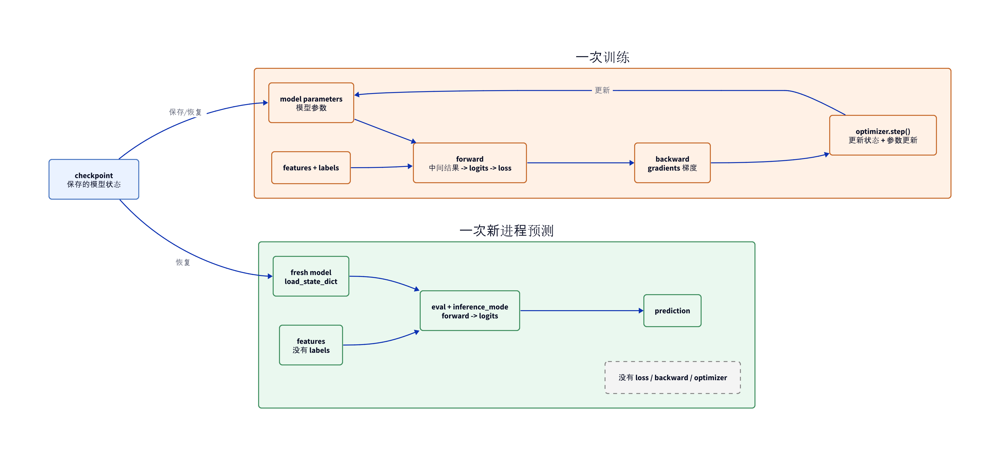

# T20：同一个模型训练时为什么比预测时多出那么多对象

> 版本：2026-11-04，按 T11 学习者主线复检
> 状态：提前稿，尚未学习或通过。正式进入前先完成 T12～T19；文件存在不表示前置已经完成。

今天只回答一个问题：

> **同一个模型，训练和推理各自需要保存什么？这些对象分别占多少逻辑数据量？**

你已经在 T10 看过参数与 checkpoint，在 T11 看过梯度，在 T12 看过完整训练循环。T20 不再发明一套模型，而是把这些熟悉对象放在同一张账上。

最终产出只有一个文件：

```text
model_memory_estimate.py
```

它不是显存分析器，也不负责优化模型。它用一个很小的 `TinyMLP` 回答三件事：

1. 一次训练中，哪些 Tensor 真的出现了？
2. 新进程只做预测时，哪些对象不再需要？
3. 只改变权重表示精度，权重本体的容量会怎样变化？



图的左边是训练：除了参数，还会出现 labels、激活、loss、梯度和优化器状态。右边是新进程预测：从 checkpoint 恢复参数后，只接收输入并产生输出，不创建训练所需的那条反向路径。

---

## Part 1：先让训练对象一件一件出现

## 1. 继续使用你已经认识的模型

T12 的小模型可以写成：

```python
import torch
from torch import nn


class TinyMLP(nn.Module):
    def __init__(self, input_dim: int, hidden_dim: int, class_count: int) -> None:
        super().__init__()
        self.first = nn.Linear(input_dim, hidden_dim)
        self.second = nn.Linear(hidden_dim, class_count)

    def forward(self, features: torch.Tensor) -> torch.Tensor:
        hidden_pre = self.first(features)
        hidden = torch.relu(hidden_pre)
        return self.second(hidden)
```

本课固定：

```text
input_dim = 4
hidden_dim = 8
class_count = 3
batch_size = 5
dtype = float32
```

先数参数。

第一层有：

$$
4 \times 8 + 8 = 40
$$

第二层有：

$$
8 \times 3 + 3 = 27
$$

所以模型共有：

$$
P = 40 + 27 = 67
$$

个参数值。`float32` 每个值占 4 bytes，因此参数 Tensor 的逻辑 payload（有效数据本体）是：

$$
67 \times 4 = 268\ \text{bytes}
$$

这里还不是整个 Python 进程占用，也不是 GPU 峰值。我们只数 Tensor 中装着的数值。

## 2. 先写一个只回答“Tensor 数值占多少”的函数

一个 Tensor 的逻辑数据量由两件事决定：

```text
元素个数 × 每个元素的字节数
```

对应接口：

```python
def tensor_payload_bytes(tensor: torch.Tensor) -> int:
    return tensor.numel() * tensor.element_size()
```

`numel()` 返回元素个数。`element_size()` 返回当前 dtype 下每个元素的字节数。

模型参数总量可以继续写成：

```python
def module_parameter_bytes(module: nn.Module) -> int:
    return sum(tensor_payload_bytes(parameter) for parameter in module.parameters())
```

先断言：

```python
model = TinyMLP(4, 8, 3)

parameter_count = sum(parameter.numel() for parameter in model.parameters())
assert parameter_count == 67
assert module_parameter_bytes(model) == 268
```

**这一步只证明参数本体有 268 bytes。** Python 对象、Tensor metadata、allocator、运行库和进程本身都没有算进去。

## 3. 一次训练还需要输入和 labels

构造固定 batch：

```python
features = torch.arange(20, dtype=torch.float32).reshape(5, 4) / 10
labels = torch.tensor([0, 1, 2, 1, 0], dtype=torch.int64)
```

它们的 shape 是：

```text
features [5, 4]
labels   [5]
```

容量分别是：

```text
features: 5 × 4 × 4 bytes = 80 bytes
labels:   5 × 8 bytes     = 40 bytes
```

这里先出现第一个训练与推理差异：**监督训练需要真实答案 labels；普通线上预测通常没有 labels。**

## 4. forward 以后，模型中间结果也要暂时存在

为了看清对象，不把 forward 压成一行：

```python
hidden_pre = model.first(features)
hidden = torch.relu(hidden_pre)
logits = model.second(hidden)
loss = nn.functional.cross_entropy(logits, labels)
```

逐项看 shape：

```text
hidden_pre [5, 8]
hidden     [5, 8]
logits     [5, 3]
loss       []       # 一个 scalar Tensor
```

这些 forward 中间结果通常称为 **activations（激活值）**。这里先按最直接的意思理解：模型处理当前 batch 时产生的中间 Tensor 和输出 Tensor。

本例选出的逻辑 Tensor payload 是：

| 对象 | 逻辑字节数 |
|---|---:|
| features | 80 |
| labels | 40 |
| hidden_pre | 160 |
| hidden | 160 |
| logits | 60 |
| loss | 4 |
| 合计 | 504 |

这个 `504 bytes` 是**我们明确列出的 Tensor 数据量**，不是精确训练峰值。

为什么不能把它叫峰值？因为 autograd 可能保存额外值，算子可能申请临时 workspace，allocator 可能保留内存，运行库和 Python 对象也有开销。

## 5. backward 以后，参数旁边出现 gradient

调用：

```python
loss.backward()
```

以后，每个需要求导的参数都得到同 shape 的 `.grad` Tensor。

```python
def gradient_payload_bytes(module: nn.Module) -> int:
    return sum(
        tensor_payload_bytes(parameter.grad)
        for parameter in module.parameters()
        if parameter.grad is not None
    )
```

本例参数都是 `float32`，每个参数都有一份同 shape 的梯度，因此：

```text
parameter payload = 268 bytes
gradient payload  = 268 bytes
```

这不是巧合公式，而是本例参数与梯度 shape、dtype 相同产生的结果。换 dtype、冻结部分参数或使用不同训练方案后，账会变化。

## 6. AdamW 第一次 step 后，优化器还会留下自己的状态

先创建优化器：

```python
optimizer = torch.optim.AdamW(model.parameters(), lr=1e-3)
```

刚创建时，AdamW 通常还没有为每个参数建立完整的动量 Tensor：

```python
assert len(optimizer.state) == 0
```

执行一次：

```python
optimizer.step()
```

以后，AdamW 为参数维护一阶矩和二阶矩。第一层理解就是：**它不只拿当前 gradient 改一次参数，还要保留过去更新趋势的状态，供下一步继续使用。**

你可以统计优化器状态里所有 Tensor：

```python
def optimizer_tensor_state_bytes(optimizer: torch.optim.Optimizer) -> int:
    total = 0
    for parameter_state in optimizer.state.values():
        for value in parameter_state.values():
            if isinstance(value, torch.Tensor):
                total += tensor_payload_bytes(value)
    return total
```

两份与参数同 shape 的 `float32` 矩状态至少贡献：

$$
2 \times 268 = 536\ \text{bytes}
$$

实现还可能把 step 计数保存为小 Tensor，因此程序应打印实际统计值，不把 `536` 硬编码成所有版本的完整总数。

## 7. 清梯度不等于删除优化器状态

调用：

```python
optimizer.zero_grad(set_to_none=True)
```

以后，本例参数的 `.grad` 会变回 `None`。但 AdamW 的一阶矩、二阶矩仍然存在，因为下一次更新还要继续使用它们。

把三件事分开：

```text
parameter
模型当前学到的值

parameter.grad
最近反向传播累积出的梯度

optimizer state
优化器跨训练步保留的更新状态
```

### Round 1 任务

在 `model_memory_estimate.py` 中完成四个只读计数 helper。它们都返回 Python `int`，供同一训练步骤的内存账使用；不会创建训练对象，也不会清空gradient或optimizer state：

```text
tensor_payload_bytes(tensor)：数一个Tensor的逻辑payload
module_parameter_bytes(module)：汇总当前Module的parameters
gradient_payload_bytes(module)：只汇总当前已经存在的parameter.grad
optimizer_tensor_state_bytes(optimizer)：汇总optimizer当前已建立的Tensor state
```

然后再给出接口：

```python
def tensor_payload_bytes(tensor: torch.Tensor) -> int:
    ...


def module_parameter_bytes(module: nn.Module) -> int:
    ...


def gradient_payload_bytes(module: nn.Module) -> int:
    ...


def optimizer_tensor_state_bytes(optimizer: torch.optim.Optimizer) -> int:
    ...
```

然后让同一个训练步依次打印：

```text
parameter bytes
selected forward tensor bytes
gradient bytes after backward
optimizer tensor state bytes before/after first step
gradient bytes after zero_grad(set_to_none=True)
```

### Round 1 停止点

先确认你能回答：

1. 为什么 `parameter bytes` 不是训练总内存？
2. 为什么 optimizer 刚构造时状态可以为空，第一次 step 后才出现？
3. 为什么清掉 `.grad` 后，optimizer state 还在？

---

## Part 2：新进程只预测，哪些训练对象不再出现

## 8. 先把真实问题说清楚

训练结束后进程退出，原来的 Python 对象、grad 和 optimizer 都消失了。

线上预测程序通常只拿 checkpoint：

```text
checkpoint
-> 构造同结构的新模型
-> 装入参数/buffer
-> 接收请求
-> 返回预测
```

它不需要继续更新参数。因此现在的问题不是“怎样让训练对象全都回来”，而是：

> **为了得到相同预测，最少需要恢复哪些状态？**

## 9. 用 fresh model 模拟新进程

保存训练后的模型状态：

```python
checkpoint_path = "t20_model.pt"
torch.save(model.state_dict(), checkpoint_path)
```

再构造一个全新对象：

```python
fresh_model = TinyMLP(4, 8, 3)
state = torch.load(
    checkpoint_path,
    map_location="cpu",
    weights_only=True,
)
fresh_model.load_state_dict(state, strict=True)
fresh_model.eval()
```

这里不构造 optimizer，也不调用 backward。

预测时：

```python
with torch.inference_mode():
    inference_logits = fresh_model(features)
    predictions = inference_logits.argmax(dim=-1)
```

你应该观察：

```python
assert all(parameter.grad is None for parameter in fresh_model.parameters())
assert inference_logits.requires_grad is False
```

**`eval()` 负责 Dropout/BatchNorm 等模块的评估行为；`inference_mode()` 负责这段执行不记录反向求导所需的关系。** 两者各管一件事。

## 10. 为什么这里真的没有 optimizer state

不是 `inference_mode()` 神奇地删除了 optimizer。

这里没有 optimizer state 的直接原因是：

```text
新进程只构造了 model
没有构造 optimizer
也没有执行训练 step
```

同样，`inference_mode()` 不会帮你清除某个旧训练进程里已经存在的 `.grad`。本实验使用 fresh model，才能把“纯推理需要什么”看清楚。

## 11. 现在再给三类对象命名

你已经亲眼看过对象，再做压缩：

| 类别 | 本例对象 | 生命周期 |
|---|---|---|
| persistent state（持久状态） | 模型参数、buffer、checkpoint | 跨请求存在；checkpoint还能跨进程保存 |
| per-request state（每请求状态） | 当前输入、logits、prediction | 随当前请求或 batch 出现，结束后可释放 |
| transient workspace（临时工作空间） | 某些算子执行时的临时 buffer | 只在部分运算阶段存在，具体大小由算子/后端决定 |

训练时还会有跨 step 的 optimizer state，以及为 backward 保留的中间值。普通推理没有 loss/backward/optimizer 这条链。

## 12. training batch 与 inference batch 不是同一份业务对象

训练 batch 通常是：

```text
features + labels
```

因为它要计算 loss，再反向更新模型。

推理 batch 通常是：

```text
多个用户请求的输入
```

把请求放成一批，是为了提高硬件利用率或吞吐，不代表这些请求突然拥有训练 labels，也不代表会执行 backward。

## 13. 参数量乘 dtype 能回答什么

若模型有 `P` 个参数值，仅估算权重本体：

```text
FP32: P × 4 bytes
FP16/BF16: P × 2 bytes
INT8 values: P × 1 byte
```

例如 `P = 7,000,000,000`：

| 表示 | 十进制 GB | 二进制 GiB，约 |
|---|---:|---:|
| FP32 | 28 GB | 26.08 GiB |
| FP16/BF16 | 14 GB | 13.04 GiB |
| INT8 数值本体 | 7 GB | 6.52 GiB |

`GB` 按 $10^9$ bytes，`GiB` 按 $2^{30}$ bytes。两种单位不要混着报。

这张表只回答：**参数值本体至少有多大。** 它没有包含：

```text
activations
KV Cache
allocator 保留与碎片
kernel workspace
CUDA context / runtime
request、scheduler 与通信 metadata
host-device staging / transfer buffer
量化 scale 等辅助数据
```

所以不能从“7B FP16 权重约 14 GB”直接推出“14 GB 显存一定能运行”。

## 14. mixed precision 不是所有对象统一变成 2 bytes

mixed precision（混合精度）的第一层意思是：**同一次训练或推理里，不同对象或不同运算可以使用不同 dtype。**

例如参数、某些计算激活、梯度累加或优化器状态可能并不全是同一种精度。T20 不实现 autocast，也不背某个框架的固定内存倍数。

本课只要求你在估算时逐项写清：

```text
这个对象是什么
它有多少元素
它实际是什么 dtype
是否被当前容量账包含
```

## 15. 模型从文件到计算设备，经过不同存储层

同一份状态可以经历：

```text
checkpoint 文件
外部存储，例如 SSD
        ↓ torch.load
CPU Tensor
主机内存 DRAM
        ↓ .to("cuda")，若使用 GPU
GPU Tensor
GPU device memory
```

本地 RTX 4060 Laptop 的显存类型是 GDDR6。HBM（高带宽内存）常见于部分数据中心加速卡，不应把所有 GPU 显存都叫 HBM。

本课当前环境仍按 CPU 脚本完成。以后在 CUDA 环境实际运行时，才能测设备分配和峰值；现在不能用逻辑 payload 代替设备实测。

### Round 2 任务

1. 保存训练后 `state_dict`。
2. 构造 `fresh_model` 并严格加载。
3. 不创建 optimizer，在 `eval()` 与 `inference_mode()` 下预测。
4. 验证 fresh model 没有 grad，预测结果与保存前一致。
5. 输出 TinyMLP 和 7B 参数模型的权重本体估算，并明确排除项。

### Round 2 停止点

先确认你能回答：

1. 为什么推理仍然需要参数，却通常不需要 optimizer state？
2. 为什么 `eval()` 不能替代 `inference_mode()`？
3. 为什么 `P × dtype bytes` 只是权重账，不是完整显存账？

---

## Part 3：INT8 为什么能缩小权重本体，又为什么不是白拿的

## 16. 先从一个权重值开始

现在有一个浮点权重：

```text
x = 0.374
```

我们希望用一个 INT8 整数近似保存它。先选：

```text
scale = 0.01
```

这个 scale 表示：整数每变化 1，对应原数值变化 0.01。

量化：

$$
q = \operatorname{clip}\left(\operatorname{round}(x / s), -128, 127\right)
$$

代入：

```text
0.374 / 0.01 = 37.4
round -> 37
```

反量化：

$$
\hat{x} = q \times s
$$

所以：

```text
37 × 0.01 = 0.37
```

误差是：

```text
abs(0.374 - 0.37) = 0.004
```

到这里才给动作命名：

- quantization（量化）：把浮点值映射到较低精度整数表示。
- dequantization（反量化）：用 scale 把整数恢复成近似浮点值。

## 17. INT8 还有表示范围

若仍取 `scale = 0.01`，权重 `2.0` 会先得到：

```text
2.0 / 0.01 = 200
```

但 INT8 最大只能表示 127，所以必须截到 127：

```text
q = 127
restored = 1.27
error = 0.73
```

这说明 scale 不是越小越好。

```text
scale 小
-> 细小变化表达得更精细
-> 但可覆盖范围变窄，容易饱和

scale 大
-> 可覆盖范围变宽
-> 但相邻整数之间的间隔更粗
```

## 18. 再量化一小组权重

```python
values = torch.tensor(
    [0.374, -0.201, 0.0, 0.615, -1.0, 1.2],
    dtype=torch.float32,
)
scale = 0.01
```

期望整数：

```text
[37, -20, 0, 62, -100, 120]
```

恢复值：

```text
[0.37, -0.20, 0.00, 0.62, -1.00, 1.20]
```

接口：

```python
def symmetric_int8_reference(
    values: torch.Tensor,
    scale: float,
) -> tuple[torch.Tensor, torch.Tensor]:
    ...
```

要求：

```text
scale > 0
q dtype 为 torch.int8
restored dtype 为 float32
max absolute error <= 0.0051
```

## 19. 为什么六个 INT8 值不是只占六个 bytes 就结束

六个原始 `float32`：

```text
6 × 4 = 24 bytes
```

六个 INT8 值加一个 `float32 scale`：

```text
6 × 1 + 1 × 4 = 10 bytes
```

这里确实更小，但不是精确四分之一，因为 scale 也要保存。真实方案还可能按 tensor、channel 或 group 保存多份 scale，并带来更多 metadata、padding 或布局要求。

## 20. 这个 reference 仍不等于 INT8 加速

若你把 INT8 权重先恢复为 `float32`，再调用普通浮点矩阵乘法：

```text
INT8 values + scale
-> dequantize to float32
-> float32 matmul
```

你证明的是：

```text
表示能恢复到多接近
权重本体与辅助信息占多少逻辑 bytes
最终输出产生多少数值误差
```

你没有证明：

```text
真正使用了 INT8 计算单元
延迟下降
吞吐上升
设备峰值按固定比例下降
模型任务质量可以接受
```

这些结论要等匹配的 kernel、硬件、框架路径和 benchmark。

### Round 3 任务

完成：

```python
def estimate_weight_payload_bytes(parameter_count: int, bytes_per_value: int) -> int:
    ...


def symmetric_int8_reference(
    values: torch.Tensor,
    scale: float,
) -> tuple[torch.Tensor, torch.Tensor]:
    ...
```

输出并解释：

1. `0.374 -> 37 -> 0.37`。
2. `2.0 -> 127 -> 1.27` 的饱和误差。
3. 六项权重的原始 bytes、INT8 数值 bytes、scale bytes。
4. 为什么当前实验是 INT8 表示 reference，不是 INT8 性能实现。

---

## 21. 最终交付

`model_memory_estimate.py` 应按下面的故事运行：

```text
同一个 TinyMLP
↓
一次训练让参数、激活、loss、gradient、optimizer state 逐项出现
↓
保存 checkpoint
↓
fresh model 只恢复预测需要的状态
↓
对比 training 与 inference 的对象清单
↓
只估算权重本体时，比较 FP32 / FP16 / BF16 / INT8
↓
用一个小 INT8 reference 证明容量收益伴随刻度、误差和范围限制
```

建议最后打印：

```text
T20 MEMORY ESTIMATE PASS
```

## 22. PASS 标准

通过时，你应该能自己解释：

1. 参数、activation、gradient 和 optimizer state 分别为什么存在。
2. fresh inference 为什么保留参数，却没有 labels、loss、backward 和 optimizer。
3. `eval()` 与 `inference_mode()` 各自控制什么。
4. 为什么 `P × dtype bytes` 不能冒充完整训练内存或推理显存。
5. `0.374` 怎样按 `scale=0.01` 变成 37，再恢复成 0.37。
6. INT8 的误差、饱和和 scale metadata 从哪里来。
7. 为什么浮点反量化 reference 不能声称实现了 INT8 加速。

## 23. 与 AI Infra 的关系

以后看到推理引擎的 memory budget，你不能只问“模型多少参数”。你还要问：

```text
权重用什么 dtype？
有哪些跨请求保留的状态？
当前 batch / sequence length 是多少？
有没有 KV Cache？
有哪些临时 workspace？
量化 scale、布局和算子是否匹配？
host 与 device 各自保存了什么？
```

T20 先把对象账立住。T21 才引入自回归生成中的 prefill、decode 与 KV Cache；不要把尚未学习的 KV Cache 反塞回今天的实现。

## 24. 本课结束后

**请亲自写一份 T20 笔记。** 至少画出训练和新进程推理的对象链，并写清你本次容量账包含了什么、排除了什么。

## 25. 核验入口

- [PyTorch `Tensor.numel`](https://docs.pytorch.org/docs/2.14/generated/torch.Tensor.numel.html)
- [PyTorch `Tensor.element_size`](https://docs.pytorch.org/docs/2.14/generated/torch.Tensor.element_size.html)
- [PyTorch `inference_mode`](https://docs.pytorch.org/docs/2.14/generated/torch.autograd.grad_mode.inference_mode.html)
- [PyTorch AdamW](https://docs.pytorch.org/docs/2.14/generated/torch.optim.AdamW.html)
- [NVIDIA TensorRT quantized types and schemes](https://docs.nvidia.com/deeplearning/tensorrt/latest/inference-library/quantized-types-schemes.html)

这些链接用于核对 API 与数值边界，不要求本课额外安装量化库或启动分布式训练。
