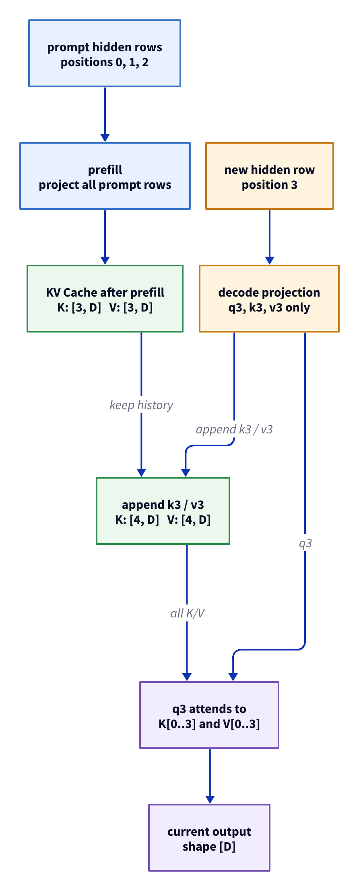
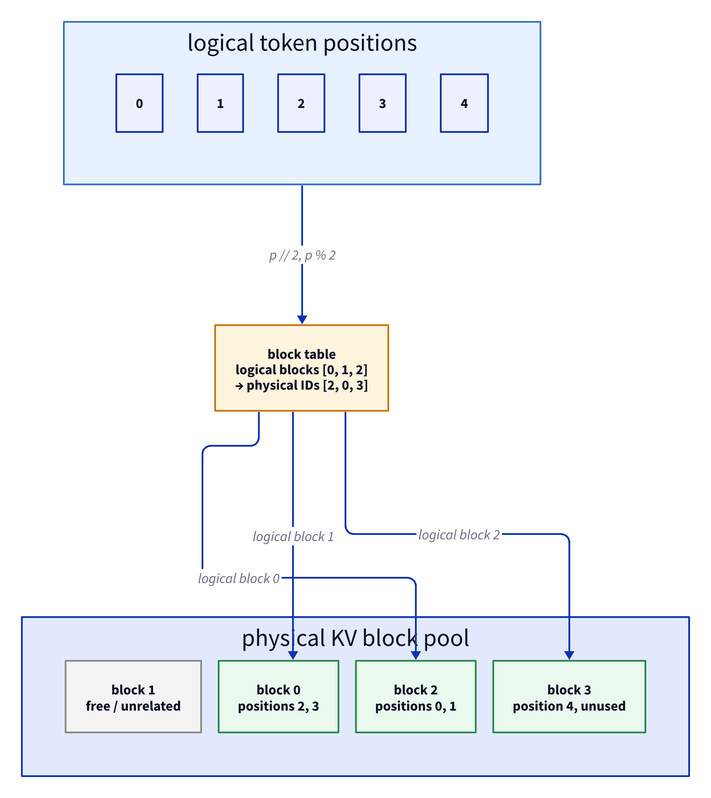

# T21：为什么生成下一个 token 时要留下过去的 K 和 V

> 状态：提前稿，尚未学习或通过。正式进入前先完成 T12～T20；文件存在不表示这些前置已经完成。

今天只解决一个问题：

> **prompt（输入提示序列）已经算过一次。生成后续 token 时，怎样复用过去的 attention 结果，避免一遍遍重算历史 K/V？**

唯一代码产出：

```text
kv_cache_reference.py
```

本课沿同一条序列完成三件事：

```text
先用完整 prefix（当前完整前缀）重算，得到参照结果
↓
保存 prompt 的 K/V，新 token 只计算自己的 q/k/v
↓
两条路径的最后一行 attention output 对齐
↓
再把连续 KV Cache（键值缓存）换成 block table（块表）寻址的小模拟
```

固定边界：一条序列、一层、一个 attention head、`float64`。输入行已经是带位置信息的 hidden representation（隐藏表示）。采样策略留在 T19，多个请求的调度留在 T22，严格性能测量留在 T23。

图中把整段 prompt 的第一次处理叫 **prefill（预填充）**，把新 token 的单步处理叫 **decode（逐 token 解码阶段）**。两步之间留下的历史 K/V 就是刚才所说的 KV Cache。



图先看数据流。prompt 的三行一起经过 projection（投影），形成历史 K/V。新 token 到来后，只产生这一行的 `q_new/k_new/v_new`；`k_new/v_new` 追加进 cache，`q_new` 读取完整 cache 得到当前输出。

---

# Part 1：先证明缓存路径与完整重算得到同一个结果

## 1. 固定一条已经进入 attention 的序列

T18 已经把 token IDs 送到了 hidden states。T21 从这里接手，不再重复 tokenizer、embedding 和 Transformer block。

先固定五个位置的输入：

```python
import math

import torch


DTYPE = torch.float64

all_hidden = torch.tensor(
    [
        [1.0, 0.0],
        [0.0, 1.0],
        [1.0, 1.0],
        [2.0, 1.0],
        [1.0, 2.0],
    ],
    dtype=DTYPE,
)

w_q = torch.tensor([[1.0, 0.5], [0.0, 1.0]], dtype=DTYPE)
w_k = torch.tensor([[0.5, 1.0], [1.0, 0.0]], dtype=DTYPE)
w_v = torch.tensor([[1.0, -0.5], [0.5, 1.0]], dtype=DTYPE)
```

前 3 行是 prompt：

```text
positions 0, 1, 2
```

后 2 行模拟随后到来的 token：

```text
positions 3, 4
```

这些行是固定比较输入。它们不由本课的 sampling 产生。两条路径必须接收完全相同的 hidden rows，才能判断差异来自“重算还是缓存”。

## 2. 先写完整重算路径

T16 已经算过 scaled dot-product attention（缩放点积注意力）。这里把同一个动作写成两个函数：

```python
def project_qkv(
    hidden: torch.Tensor,
    w_q: torch.Tensor,
    w_k: torch.Tensor,
    w_v: torch.Tensor,
) -> tuple[torch.Tensor, torch.Tensor, torch.Tensor]:
    return hidden @ w_q, hidden @ w_k, hidden @ w_v


def causal_attention(
    q: torch.Tensor,
    k: torch.Tensor,
    v: torch.Tensor,
) -> torch.Tensor:
    scores = q @ k.transpose(0, 1) / math.sqrt(q.shape[-1])
    allowed = torch.tril(
        torch.ones(
            scores.shape,
            dtype=torch.bool,
            device=scores.device,
        )
    )
    masked_scores = scores.masked_fill(~allowed, -torch.inf)
    probabilities = torch.softmax(masked_scores, dim=-1)
    return probabilities @ v
```

给定当前完整 prefix，重新计算所有行的 Q/K/V，再取最后一行输出：

```python
def full_recompute_last(
    hidden_prefix: torch.Tensor,
    w_q: torch.Tensor,
    w_k: torch.Tensor,
    w_v: torch.Tensor,
) -> torch.Tensor:
    q, k, v = project_qkv(hidden_prefix, w_q, w_k, w_v)
    outputs = causal_attention(q, k, v)
    return outputs[-1]
```

prompt 长度为 3 时：

```text
hidden_prefix: [3, 2]
q, k, v:      [3, 2]
scores:        [3, 3]
outputs:       [3, 2]
last output:   [2]
```

生成位置 3 后，prefix 长度变成 4。若继续调用这个函数，positions 0～2 的 K/V 会被重新计算。生成位置 4 时，positions 0～3 又会被重新计算。

现在问题已经具体了：

> **过去位置的 hidden rows 没变，对应 K/V 也没变。能不能第一次算完就留下？**

## 3. prompt 第一次整体进入模型，这一步叫 prefill

先把 prompt 三行一起算完：

```python
def prefill(
    hidden_prompt: torch.Tensor,
    w_q: torch.Tensor,
    w_k: torch.Tensor,
    w_v: torch.Tensor,
) -> tuple[torch.Tensor, torch.Tensor, torch.Tensor]:
    q, k, v = project_qkv(hidden_prompt, w_q, w_k, w_v)
    outputs = causal_attention(q, k, v)
    return outputs[-1], k, v
```

返回的三个对象分别是：

```text
prompt_last_output [2]
k_cache            [3, 2]
v_cache            [3, 2]
```

这次处理整段 prompt、同时建立历史 K/V 的阶段就是 prefill。

这里的“填充”指把 prompt 对应的 K/V 写入 cache。它与 padding（补位）不是同一个动作。

## 4. 新 token 到来，只计算新的一行

位置 3 到来时，历史 K/V 已经在 `k_cache/v_cache` 中。现在只投影新 hidden row：

```python
def decode_one(
    hidden_new: torch.Tensor,
    k_cache: torch.Tensor,
    v_cache: torch.Tensor,
    w_q: torch.Tensor,
    w_k: torch.Tensor,
    w_v: torch.Tensor,
) -> tuple[torch.Tensor, torch.Tensor, torch.Tensor]:
    q_new, k_new, v_new = project_qkv(
        hidden_new.unsqueeze(0),
        w_q,
        w_k,
        w_v,
    )

    new_k_cache = torch.cat((k_cache, k_new), dim=0)
    new_v_cache = torch.cat((v_cache, v_new), dim=0)

    scores = q_new @ new_k_cache.transpose(0, 1)
    scores = scores / math.sqrt(q_new.shape[-1])
    probabilities = torch.softmax(scores, dim=-1)
    output = probabilities @ new_v_cache

    return output.squeeze(0), new_k_cache, new_v_cache
```

这一次的数据形状是：

```text
q_new, k_new, v_new: [1, 2]
new K/V cache:       [4, 2]
scores:              [1, 4]
output:              [1, 2]
```

当前 token 是 prefix 最后一个位置，所以它可以读取 cache 中全部 4 个位置，不需要再为这一行增加未来位置 mask。

新 token 到来后，只执行这一行 forward 的阶段就是 decode。这里的 decode 指模型继续生成，不是把 token ID 转回文字。

## 5. 把刚才留下的对象收束成 KV Cache

刚才留下并在下一步复用的：

```text
k_cache
v_cache
```

合起来就是 KV Cache。

为什么保存 K 和 V：

```text
未来 token 的 q_new
需要和所有历史 K 比较
再用得到的权重汇总所有历史 V
```

为什么不保存历史 Q：

```text
未来一步只需要当前 token 的 query
过去 query 已经完成了各自那一步输出
后续不会再次拿它们查询新 token
```

这就是 KV Cache 的第一层本质：

> **用持续增长的 K/V 存储，换掉后续步骤对历史 K/V 的重复计算。**

## 6. R1 的正确性判据：两条路径逐步对齐

这里的 oracle（判定实现对错的参照）就是完整重算路径。它慢一些，但动作直接，适合检查 cache 路径有没有丢位置或接错 K/V。

先验证 prefill：

```python
prompt = all_hidden[:3]

prefill_output, k_cache, v_cache = prefill(
    prompt,
    w_q,
    w_k,
    w_v,
)
reference = full_recompute_last(prompt, w_q, w_k, w_v)

assert torch.allclose(prefill_output, reference, atol=1e-12, rtol=1e-12)
assert k_cache.shape == (3, 2)
assert v_cache.shape == (3, 2)
```

再让 positions 3、4 依次到来：

```python
prefix = prompt.clone()

for hidden_new in all_hidden[3:]:
    old_length = k_cache.shape[0]
    prefix = torch.cat((prefix, hidden_new.unsqueeze(0)), dim=0)

    reference = full_recompute_last(prefix, w_q, w_k, w_v)
    cached_output, k_cache, v_cache = decode_one(
        hidden_new,
        k_cache,
        v_cache,
        w_q,
        w_k,
        w_v,
    )

    assert torch.allclose(cached_output, reference, atol=1e-12, rtol=1e-12)
    assert k_cache.shape[0] == old_length + 1
    assert v_cache.shape[0] == old_length + 1
```

这组证据同时证明：

1. cache 路径得到与完整重算相同的当前输出；
2. 每次 decode 只追加一行 K 和一行 V；
3. cache 的逻辑顺序始终对应 positions `0..current_position`。

### Round 1 任务

在 `kv_cache_reference.py` 中完成并运行：

```python
project_qkv
causal_attention
full_recompute_last
prefill
decode_one
```

### Round 1 停止点

先确认你能沿 position 3 说清：

1. 哪些 K/V 来自 prompt？
2. 哪些 q/k/v 是本步新算的？
3. 为什么本步仍然读取全部历史 K/V？
4. 两条路径为什么必须喂相同 hidden rows？

---

# Part 2：省掉历史重算以后，cache 自己要占多少空间

## 7. KV Cache 节省了什么，没有省掉什么

位置 3 的两条路径对比：

```text
完整重算
对 positions 0..3 全部重新投影 Q/K/V
最后只使用 position 3 的输出

cache decode
只投影 position 3 的 q/k/v
q_new 仍与 positions 0..3 的全部 K 做比较
并汇总 positions 0..3 的全部 V
```

因此 KV Cache 消除的是历史 K/V 及前面模型路径的重复计算。标准全历史注意力下，decode 仍要读取越来越长的历史 K/V，当前 query 与历史的点积工作也随序列长度增长。

对于本例，prompt 长度 3、后续两步 decode：

| 阶段 | 完整重算本次投影多少行 | cache 路径本次投影多少行 |
|---|---:|---:|
| prefill，长度3 | 3 | 3 |
| decode position 3，长度4 | 4 | 1 |
| decode position 4，长度5 | 5 | 1 |

表格现在只是压缩刚才已经走过的两条路径。

## 8. cache shape 从单层单头推广到真实模型

本课单层单头的每份 cache 是：

```text
[sequence_length, head_dim]
```

真实模型通常逐层、逐请求、逐 KV head 保存：

```text
每一层的 K: [batch, kv_heads, sequence_length, head_dim]
每一层的 V: [batch, kv_heads, sequence_length, head_dim]
```

不同框架可能采用不同维度顺序或物理布局。容量只看元素总数，不依赖维度书写顺序。

对 full attention，KV 数值本体的估算是：

$$
\text{bytes}
=
2
\times L
\times B
\times H_{kv}
\times S
\times D_{head}
\times \text{bytes per value}
$$

其中前面的 `2` 分别代表 K 和 V。

实现：

```python
def kv_cache_payload_bytes(
    layer_count: int,
    batch_size: int,
    kv_head_count: int,
    sequence_length: int,
    head_dim: int,
    bytes_per_value: int,
) -> int:
    values = (
        2
        * layer_count
        * batch_size
        * kv_head_count
        * sequence_length
        * head_dim
    )
    return values * bytes_per_value
```

例如：

```text
L = 32
B = 1
H_kv = 32
S = 4096
D_head = 128
BF16/FP16 = 2 bytes
```

得到：

```text
2,147,483,648 bytes = 2 GiB
```

这只计算 KV 数值 payload。block metadata、allocator、padding、碎片、workspace、模型权重和其他激活仍在账外。

## 9. 时间换空间：cache 是一个明确取舍

沿刚才的对象看：

```text
不保存历史 K/V
-> 每一步重新计算历史
-> 少一份跨步骤状态，重复计算更多

保存历史 K/V
-> decode 直接读取 cache
-> 重复计算更少，cache 随有效历史增长
```

因此 KV Cache 是 **compute-memory trade-off（计算与内存取舍）**。

本课用 `torch.cat` 表达“逻辑上追加一行”。真实 runtime 常会预留空间或写入已分配位置，避免每个 token 都复制整个 cache。这个实现差异不改变 R1 的数值关系。

### Round 2 任务

1. 打印每个步骤的 prefix length、完整重算投影行数和 cache 投影行数。
2. 完成 `kv_cache_payload_bytes()`。
3. 计算本课小例子和上面的 32 层例子。
4. 在输出中明确容量账包含项与排除项。

### Round 2 停止点

先确认你能回答：

1. 为什么 cache 中保存 K/V 而不是历史 Q？
2. 为什么 KV Cache 减少重复计算，却不会让标准 decode 与历史长度无关？
3. 为什么公式使用 `H_kv`，不能总是假设它等于 query head 数？

---

# Part 3：逻辑上连续的 token，不要求物理块也连续

## 10. 连续 Tensor 在多请求服务里会遇到什么问题

单条教学序列可以把 K/V 写成连续 Tensor：

```text
position:  0   1   2   3   4
K rows:   k0  k1  k2  k3  k4
```

服务端同时处理许多请求时，每条序列长度不同，也会不断增长、结束和释放。若每条请求都要求一整段恰好连续且可持续扩大的空间，分配、搬迁和碎片会变成额外问题。

现在产生一个新需求：

> **对模型保持 token positions 连续，同时允许这些 K/V 行放在不同物理块中。**

## 11. 用 block table 把逻辑位置翻译成物理位置

固定每个块装 2 个 token 的 K/V。某条序列有 5 个位置：

```text
logical block 0: positions 0, 1
logical block 1: positions 2, 3
logical block 2: position 4
```

它实际拿到的物理块可能是：

```text
block_table = [2, 0, 3]
```

这张 `logical block -> physical block ID` 的表叫 **block table（块表）**。



读取逻辑 position `p` 时：

```text
logical_block = p // block_size
offset_inside_block = p % block_size
physical_block = block_table[logical_block]
```

若物理块展平成一维 slot：

$$
\text{slot}(p)
=
\text{block\_table}[p // \text{block\_size}]
\times \text{block\_size}
+ p \bmod \text{block\_size}
$$

例如 position 3：

```text
logical_block = 3 // 2 = 1
offset = 3 % 2 = 1
physical_block = block_table[1] = 0
physical slot = 0 * 2 + 1 = 1
```

它仍是序列中的第 4 个 token，只是数据放在 physical block 0 的第二个位置。

## 12. 小模拟只证明寻址，不实现 allocator

```python
def gather_paged_rows(
    physical_blocks: torch.Tensor,
    block_table: list[int],
    sequence_length: int,
) -> torch.Tensor:
    block_size = physical_blocks.shape[1]
    rows: list[torch.Tensor] = []

    for position in range(sequence_length):
        logical_block = position // block_size
        offset = position % block_size
        physical_block = block_table[logical_block]
        rows.append(physical_blocks[physical_block, offset])

    return torch.stack(rows, dim=0)
```

为物理块写入本课连续 `k_cache`：

```python
block_size = 2
block_table = [2, 0, 3]
physical_k = torch.full((4, block_size, 2), torch.nan, dtype=DTYPE)

for position, row in enumerate(k_cache):
    logical_block = position // block_size
    offset = position % block_size
    physical_block = block_table[logical_block]
    physical_k[physical_block, offset] = row

gathered_k = gather_paged_rows(
    physical_k,
    block_table,
    sequence_length=k_cache.shape[0],
)

assert torch.equal(gathered_k, k_cache)
```

V 用同一张 block table 做相同检查。

这种表示叫 **paged KV cache（分页 KV 缓存）**：模型看到逻辑上有序的 K/V，运行时用 block table 找到分散的物理块。这里的 KV block 是缓存管理单位，不是 CUDA thread block。

## 13. 前缀复用为什么还需要块身份与生命周期

两个请求若有相同前缀，理论上可以让它们的 block table 指向同一批已计算物理块，从而跳过共享前缀的重复 prefill。这叫 **prefix reuse（前缀复用）**。

但“字符串看起来相同”还不足以安全复用。运行时至少要知道：

```text
这块 K/V 对应哪段 token prefix
前面的 prefix 身份是什么
使用的模型与相关执行上下文是否兼容
当前还有哪些请求正在引用它
这块空间何时可以重新分配
```

运行时可以为物理块维护 **reference count（引用计数）**。第一层生命周期是：

```text
request 开始使用 block
-> 引用计数增加

request 结束使用 block
-> 引用计数减少

引用计数 > 0
-> block 仍被活跃请求使用，不能回收

引用计数 == 0
-> block 才有资格进入可复用或淘汰范围
```

“引用数为 0”表示可以回收，不等于必须立刻抹掉。保留一段时间可以服务后续前缀命中；空间不足时再按明确策略淘汰。

本课只解释这个约定，不实现哈希表、空闲队列、淘汰策略或完整块分配器。

## 14. prefill 与 decode 分开执行时，需要交接什么

同一进程里，`prefill()` 直接把 `k_cache/v_cache` 交给 `decode_one()`。

若系统把 prefill 与 decode 放到不同 worker（执行进程），交接对象仍是同一份逻辑状态，但交接约定必须更明确：

```text
属于哪个 request / sequence
覆盖哪些 token positions
每一层有哪些 K/V
shape、dtype 与 layout
物理块身份或传输后的新位置
接收方何时可以开始 decode
发送方何时可以释放原资源
```

T21 只建立这份状态交接的第一层认识，不实现网络传输或 disaggregated serving（预填充与解码分离服务）。

### Round 3 任务

1. 用 `block_table = [2, 0, 3]` 写入并读回 K/V。
2. 证明 gather 后与 R1 的连续 cache 完全相等。
3. 口述一个共享 prefix block 的引用数怎样从 0 变 2，再回到 0。
4. 说明 block table 解决的是物理放置问题，没有改变 attention 数学结果。

---

## 15. 最终交付

`kv_cache_reference.py` 应按这一条故事运行：

```text
固定 prompt 与两行后续输入
↓
prefill 建立连续 K/V cache
↓
每步 decode 与 full-prefix recompute 的最后输出对齐
↓
打印投影行数与 cache length 的变化
↓
估算多层多头 KV payload
↓
把同一份连续 K/V 写入分散物理块
↓
通过 block table 按逻辑顺序读回
```

建议最后打印：

```text
T21 KV CACHE REFERENCE PASS
```

## 16. PASS 标准

通过时，你应该能自己解释：

1. prefill 处理哪批 token，decode 每步处理哪一行。
2. KV Cache 保存什么，为什么不保存历史 Q。
3. cache decode 为什么仍要读取全部有效历史 K/V。
4. 连续重算与缓存路径怎样建立可比较的 correctness oracle。
5. KV payload 公式中 `2、L、B、H_kv、S、D_head` 分别从哪里来。
6. block table 怎样把 logical token position 映射到 physical block 和 offset。
7. prefix reuse 为什么同时需要 block identity、reference count 和 eviction contract。

## 17. 与后续主线怎样连接

T21 只研究一条序列的计算与缓存状态。

接下来：

```text
T22
多条请求怎样进入同一轮执行
怎样在序列不断完成和加入时组织 batch

T23
怎样设计 correctness、latency、throughput 与 memory benchmark

T24
把前面的模型、采样、cache 与执行流收成 tiny reference
```

## 18. 本课结束后

**请亲自写一份 T21 笔记。** 至少画出 prompt prefill、单步 decode 和 block table 三张对象关系，并写清当前 cache 容量账包含什么、没有包含什么。

## 19. 核验入口

- [Hugging Face Transformers：Caching](https://huggingface.co/docs/transformers/v4.57.0/en/cache_explanation)
- [PyTorch 2.14：scaled_dot_product_attention](https://docs.pytorch.org/docs/2.14/generated/torch.nn.functional.scaled_dot_product_attention.html)
- [PagedAttention / vLLM paper](https://arxiv.org/abs/2309.06180)
- [vLLM：Automatic Prefix Caching](https://docs.vllm.ai/en/latest/design/prefix_caching/)

这些资料用于核对 cache 语义、attention shape 与生产系统边界。核心实现仍由本课固定小例子独立完成，不要求安装 Transformers、vLLM 或 CUDA。
