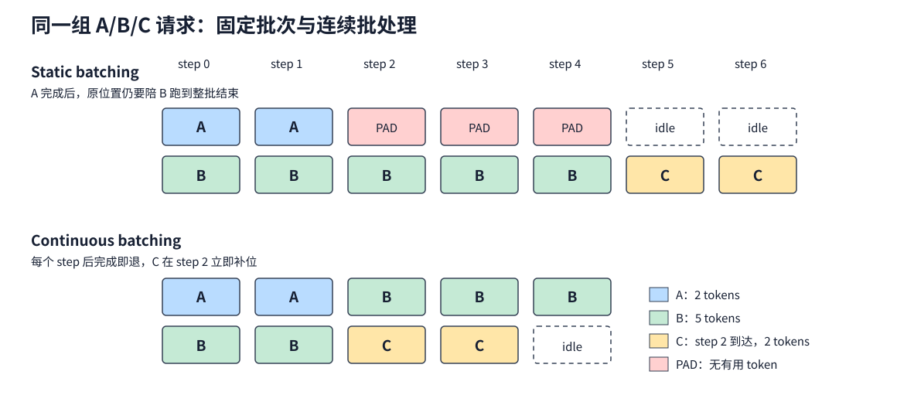

# T22：为什么一批请求不能等最慢的那个结束再换下一批

> 版本：2026-11-12
> 状态：提前稿，尚未学习或通过。正式进入前先完成 T15～T21；文件存在不表示这些前置已经完成。

T21 只看一条序列：prompt 先做 prefill，随后每次 decode 一个新 token，KV Cache 持续增长。

现在同时来了多条请求。它们到达时间不同，prompt 长度不同，最后生成的 token 数也不同。

今天只解决一个问题：

> **每一轮模型执行前，scheduler（调度器）怎样决定哪些请求一起运行、各做多少 token 工作？**

唯一代码产出：

```text
batch_scheduler_sim.py
```

这只是 CPU 离散模拟，不运行真实模型，也不测 GPU 性能。主线只有一条：

```text
固定一批请求一起跑到底
-> 短请求完成后仍留下空转位置
-> 每个 decode step 后重新组成 batch
-> 新请求可以补入，完成请求立即退出
-> 再加入长 prompt 的 prefill 工作
-> 用 token budget 和 chunked prefill 控制每一步工作量
```



---

# Part 1：先看固定批次为什么会浪费位置

## 1. 先只观察 decode，不把 prefill 混进来

先固定三条已经能够进入 decode 的请求：

| 请求 | 可以开始的 step | 还要生成多少 token |
|---|---:|---:|
| A | 0 | 2 |
| B | 0 | 5 |
| C | 2 | 2 |

本节一个 step 只表示一次离散的 decode 迭代：

```text
某条请求本 step 被选中
-> 它生成 1 个 token
-> decode_remaining 减 1
```

batch 最多同时容纳 2 条请求。

这里暂时没有真实时间、矩阵计算和 KV block 分配。先把“谁在第几轮运行”看清。

## 2. 固定批次：A 完成了，也不能让 C 立即补进来

最直接的做法是：

```text
step 0 选出 A、B
-> 这批成员固定
-> 等整批里最慢的 B 结束
-> 才开始下一批
```

于是时间线是：

| step | 真正在生成 token 的请求 | 已到达但仍在等待 | 已完成但仍被本批保留的位置 | 还没装入请求的位置 |
|---:|---|---|---:|---:|
| 0 | A, B | - | 0 | 0 |
| 1 | A, B | - | 0 | 0 |
| 2 | B | C | 1 | 0 |
| 3 | B | C | 1 | 0 |
| 4 | B | C | 1 | 0 |
| 5 | C | - | 0 | 1 |
| 6 | C | - | 0 | 1 |

A 在 step 1 结束后已经得到两个 token。

但 A 原来占据的位置仍属于当前固定批次。step 2 到达的 C 只能继续等待，直到 B 在 step 4 结束。

这三格：

```text
step 2：A 的旧位置
step 3：A 的旧位置
step 4：A 的旧位置
```

不再产生任何有用 token。本课把一格称为一个 **slot-step（位置步）**，这三格就是 padding waste（补位浪费）。

它与 T15 为输入序列补 PAD token 的原因不同。这里补的是不同生成长度之间的空缺。

## 3. 先数清固定批次发生了什么

三条请求真正需要的 token 工作一共是：

$$
2 + 5 + 2 = 9
$$

固定批次另外产生了 3 个 padding slot-steps：

```text
useful token steps = 9
padding slot-steps = 3
all requests finish at = 7
C first scheduled at = 5
```

这里的 `finish at = 7` 表示 step 6 执行结束后的边界时刻。

这些数字只描述模拟器中的工作格子，不表示 9 个真实 token 一定耗时相同，也不表示 GPU 利用率。

## 4. 每一步结束后重新组批

现在只改一条规则：

```text
每个 step 结束
-> 移出已经完成的请求
-> 查看本 step 前已经到达的等待请求
-> 用它们补上空位
-> 运行下一步
```

同一组 A、B、C 会变成：

| step | 真正在生成 token 的请求 | 已到达但仍在等待 | padding 位置 | 空闲位置 |
|---:|---|---|---:|---:|
| 0 | A, B | - | 0 | 0 |
| 1 | A, B | - | 0 | 0 |
| 2 | B, C | - | 0 | 0 |
| 3 | B, C | - | 0 | 0 |
| 4 | B | - | 0 | 1 |

A 完成后立即退出。C 在 step 2 到达，正好补入 A 腾出的位置。

现在的结果是：

```text
useful token steps = 9
padding slot-steps = 0
all requests finish at = 5
C first scheduled at = 2
```

这个动作叫 **continuous batching（连续批处理）**。

它的核心不是“batch 一直很大”，而是：

> **batch 的成员可以在每个迭代边界退出和加入。**

Orca 论文把这种粒度称为 iteration-level scheduling（迭代级调度）。

## 5. static、dynamic 和 continuous 不要混成一个词

刚才已经看见两种具体行为，现在再给名字：

| 名称 | 新请求怎样进入 | batch 开始后成员会不会改变 |
|---|---|---|
| static batching，静态批处理 | 预先组成固定批次 | 不改变，等整批结束 |
| dynamic batching，动态组批 | 按到达窗口或数量凑出一批 | 不一定改变，可能仍整批跑完 |
| continuous batching，连续批处理 | 等待请求可在迭代边界补位 | 会，完成即退、空位可补 |

“请求是运行时到达的”只能说明组批是动态的。

只有 batch 在执行期间还能按迭代改变成员，才是本课研究的 continuous batching。

## 6. R1 要实现的两个模拟器

两个函数都接收请求说明和 batch 容量，返回逐 step 的 trace（轨迹）。输入请求说明保持不变。

```python
from dataclasses import dataclass


@dataclass(frozen=True)
class DecodeJob:
    request_id: str
    ready_step: int
    output_tokens: int


@dataclass(frozen=True)
class DecodeStep:
    step: int
    active_ids: tuple[str, ...]
    waiting_ids: tuple[str, ...]
    padding_slots: int
    idle_slots: int


def simulate_static_decode(
    jobs: list[DecodeJob],
    max_batch_size: int,
) -> list[DecodeStep]:
    ...


def simulate_continuous_decode(
    jobs: list[DecodeJob],
    max_batch_size: int,
) -> list[DecodeStep]:
    ...
```

`active_ids` 是本 step 真正生成一个 token 的请求。

`waiting_ids` 是已经到达、但本 step 没有进入 batch 的请求。尚未到达的请求不在其中。

`padding_slots` 是已完成成员仍被当前固定批次占据的位置。

`idle_slots` 是没有任何请求占据的位置。continuous 模拟中不应制造 padding slot，但低负载时仍可能有 idle slot。

固定输入：

```python
jobs = [
    DecodeJob("A", ready_step=0, output_tokens=2),
    DecodeJob("B", ready_step=0, output_tokens=5),
    DecodeJob("C", ready_step=2, output_tokens=2),
]

static_trace = simulate_static_decode(jobs, max_batch_size=2)
continuous_trace = simulate_continuous_decode(jobs, max_batch_size=2)
```

R1 的 oracle 是前面两张表。至少留下这些断言：

```python
assert sum(step.padding_slots for step in static_trace) == 3
assert sum(step.padding_slots for step in continuous_trace) == 0

assert len(static_trace) == 7
assert len(continuous_trace) == 5

assert continuous_trace[2].active_ids == ("B", "C")
assert static_trace[2].waiting_ids == ("C",)
assert continuous_trace[2].waiting_ids == ()
```

还要从 trace 数出每个请求出现的次数：

```text
A -> 2
B -> 5
C -> 2
```

这证明调度变化没有多生成或漏生成 token。

### Round 1 任务

1. 实现两个 decode 模拟器。
2. 打印两张逐 step 表。
3. 断言 useful token 次数、padding 数、总完成边界和 C 的首次执行 step。
4. 不加入 prompt、KV block、wall-clock 计时或绘图代码。

### Round 1 停止点

先确认你能回答：

1. A 在什么时候完成？固定批次为什么仍留下它的位置？
2. C 在两种策略下分别什么时候第一次运行？
3. continuous batching 改变的是请求计算结果，还是每步 batch 的成员？

---

# Part 2：长 prompt 和正在 decode 的请求争同一步预算

## 7. continuous batching 还没有回答“每条请求做多少工作”

R1 中，每个活跃请求每步都只做一件事：decode 1 个 token。

真实服务还有 prefill：

```text
decode 请求 D
本步只需要推进 1 个 token

新请求 L
prompt 有 8 个 token 还没有 prefill
```

若把 L 的 8-token prefill 一次塞进当前 step，这一步就比纯 decode step 重得多。

所以 scheduler 不只要选“谁运行”，还要决定：

> **每个被选中的请求，本 step 处理多少个 token？**

## 8. token budget 是本模拟器的一把统一尺子

固定每一步的 token budget（token 工作预算）为 8：

```text
一条 decode 请求推进一步 -> 消耗 1
prefill N 个 prompt token -> 消耗 N
本 step 所有消耗之和 -> 不能超过 8
```

$$
\sum \text{decode work}
+
\sum \text{prefill work}
\leq
\text{token budget}
$$

这是调度模拟中的记账单位。

它不声称 1 个 prefill token 与 1 个 decode token 的真实耗时完全相同，也不等于 FLOPs、显存字节或毫秒。T23 才会建立实际测量口径。

## 9. 同一个场景，用三种策略走一遍

固定两条请求：

```text
D：已经完成 prefill，还要 decode 4 个 token
L：新到达，先 prefill 8 个 prompt token，再 decode 1 个 token
token budget = 8
```

本模拟约定：prefill 在某个 step 结束后，请求从下一 step 起进入 decode。

### 9.1 整段 prefill 优先

先让 L 一次做完整 prefill：

| step | decode 工作 | prefill 工作 | used budget |
|---:|---|---|---:|
| 0 | - | L: 8 | 8 |
| 1 | D, L | - | 2 |
| 2 | D | - | 1 |
| 3 | D | - | 1 |
| 4 | D | - | 1 |

L 的 prompt 很快处理完，但 D 在 step 0 没有推进。

### 9.2 decode 优先，但 prefill 必须整段装下

先给 D 1 个预算，当前只剩 7。

L 的 8-token prefill 不能完整装入，因此继续等待：

| step | decode 工作 | prefill 工作 | used budget |
|---:|---|---|---:|
| 0 | D | - | 1 |
| 1 | D | - | 1 |
| 2 | D | - | 1 |
| 3 | D | - | 1 |
| 4 | - | L: 8 | 8 |
| 5 | L | - | 1 |

D 每一步都能推进，但 L 一直等到 D 完成才开始 prefill。

### 9.3 decode 优先，并允许把 prefill 切成 4-token chunk

现在 L 的 8-token prefill 可以分两步完成：

| step | decode 工作 | prefill 工作 | used budget |
|---:|---|---|---:|
| 0 | D | L: 4 | 5 |
| 1 | D | L: 4 | 5 |
| 2 | D, L | - | 2 |
| 3 | D | - | 1 |

D 没有出现空档。L 也不用等 D 全部结束，两个 step 后就完成 prefill。

把长 prefill 拆成多个 step 的做法叫 **chunked prefill（分块预填充）**。

第一块完成后，L 已经为 prompt 前 4 个位置建立了 K/V；第二块继续处理剩余 4 个位置。它沿用的是 T21 的 cache 状态，不是每块重新从头计算。

## 10. 三种策略改变了谁的等待

前面的具体结果可以压成一张表：

| 策略 | D 第一次 decode | L prefill 完成边界 | L 第一次 decode | D 是否中断一步 |
|---|---:|---:|---:|---|
| 整段 prefill 优先 | 1 | 1 | 1 | 是 |
| decode 优先、不切块 | 0 | 5 | 5 | 否 |
| decode 优先、4-token chunk | 0 | 2 | 2 | 否 |

这里没有一条“所有目标都最好”的策略：

```text
整段 prefill 越早完成
-> 新请求越早进入 decode
-> 可能让正在生成的请求出现空档

优先保证 decode 连续推进
-> 旧请求更平稳
-> 新长 prompt 可能等待更久

允许 chunked prefill
-> 两类工作可以在预算内共同推进
-> 长 prompt 要跨多个 step 才完成
```

## 11. R2 的请求对象与调度结果

现在才把完整请求状态写进接口。

`simulate_token_budget()` 的用途是把一组固定请求跑到全部完成，并返回每一步的调度决定。输入请求只说明到达时刻、prompt 数和目标输出数，不被修改；函数内部另存尚未处理的 prompt 数和尚未生成的 output 数。

```python
@dataclass(frozen=True)
class ServingRequest:
    request_id: str
    arrival_step: int
    prompt_tokens: int
    output_tokens: int


@dataclass(frozen=True)
class BudgetStep:
    step: int
    decode_ids: tuple[str, ...]
    prefill_work: tuple[tuple[str, int], ...]
    used_tokens: int
    waiting_ids: tuple[str, ...]


def simulate_token_budget(
    requests: list[ServingRequest],
    token_budget: int,
    *,
    decode_first: bool,
    prefill_chunk_limit: int | None,
) -> list[BudgetStep]:
    ...
```

`prefill_chunk_limit=None` 表示本模拟器要求整段剩余 prefill 一次装下；`4` 表示一次最多处理 4 个 prompt token。

`BudgetStep` 是证据，不是模型输出：

```text
decode_ids
-> 哪些请求各推进了 1 个 output token

prefill_work
-> 哪些请求本步处理了多少 prompt token

used_tokens
-> 本步总记账，必须 <= token_budget

waiting_ids
-> 已到达但本步没有获得工作的请求
```

固定场景：

```python
requests = [
    ServingRequest("D", arrival_step=0, prompt_tokens=0, output_tokens=4),
    ServingRequest("L", arrival_step=0, prompt_tokens=8, output_tokens=1),
]
```

这里 `D.prompt_tokens == 0` 表示它在观察窗口开始前已经完成 prefill，不表示真实请求可以没有 prompt。

同一个接口用参数表达前面的三种策略：

```python
whole_prefill_first = simulate_token_budget(
    requests,
    token_budget=8,
    decode_first=False,
    prefill_chunk_limit=None,
)

decode_first_whole = simulate_token_budget(
    requests,
    token_budget=8,
    decode_first=True,
    prefill_chunk_limit=None,
)

decode_first_chunked = simulate_token_budget(
    requests,
    token_budget=8,
    decode_first=True,
    prefill_chunk_limit=4,
)
```

这三次调用只改变调度策略，不改变请求输入和 token budget。

### Round 2 任务

1. 实现 `simulate_token_budget()`。
2. 用同一函数跑出 §9 的三张表。
3. 每一步断言 `used_tokens <= token_budget`。
4. 断言 D 恰好 decode 4 次、L 恰好 prefill 8 个 token 并 decode 1 次。
5. 记录两条请求的 first decode step，不把它命名成真实 TTFT 或 TPOT。

### Round 2 停止点

先确认你能回答：

1. 为什么 decode-first 且不切块时，7 个剩余预算仍不能处理 L？
2. chunked prefill 保存了什么进度，下一步从哪里继续？
3. token budget 约束的是本模拟器中的什么，不代表哪些真实资源？

---

# Part 3：从一张 trace 看见 scheduler、backpressure 与阶段分离

## 12. scheduler 不只是一个 FIFO queue

普通 FIFO queue 回答：

```text
下一个取出的元素是谁？
```

本课 scheduler 每一步要同时回答：

```text
哪些 running 请求继续 decode？
哪些 waiting 请求已经到达？
剩余 token budget 能接纳多少 prefill？
哪些请求本步完成并退出？
下一步有哪些空位和剩余状态？
```

所以它更像：

```text
waiting/running state
+ scheduling policy
+ resource budget
+ completion update
```

它可以使用 FIFO 作为同类请求之间的顺序，但 scheduler 本身不等于一条 FIFO queue。

## 13. waiting 持续增长就是容量压力的证据

再看一个不需要新算法的场景：

```text
max batch size = 2
每个 step 新到达 1 条请求
每条请求都要 decode 4 个 token
```

每个 step 新增的需求是 4 个 token-work，最多只能完成 2 个。

若这种负载持续：

```text
arrival work rate > service work rate
-> waiting queue 持续增长
-> 新请求排队越来越久
```

这就是 backpressure（反压）需要出现的地方：下游容量已经不足，上游不能无限制继续灌入工作。

真实服务可能限制队列、拒绝或限流、延迟接纳，或扩充资源。本课只打印 `waiting_count`，不实现网络层 admission control（接纳控制）。

## 14. PD 和 EPD 只是把今天的阶段放到不同执行者

到目前为止，prefill 与 decode 共用同一个模拟 scheduler。

PD disaggregation（预填充/解码分离）把它们放到不同执行实例：

```text
request
-> prefill worker 建立 prompt KV Cache
-> 交接 KV state
-> decode worker 逐 token 生成
```

这里最重要的不是新缩写，而是 T21 已经出现的交接对象：

```text
request / sequence identity
覆盖的 token positions
各层 KV blocks
shape、dtype、layout
接收方何时可以开始
发送方何时可以释放
```

EPD disaggregation（编码/预填充/解码分离）再把多模态模型的 encoder 工作独立出来：

```text
image or other modality
-> encoder worker 产生表示
-> prefill worker 建立语言模型 KV Cache
-> decode worker 生成 token
```

T22 不实现 router、worker、KV 传输、重试或故障恢复。这里只需要知道：阶段一旦分开，scheduler 之外还多了状态交接与生命周期问题。

## 15. R3 只给同一模拟补证据

不要再新建第二套 scheduler。给 R1/R2 的 trace 补这些断言：

1. 请求不会在 `arrival_step` 之前出现。
2. 每一步 `used_tokens <= token_budget`。
3. 请求完成后不会再次进入后续 step。
4. 每条请求的 prefill 总量和 decode 总量与输入规格完全一致。
5. continuous decode 中，空位按到达顺序接纳等待请求。
6. 过载小场景中 `waiting_count` 会增长，而不是静默丢请求。

建议最终输出：

```text
STATIC DECODE TRACE PASS
CONTINUOUS DECODE TRACE PASS
TOKEN BUDGET TRACE PASS
BACKPRESSURE OBSERVATION PASS
T22 BATCH SCHEDULER SIM PASS
```

这些 trace 证明模拟器遵守本课合同。

它们不能证明某个真实 serving engine 更快，也不能支持“吞吐提升多少”或“延迟降低多少”的结论。

---

## 16. 最终交付

`batch_scheduler_sim.py` 应沿这一条路径运行：

```text
A/B/C 固定 decode workload
-> static batch trace
-> continuous batch trace
-> 9 个有用 token 不变，padding 3 -> 0
-> D/L prefill-decode workload
-> 三种 token-budget policy trace
-> chunked prefill 在预算内与 decode 共同推进
-> 过载场景观察 waiting 增长
```

不要求：

```text
PyTorch 模型执行
真实 tokenizer 或 sampling
KV block allocator
vLLM / SGLang 源码复刻
网络 server
wall-clock benchmark
PD / EPD 部署
```

## 17. PASS 标准

通过时，你应该能自己解释：

1. 固定批次中 3 个 padding slot-steps 从哪里来。
2. continuous batching 为什么能让 C 在 step 2 补入。
3. dynamic batching 与 continuous batching 的差别。
4. scheduler 为什么不只是普通 FIFO queue。
5. token budget 怎样同时记 decode 和 prefill 工作。
6. 整段 prefill 优先、decode 优先不切块、decode 优先切块分别让谁等待。
7. chunked prefill 为什么需要保存已处理 prompt 的 KV 状态。
8. waiting queue 增长为什么是 backpressure 信号。
9. PD/EPD 分开后至少要交接哪些状态。

## 18. 与后续主线怎样连接

T22 只得到离散的调度 trace。

接下来：

```text
T23
把“第几步发生什么”接到 correctness、latency、throughput、TTFT、TPOT/ITL 和严谨 benchmark

T24
把模型、sampling、KV Cache 与 scheduler 收进 tiny Transformer reference
```

## 19. 本课结束后

**请亲自写一份 T22 笔记。**

至少保留两张图：A/B/C 的 static/continuous 时间线，以及 D/L 的三种 token-budget trace。再用自己的话写清 scheduler 每一步读什么状态、做什么决定、更新什么状态。

## 20. 核验入口

- [Orca：迭代级调度原论文页面](https://www.usenix.org/conference/osdi22/presentation/yu)
- [vLLM V1 Scheduler 当前源码文档](https://docs.vllm.ai/en/latest/api/vllm/v1/core/sched/scheduler/)
- [vLLM：Disaggregated Prefilling](https://docs.vllm.ai/en/v0.12.0/features/disagg_prefill/)
- [SGLang：PD Disaggregation](https://github.com/sgl-project/sglang/blob/main/docs/docs/advanced_features/pd_disaggregation.mdx)
- [SGLang：EPD Disaggregation](https://github.com/sgl-project/sglang/blob/main/docs/docs/advanced_features/epd_disaggregation.mdx)
- [AIInfraGuide：Continuous Batching](https://caomaolufei.github.io/AIInfraGuide/inference/%E6%A8%A1%E5%9D%97%E5%9B%9B-%E6%8E%A8%E7%90%86%E4%BC%98%E5%8C%96/%E7%AC%AC2%E7%AB%A0-%E6%8E%A8%E7%90%86%E5%BC%95%E6%93%8E%E6%A0%B8%E5%BF%83%E6%8A%80%E6%9C%AF/22-continuous-batching/)
- [AIInfraGuide：Chunked Prefill 与统一 Token Budget 调度](https://caomaolufei.github.io/AIInfraGuide/inference/%E6%A8%A1%E5%9D%97%E5%9B%9B-%E6%8E%A8%E7%90%86%E4%BC%98%E5%8C%96/%E7%AC%AC2%E7%AB%A0-%E6%8E%A8%E7%90%86%E5%BC%95%E6%93%8E%E6%A0%B8%E5%BF%83%E6%8A%80%E6%9C%AF/24-chunked-prefill-%E4%B8%8E%E7%BB%9F%E4%B8%80%E8%B0%83%E5%BA%A6/)

官方资料用于核对概念和当前实现边界。T22 的核心仍是自己的固定 trace 和断言，不复制框架 scheduler，也不采用外部性能倍数作为本机结论。
