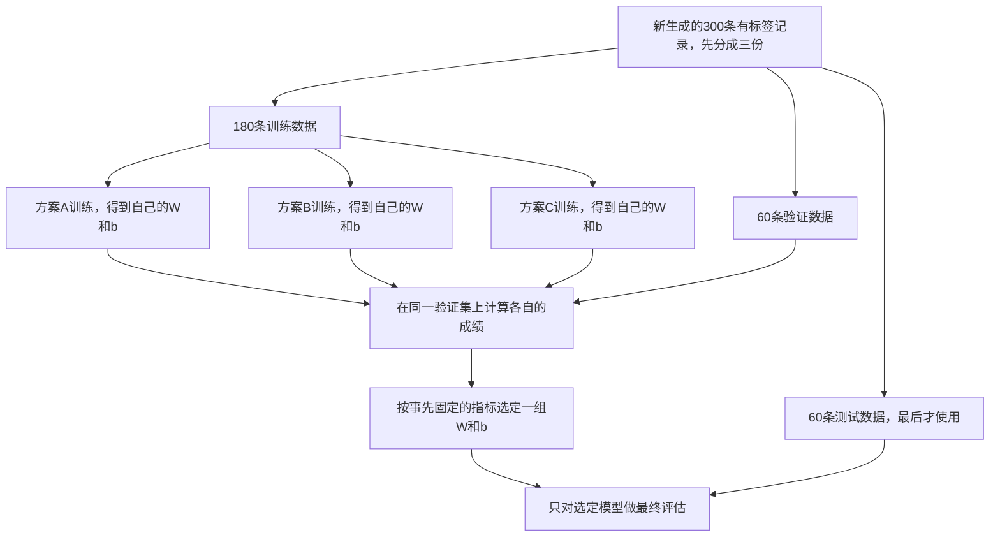

# AI Infra Theory T8：Softmax Classifier 与完整 ML Workflow

> 版本：2026-10-17，R1/R2正文保留；R3按已通过实现明确剩余输入校验、复用证据和最终检查对象
> 前置：T1~T6；T7 由 Ex1 或 synthetic fallback 中任一路径等价通过
> 当前状态：T1~T7已通过，T7最终98/100；T8 R1核心与R2均100/100正式通过；旧checker的90/100仅为R1历史记录；当前R3，整课与Theory Gate 1尚未通过
> 建议投入：约 6~8 个有效小时
> 固定产出：`softmax_classifier_numpy.py`
> 本课出口：Theory Gate 1

---

## 开始前：T8 只学尚未被 ML 资料覆盖的增量

你已经用 Ex1 的真实数据写完餐车利润与房价的训练循环。房价代码修正了 loss 的 $1/2$ 系数；独立检查确认 gradient 与 loss 一致，训练结果也已非常接近最小二乘参照。T7 不再需要另一份 synthetic 回归实现。

你也已口述清楚新房子的预测链：**复用训练集的均值、标准差和已学到的 theta**。T8 接着推进两个新问题：从预测一个连续数值扩展到三个类别；用带真实答案的留出数据，判断模型对未见输入是否有用。房价 cost 的绝对数值大，不是现在就增加复杂特征的理由。

`ML/ML.md` 与 Ex2 负责第一次讲懂、实现：

```text
binary logistic regression
sigmoid / binary cross entropy
decision boundary
L2 regularization
```

这些内容已经掌握时，本文件对应段落只作查阅，不重复播放同一组视频，也不再写第二份 binary-logistic program。

T8 必须新增的是：

```text
multiclass logits [N,C]
stable softmax + logits-space cross entropy
analytic gradient + finite-difference spot check
train / validation / test workflow
preprocessing leakage boundary
confusion observation
```

Ex2 可以抵扣 binary-logistic/regularization 部分，不能抵扣上面这组 multiclass softmax 与 workflow evidence。

---

# Part 1：从回归一个数，走到选择一个 class

## 0. 今天解决两个问题

T7 的 model 输出一个连续数值。现在我们想回答“属于哪一类”。先借三个带名字的类别看懂输出：

```text
class 0 = cat（猫）
class 1 = dog（狗）
class 2 = bird（鸟）

同一条输入 x，当前模型给出：
cat  -> 2.0
dog  -> 1.0
bird -> 0.0
```

**一条输入，对三个候选类别各打一个分。** 因此 `z = [2,1,0]` 的三项依次对应猫、狗、鸟；当前模型最倾向猫。如果真实答案是狗，后面的训练就要纠正这种倾向。这是说明类别含义的例子，实际 coding 使用 §5 的二维点数据，不做图像处理。

本篇的 input sample/example（输入样本）指数据集中的一条记录。T5 的 random sample/draw（随机抽样结果）则是从概率分布抽到的一次结果；这里的真实标签来自数据，不由 sampler 抽出来。

接下来回答两个层次的问题：

1. **计算层**：怎样从 `[B,D]` features 得到 `[B,C]` logits，训练出一个三分类器？
2. **实验层**：训练集表现很好时，怎样用未参与训练、但带真实答案的数据，评估 model 对新输入的表现？

今天的完整链是：

```text
features
-> logits
-> probabilities
-> cross-entropy loss
-> gradients
-> parameter update
-> validation-based model choice（按验证集表现选择配置）
-> one-time test evaluation（配置固定后，进行一次最终测试集评估）
```

## 1. 为什么每个 class 需要一个 score

先回到你熟悉的房价预测。一条输入有 $D$ 个 features（特征），一组 weights（权重）和一个 bias（偏置），就能算出一个输出。

现在要对三个类别分别打分，就为每个类别准备自己的一组参数。仍然把同一条输入 $\mathbf x$ 交给它们：

$$
\begin{aligned}
z_0 &= \sum_{d=0}^{D-1}x_dW_{d,0}+b_0,\\
z_1 &= \sum_{d=0}^{D-1}x_dW_{d,1}+b_1,\\
z_2 &= \sum_{d=0}^{D-1}x_dW_{d,2}+b_2.
\end{aligned}
$$

$W_{d,c}$ 表示“第 $d$ 个特征，对第 $c$ 个类别分数的权重”。固定 $c$ 看一整列，就是这个类别使用的全部 weights。

把三列并排放进 $W$，就能把上面三次计算写成一行。用 $C$ 表示类别数，当前 $C=3$：

$$
\mathbf z=\mathbf xW+\mathbf b.
$$

```text
一条输入 x [D]
每类一列 weights，合起来 W [D,C]
每类一个 bias，合起来 b [C]
-> 这一条输入的 scores z [C]
```

例如只看两项数值特征，取 $\mathbf x=[2,3]$、下面这组 weights 和零 bias：

$$
W=\begin{bmatrix}1&0.5&0\\0&0&0\end{bmatrix},
\qquad
\mathbf b=[0,0,0].
$$

三个分数分别是 $2\times1+3\times0=2$、$2\times0.5+3\times0=1$、$0$，正好得到开头的 $\mathbf z=[2,1,0]$。分数来自参数与输入的计算。

这些 scores 叫 logits（未经概率归一化的分类分数）。它们可以是任意实数，不要求位于 `[0,1]`。T6 的 softmax 把这一整组分数变成同一条输入的类别概率。

**一条输入讲清以后，再把多条输入逐行叠起来。** 用 $B$ 表示这次一起计算的样本数：

```text
X [B,D]
W [D,C]
b [C]
```

同一份 $W$ 和 $\mathbf b$ 被每一行共用，这就是 linear classifier（线性分类器）的批量计算：

$$
Z=XW+b
$$

$Z$ shape 是 `[B,C]`。第 $i$ 行是第 $i$ 条输入的完整分数组；其中第 $c$ 项对应 class $c$。后文统一用 $i$ 编号样本、$d$ 编号特征、$c$ 编号类别，避免把样本编号与 bias $\mathbf b$ 混在一起。

T6 的 stable softmax 沿 class axis 把每行 logits 变成 probabilities：

$$
P_{i,c}
=
\frac{e^{Z_{i,c}}}
{\sum_{j=0}^{C-1}e^{Z_{i,j}}}
$$

Prediction（预测类别）是：

$$
\hat y_i=\arg\max_c Z_{i,c}
$$

对 softmax 前后取 `argmax` 结果相同，因为 exponential 和 normalization 都不改变同一行内的排序。[D2L：从单条分类输入到批量 softmax](https://d2l.ai/chapter_linear-classification/softmax-regression.html)

## 2. Binary logistic 与 multiclass softmax 的关系

Binary logistic regression（二分类逻辑回归）只需一个 logit $z$，通过 sigmoid：

$$
\sigma(z)=\frac{1}{1+e^{-z}}
$$

得到 class `1` 的 probability，class `0` probability 是 $1-\sigma(z)$。

Multiclass softmax regression（多分类 softmax 回归）为每个 class 保留一个 logit，再统一归一化。两者都不是用 linear regression 的数值大小直接当类别；它们先建立 probability model，再用 loss 训练。

当前主产出直接做三分类。Binary logistic 只需理解对应关系，不另写一套程序。

## 3. Cross entropy 在训练什么

对第 $i$ 条输入，真实 class index（类别下标）为 $y_i$。这一条的 loss 是：

$$
\ell_i=-\log P_{i,y_i}
$$

Batch mean：

$$
L
=
\frac{1}{B}\sum_{i=0}^{B-1}\ell_i
$$

如果 model 给正确 class 高 probability，loss 小；若自信地相信错误 class，正确 class probability 接近 `0`，loss 很大。

Accuracy 只关心 argmax 是否正确。下面两组 probabilities 都预测 class `0`：

```text
[0.51,0.48,0.01]
[0.98,0.01,0.01]
```

若真实 class 是 `0`，accuracy 都是 `1`，但第二组 confidence 更强、loss 更小。训练看 loss，最终任务解释通常同时看 loss 与 accuracy。

## 4. Softmax + cross entropy 的 gradient

继续使用开头这**一条输入、三个类别**的例子，logits 是：

$$
\mathbf z=
\begin{bmatrix}
2&1&0
\end{bmatrix}
$$

真实类别是 class $1$。Softmax 后大约得到：

$$
\mathbf p\approx
\begin{bmatrix}
0.665&0.245&0.090
\end{bmatrix}
$$

Loss 只取正确类别的 probability：

$$
\ell=-\log p_1
$$

如果直接对 softmax 的每一项分别求导，符号会显得很散。先把 $p_1$ 展开：

$$
\ell
=
-\log\left(\frac{e^{z_1}}{\sum_j e^{z_j}}\right)
$$

利用 $\log(a/b)=\log a-\log b$：

$$
\ell
=
-z_1+\log\sum_j e^{z_j}
$$

现在分别看任意一个 logit $z_c$ 对 loss 的影响。

第一项 $-z_1$ 只在 $c=1$ 时给出 $-1$；第二项对任意 $z_c$ 的导数都是：

$$
\frac{e^{z_c}}{\sum_j e^{z_j}}=p_c
$$

两部分相加：

$$
\frac{\partial \ell}{\partial z_c}
=
p_c-\mathbf 1[c=y]
$$

$\mathbf 1[c=y]$ 是 indicator（指示量）：条件成立时为 $1$，否则为 $0$。代回当前三个 classes：

$$
\frac{\partial \ell}{\partial \mathbf z}
\approx
\begin{bmatrix}
0.665&-0.755&0.090
\end{bmatrix}
$$

现在这条 gradient 的含义就能直接读出来：

> **注意，上面只是对 logits 的梯度，所以你看成目前坐标为 (z0,z1,z2)
> 那么，我们梯度下降会沿着负梯度走，所以 z0 会变少,z1 变大 这样。**

这段先读 loss 对中间分数的变化方向；真实训练会更新下面要推导的 $W,\mathbf b$，多条输入的贡献会合并到同一组参数。

```text
class 0 和 2 是错误 classes：gradient 为正，gradient descent 会压低它们的 logits
class 1 是正确 class：gradient 为负，gradient descent 会抬高它的 logit
```

三项之和约为 $0$。这是因为所有 classes 通过同一个 softmax denominator 竞争；抬高一个 class 的相对地位，必然会改变其余 classes 的 probabilities。

### 4.1 从一条 sample 推到 weight matrix

刚才算到的是 loss 对每个 logit 的偏导。把这三个数暂时记成：

$$
g_c=\frac{\partial\ell}{\partial z_c},
\qquad
\mathbf g\approx[0.665,-0.755,0.090].
$$

但训练真正更新的是 $W$ 和 $\mathbf b$。**我们还差一步：某个 weight 改变时，loss 会怎样改变？** 这正好接回 T4 的链式法则。

先看一个具体位置 $W_{1,0}$。它把第二项特征 $x_1$ 送进 class 0 的分数：

$$
z_0=x_0W_{0,0}+x_1W_{1,0}+b_0.
$$

只改变 $W_{1,0}$、保持其他输入和参数不变时，$z_0$ 随之改变，而 $z_1,z_2$ 的算式没有用到这个 weight。这条计算依赖是：

~~~mermaid
graph LR
    A["一个参数 W(1,0)"] -->|局部导数 x1| B["中间分数 z0"]
    B -->|上游梯度 g0| C["softmax 与交叉熵得到 loss"]
~~~

图中的箭头表示正向计算依赖，旁边标的是每段的变化率。反向求导时，把这两段的变化率乘起来：

$$
\underbrace{\frac{\partial\ell}{\partial W_{1,0}}}_{\text{需要的参数梯度}}
=
\underbrace{\frac{\partial\ell}{\partial z_0}}_{g_0\text{，上一步已算出}}
\underbrace{\frac{\partial z_0}{\partial W_{1,0}}}_{x_1}.
$$

在 $\mathbf x=[2,3]$ 这个例子里，$x_1=3$，因此这一个 weight 的梯度约为 $0.665\times3=1.995$。这里的数值用前文三位小数近似；精确值以未舍入的概率计算。

推广到任意一个 $W_{d,c}$，链式法则本来要累加它经过所有 logits 的路径：

$$
\frac{\partial\ell}{\partial W_{d,c}}
=\sum_{j=0}^{C-1}
\frac{\partial\ell}{\partial z_j}
\frac{\partial z_j}{\partial W_{d,c}}.
$$

但这个 weight 只出现在 $z_c$ 的线性算式里。其他 $z_j$ 对它的偏导为 $0$，只留下这一条从 weight 到 logit 的路径。Softmax 分母随 $z_c$ 改变所产生的影响，已经包含在刚才算出的 $g_c$ 中1，因此得到：

$$
\frac{\partial \ell}{\partial W_{d,c}}
=
g_c x_d.
$$

**接下来先把每个元素写出来，再看矩阵。** 当前有两个特征、三个类别，$W$ 有六个 weights，对应的梯度也有六项：

$$
\frac{\partial \ell}{\partial W}
=
\begin{bmatrix}
x_0g_0 & x_0g_1 & x_0g_2\\
x_1g_0 & x_1g_1 & x_1g_2
\end{bmatrix}.
$$

每一行固定一个 feature，每一列固定一个 class；格子 $(d,c)$ 就是 $W_{d,c}$ 应收到的梯度。把同一个 $x_d$ 从每行提出来：

$$
\begin{bmatrix}x_0\\x_1\end{bmatrix}
\begin{bmatrix}g_0&g_1&g_2\end{bmatrix}
=
\begin{bmatrix}
x_0g_0 & x_0g_1 & x_0g_2\\
x_1g_0 & x_1g_1 & x_1g_2
\end{bmatrix}.
$$

**一个列向量的每项，分别乘上另一个行向量的每项，形成一张矩阵，这个运算就叫 outer product（外积）。** 到这里，它只是刚才六个偏导的紧凑写法。

数学上把 $\mathbf x$ 写成 `[1,D]` 的行向量，$\mathbf g$ 写成 `[1,C]` 的行向量，就得到：

$$
\frac{\partial\ell}{\partial W}=\mathbf x^T\mathbf g.
$$

```text
x.T [D,1] @ g [1,C]
-> dW [D,C]
```

这里要把数学的行/列写法与 NumPy 的一维数组分开。若 `x.shape == (D,)`，`x.T` 仍是 `(D,)`；要表达上面的外积，可以这样写：

~~~python
import numpy as np

x = np.array([2.0, 3.0])
g = np.array([0.665, -0.755, 0.090])
print(x.T.shape)                 # (2,)，一维数组的转置不会增加轴
print(np.outer(x, g).shape)      # (2, 3)，逐项组合成矩阵
print((x[:, None] @ g[None, :]).shape)  # (2, 3)，先显式加出列/行轴
~~~

`np.outer(x, g)` 返回的第 `(d,c)` 项就是 `x[d] * g[c]`；两个输入在这里都是一维向量。[NumPy：outer](https://numpy.org/doc/stable/reference/generated/numpy.outer.html)、[一维数组的 transpose](https://numpy.org/doc/stable/reference/generated/numpy.transpose.html)

Bias 的路径更短：$z_c$ 对 $b_c$ 的偏导是 $1$，所以 $\partial\ell/\partial b_c=g_c$。单条输入的 `dW [D,C]`、`db [C]` 至此都有了来源。

### 4.2 最后才扩展到 batch

现在把同一套计算用于 $B$ 条输入。每条输入都对同一个 $W_{d,c}$ 贡献一个 $x_{i,d}g_{i,c}$；平均 loss 对应平均贡献：

$$
\frac{\partial L}{\partial W_{d,c}}
=\frac{1}{B}\sum_{i=0}^{B-1}x_{i,d}g_{i,c}.
$$

其中 $g_{i,c}=P_{i,c}-\mathbf1[c=y_i]$。把平均因子一起放入一张新矩阵 $dZ$：

$$
dZ_{i,c}=\frac{P_{i,c}-\mathbf1[c=y_i]}{B}.
$$

这时：

```text
X  [B,D]
dZ [B,C]
```

`X.T @ dZ` 的第 `(d,c)` 项，恰好就是沿样本编号 $i$ 求和的那一项。矩阵乘法把这些重复计算合在一起：
$$
\frac{\partial L}{\partial W}=X^T dZ
$$

其中：

```text
dZ = (probabilities - one_hot(labels)) / B

X.T [D,B] @ dZ [B,C]
-> batch axis B 被乘加归约
-> 保留 feature axis D 与 class axis C
-> dW [D,C]
```

这里的 one-hot（独热表示）把每条真实标签写成长度为 $C$ 的向量：正确类别位置为 1，其余为 0。**平均因子已经包含在 dZ 中，下面算 dW 和 db 时就不再除以 B。**

同一份 bias $\mathbf b$ 被所有输入共用，所以把每条输入对它的贡献沿样本轴累加：

$$
\frac{\partial L}{\partial \mathbf b}
=
\sum_{i=0}^{B-1}dZ_{i,:}
$$

得到 `db [C]`。先有单个参数的路径与偏导，再有一条输入的完整梯度，最后才把多条输入的贡献求平均。这个顺序也接上了你在 Ex1 写过的 `X.T @ error / m`，只是现在每条输入有 $C$ 个分数方向。

## 5. 先准备一份能暴露 workflow 的 dataset

固定生成三个二维 clusters：

```python
def make_dataset(seed: int = 2026) -> tuple[np.ndarray, np.ndarray]:
    ...
```

建议每类中心：

```text
class 0: (-2,-1)
class 1: ( 2,-1)
class 2: ( 0, 2)
```

每类固定 100 条，以对应中心加标准差为 0.8 的 Gaussian noise（高斯噪声）生成。最终：

```text
features [300,2] float64
labels [300] int64，values in {0,1,2}，每类各 100 条
```

特征与标签始终成对保存。若按 class 依次生成，行顺序就可能是 100 个 class 0、100 个 class 1、100 个 class 2；R1 可以先把这份数据全当作训练练习，R2 再建立独立的切分流程。

使用固定 seed 是为了让不同 experiment 比较同一数据，不是为了证明任何 seed 上都有效。

# Part 2：Round1，先独立闭合三分类 training loop

## 6. 先看今天最终要造什么

文件：`softmax_classifier_numpy.py`

建议放在 Ubuntu 的 `~/code/system-learning/ai-theory/t08/`。这是一份新产出，不改 Ex1 的两个脚本。复用相邻 `t06/stable_softmax.py` 中已经通过验收的函数：

~~~python
from stable_softmax import stable_softmax
from stable_softmax import cross_entropy_from_logits as stable_cross_entropy
~~~

`as stable_cross_entropy` 是给导入函数起一个本地别名，避免与本课同名 wrapper 混淆。下面的 wrapper 直接委托它计算 loss，不重新实现 T6 的数值稳定性机制；导入路径的设置见 §8。

今天最终造一个 **最小三分类训练系统**，不是四个互不相干的数学函数：

```text
make_dataset
-> features [N,D], labels [N]

initialize
-> weights [D,C], bias [C]

features + weights + bias
-> logits()
-> scores [N,C]
-> cross_entropy_from_logits()
-> scalar loss

同一批 inputs/parameters
-> gradients()
-> grad_weights [D,C], grad_bias [C]
-> simultaneous parameter update
-> repeat

training finished
-> predict()
-> class indices [N]
```

每个 function 在这台机器里的角色：

| Function | 角色 | 消费 | 产生 |
|---|---|---|---|
| `logits` | forward 的 linear score calculation | features、weights、bias | class scores |
| `cross_entropy_from_logits` | scalar objective/loss | scores、labels | one scalar |
| `gradients` | analytic backward | data、labels、current parameters | `dW`、`db` |
| `predict` | inference decision policy | features、trained parameters | class indices |
| `train` | orchestration | 上述 functions + config | 更新后的 parameters/history |

`train` 不代表一种新的数学公式；它只是按顺序反复调用 forward、loss、gradient 和 update。

训练循环会调用 `logits/loss/gradients` 并更新参数；评估会调用 `logits/predict`，有真实标签时也会计算 loss，但保持参数不变。**Forward 和 loss 可以用于训练及评估；这里的 gradient 与 parameter update 只在训练阶段执行。**

数学到代码的最小映射：

| 数学 | 代码 | 生命周期 |
|---|---|---|
| $X$ | `features` | fixed dataset input |
| $y$ | `labels` | fixed targets |
| $W,b$ | `weights`, `bias` | persistent trainable parameters |
| $Z$ | `scores` / logits | temporary activation |
| $L$ | returned loss | scalar objective |
| $\nabla_WL,\nabla_bL$ | `grad_weights`, `grad_bias` | current-step gradients |

先用一个 concrete call 锁定第一块的语义：

```python
class_count = weights.shape[1]
scores = logits(features, weights, bias)
assert scores.shape == (features.shape[0], class_count)
```

它只产生 raw scores；不会替 caller 计算 loss、更新 parameters 或选择最终 class。完整图景明确以后，再固定最低 public functions：

```python
def logits(
    features: np.ndarray,
    weights: np.ndarray,
    bias: np.ndarray,
) -> np.ndarray:
    ...


def cross_entropy_from_logits(
    scores: np.ndarray,
    labels: np.ndarray,
) -> float:
    ...


def gradients(
    features: np.ndarray,
    labels: np.ndarray,
    weights: np.ndarray,
    bias: np.ndarray,
) -> tuple[np.ndarray, np.ndarray]:
    ...


def predict(
    features: np.ndarray,
    weights: np.ndarray,
    bias: np.ndarray,
) -> np.ndarray:
    ...
```

可自行设计 `train(...)` 的配置形式。Round1 不规定 class、dataclass 或函数拆分，只固定 observable behavior。

## 7. Round1 contract

Shape：

```text
features [N,D]
weights [D,C]
bias [C]
logits [N,C]
labels/predictions [N]
```

接口里的 `N` 是本次传入的样本行数，对应前面推导里的 $B$。切分之后，train、validation、test 各自有自己的行数。

Input：

```text
float64 finite ndarray features/weights/bias
integer labels in [0,C)
N,D,C > 0
learning rate > 0
```

Output：

```text
loss finite scalar
grad_weights [D,C]
grad_bias [C]
predictions [N]
不修改 caller dataset
```

必须复用 T6 的 stable logits-space loss，不能先 naive softmax 再 `log`。

本课固定 `float64`，与现有 T6 接口一致。**本轮 R1 先在上述合法输入上验收核心计算与训练；按你本次明确要求，主动拒绝非法 shape/dtype/label range/非有限输入的检查移到 R2/R3。** 最终仍约定这些非法输入报告 `ValueError`，没有删除这条错误约定。程序或检查器的意外失败仍应非零退出，不能打印成 PASS；具体五项待补内容在 §17 对照当前实现列出。

## 8. 最低 evidence

```text
untrained logits/accuracy/loss
第一轮 gradients 全 finite，shape exact
final loss 低于 initial loss
training accuracy 明显高于 random baseline 1/3
prediction values 全在 [0,3)
同 seed/config 再运行得到相同结果
```

这里的 `1/3` 与 `[0,3)` 对应本次数据集恰好有三类；你的分类计算支持一般的 $C$ 类，通用口径是 baseline $1/C$、预测落在 `[0,C)`。R1 已用 $C=2,4,7$ 的调用验证过这点，后续继续保留这个能力。

再抽一个 parameter coordinate，用 T4 finite difference 对照 analytic gradient。只查一到三个 coordinates，不需要全量 gradient checker。

运行：

```bash
mkdir -p ~/code/system-learning/ai-theory/t08
cd ~/code/system-learning/ai-theory/t08
export PYTHONPATH="../t06${PYTHONPATH:+:$PYTHONPATH}"
python3 -B softmax_classifier_numpy.py
```

上面的 `PYTHONPATH` 为当前终端中的 Python 增加 T6 模块查找位置；不会复制旧代码或修改全局环境。`-B` 只是不生成 bytecode cache（字节码缓存）。这些命令是 T8 的运行入口，不代表这份新程序已经实现或通过。

### Reading Gate

到这里暂停。先交付一个只使用 training data 的 classifier V1。不要提前把 train/validation/test 都揉进第一版。

带着：

```text
你的 parameter shapes
initial/final loss
initial/final training accuracy
一个 finite-difference coordinate
```

回来后再进入 workflow。这个闸门保护的是“能否独立组合 T4、T6 与 T7 等价 training-loop evidence”，不是让你写几十个 test cases。

**2026-10-16 R1 正式通过。** 按你本轮批准的范围，合法输入下的 14 项核心检查全部通过，核心得分 90/90，折算为 R1 的 100/100。当前已保存版仍使用分开的 W/b；合并 $\Theta$ 只是可采用的等价设计，不要求你为教程或 checker 重构。

本轮实际运行的是 `alpha=0.01`、`iterations=100000`：平均交叉熵由 `1.0986122887` 降到 `0.3345462360`，训练集 accuracy 为 `87.33%`，两次返回参数一致；三个有限差分点最大绝对误差约 `1.76e-11`。通用 $C=2,4,7$ 的函数检查也通过。

完整 `t8_r1_checker.py` 仍显示 90/100、14/19 PASS，并因后置项未通过返回 1；它没有改分或删测试。后面的五项输入检查属于**待完成的最终约定**，不再阻塞 R1，也没有被宣布修复。接下来直接从你的这份首版升级。

---

# Part 3：训练成功以后，怎样判断它真的有用

## 9. 已经训练出 W、b，接下来要选哪一组？

你的 R1 已经走通：`train()` 内部生成 300 条有标签的二维输入，用 `gradients()` 反复更新 W、b，最后返回这两份参数。在这批数据上，平均交叉熵降到 `0.3345462360`，accuracy 达到 `87.33%`。

**这说明你的训练确实生效了。接下来要回答的是：换成没有参与参数更新的数据，这份 W、b 还能分得怎样？** 从已见数据中学到的规律能否用于新数据，这种能力叫 generalization（泛化）。

再往前走一步。你已经会调整 learning rate 和训练步数，但还不知道哪组配置更合适。假设预先定下 A、B、C 三组配置，让它们各自从新参数出发，在**同一批训练数据**上运行：

```text
同一批 features、labels
    -> 配置 A 的训练循环 -> W_A、b_A
    -> 配置 B 的训练循环 -> W_B、b_B
    -> 配置 C 的训练循环 -> W_C、b_C
```

现在手里有三份训练结果，最后保留哪一份？只比较它们在训练数据上的成绩，还没有回答新数据上的问题。我们需要另一批有真实标签、但没有参与这些参数更新的数据，让三份结果都来做同一场比较。

这里也把你对 training 的理解补准：**配置先给定，优化算法再根据训练数据的 loss、gradient 更新 W、b。** 你 R1 用的就是梯度下降；有限次更新得到的是当前训练结果，并没有自动选出最好的优化算法，也不保证已经到达全局最优参数。

## 10. 留一批有答案的数据，比较三份训练结果

先把一批数据留开。它仍由 features 和 labels 组成：features 是输入，labels 是用来判断预测对错的真实答案。训练 A、B、C 时，更新只使用前一批数据；现在三组 W、b 都已经训练完，才让它们分别预测这批留出的输入。

你已经写好的函数就能完成这一步。假设 `held_features/held_labels` 是留出的数据，`weights_a/bias_a` 是方案 A 训练完的参数：

```python
# 用固定的 A 参数做预测、算成绩；这段调用不更新参数。
held_loss = get_loss(held_features, weights_a, bias_a, held_labels)
held_predictions = predict(held_features, weights_a, bias_a)
held_accuracy = float(np.mean(held_predictions == held_labels))
```

`get_loss()` 内部已经会算 logits，再调用稳定交叉熵；`predict()` 返回每行的类别编号。**同一份 W、b 保持不变，只是换了一批输入去检查表现。** 对 B、C 也做相同的调用，就能比较三份结果。

**这批专门用来比较、选择训练方案的数据，就叫 validation set（验证集）。** 从此可以把上面的 `held_features/held_labels` 命名为 `validation_features/validation_labels`；参与参数更新的那批则是 training set（训练集）。先有这两种不同用途，才有两个名字。

比较时还要先定一把尺。你当前已经有两项成绩：accuracy 看最终类别分对了多少；平均交叉熵看模型给真实类别分配的概率。比如真实类别为 0，概率从 `[0.4,0.35,0.25]` 变成 `[0.8,0.1,0.1]`，两次都分对了，但后者对真实答案给出的概率更高，交叉熵会更低。

本课选平均交叉熵作为首要指标，越低越好。下面的数字**只演示选择过程，不是你的实测，也不预告后面三个正则配置的结果**：

| 已训练好的方案 | 在训练数据上的平均交叉熵 | 在同一验证集上的平均交叉熵 |
|---|---|---|
| A 的 W、b | 0.24 | 0.30 |
| B 的 W、b | 0.20 | 0.22 |
| C 的 W、b | 0.10 | 0.55 |

C 在练过的数据上分数最好，B 在留出的数据上分数最好。按事先确定的选择规则，保留 **B 的配置，以及它训练结束时的 W、b**。验证集的作用就在这个选择动作里；它本身没有再对 B 做梯度更新。

你可以把全过程看成两层：

- **里面的训练循环**：配置固定，用训练数据反复更新 W、b。你的 R1 已经完成。
- **外面的选择过程**：几组配置各自训练，比较验证成绩，决定保留哪组结果。R2 新增的是这一层。

learning rate、训练步数、正则强度这些在外层比较的配置，叫 hyperparameters（超参数）。它们和梯度更新直接学出的 W、b 分属两层，所以“训练参数”和“选择怎样训练”是两个动作。

接上你 T7 的房价例子也一样：“1650 平方英尺、3 间卧室”只有输入时，是待预测样本；如果同时知道真实售价，并用预测误差比较几种训练方案，它才在承担验证数据的工作。

## 11. 已经用验证成绩选了 B，为什么还要留最后一批？

你可能会问：验证数据明明没参与更新，拿 B 在它上面的成绩直接当最终成绩，可以吗？关键在于刚才已经发生了一个动作：**我们看过 A、B、C 的验证成绩，所以才决定选 B。**

验证数据没有直接进入梯度，却已经影响了最后用哪份模型。如果继续根据这份成绩改 learning rate、步数或模型，再反复挑选，整个选择过程可能越来越适应这批有限的数据。此时用同一份成绩报告最终效果，容易过于乐观。

因此在最开始分数据时，再留最后一批有标签的记录。它从头到尾不参与 W、b 的更新，也不参与 A、B、C 的选择。等 B 已经选定，才把 **B 原样拿来**，用 `get_loss()` 和 `predict()` 在这最后一批上算成绩。

**这批只用于方案确定后最终评估的数据，叫 test set（测试集）。** 这里评估的仍是同一个分类器；不需要再实现一种“测试算法”。本课只对选定方案做一次最终评估，报告它在这份留出数据上的表现。

先把下一节的实际规模放进完整流程：



图中三条训练分支各自产生一份参数；验证数据汇入的是**比较成绩**这一步。最后一条测试分支直到选定模型后才接入，输出的是最终报告。图中的字母只是方案编号，不代表某一组必然获胜。

到这里，三份数据的用途才完整：**一份帮你学出参数，一份帮你比较训练方案，最后一份检查已经选定的方案。** 验证和测试都保持 W、b 不变；区别在于前者的结果用于选择，后者的结果只用于最终报告。[官方说明：模型选择与留出评估](https://scikit-learn.org/stable/modules/cross_validation.html)

## 12. Round2：把这条流程接到你自己的函数上

**这轮继续维护原来的 `softmax_classifier_numpy.py`：让 train 使用指定数据，训练三个候选，用验证集选一个，最后评估一次。** 原来的 logits/loss/gradient/predict 保留。前面的 A/B/C 是讲解，下面才是你要完成的那一次固定实验，不增加第二份作业。

### 12.1 先一次性分好 180、60、60 条数据

用 `make_dataset(seed=2027)` 生成新数据池，保留你自己的三个 center `[-2,-1]`、`[-2,1]`、`[0,2]` 和 `scale=0.8` 的噪声。R1 的 seed=2026 数据已经整批参与训练，这次从新数据和零参数开始，留出此前没有参与参数更新的记录。

你当前的行顺序是 `class 0, class 1, class 2` 轮流追加，没有“三类各挤成连续一大块”的问题。这轮要进一步明确每份的组成：从每类的 100 条中，取 60 条训练、20 条验证、20 条测试。

固定 split seed=2028，在每个类别内部打乱行号，再分配这些行号；取 features 和 labels 时必须使用**同一组行号**。这样保证每一行输入仍配着它的真实标签：

| 数据份额 | class 0 | class 1 | class 2 | 总数 |
|---|---|---|---|---|
| train | 60 | 60 | 60 | 180 |
| validation | 20 | 20 | 20 | 60 |
| test | 20 | 20 | 20 | 60 |

这种让各份都保留类别比例的做法，叫 stratified split（分层切分）。三组行号互不相交，合起来覆盖 300 条；所有候选共用**这一次切分**，各自不能重新随机挑一批更有利的数据。

60/20/20 是本次小实验的固定安排，便于把流程看清；不是所有任务都必须采用的比例。这次仍使用原二维值，不新增标准化作业；若以后加入它，统计量来源按 §13 处理。

### 12.2 让 train 接收那 180 条，而不是内部重建 300 条

你当前无参 `train()` 自行生成整批数据，caller 因而无法指定“只用切分后的 180 行训练”。现在把数据来源交给 caller，训练函数继续负责初始化、梯度与更新，仍返回 `weights, bias`。可采用这个明确接口：

```python
def train(
    features: np.ndarray,
    labels: np.ndarray,
    alpha: float = 0.01,
    iterations: int = 10000,
    regularization: float = 0.0,
) -> tuple[np.ndarray, np.ndarray]:
    ...
```

`regularization` 对应你在 `ML.md` 学过的正则强度 $\lambda$：控制训练目标对大 weights 的惩罚，0 表示不加这项。§14 只把它的系数接到你当前梯度上，理解三份数据的用途不需要先重学正则化。

caller 拿到切分后的数据，就可以先训练一个零正则候选：

```python
weights_a, bias_a = train(
    train_features, train_labels,
    alpha=0.01, iterations=10000, regularization=0.0,
)
validation_loss_a = get_loss(
    validation_features, weights_a, bias_a, validation_labels,
)
```

第一步只让那 180 行影响 W、b；第二步用固定参数给另外 60 行打分。**验证数据由 caller 传给评估函数，不传进这次梯度更新。** loss/accuracy 在外部用现有函数计算，不要求另造 history class；类别数仍按本次任务确定，核心函数保留一般 C 类能力。

### 12.3 训练三个候选，保留选中参数，再做最终评估

跑之前固定三组配置及顺序：

| 候选 | learning rate | 更新步数 | 正则强度 $\lambda$ |
|---|---|---|---|
| A | 0.01 | 10000 | 0.0 |
| B | 0.01 | 10000 | 1.0 |
| C | 0.01 | 10000 | 10.0 |

三者分别从零 W、b 开始，用相同的训练行。R1 的 100000 步已经证明训练能运行；这轮固定 10000 步做有限比较，不要求达到最优解，也不预设正则化一定胜过零正则。

**首要比较 validation 的平均交叉熵，越低越好；数值完全相同时比较 accuracy，越高越好；仍相同则保留预先排在前面的候选。** 选择标准在运行前确定，三份参数与成绩分别保留，后一个候选的训练不能覆盖前一个候选的已保存参数。

每个候选都记录训练集与验证集的 data loss、accuracy。这里 data loss 指只比较预测和真实标签的原始损失，沿用你的 `get_loss()`；验证成绩不加入各自不同的 L2 惩罚，这样三者使用同一把预测质量的尺。训练时怎样加入惩罚见 §14。

三组跑完后，按上面的规则选定一组，**使用它本次训练结束时的那份 W、b**。然后才在 test 的 60 行上计算 data loss、accuracy，按 §16 汇总分错的类别。测试成绩只报告，不再用它替换赢家或追加配置。

本课到这里结束选择过程：不额外做 train+validation 重训，不展开无限调参。保留选中的参数、配置、类别含义与切分 seed；当前没做标准化，就没有额外的 mean/std 要保存。同一数据 seed、切分和候选顺序应能复现选择结果。

## 13. 为什么缩放用的 mean/std 也只从训练数据中计算？

你在 T7 已经答对：预测新房子时，使用训练数据的均值、标准差，不把新房子加进去重算。现在三份数据的用途明确了，就能解释这个规则为什么延伸到整个实验。

看一个只为说明均值来源的小例子：某个特征的训练值是 `[0,2]`，验证值是 `[100]`，测试值是 `[200]`。仅用训练值，均值为 1；把四个值混起来算，均值变为 75.5。接下来即使梯度循环只收到训练两行，它看到的缩放结果也已经由另外两份数据改变了。

**预处理从数据学出的统计量，也是训练过程确定的状态。** 若把留出数据一起用于估计它们，这些数据的分布信息就提前进入了训练过程，最终评估不再只检查**“训练数据确定**的一套处理方法”。这种越过原定数据用途的信息流动，叫 data leakage（数据泄漏）。这里不需要读取留出标签，也可能发生。

所以若采用标准化，顺序是：

```text
先分好 train、validation、test
-> 只用 train 估计 mean/std
-> 用同一组 mean/std 分别变换三份输入
-> train 训练，validation 选择，test 最终评估
```

验证集按约定可以影响配置选择；上面限制的是**拟合预处理统计量时的数据来源**。你当前 T8 没有标准化，两个维度尺度也相近，本轮继续直接用原值。这里只接通已有 T7 判断，不增加另一条实现分支。[官方说明：预处理与数据泄漏](https://scikit-learn.org/stable/common_pitfalls.html#data-leakage)

## 14. 已会的 L2，怎样接到当前 W、b 上？

现在你已经知道 $\lambda$ 会产生不同候选，也知道用验证成绩比较它们。这里补上训练动作：原来只要求降低预测误差，加入 L2 regularization（L2 正则化）后，还会让较大的 weights 付出额外代价。你在 `ML.md` 学过这个机制，本节只做现有代码的系数对接。

你当前 `gradients()` 正确返回纯数据损失的 `dW, db`：`dZ=g/B` 已按样本取平均，随后 `features.T @ dZ` 得到权重梯度，循环累加得到 bias 梯度。**保留这份已通过的 backward，在训练步骤组合新增项。**

把训练行数记作 $N_{\text{train}}$，本课每步使用全部 180 条训练数据，因此 $B=N_{\text{train}}=180$。沿用 `ML.md` 的约定：

$$
L_{\text{reg}}
=
L_{\text{data}}
+\frac{\lambda}{2N_{\text{train}}}\lVert W\rVert_F^2
$$

这里 $\lVert W\rVert_F^2=\sum_{d,c}W_{d,c}^2$，即把矩阵里所有 weights 的平方相加，叫 Frobenius norm squared（弗罗贝尼乌斯范数的平方）。它把原来一个 weight vector 的惩罚扩展到每个类别的权重列。

对每个权重求导，新增项里的 2 抵消，得到：

$$
\frac{\partial L_{\text{reg}}}{\partial W}
=
\frac{\partial L_{\text{data}}}{\partial W}
+\frac{\lambda}{N_{\text{train}}}W
$$

因此训练更新所用的权重梯度是**已有 data gradient 加上 $\lambda W/180$**，bias 梯度保持原样。本课只惩罚 W；当前 W/b 分开保存，正好直接区分。如果以后采用首列补 1 的合并 $\Theta$，对应 bias 的那一行仍不惩罚，不要求现在为此重构。

`get_loss()`、`cross_entropy_from_logits()` 与 `gradients()` 继续负责纯数据项。训练步骤组合惩罚与其梯度，验证/测试继续使用原 `get_loss()`；这样既能复用 R1 数值检查，也能让不同 $\lambda$ 的预测表现可比较。

这里的 $\lambda/N_{\text{train}}$ 就是 `ML.md` 的 $\lambda/m$，样本数指切分后的 180，而非原池的 300。`dZ` 已经除过样本数，data gradient 不再重复除；新增项单独按上述公式计算。像 T7 修复 $1/2$ 那次一样，有限差分必须对照**同一个带惩罚的目标**，loss 与 gradient 的系数一一对应。

较大 $\lambda$ 让更新更倾向压低权重大小，但不保证验证结果更好；太强也会妨碍拟合。所以本课实际比较 0、1、10，而不是先规定谁应获胜。其他教材可能把样本数吸收进 $\lambda$，需换算后再比较；以后使用 mini-batch（小批量更新）时，也仍按选定的完整训练目标解释正则系数，不随意把此处的 180 换成批大小。

## 15. 先对照训练与验证表现，再判断问题在哪里

跑完 §12，你会有每个候选的两份成绩。为什么训练成绩也保留？因为同样是“验证表现不理想”，背后的问题可能不同。

看两个**假设的诊断现象，不是你当前模型的结果**：

| 现象 | 训练 accuracy | 验证 accuracy | 首先追问什么 |
|---|---|---|---|
| A | 55% | 54% | 连训练行都分不好：更新是否生效、是否训练足够、模型能否表示规律？ |
| B | 99% | 70% | 训练行几乎全对，换到留出的行明显下降：是否过度适应训练细节？ |

A 若在确认训练过程正常、优化已充分后仍捕捉不到主要规律，就支持 underfitting（欠拟合）的判断。B 若在同一任务、可比的数据分布下持续出现大差距，就提示 overfitting（过拟合）：对训练细节的适应没有同样推广到新数据。

**先看具体表现和原因，再给它命名。** 单独一个低验证分数不足以区分两者；训练没跑好、数据分布不同、标签噪声，也会影响结果。教材还常用 high bias（高偏差）/high variance（高方差）讨论这两类倾向，但一次切分的两项成绩不能完成误差来源的定量分解。这里的偏差也与代码里的参数 `bias` 含义不同。

对你自己的数据，三个点云带 `scale=0.8` 的噪声，类别可能重叠，训练 accuracy 本来就未必能到 100%。这轮解释实际看到的 train/validation 差距即可，不要求故意造出过拟合；T13 再用曲线深入观察。

## 16. 分错的记录，集中在哪两个类别之间？

假设四条记录的真实类别是 `[0,1,1,2]`，你的 `predict()` 返回 `[0,2,1,1]`。accuracy 是 50%，但它没有告诉你：两条错误分别是 `1 -> 2` 和 `2 -> 1`。

为保留这层信息，建一张表：行表示真实类别，列表示预测类别。每看一条结果，就给对应格子加 1。上面四条得到：

| 真实类别 / 预测类别 | 0 | 1 | 2 |
|---|---|---|---|
| 0 | 1 | 0 | 0 |
| 1 | 0 | 1 | 1 |
| 2 | 0 | 1 | 0 |

**这张按“真实类、预测类”累计次数的表，叫 confusion matrix（混淆矩阵）。** 对角线上的计数是预测正确，其余格子说明错到了哪一类。它直接复用你已有的 predictions，不再做一套预测。

```python
# labels 与 predictions 对应同一批、同一行序的记录。
matrix = np.zeros((class_count, class_count), dtype=np.int64)
for truth, predicted in zip(labels, predictions):
    matrix[truth, predicted] += 1
```

通用大小为 `[C,C]`；本次数据 C=3，所以是 3×3。所有格子的和等于本次评估的记录数，对角线和等于分对的数量。用最终 test 的 predictions 填这张表，就能在最终报告中说明错误集中在哪里；它是对既定结果的分析，不再拿来更换本轮赢家。

# Part 4：Theory Gate 1 与系统连接

## 17. Round3：只补现有入口的输入检查

**R1、R2 都已经正式通过。你现在继续维护同一份 `softmax_classifier_numpy.py`，代码改动集中在输入校验；训练、三候选选择和最终测试流程保留。**

接下来打开代码时，任务就是：

- 给 `logits()` 补本课已有的输入类型、shape 和数值检查。
- 给 `gradients()` 补整数标签、标签 shape 和 `[0,C)` 范围检查。
- 让 `predict()` 同样兑现输入约定，可以复用前面已经正确的校验。

§17.1 保留五个具体失败场景，帮助你定位这些改动。补完后，再用检查器确认非法输入得到 `ValueError`，正常输入仍保持原来的计算结果。测试脚手架可以继续由我负责，你掌握每个场景的原因并修改自己的实现。

**后面 §17.2~§17.5 说明已有证据怎样复用、最终怎样检查，不是另一份待实现的功能清单。**

### 17.1 先补本轮明确后置的五项输入检查

先从你已通过的正常调用看起：C=7 时，标签 6 表示第七类；把同一条记录的标签改成 -1，这个任务中就没有对应的类别了。但你当前构造 one-hot 时用了 NumPy 索引，-1 会指向最后一列，计算仍能继续。因此需要在索引前判断标签范围，让这次调用按接口约定报告 `ValueError`。

另一个相邻情况是浮点 labels：当前实现会在索引处抛 `IndexError`。这次要把检查放到索引之前，明确报告“标签类型不符合分类接口”的 `ValueError`。两者都是补接口入口的判断，已通过的梯度公式保留。

对照这两个场景，再看本轮后置的五项。表中的当前行为来自 R1 检查，均尚未宣布修复；最终的非法输入约定是 `ValueError`：

| 当前入口与输入 | 已观察到的行为 | 你接下来补什么 |
|---|---|---|
| `logits` 收到 float32 features | 调用正常返回 | 检查本课要求的 float64 输入类型 |
| `logits` 收到含 NaN 的 features | NaN 进入计算结果 | 检查输入数值均 finite |
| `gradients` 收到标签 -1 | 被 NumPy 当作最后一类的索引接受 | 在索引前检查标签范围 `[0,C)`；同一 case 随后还会检查上界 C |
| `gradients` 收到浮点 labels | 索引时抛 IndexError | 在索引前检查整数 dtype，并报告 ValueError |
| `predict` 收到含 Inf 的 weights | 仍返回类别 | 检查 weights 全部为有限值，否则抛出 `ValueError` |

你可以让多个入口复用必要校验，避免复制同一套判断；保持原函数名字、返回值和数学计算。shape/dtype/finite/label-range 的最终 contract 继续保留，五个复现只是当前明确待补的入口，不把测试列表当成非法输入的全部可能。

### 17.2 你的 R2 已经把数据接对了，直接保留

先看为什么除了数学计算，还要检查数据怎样使用。假设 `train()`、`get_loss()` 和 `predict()` 都算得正确，但程序拿 test 的成绩比较 A/B/C、选出赢家，最终报告就不再是在检查一个此前已经选定的方案。**函数计算正确，还要配上正确的数据用途。**

你的当前 `main()` 已经把这件事做对，实际路径是：

1. `make_dataset(60, seed=2026)` 产生 180 条训练记录；另外分别用 `n=20`、seed=2027/114514 生成验证与测试记录，各 60 条。每份都包含三个类别。
2. A/B/C 都只把同一份 `train_features/train_labels` 交给 `train()`，各自得到一组 W、b。
3. `candidates` 中保存的是各组参数在同一验证集上的纯 data loss 和 accuracy。你按 `(loss, -accuracy)` 排序，完全相同时保留原候选顺序。
4. 从 `candidates[0]` 取出那一组 W、b，之后才调用测试集的 `get_loss()`、`get_accuracy()`。测试结果只报告，不再改变赢家。

**这条路径已经在 R2 的实际运行与临时检查中通过。R3 保留它，不重新实现数据切分或候选框架。** 你分别生成三批数据的方案成立，也不必改回前文的单池切分示例。

R1 的 logits、稳定 loss、数据梯度、预测范围等数值证据同样复用。补校验后做一次正常路径回归，是确认旧计算没有被修改破坏，不是让你重写这些 tests。

你当前直接使用原二维点，**本轮没有标准化任务**。§13 的“统计量只从训练数据估计”是以后采用这一步时的原则，不要求现在新增均值、标准差计算或标准化函数。

### 17.3 L2 的有限差分，检查的是哪个目标？

你把 L2 加在 `train()` 的权重更新里，而 `get_loss()` 仍只计算预测误差。因此要核对新增的正则梯度，检查器就要先把“预测误差 + 权重惩罚”合成一个标量目标，再对它做差分。

**这里只解释检查器的计算对象，程序不需要新增对外函数。** 假设检查器已经取得训练数据、一组 W、b，并固定一个非零的 `regularization`。下面的局部函数只把待检查的 W 作为输入，数据、b 和正则强度保持不变：

```python
n_train = train_features.shape[0]
fixed_bias = bias.copy()

def regularized_objective(candidate_weights):
    data_loss = get_loss(
        train_features, candidate_weights, fixed_bias, train_labels,
    )
    penalty = regularization / (2 * n_train) * np.sum(
        candidate_weights * candidate_weights,
    )
    return float(data_loss + penalty)
```

把 W 复制成 `W_plus`、`W_minus`，只让同一个非零元素分别加、减 $\varepsilon$，其他位置保持不变。数值梯度来自这个完整目标的两次结果：

$$
g_{\mathrm{numerical}}
=\frac{F(W_{\mathrm{plus}})-F(W_{\mathrm{minus}})}{2\varepsilon}
$$

这里 $F$ 就是上面的 `regularized_objective`。它对照的是已有数据梯度再加正则项后的同一个坐标：

$$
g_{\mathrm{analytic}}
=\left(dW_{\mathrm{data}}+\frac{\lambda}{N_{\mathrm{train}}}W\right)_{d,c}
$$

`dW_data` 来自你的 `gradients()`；$(d,c)$ 是选中的权重位置。这样才是在核对 `train()` 新组合的目标，而非只对纯 `get_loss()` 做差分。使用非零 $\lambda$ 和非零权重，是为了让这次检查确实看见新增项。

**这项检查已经在 R2 验收中完成，直接复用。** 它解释了此前的数值对照在验证什么，不新增第二份训练程序，也不要求你再手写一个完整 gradient checker。

### 17.4 混淆矩阵已有观察，不另造一个组件

你的 `predict()` 已经产生最终测试集的类别编号。R2 验收按这些编号与真实 labels 逐条计数，得到：

```text
[[19,  1,  0],
 [ 4, 15,  1],
 [ 0,  3, 17]]
```

行是真实类别，列是预测类别。总数为 60，对角线为 `19+15+17=51`，所以 accuracy 为 `51/60=85%`。例如第二行第一列的 4，表示四条真实 class 1 被分到了 class 0。

**这张表是 Codex 根据你当前预测补算的观察，不是你已经写进 main 的输出。** 最终分析可以直接引用它；生成展示表的几行计数也可由我协助，不要求新增 class、public API 或重写预测。本轮真正待改的程序入口仍是 §17.1。

### 17.5 补完后，最终怎样交付和检查？

你交回的仍是原模块：入口能拒绝不合约定的数据，现有 `main()` 继续完成训练、验证选择与最终测试。它已经会打印选中候选、验证 loss/accuracy 和最终 test loss/accuracy；保留这份输出即可。

检查器另外负责：用 §17.1 的代表错误输入调用接口，确认得到 `ValueError`；再运行合法输入和原 `main()`，确认没有破坏 R1/R2。**程序负责正常训练与预测，检查器负责报告这些调用是否符合约定。** 机械 cases 不必全部由你手写。

这里还要适配旧测试入口：`t8_r1_checker.py` 原来调用无参 `train()`、默认生成整批数据；你现在的接口是 `train(features, labels, ...)` 和 `make_dataset(n, seed)`。最终检阅使用与这两个真实签名匹配的检查，保留原有数值判据；旧 checker 的调用不匹配不代表模型计算退步，也不要求生产代码改回旧接口。

**R3 完成的标志是：输入检查通过，已通过的正常计算与实验流程保持，能解释本节的区别。** 不新增标准化、第二套实验框架或重复训练作业。当前只是说明怎样收尾，R3 和整课尚未被宣布通过。

## 18. Theory Gate 1

Theory Gate 1 是进入 PyTorch 前的基础确认：NumPy 数组与 shape、简单梯度、概率、稳定 softmax/loss，以及训练和评估流程能够接在一起。T1~T7 和 T8 已通过的 R1/R2 提供了这些前置证据，继续复用。

**当前只补 §17.1 的输入检查与最终解释，再确认原正常路径保持。** 数据生成、候选选择、最终评估和 L2 对照都已通过，不再作为待实现功能。检阅看同一份程序、实际检查报告和必要口述，机械 cases 仍可委托。

能结合现有代码说清“一份数据学 W、b，另一份比较几组结果，最后一份在决定结束后才评估”，再完成剩余输入约定，就可以收这一关。当前 R1/R2 已通过，整课与 Gate 待最终验收；系统主线照原进度推进。

## 19. 与 AI Infra 的连接

假设以后要把选中的分类器接到一个服务。客户端送来一条二维输入，服务用**已经选定的 W、b** 调用你的 `predict()`，再把类别编号返回。一次请求只做这段计算，参数训练和候选比较已经在此前完成。

```text
本课的训练与选择
    数据及切分 -> 三组训练结果 -> 验证选择 -> 固定W、b -> 最终测试报告

将来的单次推理请求
    一条输入 -> 按训练时的规则准备特征 -> 固定W、b做forward -> 类别 -> 返回
```

这两行接在“固定的 W、b”上：前一行解释它怎么产生、为什么选它，后一行解释它怎样被反复使用。服务还必须知道二维特征的含义与顺序、类别编号对应谁；如果训练用了标准化，也必须复用训练时保存的 mean/std。这样，同一个模型交给另一个进程，输入含义和计算才保持一致。

**要交付的是一份可重现使用的模型及其必要信息。** 这份保存下来的模型产物叫 model artifact（模型产物）；它不只靠一个最终 accuracy 就能描述清楚。数据 seed、切分、配置和评估结果则说明它的来历与已观察到的效果。

T10 的 `state_dict`（保存 PyTorch 参数等状态的字典）会接住参数保存这一部分，后续 inference server（推理服务）再处理请求运行边界。本课先把两条数据流接清，不提前要求你造部署系统或写长 README。

## 20. 视频与资料顺序

尚未在 `ML.md` / Ex2 学过对应内容时，按缺口选看：

- 吴恩达 [P26~P31 逻辑回归](https://www.bilibili.com/video/BV1owrpYKEtP?p=26)
- 李沐 [09 Softmax 回归与损失](https://www.bilibili.com/video/BV1K64y1Q7wu/)

V1 后若 workflow 概念仍不清楚，再定向选看：

- 吴恩达 [P32~P36 regularization](https://www.bilibili.com/video/BV1owrpYKEtP?p=32)
- [P70~P80 model evaluation 与 error analysis](https://www.bilibili.com/video/BV1owrpYKEtP?p=70)
- 李沐 [11 模型选择、过拟合与欠拟合](https://www.bilibili.com/video/BV1kX4y1g7jp/)

正文已经给出主线。已经由 `ML.md` 学懂的分集直接跳过；视频只在需要第二解释时使用，不要求一次刷完所有分集。

R1/R2 已有真实代码与数值证据，当前不新增重看视频任务。上述链接只在某个具体概念仍需要第二解释时选用。

## 21. 通过标准与停止边界

通过：

```text
核心 logits/gradients/predict 支持一般 C 类；本次训练实验固定 C=3
gradient 有 numerical spot check
stable loss/shape/input contracts 成立
完成一次 train-validation-test workflow
能解释 leakage、underfit、overfit 和 regularization
若复用 Ex2，能够指出它抵扣了哪些 binary 部分、T8 又新增了哪些 multiclass/workflow evidence
Theory Gate 1 全部满足
```

**你下一步只在同一份 `softmax_classifier_numpy.py` 补齐 §17.1 的入口检查。** 保留当前三批数据、训练、排序和最终评估；已有 L2/混淆观察复用。完成后交当前代码，由检查器做错误输入检查与正常路径回归；短 note 或口述只记真实卡点，不另抄已通过的结果。

停止：

```text
不引入 sklearn
不刷复杂 datasets
不扩展 SVM/tree/boosting
不做无限 hyperparameter search
不写长 README 或 benchmark
```

## 22. 压缩记忆

```text
logits 是每个 class 的 raw score
softmax + cross entropy 训练 probability quality
accuracy 与 loss 看见不同层面的结果
train fit parameters
validation choose configuration
test report final generalization
需估计的预处理统计量只在 train 上拟合，再用于其他数据
```
