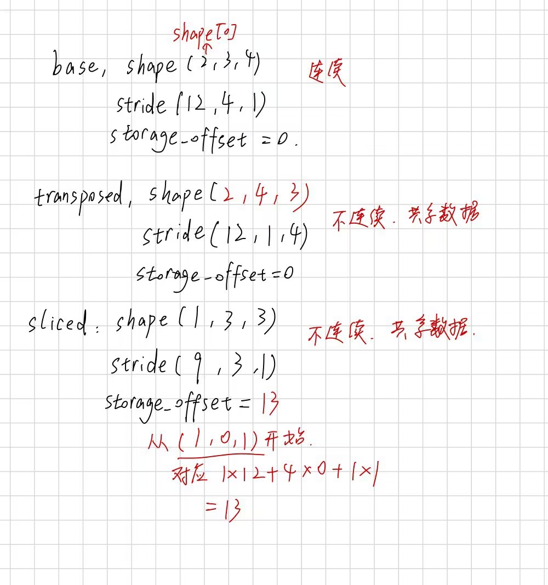

## R1

### 预测



### 实际

```text
sliced 的 stride 是 (12,4,1)
因为 sliced=[[13., 14., 15.],
         [17., 18., 19.],
         [21., 22., 23.]]
13 17 相差 4，所以我们得到 stride[1]=4

其实我觉得本质是 slice 只是拿掉一些元素，并没有改变元素的相对顺序，所以该多少还是多少。
```

## R3(api)

### view

> 能否在共享原来的 storage 的情况下，换一个 shape。也就是只改变 shape 和 stride。
>
> .view(-1) 就是尝试展开成一维。

### reshape

> 换一个 shape。但是允许在没办法共享原来的 storage 的情况下，去把原来的数据按逻辑顺序，连续排在新 storage。只保证改变形状，不保证之后一定连续。

### contiguous

> 保持 Tensor 形状和数值，把数据按当前逻辑顺序放进连续布局后返回。（保证之后在 storage 上连续）但是不保证一定会复制到独立副本。

### clone

> clone 保证独立存储

### Dtype

> 每个元素是什么类型，占几个字节

### device

> CPU 有自己那一侧的内存，就是 host/system memory（主机内存）。
>
> GPU 也有自己的 VRAM(显存)。
>
> Tensor 用 device 来区分自己这份数据位于 cpu 那一侧的内存/gpu 那一侧的内存。
>
> device 为 cpu/gpu 会影响底层调用的算子。

### numpy 与 torch

#### torch.tensor(array)

> 从 numpy 的 ndarray 复制数据，得到独立存储的 Tensor

#### torch.from_numpy(array)

> 返回的 Tensor 与 array 共享 cpu 内存。也就是共享 storage

#### tensor.numpy()

> 返回共享数据的 numpy 的 ndarray
