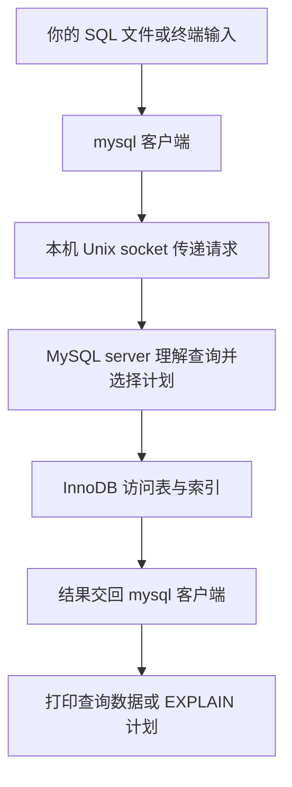
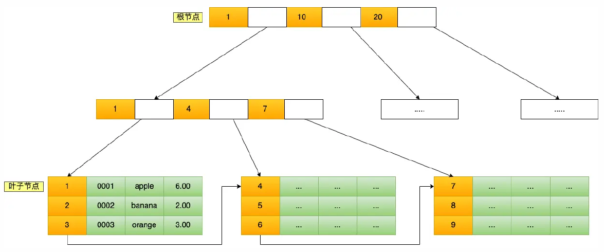
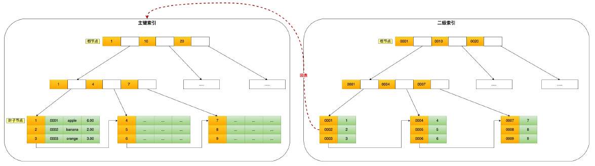
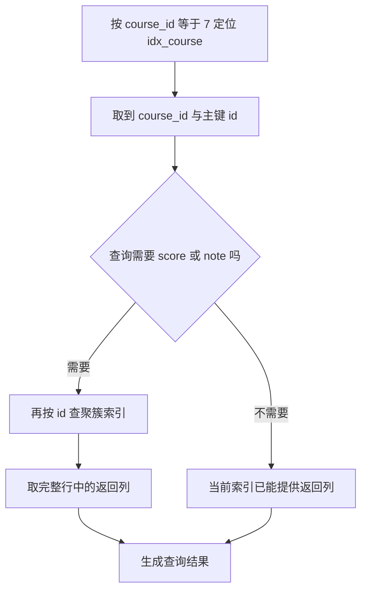

# Week13 Day1：从一个 MySQL 小表看懂索引、回表与覆盖

> 日期：2026-10-11
>
> 主线位置：Mini Redis V1 已完成 -> **MySQL 查询与索引第一层** -> 回到 KvStore 的 TTL
>
> 当前状态：Week1~Week12、84 个主线单元已正式通过；本篇生成不代表 Day1 已通过。
>
> 今日产出：`mysql_index_lab.sql` 中的三组查询、实际 EXPLAIN 输出，以及你的简短判断。无需新写 C++ 组件。

**今天用一个真实 MySQL 表，弄明白同一批数据怎样被找到：逐行查、通过另一个字段的索引查，以及直接从索引里拿到所需结果。**

你负责预测查询结果、观察访问计划、解释差异。建表和生成两万行数据的机械部分已经提供，不需要手写一大坨 INSERT，也不把今天变成另一道 parser 大模拟。

---

# Part 1：前情提要与必要术语

## 1. 从你已经会的 GET，走到一个新问题

你的 Mini Redis 已经能做：

```text
SET student:1007:score 98
GET student:1007:score
-> 得到 98
```

这里 caller 已经知道完整 key。`KvStore::get` 根据这个 key 找到 value，路径很清楚。

现在换一个要求：**查出课程 7 的所有成绩记录，返回记录编号和分数。** 我们还不知道这些记录各自的编号，需要按记录里的另一个字段筛选。

今天的数据长这样。这里只展示完整实验表中的几行：

| id | course_id | score | note |
|---|---|---|---|
| 7 | 7 | 7 | `record-7...` |
| 8 | 8 | 8 | `record-8...` |
| 1007 | 7 | 98 | `record-1007...` |
| 2007 | 7 | 88 | `record-2007...` |

一行保存一条成绩记录；一列保存同一种属性。`id` 唯一标识记录，`course_id` 表示它属于哪门课程。

我们可以把需求交给 MySQL：

```sql
SELECT id, score
FROM course_scores
WHERE course_id = 7;
```

读作：**从 `course_scores` 表中，找出 `course_id` 等于 7 的行，只返回其中的 `id` 和 `score`。** 这就是今天首先要能看懂的动作。

MySQL 接受查询，负责找到符合条件的数据。至于它逐行查看，还是沿某个索引定位，属于后面要观察的执行路径。

## 2. 今天与 Mini Redis 的关系

**Redis 的 key-value 模型让你按 key 操作 value；关系数据库把数据组织成有明确字段的记录，再按查询条件处理它们。** 今天用 MySQL 看第二种模型。

MySQL 是数据库服务器程序。你在终端输入 SQL，客户端把请求交给服务器，服务器处理数据，再返回查询结果。SQL 是 Structured Query Language，结构化查询语言；`SELECT` 就是它的查询语句。

这和你已经写过的 client -> server -> reply 有共同骨架，但今天不实现 MySQL 协议，也不把 MySQL 接进 Mini Redis。它是一段独立、范围很窄的数据库学习。

你之前已经分清：TTL 管有效期，淘汰管内存压力，持久化管重启恢复。今天再补上：**“怎样查数据”是另一类问题，索引服务于它。** 明天仍回到原 KvStore 加有效期，没有改主线。

## 3. 今日主问题

1. **表中的一行、一列、主键，怎样对应今天的实际数据？**
2. **按 `course_id` 查询时，数据库怎样确定要检查哪些记录？**
3. **已经用了同一个二级索引，为什么有的查询还要找完整行，有的可以直接回答？**
4. **EXPLAIN 的输出支持什么判断；为什么不能直接把它写成性能提升？**

第一问在开工前建立基础；第二、三问先观察再拆机制；第四问让证据与结论对齐。

## 4. 例子里的几个名字

### 4.1 table、row、column

**Table（表）保存同一结构的一批记录；row（行）是一条记录；column（列）是记录中的一个字段。**

本例 table 是 `course_scores`，一条 row 含 `id/course_id/score/note` 四个 columns。查询返回的结果也能显示成行列，但它不等于又创建了一张永久表。

### 4.2 primary key

**Primary key（主键）唯一标识一行，并且不能为空。** 本例指定 `id` 为主键，两行不能有相同 `id`；不同记录可以有相同 `course_id`。

这就是为什么课程 7 可以对应很多行，而某个 `id` 只能对应一行。主键的“唯一标识”先记住；InnoDB 怎样围绕它组织数据，等 R1 之后再展开。

### 4.3 index

**Index（索引）是数据库额外维护的查找结构，让它有机会按指定字段定位候选记录。**

本例已有主键，R1 还会建立一个按 `course_id` 查找的 secondary index（二级索引，即本例中主键组织之外的索引）。索引由数据库建立和维护，今天无需自己写树。

先留一个问题：这个额外结构到底保存了哪些列，为什么有时还得去取完整行？把问题带到实验里。

### 4.4 query plan 与 EXPLAIN

**Query plan（查询执行计划）描述数据库准备采用的访问路径；EXPLAIN 是显示这个计划的 SQL 入口。**

在查询前加上 `EXPLAIN`，会得到计划说明，而不是课程成绩：

```sql
EXPLAIN SELECT id, score
FROM course_scores
WHERE course_id = 7;
```

今天使用普通 `EXPLAIN` 观察计划。真正返回数据的动作仍是 `SELECT`；两者的输出分别保存，别把计划的估计当成实际结果。

---

# Part 2：教程开始

## 5. Round1：今天的实验整体怎样运行

**造一张固定的小表，保持查询条件不变，只改变是否有二级索引、以及返回哪些列。** 这样才能把结果差异挂到具体变化上。

这不是一个新 C++ component。实验的对象与职责是：

| 对象 | 今天做什么 |
|---|---|
| `mysql` 客户端 | 读取你的 SQL，交给服务器，打印数据或计划 |
| MySQL server | 接受查询，选择并执行访问路径 |
| InnoDB | MySQL 使用的 storage engine（存储引擎），负责本日表和索引的数据访问 |
| `course_scores` | 独立实验表，保存两万条成绩记录 |
| `idx_course` | R1 中建立的课程号索引 |
| 你的实验记录 | 保留 SQL、实际输出、预测与解释 |

InnoDB 在 MySQL 服务器进程的 user space（用户空间）中工作。需要访问文件时再通过操作系统；它不是一个内核模块。

本次采用同机的 Unix domain socket（Unix 域套接字，用于本机进程通信），无需占用 TCP 3306。可以把程序关系读成：



**这里的 SQL 是 application 层请求内容；Unix socket 负责本机传递 bytes。** 若采用 TCP 连接，才会经过 TCP/IP 网络路径。今天只改数据与查询，不改你已有的 Reactor、Connection 或 RESP parser。

## 6. 文件、环境和第一次启动

新教学文件已经同步到 Ubuntu：

```text
~/code/system-learning/database_labs/week13/
    mysql_lab.sh             本地隔离 MySQL 的启动/连接/停止脚手架
    mysql_index_setup.sql    建表和生成数据，已经提供
    mysql_index_lab.sql      你保存本日三组实验 SQL 的文件
```

第三个文件由你创建。记录新增理解时，可以写 `week13/day1/day1_note.md`，或者简短口述；无需再复制一份实验报告。

Windows 的教学脚手架和环境记录位于 [database_labs/week13](../../database_labs/week13/ENVIRONMENT.md)。环境版本、目录与安全范围都在这份记录里；正文专注今天的机制。

在 Ubuntu 终端运行：

```bash
cd ~/code/system-learning/database_labs/week13
bash mysql_lab.sh start
bash mysql_lab.sh sql
```

看到 `mysql>` 提示符，就可以输入 SQL。注意两种位置：

```text
Ubuntu shell：执行 bash mysql_lab.sh ...
mysql>：输入 SELECT / USE / EXPLAIN 等 SQL
```

`mysql_lab.sh` 只是调用真实 MySQL 程序的脚手架；不需要你学习它的下载、解压和启动实现。它不使用 sudo、不注册系统服务，数据放在独立用户目录，只开放本机 socket。

在 `mysql>` 里先执行：

```sql
SELECT VERSION();
```

`VERSION()` 返回这次服务器的实际版本。把结果留下，后面解释计划以这个环境为准。

退出客户端输入 `exit`。**退出客户端只结束这条会话，数据库服务器仍在；停止实例用 `bash mysql_lab.sh stop`。** 停止实例不删除实验数据，下次 `start` 可以继续。

## 7. 先看懂最少的 SQL

### 7.1 选择列、选择表、筛选行

再看最前面的查询：

```sql
SELECT id, score
FROM course_scores
WHERE course_id = 7;
```

- `SELECT id, score`：结果需要这两列。
- `FROM course_scores`：从这张表找。
- `WHERE course_id = 7`：只留下满足条件的行。
- `;`：结束这条语句，交给客户端执行。

查询不会因为只返回两列，就删除表中另外两列。**返回什么与表实际保存什么，是两个层次。**

`SELECT *` 表示返回全部列。本日正式对照写出列名，让“到底需要哪些信息”始终可见。

### 7.2 选定实验库

一个 MySQL 实例可以容纳多个 database（数据库命名空间）。`infra_index_lab` 是本日专用实验库，`course_scores` 是里面的一张表：

```sql
USE infra_index_lab;
```

`USE` 选定当前会话后续语句使用的默认库，不会把数据复制到客户端。也可以写全名 `infra_index_lab.course_scores`。

遇到 schema（模式）时看语境：MySQL 的 `CREATE SCHEMA` 与 `CREATE DATABASE` 同义；口语中的“表的 schema”则常指字段、类型和约束这套结构。今天分别用“实验库”和“表结构”，避免混在一起。

### 7.3 查询结果的顺序与数量

SQL 没有指定排序时，不承诺返回行的顺序。想稳定地按编号看几条记录，可以写：

```sql
SELECT id, course_id, score
FROM course_scores
WHERE course_id = 7
ORDER BY id
LIMIT 3;
```

`ORDER BY id` 要求按编号升序；`LIMIT 3` 最多返回三行。这个例子用于看数据。

**下面三组正式 EXPLAIN 不加 ORDER BY 或 LIMIT**，先单独观察筛选和取列的路径，不额外混入排序与提前停止。

统计符合条件的行数用：

```sql
SELECT COUNT(*) AS matching_rows
FROM course_scores
WHERE course_id = 7;
```

`COUNT(*)` 统计符合条件的行数；`AS matching_rows` 给结果列起一个便于阅读的名字。

## 8. 数据准备：机械部分由脚手架完成

先退出交互客户端，回到 Ubuntu shell：

```bash
bash mysql_lab.sh sql < mysql_index_setup.sql
```

`<` 把 SQL 文件作为客户端输入。这份脚手架会建立独立实验库，重建 `course_scores`，填入固定数据，并显示基础检查结果。

**重跑 setup 会清空并重建这一张实验表，连同你后来创建的索引。** 它只操作 `infra_index_lab.course_scores`，用于重新开始三组对照，不应改库名去运行在业务库里。

表结构为：

```sql
CREATE TABLE course_scores (
    id INT UNSIGNED NOT NULL,
    course_id INT UNSIGNED NOT NULL,
    score INT UNSIGNED NOT NULL,
    note VARCHAR(255) NOT NULL,
    PRIMARY KEY (id)
) ENGINE=InnoDB;
```

读到能说明每列即可：

| 写法 | 当前含义 |
|---|---|
| `INT UNSIGNED` | 非负整数列；保存编号或分数 |
| `VARCHAR(255)` | 可变长字符串列，长度上限以字符计；今天内容是 ASCII |
| `NOT NULL` | 这列必须有值，不能写 SQL 的空值 NULL |
| `PRIMARY KEY (id)` | `id` 是主键，唯一并且非空 |
| `ENGINE=InnoDB` | 这张表交给 InnoDB 管理 |

数据规则已经固定：

```text
id：1 到 20000
course_id：id 对 1000 取余
score：id 对 101 取余
note：由 record-id 开始的 200 个 ASCII 字符
```

课程号会重复，记录编号不会。`note` 特意保存额外内容，后面查询是否需要它会改变取数据的路径。

脚手架里的递归生成语句只是产生这两万行，今天不用独立设计或重写它。你需要核对两项结果：**总行数 20000，课程 7 的行数 20。** 能从编号规则说明为什么是 20，比抄两万条 INSERT 更有价值。

进入客户端查看现状：

```bash
bash mysql_lab.sh sql
```

```sql
USE infra_index_lab;
DESCRIBE course_scores;
SHOW INDEX FROM course_scores;
```

`DESCRIBE` 展示列和类型等表结构。`SHOW INDEX` 展示这张表已有的索引：刚重建后只有 `PRIMARY`，对应 `id`。稍后再调用它，可以确认 `idx_course` 是否已建立。

## 9. 三组正式实验：先预测，再运行

把以下动作按顺序保存到 `mysql_index_lab.sql`。文件开头保留：

```sql
USE infra_index_lab;
SELECT VERSION();
```

每组运行前，先用一句话预测：会返回哪些行、哪些列，数据库可能检查多大范围。预测访问路径时允许猜错；R2 正是用来把猜测与实际对象接起来。

### 9.1 第一组：没有课程号索引

```sql
EXPLAIN SELECT id, course_id, score, note
FROM course_scores
WHERE course_id = 7;

SELECT id, course_id, score, note
FROM course_scores
WHERE course_id = 7;
```

两个语句分别显示计划、返回数据。保留计划里的 `type/key/rows/Extra`：

| 字段 | 先知道它在报告什么 |
|---|---|
| `type` | 访问方式的名称，R2 按你看到的名称拆解 |
| `key` | 计划实际选用的索引 |
| `rows` | 估计需要检查的行数 |
| `Extra` | 额外的执行说明 |

先保存实际文本，不需要现在背整张 EXPLAIN 字段表。返回的每一行都应属于课程 7；返回总量应与 `COUNT(*)` 一致。

### 9.2 第二组：加一个索引，再运行相同查询

```sql
CREATE INDEX idx_course ON course_scores(course_id);
ANALYZE TABLE course_scores;
SHOW INDEX FROM course_scores;

EXPLAIN SELECT id, course_id, score, note
FROM course_scores
WHERE course_id = 7;

SELECT id, course_id, score, note
FROM course_scores
WHERE course_id = 7;
```

`CREATE INDEX` 在指定表的指定列上建立索引，`idx_course` 是它的名字。创建完成后由 MySQL 维护它，后续行的相关修改也需要同步更新这个结构。

`ANALYZE TABLE` 更新优化器会使用的表统计信息。Optimizer（优化器）是选择查询路径的部分；这里让它在建立索引后重新获得统计依据。这个命令的 `OK` 只说明统计分析完成。

**这一组只增加索引，查询条件和返回列保持不变。** 检查返回数据是否还是同一批行，再看计划如何变化。

若再次运行时提示 `Duplicate key name 'idx_course'`，表示同名索引已存在。想从第一组重新开始，就重跑专用 setup；不要把错误当成第二组的新结果。

### 9.3 第三组：保留索引和条件，只减少返回列

```sql
EXPLAIN SELECT id, course_id
FROM course_scores
WHERE course_id = 7;

SELECT id, course_id
FROM course_scores
WHERE course_id = 7;
```

这一组不删行、不改条件，只要求两个字段。看 `key` 是否相同，`Extra` 是否变化。

**相同的一批记录，返回信息减少以后，是否可以少走一段取数据的路径？** 先把结果和你的猜测留住，暂时不用自己画 B+ 树来解释。

## 10. Round1 到哪里算完成

三组都来自同一实例、同一张表、同一个 `course_id=7` 条件。每组留下查询、实际计划和一句自己的判断，就足够提交 R1。

查询结果要能核对：第一、二组对应相同的 20 条记录；第三组仍对应这 20 条记录，只少了 `score/note` 两列。未指定排序时比较记录内容，不以打印顺序判错。

文件也可以在 shell 一次运行：

```bash
bash mysql_lab.sh sql < mysql_index_setup.sql
bash mysql_lab.sh sql < mysql_index_lab.sql
```

第一行重新建立干净基线，第二行执行你保存的三个阶段。SQL 出错时先看第一处错误再继续；本日不写 GTest、Python checker、CMake 或 benchmark。

### Reading Gate：到这里先停止

先完成 R1，再读 §11 之后的解释。**这道闸门保留的是你对计划的首次判断，不是让你在没学过 SQL 时猜接口怎么用。**

提交时给三组实际输出和短判断即可；记录里有暂时不理解的字段，直接留下疑问。R1 正式通过后，后半教程会按你的真实结果逐节定向校准，保留你已经加入的内容。

---

## 11. Round2：先回答数据库到底在找什么

现在回看你的三组输出。查询的最终目标一直是“课程 7 的这 20 条记录”，变化的是数据库通过什么结构找到它们、再从哪里取得返回列。

若没有一个适合按课程号定位的索引，一个直接办法是：

```text
读取一行
-> 检查 course_id 是否为 7
-> 满足则取出需要的列
-> 继续检查下一行，直到检查完
```

这个动作叫 full table scan（全表扫描）。**扫描的工作规模与最终返回的 20 行，是两个不同数字。** 找到很少的结果，也可能需要检查很多记录。

加入索引后，问题变成：数据库能否先到 `course_id=7` 的位置，只检查相应候选项？这时才需要展开索引内部的对象。

## 12. B+ 树为什么围绕“页”组织

你已经会树、查找和有序访问，不用再学一遍基础树算法。这里新增的是：**数据库把大量记录分成页，再用多层目录找到目标页。**

Page（页）在这里是数据库组织和读写数据的存储单位。本次 InnoDB 页大小为 16384 bytes，典型默认值为 16 KiB。可以查询实际值：

```sql
SELECT @@innodb_page_size;
```

`@@` 用来读取 MySQL 系统变量。这是 InnoDB 的存储页；它与 Week5 页表映射的虚拟内存页承担不同职责，不能把两者当成同一张页表。

一页能容纳多条记录或多个目录项。B+ tree（B+ 树）用上层目录指导到哪一个子页，下层叶子页保存记录；同一层叶子页之间还有链接，便于继续查看相邻范围。

**一次从目录选择一个子页，可以排除一大片无关数据。** 因为一个节点可容纳很多目录项，数据很多时也能用较少层数定位；具体高度取决于页大小、记录大小和页的填充程度，不固定为三层或四层。

这里的 page number（页编号）指向存储结构里的页，不是把磁盘上的 C++ pointer 保存到文件。一个页可能已在内存中，也可能需要读入。

因此，“访问了三层树”不能直接写成“三次物理磁盘 I/O”。MySQL 会用 Buffer Pool（缓冲池，缓存 InnoDB 数据和索引页的内存区域）复用已经读入的页；它的内部管理今天只建立这一层认识。

官方查证：[InnoDB 索引的物理结构](https://dev.mysql.com/doc/refman/8.0/en/innodb-physical-structure.html)。

## 13. 主键为什么能直接找到本日行数据

你的实验表明确指定 `PRIMARY KEY(id)`。InnoDB 用这个主键作为 clustered index（聚簇索引）的键。

**聚簇索引的叶子保存行记录：沿 id 查到对应叶子记录时，本日要的 score、note 等数据就在这条行记录中。** 主键索引不是只有 id 的一张独立小表，再另外寻找完全无关的行文件。

先看一张商品表的同类结构，再映射到你的成绩表：



图中黄色数字是主键，上层黄色目录把查找导向下面的叶子；绿色部分是该记录的其他列。查 `id=5` 时，从上层走到包含 5 的叶子，就可以取得这一行的数据。

**把图里的商品名、价格换成 `course_id/score/note`，就对应本日表。** 这是逻辑结构示意，不是精确的文件布局。图把叶子间链接画成单向，InnoDB 叶子页实际有双向链接。

来源：小林 Coding《图解 MySQL》亮白版 v2.0，PDF 第 40 页，裁取主键索引图。相关规则以 [InnoDB 聚簇与二级索引文档](https://dev.mysql.com/doc/refman/8.0/en/innodb-index-types.html) 为准。

本表的主键查找可以写成：

```text
id = 1007
-> 聚簇索引按 id 定位
-> 找到该行记录
-> 取 score = 98，以及其他需要的列
```

注意图是按主键组织，而你的正式查询条件是 `course_id=7`。**知道主键索引存在，不等于可以直接按任意其他列定位。** 这正是二级索引出场的理由。

## 14. 二级索引怎样把课程号接到完整行

`idx_course` 按 `course_id` 建立另一套有序查找结构。为了知道某个候选对应哪条完整记录，InnoDB 的二级索引记录还包含该行的主键列。

因此本日索引中会有这样的逻辑记录：

```text
course_id = 7，id = 7
course_id = 7，id = 1007
course_id = 7，id = 2007
...
```

**二级索引保存本索引列和主键；这条主键把候选项接回聚簇索引中的行。** `score/note` 没有加入 `idx_course`，不会因为出现在 SELECT 里，就自动被复制进这个索引。

例如第二组查找：

```text
按 course_id = 7 定位二级索引
-> 找到候选记录的 id = 1007
-> 通过 id = 1007 查聚簇索引
-> 从完整行取 score、note
-> 对其他匹配 id 继续
```

**Back-to-table lookup（回表）就是从二级索引取得主键后，再查聚簇索引取所需行数据。** 不是把查询结果放回 SQL 表里，也不是返回客户端之后再查询一次。

这张图把两棵树画在一起：



右侧按商品编号 `product_no` 组织，叶子里绿色数字是对应主键 id。红色虚线表示：从右侧取得 id，再到左侧主键树取商品行。左侧对应本日 `PRIMARY`，右侧对应本日 `idx_course`。

图中的字段名来自商品例子；本日右侧索引字段换成 `course_id`，主键仍是 `id`。右侧不只有主键，还包含用于查找的二级索引列；这里两个部分都应读出来。

来源：同一 PDF 第 42 页，裁取回表图。图上的单向叶链接仍按 §13 的说明理解。今天只看两棵树的交接，不扩展完整 InnoDB 页格式。

## 15. 覆盖索引：需要的信息已经齐了

第三组只要求：

```sql
SELECT id, course_id
FROM course_scores
WHERE course_id = 7;
```

回到刚才那条二级索引记录 `(course_id=7, id=1007)`：筛选要的课程号在里面，返回要的两列也都在里面。

**Covering index（覆盖索引）指当前查询需要的列可以由所用索引提供。** 本日静态数据场景可以沿 `idx_course` 完成定位并交付结果，不必为了取得 `score/note` 再走那段路径。



图中的分支由**查询所需信息与索引包含的信息**决定。同一个 `idx_course`，第二组不覆盖，第三组覆盖；覆盖不是又创建了一种叫“覆盖”的特殊索引。

你创建索引时只写了 `course_id`，但 InnoDB 的二级索引记录还带主键 `id`，所以第三组能返回它。`SHOW INDEX` 里显式声明的列清单不能直接当成叶子记录的全部内容。

更复杂并发场景还涉及可见性判断，留给 Day6；今天不把覆盖写成任何环境下都保证零聚簇页访问或零磁盘 I/O。

## 16. 对照实际 EXPLAIN，先抓四个字段

下面是 Codex 生成教程时在隔离 MySQL 实例上的**实际参考结果**，不是你已经完成的证据。你的输出才是 R1 复检和后续定向润色的依据。

| 组别 | type | key | rows | Extra |
|---|---|---|---|---|
| 未建 `idx_course`，取四列 | `ALL` | `NULL` | 19776 | `Using where` |
| 建索引后，仍取四列 | `ref` | `idx_course` | 20 | `NULL` |
| 同一索引，只取 id/course_id | `ref` | `idx_course` | 20 | `Using index` |

其中 `19776` 是这次统计信息的估计值，真实表有 `20000` 行。重建或重新分析后估计可以变化，不要求你复制同一个整数。

### 16.1 type：它准备怎样访问

- `ALL`：逐行扫描表数据，再筛选条件。
- `ref`：通过非唯一索引等值定位，读取匹配的候选记录。本例一个课程号可能匹配多行。
- `index`：扫描一个索引的记录，不等于只定位了少数匹配项。

第三种是一个容易混淆的名称，今天先记住：**看到单词 index，要继续看它是在定位，还是在扫描。** 不能只按单词“用了索引”判断工作量。

不背访问类型快慢排行榜。返回大部分数据时，扫描也可能是合理选择。

### 16.2 key：这次真正选的是谁

`possible_keys` 是可能有帮助的索引候选，`key` 才是这份计划实际选择的索引。

第二、三组选择 `idx_course`，说明这次按课程号的路径被采用。第一组 `key=NULL` 说明该计划没有选一个索引来定位匹配行；表仍有主键结构，不能把它理解成整张表没有任何索引。

### 16.3 rows：估计工作量，不是成绩条数

**`rows` 是优化器估计需要检查的行数，实际匹配数量由 SELECT 或 COUNT 的结果核对。**

第一组估计检查接近整张表，却只返回 20 行。后两组估计 20 行，这次恰好与匹配数一致；不能因此把这个字段重新定义成“返回行数”。

### 16.4 Extra：还做了什么

| 文本 | 当前应怎样理解 |
|---|---|
| `Using where` | 需要按 WHERE 条件过滤记录 |
| `Using index` | 当前查询所需列可以通过索引提供，属于覆盖访问 |
| `Using index condition` | 使用 Index Condition Pushdown（索引条件下推），先用索引中已有信息检查部分条件，再按需取完整行 |

**`Using index condition` 不等于 `Using index`。** 下推的目标是减少不必要的完整行读取；覆盖的条件是当前查询要的信息在索引里已经齐了。

本日三组没有刻意制造索引条件下推，只需要看见这个相近文本时能分清。它不是本日第四个必做实验。普通 EXPLAIN 也不会直接列出每一次回表；第二组的回表判断还要结合本表和索引包含哪些列。

查证：[EXPLAIN 字段](https://dev.mysql.com/doc/refman/8.0/en/explain-output.html)、[索引条件下推](https://dev.mysql.com/doc/refman/8.0/en/index-condition-pushdown-optimization.html)。

## 17. 建索引为什么不是无条件“更快”

本表有两万行，课程 7 只占 20 行。先定位少量候选，再取所需记录，是容易有价值的场景。

如果条件匹配绝大部分数据，通过索引逐个找到主键、再取大量完整行，成本可能不如直接扫描数据。优化器会根据统计信息、需要的列和访问成本选择计划。

**有索引代表多了一条候选路径；实际选哪条，要看查询和数据。** 所以 R1 必须留实际 `key/type`，而不是写“我创建索引了，所以数据库一定用了”。

索引本身也有成本：额外占用存储，插入、删除或修改相关列时需要维护。今天不做性能压测，但要能说清为什么不是把每一列都建立索引就结束。

从你已有的 `std::map` 看，也能理解“为了某个查找顺序维护一个结构”这件事。数据库进一步围绕页、行访问和成本组织它，不能仅凭两者都有树就把内存容器与数据库索引等同。

## 18. 计划怎样变成一次真实查询

把正常路径串一次：

```text
mysql 客户端交付 SELECT
-> MySQL 理解表、列与条件
-> 优化器比较候选访问路径，选择计划
-> 执行阶段向 InnoDB 请求数据
-> InnoDB 沿本次采用的索引或扫描路径找记录
-> 取出需要的列，处理需要的过滤
-> 返回结果给客户端
```

普通 EXPLAIN 展示计划信息。`ANALYZE TABLE` 更新统计；名字相近的 `EXPLAIN ANALYZE` 则会实际执行查询并报告运行信息，它不是本日普通 EXPLAIN 的同义写法。

**今天的证据是访问路径与结果正确，不是已经测出了吞吐或延迟收益。** 你和学长讨论的性能工程原则继续有效：以后若要主张优化了多少，仍需建立可比较 workload、测量和定位，自己能捍卫结论。

---

# Part 3：收尾、验证与验收

## 19. Round3：收住三组解释，不再写一套 tests

R1 的 SQL 和输出继续使用，不创建 V2 副本。R2 后只补清三件事：

1. 第一组怎样查找，以及需要检查的规模和返回数量为何不同。
2. 第二组从 `idx_course` 找到什么，再从 `PRIMARY` 取什么。
3. 第三组所需列为什么已经齐了，以及实际 Extra 是否支持该判断。

若输出与你最初预测不同，修改你的解释并保留原因，不把输出改写成教程参考结果。若没有形成目标对照，检阅时先核对实际表、索引、条件和数据，再确定是否需要调整实验；不靠 `FORCE INDEX` 强制一个答案。

你不需要手写 correctness checker。这里核心训练是**解释同一条件下路径怎样变化**，代码化重复核对行数不是新的设计题。

完成后退出客户端，在 shell 停止本日实例：

```bash
bash mysql_lab.sh stop
```

数据库数据仍保留；下次启动后可继续查询。Day6 的事务实验会沿用同一实验环境。

## 20. 一个可选观察：已经有主键为何仍会扫描

如果想巩固 `type=index` 与“索引定位”的区别，可以在重跑 setup、还没建课程索引时观察：

```sql
EXPLAIN SELECT id, course_id, score, note
FROM course_scores
WHERE course_id = 7
ORDER BY id;
```

Codex 的初次验证中，这条计划显示 `type=index, key=PRIMARY`：按主键顺序扫描，同时检查课程条件。它不是通过主键直接定位课程 7。

这是一个额外约束让计划改变的例子；不增加必做三组，也不要求刷索引失效题。已经能解释这一点，可以直接跳过。

## 21. 今天的完成标准

**核心通过条件：**有三组真实 SQL/EXPLAIN，结果集合和返回列正确；能沿数据结构解释扫描、回表、覆盖三条路径。实际计划不完全相同也允许，但需要解释依据。

**重点错误处理：**分清客户端未连接、未选择数据库、表不存在、索引已经存在这些实验错误；不要在错误状态下继续粘贴并把空输出当成功。脚手架失败时提供第一处报错，检阅会先处理环境。

**工程增强后置：**不写 MySQL connector、连接池、B+ 树实现，不压测数据库，不加入复杂 JOIN、复合索引规则或索引失效大全。ASan/TSan/CTest 不是本日 SQL 观察的验收工具。

只有新理解或疑问需要记到 note。你的口述可以替代机械抄题，但查询计划必须来自实际运行，不能只读本篇表格就登记为做过实验。

## 22. 五个收口问题

1. `id` 与 `course_id` 在本表里分别承担什么角色？为什么后者可以对应多行？
2. 第二组沿课程索引找到记录后，为什么还要访问主键组织中的行？
3. 第三组没有重新建立索引，为什么可以覆盖？`id` 的信息从哪里来？
4. `rows` 与 COUNT 结果分别是什么；`Using index` 与 `Using index condition` 分别说明什么？
5. 三组计划发生变化，能直接说明查询快了多少吗？还缺什么证据？

这些问题都挂到你今天的表和输出回答，不写成五篇八股文章。真实输出、理解和新增疑问足够后，就收住本日。

## 23. 资料放在当前问题旁边

正文已经讲完必学内容，外部材料用于查证或第二种解释：

- 查询语法：[MySQL SELECT](https://dev.mysql.com/doc/refman/8.0/en/select.html)。只查 SELECT/FROM/WHERE；不用读完所有扩展。
- 表结构与查询信息：[MySQL 获取库和表的信息](https://dev.mysql.com/doc/refman/8.0/en/getting-information.html)。对应 USE、DESCRIBE、SHOW。
- 树的页结构、聚簇/二级索引与 EXPLAIN 的官方入口已放在 §12、§13、§16。
- 本日两张图来自本地《图解 MySQL》，已裁出相关结构并在图下解释；阅读原 PDF 时定向到第 40~42 页即可，不从第一页刷到结尾。

今天不新增 MIT 6.S081 lecture，也不要求同步完整 CMU 15-445 或 BusTub。数据库系统课后续按项目需要调用，当前先把一个真实查询解释清楚。

## 24. 明天回到你自己的 KvStore

今天补齐的是关系数据库与查找路径的第一层。明天重新使用现有 `KvStore`：**让 key 在指定时刻失效，并用可控时钟证明到期前、恰好到期、到期后的结果。**

不把 MySQL 接进 Mini Redis，也不把今天的表替换掉你的 map。两段学习各自解决明确的问题，仍服务于同一条系统工程主线。

AI 理论线继续从 T6 往前走，不因为本日数据库实验而换课程或增加一套视频任务。
