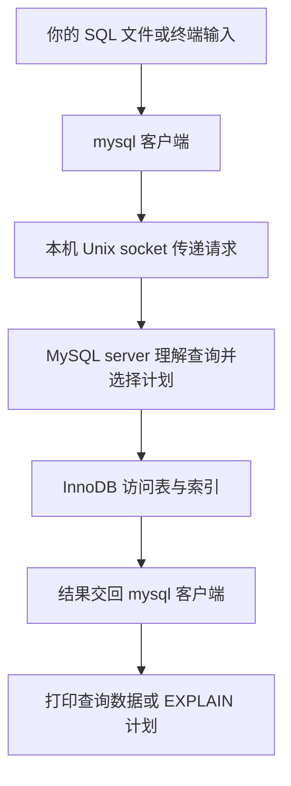
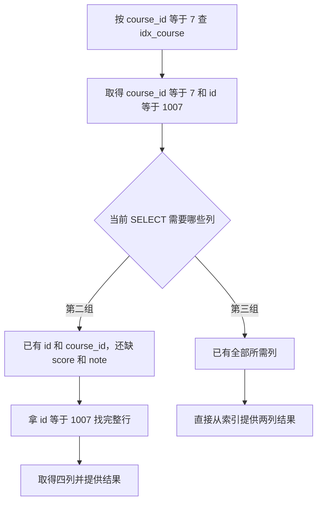

# Week13 Day1：从一个 MySQL 小表看懂索引、回表与覆盖

> 日期：2026-10-11
>
> 主线位置：Mini Redis V1 已完成 -> **MySQL 查询与索引第一层** -> 回到 KvStore 的 TTL
>
> 当前状态：Week1~Week12、84 个主线单元已正式通过；本篇生成不代表 Day1 已通过。
>
> 今日产出：`mysql_index_lab.sql` 中的三组查询、实际 EXPLAIN 输出，以及你的简短判断。无需新写 C++ 组件。

**今天用一个真实 MySQL 表，弄明白同一批数据怎样被找到：逐行查、通过另一个字段的索引查，以及直接从索引里拿到所需结果。**

你负责预测查询结果、观察访问计划、解释差异。建表和生成两万行数据的机械部分已经提供，不需要手写一大坨 INSERT，也不把今天变成另一道 parser 大模拟。

---

# Part 1：前情提要与必要术语

## 1. 从你已经会的 GET，走到一个新问题

你的 Mini Redis 已经能做：

```text
SET student:1007:score 98
GET student:1007:score
-> 得到 98
```

这里 caller 已经知道完整 key。`KvStore::get` 根据这个 key 找到 value，路径很清楚。

现在换一个要求：**查出课程 7 的所有成绩记录，返回记录编号和分数。** 我们还不知道这些记录各自的编号，需要按记录里的另一个字段筛选。

今天的数据长这样。这里只展示完整实验表中的几行：

| id | course_id | score | note |
|---|---|---|---|
| 7 | 7 | 7 | `record-7...` |
| 8 | 8 | 8 | `record-8...` |
| 1007 | 7 | 98 | `record-1007...` |
| 2007 | 7 | 88 | `record-2007...` |

一行保存一条成绩记录；一列保存同一种属性。`id` 唯一标识记录，`course_id` 表示它属于哪门课程。

我们可以把需求交给 MySQL：

```sql
SELECT id, score
FROM course_scores
WHERE course_id = 7;
```

读作：**从 `course_scores` 表中，找出 `course_id` 等于 7 的行，只返回其中的 `id` 和 `score`。** 这就是今天首先要能看懂的动作。

MySQL 接受查询，负责找到符合条件的数据。至于它逐行查看，还是沿某个索引定位，属于后面要观察的执行路径。

## 2. 今天与 Mini Redis 的关系

**Redis 的 key-value 模型让你按 key 操作 value；关系数据库把数据组织成有明确字段的记录，再按查询条件处理它们。** 今天用 MySQL 看第二种模型。

MySQL 是数据库服务器程序。你在终端输入 SQL，客户端把请求交给服务器，服务器处理数据，再返回查询结果。SQL 是 Structured Query Language，结构化查询语言；`SELECT` 就是它的查询语句。

这和你已经写过的 client -> server -> reply 有共同骨架，但今天不实现 MySQL 协议，也不把 MySQL 接进 Mini Redis。它是一段独立、范围很窄的数据库学习。

你之前已经分清：TTL 管有效期，淘汰管内存压力，持久化管重启恢复。今天再补上：**“怎样查数据”是另一类问题，索引服务于它。** 明天仍回到原 KvStore 加有效期，没有改主线。

## 3. 今日主问题

1. **表中的一行、一列、主键，怎样对应今天的实际数据？**
2. **按 `course_id` 查询时，数据库怎样确定要检查哪些记录？**
3. **已经用了同一个二级索引，为什么有的查询还要找完整行，有的可以直接回答？**
4. **EXPLAIN 的输出支持什么判断；为什么不能直接把它写成性能提升？**

第一问在开工前建立基础；第二、三问先观察再拆机制；第四问让证据与结论对齐。

## 4. 例子里的几个名字

### 4.1 table、row、column

**Table（表）保存同一结构的一批记录；row（行）是一条记录；column（列）是记录中的一个字段。**

本例 table 是 `course_scores`，一条 row 含 `id/course_id/score/note` 四个 columns。查询返回的结果也能显示成行列，但它不等于又创建了一张永久表。

### 4.2 primary key

**Primary key（主键）唯一标识一行，并且不能为空。** 本例指定 `id` 为主键，两行不能有相同 `id`；不同记录可以有相同 `course_id`。

这就是为什么课程 7 可以对应很多行，而某个 `id` 只能对应一行。主键的“唯一标识”先记住；InnoDB 怎样围绕它组织数据，等 R1 之后再展开。

### 4.3 index

**Index（索引）是数据库额外维护的查找结构，让它有机会按指定字段定位候选记录。**

本例已有主键，R1 还会建立一个按 `course_id` 查找的 secondary index（二级索引，即本例中主键组织之外的索引）。索引由数据库建立和维护，今天无需自己写树。

先留一个问题：这个额外结构到底保存了哪些列，为什么有时还得去取完整行？把问题带到实验里。

### 4.4 query plan 与 EXPLAIN

**Query plan（查询执行计划）描述数据库准备采用的访问路径；EXPLAIN 是显示这个计划的 SQL 入口。**

在查询前加上 `EXPLAIN`，会得到计划说明，而不是课程成绩：

```sql
EXPLAIN SELECT id, score
FROM course_scores
WHERE course_id = 7;
```

今天使用普通 `EXPLAIN` 观察计划。真正返回数据的动作仍是 `SELECT`；两者的输出分别保存，别把计划的估计当成实际结果。

---

# Part 2：教程开始

## 5. Round1：今天的实验整体怎样运行

**造一张固定的小表，保持查询条件不变，只改变是否有二级索引、以及返回哪些列。** 这样才能把结果差异挂到具体变化上。

这不是一个新 C++ component。实验的对象与职责是：

| 对象 | 今天做什么 |
|---|---|
| `mysql` 客户端 | 读取你的 SQL，交给服务器，打印数据或计划 |
| MySQL server | 接受查询，选择并执行访问路径 |
| InnoDB | MySQL 使用的 storage engine（存储引擎），负责本日表和索引的数据访问 |
| `course_scores` | 独立实验表，保存两万条成绩记录 |
| `idx_course` | R1 中建立的课程号索引 |
| 你的实验记录 | 保留 SQL、实际输出、预测与解释 |

InnoDB 在 MySQL 服务器进程的 user space（用户空间）中工作。需要访问文件时再通过操作系统；它不是一个内核模块。

本次采用同机的 Unix domain socket（Unix 域套接字，用于本机进程通信），无需占用 TCP 3306。可以把程序关系读成：



**这里的 SQL 是 application 层请求内容；Unix socket 负责本机传递 bytes。** 若采用 TCP 连接，才会经过 TCP/IP 网络路径。今天只改数据与查询，不改你已有的 Reactor、Connection 或 RESP parser。

## 6. 文件、环境和第一次启动

新教学文件已经同步到 Ubuntu：

```text
~/code/system-learning/database_labs/week13/
    mysql_lab.sh             本地隔离 MySQL 的启动/连接/停止脚手架
    mysql_index_setup.sql    建表和生成数据，已经提供
    mysql_index_lab.sql      你保存本日三组实验 SQL 的文件
```

第三个文件由你创建。记录新增理解时，可以写 `week13/day1/day1_note.md`，或者简短口述；无需再复制一份实验报告。

Windows 的教学脚手架和环境记录位于 [database_labs/week13](../../database_labs/week13/ENVIRONMENT.md)。环境版本、目录与安全范围都在这份记录里；正文专注今天的机制。

在 Ubuntu 终端运行：

```bash
cd ~/code/system-learning/database_labs/week13
bash mysql_lab.sh start
bash mysql_lab.sh sql
```

看到 `mysql>` 提示符，就可以输入 SQL。注意两种位置：

```text
Ubuntu shell：执行 bash mysql_lab.sh ...
mysql>：输入 SELECT / USE / EXPLAIN 等 SQL
```

`mysql_lab.sh` 只是调用真实 MySQL 程序的脚手架；不需要你学习它的下载、解压和启动实现。它不使用 sudo、不注册系统服务，数据放在独立用户目录，只开放本机 socket。

在 `mysql>` 里先执行：

```sql
SELECT VERSION();
```

`VERSION()` 返回这次服务器的实际版本。把结果留下，后面解释计划以这个环境为准。

退出客户端输入 `exit`。**退出客户端只结束这条会话，数据库服务器仍在；停止实例用 `bash mysql_lab.sh stop`。** 停止实例不删除实验数据，下次 `start` 可以继续。

## 7. 先看懂最少的 SQL

### 7.1 选择列、选择表、筛选行

再看最前面的查询：

```sql
SELECT id, score
FROM course_scores
WHERE course_id = 7;
```

- `SELECT id, score`：结果需要这两列。
- `FROM course_scores`：从这张表找。
- `WHERE course_id = 7`：只留下满足条件的行。
- `;`：结束这条语句，交给客户端执行。

查询不会因为只返回两列，就删除表中另外两列。**返回什么与表实际保存什么，是两个层次。**

`SELECT *` 表示返回全部列。本日正式对照写出列名，让“到底需要哪些信息”始终可见。

### 7.2 选定实验库

一个 MySQL 实例可以容纳多个 database（数据库命名空间）。`infra_index_lab` 是本日专用实验库，`course_scores` 是里面的一张表：

```sql
USE infra_index_lab;
```

`USE` 选定当前会话后续语句使用的默认库，不会把数据复制到客户端。也可以写全名 `infra_index_lab.course_scores`。

遇到 schema（模式）时看语境：MySQL 的 `CREATE SCHEMA` 与 `CREATE DATABASE` 同义；口语中的“表的 schema”则常指字段、类型和约束这套结构。今天分别用“实验库”和“表结构”，避免混在一起。

### 7.3 查询结果的顺序与数量

SQL 没有指定排序时，不承诺返回行的顺序。想稳定地按编号看几条记录，可以写：

```sql
SELECT id, course_id, score
FROM course_scores
WHERE course_id = 7
ORDER BY id
LIMIT 3;
```

`ORDER BY id` 要求按编号升序；`LIMIT 3` 最多返回三行。这个例子用于看数据。

**下面三组正式 EXPLAIN 不加 ORDER BY 或 LIMIT**，先单独观察筛选和取列的路径，不额外混入排序与提前停止。

统计符合条件的行数用：

```sql
SELECT COUNT(*) AS matching_rows
FROM course_scores
WHERE course_id = 7;
```

`COUNT(*)` 统计符合条件的行数；`AS matching_rows` 给结果列起一个便于阅读的名字。

## 8. 数据准备：机械部分由脚手架完成

先退出交互客户端，回到 Ubuntu shell：

```bash
bash mysql_lab.sh sql < mysql_index_setup.sql
```

---
对，**就是让 MySQL 客户端读取并执行 `mysql_index_setup.sql` 里的 SQL 语句。**

```bash
bash mysql_lab.sh sql < mysql_index_setup.sql
```

执行链是：

```text
Ubuntu shell 打开 mysql_index_setup.sql
→ 把文件内容作为脚本的标准输入
→ 脚本启动 MySQL 客户端，并让它读取这些内容
→ 客户端把 SQL 发给 MySQL server
→ server 执行建库、重建表、插入数据等操作
→ 查询结果或错误显示在终端
```

**`<` 的工作只是把文件内容送进去；真正执行 SQL 的是 MySQL server。**

---

`<` 把 SQL 文件作为客户端输入。这份脚手架会建立独立实验库，重建 `course_scores`，填入固定数据，并显示基础检查结果。

**重跑 setup 会清空并重建这一张实验表，连同你后来创建的索引。** 它只操作 `infra_index_lab.course_scores`，用于重新开始三组对照，不应改库名去运行在业务库里。

表结构为：

```sql
CREATE TABLE course_scores (
    id INT UNSIGNED NOT NULL,
    course_id INT UNSIGNED NOT NULL,
    score INT UNSIGNED NOT NULL,
    note VARCHAR(255) NOT NULL,
    PRIMARY KEY (id)
) ENGINE=InnoDB;
```

读到能说明每列即可：

| 写法 | 当前含义 |
|---|---|
| `INT UNSIGNED` | 非负整数列；保存编号或分数 |
| `VARCHAR(255)` | 可变长字符串列，长度上限以字符计；今天内容是 ASCII |
| `NOT NULL` | 这列必须有值，不能写 SQL 的空值 NULL |
| `PRIMARY KEY (id)` | `id` 是主键，唯一并且非空 |
| `ENGINE=InnoDB` | 这张表交给 InnoDB 管理 |

数据规则已经固定：

```text
id：1 到 20000
course_id：id 对 1000 取余
score：id 对 101 取余
note：由 record-id 开始的 200 个 ASCII 字符
```

课程号会重复，记录编号不会。`note` 特意保存额外内容，后面查询是否需要它会改变取数据的路径。

脚手架里的递归生成语句只是产生这两万行，今天不用独立设计或重写它。你需要核对两项结果：**总行数 20000，课程 7 的行数 20。** 能从编号规则说明为什么是 20，比抄两万条 INSERT 更有价值。

进入客户端查看现状：

```bash
bash mysql_lab.sh sql
```

```sql
USE infra_index_lab;

DESCRIBE course_scores;
SHOW INDEX FROM course_scores;
```

`DESCRIBE` 展示列和类型等表结构。`SHOW INDEX` 展示这张表已有的索引：刚重建后只有 `PRIMARY`，对应 `id`。稍后再调用它，可以确认 `idx_course` 是否已建立。

## 9. 三组正式实验：先预测，再运行

把以下动作按顺序保存到 `mysql_index_lab.sql`。文件开头保留：

```sql
USE infra_index_lab;
-- 选择默认 database
SELECT VERSION();
-- from 指定在默认 database 里的哪张表
```

每组运行前，先用一句话预测：会返回哪些行、哪些列，数据库可能检查多大范围。预测访问路径时允许猜错；R2 正是用来把猜测与实际对象接起来。

### 9.1 第一组：没有课程号索引

```sql
EXPLAIN SELECT id, course_id, score, note
FROM course_scores
WHERE course_id = 7;

SELECT id, course_id, score, note
FROM course_scores
WHERE course_id = 7;
```

两个语句分别显示计划、返回数据。保留计划里的 `type/key/rows/Extra`：

| 字段 | 先读懂哪件事 |
|---|---|
| `type` | 怎样找到候选记录。`ALL` 表示逐行扫描表；`ref` 表示借助索引按等值条件定位，一个值可以对应多行 |
| `key` | 计划实际选择的索引名；`NULL` 表示这份计划没选索引来定位候选 |
| `rows` | 估计需要检查多少行；实际返回数量由 SELECT 或 COUNT 核对 |
| `Extra` | 附加执行说明；先保留实际文本，R2 再解释它与取数路径的关系 |

**这四列是 EXPLAIN 返回的计划信息，`ALL/ref` 是 `type` 里的值。** 先有这份最小读法，才能看懂自己观察到了什么；它没有预先指定下面哪组会出现哪个结果。索引里保存哪些字段、为什么某组能少走一步，仍留到 R2。

其他列暂时不用一起背。返回的每一行都应属于课程 7；返回总量应与 `COUNT(*)` 一致。

### 9.2 第二组：加一个索引，再运行相同查询

```sql
CREATE INDEX idx_course ON course_scores(course_id);
ANALYZE TABLE course_scores;
SHOW INDEX FROM course_scores;

EXPLAIN SELECT id, course_id, score, note
FROM course_scores
WHERE course_id = 7;

SELECT id, course_id, score, note
FROM course_scores
WHERE course_id = 7;
```

`CREATE INDEX` 在指定表的指定列上建立索引，`idx_course` 是它的名字。创建完成后由 MySQL 维护它，后续行的相关修改也需要同步更新这个结构。

`ANALYZE TABLE` 更新优化器会使用的表统计信息。Optimizer（优化器）是选择查询路径的部分；这里让它在建立索引后重新获得统计依据。这个命令的 `OK` 只说明统计分析完成。

**这一组只增加索引，查询条件和返回列保持不变。** 检查返回数据是否还是同一批行，再看计划如何变化。

若再次运行时提示 `Duplicate key name 'idx_course'`，表示同名索引已存在。想从第一组重新开始，就重跑专用 setup；不要把错误当成第二组的新结果。

### 9.3 第三组：保留索引和条件，只减少返回列

```sql
EXPLAIN SELECT id, course_id
FROM course_scores
WHERE course_id = 7;

SELECT id, course_id
FROM course_scores
WHERE course_id = 7;
```

这一组不删行、不改条件，只要求两个字段。看 `key` 是否相同，`Extra` 是否变化。

**相同的一批记录，返回信息减少以后，是否可以少走一段取数据的路径？** 先把结果和你的猜测留住，暂时不用自己画 B+ 树来解释。

## 10. Round1 到哪里算完成

三组都来自同一实例、同一张表、同一个 `course_id=7` 条件。每组留下查询、实际计划和一句自己的判断，就足够提交 R1。

查询结果要能核对：第一、二组对应相同的 20 条记录；第三组仍对应这 20 条记录，只少了 `score/note` 两列。未指定排序时比较记录内容，不以打印顺序判错。

文件也可以在 shell 一次运行：

```bash
bash mysql_lab.sh sql < mysql_index_setup.sql
bash mysql_lab.sh sql < mysql_index_lab.sql
```

第一行重新建立干净基线，第二行执行你保存的三个阶段。SQL 出错时先看第一处错误再继续；本日不写 GTest、Python checker、CMake 或 benchmark。

### Reading Gate：到这里先停止

先完成 R1，再读 §11 之后的解释。**这道闸门保留的是你对计划的首次判断，不是让你在没学过 SQL 时猜接口怎么用。**

提交时给三组实际输出和短判断即可；记录里有暂时不理解的字段，直接留下疑问。R1 正式通过后，后半教程会按你的真实结果逐节定向校准，保留你已经加入的内容。

---

## 11. Round2：先把你的三行计划读懂

**你已经完成 R1 的实际观察，98/100 的通过结论保留。现在补的是讲解顺序，不是让你重做实验。** 先读懂计划在说什么，再弄清索引给了哪些信息；等回表与覆盖的动作站稳后，再讲 B+ 树。

EXPLAIN 返回一张“准备怎样查数据”的说明表。它的 `type/key/rows/Extra` 是输出字段，不是让你传给查询函数的参数。用你已经保存的结果读一次：

| 实际观察 | 现在读成一句话 |
|---|---|
| `ALL / key=NULL / rows=19776 / Using where` | 准备扫描表数据，按 WHERE 筛选；估计检查 19776 行 |
| `ref / key=idx_course / rows=20 / Extra=NULL` | 准备借助课程号索引按等值条件定位候选，估计检查 20 行 |
| `ref / key=idx_course / rows=20 / Using index` | 同样借助课程号索引定位；这次查询所需的列可以由这个索引提供 |

第一行的 `ALL` 叫 full table scan（全表扫描）：把表里的记录逐行检查。第二、三行的 `ref` 在本例里表示按课程号进行 indexed equality lookup（索引等值查找）：找的是课程号恰好为 `7` 的候选。

你的 SELECT 实际都返回 20 条记录；第一行 `rows=19776` 是计划估计要检查的规模，**不是返回 19776 条成绩**。整表真实的 `20000` 行和匹配的 `20` 行，已在 R1 只读复检时核对。

先抓住第二、三行的区别：**它们用同一个索引找同一批候选，但取得返回列的工作可以不同。** `key` 回答用了哪个索引，`Using index` 回答所需列能否由索引提供，两者回答不同的问题。

你最初说“最终总要找到符合 WHERE 的行”，这部分正确。下面只补上你还没建立的对象：**索引里已经有什么，查询还缺什么？**

## 12. 先看 idx_course 里面有什么

你的表中有这些真实记录：

| id | course_id | score | note |
|---|---|---|---|
| 7 | 7 | 7 | `record-7...` |
| 8 | 8 | 8 | `record-8...` |
| 1007 | 7 | 98 | `record-1007...` |
| 2007 | 7 | 88 | `record-2007...` |

现在希望按课程号找记录。原表的 `id` 是唯一编号，但我们还不知道课程 7 对应哪些编号，因此建立：

```sql
CREATE INDEX idx_course
ON course_scores(course_id);
```

**数据库额外维护一份按 `course_id` 组织的查找目录。** 暂时不管它内部是什么树，先把目录里的信息画出来：

**索引是一份按特定字段组织、帮助数据库查找记录的目录。比如下图的目录，就是一份索引(index)**

```text
idx_course 的逻辑内容

course_id     id
---------     ----
1             1
1             1001
1             2001
...
7             7
7             1007
7             2007
...
8             8
8             1008
...
```

这里一条 `(course_id,id)` 就是一条 index entry（索引条目，即目录中的**一条索引记录**）。同一个课程号可以出现多次，所以课程 7 会对应一批条目，而不是一条唯一记录。

**你先按课程号找到条目，条目里的 `id` 再告诉你：它对应原表中的哪条记录。** 例如 `(7,1007)` 表示“课程 7 的一条记录，其唯一编号是 1007”。

为什么你只在 CREATE INDEX 里写 `course_id`，目录里却还有 `id`？因为本表使用 InnoDB：这种 secondary index（二级索引，即本表主键组织之外的索引）记录还带有该行的主键。数据库据此可以继续寻找完整行。[InnoDB 官方说明](https://dev.mysql.com/doc/refman/8.0/en/innodb-index-types.html)

这张表格是现有索引内容的**逻辑示意**，没有要求创建另一张 SQL 表。你的 `SHOW INDEX` 只列出显式声明的 `course_id`，也不等于内部索引记录只能含这一列。

到这里先把对象站稳：

```text
完整行：id / course_id / score / note
idx_course 条目：course_id / id
```

## 13. 第二组：已经拿到两列，还缺两列

你第二组查询要的是完整的四列：

```sql
SELECT id, course_id, score, note
FROM course_scores
WHERE course_id = 7;
```

数据库先沿 `idx_course` 找到课程 7 的候选。拿其中一条 `(course_id=7,id=1007)`，对照 SELECT 的需要：

| 需要的列 | 此刻从 idx_course 取得了吗 |
|---|---|
| `id` | 已有，值为 1007 |
| `course_id` | 已有，值为 7 |
| `score` | 还没有 |
| `note` | 还没有 |

**现在缺的是 `score/note`，不是又不知道课程号了。** 数据库已经有唯一编号 `id=1007`，于是用它找到完整行：

```text
idx_course 提供 (course_id=7,id=1007)
-> SELECT 还需要 score/note
-> 拿 id=1007 找完整行
-> 得到 (1007,7,98,record-1007...)
-> 四列齐了，提供这一条结果
```

这个“**从二级索引取得主键，再按主键找行数据**”的动作，就叫 back-to-table lookup（回表）。

你实际打印出来的 `score=98` 和 `record-1007...`，来自完整行，不是 CREATE INDEX 时自动添加到 `idx_course` 的。其他 19 条匹配记录同样按需要取齐返回列。

你的 `Extra=NULL` 只表示这格没有额外展示说明。回表的判断要结合刚才的两份内容：索引只有 `course_id/id`，查询还需要 `score/note`。

## 14. 第三组：相同目录，现在所需信息已经齐了

你第三组仍按课程号筛选，却只取两列：

```sql
SELECT id, course_id
FROM course_scores
WHERE course_id = 7;
```

还是找到刚才那个 `(course_id=7,id=1007)`。再对照本次 SELECT：

| 需要的列 | 此刻从 idx_course 取得了吗 |
|---|---|
| `id` | 已有，值为 1007 |
| `course_id` | 已有，值为 7 |

**筛选依据和返回列都已经在索引条目里了。** 这次不用为了取得 `score/note` 再查完整行：

```text
idx_course 提供 (course_id=7,id=1007)
-> 本次所需列已经齐了
-> 提供 id=1007、course_id=7
```

这叫 covering index（覆盖索引）：**对当前查询而言，所用索引已经包含筛选和返回所需的信息。**

你没有新建一种索引。同一个 `idx_course`，对第二组不覆盖，对第三组覆盖；覆盖描述的是**这条查询与这份索引内容之间的关系**。

把最重要的两条路径放到一起：



读这张图时先跟完第二组，再跟完第三组。共同起点是 `idx_course`；第二组多了“取得完整行”这一段，第三组在目录信息齐全时就能回答。

于是你的首次猜测可以保留前半句，并补成：

> 两组都要找到课程 7 的候选；但第二组还要取完整行中的 score/note，第三组的所需信息已在索引里，因此可以少走这段。

你的第三组实际有 `Using index`，正支持这次覆盖访问。先把这条逻辑链说清，再进入下一节。并发可见性还可能影响物理访问，Day6 再补；当前静态场景的取数模型已经足够。

## 15. 现在再问：很大的目录怎样快速找到课程 7

现在已经知道 `idx_course` 里保存 `(course_id,id)`，也知道找到条目之后，是否还需要完整行。

新的问题才是：**如果目录里有几亿条记录，怎样直接到课程 7 的位置，而不是每次从第一条扫起？**

### 15.1 B+ 树先解决“到哪里找条目”

数据库把大量有序记录分成 page（页，即组织这些记录的存储单位），再建立能逐步缩小查找范围的上层目录。InnoDB 用 B+ tree（B+ 树）组织本日这类索引：目录页负责导航，叶子页保存索引记录，树保持平衡。

先看最小查找链：

```text
待查的课程号 7
-> 从上层目录选择包含这个键范围的子页
-> 沿目录逐层缩小范围
-> 到达保存索引条目的叶子页
-> 找到课程 7 的第一条匹配项
-> 继续取得同课程号的其他匹配项
```

上层目录保存去哪一个子页的信息；leaf page（叶子页，即查找最终到达、保存索引记录的页面）保存前面看到的条目。叶子页位于同一层，并有相邻页的链接。

**多个匹配条目可能跨叶子页。** 数据库可以继续访问相邻叶子页，直到超出课程号 7 的范围。不要把前面的逻辑表格当成所有匹配项必然挤在一个物理页里。

B+ 树承担的是“怎样快速找到条目”。回表承担的是“条目缺少返回列时怎样继续取数据”。覆盖回答的是“当前查询是否已经由条目本身满足”。现在这三个层次才接到一起。

### 15.2 再把刚才的完整行查找映射到 InnoDB

你的表明确指定 `PRIMARY KEY(id)`。InnoDB 用 `id` 组织 clustered index（聚簇索引）：**它的叶子记录保存行数据**。

因此，前面“拿 `id=1007` 找完整行”在本表里的具体实现是：沿聚簇索引按 `id` 定位，取得 `1007,7,98,record-1007...` 这条记录。

这时再看第一张图：


黄色数字是主键，上层目录指向下一层；底部绿色部分是行的其他列。把商品名、价格换成你的 `course_id/score/note`，就能读出“根据 `id` 找到完整行”的动作。

来源：小林 Coding《图解 MySQL》亮白版 v2.0，PDF 第 40 页，裁取主键索引图。图是逻辑示意；叶子页实际有双向链接，图上的单向箭头不代表完整文件布局。

`idx_course` 则是另一棵按 `course_id` 查找的树，叶子记录带有 `course_id` 和主键 `id`。于是第二组刚才的逻辑路径，现在可以映射成：

```text
课程号二级索引：定位 (course_id=7,id=1007)
-> 取得主键 id=1007
-> 主键聚簇索引：定位 id=1007 的行
-> 取 score/note
```

```
一个叶子节点 = 一个叶子页
┌────────────────────────┐
│ 页头、管理信息          │
│ (course_id=7, id=7)     │
│ (course_id=7, id=1007)  │
│ (course_id=7, id=2007)  │
│ ……更多索引记录          │
└────────────────────────┘
```

**上层的非叶子节点也由页实现**，只是保存的主要是用于导航的键和子页编号。

因此可以记成：

> **树由页组成；一个节点对应一页，一页容纳多条记录。叶子页保存最终索引记录，上层页负责指路。**

---

第二张图画的就是这次交接：


右侧按商品编号组织，对应你的 `idx_course`；绿色数字代表找到的主键 `id`。红色虚线把这个 `id` 带到左侧主键索引，取得商品行。把右侧字段改成 `course_id`，就对应你第二组的实际查询。

来源：同一 PDF 第 42 页，裁取回表图；同样按逻辑示意理解叶链接。第三组所需列已在右侧索引记录里，本日静态场景就省掉了为了取额外列而进行的这次交接。

相关事实查证：[InnoDB 聚簇与二级索引](https://dev.mysql.com/doc/refman/8.0/en/innodb-index-types.html)。

### 15.3 页大小与缓存只补到第一层

R1 检阅时，Codex 在你的实例查询到 `@@innodb_page_size=16384`，即 `16 KiB`。这是数据库的存储页大小；你的 note 没记录它，不算你已经完成的观察，也不需要现在补一次。

以后需要确认实际值时，可以用：

```sql
SELECT @@innodb_page_size;
```

`@@` 用来读取 MySQL 系统变量。数据库页与 Week5 中用于虚拟地址映射的页，作用不同。

一页可以容纳多个目录项，所以目录通常能在较少层数内定位目标。具体层数取决于数据量、记录大小和填充情况，不固定为三层或四层；今天也不算页面分裂或容量公式。

已经访问过的页可能在 Buffer Pool（缓冲池，即 InnoDB 缓存数据和索引页的内存区域）里。**访问某一页，不等于本次一定发生了一次磁盘读取。** 今天只保留这个边界，缓存管理算法、页格式和物理 I/O 计数都后置。

查证：[InnoDB 索引的物理结构](https://dev.mysql.com/doc/refman/8.0/en/innodb-physical-structure.html)。

## 16. 回到 EXPLAIN，核对刚才两条取数路径

§11 已把基本字段读成人话。现在回到你同一个 `idx_course` 的两组计划，解释它们为什么能同时成立：

```text
type=ref：怎样按条件找到候选
key=idx_course：选择哪份索引
rows=20：预计检查多少候选
Extra=Using index：当前查询所需列可由这个索引提供
```

第二组前三项相同，但仍缺 `score/note`，因此继续取行数据；第三组所需信息已齐，才有覆盖访问的说明。**同一个 key 没有保证后续取数步骤相同。**

### 16.1 key 与 possible_keys

`possible_keys` 列出可能有帮助的候选索引；`key` 才是这份计划真正选择的那个。

你第一组 `key=NULL` 表示没选一个索引来定位课程 7，表仍有 `PRIMARY`。第二、三组实际选择了 `idx_course`，这是你的输出事实；不是“创建索引就一定会用”的预设答案。

### 16.2 两个 ref，要先看它在哪里

你的计划同时有一个 `type` 列和一个 `ref` 列：

- `type=ref`：本例按索引进行等值定位的访问方式。
- `ref=const`：参与索引查找比较的是一个 constant（常量），本例就是课程号 `7`。

**`type` 里的值 `ref`，与名叫 `ref` 的输出列，是两个不同位置。** 这样就不会把列名、访问方式和常量一起当成一种参数。

同样，`type=index` 这个访问方式表示扫描索引；`Extra=Using index` 表示覆盖访问。你本日三组没出现前者，§20 只提供可选例子，不另加必做实验。

### 16.3 rows、实际结果与速度分别读

你第一组 `rows=19776` 是估计检查规模；整表实际 `20000` 行，SELECT 实际匹配 `20` 行。后两组估计也是 20，恰好与匹配数相同，字段本身仍是估计。

所以读计划时分别问：

```text
计划估计要看多少：rows
这次实际返回多少：SELECT/COUNT
实际花了多久：需要独立的时间测量
```

普通 EXPLAIN 不会逐次展示每次回表或物理页读取。第二组的回表判断来自它需要的列与索引内容；这与已经 trace 到实际每次 I/O 不是同一类证据。

### 16.4 三个 Extra 文本分开读

| 文本 | 本日作用 |
|---|---|
| `Using where` | 还需根据 WHERE 条件过滤记录 |
| `Using index` | 查询所需列可由索引提供，覆盖访问 |
| `Using index condition` | Index Condition Pushdown（索引条件下推）：先利用索引中已有信息判断部分条件，再按需读取完整行 |

最后一项不是覆盖访问的同义词。本日没有刻意制造它，只留一层辨认，不布置第四组实验。

查证：[EXPLAIN 字段](https://dev.mysql.com/doc/refman/8.0/en/explain-output.html)、[索引条件下推](https://dev.mysql.com/doc/refman/8.0/en/index-condition-pushdown-optimization.html)。

## 17. 建索引为什么不是无条件“更快”

你记录的变化是 `ALL/19776 -> ref/20`，支持“访问路径与估计检查规模改变了”。课程 7 在两万行中只占 20 行，确实适合先定位少量候选。

**这还不是查询快了 `19776/20` 倍。** 回表、页是否已缓存、客户端打印等成本没有被这些两个数字直接测量。

如果条件匹配绝大部分数据，通过索引逐个找到主键、再取大量完整行，成本可能不如直接扫描数据。优化器会根据统计信息、需要的列和访问成本选择计划。

**有索引代表多了一条候选路径；实际选哪条，要看查询和数据。** 所以 R1 必须留实际 `key/type`，而不是写“我创建索引了，所以数据库一定用了”。

索引本身也有成本：额外占用存储，插入、删除或修改相关列时需要维护。今天不做性能压测，但要能说清为什么不是把每一列都建立索引就结束。

从你已有的 `std::map` 看，也能理解“为了某个查找顺序维护一个结构”这件事。数据库进一步围绕页、行访问和成本组织它，不能仅凭两者都有树就把内存容器与数据库索引等同。

## 18. 计划怎样变成一次真实查询

你在 §8 新增的执行链正确：`<` 让 shell 把文件接到标准输入，脚本启动 mysql 客户端，客户端把 SQL 交给 server；真正管理表和执行 SQL 的是 server。接上你保存的 `mysql_index_lab.sql`，链变成：

```text
shell 把 mysql_index_lab.sql 交给 mysql 客户端
-> USE 选择本会话的 infra_index_lab
-> SELECT VERSION 确认 8.0.42 实例
-> EXPLAIN 展示当前查询的计划
-> 紧随其后的 SELECT 真正取出 20 条结果
-> CREATE INDEX/ANALYZE 改变后续查询可用结构与统计依据
-> 后两组继续分别展示计划、执行查询
```

对其中每条 SELECT，server 的内部主链仍是：

```text
理解表、列和条件
-> 优化器选择查询路径
-> 执行阶段向 InnoDB 请求数据
-> InnoDB 扫描或沿索引找到候选，取得需要的列
-> 把结果交回 mysql 客户端
```

普通 EXPLAIN 展示计划信息。`ANALYZE TABLE` 更新统计；名字相近的 `EXPLAIN ANALYZE` 则会实际执行查询并报告运行信息，它不是本日普通 EXPLAIN 的同义写法。

**今天的证据是访问路径与结果正确，不是已经测出了吞吐或延迟收益。** 你和学长讨论的性能工程原则继续有效：以后若要主张优化了多少，仍需建立可比较 workload、测量和定位，自己能捍卫结论。

---

# Part 3：收尾、验证与验收

## 19. Round3：收住三组解释，不再写一套 tests

**你的三组 SQL 和结果已经正确，保持原文件不动，不重建表、不补一套 tests。** 接下来只做以下收口：

1. 修 note 末尾的第三组引用：实际为 `SELECT id,course_id`，不是四列查询。保留原始结果。
2. 保留首次猜测，在后面补上修正或向我口述：第二、三组共同按 `course_id` 找候选；第二组再按 `id` 取 `score/note`，第三组需要的列已在索引里。
3. 简短说明 `19776` 是第一组的估计检查规模，实际表有 `20000` 行，三组都匹配 `20` 行；这些数和 EXPLAIN 还没有给出实际速度收益。

第 2 项是本日主要新增理解。第 1 项只修记录，第 3 项只守住证据含义；不用把前面的输出抄第二遍，也不要求画一套新图。

你不需要手写 correctness checker。这里核心训练是**解释同一条件下路径怎样变化**，代码化重复核对行数不是新的设计题。

本轮复检保留了你原来的运行实例，没有替你停止。你结束今天观察后，可以退出客户端，再在 shell 停止实例：

```bash
bash mysql_lab.sh stop
```

数据库数据仍保留；下次启动后可继续查询。Day6 的事务实验会沿用同一实验环境。

## 20. 一个可选观察：已经有主键为何仍会扫描

你的正式结果已经足够支持本日对照，这一节可以跳过。只在以后需要区分 `type=index` 与索引定位时，再在另一次专用实验的无课程索引基线上观察：

```sql
EXPLAIN SELECT id, course_id, score, note
FROM course_scores
WHERE course_id = 7
ORDER BY id;
```

Codex 的初次验证中，这条计划显示 `type=index, key=PRIMARY`：按主键顺序扫描，同时检查课程条件。它不是通过主键直接定位课程 7。

这是一个额外约束让计划改变的例子；不增加必做三组，也不要求刷索引失效题。已经能解释这一点，可以直接跳过。

## 21. 今天的完成标准

**R1 已通过的部分：**正确 SQL、三组实际输出、相同的 20 条记录与第三组投影。这里不要求补 C++、GoogleTest、sanitizer 或性能报告。

**完整 Day1 尚待收口：**修正 note 的第三组引用，并把 §19 的两条取数路径与估计/实测区别说清楚。首次猜错是允许的；学习完 R2 后能根据索引实际内容修正模型，才是本日最终目标。

**重点错误处理：**分清客户端未连接、未选择数据库、表不存在、索引已经存在这些实验错误；不要在错误状态下继续粘贴并把空输出当成功。脚手架失败时提供第一处报错，检阅会先处理环境。

**工程增强后置：**不写 MySQL connector、连接池、B+ 树实现，不压测数据库，不加入复杂 JOIN、复合索引规则或索引失效大全。ASan/TSan/CTest 不是本日 SQL 观察的验收工具。

只有新理解或疑问需要记到 note。你的口述可以替代机械抄题，但查询计划必须来自实际运行，不能只读本篇表格就登记为做过实验。

## 22. 五个收口问题

1. `id` 与 `course_id` 在本表里分别承担什么角色？为什么后者可以对应多行？
2. 第二组沿课程索引找到记录后，为什么还要访问主键组织中的行？
3. 第三组没有重新建立索引，为什么可以覆盖？`id` 的信息从哪里来？
4. `rows` 与 COUNT 结果分别是什么；`Using index` 与 `Using index condition` 分别说明什么？
5. 三组计划发生变化，能直接说明查询快了多少吗？还缺什么证据？

本次 R1 中这五题尚未作答，它们是闸门之后的整日收口，不扣 R1 分。第 2、3 题直接对应你“路径应该相同”的猜测；第 4、5 题分别对应 `19776/20` 和性能结论的边界。

可以围绕 §19 做一次短口述，把这些关系串起来，不必额外抄五篇答案。能解释自己的表与输出，就收住本日。

## 23. 资料放在当前问题旁边

正文已经围绕你的 `course_scores/idx_course` 讲完必学链。若仍卡在同一 `key` 为何能省回表，回看 §12~§14 的逻辑目录、逐列对照和路径图；§15 再把已懂的动作接到树结构。外部资料只用于查证或第二解释：

- 查询语法：[MySQL SELECT](https://dev.mysql.com/doc/refman/8.0/en/select.html)。只查 SELECT/FROM/WHERE；不用读完所有扩展。
- 表结构与查询信息：[MySQL 获取库和表的信息](https://dev.mysql.com/doc/refman/8.0/en/getting-information.html)。对应 USE、DESCRIBE、SHOW。
- 索引逻辑内容在 §12，回表/覆盖在 §13~§14，两张实现图和树的组织在 §15；EXPLAIN 的最小读法与机制对照分别在 §9、§11、§16。
- 本日两张图来自本地《图解 MySQL》，已裁出相关结构并在图下解释；阅读原 PDF 时定向到第 40~42 页即可，不从第一页刷到结尾。

今天不新增 MIT 6.S081 lecture，也不要求同步完整 CMU 15-445 或 BusTub。数据库系统课后续按项目需要调用，当前先把一个真实查询解释清楚。

## 24. 明天回到你自己的 KvStore

你已经完成 MySQL 的实际查询与计划观察；把本日 R2/R3 的取数路径解释收住后，明天重新使用现有 `KvStore`：**让 key 在指定时刻失效，并用可控时钟证明到期前、恰好到期、到期后的结果。**

不把 MySQL 接进 Mini Redis，也不把今天的表替换掉你的 map。两段学习各自解决明确的问题，仍服务于同一条系统工程主线。

AI 理论线当前是 T6 R1 已通过、稳定 loss 待完成，继续既有安排，不因为本日数据库实验而换课程或增加视频任务。
