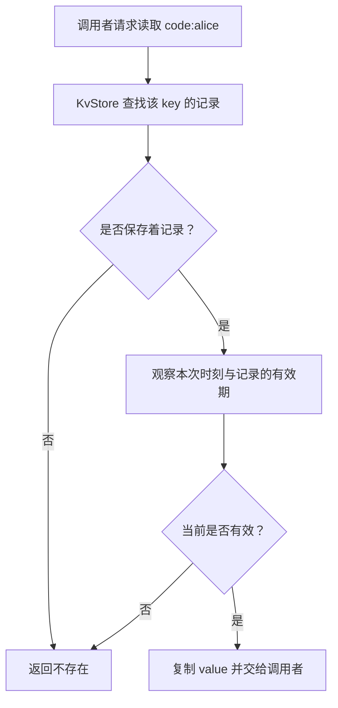

# Week13 Day2：让 KvStore 的 key 按时失效

> 版本：2026-10-14，依据 Week13 周规划、Day1 最终验收与当前 Ubuntu KvStore 编写
> 今日产出：升级原 KvStore 的时间语义，用可控时间验证有效期；今天不接新网络命令
> 阅读顺序：Part 1 -> Round1 -> 停下独立实现 -> Round2 -> Round3

[TOC]

---

# Part 1：前情提要与必要术语

## 1. 今天只解决一件事

**让同一份 key/value 在到期前还能读，时间一到便按不存在处理。**

你已经能保存验证码：

```text
key   = "code:alice"
value = "483921"
```

但原来的 KvStore 只判断 key 是否在 map 里。只要没人删除，这份验证码就一直可以取出来。

今天给它增加一个有效期。先用一个很短的教学时间线：在当前时间 1000ms 时，规定它再有效 2000ms。

```text
当前时间 1000ms：设置有效期 2000ms
当前时间 2999ms：仍能读到 "483921"，剩余 1ms
当前时间 3000ms：已经到期，GET 按不存在处理
当前时间 3001ms：仍按不存在处理
```

**测试必须能直接把时间推进到这些位置，而不是让程序真的睡两秒。**

这就是今天的完整目标：数据有时间上的有效性，测试能精确控制判断发生的时刻。

## 2. 接着你已经写好的东西继续

Week13 Day1 已正式通过 `98/100`。你现在能区分：同一个索引定位候选，查询需要的字段不同，后面的取数路径也可能不同。MySQL 入口先收住，今天回自己的 Mini Redis。

生成时只读检查的实际代码仍在：

```text
/home/xgf/code/system-learning/cpp/week10
```

你的 KvStore 当前使用 `std::map<std::string, std::string>`；`get/exists` 是 const，`get` 返回独立拥有内容的 `std::optional<std::string>`，`size()` 返回物理保存的条目数。

当前主要动作是：

| 原接口 | 你已经实现的行为 | 今天新增的关系 |
|---|---|---|
| `set` | 保存或覆盖 value | 普通覆盖还要清除旧有效期 |
| `get` | 找到 key 就复制 value 返回 | 返回前还要确认这份数据仍有效 |
| `exists` | 判断容器里有没有 key | 判断当前时刻是否存在有效 key |
| `erase` | 删除并返回是否成功 | 过期 key 不计入成功删除的有效 key |
| `size` | 返回 map 的条目数 | 继续保持物理数量口径 |

Week12 你已经正确解释了：**SET 先修改共享 store，再生成回复；回复是否送达，是 Connection 的后续工作。** 今天给 store 增加时间判断，原 bytes 传输链继续复用。

今天不是继续写一坨 parser。RESP parser、reply encoder、Connection、EventLoop 和 main owner 都先保留。

## 3. 带着四个问题进入正文

1. 存在于容器里的 key，为什么可能已经不能读取？
2. 怎样让同一份 store 在真实运行和测试中使用不同的时间来源？
3. 恰好到期、普通 SET 覆盖、删除后重建，各自应该得到什么结果？
4. 时间有单位和范围，怎样拒绝无效设置并保留原状态？

接口约定回答“今天怎样算对”；后半教程再把这些约定与实际机制串起来。

## 4. 先给时间线上这几个对象命名

### 4.1 TTL：还允许存活多久

`TTL = Time To Live`，生存时间。**它是一段长度，例如从现在起再有效 2000ms。**

这里的 `ms = millisecond`，毫秒。1000ms 等于一秒。本日组件统一使用整数毫秒。

网络里的 IP TTL 表示转发跳数预算；此处是 key 的时间长度。同名术语在不同场景承担不同职责。

### 4.2 deadline：从哪个时刻开始失效

`deadline`，到期时刻。**它是时间线上的一个位置，例如 3000ms。**

当前时间是 1000ms，允许再有效 2000ms，到期位置便是 3000ms。

本项目约定：**当前时间达到 deadline，就已经失效。** 到期前与恰好到期必须分开测。

### 4.3 clock：给组件提供当前时刻

`clock`，时钟，今天具体指“能告诉 KvStore 当前是多少毫秒”的时间来源。

真实运行时，时间来源读取单调时钟。测试时，时间来源可以读取你自己控制的整数变量。

这样的可控时间来源叫 `fake clock（测试时钟）`。它不要求等待现实中的时间流逝。

`clock injection（时钟注入）` 指：**创建组件时，把获取当前时间的能力传进去。** 组件照样判断有效性；测试可以替换时间来源。

具体调用语法在 Round1 的 API 小例子里讲，不要求先建立继承体系。

---

# Part 2：教程主体

**教程开始。**

## Round1：先在原 KvStore 上独立完成第一版

## 5. 先看今天这个组件到底干什么

今天升级的仍是一个普通 C++ 内存组件 `KvStore`。

它接收 key/value、调用者指定的有效长度以及当前时间来源。它负责保存数据，并回答：**在这次操作观察到的时刻，这份数据是否仍然有效？**

返回结果继续交给 caller，调用者。将来 command dispatcher，命令分发器，会把结果交给已有 encoder 编成 RESP 回复。

```text
今天的输入：key/value + 有效长度 + 时间来源
          |
          v
       KvStore
          |
          +--> 返回拥有自己内容的 value，或者不存在
          +--> 返回有效 key 是否存在/是否删除
          +--> 返回剩余毫秒数或状态标记
```

这是 application/storage 层，即应用协议背后的数据状态。它位于服务器进程的 user space，用户空间。

在整体服务中的位置是：

```text
Application 层：RESP request -> dispatcher -> KvStore -> reply encoder
Transport 层：TCP 提供有序 byte stream
Internet 层：IP 负责跨网络传递 packet
Link 层：Ethernet 等负责当前链路上的 frame
```

今天单测 KvStore，不经过下面三层。这样的拆分让你能把时间固定到 2999ms 或 3000ms，不必同时处理 socket 调度和网络延迟。

Day3 才把两条命令接进 dispatcher，Day5 再做真实 TCP 有效期检查。当前阶段**key 到期不会要求关闭 Connection**；客户端仍能在原连接上继续发送其他命令。

## 6. 本次维护哪些文件

继续使用原工程，不创建另一份 week13 服务器：

```text
include/mini_redis/kv_store.hpp  -> 原 KvStore 的声明与 private representation
src/kv_store.cpp               -> 原 KvStore 的实现
tests/kv_store_ttl_test.cpp     -> 今天新增的组件检查
CMakeLists.txt                 -> 只追加新 test target，原 targets 保留
```

`private representation（内部表示）` 指组件用来保存和组织数据的成员与结构。这部分由你决定。教程只规定对外行为，不先替你选第二张 map、Entry 类型或清理算法。

下面的小 checker 已给出，你可以直接放进新 test 文件。重复 GTest 语法不是今天重点；你需要知道每个时间点为何应该得到那个结果。

## 7. Public API：调用者能用什么

保留原五个接口，再增加可替换时间来源、设置有效期和查询剩余时间：

```cpp
#pragma once
#include <cstddef>
#include <cstdint>
#include <functional>
#include <optional>
#include <string>

class KvStore {
public:
    using TimeMs = std::int64_t;
    using Now = std::function<TimeMs()>;

    KvStore();
    explicit KvStore(Now now);

    void set(std::string key, std::string value);
    std::optional<std::string> get(const std::string& key) const;
    bool erase(const std::string& key);
    bool exists(const std::string& key) const;
    std::size_t size() const noexcept;

    bool expire_ms(const std::string& key, TimeMs ttl_ms);
    TimeMs pttl(const std::string& key) const;

private:
    // 由你设计内部存储与时间来源的保存方式。
};
```

这是 public declaration，公开声明，不是让你把原 private 内容全部删除。修改原 header，保留适合你的内部实现与注释；上面只列出本日要对齐的公开接口。

`using TimeMs = std::int64_t` 给有符号 64 位整数起一个单位明确的名字。使用有符号类型也让 `pttl` 能返回 -1/-2。

`Now = std::function<TimeMs()>` 的含义是：**一个不接收参数、调用后返回当前毫秒数的 callable（可调用对象）**。例如一个 lambda 就可以成为 Now。

这不是“把一个固定时间传进去”。传进去的是获取时间的能力，组件以后每次需要判断时间时再调用它。

本日不用虚基类来实现 clock。虚函数的独立补缺仍按 Week13 Day7 安排，不抢到 TTL 开工前。

## 8. 把每个接口的功能与触发场景说清楚

### 8.1 两个 constructor：怎样创建 store

```cpp
KvStore store;
```

默认构造使用 `std::chrono::steady_clock` 提供进程内的非负、单调毫秒读数。可选择创建 store 时刻等固定起点，从此计算经过的时间；同一 store 的所有读数必须采用同一个起点。

```cpp
KvStore store(read_now);
```

显式构造接收 Now，组件保存一份 callable，之后使用它获取当前时刻。`explicit` 的意思是这次构造需要明确调用，不让一个函数对象隐式变成 KvStore。

传入空的 `std::function` 时抛 `std::invalid_argument`。测试时间必须由 caller 保证不倒退；相同时间连续调用是允许的。

### 8.2 `set`：保存新内容，同时取消旧有效期

```cpp
store.set("code:alice", "483921");
```

普通 SET 的结果是：这个 key 保存给定 value，当前没有有效期。若之前有旧 value 或旧有效期，本次成功覆盖后都以新状态为准。

key 已经过期但仍物理保存在组件里时，SET 也能建立新的有效数据。新值从这次 SET 起没有有效期。

空 key、空 value、含 `\0` 的 string 继续按长度保存。原来的 binary-safe，二进制安全，保证不改变。

### 8.3 `get`：取当前仍有效的 value

```cpp
auto value = store.get("code:alice");
if (value) {
    // *value 是调用者独立拥有的一份 string。
}
```

物理没有 key，或者当前已经到期，都返回 `std::nullopt`。没有设置有效期、或尚未到期，返回 value 的 owning copy，独立拥有的副本。

保留原 `const` 声明。**今天的 get 不擦除内部记录，也不修改其有效期。** 它可以读取时间来源并据此决定是否交付 value。

### 8.4 `exists`：判断此时是否存在有效 key

```cpp
bool present = store.exists("code:alice");
```

无 key 或已到期返回 false；永久有效或尚未到期返回 true。保留 const，并与 get 采用相同的到期边界。

### 8.5 `erase`：删记录，但返回有效 key 的删除结果

```cpp
bool removed_live_key = store.erase("code:alice");
```

物理有这个 key 时，本次调用删除它及其有效期信息。返回 true 表示调用观察时它仍是有效 key；已过期的记录即使被顺手回收，也返回 false。

物理没有 key 时返回 false。这样将来 DEL 的计数表示“删除了多少有效 key”，不会把已经失效的记录重新计成一个存在的数据。

### 8.6 `size`：仍是物理保存的条目数

```cpp
std::size_t stored_entries = store.size();
```

它继续返回内部保存的 key/value 记录数量，不读取 clock、不清理、不统计当前有效 key 数。

因此，某 key 已到期后，get 可以返回不存在，而 size 暂时仍是 1。这个口径是本日刻意保留的观测，Day4 用它区分有效性判断与实际回收。

### 8.7 `expire_ms`：给有效 key 设置从现在起的生存长度

```cpp
bool applied = store.expire_ms("code:alice", 2000);
```

这里的 2000 单位是**毫秒**，不是到期时刻、秒数或字符串长度。

| 输入与当前状态 | 返回/状态 |
|---|---|
| key 有效，正 ttl 可表示 | 返回 true；替换为本次设置的有效期 |
| key 有效，ttl 为 0 或负数 | 返回 true；立即删除该 key 及有效期 |
| key 无有效数据 | 返回 false；不把失效数据重新变有效 |
| 正 ttl 与当前时间组合越界 | 抛 `std::overflow_error`；保留原状态 |

已经设置过有效期时，再设置会替换旧有效期，不要求只能缩短。结果以**本次设置的时刻**为起点。

本日只做 C++ 组件方法；`expire_ms` 不是新加的 RESP wire command，线上协议命令。Day3 的 EXPIRE 参数使用秒，转换工作到时在 dispatcher 中完成。

### 8.8 `pttl`：查询当前状态或剩余毫秒

```cpp
KvStore::TimeMs remaining = store.pttl("code:alice");
```

`PTTL` 是 Redis 中以毫秒查询剩余 TTL 的命令名。这里先实现同名组件能力，尚未增加命令分支。

| 返回值 | 明确含义 |
|---|---|
| 正数 | 当前仍有效，返回剩余毫秒数 |
| `-1` | key 有效，但没有设置有效期 |
| `-2` | 不存在有效 key，包括已到期 |

在本项目整数毫秒、达到 deadline 即失效的约定下，带期限且仍有效时至少剩余 1ms，恰好到期返回 -2。**本项目不把 0 当作“永久”。**

pttl 保留 const，不擦除记录。不要把合法状态 -1/-2 当成异常；稍后 encoder 会把它们编成普通 RESP Integer reply。

这组状态标记与 Redis 2.8 以来的基本约定对齐，精确相等边界按本周项目 contract 执行。[PTTL 官方说明](https://redis.io/docs/latest/commands/pttl/)

## 9. 时间的范围与 error contract

### 9.1 本日支持范围

TimeMs 使用 `std::int64_t`。当前时刻与保存的到期时刻都必须在非负可表示范围内：

```cpp
0
std::numeric_limits<KvStore::TimeMs>::max()
```

上面第二行来自 `<limits>`，返回这个整数类型的最大值。不要另外手写一个可能位数不对的长常量。

`ttl_ms` 本身可以是 TimeMs 的任意值；非正值按立即删除处理。正值还需要满足“从当前时刻开始设置后的到期位置能表示”。本日 R1 就需要正确处理范围失败，但检查表达式与计算顺序由你设计。

**一次需要观察时间的 store 调用，使用一个当前时间快照完成该次判断。** 时钟可以在两次不同调用之间推进；同一次操作的有效性与剩余长度不能混用两个读数。

错误优先级也定清楚：expire_ms 先验证本次 clock 读数与正 ttl 的可表示范围；验证失败就抛异常，即使 key 原本不存在。验证通过后才按有效 key 是否存在返回 true/false。

### 9.2 哪些情况抛什么

| 情况 | 行为 | 参考英文 error message |
|---|---|---|
| 显式构造传入空 Now | `std::invalid_argument` | `clock callback must not be empty` |
| 时间来源返回负毫秒数 | `std::invalid_argument` | `clock must return non-negative milliseconds` |
| 正 ttl 造成 deadline 超出 TimeMs 范围 | `std::overflow_error` | `TTL deadline out of range` |
| 用户提供的 Now 调用时抛异常 | 原异常继续传播；本次操作不改 store 状态 | 保留时间来源的诊断 |
| key 不存在/已过期 | 使用 nullopt、false 或 -2 的正常结果 | 不需要报错 |

异常类型是约定，英文句子提供参考，不把措辞差异变成通过条件。使用对应异常需要 `<stdexcept>`。

上述输入/时间失败都必须发生在修改当前状态之前。这里要求的是这些**明确列出的错误路径**保留状态；不新增全容器内存分配失败注入工程。

测试 clock 的负值会被拒绝；“非负但倒退”的时间来源违反本日前置约定，由 caller 保证单调，不要求组件新增历史读数检测器。

## 10. 开工前只补这些 API 用法

### 10.1 `steady_clock`、`time_point`、`duration`

`steady_clock（单调时钟）` 的读数不会随时间前进而减小，适合测量进程内经过多久。普通日历时间会受校时影响；本项目 TTL V2 选择前者。[C++ steady_clock 定义](https://eel.is/c++draft/time.clock.steady)

在 `<chrono>` 中：

```cpp
using Clock = std::chrono::steady_clock;
Clock::time_point start = Clock::now();
```

`now()` 返回 `time_point（时间点）`，即这只时钟时间线上的位置。两个时间点相减得到 `duration（时长）`。

```cpp
auto elapsed = later - start;
auto elapsed_ms =
    std::chrono::duration_cast<std::chrono::milliseconds>(elapsed);
auto number = elapsed_ms.count();
```

`duration_cast` 负责时长单位转换；`count()` 才取出数值。源时长转成整数毫秒时，会舍去不足一毫秒的部分。它没有让线程等待，也没有设置定时任务。[duration_cast 标准定义](https://eel.is/c++draft/time.duration.cast)

### 10.2 一段可以单独跑的最小例子

这段只验证 chrono 和 Now 的调用形态，不实现 KvStore。你可以在临时文件运行，不必作为另一份今日产出保存。

```cpp
// chrono/callable 语法小例子：单位换算，以及同一函数对象读取变化的时间。
#include <chrono>
#include <cstdint>
#include <functional>
#include <iostream>

int main() {
    using Clock = std::chrono::steady_clock;
    const auto start = Clock::now();
    const auto later = start + std::chrono::milliseconds{1500};
    const auto elapsed =
        std::chrono::duration_cast<std::chrono::milliseconds>(later - start);
    std::cout << "elapsed_ms=" << elapsed.count() << '\n';

    std::int64_t fake_now = 1000;
    std::function<std::int64_t()> read_now = [&fake_now] {
        return fake_now;
    };
    std::cout << "now_ms=" << read_now() << '\n';
    fake_now = 2999;
    std::cout << "now_ms=" << read_now() << '\n';
}
```

假设临时文件叫 `chrono_clock_demo.cpp`：

```bash
g++ -std=c++17 -Wall -Wextra -g chrono_clock_demo.cpp -o chrono_clock_demo
./chrono_clock_demo
```

输出：

```text
elapsed_ms=1500
now_ms=1000
now_ms=2999
```

这里没有真的等 1500ms。第二个时间点是从第一个位置向后构造出来的；这个例子测试单位，不测试机器调度。

`[&fake_now]` 表示 lambda 借用这个变量。函数对象被复制后，仍读取同一个 fake_now，所以修改变量会影响之后的调用。fake_now 必须比使用它的 store 活得久。

真实时钟接法由你放进默认 constructor；测试 constructor 则接收这种 callable。组件保存自己的 Now 对象，而不是借用 constructor 参数对象的地址。

## 11. 给你一个最小 KvStore checker

把下面内容放进新文件 `tests/kv_store_ttl_test.cpp`。它只通过公开 API 使用你的组件，不规定内部成员。

```cpp
// 一个受控时间线：验证同一份数据在到期前存在，恰好到期时失效。
#include "kv_store.hpp"
#include <gtest/gtest.h>
#include <string>

TEST(KvStoreTtl, ExactDeadline) {
    KvStore::TimeMs fake_now = 1000;
    KvStore store([&fake_now] { return fake_now; });
    store.set("code:alice", "483921");
    EXPECT_EQ(store.pttl("code:alice"), -1);
    ASSERT_TRUE(store.expire_ms("code:alice", 2000));
    EXPECT_EQ(store.pttl("code:alice"), 2000);

    // 当前读数由测试指定，component 不需要 sleep。
    fake_now = 2999;
    const KvStore& view = store;
    const auto value = view.get("code:alice");
    ASSERT_TRUE(value.has_value());
    EXPECT_EQ(*value, std::string("483921"));
    EXPECT_TRUE(view.exists("code:alice"));
    EXPECT_EQ(view.pttl("code:alice"), 1);

    fake_now = 3000;
    EXPECT_FALSE(view.get("code:alice").has_value());
    EXPECT_FALSE(view.exists("code:alice"));
    EXPECT_EQ(view.pttl("code:alice"), -2);
    EXPECT_EQ(view.size(), 1u);

    fake_now = 3001;
    EXPECT_FALSE(view.get("code:alice").has_value());
    EXPECT_EQ(view.pttl("code:alice"), -2);
}
```

这个 checker 的 oracle，预期结果依据，来自第 1 节时间线与 public contract。它没有调用你的 private helper，也不复用你的到期判断公式来算预期。

`const KvStore& view` 验证查询可以经 const 接口调用；`size()==1` 验证这些查询没有物理删除记录。

GTest 的 EXPECT/ASSERT 失败会让这个测试 executable 非零退出，CTest 也会标成失败。**不要另外打印 PASS 来替代断言结果。** 通过后的测试摘要会包含：

```text
[  PASSED  ] 1 test.
```

这是实现完成后应观察到的结果，不表示你当前源码已经通过。现有 V1 尚没有这些新接口。

## 12. CMake 与第一次编译运行

原工程已经有 `kv_store` library、GoogleTest 和 `gtest_discover_tests`。保留原构建内容，只追加：

```cmake
# TTL 组件检查复用原 kv_store library 和原 GoogleTest 配置。
add_executable(kv_store_ttl_test tests/kv_store_ttl_test.cpp)
target_compile_options(kv_store_ttl_test PRIVATE -Wall -Wextra -g)
target_link_libraries(kv_store_ttl_test PRIVATE
    kv_store
    GTest::gtest_main
    GTest::gtest
)
gtest_discover_tests(kv_store_ttl_test PROPERTIES TIMEOUT 5)
```

`kv_store` 的 PUBLIC include 路径会传播给这个 test，所以它继续用 `#include "kv_store.hpp"`，不用绝对路径。

在 Ubuntu 原工程运行：

```bash
cd /home/xgf/code/system-learning/cpp/week10
cmake -S . -B build -DCMAKE_BUILD_TYPE=Debug
cmake --build build --target kv_store_ttl_test
cmake -E chdir build ctest --output-on-failure -R '^KvStoreTtl\.'
```

第三行构建新增的测试 executable；第四行仍是约定的 CTest 入口，只用 `-R` 正则筛选当前测试名。它不会要求启动 Mini Redis server 或 MySQL。

你升级 header/implementation 后，最终还要 build 整个原工程，确认原 server 与 dispatcher 的调用继续兼容；这一步在 Round3 收口。

## 13. 到这里停止阅读，独立实现 R1

现在你已经有用途、准确文件名、公开接口、时间范围、错误行为、必要 API、一个小调用与真实 build/run 入口。

**先设计并实现原 KvStore 的 V1，再继续读 Round2。** R1 的核心是自己决定怎样组织 value 与有效期，怎样从时间来源取得一个读数，并让原五个接口与两个新增接口共同满足约定。

R1 提交时先给：

- 升级后的原 header/source。
- 上述小 checker 的真实运行结果。
- 一句解释：你的当前时间来自哪里，如何在测试中推进它。

SET 清旧有效期、erase、重新设置、非正长度与范围失败都已在 R1 contract 里明示；第一版可以先跑通主时间线，存在问题就带着代码来检阅。额外机械 tests 可以在 review 时授权我补，不要求今天再独立写几十个 cases。

读到这里先停。下面是机制对照，会在你的 R1 正式通过时按真实实现逐节定向润色，保留你学习中新增的内容。

---

## Round2：把第一版里的时间与状态串清楚

以下是完整后半教程，不是另一套实现答案。R1 通过后会从本文件最新版本出发，按照你的成员、函数与实际问题更新这一部分。

## 14. 从一份验证码走完有效性判断

原 KvStore 的依据只有一个：能在容器里找到 key，就有 value。

新增有效期后，要同时回答两件事：**这份记录是否保存着，以及当前时刻是否仍允许把它当作存在的数据。**

回到同一个例子。设置时当前读数是 1000ms，指定生存长度 2000ms，到期位置是 3000ms。

记设置时刻为 $t$，生存长度为 $\tau$，到期时刻为 $d$：

$$
d = t + \tau
$$

随后 GET 并不需要“再等一会儿”。它在本次调用中读取当前时刻，检查当前记录的有效性。



这张图是行为链，不指定你用哪一个容器保存时间。

在 2999ms，读取仍允许进行；到 3000ms，时间边界已经跨过。同一记录没有收到额外网络消息，也可以失去对外可见性。

**失效首先是一条读取规则，不必等一段清理代码真的执行过，才能判定数据过期。**

## 15. 当前时间怎样真正进入这条链

测试把 fake_now 改成 3000，并不会直接改你的 key/value，也没有调用 erase。

它改变的是时间来源下一次提供的读数：

```text
test 修改 fake_now
-> test 调用 store.get(key)
-> KvStore 调用保存的 Now
-> Now 读取此时的 fake_now
-> KvStore 用这个读数判断有效性
-> 返回 value 或不存在
```

真实运行时同一位置改为：

```text
dispatcher 调用 store.get(key)
-> KvStore 调用默认时间来源
-> 时间来源读取 steady_clock，换算成同一时间轴上的毫秒
-> KvStore 判断有效性
-> dispatcher 把结果编码为 reply
```

这两条路径的变化只在“当前时刻由谁提供”。有效期规则本身继续在 KvStore 内执行，所以测试验证的是同一组件行为。

### 一次操作使用一个时间快照

假设调用第一次读时间得到 2999，第二次得到 3000。先按前者判断“有效”，再按后者计算“剩余长度”，就可能把同一次结果混成两个时刻的状态。

本日要求一次操作里的判断使用同一读数。**时间快照就是这次操作采用的那个时刻，不表示暂停真实时钟。**

两次独立 API 调用之间可以跨过 deadline，所以真实运行时 get 成功后紧接着 exists 返回 false，也可能合法。测试的 fake_now 不变时，则能要求各结果严格一致。

你的当前 DEL/EXISTS handlers 是循环调用 store 方法。Day3 会根据届时的真实方案，让一条多 key 命令采用一致的时间观测；Day2 的单次方法快照不能冒充整条命令快照已经完成。

### 起点和单位必须一致

时间点比较要处在同一条时间轴上。真实 clock 的数字可以从创建 store 时的起点累计，测试 clock 可以从 1000 开始；分别使用时都成立。

但同一个 store 不能设置时拿一种起点，读取时换成另一种；也不能设置按秒、读取按毫秒。单位清楚，比“这个整数看起来很大”更重要。

## 16. 为什么保留 const：先保证读不到，再安排回收

你的 Week12 note 已经记录过：const map 不能使用可能插入元素的 `operator[]`。当前 get 用 find，已经尊重了只读查询。

今天延续这个明确边界：get/exists/pttl **不修改存储的记录和有效期**，它们只是结合时间决定结果。

```text
                对外有效性          物理记录
到期前              有效                保留
恰好到期            不存在              可以仍保留
调用 erase 后       不存在              已删除
Day4 维护回收后     不存在              已删除
```

读取一个外部时间来源，不等于修改 KvStore 内保存的数据。const 对成员操作的限制，也不会让外部现实时间冻结。

`lazy expiration（访问时判定过期）` 指访问目标 key 时才判断其时效。真实 Redis 的常见路径还会删除已过期 key；本日保留 const，因此实现的是**访问时失效判定，物理删除另安排**。

把两个动作拆开有具体好处：今天用 size 还能观察到“已失效但未回收”，Day4 再验证维护是否真正检查和删除了它。

普通查询返回不存在，只能证明访问规则成立。若要证明无人访问时也回收，就得观察独立维护动作，不能先 GET 再宣称后台清理发生了。

**这里的取舍是本项目 V2 的阶段设计，不是宣称复制了 Redis 全部过期路径。**

## 17. SET 与重新设置期限：现在是谁的有效期

有效期约束的是当前这份数据。它不是一个只要绑过名字，就永久跟随名字的规则。

### 17.1 普通 SET 建立新状态

```text
1000ms：SET k old
1000ms：设置 k 再有效 2000ms
2000ms：SET k new
3000ms：GET k -> new
3000ms：PTTL k -> -1
```

2000ms 的普通 SET 覆盖内容，也清除旧有效期。因此到原 3000ms 边界，新值仍有效。

你需要核对的不是“有没有更新 value”这一件事，而是**成功 SET 后，内容和有效期共同构成怎样的新状态**。[Redis 普通 SET 对旧 TTL 的处理](https://redis.io/docs/latest/commands/set/)

### 17.2 再次设置以本次时刻为起点

```text
1000ms：设置 k 再有效 2000ms，原到期位置 3000ms
2000ms：重新设置 k 再有效 5000ms
3000ms：k 仍有效
7000ms：k 按不存在处理
```

第二次不是把 5000 接在旧 deadline 后，也不是一定缩短；它替换为本次规定的生存长度。

### 17.3 删除后同名重建

```text
给 k 设置旧有效期
-> erase(k)
-> set(k, new)
-> 推过旧到期时刻
-> 新 value 仍存在且没有有效期
```

这条检查区分旧记录与新记录。Day4 若增加单独的到期维护信息，还会继续围绕这个关系核对；今天不提前指定 heap、版本号或另一种清理结构。

## 18. 时间加法为什么也属于正确性

正长度需要落到一个可表示的到期位置。假设 TimeMs 的最大值叫 $M$，当前非负时刻叫 $t$，正长度叫 $\tau$。

合法条件可以写成：

$$
\tau \le M - t
$$

在已经确认当前时刻非负、且属于 TimeMs 范围后，右侧减法有界。**不能先执行可能溢出的有符号加法，再用结果判断是否超范围。**

例如当前是 1500ms，却要求再有效 `std::numeric_limits<TimeMs>::max()` 那么长，不能保存一个绕回去的负 deadline。方法应明确拒绝，本次失败不覆盖原有效期。

非正长度走立即删除语义，不需要对最小负整数取绝对值，也不需要把它先转换为无符号数。[EXPIRE 非正长度语义](https://redis.io/docs/latest/commands/expire/)

对 pttl，先确认 key 仍有效，再计算剩余长度：

$$
r = d - t
$$

在本日范围里，仍有效意味着 $d>t\ge0$，剩余长度是可表示的正数。-1/-2 是另两种状态，不是某次时间差恰巧算出来的结果。

今天重点看一组代表性范围失败即可，不新增一堆无意义的大整数排列。Day3 秒转毫秒还会多一次乘法范围判断，那是下一天的新输入边界。

## 19. 到期以后，已经取出的 value 会怎样

你的 get 继续返回 `std::optional<std::string>`。成功返回时，调用者拥有一份复制后的内容。

```text
2999ms：get(k) 成功，caller 得到 string 副本
3000ms：store 中 k 已失效
之后：caller 先前拿到的 string 仍保持原 bytes
```

这是你已经掌握的 owning value 保证，今天只增加时间上的对照。未来 dispatcher 已经生成 reply 后，key 到期也不会改写那份 reply 或 Connection output 中的待发送 bytes。

“当前 GET 是否应该交付”由 store 的当次判断决定；“先前交付的副本是否还能访问”由副本自己的 lifetime，生命周期，决定。这两个问题有不同对象。

不要为了 TTL 把 get 改成借用内部 string 的 pointer/string_view。那会引入新的失效关系，改变已通过的 API；今天没有这个需要。

## 20. 此时再看图解：你的设计与真实 Redis 怎样对应

**读完 §16~§19，再选读《图解 Redis》的这一篇，作为第二解释源。**

- 篇名：[Redis 过期删除策略和内存淘汰策略有什么区别？](https://www.xiaolincoding.com/redis/module/strategy.html)
- 本次看：“如何判定 key 已过期了？”以及“过期删除策略有哪些？”中的“惰性删除”。
- 带回一个判断：你的查询检查发生在哪里，哪些接口只隐藏失效数据，哪一个动作真的释放记录。
- 看到“定期删除”先停；具体清理与预算留给 Day4，“内存淘汰策略”留给 Day6。

文章会展示真实 Redis 的过期字典和查询流程。这是对照材料，**不要求把你的 map 方案换成文章的表示**。本日 const 查询只判定，和文中的访问时实际删除要区分。

另一个重要版本/设计差别是时间轴：本项目 V2 使用进程内单调时间，真实 Redis 的过期信息采用绝对 Unix 时间表示，能够参与跨进程保存与恢复。重启后的 TTL 不能原样复制本日相对时间整数来解决。[Redis 过期与持久化说明](https://redis.io/docs/latest/commands/expire/)

Unix timestamp（Unix 时间戳）是从约定日历起点累计的时间读数；它不是你默认 store 的“创建后经过多少毫秒”。这层区别现在记住用途即可，Week14 再设计恢复表示。

---

# Part 3：收尾、验证与验收

## Round3：把这一份组件收住，不复制另一个 store

## 21. 本轮明确完成什么升级

继续维护 §6 的原 header/source 与一份新测试，不复制旧 parser/server。

相对你已验证的 Week12 实现，本日要完成三项升级：

1. **时间成为 store 的可控输入。** 默认运行接单调时间；测试接 fake clock。
2. **原 CRUD 行为与有效期一致。** CRUD 即 Create/Read/Update/Delete，增、读、改、删；这里核对 set/get/exists/erase，不让某个入口继续暴露已过期值。
3. **状态替换与拒绝路径有证据。** SET 清旧 TTL、再次设置、删除重建与范围失败，都使用明确时间点判断。

R1 正式通过时，这一节会依据你届时的真实实现改成具体的保留项、修复位置和最小补测动作。不会要求你猜一堆“如果”的分支，也不会为了迎合预设容器重写正确设计。

## 22. 只补这些有新增判断价值的 checks

第一条已经由 §11 的 checker 覆盖。后续测试仍放在同一个 `kv_store_ttl_test.cpp`；你能说明 oracle 后，可以授权我补机械代码，不需要重复手写 GTest 外壳。

| 场景 | 实际建立的状态与动作 | exact oracle，精确预期 |
|---|---|---|
| 到期边界 | 1000ms 设置 2000ms，推进到 2999/3000/3001 | 先 value/true/1，再不存在/false/-2；只读查询后物理 size 仍为 1 |
| 普通 SET 覆盖 | 1000ms 设置到 3000ms；2000ms SET 新值；推进到 3000 | get 是新值，pttl 为 -1 |
| 删除重建 | 设置期限后 erase，SET 同名新值，推过旧期限 | 新值仍在，pttl 为 -1；删除已过期记录时 bool 为 false 且物理记录移除 |
| 再次设置 | 1000ms 设置 2000ms；2000ms 改为 5000ms | 3000ms 仍有效，剩 4000；7000ms 失效 |
| 非正长度与缺失 | 有效 key 设置 0/负值；另对不存在/已过期 key 设置合法长度 | 前者 true 且删除；后者 false，不复活 |
| 范围失败保留状态 | 原 deadline 为 3000；1500ms 设置 max 长度并捕获指定异常 | overflow_error；之后 value 不变，pttl 精确为 1500 |
| clock 入口与副本 | 空 Now；负读数；2999ms 得到副本后推到 3000 | 指定异常且已有状态不变；先前副本仍是旧 bytes |

`size` 检查的是物理记录口径。删除重建与范围失败要用独立小场景，不拿前一 case 残留状态当作前置。

负读数检查后，将 fake clock 恢复到**它之前的合法读数或更大时刻**，再验证状态没被改写；这不是让正常 clock 倒退。空 Now constructor 的失败没有创建一个可继续使用的 store。

异常 case 必须检查确实抛出了约定类型；没有抛或类型错误应让 test 失败。副本、binary 与普通旧命令可以复用既有测试，只增加本次时间变化带来的那条关系。

## 23. 最终构建与工具各证明什么

### 23.1 先完整构建，再运行同一 CTest 入口

在原工程执行：

```bash
cmake -S . -B build -DCMAKE_BUILD_TYPE=Debug
cmake --build build
cmake -E chdir build ctest --output-on-failure
```

完整 build 会检查旧 dispatcher/server 是否仍能编译链接。CTest 会执行原有组件检查与新加 TTL tests；原先的 `74/74` 是历史基线，新总数以你实际新增的测试数量为准，不预写一个漂亮数字。

今天不需要重跑 Week12 全部进程外多客户端、慢读和 strace 场景。服务器的有效期命令尚未接入，Day5 会补真正有新输入关系的网络验证。

### 23.2 ASan/UBSan：检查新存储路径的内存与算术

另用一个 build 目录，避免把工具构建与 normal build 混在一起：

```bash
cmake -S . -B build-w13-day2-san \
  -DCMAKE_BUILD_TYPE=Debug \
  -DCMAKE_CXX_FLAGS="-fsanitize=address,undefined -fno-omit-frame-pointer" \
  -DCMAKE_EXE_LINKER_FLAGS="-fsanitize=address,undefined"
cmake --build build-w13-day2-san --target kv_store_ttl_test
cmake -E chdir build-w13-day2-san ctest --output-on-failure -R '^KvStoreTtl\.'
```

ASan，即 AddressSanitizer，检查已执行路径中的越界、释放后使用等内存错误；UBSan，即 UndefinedBehaviorSanitizer，能捕获许多未定义行为，包括可达的有符号算术溢出。

本次重点是新元数据与删除/重建路径的 lifetime，以及临界时间输入。工具无报告只说明本次覆盖路径没有报告相应错误；**精确边界和旧 TTL 是否被清掉，仍由业务断言证明。**

当前 store 仍由单线程使用，fake clock 也在同一测试线程推进。今天没有新增并发共享状态，不机械加一份 TSan 任务。

### 23.3 今日证据边界

fake clock 的 PASS 证明组件在指定时刻执行约定的状态判断。它没有证明后台清理、真实 TCP 时间集成、吞吐提升或进程重启恢复。

本教程生成时只读核对了原 source/CMake，并验证独立 chrono/callable 例子和 checker 的语法准备；新 KvStore 的实际构建与运行证据要在你的实现保存后验收，不能用教材里的预期输出替代。

## 24. 今日通过标准与 note

核心通过：

- 原 store 已接入真实/测试两种时间来源，接口用途和单位明确。
- get/exists/pttl 在 before/exact/after 三个时刻一致，const 查询不擦除记录。
- SET、erase、再次设置与范围拒绝按本日约定工作，有少量独立 oracle 支撑。
- 原调用点仍能完整构建，新增测试失败会非零退出，相关 sanitizer 路径已检查。

clock 捕获悬空引用、错误类型或时间单位混乱属于当天需要修的真实问题。通用 timer framework、复杂清理数据结构、时间持久化和性能结果是后续内容。

note 只写你真正新理解或卡住的地方：时间来源怎样接入、有效与物理存在的区别、一个实际修复。已经在代码/测试里清楚表达的普通赋值和检查，不再抄一套说明书。

## 25. 五道收口题

代码和正确口述可以共同支撑，不要求再填一份长答卷。

1. 3000ms 时 get 返回不存在，size 却仍是 1，各自说明什么事实？
2. fake_now 从 2999 改成 3000 后，哪个调用真正读取新时间，哪个对象仍没被删除？
3. 普通 SET 与再次 expire_ms，对旧有效期分别产生什么变化？
4. 一个无效的大 TTL 设置失败，怎样用独立结果证明旧 value 和有效期保持？为什么不能先加再判断？
5. 为什么本日相对单调时间能用于进程内 TTL，却不能直接当作 Week14 重启恢复的时间表示？

## 26. 到这里收住，下一天再接命令

今天完成的是 KvStore 的时间语义与可控证据，不改 RESP grammar，不实现主动清理，不增加后台线程。

Day3 让客户端使用 `EXPIRE key seconds` 和 `PTTL key`，新增整数参数校验、秒到毫秒换算、命令回复，以及多 key 命令的一致时间观测。

Day4 再回答：**失效后始终没人访问的记录，怎样在有限工作量内回收？**

今日压缩记忆：**clock 给当前时刻，TTL 决定生存长度；到期规则决定能否读取，清理动作决定何时回收。**
