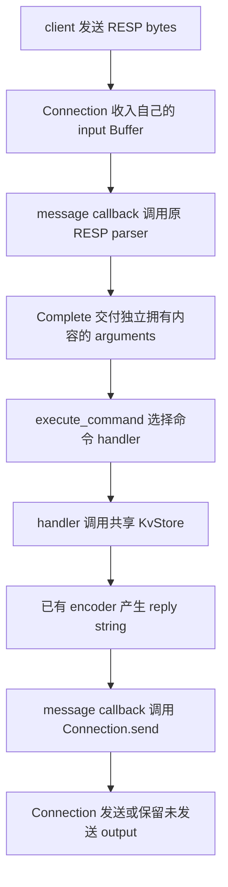
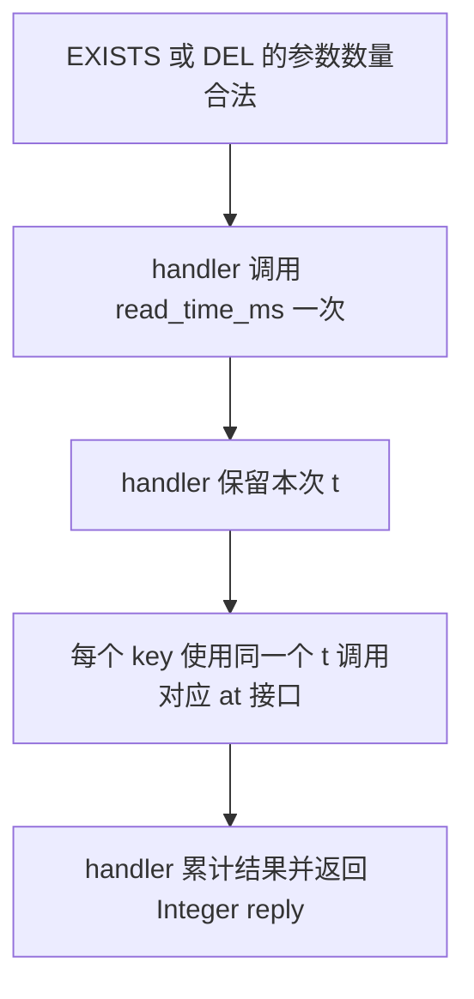

# Week13 Day3：让客户端设置和查询 key 的有效期

> 版本：2026-10-16，依据 Day2 最终通过的 KvStore 与当前命令分发器生成
> 前置：Day2 整日正式通过 100/100；今天继续原工程，不另造一套服务器
> 今日产出：EXPIRE/PTTL 两条命令；后半把时间判断从“单次方法”推进到“整条命令”
> 学习方式：完整保留 R1 独立实现、R2 对照讲解、R3 定向升级；R1 通过后再按你的真实首版润色后半

---

# Part 1：前情提要

## 1. 今天先把这条调用打通

**让使用者能够发送 `EXPIRE code 2`，给 code 设置两秒有效期，再用 `PTTL code` 查询剩余毫秒数。**

昨天你已经让 KvStore 做到了“到期后读不到”。今天给这项能力增加命令入口。主要改动落在原来的 `command_dispatcher.hpp/.cpp`；RESP parser、Buffer 和 Reactor 都继续使用。

先看一个固定时钟下的使用场景。这里的命令写成便于阅读的形式，实际 dispatcher 接收的是已经解析好的字符串数组。

| 当前毫秒时刻 | 使用者调用 | 使用者得到的结果 |
|---|---|---|
| 1000 | `SET code 2468` | `OK`，此时 code 没有有效期 |
| 1000 | `EXPIRE code 2` | 整数 1，设置成功 |
| 1000 | `PTTL code` | 整数 2000 |
| 2999 | `PTTL code` | 整数 1 |
| 3000 | `PTTL code` | 整数 -2，code 当前已经无效 |
| 3000 | `GET code` | Null Bulk String，表示没有可返回的值 |

**今天主要完成应用层的命令含义：把使用者的参数变成 KvStore 调用，再把结果变成回复 bytes。**

## 2. 从你昨天的实际代码继续

Day2 最终版保留了你的设计：`std::map<std::string, node>` 存 value 与 deadline，`deadline == -1` 表示没有期限，`Now` 保存取得当前毫秒时刻的能力。

你已经解决了三个实际问题：

- `pttl` 和 `expire_ms` 在一次操作里复用同一个时间读数。
- 非正 TTL 对有效 key 才删除并返回 true；缺失或当前已过期返回 false。
- 正 TTL 的期限加法检查、负时刻检查和默认 clock 的生命周期都已补齐。

这些是今天可以依靠的组件能力。**今天不再从头解释 node 如何表示过期，也不重写昨天的核心检查。**

你现有的 dispatcher 已有 PING、ECHO、SET、GET、DEL、EXISTS 六条命令，`execute_command` 返回独立拥有 bytes 的 `std::string`。我们沿这条路径增加两条，而不是新增一个处理 TTL 的网络层。

## 3. 今天带着四个问题往下走

1. `EXPIRE code 2` 里的 `2` 是什么单位，应该怎样交给昨天的毫秒接口？
2. `PTTL` 的正数、-1、-2 各自对应什么数据状态？
3. `EXPIRE code 2x` 已经是完整 RESP request，服务器应该怎样回复，之后还能否执行 PING？
4. 一条 `EXISTS code code` 会检查两次同名 key；“每次方法只读一次时间”是否已经足够？

前三个让你能完成首版；第四个留到 R1 之后，用自己的首版接着推。

## 4. 必要术语，跟着今天的对象理解

**EXPIRE：设置 key 的过期时间。** 命令参数使用秒；本项目把它转换成毫秒，交给 KvStore。成功时返回整数 1，缺失或当前已过期时返回整数 0。

**PTTL：以毫秒返回剩余生存时间。** TTL 是 Time To Live，生存时间；这里的 P 对应毫秒精度的查询版本。它把“带期限仍有效”“没有期限仍有效”“当前不存在”区分成三类结果。

**Handler（处理函数）：负责执行某一条命令的普通 C++ 函数。** 你已有的 `get_handler` 就属于这一类。dispatcher 根据命令名选中它，它检查参数、调用 store、返回已经编码的回复。

**Arity（参数数量）：这条命令总共带了几个字符串。** 今天数量包含命令名本身：`{"EXPIRE", "code", "2"}` 的 arity 是 3；`{"PTTL", "code"}` 的 arity 是 2。

**Command error（命令错误）：请求边界已经完整，但命令用法不成立。** 例如 EXPIRE 的时长写成 `2x`。应用层返回一条 RESP Error reply 后，可以继续执行后面的完整命令。

时间快照、显式时间接口等后半才需要的词，到对应场景再解释。

---

# Part 2：教程

教程开始

## 5. 这次改动在整条网络链的哪里

先顺着一条普通请求走完。

客户端把 `EXPIRE code 2` 编成 RESP bytes，TCP 把 bytes 送到你的 socket。Connection 收到后存进自己的 input Buffer，应用层的 message callback 调用原 RESP parser。

parser 确认第一条请求完整，交付三个字符串：`EXPIRE`、`code`、`2`。message callback 把它们交给 `execute_command`。今天新增的命令处理函数调用 KvStore 设置期限，再让原 encoder 把 bool 结果编码成整数回复。

message callback 继续调用 Connection 的 `send`；Connection 负责尽力发送并保存尚未发送的 output。**KvStore 的期限在命令执行时就已更新，不需要等待客户端收到回复。**



图中 D 到 G 是今天动手的范围。TCP 层继续负责可靠字节流；IP 层继续负责寻址与路由；链路层继续负责相邻链路交付。**EXPIRE 的“两秒”和 PTTL 的“-2”是应用协议约定，由你的应用代码解释。**

今天可以直接用 GTest 调 `execute_command`，先验证这段应用链。真实 TCP 和空闲维护在 Day5 统一接，不要求再手写一个 server。

## 6. 今天维护哪些文件

仍在 Ubuntu 原工程根目录工作：

```bash
cd /home/xgf/code/system-learning/cpp/week10
```

| 文件 | 今天的职责 |
|---|---|
| `include/mini_redis/command_dispatcher.hpp` | 保留原声明，增加两条命令处理函数的声明 |
| `src/command_dispatcher.cpp` | 接入 EXPIRE/PTTL，处理命令参数并返回 reply |
| `tests/ttl_command_test.cpp` | 今天的独立小 checker；下文直接提供可复制版本 |
| 根目录 `CMakeLists.txt` | 仅添加这个测试 target，继续链接已有 library |
| `include/mini_redis/kv_store.hpp` 与 `src/kv_store.cpp` | R1 直接复用；R2/R3 再处理整条命令的时间一致性 |

`ttl_command_test` 是可执行程序，由 GoogleTest 提供 main。组件 source 没有新 main。已有 server 仍链接同一个 command_dispatcher library；今天先构建组件和 tests，不声称已经做完网络 TTL 验证。

## 7. 从使用者角度看两个新增接口

保留你当前的自由函数组织方式，增加：

```cpp
std::string expire_handler(
    KvStore& store,
    const std::vector<std::string>& arguments);

std::string pttl_handler(
    KvStore& store,
    const std::vector<std::string>& arguments);
```

这些声明放在现有 dispatcher header；头文件继续直接包含本文件使用的类型声明。`execute_command` 的 public signature 保持：

```cpp
std::string execute_command(
    KvStore& store,
    const std::vector<std::string>& arguments);
```

### 7.1 调用发生在什么时候

- `expire_handler`：dispatcher 识别出命令名 EXPIRE 时调用。
- `pttl_handler`：dispatcher 识别出命令名 PTTL 时调用。
- 测试、未来 message callback 仍优先调用 `execute_command`，这样连命令识别一起验证。

`arguments` 已经是一条完整 request 的所有 arguments；handler 借用它们，只在调用期间读取。store 仍由外层拥有并跨命令保留。返回值是已编码的 reply bytes，可以独立于 arguments 存活。

### 7.2 最小使用方式

下面是调用片段，不是 handler 实现：

```cpp
KvStore::TimeMs now_ms = 1000;
KvStore store([&now_ms] { return now_ms; });

const auto a = execute_command(store, {"SET", "code", "2468"});
const auto b = execute_command(store, {"EXPIRE", "code", "2"});
const auto c = execute_command(store, {"PTTL", "code"});
```

预期 `a == "+OK\r\n"`、`b == ":1\r\n"`、`c == ":2000\r\n"`。完整可运行版本在 §12 的小 checker，不需要自己再把这个片段包装一遍。

这个例子的 fake clock（可控假时钟）一直读出 1000，因此连续调用不会消耗实验里的两秒；真实时钟下，后一次查询的剩余时间可能已经减少。

## 8. EXPIRE：输入秒，设置从当前时刻开始的期限

形式：

```text
EXPIRE key seconds
```

三个 arguments，一个也不多、一个也不少。本日不支持 NX/XX/GT/LT 等选项。

先只看普通调用：当前时间 1000ms，code 有效，使用者给出 2 秒。命令把 2 秒转换成 2000 毫秒，KvStore 把这段长度加到本次时刻上，得到 deadline 3000ms。

**seconds 是“从本次命令开始还能活多久”，不是已经确定的到期时刻。** 使用者再次发送 `EXPIRE code 2`，应从新的命令时刻重新计算期限，而不是给旧期限累加两秒。

| key 当前状态与输入 | 正常结果 | 对 store 的影响 |
|---|---|---|
| key 有效，seconds 为正且范围合法 | Integer 1 | 替换为本次时刻起的新期限，value 不变 |
| key 缺失或当前已过期，seconds 合法 | Integer 0 | 不创建 key，也不复活旧记录 |
| key 有效，seconds 为 0 或负整数 | Integer 1 | 立即删除当前有效记录 |
| key 缺失或当前已过期，seconds 为 0 或负整数 | Integer 0 | 没有有效 key 被删除 |

正常 Integer reply 直接复用 `encode_resp_integer`。本项目的 bool 成功结果对应 1/0，编码后的完整 bytes 分别为 `":1\r\n"` 与 `":0\r\n"`。

设置成功、重设期限与非正时长删除的行为，对齐 [Redis EXPIRE 文档](https://redis.io/docs/latest/commands/expire/) 的本日子集；我们没有实现文档里的全部选项。

## 9. PTTL：把昨天的三类结果交给使用者

形式：

```text
PTTL key
```

只接受两个 arguments。命令调用 KvStore 查询，并把有符号结果交给 integer encoder：

| 当前状态 | KvStore 结果 | 完整 reply 示例 |
|---|---|---|
| 当前有效，并且有期限 | 剩余毫秒数，严格大于 0 | `:2000\r\n` |
| 当前有效，没有期限 | -1 | `:-1\r\n` |
| 物理缺失或当前已经过期 | -2 | `:-2\r\n` |

**-1 和 -2 都是正常 Integer reply，不是 Error reply。** 使用者需要这两个状态，才能区分“永不过期”和“现在没有这个 key”。

本项目在 `now_ms >= deadline` 时按过期处理，所以恰好到点返回 -2，不返回 0。这与我们已经选定的整数毫秒状态模型一致；不要据此把所有真实 Redis 时钟/取整边界都断言成完全相同。

真实 Redis 自 2.8 起区分这两个特殊值，见 [PTTL 返回值说明](https://redis.io/docs/latest/commands/pttl/)。今天保留有符号 `TimeMs` 到 encoder 的路径，避免先转成 `std::size_t` 后把 -2 变成很大的正数。

## 10. seconds 字符串的规则与错误约定

### 10.1 先把接受什么写明白

**本项目的 seconds 使用十进制有符号 64 位整数文本：可有一个前导负号，后面至少一位 ASCII 数字，并且必须读完整个 argument。**

| argument 内容 | 是否是合法整数文本 | 数值 |
|---|---|---|
| `"2"`、`"0002"` | 是 | 2 |
| `"0"`、`"-0"` | 是 | 0 |
| `"-3"` | 是 | -3 |
| `""`、`"-"`、`"+2"` | 否 | 没有可接受数值 |
| `" 2"`、`"2 "`、`"2x"` | 否 | 不接受空白或尾巴 |
| `std::string("2\0", 2)` | 否 | NUL 也是 argument 的一个 byte，不能忽略 |
| 超出 `std::int64_t` 可表示范围的文本 | 否 | 范围失败 |

这里允许前导零和 `-0`，是为了与本日选用的整数转换 API 保持简单一致。**这是本项目明确选定的语法，不宣称逐字复刻 Redis 的全部整数文本接受规则。** key/value 仍然按已有 binary string 处理，只有时长 argument 需要满足这张表。

正秒数还必须能安全转换成毫秒，并能与当前时刻相加。非正数的含义是立即删除，不需要先把它乘成一个负毫秒数。具体范围推演在 R2；R1 先使用小整数完成主链。

### 10.2 命令错误返回哪些 bytes

| 情况 | 交给 `encode_resp_error` 的 message | 最终动作 |
|---|---|---|
| EXPIRE 参数数量不是 3 | `ERR wrong number of arguments for 'expire' command` | 返回 Error，store 不变 |
| PTTL 参数数量不是 2 | `ERR wrong number of arguments for 'pttl' command` | 返回 Error，store 不变 |
| seconds 文本非法、整数越界、正秒数转毫秒越界、最终期限越界 | `ERR value is not an integer or out of range` | 返回 Error，旧 value/期限保持 |
| 内部取得负时刻，或 clock callable 自己抛异常 | 沿组件约定抛异常，不伪装成上述用户参数错误 | 不把 clock 故障报告为时长写错 |

例如非法 seconds 的完整 reply 是：

```text
-ERR value is not an integer or out of range\r\n
```

表里的 message 不带开头 `-` 和末尾 CRLF；这两个由现有 encoder 添加。对命令错误，使用者得到的是返回的 string，不是一个逃出 handler 的 `invalid_argument`。

内部 clock 的异常消息继续沿用 Day2 的约定；今天不新增必须逐字匹配的内部异常文本。分配失败等意外异常也不纳入“客户端整数写错”这一类。server 顶层如何处理内部故障属于后续集成范围，不在今天借一条组件测试宣称已验证。

### 10.3 错误的检查顺序也是对外行为

先看正常情况：`EXPIRE code 2` 的参数数量和整数都合法，才能进入设置期限。

改一个条件：使用者发 `EXPIRE missing 2x`。虽然 key 缺失，但 `2x` 不是本项目接受的整数。这次返回数字错误，不返回 `:0`。

再改一个条件：seconds 本身能存进 64 位整数，但换算后的期限放不下。本项目同样先兑现范围检查，即使 key 缺失也返回数字错误。这承接昨天选定的“合法输入才谈 key 状态”策略。

本日顺序固定为：**参数数量 → 整个整数文本 → 正时长的单位范围 → 本次时间及期限范围 → key 的正常成功/缺失结果。** 非正时长跳过正时长的换算/加法，仍遵守 clock 有效性检查。

这是为了让错误调用有一致结果而选择的 API 规则。你需要兑现它；不必把它理解成所有 KV 系统都只能选择这个优先级。

## 11. 不再手写一个数字扫描器：认识 std::from_chars

你已经写过 RESP 数字 framing。这里要读的是**一个已经完整交付的命令参数**，不用再写 NeedMore 状态机。

C++17 提供 `std::from_chars`，意思是“从一段字符范围转换出数值”。整数版本在 `<charconv>`：

```cpp
std::from_chars_result std::from_chars(
    const char* first,
    const char* last,
    Integer& value,
    int base = 10);
```

这里的 `Integer` 表示所选的整数类型，不是需要你声明的实际类型名。今天传 `std::int64_t` 变量。

- `[first, last)`：要读取的半开区间，last 指向范围末尾之后。
- `value`：成功时被写入转换结果的变量。
- `base`：进制，今天固定 10。
- 返回对象的 `ec`：错误码；`std::errc{}` 表示转换成功。
- 返回对象的 `ptr`：停止读取的位置；只有 `ptr == last` 才说明整个 argument 都被消费。

**转换成功和整段合法是两件事。** 对 `"12ms"`，这个 API 可以成功读出前缀 12，随后停在 m；命令要求的是整个 seconds，因此还要检查停止位置。

它不抛转换异常，也不跳过前导空格；有符号整数接受 `-`，不接受前导 `+`。数值超出目标类型时返回 `result_out_of_range`，输出变量保持原值。规范依据见 [C++ 的 from_chars 说明](https://eel.is/c++draft/charconv.from.chars)。

### 11.1 一个与主练习分开的最小调用例子

这份 demo 只展示 API，不实现 EXPIRE 的完整参数处理函数。可以临时存成 `/tmp/from_chars_demo.cpp`：

```cpp
#include <charconv>
#include <cstdint>
#include <iostream>
#include <string>
#include <system_error>

int main() {
    const std::string text = "12ms";
    std::int64_t value = 99;

    const auto result = std::from_chars(
        text.data(), text.data() + text.size(), value, 10);

    std::cout << std::boolalpha
              << "converted=" << (result.ec == std::errc{}) << '\n'
              << "whole=" << (result.ptr == text.data() + text.size()) << '\n'
              << "value=" << value << '\n'
              << "used=" << (result.ptr - text.data()) << '\n';
}
```

```bash
g++ -std=c++17 -Wall -Wextra -g /tmp/from_chars_demo.cpp -o /tmp/from_chars_demo
/tmp/from_chars_demo
```

输出：

```text
converted=true
whole=false
value=12
used=2
```

把 text 改为 `"-3"`，会得到 converted/whole 都为 true，value 为 -3，used 为 2。然后再看你自己的 EXPIRE 需要怎样利用这两个判断。

本日使用完整 `std::string` 的 data/size 提供有效范围，包括空字符串的空范围；不要改成 `strlen`，否则会改变含 NUL argument 的检查边界。

## 12. R1：你先独立接通两条命令

**R1 的任务是：在原 dispatcher 上增加 EXPIRE/PTTL，证明使用者可以设置、查询和观察到期。**

先完成这几项：

1. `execute_command` 能识别 EXPIRE/PTTL，沿用原命令名的 ASCII 大小写不敏感匹配；key 原样传递。
2. 普通有效 key 设置小正秒数成功，缺失 key 返回 0；PTTL 正确交付剩余值、-1、-2。
3. 参数数量错误与 `2x` 这样的简单整数错误，返回 §10 的 exact Error bytes；再调用 PING 仍正常。
4. 沿用 Day2 的 fake clock，在恰好到期时得到 -2；普通 SET 替换后 PTTL 回到 -1。

可以暂时留到后半：非正/极端 seconds 的完整矩阵、正秒数乘法与期限溢出的细分、clock 异常来源区分，以及多 key 整条命令只取一次时间。**这些是明示的 R2/R3 升级，不会倒过来当作“R1 没照要求写”的扣分。**

你负责两个 handlers 与 dispatcher 接入。重复 GoogleTest 代码可以用下面这份；不要求为简单调用再消耗一轮手写体力。

### 12.1 最小 checker，直接放进 tests/ttl_command_test.cpp

```cpp
#include "command_dispatcher.hpp"
#include "kv_store.hpp"

#include <gtest/gtest.h>

#include <string>

TEST(TtlCommandR1, SetExpireQueryAndExactDeadline) {
    KvStore::TimeMs now_ms = 1000;
    KvStore store([&now_ms] { return now_ms; });

    EXPECT_EQ(execute_command(store, {"SET", "code", "2468"}), "+OK\r\n");
    EXPECT_EQ(execute_command(store, {"PTTL", "code"}), ":-1\r\n");
    EXPECT_EQ(execute_command(store, {"eXpIrE", "code", "2"}), ":1\r\n");
    EXPECT_EQ(execute_command(store, {"pTtL", "code"}), ":2000\r\n");

    now_ms = 2999;
    EXPECT_EQ(execute_command(store, {"PTTL", "code"}), ":1\r\n");
    now_ms = 3000;
    EXPECT_EQ(execute_command(store, {"PTTL", "code"}), ":-2\r\n");
    EXPECT_EQ(execute_command(store, {"GET", "code"}), "$-1\r\n");
    EXPECT_EQ(execute_command(store, {"EXPIRE", "code", "2"}), ":0\r\n");
}

TEST(TtlCommandR1, MissingAndSetClearsOldTtl) {
    KvStore::TimeMs now_ms = 1000;
    KvStore store([&now_ms] { return now_ms; });

    EXPECT_EQ(execute_command(store, {"PTTL", "missing"}), ":-2\r\n");
    EXPECT_EQ(execute_command(store, {"EXPIRE", "missing", "2"}), ":0\r\n");
    EXPECT_EQ(execute_command(store, {"SET", "k", "old"}), "+OK\r\n");
    EXPECT_EQ(execute_command(store, {"EXPIRE", "k", "2"}), ":1\r\n");
    EXPECT_EQ(execute_command(store, {"SET", "k", "new"}), "+OK\r\n");

    now_ms = 5000;
    EXPECT_EQ(execute_command(store, {"PTTL", "k"}), ":-1\r\n");
    EXPECT_EQ(execute_command(store, {"GET", "k"}), "$3\r\nnew\r\n");
}

TEST(TtlCommandR1, CommandErrorsDoNotChangeOldDeadline) {
    KvStore::TimeMs now_ms = 1000;
    KvStore store([&now_ms] { return now_ms; });

    ASSERT_EQ(execute_command(store, {"SET", "k", "v"}), "+OK\r\n");
    ASSERT_EQ(execute_command(store, {"EXPIRE", "k", "2"}), ":1\r\n");

    EXPECT_EQ(execute_command(store, {"EXPIRE", "k"}),
              "-ERR wrong number of arguments for 'expire' command\r\n");
    EXPECT_EQ(execute_command(store, {"PTTL"}),
              "-ERR wrong number of arguments for 'pttl' command\r\n");
    EXPECT_EQ(execute_command(store, {"EXPIRE", "k", "2x"}),
              "-ERR value is not an integer or out of range\r\n");
    EXPECT_EQ(execute_command(store, {"PTTL", "k"}), ":2000\r\n");
    EXPECT_EQ(execute_command(store, {"GET", "k"}), "$1\r\nv\r\n");
    EXPECT_EQ(execute_command(store, {"PING"}), "+PONG\r\n");
}
```

三个 tests 分别在证明：

- 第一条：秒→毫秒接通，并且到期点完全由 fake clock 决定。
- 第二条：缺失/无期限有区别，原 SET 的替换语义继续成立。
- 第三条：命令错误没有覆盖旧状态，后续命令仍能执行。

这里是直接连续调用 dispatcher 的组件证据；它没有经过 TCP，不能把最后一个 PING 写成“已经验证坏连接隔离”。

### 12.2 CMake 直接追加这一段

原工程已经有 `enable_testing()`、`find_package(GTest REQUIRED)`、`include(GoogleTest)`，也已经有 command_dispatcher library。只追加新 target，不复制原配置：

```cmake
add_executable(ttl_command_test tests/ttl_command_test.cpp)
target_compile_options(ttl_command_test PRIVATE -Wall -Wextra -g)
target_link_libraries(ttl_command_test PRIVATE
    command_dispatcher
    GTest::gtest_main
    GTest::gtest
)
gtest_discover_tests(ttl_command_test PROPERTIES TIMEOUT 5)
```

command_dispatcher 已 PUBLIC 链接 kv_store/resp_encoder，所需头文件目录与链接依赖会传递给这个 test；不需要另建一套库。

在工程根目录运行：

```bash
cmake -S . -B build -DCMAKE_BUILD_TYPE=Debug
cmake --build build -j2
cmake -E chdir build ctest --output-on-failure -R '^TtlCommandR1\.'
```

CTest 的 `-R` 按正则选择测试名。这里仅运行三个新增 tests：预期 3/3 PASS，失败返回非零，`--output-on-failure` 展开失败断言。GoogleTest 负责每条断言，CTest 负责启动/汇总；两者沿用 Day4 已学分工。

命令阶段也分清：找不到头文件是编译配置问题，`undefined reference` 是链接问题；可执行程序已经启动但 expected/actual 不符，才是本次行为检查失败。

## 13. 阅读闸门：到这里停止

先用昨天已经通过的 store 完成自己的两个 handlers，跑 §12 的三个 tests，再把代码和真实卡点交给我检阅。

**后面的内容现在不需要用来“照着拼首版”。** R1 正式通过时，我会依据你届时保存的实现、note 与 Daily 增补，逐节调整 R2/R3；保留你自己的命名、注释和正确设计。

---

## 14. Round2：先把“合法请求”和“合法命令”接起来

本节以下是 R1 后的讲解。届时先对照你自己的 handler，再看新增关系。

以 `{"EXPIRE", "k", "2x"}` 为例：原 parser 已经证明它是一条完整的 Array of Bulk Strings，arguments 也已经交付。它能证明字符串边界，却不会替 EXPIRE 解释 `2x` 的业务含义。

你的 handler 接着验证 seconds，发现不符合整数规则，返回 Error reply。**一次完整请求，可以对应一次失败的命令执行。**

因此应用层处理完这条完整 request 后，仍按 parser 给出的 `consumed_bytes` 消费它，并继续检查 input 中下一条完整 request。反过来，RESP framing Error 是请求结构不合法，仍沿用 Week12 的协议错误策略。

```text
Complete request: EXPIRE k 2x
    -> EXPIRE 参数错误
    -> 一条 Error reply
    -> 下一条完整 PING 可以继续分发

RESP framing Error
    -> 本项目沿用协议错误回复与关闭策略
```

今天不需要修改 parser 来认识 EXPIRE；命令种类增加是 dispatcher 的扩展。Day5 再用同一条 TCP 连接验证这段组合路径，今天先保留组件级判断。

## 15. 秒与毫秒：分清数值、长度和期限

回到普通例子：now=1000ms，seconds=2。这里有三个不同对象：

- seconds：客户端提交的相对长度，单位是秒。
- ttl_ms：交给组件的相对长度，单位是毫秒。
- deadline：组件保存的绝对比较点，单位也是毫秒，与 Now 使用同一个时间起点。

它们的关系是：

$$
\text{ttl\_ms}=1000\times\text{seconds}
$$

$$
\text{deadline}=\text{now\_ms}+\text{ttl\_ms}
$$

第一步是命令层的单位适配，第二步才是 Day2 组件已经实现的设置期限。**知道 seconds 能放进 int64_t，只证明输入整数可表示，不能证明这两个后续算式都放得下。**

设 `TimeMs` 最大值为 `M = 9223372036854775807`。正 seconds 的安全乘法需要：

$$
0 < \text{seconds} \le \left\lfloor\frac{M}{1000}\right\rfloor
$$

当满足这个范围时再乘 1000；或者使用目标环境已支持、并经 Day2 核对的 GCC checked arithmetic（带溢出检查的算术）取得乘积。无论采用哪种正确方式，都不能先执行可能溢出的 signed multiplication，再拿结果判断。

随后组件检查最终 deadline。举一个能区分两个检查的输入：

```text
seconds = 1                         -> 1000ms，换算本身合法
now_ms = M - 500                    -> 当前时刻也可表示
now_ms + 1000                       -> 超出 M，最终期限不合法
```

这时 EXPIRE 返回 §10 的数字 Error，旧 value 和 deadline 保持。这个例子测试的是期限加法，不是 from_chars。

还有一个不同分支：seconds 是最小负整数。它在文本转换时合法，但命令含义只是“立即删除”。**非正 seconds 不做乘法，也不取绝对值；直接走已经定义的非正 TTL 行为。** 这样既落实语义，也不制造一个本来不需要计算的越界表达式。

## 16. 一次失败，究竟该归因给谁

先看一个正常的范围失败：clock 成功返回一个合法时刻，正 TTL 与这个时刻相加放不下。Day2 的组件报告 `std::overflow_error`，handler 把它转换成使用者可以读懂的整数范围 Error。

再只改变 clock：注入的 `Now` 自己抛了 `std::overflow_error`。这次根本没有得到当前时刻，不能判断用户的 TTL 是否越界。

如果 handler 把“取时 + 设置”整个过程都包在同一个 `catch (std::overflow_error)` 里，这两种来源会被合并。使用者明明输入合法的 2，却可能收到“整数写错”。

**异常类型相同，不代表错误来源相同。我们要先保留“取得时间失败”和“已知时间后的期限范围失败”这两个步骤。**

下面的显式时间接口既用来解决这件事，也用来完成下一节的多 key 一致观测。它属于后半升级，不要求 R1 先猜出来，更不要求引入自定义异常继承体系。

## 17. 从单次方法，走到整条命令的时间快照

**时间快照（time snapshot）：一次命令先取得一个 now_ms，后续这条命令的有效性判断都以这个读数为准。**

昨天 `pttl` 内部只读一次时间，解决的是一次方法调用里的混用。今天还要看：一条命令可能调用很多次 store 方法。

### 17.1 用你已有 EXISTS handler 看一个具体场景

你的当前代码会遍历 arguments，对每个 key 调一次 `store.exists`，并累加 true 的次数。key 还没有期限时，这样做的结果已经通过 Week12。

现在给 code 设置 deadline=3000，让时钟每次调用递增 1ms，然后执行：

```text
EXISTS code code
```

当前旧调用关系可能是：

| 动作 | 当前读数 | code 是否有效 | 累计 |
|---|---|---|---|
| 第一次 `exists(code)` | 2999 | 是 | 1 |
| 第二次 `exists(code)` | 3000 | 否 | 1 |

没有别的线程，也没有修改 value，变化的只有两次取时。这条命令却把同一个 key 一次算有效、一次算无效。

本项目选定的行为是：**命令以同一时刻判断所有 key。** 本次快照若为 2999，两次都有效，EXISTS 返回 2；若为 3000，两次都过期，返回 0。

真实 Redis 的 EXISTS 明确按出现次数计数：同一个有效 key 写两次，计两次，见 [EXISTS 官方说明](https://redis.io/docs/latest/commands/exists/)。这里的可控时钟快照是我们为本项目明确建立的实现约定；不是引用这条计数规则就自动证明自己的时间处理正确。

**当前旧 dispatcher 的这条路径已在生成阶段用递增假时钟复现：返回 1，取时两次。** 这用于说明 TTL 接入后的新增关系，不撤销旧 Day2 或 Week12 的验收。

### 17.2 DEL 还包含真实修改

先准备两个不同 key：a、b，二者 deadline 都是 3000。命令快照为 2999，执行 `DEL a b`：二者都在这个时刻有效，应删除两个并返回 2。

若分别调用两次会重新取时的 erase，就可能第一次看到 2999、第二次看到 3000，最终只记 1。今天要把这里也接到同一命令时刻。

另一个例子是 `DEL a a`。第一次删除后，第二次已经没有 a，所以只计 1。**共用时间读数，仍然保留命令内部按顺序发生的真实修改。** 它不意味着第二次访问要看见“删除以前”的一份数据副本。

于是两个正确答案是：

```text
有效 key: EXISTS a a -> 2
有效 key: DEL a a    -> 1
```

这里不加 mutex，不暂停真实时间，也不复制整个 map。你需要统一的是这条命令拿来比较 deadline 的数值。

## 18. 给原组件补一组能使用同一读数的调用

针对现有接口，一个有限升级是增加以下 public declarations。名字中的 `_at` 表示“在调用者提供的时刻判断”：

```cpp
TimeMs read_time_ms() const;

bool exists_at(const std::string& key, TimeMs now_ms) const;
bool erase_at(const std::string& key, TimeMs now_ms);
bool expire_ms_at(const std::string& key, TimeMs ttl_ms, TimeMs now_ms);
```

这几项写在 `KvStore` 类中，`TimeMs` 继续使用你已有 alias。**这是 R2/R3 的新增调用能力，不要求另建 Clock 类或换掉 map/node。**

| 接口 | 谁调用、用来干什么 | 返回与失败约定 |
|---|---|---|
| `read_time_ms()` | 需要一次命令时间的 handler 调用；执行一次保存的 Now | 返回非负毫秒数；负数抛 `invalid_argument`，callable 自身异常原样传播 |
| `exists_at(key, t)` | EXISTS handler 在多个 key 上复用 t | 在 t 时有效返回 true；缺失/过期 false；负 t 抛 `invalid_argument` |
| `erase_at(key, t)` | DEL handler 在多个 key 上复用 t | 只有删除 t 时有效 key 才 true；缺失/过期 false；可沿现有策略清掉物理过期记录；负 t 抛异常 |
| `expire_ms_at(key, ttl, t)` | EXPIRE handler 已成功读时后设置期限 | 沿 Day2 expire_ms 语义；负 t 或期限加法越界时先抛异常，旧 value/期限不变 |

三个 `_at` **都不再调用 Now**。`expire_ms_at` 对正 ttl 的范围检查仍在缺失/过期早退之前；非正 ttl 对当前有效 key 立即删除，缺失/过期 false。

为了保持 Day2 旧调用方可用，原 `get/exists/erase/expire_ms/pttl` 的签名与对外语义保留。你可以让原方法复用新判断逻辑，避免维护两份期限规则；原 get/exists/erase 对物理缺失不读时的既有路径也可以保留。今天不把统一命令时刻扩展成“每条 PING 都必须读时”。

一个单 API 的使用例子：已知 k 的 deadline 为 3000，`store.exists_at("k", 2999)` 返回 true；`store.exists_at("k", 3000)` 返回 false，两次都不会取得新时刻。

接回整条命令后，时间关系可以读成：



图里固定的是时间参数，map 仍是原来的共享业务状态。后续若你的 R1 有同等清晰的批量接口方案，可以保留等价能力；不会为迎合 `_at` 命名而重写正确设计。

## 19. 用这层拆分收住 EXPIRE 的错误边界

把 §16 的两种失败接到新能力上：

```text
合法的 seconds 文本与正时长换算
    -> read_time_ms 取得本次 t
       这里失败：保留 clock 的原异常
    -> expire_ms_at 使用已知 t 设置期限
       这里期限越界：转成命令的数字范围 Error
    -> 正常 bool 结果编码成 Integer 1/0
```

这条链解释的是职责和错误来源，不要求把整个 handler 写成一串嵌套 catch。**只在能确定错误属于哪个动作的边界上进行转换。**

PTTL 单次只需要当前 store 的 `pttl(key)`，它已经保证方法内只取一次时；没有必要为了凑形式再增加一个 `pttl_at`。同样，GET 今天可以继续用原 get，SET 沿原替换语义，PING/ECHO 不需要 clock。

两种特意保留的失败对照：

| 测试怎样建立 | 应观察到什么 | 说明什么 |
|---|---|---|
| clock 成功读出 `M-500`，合法输入 1 秒，旧 key 原有 value/期限 | 数字 Error；旧状态保持 | 已知时刻后的期限范围失败被正确翻译 |
| clock callable 直接抛出带自定义 message 的 `overflow_error`，输入仍为 1 秒 | 原异常与 message 逃出 execute_command；store 不变 | 内部取时失败没有被冒充成用户整数错误 |

第二条的 oracle（判定对错的依据）来自我们选定的组件异常传播约定。它是为了核对转换边界，不是在真实服务器上故意把进程异常退出当作正常回复。

## 20. 本日复用哪些旧能力

**原 SET 清除旧期限，删除后重建同名 key 不继承旧期限，过期 key 不被 EXPIRE 复活。** 这几项 Day2 的组件语义继续成立；今天只确认命令接线没有绕开它们。

例如：在 t=1000 设置 k 的两秒 TTL；t=2000 再设置两秒；t=3000 查询时应还剩 1000ms。这里证明重新设置是从本次时刻计算。

key/value 仍是 owning string（自己拥有内容的字符串）。假如 key 是 `std::string("a\0b", 3)`，handler 应把这三个 bytes 原样交给 store。只对命令名做 ASCII 大小写匹配；不把 key 转小写，也不把 key 当 C-string 截断。

reply 继续通过原 encoder 形成独立字符串。生成 `":1000\r\n"` 之后，即使真实时间继续前进，已经生成的回复内容也不会自动更新；PTTL 报告的是执行这条查询时观察到的剩余量。

这些关系不需要重画 Week11/Week12 的所有权总图。今天只把新增加的“命令时刻”放进已有对象链。

---

# Part 3：收尾与升级

## 21. Round3：今天具体把首版升级到哪里

在 R1 的两个 handlers 上继续维护，不复制第二份 dispatcher。后续正式 R1 review 会把本节进一步落到你的实际代码行和已经正确的部分；当前预定新增量只有三组。

### 21.1 完成时长与错误输入

把 §10 的整数文本规则落实完整，正秒数安全转毫秒，非正秒数立即删除；期限溢出回复固定 Error，旧 value 与 deadline 保持。

续期、普通 SET 清期限和过期不复活，用现有 KvStore 语义接通即可，不新写一个 store。

### 21.2 完成命令级时间一致性

在原 KvStore 增加 §18 的显式时间能力，保留旧 API。将你当前 EXISTS/DEL handler 中“每轮调用会重新取时的方法”，改成“本条命令取得一次 t，循环使用同一个 t”。

EXPIRE 把取时失败与期限范围失败分开，落实 §19 的异常来源约定。PTTL 继续使用原单次取时查询。

这是今天真正超出“加两个函数”的新关系。现在不扩展后台定时任务，也不引入新的线程或锁。

### 21.3 用少量确定性 cases 留下证据

保留三个 R1 tests。新增重点是以下关系，不要求你手写几十条同构断言：

| 场景 | 怎样建立 | 期望结果 |
|---|---|---|
| 非正秒数 | 有效 k，分别设置 0、-1、最小 int64；每次重新 SET | 返回 1，随后 PTTL 为 -2；缺失/过期则返回 0 |
| 非法整数表 | §10 的非法文本逐个提交，先为 k 留一份旧 value/期限 | exact 数字 Error；旧状态保持；PING 继续 |
| 秒数乘法范围 | 正 seconds 本身可表示，但大于 `M/1000` | 数字 Error；缺失 key 也先兑现范围检查 |
| 最终期限范围 | now=M-500，seconds=1 | 数字 Error，旧状态保持 |
| 重设期限 | t=1000 EXPIRE 2；t=2000 再 EXPIRE 2；t=3000 PTTL | 1000ms |
| EXISTS 同次观测 | k deadline=3000，命令开始读数2999，后续 clock 每次调用递增 | `EXISTS k k` 返回2，执行期间 clock 只调用1次 |
| DEL 同次观测 | a/b deadline=3000，命令开始读数2999，clock递增 | `DEL a b` 返回2，clock只调用1次；另测 `DEL a a` 为1 |
| clock 异常来源 | callable 抛指定 overflow_error，而非返回时刻 | 原异常原 message 传播，store 保持 |

递增 clock 的 case 要注意：**准备数据时先用固定合法时刻设好期限，再重置调用计数并启用递增模式。** 计数只覆盖待测的那一条 execute_command。完成命令后，检查状态所需的后续调用不计进该条命令的读时次数。

只有观测到真实 clock 调用次数，才能说明统一了取时；不能让测试的 lambda 一直返回同一个数，再根据结果猜“肯定只调用了一次”。这复用你昨天已经踩过并修复的时间问题，而不是新增一个陌生测试框架。

你可以口述每行的场景和 oracle，由我把这些机械 correctness tests 补到约定文件；production code 的判断与修复由你掌握。最后的测试结果要真实来自当前代码，不以“看着应该没问题”代替运行。

## 22. 最终怎样运行和读结果

先只跑当天目标，再做一次原工程 regression（回归检查：确认旧能力没有被本次修改破坏）：

```bash
cmake -S . -B build -DCMAKE_BUILD_TYPE=Debug
cmake --build build -j2
cmake -E chdir build ctest --output-on-failure -R '^TtlCommand'
cmake -E chdir build ctest --output-on-failure
```

新增测试继续用 `TtlCommand...` 开头，就会被第一条 CTest 筛选到。最后一条不筛选，跑当前工程所有已登记测试。总数量由你实际保存的 cases 决定，不预先承诺一定是 78 项或把旧 75 项当作新增检查。

本日涉及整数范围与生命周期，没有新增多线程共享操作，不需要机械加入 TSan。ASan/UBSan 可用来辅助检查你升级后的实际执行路径；业务上的 -1/-2、一次取时和旧期限保持仍要靠 exact assertions，sanitizer 没报告不能代替它们。

如果使用独立 sanitizer build，继续沿已有方法，避免污染 normal build：

```bash
cmake -S . -B build-ttl-san -DCMAKE_BUILD_TYPE=Debug \
  -DCMAKE_CXX_FLAGS='-fsanitize=address,undefined -fno-omit-frame-pointer' \
  -DCMAKE_EXE_LINKER_FLAGS='-fsanitize=address,undefined'
cmake --build build-ttl-san --target ttl_command_test -j2
ASAN_OPTIONS=detect_leaks=1:halt_on_error=1 UBSAN_OPTIONS=halt_on_error=1 \
  cmake -E chdir build-ttl-san ctest --output-on-failure -R '^TtlCommand'
```

这里只构建当天 test target，所以 CTest 也只选择对应 tests；不要把尚未构建的其他 target 报为业务失败。本日不测性能，不使用 sanitizer binary 给吞吐量结论。

## 23. 今天的完成标准

**核心通过：** 使用者能经 execute_command 设置与查询 TTL，秒/毫秒单位正确；命令错误返回可理解的固定回复；一次完整命令的时间判断一致。

**重点错误路径：** 非法整数、正时长范围失败不破坏旧状态；clock 内部异常不被错翻成参数错误；缺失、无期限、过期的返回值分清。

R1 三个 tests、后半新增关系与原工程回归共同提供证据。已经能从真实代码/测试说明的机械事实，不另写一份答案集。note 只记录本次真正卡住的连接，例如“为什么 EXISTS 也要改”或“为什么 catch 的范围影响错误含义”。

不要求今天重新画整个服务器、写 README/interview、做网络慢读或实现 TTL 主动维护。今天的主线是命令适配与一致时间，范围到这里。

## 24. 五个收口问题，口述即可

1. `EXPIRE k 2x` 的 parser 结果和命令执行结果分别是什么？后续 PING 由哪一层决定还能继续？
2. now=1000 时 EXPIRE k 2，now=2000 再 EXPIRE k 2，now=3000 的 PTTL 是多少？为什么？
3. 一条 `EXISTS k k` 为什么可能需要统一时刻，而单次 exists 内部只读一次时间还不够？
4. 同一时刻下，`EXISTS k k` 为何能是 2，而 `DEL k k` 为何是 1？
5. 若 clock 自己抛 overflow_error，为什么不应直接回复“seconds 超出范围”？你的实现在哪里保留这两种来源？

这些问题检查的是新连接，不要求你把命令表再抄一遍。能结合自己的代码解释即可。

## 25. 资料放在对应问题旁，不再开一轮长阅读

本篇的 EXPIRE、PTTL 与 EXISTS 行为分别在对应小节给了官方链接，读完自己实现后，定向核对语法与返回值即可；不用继续浏览整个命令索引。

《图解 Redis》的“过期删除策略”里，Day2 对应的是如何判断已过期；**下一天才进入“定期删除如何工作”的主动维护部分。** 今天不提前要求复述定期删除算法，内存淘汰仍留 Day6。已有图解材料用于接上当前机制，不抢本日两个命令的主线。

本篇是当前项目的受限命令子集：内部使用单调相对毫秒时钟，采用明确的整数语法、错误顺序和非负时刻约定；真实 Redis 的持久化时间表示、选项和完整兼容边界不在本日实现范围。

## 26. 明天从哪里继续

今天 GET 已经过期的 key，会得到“没有这个值”。但你的 const 查询可以让物理 node 继续留在 map 里；如果以后谁也不再访问它，所占对象就可能一直保留。

Day4 解决这一件新事：**让服务主动检查到期记录，并且每次只做有预算的一小段工作。** 先在 KvStore 组件里证明清理与推进，再由 Day5 接回事件循环；没有必要为了两个 TTL commands 顺手加入后台线程。

今日压缩记忆：**RESP parser 交付完整参数，命令层解释秒数并生成回复，KvStore 按明确时刻判断期限；整条多 key 命令共用一次时间读数。**
