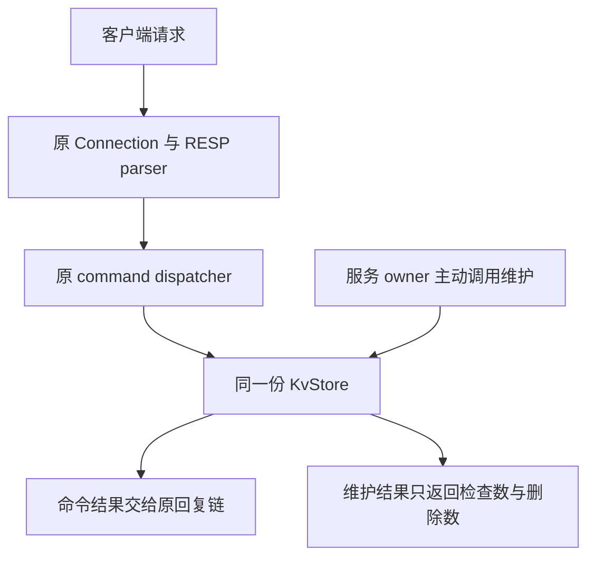

# Week13 Day4：分批回收没人再访问的过期 key

> 版本：2026-10-19，依据 Day3 最终实现生成
> 前置：Day3 整日正式通过 98/100，R1 保持 100/100
> 今日产出：给原 KvStore 增加有检查预算的主动清理；今天只做组件，Day5 再接事件循环
> 学习方式：R1 独立实现，R2 对照机制，R3 补齐更新与异常路径；R1 通过后，后半仍会按你的真实首版定向润色

[TOC]

---

# Part 1：前情提要

## 1. 今天让过期记录真正离开容器

**给 KvStore 增加一个函数：每次只检查一小批记录，把其中已经到期的记录删除，随后把执行权交还给调用者。**

昨天你已经保证：到了有效期，GET 读不到旧值。现在还有一个具体问题：如果一批验证码失效以后，再也没有客户端访问它们，它们仍可能留在 `data_` 里。

沿用你的时间单位，先看三条记录：

| key | value | deadline |
|---|---|---|
| `code` | `2468` | 1100 |
| `ticket` | `T1` | 1300 |
| `name` | `FxorG` | -1，没有期限 |

当 `now == 1100`：

- `code` 已经失效，读取应返回不存在。
- `ticket` 仍有效。
- `name` 仍有效。
- **维护执行前，三条记录仍可物理存在，`size()` 仍是 3。**

今天要得到的新增结果是：调用维护以后，`code` 被从容器删除，`size()` 变成 2，另外两条保持原状。

这里有两个不同的时点：**到期决定能否使用，清理决定何时回收记录。** 前一个已经做好，今天补后一个。

## 2. 从你已经通过的实现接起

你当前的 KvStore 保存的是：

```text
data_：std::map<std::string, node>
node：value + deadline
deadline == -1：没有期限
Now：取得当前毫秒时刻的 callable
```

Day3 又增加了 `read_time_ms()` 和几个接收已知时刻的入口，让一条 EXISTS/DEL 命令里的多个 key 共用时间。EXPIRE 已经分清秒到毫秒的范围、期限加法范围，以及 clock 自己抛出的异常。

这些今天全部保留。新工作落在原 `kv_store.hpp/.cpp`；**原命令、RESP parser、回复编码和 Reactor 都沿用。**

尤其要接上你的真实行为：`get`、`exists`、`pttl` 是 const 查询，只判断失效，不物理删除；`erase/erase_at` 才可能删除。因此，当前的“访问时判断”还不能直接叫作“所有读取都会惰性删除”。今天也不改这些查询的 const 语义。

## 3. 四个主问题，贯穿今天

1. 没有客户端再读取一个过期 key，谁来把它从容器移走？
2. 一轮只允许检查两条记录时，“检查数”和“删除数”分别在数什么？
3. 连续调用怎样让后面的记录也得到检查，而不是永远停在同一部分？
4. 两轮之间发生 SET、DEL 或重新 EXPIRE，下一轮怎样处理当前的数据？

R1 先完成前三个的主链；第四个以及异常后的状态放在 R2/R3 打磨。

## 4. 现在需要的两个名字

**Active expiration（主动过期清理）：由服务主动检查数据的期限，并回收到期记录。** 触发它不需要某个客户端先 GET 这个 key。

**Work budget（工作预算）：本次维护允许检查的候选记录数量。** 一条记录检查后发现仍有效，也已经做了工作，所以同样消耗预算。

本项目今天先用“条数”限量。检查一条记录耗时多少，还受到 key/value 大小、比较和释放成本影响；这项预算的用途是把全量维护拆小，不能直接换算成固定的毫秒上限。

---

# Part 2：教程开始

## 5. 这次组件在整个服务器里的位置

客户端的一条命令仍走旧路径：

```text
TCP bytes
-> Connection input
-> RESP parser
-> execute_command
-> KvStore
-> reply bytes
-> Connection output
```

今天增加的是另一个使用同一份 KvStore 的入口：**owner 主动调用维护，维护直接回收存储里的到期记录。** 它不需要伪造一条 RESP 请求，也没有回复要发给客户端。



图里有两个调用入口，但它们处理的是同一份数据。今天先在测试进程中直接调用维护；Day5 再让服务器 owner 在事件循环中调用它。

它属于**应用层的数据管理**，运行在用户态的服务器进程里。TCP 负责传输 bytes，操作系统管理内存页；“这份验证码到期以后该删除哪条 node”由 KvStore 决定。

当前仍是单线程使用 store。这里的“主动”描述谁发起检查，**不要求创建后台线程。**

## 6. Round1：继续升级原 KvStore

### 6.1 文件与用途

Ubuntu 工程根目录保持：

```text
/home/xgf/code/system-learning/cpp/week10
```

| 文件 | 本次负责什么 |
|---|---|
| `include/mini_redis/kv_store.hpp` | 声明维护结果和维护函数；内部设计由你决定 |
| `src/kv_store.cpp` | 实现分批检查与到期回收，保留原 TTL 接口 |
| `tests/kv_store_expiration_test.cpp` | 新测试入口，调用组件并比较结果 |
| `CMakeLists.txt` | 追加新测试 target，复用已有 `kv_store` library |

本日没有新的 server executable。测试通过后正常退出，KvStore 析构继续释放其剩余记录。

### 6.2 先从调用者看新增功能

调用者说：“这次最多检查两条。”

```cpp
const auto result = store.sweep_expired(2);
```

维护检查一小批记录，删除其中到期的，再告诉调用者：

```text
examined：本次检查了多少条候选记录
removed：其中实际从 data_ 删除了多少条到期记录
```

例如返回 `{2, 0}`，表示检查过两条，但它们都无需删除；返回 `{2, 1}`，表示检查过两条并回收一条。**removed 为 0，也可能已经完成了有价值的检查并向前推进。**

这两个数就是以后 owner 能记录的维护证据。今天先返回它们，不新增公开 DEBUG 命令。

## 7. Public contract：只规定调用者能看到的行为

Public contract（公开接口约定）说明怎样调用、结果是什么，以及什么时候算实现正确。内部怎样保存推进位置，留给你设计。

在现有 `KvStore` 的 public 区域新增：

```cpp
struct ExpireSweepResult {
    std::size_t examined = 0;
    std::size_t removed = 0;
};

ExpireSweepResult sweep_expired(std::size_t max_examined);
```

这两项放在 `class KvStore` 内，所以需要显式写类型时使用 `KvStore::ExpireSweepResult`。`sweep` 在这里就是巡检一批记录。

### 7.1 输入、返回值与数据变化

| 项目 | 本项目选定的行为 |
|---|---|
| 谁调用 | 现在由测试调用；Day5 由服务器 owner 调用 |
| `max_examined` | 本轮最多检查的候选记录数，0 合法 |
| `max_examined == 0` | 返回 `{0, 0}`，不取时间、不删除、不推进维护位置 |
| store 物理为空 | 返回 `{0, 0}`，不取时间 |
| 正预算且非空 | 读取并验证一次当前时刻，本轮按同一个时刻判断到期 |
| 到期条件 | 该记录有期限，并且本轮时刻大于等于它当前的 deadline |
| 删除结果 | 只删除符合到期条件的当前记录；value、无期限状态和未来期限保持正确 |
| 返回计数 | `removed <= examined <= max_examined`；removed 是本次实际删除条数 |
| 拥有关系 | 返回值只拥有两个数字，不借用 key、value 或 node 的地址 |

**检查预算要包括寻找候选时逐条枚举的记录。** 不能先遍历全表收集所有 key，再只把其中两条算进 examined。容器用于定位的树节点比较属于查找开销，不逐个当成这里的“候选记录”；但额外的线性枚举不能隐藏起来。

已有 `size()` 继续返回物理条目数。维护正常返回后应满足：

```text
维护前 size - 维护后 size == result.removed
```

本日维护执行期间没有其他线程或回调修改 store，上述等式有明确的比较条件。

### 7.2 连续调用的推进要求

假设当前有 N 条记录，时间固定，调用之间没有 SET、DEL 或重新设置期限：

- 预算足够覆盖这 N 条记录时，一次调用应回收全部当前到期记录。
- 每轮预算为 1 时，连续最多 N 次调用应回收全部当前到期记录。
- 仍有效的记录可以继续保留，但不能让它们永久挡住后面的到期记录。

这是本学习组件选定的、可确定性验证的推进要求。它没有规定检查顺序，也不是在声称 Redis 的随机抽样具有同样的轮数保证。

两轮之间允许原 API 修改数据；下一轮按**当前记录与当前期限**判断。持续无限插入时多久清完，不是今天承诺的范围。

### 7.3 错误约定，先给清楚

| 情况 | 行为 | 英文错误信息参考 | 失败后的数据 |
|---|---|---|---|
| 预算为 0 或物理为空 | 正常返回 `{0,0}`，不调用 Now | 无 | 完全不变 |
| 本轮实际取得负毫秒时刻 | 抛 `std::invalid_argument` | `clock must return non-negative milliseconds`，沿用原文字 | 本轮尚未删除，维护位置不变 |
| Now 自己抛异常 | 原类型、原消息向外传播 | 保留 clock 给出的原消息 | 本轮尚未删除，维护位置不变 |
| 内部保存辅助状态时发生分配失败 | 允许 `std::bad_alloc` 传播，不编造成功结果 | 保留标准异常消息 | 对象保持可用；不承诺整轮回滚已经完成的删除 |

所以，正预算且非空时，时间取得并验证成功以后，才开始这轮会改变数据或推进位置的工作。**这是本项目对维护调用的错误顺序约定。** 你可以复用昨天的 `read_time_ms()`，不用再增加一组公开 `_at` 接口。

这里没有新的期限加法，比较的是已有 deadline 与本轮时刻；昨天的 EXPIRE 范围检查仍由原接口负责。

## 8. 第一版只做到哪里

R1 先完成：

1. 新接口能调用，零预算与空 store 正常返回。
2. 时间固定时，正确区分到期、未来期限和没有期限。
3. 检查不超过预算；小预算连续调用能够回收后面的到期记录。

先在**没有中途 SET/DEL/续期、clock 始终返回合法固定值**的输入上打通主链。

R2/R3 再检查两轮之间修改数据的生命周期、clock 异常与单次取时。§7 已把最终行为公开，但这些后置路径不回头冒充 R1 首版全做完的要求。代码中可达的内存错误仍要修复；分轮是为了逐步打磨，不是让错误路径永远悬空。

本轮使用你已经会的 map、string、optional、循环和 clock 即可。内部推进方式由你选择；现在不指定成员、第二张表或清理算法。

## 9. 最小调用：把时间移到边界，再直接维护

下面是使用新接口的片段，可放进测试函数。它展示调用方式，不是 `sweep_expired` 的实现。

```cpp
KvStore::TimeMs now = 1000;
KvStore store([&now] { return now; });

store.set("code", "2468");
store.expire_ms("code", 100);  // deadline 为 1100。

now = 1100;
// 此时直接维护，不先调用 erase/DEL 帮它删除。
const auto result = store.sweep_expired(1);

// 单条到期记录应被检查并回收，物理 size 从 1 变成 0。
```

这里 now 由外层局部变量拥有，clock 保存它的引用；测试作用域内 now 比 store 活得更久。时间改变只是测试输入改变，没有 sleep 或调度等待。

## 10. 开工用的小测试和 CMake

下面三个 GTest 可以直接作为 `tests/kv_store_expiration_test.cpp`。它们负责把结果比对自动化，**不规定你在 KvStore 里怎样组织实现。** 你负责看懂每个初始状态与预期值，测试体本身可以使用这份。

```cpp
// 验证分批回收：零工作、精确到期、有限集合上的持续推进。
#include "kv_store.hpp"
#include <gtest/gtest.h>
#include <cstddef>
#include <string>

TEST(ExpirationR1, EmptyAndZeroBudgetDoNoWork) {
    KvStore::TimeMs now = 1000;
    KvStore store([&now] { return now; });
    const auto empty = store.sweep_expired(4);
    EXPECT_EQ(empty.examined, 0u);
    EXPECT_EQ(empty.removed, 0u);

    store.set("code", "2468");
    ASSERT_TRUE(store.expire_ms("code", 100));
    now = 1100;
    const auto zero = store.sweep_expired(0);
    EXPECT_EQ(zero.examined, 0u);
    EXPECT_EQ(zero.removed, 0u);
    EXPECT_EQ(store.size(), 1u);
}

TEST(ExpirationR1, ExactDeadlineWithoutClientAccess) {
    KvStore::TimeMs now = 1000;
    KvStore store([&now] { return now; });
    store.set("code", "2468");
    store.set("ticket", "T1");
    store.set("name", "FxorG");
    ASSERT_TRUE(store.expire_ms("code", 100));
    ASSERT_TRUE(store.expire_ms("ticket", 300));

    now = 1100;
    ASSERT_EQ(store.size(), 3u);
    const auto result = store.sweep_expired(3);
    EXPECT_GE(result.examined, 1u);
    EXPECT_LE(result.examined, 3u);
    EXPECT_EQ(result.removed, 1u);
    EXPECT_EQ(store.size(), 2u);
    EXPECT_EQ(store.get("ticket"), std::string("T1"));
    EXPECT_EQ(store.get("name"), std::string("FxorG"));
}

TEST(ExpirationR1, SmallBudgetEventuallyReachesExpiredRecords) {
    KvStore::TimeMs now = 1000;
    KvStore store([&now] { return now; });
    for (int i = 0; i < 4; ++i) {
        store.set("a_keep_" + std::to_string(i), "live");
        const auto key = "z_expired_" + std::to_string(i);
        store.set(key, "old");
        ASSERT_TRUE(store.expire_ms(key, 100));
    }

    now = 1100;
    const auto initial_size = store.size();
    std::size_t total_removed = 0;
    // 初始只有 8 条、时间与数据固定；按公开约定至多 8 次小步。
    for (std::size_t round = 0; round < initial_size; ++round) {
        const auto before = store.size();
        const auto result = store.sweep_expired(1);
        EXPECT_LE(result.examined, 1u);
        EXPECT_LE(result.removed, result.examined);
        EXPECT_EQ(before - store.size(), result.removed);
        total_removed += result.removed;
    }
    EXPECT_EQ(total_removed, 4u);
    EXPECT_EQ(store.size(), 4u);
    for (int i = 0; i < 4; ++i) {
        EXPECT_EQ(store.get("a_keep_" + std::to_string(i)),
                  std::string("live"));
    }
}
```

第一项检查空和零预算。第二项把 now 精确放在 deadline，先观察物理条目，再让维护删除。第三项保留一些永久有效记录，验证小步调用确实能处理其余到期记录。

`EXPECT_LE(a,b)` 表示预期 `a <= b`，`EXPECT_GE(a,b)` 表示 `a >= b`。EXPECT 失败会登记失败并继续当前测试；ASSERT 失败会结束当前测试函数，适合“前提没有建立，后面比较也没有意义”的位置。程序退出状态由 GTest 汇总，任一断言失败都会让 CTest 看到失败。

在当前 `CMakeLists.txt` 末尾追加；原 `kv_store` target 和 `include(GoogleTest)` 已存在，不重复声明：

```cmake
# 主动清理的测试入口，复用原 KvStore 实现与头文件路径。
add_executable(kv_store_expiration_test
    tests/kv_store_expiration_test.cpp
)
target_compile_options(kv_store_expiration_test PRIVATE
    -Wall -Wextra -g
)
target_link_libraries(kv_store_expiration_test PRIVATE
    kv_store
    GTest::gtest_main
    GTest::gtest
)
gtest_discover_tests(kv_store_expiration_test PROPERTIES TIMEOUT 5)
```

在上述 Ubuntu 工程根目录运行：

```bash
cmake -S . -B build -DCMAKE_BUILD_TYPE=Debug
cmake --build build --target kv_store_expiration_test
cmake -E chdir build ctest --output-on-failure -R '^ExpirationR1\.'
```

应发现并运行三个测试，全部通过、退出码为 0。这里是目标输出，**不是你的 Day4 实现已经通过的记录**。TIMEOUT 5 是防止错误实现一直循环；被 timeout 中止属于测试失败。

## 11. 到这里停止阅读：先完成 Round1

现在你已经有文件、用途、接口、行为、第一条运行命令和小测试。先自己完成首版，再让我检阅。

交付原组件的增量即可。你能口述测试在证明什么，就可以使用上面的脚手架，不必为“亲手写了几个 EXPECT”重复花精力。

**下面开始讨论内部推进与生命周期；保留到 R1 完成之后。**

---

## 12. Round2：先看你的一轮究竟做了什么

R1 后首先对照三个实际数：本轮 examined、removed，以及维护前后 `size()`。

假设预算为 2，第一轮返回 `{2,0}`，第二轮返回 `{2,1}`。我们先问：这四次检查落在哪些记录上？如果第二轮继续处理了新记录，即使第一轮一个也没删，维护也已经在推进。

这和普通 DEL 的视角不同。DEL 的任务是处理指定 key；维护的任务还包含**让有限的检查机会不断覆盖尚未检查的记录**。

这一节及后续以你当前 map/node 为起点讲一种可行思路。R1 正式通过时，会再逐节落到你的实际首版：保留哪些动作、哪个位置需改、还缺哪项证据；不会要求把正确设计换成同名模板。

## 13. 为什么删除数限制不住检查工作

把场景放大一点：当前有一万条记录，全部没有期限，本轮预算为 2。

调用者期待维护检查少量数据以后回来。假如实现的停止条件却是“删够两条才停”，它根本删不到两条，只能一路扫完这一万条，甚至在循环扫描时无法退出。

这次没有发生删除，CPU 仍然进行了查找、读取和判断。**预算数的是处理过的候选，删除数只是处理结果中的一个子集。**

同理，先复制全部 key 到 vector，再只检查其中两条，也已经在收集候选时做完一次全量枚举。两条预算没有限制住那段工作。

回到你的代码，只需找到“本条记录进入检查”的位置，确认它消耗预算，并且本轮达到预算就返回。这里没有要求给所有辅助操作建立一套新的计量框架。

## 14. 小步执行以后，下一轮从哪里继续

用 R1 第三个测试中的 key 顺序看这个问题：

```text
a_keep_0   a_keep_1   a_keep_2   a_keep_3
z_expired_0   z_expired_1   z_expired_2   z_expired_3
```

你的 `std::map` 按 key 排序。若每次预算 1、每次都从 `begin()` 开始，那么第一条永久有效记录每次都被检查，后面的过期记录一直没有机会。

所以两次调用之间，需要保留足够的信息来回答：“上一轮检查到哪里了？”这份信息常叫 **cursor（巡检位置）**。先有继续检查的需要，才需要保存它。

一种适合当前 map 的做法，是保存**上一条已检查 key 的独立 string 副本**。例如上一轮检查到 `a_keep_1`，下一轮寻找比它大的第一条当前记录；到末尾以后再从头开始。

这里保存的是定位用的 key，不保存它的旧 value 或旧 deadline。下一次拿到当前 node，再判断当前期限。

### 14.1 `upper_bound` 为什么能用于继续定位

`std::map::upper_bound(k)` 返回“key 严格大于 k 的第一条记录”的 iterator；没有这样的记录就返回 `end()`。它属于 `<map>`，不会创建或删除条目。

下面这个独立小程序只演示定位语法，不是维护函数：

```cpp
// 演示按 key 恢复位置；原 key 不存在时，仍可定位后继。
#include <iostream>
#include <map>
#include <string>

int main() {
    std::map<std::string, int> values{{"a", 1}, {"c", 3}, {"e", 5}};
    const std::string previous = "c";
    values.erase("c");
    const auto next = values.upper_bound(previous);
    if (next != values.end()) {
        std::cout << next->first << '\n';
    }
}
```

若保存为私有练习文件 `map_resume_demo.cpp`：

```bash
g++ -std=c++17 -Wall -Wextra -g map_resume_demo.cpp -o /tmp/map_resume_demo
/tmp/map_resume_demo
```

输出 `e`。关键在于 previous 自己拥有 `"c"`，原来的 c 条目被删以后，它仍可用于定位。

定位是对数级查找；一轮内可以用局部 iterator 继续移动，不需要每检查一条都重新查找。这是可选设计提示，不要求统一你的成员名或替换已正确的方案。[C++17 草案：关联容器查找与失效规则](https://timsong-cpp.github.io/cppwp/n4659/associative.reqmts)

### 14.2 到末尾以后，仍然需要下一圈

假设第一圈检查 ticket 时，它还没有到期。后来时间从 1100 走到 1300，ticket 才失效。

维护如果只扫描一遍就永久停止，ticket 便再也没有回收机会。因此有限检查要能继续循环；每次调用仍受自己的预算约束。

```text
上一轮结束
-> 下一轮从尚未检查的位置继续
-> 到达末尾后，之后的检查重新覆盖开头
-> 新一轮读取自己的当前时刻
```

轮转不表示单次调用可以无限转圈。**一轮函数应有限返回，后续调用再获得下一份预算。**

## 15. 删除一条记录以后，哪些位置还能用

你已经用过 `data_.erase(it)`。今天新增的问题是：循环还要继续，而且下一轮可能继续使用某个保存的位置。

先看最小生命周期：

```text
it 指向当前 node
-> erase(it) 销毁这条 map 记录
-> 原 it 不再可用
-> 后续从仍有效的位置继续
```

map 的 `erase(iterator)` 返回被删记录之后的 iterator。对于当前 map，删除使被删元素的 iterator/reference 失效，其他元素的位置仍有效；不能把这个规则照搬成 vector 的规则。

```cpp
// 片段：it 原先指向一条有效记录；用返回值承接删除后的后继。
it = data_.erase(it);
```

这句解决同一次遍历里的继续问题。跨调用还要考虑外部删除：假如你把某条记录的 iterator 保存成成员，而下一次调用前 DEL 恰好删了它，这个成员就失效了。

上一节的 owning string（独立拥有数据的字符串）方案让“定位信息”不借用 node 的生命。另一种正确设计也可以保留，但需要说清原 `erase`、`erase_at`、非正 TTL 删除等路径怎样保护其保存的位置。

同样，若成员保存了“指向本对象容器内部”的位置，复制/移动 KvStore 后也要检查它是否还指向正确容器。采用只保存值的定位信息，则不会复制出一个指向旧 map 的 iterator。现在只处理真实使用到的生命周期，不因此重写 Rule of Five。

## 16. 用一轮自己的时间，并读取当前期限

### 16.1 共用时刻，复用昨天已经建立的能力

昨天一条 EXISTS 命令只取一次时刻，今天一次维护也采用同样的判断单位。

例如两条记录 deadline 都是 1100，而测试 clock 每次调用递增：第一次给 1099，第二次给 1100。如果每检查一条就取一次时间，同一轮会把它们看成两个状态。

按今天的约定，一轮只读一次 t。t 是 1099，两条都保留；下一轮 t 是 1100，两条都可以回收。这不改变到期边界，只把一轮判断的时间基准固定下来。

你已有 `read_time_ms()`，直接用这项能力即可。**现在增加的是一个维护入口，不是为每个函数都再生成 `_at` 版本。**

### 16.2 SET 以后，以新 node 为准

具体走一次更新：

```text
t=1000：SET code old，设置 deadline=1100
t=1050：SET code new
t=1100：主动维护检查 code
```

你现在的 `set` 把它替换成 `node{value,-1}`。所以检查时看到的是 `new`、没有期限，应该保留。

再看重新设置期限：

```text
t=1000：设置 deadline=1100
t=1050：再次设置 1000ms，有效期变成 deadline=2050
t=1100：检查，保留
t=2050：检查，可以回收
```

**清理决定依据当前记录的期限。** 保存巡检位置不等于保存过去的删除命令。若你的设计额外保存了旧期限候选，就在实际删除前核对它是否仍代表当前记录；处理这些候选本身也消耗检查预算。

### 16.3 `erase_at` 的 bool 与 removed 含义不同

你的 `erase_at` 对已过期记录会物理删除，但返回 false，因为它的 bool 在回答“是否删除了一个逻辑有效的 key”。这个行为昨天已经正确通过，今天保留。

维护的 removed 问的是“本次实际回收了几条到期记录”。因此，直接把 `erase_at` 的 bool 累加到 removed，会把真正删除的过期记录记成 0。

另外，`erase_at` 对仍有效记录也会执行 DEL；维护必须先判断到期，不能拿它代替“条件性清理”。**旧 API 的返回值有自己的业务含义，新的统计要按实际动作计数。**

## 17. 为什么读时失败要发生在删除之前

用你昨天已经学过的异常来源看一次：现在有两条过期记录，测试 clock 这次抛出 `std::overflow_error("clock failed")`。

维护还没有得到合法的判断时刻，就无法决定这一轮哪些记录到期。因此应让原异常传播，并保持本轮数据与巡检位置不变；它没有需要回复给客户端的 RESP Error。

负时刻也一样，沿用 `read_time_ms()` 的 `invalid_argument`。零预算和空 store 没有检查任务，直接返回，不调用这个依赖。这是前面已经公开的行为顺序，不是测试临时追加的要求。

分配失败则是另一件事：如果已完成某些删除，后续保存辅助字符串时才分配失败，本日只要求对象仍可用，不建立“恢复所有已删除 value”的昂贵回滚机制。

## 18. 把自己的方法与 Redis 对齐

现在再看真实系统，就能带着明确的问题阅读：访问时判断解决可见性，主动维护解决无人访问时的回收。Redis 的官方 EXPIRE 文档说明它结合访问触发的被动过期与主动检查；主动路径会检查带期限的 key 并删除到期项。[Redis：How Redis expires keys](https://redis.io/docs/latest/commands/expire/#how-redis-expires-keys)

**在完成 R1、读到这里时，再定向读小林《Redis 过期删除策略和内存淘汰策略有什么区别？》。**

阅读位置：

- “过期删除策略有哪些？”里三种方式的示意与取舍。
- “Redis 过期删除策略是什么？”里的两种方式配合，以及主动检查流程图。
- 到“Redis 内存淘汰策略是什么？”之前停止；内存压力淘汰留 Day6。

阅读用途是用图解释“尽快回收”与“控制维护工作”的取舍。文章的固定抽样数、比例和周期属于其所述实现背景，**不当成本项目参数，也不当作所有 Redis 版本的固定规则**。[小林：过期删除与内存淘汰](https://xiaolincoding.com/redis/module/strategy.html)

你今天用 map 做确定性小步巡检，真实 Redis 的存储与抽样机制不同。对齐的是问题和职责，不是把当前组件称作 Redis 的同款算法。

---

# Part 3：收尾、验证与验收

## 19. Round3：在首版上补齐三组行为

继续维护同一份 KvStore，不复制一份“最终版 store”。下面是在前文已经理解的行为上补证据，不是三组突然增加的新概念。

### 19.1 保留正常主链，补跨轮推进与删除

保留 R1 三个测试。再建立“维护走过一小步 -> 外部删除记录 -> 下一轮继续”的场景，验证保存的位置没有借用已经销毁的对象。

接着清空 store，再用原 SET 插入新记录并设置期限，让它到期后能继续被回收。**一段数据扫完以后，维护能力仍可继续用于后来加入的数据。**

原来的 `erase`、`erase_at` 和非正 TTL 都可能物理删除。核对你实际采用的位置设计，让这些入口与维护共存；不为测试统一重构所有旧函数。

### 19.2 补覆盖、续期与 binary key

按 §16 的两个时间线验证普通 SET 清旧期限、重新 EXPIRE 使用新期限。比较 value 与物理 size，不能只看 `get` 在某一刻返回了什么。

再用包含 NUL 的 key，例如：

```cpp
const std::string binary_key("a\0b", 3);
```

它与 `"a"` 是两个不同 key。检查位置和查找都应保留完整长度。这里复用你已经做过的 binary string 能力，不重写 RESP parser。

### 19.3 补单次取时和失败后的状态

使用已有的注入 clock 做三个小观察：

| 已建立的场景 | 这次要比对的结果 |
|---|---|
| 正预算、非空，clock 每调用一次递增，至少两条记录待处理 | 一次 sweep 的 clock 调用数为 1，按同一个 t 判断 |
| budget 为 0，或 store 物理为空，clock 若被调用就抛异常 | 正常返回 `{0,0}`，clock 调用数为 0 |
| 有待检查数据，clock 返回负数或抛原异常 | 负数为 invalid_argument；原异常类型与消息保持；size、value、deadline 与推进位置没有因这次失败改变 |

最后一项中，推进位置可通过“失败前后接着维护，处理到哪些记录”或只读核对实现来验证，不为了测试暴露 private 成员。

**机械 GTest 可以委托给我补写。** 你能解释初始状态、为什么预期这样，以及错误实现会怎样失败，已经承担了本日需要的判断；不用再手写一大批同形断言。

## 20. 编译、回归与 ASan/UBSan

仍在原 Ubuntu 工程根目录。先构建全部 target，避免只编译新测试而漏掉接口对旧使用者的影响：

```bash
cmake -S . -B build -DCMAKE_BUILD_TYPE=Debug
cmake --build build
cmake -E chdir build ctest --output-on-failure
```

本次生成前，Day3 的最近正式证据是固定 CTest 99/99。增加当天三个测试且没有其他变化时，预计多三项；以当前 CTest 实际发现的结果为准，不把旧数字照抄成新运行结果。

今天的内存风险集中在“边遍历边删除”和“两轮之间的外部删除”。因此 sanitizer 运行应让这些路径真的执行。用独立目录构建，避免拿带检测的结果做性能计时：

```bash
cmake -S . -B build-expiration-san \
  -DCMAKE_BUILD_TYPE=Debug \
  -DCMAKE_CXX_FLAGS="-fsanitize=address,undefined -fno-omit-frame-pointer" \
  -DCMAKE_EXE_LINKER_FLAGS="-fsanitize=address,undefined"
cmake --build build-expiration-san --target kv_store_expiration_test
cmake -E chdir build-expiration-san ctest --output-on-failure -R '^Expiration'
```

ASan 主要帮助发现失效地址访问；UBSan 检查执行到的部分未定义行为。若报告出现，先沿调用栈找到 `sweep_expired` 或外部删除路径，再看报告涉及的地址原先由谁拥有、在哪次 erase 后失效。

没有报告只说明这次覆盖的路径没有被工具报错；**是否超预算、有没有持续推进、有没有删错新值，由行为测试证明。** 当前组件没有新增多线程共享访问，不机械追加 TSan 或百轮压力运行。

## 21. 物理条目减少，究竟证明了什么

假设维护前 size 为 100，累计 removed 为 20，维护后 size 为 80。

我们能说：这二十条 map 记录已被删除，对应 node、key/value 字符串的生命周期按容器规则结束，所拥有的分配按其实现回收。

进程监视器中的 **RSS（Resident Set Size，常驻物理内存大小）** 却可能没有立刻下降。释放后的空间可能仍由内存分配器保留，用来满足后续分配；分配器与操作系统处理的是更大的内存管理单位。

因此本日证据止于“正确且有限地回收记录”。碎片、峰值内存、回收延迟与吞吐的测量需要专门场景，仍按后续性能规划推进。

## 22. 五个收口问题

可口述、指代码或复用测试解释，不要求再抄一份答案集。

1. `now == deadline` 时，为什么记录可能已经读不到，但物理 size 还没有变？今天哪个动作使 size 改变？
2. 返回 `{2,0}` 是否表示维护什么也没做？如果只按 removed 限制循环，会发生什么？
3. 有永久有效记录挡在前面时，你怎样证明后面的到期记录得到过检查？
4. 两轮之间 SET 新值或重新设置期限，你的维护检查哪一份 deadline？保存的位置会不会因 DEL 失效？
5. 为什么这次的条数预算不能直接等同于“服务器延迟最多增加 1ms”？

前三项已有实现和测试支持就直接收住；后两项指出自己的状态保存与实际删除位置即可。note 只记真正新理解或仍卡住的地方。

## 23. 今日停止点与 Day5 衔接

今天完成的是：**原 KvStore 能在每轮有限工作后返回，并通过连续调用回收到期记录。**

服务器现在还不会因为组件多了一个方法就自动调用它。Day5 才处理真实事件循环里的执行时机：客户端不发请求时，维护也需要获得机会；客户端很忙时，维护也需要按预算让出执行权。

因此今天保留原网络入口、Connection、parser 与 dispatcher。也先不实现内存压力淘汰、每 key 定时任务或持久化。你的 Mini Redis 正在增加第二种数据生命周期动作：命令决定 value 的变化，维护逐步回收已经失效的记录。
