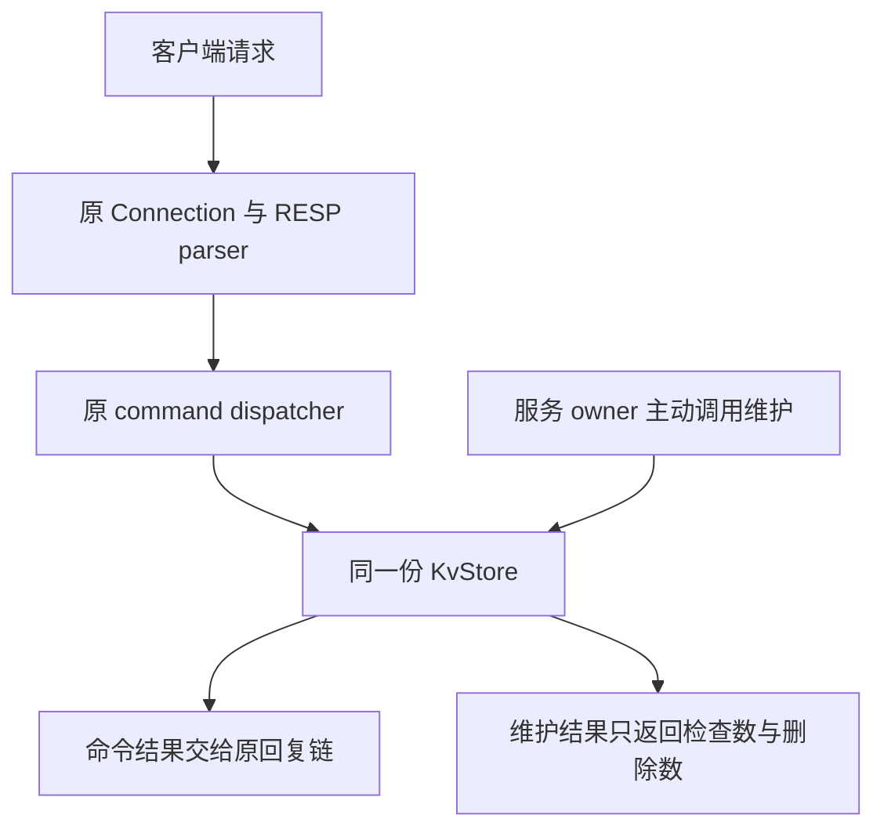

# Week13 Day4：分批回收没人再访问的过期 key

> 版本：2026-10-20，R1正式通过100/100；§14补全节点位置到排序边界的含义变化，再推出upper_bound；R1正文与用户笔记保留
> 前置：Day3 整日正式通过 98/100，R1 保持 100/100
> 今日产出：给原 KvStore 增加有检查预算的主动清理；今天只做组件，Day5 再接事件循环
> 学习方式：R1 独立实现，R2 对照机制，R3 补齐更新与异常路径；R1 通过后，后半仍会按你的真实首版定向润色

[TOC]

---

# Part 1：前情提要

## 1. 今天让过期记录真正离开容器

**给 KvStore 增加一个函数：每次只检查一小批记录，把其中已经到期的记录删除，随后把执行权交还给调用者。**

昨天你已经保证：到了有效期，GET 读不到旧值。现在还有一个具体问题：如果一批验证码失效以后，再也没有客户端访问它们，它们仍可能留在 `data_` 里。

沿用你的时间单位，先看三条记录：

| key | value | deadline |
|---|---|---|
| `code` | `2468` | 1100 |
| `ticket` | `T1` | 1300 |
| `name` | `FxorG` | -1，没有期限 |

当 `now == 1100`：

- `code` 已经失效，读取应返回不存在。
- `ticket` 仍有效。
- `name` 仍有效。
- **维护执行前，三条记录仍可物理存在，`size()` 仍是 3。**

今天要得到的新增结果是：调用维护以后，`code` 被从容器删除，`size()` 变成 2，另外两条保持原状。

这里有两个不同的时点：**到期决定能否使用，清理决定何时回收记录。** 前一个已经做好，今天补后一个。

## 2. 从你已经通过的实现接起

你当前的 KvStore 保存的是：

```text
data_：std::map<std::string, node>
node：value + deadline
deadline == -1：没有期限
Now：取得当前毫秒时刻的 callable
```

Day3 又增加了 `read_time_ms()` 和几个接收已知时刻的入口，让一条 EXISTS/DEL 命令里的多个 key 共用时间。EXPIRE 已经分清秒到毫秒的范围、期限加法范围，以及 clock 自己抛出的异常。

这些今天全部保留。新工作落在原 `kv_store.hpp/.cpp`；**原命令、RESP parser、回复编码和 Reactor 都沿用。**

尤其要接上你的真实行为：`get`、`exists`、`pttl` 是 const 查询，只判断失效，不物理删除；`erase/erase_at` 才可能删除。因此，当前的“访问时判断”还不能直接叫作“所有读取都会惰性删除”。今天也不改这些查询的 const 语义。

## 3. 四个主问题，贯穿今天

1. 没有客户端再读取一个过期 key，谁来把它从容器移走？
2. 一轮只允许检查两条记录时，“检查数”和“删除数”分别在数什么？
3. 连续调用怎样让后面的记录也得到检查，而不是永远停在同一部分？
4. 两轮之间发生 SET、DEL 或重新 EXPIRE，下一轮怎样处理当前的数据？

R1 先完成前三个的主链；第四个以及异常后的状态放在 R2/R3 打磨。

## 4. 现在需要的两个名字

**Active expiration（主动过期清理）：由服务主动检查数据的期限，并回收到期记录。** 触发它不需要某个客户端先 GET 这个 key。

**Work budget（工作预算）：本次维护允许检查的候选记录数量。** 一条记录检查后发现仍有效，也已经做了工作，所以同样消耗预算。

本项目今天先用“条数”限量。检查一条记录耗时多少，还受到 key/value 大小、比较和释放成本影响；这项预算的用途是把全量维护拆小，不能直接换算成固定的毫秒上限。

---

# Part 2：教程开始

## 5. 这次组件在整个服务器里的位置

客户端的一条命令仍走旧路径：

```text
TCP bytes
-> Connection input
-> RESP parser
-> execute_command
-> KvStore
-> reply bytes
-> Connection output
```

今天增加的是另一个使用同一份 KvStore 的入口：**owner 主动调用维护，维护直接回收存储里的到期记录。** 它不需要伪造一条 RESP 请求，也没有回复要发给客户端。



图里有两个调用入口，但它们处理的是同一份数据。今天先在测试进程中直接调用维护；Day5 再让服务器 owner 在事件循环中调用它。

它属于**应用层的数据管理**，运行在用户态的服务器进程里。TCP 负责传输 bytes，操作系统管理内存页；“这份验证码到期以后该删除哪条 node”由 KvStore 决定。

当前仍是单线程使用 store。这里的“主动”描述谁发起检查，**不要求创建后台线程。**

## 6. Round1：继续升级原 KvStore

### 6.1 文件与用途

Ubuntu 工程根目录保持：

```text
/home/xgf/code/system-learning/cpp/week10
```

| 文件 | 本次负责什么 |
|---|---|
| `include/mini_redis/kv_store.hpp` | 声明维护结果和维护函数；内部设计由你决定 |
| `src/kv_store.cpp` | 实现分批检查与到期回收，保留原 TTL 接口 |
| `tests/kv_store_expiration_test.cpp` | 新测试入口，调用组件并比较结果 |
| `CMakeLists.txt` | 追加新测试 target，复用已有 `kv_store` library |

本日没有新的 server executable。测试通过后正常退出，KvStore 析构继续释放其剩余记录。

### 6.2 先从调用者看新增功能

调用者说：“这次最多检查两条。”

```cpp
const auto result = store.sweep_expired(2);
```

维护检查一小批记录，删除其中到期的，再告诉调用者：

```text
examined：本次检查了多少条候选记录
removed：其中实际从 data_ 删除了多少条到期记录
```

例如返回 `{2, 0}`，表示检查过两条，但它们都无需删除；返回 `{2, 1}`，表示检查过两条并回收一条。**removed 为 0，也可能已经完成了有价值的检查并向前推进。**

这两个数就是以后 owner 能记录的维护证据。今天先返回它们，不新增公开 DEBUG 命令。

## 7. Public contract：只规定调用者能看到的行为

Public contract（公开接口约定）说明怎样调用、结果是什么，以及什么时候算实现正确。内部怎样保存推进位置，留给你设计。

`kv_store.hpp` 顶部应显式包含 `<cstddef>`，它提供 `std::size_t`。你的现有头文件已经包含它，保留即可；下面只展示 class 内的新增声明。

在现有 `KvStore` 的 public 区域新增：

```cpp
struct ExpireSweepResult {
    std::size_t examined = 0;
    std::size_t removed = 0;
};

ExpireSweepResult sweep_expired(std::size_t max_examined);
```

这两项放在 `class KvStore` 内，所以需要显式写类型时使用 `KvStore::ExpireSweepResult`。`sweep` 在这里就是巡检一批记录。

### 7.1 输入、返回值与数据变化

| 项目 | 本项目选定的行为 |
|---|---|
| 谁调用 | 现在由测试调用；Day5 由服务器 owner 调用 |
| `max_examined` | 本轮最多检查的候选记录数，0 合法 |
| `max_examined == 0` | 返回 `{0, 0}`，不取时间、不删除、不推进维护位置 |
| store 物理为空 | 返回 `{0, 0}`，不取时间 |
| 正预算且非空 | 读取并验证一次当前时刻，本轮按同一个时刻判断到期 |
| 到期条件 | 该记录有期限，并且本轮时刻大于等于它当前的 deadline |
| 删除结果 | 只删除符合到期条件的当前记录；value、无期限状态和未来期限保持正确 |
| 返回计数 | `removed <= examined <= max_examined`；removed 是本次实际删除条数 |
| 拥有关系 | 返回值只拥有两个数字，不借用 key、value 或 node 的地址 |

**检查预算要包括寻找候选时逐条枚举的记录。** 不能先遍历全表收集所有 key，再只把其中两条算进 examined。容器用于定位的树节点比较属于查找开销，不逐个当成这里的“候选记录”；但额外的线性枚举不能隐藏起来。

已有 `size()` 继续返回物理条目数。维护正常返回后应满足：

```text
维护前 size - 维护后 size == result.removed
```

本日维护执行期间没有其他线程或回调修改 store，上述等式有明确的比较条件。

### 7.2 一次最多走一圈，连续调用继续推进

**同一次调用中，每条记录最多检查一次；完成当前这一圈就返回，即使预算还有剩余。** 例如开始时只有三条记录，预算给到 100，也只检查这三条，而不是反复检查到 100 次。

本项目选择按当前 map 的记录逐条巡检，并用满本轮可用的检查量。令 $N$ 为**调用开始时**的物理条目数，正常返回时：

$$
\operatorname{examined}=\min(\operatorname{max\_examined},N)
$$

删除会让 size 变小，但不会把本轮剩余记录的检查任务一起取消。也不因刚刚删掉一条到期记录就提前结束。这里规定的是本项目的对外行为，内部怎样保存和恢复位置仍由你决定。

时间固定，调用之间没有 SET、DEL 或重新设置期限时，继续满足：

- 预算足够覆盖这 $N$ 条记录时，一次调用应回收全部当前到期记录。
- 每轮预算为 1 时，连续最多 $N$ 次调用应回收全部当前到期记录。
- 仍有效的记录可以继续保留，但不能让它们永久挡住后面的到期记录。

这是本学习组件选定的、可确定性验证的推进要求。它没有规定检查顺序，也不是在声称 Redis 的随机抽样具有同样的轮数保证。

两轮之间允许原 API 修改数据；下一轮按**当前记录与当前期限**判断。持续无限插入时多久清完，不是今天承诺的范围。

### 7.3 最终错误约定，R2/R3 再读

**本节保留整日的最终约定。R1 可以先跳过，暂不要求理解、实现或验证下面的异常路径；完成首版后，R2/R3 再回来处理。** R1 仍在合法固定 clock 上实现主链，零预算与空 store 的正常返回也照常属于 R1。

| 情况 | 行为 | 英文错误信息参考 | 失败后的数据 |
|---|---|---|---|
| 预算为 0 或物理为空 | 正常返回 `{0,0}`，不调用 Now | 无 | 完全不变 |
| 本轮实际取得负毫秒时刻 | 抛 `std::invalid_argument` | `clock must return non-negative milliseconds`，沿用原文字 | 本轮尚未删除，维护位置不变 |
| Now 自己抛异常 | 原类型、原消息向外传播 | 保留 clock 给出的原消息 | 本轮尚未删除，维护位置不变 |
| 内部保存辅助状态时发生分配失败 | 允许 `std::bad_alloc` 传播，不编造成功结果 | 保留标准异常消息 | 对象保持可用；不承诺整轮回滚已经完成的删除 |

所以，正预算且非空时，时间取得并验证成功以后，才开始这轮会改变数据或推进位置的工作。**这是本项目对维护调用的错误顺序约定。** 你可以复用昨天的 `read_time_ms()`，不用再增加一组公开 `_at` 接口。

这里没有新的期限加法，比较的是已有 deadline 与本轮时刻；昨天的 EXPIRE 范围检查仍由原接口负责。

## 8. 第一版只做到哪里

R1 先完成：

1. 新接口能调用，零预算与空 store 正常返回。
2. 时间固定时，正确区分到期、未来期限和没有期限。
3. 检查不超过预算；小预算连续调用能够回收后面的到期记录。

先在**没有中途 SET/DEL/续期、clock 始终返回合法固定值**的输入上打通主链。

R2/R3 再检查两轮之间修改数据的生命周期、clock 异常与单次取时。§7 已把最终行为公开，但这些后置路径不回头冒充 R1 首版全做完的要求。代码中可达的内存错误仍要修复；分轮是为了逐步打磨，不是让错误路径永远悬空。

本轮使用你已经会的 map、string、optional、循环和 clock 即可。内部推进方式由你选择；现在不指定成员、第二张表或清理算法。

## 9. 最小调用：把时间移到边界，再直接维护

下面是使用新接口的片段，可放进测试函数。它展示调用方式，不是 `sweep_expired` 的实现。

```cpp
KvStore::TimeMs now = 1000;
KvStore store([&now] { return now; });

store.set("code", "2468");
store.expire_ms("code", 100);  // deadline 为 1100。

now = 1100;
// 此时直接维护，不先调用 erase/DEL 帮它删除。
const auto result = store.sweep_expired(1);

// 单条到期记录应被检查并回收，物理 size 从 1 变成 0。
```

这里 now 由外层局部变量拥有，clock 保存它的引用；测试作用域内 now 比 store 活得更久。时间改变只是测试输入改变，没有 sleep 或调度等待。

## 10. 开工用的小测试和 CMake

下面三个 GTest 可以直接作为 `tests/kv_store_expiration_test.cpp`。它们负责把结果比对自动化，**不规定你在 KvStore 里怎样组织实现。** 你负责看懂每个初始状态与预期值，测试体本身可以使用这份。

```cpp
// 验证分批回收：零工作、精确到期、有限集合上的持续推进。
#include "kv_store.hpp"
#include <gtest/gtest.h>
#include <cstddef>
#include <string>

TEST(ExpirationR1, EmptyAndZeroBudgetDoNoWork) {
    KvStore::TimeMs now = 1000;
    KvStore store([&now] { return now; });
    const auto empty = store.sweep_expired(4);
    EXPECT_EQ(empty.examined, 0u);
    EXPECT_EQ(empty.removed, 0u);

    store.set("code", "2468");
    ASSERT_TRUE(store.expire_ms("code", 100));
    now = 1100;
    const auto zero = store.sweep_expired(0);
    EXPECT_EQ(zero.examined, 0u);
    EXPECT_EQ(zero.removed, 0u);
    EXPECT_EQ(store.size(), 1u);
}

TEST(ExpirationR1, ExactDeadlineWithoutClientAccess) {
    KvStore::TimeMs now = 1000;
    KvStore store([&now] { return now; });
    store.set("code", "2468");
    store.set("ticket", "T1");
    store.set("name", "FxorG");
    ASSERT_TRUE(store.expire_ms("code", 100));
    ASSERT_TRUE(store.expire_ms("ticket", 100));

    now = 1100;
    ASSERT_EQ(store.size(), 3u);
    const auto result = store.sweep_expired(3);
    EXPECT_EQ(result.examined, 3u);
    EXPECT_EQ(result.removed, 2u);
    EXPECT_EQ(store.size(), 1u);
    EXPECT_EQ(store.get("name"), std::string("FxorG"));

    // 当前只剩一条永久有效记录；预算再大，本轮也只检查它一次。
    const auto remaining = store.sweep_expired(100);
    EXPECT_EQ(remaining.examined, 1u);
    EXPECT_EQ(remaining.removed, 0u);
    EXPECT_EQ(store.size(), 1u);
}

TEST(ExpirationR1, SmallBudgetEventuallyReachesExpiredRecords) {
    KvStore::TimeMs now = 1000;
    KvStore store([&now] { return now; });
    for (int i = 0; i < 4; ++i) {
        store.set("a_keep_" + std::to_string(i), "live");
        // 一条未来到期，另外三条没有期限；在本次时刻都必须保留。
        if (i == 0) {
            ASSERT_TRUE(store.expire_ms("a_keep_0", 300));
        }
        const auto key = "z_expired_" + std::to_string(i);
        store.set(key, "old");
        ASSERT_TRUE(store.expire_ms(key, 100));
    }

    now = 1100;
    const auto initial_size = store.size();
    std::size_t total_removed = 0;
    // 初始只有 8 条、时间与数据固定；按公开约定至多 8 次小步。
    for (std::size_t round = 0; round < initial_size; ++round) {
        const auto before = store.size();
        const auto result = store.sweep_expired(1);
        EXPECT_EQ(result.examined, 1u);
        EXPECT_LE(result.removed, result.examined);
        EXPECT_EQ(before - store.size(), result.removed);
        total_removed += result.removed;
    }
    EXPECT_EQ(total_removed, 4u);
    EXPECT_EQ(store.size(), 4u);
    for (int i = 0; i < 4; ++i) {
        EXPECT_EQ(store.get("a_keep_" + std::to_string(i)),
                  std::string("live"));
    }
}
```

第一项检查空和零预算。第二项与开篇例子相比，把 ticket 的期限也改成 1100：现在是两条到期、一条永久有效，预算 3 必须完整检查这三条并回收两条。若删掉第一条就返回，这项会失败；随后对剩余一条给预算 100，验证一轮不会重复检查它。

第三项保留一条未来到期记录和三条无期限记录，验证它们不会被误删，小步调用又确实能处理后面的到期记录。

`EXPECT_LE(a,b)` 表示预期 `a <= b`，`EXPECT_GE(a,b)` 表示 `a >= b`。EXPECT 失败会登记失败并继续当前测试；ASSERT 失败会结束当前测试函数，适合“前提没有建立，后面比较也没有意义”的位置。程序退出状态由 GTest 汇总，任一断言失败都会让 CTest 看到失败。

在当前 `CMakeLists.txt` 末尾追加；原 `kv_store` target 和 `include(GoogleTest)` 已存在，不重复声明：

```cmake
# 主动清理的测试入口，复用原 KvStore 实现与头文件路径。
add_executable(kv_store_expiration_test
    tests/kv_store_expiration_test.cpp
)
target_compile_options(kv_store_expiration_test PRIVATE
    -Wall -Wextra -g
)
target_link_libraries(kv_store_expiration_test PRIVATE
    kv_store
    GTest::gtest_main
    GTest::gtest
)
gtest_discover_tests(kv_store_expiration_test PROPERTIES TIMEOUT 5)
```

在上述 Ubuntu 工程根目录运行：

```bash
cmake -S . -B build -DCMAKE_BUILD_TYPE=Debug
cmake --build build --target kv_store_expiration_test
cmake -E chdir build ctest --output-on-failure -R '^ExpirationR1\.'
```

应发现并运行三个测试，全部通过、退出码为 0。这里是目标输出，**不是你的 Day4 实现已经通过的记录**。TIMEOUT 5 是防止错误实现一直循环；被 timeout 中止属于测试失败。

## 11. 到这里停止阅读：先完成 Round1

现在你已经有文件、用途、接口、行为、第一条运行命令和小测试。先自己完成首版，再让我检阅。

交付原组件的增量即可。你能口述测试在证明什么，就可以使用上面的脚手架，不必为“亲手写了几个 EXPECT”重复花精力。

**下面开始讨论内部推进与生命周期；保留到 R1 完成之后。**

---

## 12. Round2：先看你的一轮究竟做了什么

**你的 R1 已正式通过 100/100。** 当前实现先把预算限制为 `min(max_examined, data_.size())`，再读一次时间，沿 map 检查这一小批记录。删除时承接 `erase(it)` 的返回值，正常保留时递增 it，最后保存下一次的起点。

第三个测试已经实际证明：四条 keep 记录和四条到期记录，总共八条；预算为 1 连续调用八次，累计 removed 为 4，物理 size 从 8 变成 4，keep 的值不变。

前四次虽然各返回 `{1,0}`，成员 `sweep_expired_start` 仍不断前进。第五次开始处理后面的到期记录。**检查有进展，和这次有没有删除，是两件事。** 你笔记中“需要记录下一次从哪里开始”的判断已经落实。

首版还提前做好了两项后半要求：一轮只调用一次 `read_time_ms()`；读时失败发生在修改数据和保存位置之前。实测也已覆盖，后面直接保留。

现在只补一个真实缺口：**两轮之间，原 DEL 等入口可能删除成员迭代器指向的记录。** R1 固定数据集没有这一步，所以不撤销 R1 的通过；R2 先看清这个生命周期，R3 再升级跨调用的位置保存方式。

## 13. 为什么删除数限制不住检查工作

这项你已经写对：每进入一次循环就增加 examined，到期删除才增加 removed。循环按 examined 停止。

沿你的代码把输入换成八条永久有效记录，预算为 2：函数检查两条、返回 `{2,0}`，size 保持 8。私有测试已实际通过。即使一条也删不掉，维护仍能按预算返回。

开头的预算截断也有作用。第二个原测试删掉两条后只剩 name，再给预算 100，你返回的 examined 是 1；没有把同一条记录重复数到 100。

**保留这两处控制：按 examined 限量，按调用开始时的条目数限制单轮范围。** 你的实现也没有预先复制全部 key，寻找候选没有隐藏一次额外的全表枚举。R3 不需要重写这些已经正确的动作。

## 14. 小步执行以后，下一轮从哪里继续

**这一节要解决：一轮结束以后，究竟记住什么，才能在数据变化后继续巡检？** 先沿你的首版走一次，再改变保存进度的方式。

你的成员 `sweep_expired_start` 保存下一条记录的迭代器。假设当前有三个无期限 key：

```text
map 当前顺序：a、b、c
第一次 sweep_expired(1)：检查 a，局部 it 前进到 b
正常返回：sweep_expired_start 指向 b
成员记住的是：下一次从 b 这个具体节点继续
```

这份跨调用保留的进度叫 **cursor（巡检位置）**。首版把它表示成一个节点的位置；固定数据集上，这已经足够持续推进。

现在两轮之间执行 `store.erase("b")`，map 变成 a、c。b 的节点被销毁，成员还保留着原位置，下一轮就无法安全使用它。这正是本次已经复现的错误。

### 先问：继续检查真正需要知道什么

上一轮已经检查完 a。现在想继续，只需记住一句话：

**“我在 key 的排序顺序里做到 a 这里了；下次请从当前排在 a 后面的第一条记录继续。”**

所以这次换表示，改变的不只是成员类型：

| 表示 | 保存什么 | 下一轮怎样使用 |
|---|---|---|
| 首版成员迭代器 | 下一条 b 节点的位置 | 直接访问这个仍须有效的位置 |
| 本轮选定的独立 key 值 | 上次已检查到的排序位置 a | 在当前 map 里重新找 a 后面的第一条记录 |

把字符串内容复制到自己拥有的成员，例如保存值 `"a"`，就留下了这个进度刻度。**它在这里代表排序边界，不再借用某个 map 节点的生命周期。**

### 同一个边界，面对当前的数据

保存的值始终是 `last_checked_key = "a"`。下一轮的目标随当前数据决定：

| 两轮之间发生什么 | 当前 map | 从 a 后面继续，应找到谁 |
|---|---|---|
| 没有删除 | a、b、c | b |
| 删除 b | a、c | c |
| 连 a 也删除 | c | c |

最后一行最重要：成员仍拥有字符串 `"a"`，即使 map 里已没有 a，仍能按排序关系判断 c 排在 a 后面。我们需要的是**拿边界值做比较**，这一步不需要先找到 a 的节点。

你笔记里的“值域”理解抓住了这个本质。可以把它想成**有序 key 空间上的刻度**：

```text
保存的刻度：100
当前有 200、300、301：下一条是 200
200 被删后只剩 300、301：下一条变成 300
```

这里数字只表示顺序。实际 key 仍按字符串比较规则排序，不转换成数字；例如字符串 `"100"` 排在 `"20"` 前面。

### 14.1 现在才把“找当前后继”写成调用

到这里，下一次需要做的动作已经明确：**拿保存的 a，在当前 map 中找到严格排在它后面的第一条记录。**

C++ 的 map 为这个查找提供了 `upper_bound`：

```cpp
// 片段：last_checked_key 是自己保存的上次已检查 key。
auto it = data_.upper_bound(last_checked_key);
```

`std::map::upper_bound(k)` 按该 map 的比较规则返回严格排在 k 后面的第一条记录；没有后继时返回 `end()`。参数 k 可以不在 map 中。它声明于 `<map>`，查找本身不创建或删除记录。[C++17 草案：关联容器查找](https://timsong-cpp.github.io/cppwp/n4659/associative.reqmts)

这也解释了为什么本方案保存“上一条已检查 key”：检查完 a，再找严格排在 a 后面的第一条，正好是下一步。若保存的是下一条 b，却仍调用 `upper_bound("b")`，就会跳到 c，漏过仍存在的 b。**保存值的含义与查找规则必须配套。** 本课选择的是“已检查边界 + 严格后继”；其他表示也需要自己的配套查找规则。

下面的独立程序把刚才三种状态实际跑一遍，不实现维护循环：

```cpp
// 演示同一个已检查边界，在当前 map 中分别找到 b、c、c。
#include <iostream>
#include <map>
#include <string>

int main() {
    std::map<std::string, int> values{{"a", 1}, {"b", 2}, {"c", 3}};
    const std::string last_checked_key = "a";

    std::cout << values.upper_bound(last_checked_key)->first << '\n';
    values.erase("b");
    std::cout << values.upper_bound(last_checked_key)->first << '\n';
    values.erase("a");
    std::cout << values.upper_bound(last_checked_key)->first << '\n';
}
```

这个固定例子里 c 始终存在，因此三次查找都有后继。一般情况下怎样处理 `end()`，下一小节接回原有轮转。

若保存为私有练习文件 `map_resume_demo.cpp`：

```bash
g++ -std=c++17 -Wall -Wextra -g map_resume_demo.cpp -o /tmp/map_resume_demo
/tmp/map_resume_demo
```

输出依次为 b、c、c。最后一次连边界对应的 a 也已经删除，保存在独立字符串中的 a 仍能用于查找。

这个查找只用于一轮开始时恢复位置。一轮内继续使用你的局部 it 顺序移动、删除，保留原循环主体。

### 14.2 到末尾以后，仍然需要下一圈

你的首版已经会在 it 到达 `end()` 时回到 `begin()`。因此，第一圈仍有效的 ticket，后来到期后还能得到检查机会。这项能力保留。

第一次维护还没有保存过边界，直接从当前开头开始；以后先找保存边界的严格后继，返回 `end()` 时再回到开头。**“有没有边界”与“边界值是什么”要分开表达**，因为空字符串本身也是合法 key；可以沿用你会的 optional 表达尚无边界。

你最后新加的空表分支显式把成员设回 `end()`，表达的是维护自己删空后的状态。在当前循环里，最后一次 `erase` 返回值本来也会是 `end()`；这不是原 R1 失败点。

```text
升级以后：保存上一条检查过的 key
-> 下一轮在当前 map 找严格后继
-> 没有后继时从 begin 开始
-> 仍只检查 min(预算, 本轮初始 size) 条
```

私有测试还让一轮从 map 中间开始并跨过末尾，预算截断与完整检查都通过。更换跨调用表示时，把这项行为一并保留。

## 15. 删除一条记录以后，哪些位置还能用

**你在同一次维护中的删除写法是正确的。** `it = data_.erase(it)` 用仍有效的后继接住返回值，没有在删除后继续递增原 it。

先看最小生命周期：

```text
it 指向当前 node
-> erase(it) 销毁这条 map 记录
-> 原 it 不再可用
-> 后续从仍有效的位置继续
```

map 的 `erase(iterator)` 返回被删记录之后的 iterator。对于当前 map，删除使被删元素的 iterator/reference 失效，其他元素的位置仍有效；不能把这个规则照搬成 vector 的规则。

```cpp
// 片段：it 原先指向一条有效记录；用返回值承接删除后的后继。
it = data_.erase(it);
```

真正新增的责任在成员上：原 `erase`、`erase_at`、`expire_ms` 的非正时长分支，以及 `expire_ms_at` 的非正时长分支，都可能在维护之外物理删除记录。只处理 sweep 自己删空，覆盖不到这些入口。

§14选定的 key 副本让定位信息独立于 node 的生命周期，因此这轮不需要往每个旧删除入口插入维护游标的修补逻辑；旧 TTL 行为保持。

还有同源问题：`auto copied = store` 会复制 map，也会复制成员迭代器。新 map 拥有自己的节点，但这个迭代器仍指向旧 map。私有检查已报告“比较了来自不同容器的迭代器”。

独立的 key 值能解除成员对原 map 节点的借用，这次沿用已有对象管理，只升级位置状态。**这里已复现的旧方案反例是 copy；升级后再分别验证复制和移动的目标对象，move 只作为回归项。** 两者分别判断，不把它们归成同一种已测故障。

## 16. 用一轮自己的时间，并读取当前期限

### 16.1 共用时刻，复用昨天已经建立的能力

你已在循环外调用 `read_time_ms()`，并用同一个 now_ms 比较全部记录。这项无需再改；私有检查确认非空且正预算时，clock 调用数为 1。

例如两条记录 deadline 都是 1100，而测试 clock 每次调用递增：第一次给 1099，第二次给 1100。如果每检查一条就取一次时间，同一轮会把它们看成两个状态。

按今天的约定，一轮只读一次 t。t 是 1099，两条都保留；下一轮 t 是 1100，两条都可以回收。这不改变到期边界，只把一轮判断的时间基准固定下来。

你已经复用了原 `read_time_ms()`。后续只改位置表示，继续保留这一个取时点；没有新增公开 `_at` 接口的需要。

### 16.2 SET 以后，以新 node 为准

具体走一次更新：

```text
t=1000：SET code old，设置 deadline=1100
t=1050：SET code new
t=1100：主动维护检查 code
```

你现在的 `set` 给同名 key 赋 `node{value,-1}`，清除旧期限；sweep 读取的是当前 `it->second.deadline`。所以检查时看到 new 和无期限状态，应该保留。给已有 map 条目赋新 mapped value，也不同于把整条 map 记录 erase 掉。

再看重新设置期限：

```text
t=1000：设置 deadline=1100
t=1050：再次设置 1000ms，有效期变成 deadline=2050
t=1100：检查，保留
t=2050：检查，可以回收
```

**你已经直接比较当前 node 的期限，没有另外保存旧删除任务。** 更换位置表示后，仍从查到的当前 node 读取期限；这两条时间线在 R3 留下测试证据即可，不另加期限队列或第二张表。

### 16.3 `erase_at` 的 bool 与 removed 含义不同

你的 `erase_at` 对已过期记录会物理删除，但返回 false，因为它的 bool 在回答“是否删除了一个逻辑有效的 key”。这个行为昨天已经正确通过，今天保留。

维护的 removed 问的是“本次实际回收了几条到期记录”。你已在直接 `data_.erase(it)` 后执行 `++removed`，计数口径正确。

`erase_at` 对仍有效记录还会执行 DEL，因此你没有用它替换条件性回收也是恰当的。R3保留这项直接删除与实际计数。

## 17. 为什么读时失败要发生在删除之前

这部分你的首版也已满足。当前执行顺序是：零预算/空表返回，随后 `read_time_ms()`，成功以后才取得并移动本轮位置。

私有场景先检查 a，让下一条落在 b；然后让 clock 抛 `std::overflow_error("clock sentinel")`。异常类型和消息原样传出，size 保持 2；恢复正常 clock 后，下一次仍能处理 b。负时间也按原入口抛 `invalid_argument`。

这是在证明：**没有取得合法时刻，就没有开始本轮删除和推进。** 你不需要新增异常翻译，也没有 RESP Error 要回复。

零预算和空表不读 clock 也已实际通过。更换成员表示时，继续保留这个返回顺序与读时位置。

升级为保存字符串后，要在被检查记录仍存在时取得它的独立 key，才能在删除后继续保存定位依据。复制字符串可能分配内存；本日沿用§7.3的基本要求：失败传播、对象仍可用，不要求恢复本轮已经删除的 value。也不要求你另造分配失败注入框架。

## 18. 把自己的方法与 Redis 对齐

现在再看真实系统，就能带着明确的问题阅读：访问时判断解决可见性，主动维护解决无人访问时的回收。Redis 的官方 EXPIRE 文档说明它结合访问触发的被动过期与主动检查；主动路径会检查带期限的 key 并删除到期项。[Redis：How Redis expires keys](https://redis.io/docs/latest/commands/expire/#how-redis-expires-keys)

**在完成 R1、读到这里时，再定向读小林《Redis 过期删除策略和内存淘汰策略有什么区别？》。**

阅读位置：

- “过期删除策略有哪些？”里三种方式的示意与取舍。
- “Redis 过期删除策略是什么？”里的两种方式配合，以及主动检查流程图。
- 到“Redis 内存淘汰策略是什么？”之前停止；内存压力淘汰留 Day6。

阅读用途是用图解释“尽快回收”与“控制维护工作”的取舍。文章的固定抽样数、比例和周期属于其所述实现背景，**不当成本项目参数，也不当作所有 Redis 版本的固定规则**。[小林：过期删除与内存淘汰](https://xiaolincoding.com/redis/module/strategy.html)

你今天用 map 做确定性小步巡检，真实 Redis 的存储与抽样机制不同。对齐的是问题和职责，不是把当前组件称作 Redis 的同款算法。

---

# Part 3：收尾、验证与验收

## 19. Round3：在首版上补齐三组行为

**R3围绕同一次巡检位置升级：用删除、复制等场景检查新位置设计，再用 SET、EXPIRE、binary key 和 clock 回归确认旧行为保持。** 这些是同一处改动的验证，不是新增一串功能。

**只升级原 `kv_store.hpp/.cpp` 的跨调用位置表示，其他已过动作保留。** 按§14把进度记成自己拥有的“上次已检查 key 的排序边界”，下一轮找当前的严格后继。恢复本 map 的局部 it 后，继续使用原预算截断、单次取时、到期判断和计数。

`std::min` 所属的 `<algorithm>` 也在使用它的源码中显式包含，不依赖其他头文件间接带入。公开接口、原三个测试、旧 TTL 与 command 行为都不改。

下面是沿前文已经理解的机制留下证据，不是重新做一次 R1。机械 GTest 仍可以明确委托给我；本轮没有擅自修改你的永久 tests。

### 19.1 保留正常主链，补跨轮推进与删除

先修本轮实际复现的序列：a、b、c 无期限，维护一步检查 a，然后通过原 `erase("b")` 删除 b，再维护一步。应正常检查当前仍存在的记录，不能访问已销毁的 b。

再用 `erase_at` 和两个 EXPIRE 接口的非正时长删除路径做同类检查。这些入口直接复用原语义，只验证它们与维护共存。

接着清空 store，插入新记录并让它到期，确认仍能回收。最后对升级后的 store 分别做复制、移动，再在各自目标对象上继续维护，验证使用的是目标自己的 map。这里回归的是升级后的行为；旧方案的已测故障仍明确指向§15的复制场景。

### 19.2 补覆盖、续期与 binary key

按§16.2的两个时间线验证：普通 SET 后旧期限到达仍保留新值；续期后旧期限不删、新期限恰好到达才回收。比较 value、removed 与物理 size，明确回收是 sweep 做的。

再用包含 NUL 的 key，例如：

```cpp
const std::string binary_key("a\0b", 3);
```

私有检查已经确认你当前循环能区分这个 key、`"a"` 和空 key。升级为保存 key 字符串后保留这项能力；定位信息按完整长度复制与比较，继续复用原 binary string，不重写 RESP parser。

### 19.3 补单次取时和失败后的状态

本轮私有检查已经通过下面三项。升级位置表示以后再回归即可，不把它们重新列成待实现功能：

| 已建立的场景 | 这次要比对的结果 |
|---|---|
| 正预算、非空，clock 每调用一次递增，至少两条记录待处理 | 一次 sweep 的 clock 调用数为 1，按同一个 t 判断 |
| budget 为 0，或 store 物理为空，clock 若被调用就抛异常 | 正常返回 `{0,0}`，clock 调用数为 0 |
| 有待检查数据，clock 返回负数或抛原异常 | 负数为 invalid_argument；原异常类型与消息保持；size、value、deadline 与推进位置没有因这次失败改变 |

最后一项沿用§17的 a/b 场景，不暴露 private 成员；失败后恢复时刻，再看能否继续处理 b。

**机械 GTest 可以委托给我补写。** 你能解释初始状态、为什么预期这样，以及错误实现会怎样失败，已经承担了本日需要的判断；不用再手写一大批同形断言。

## 20. 编译、回归与 ASan/UBSan

仍在原 Ubuntu 工程根目录。先构建全部 target，避免只编译新测试而漏掉接口对旧使用者的影响：

```bash
cmake -S . -B build -DCMAKE_BUILD_TYPE=Debug
cmake --build build
cmake -E chdir build ctest --output-on-failure
```

**2026-10-20 的 R1 正式实测：当前源码完整 Debug 构建零 warning，原工程 CTest 102/102。** 其中包含你使用的三个 ExpirationR1 测试；Day3的99项仍保留。

独立私有检查为12项 R1 行为和3项后置 clock 行为，正常与ASan/UBSan均15/15，覆盖路径无诊断。矩阵检查还覆盖不同条目数与预算、从中间开始的一圈和整数上限。它们是本次工具证据，不是用户新增了15项永久测试。

另有两项独立的标准库迭代器诊断：跨轮删除 b、复制 store 后继续维护，均复现失效或跨容器迭代器错误。这两项没有混入上面的15项通过统计；它们就是R3待修的位置生命周期，不把部分覆盖的sanitizer通过说成整日已经完成。

你改完R3后，重新跑完整回归和新增路径，以当时实际发现数为准。

今天的内存风险集中在“边遍历边删除”和“两轮之间的外部删除”。因此 sanitizer 运行应让这些路径真的执行。用独立目录构建，避免拿带检测的结果做性能计时：

```bash
cmake -S . -B build-expiration-san \
  -DCMAKE_BUILD_TYPE=Debug \
  -DCMAKE_CXX_FLAGS="-fsanitize=address,undefined -fno-omit-frame-pointer" \
  -DCMAKE_EXE_LINKER_FLAGS="-fsanitize=address,undefined"
cmake --build build-expiration-san --target kv_store_expiration_test
cmake -E chdir build-expiration-san ctest --output-on-failure -R '^Expiration'
```

ASan 主要帮助发现失效地址访问；UBSan 检查执行到的部分未定义行为。若报告出现，先沿调用栈找到 `sweep_expired` 或外部删除路径，再看报告涉及的地址原先由谁拥有、在哪次 erase 后失效。

没有报告只说明这次覆盖的路径没有被工具报错；**是否超预算、有没有持续推进、有没有删错新值，由行为测试证明。** 当前组件没有新增多线程共享访问，不机械追加 TSan 或百轮压力运行。

## 21. 物理条目减少，究竟证明了什么

你的 R1 第三个测试已经给出一个实际例子：size 从8变4，累计removed为4。它证明四条到期记录被物理删除。

对应node、key/value字符串的生命周期按容器规则结束，所拥有的分配按其实现回收。

进程监视器中的 **RSS（Resident Set Size，常驻物理内存大小）** 却可能没有立刻下降。释放后的空间可能仍由内存分配器保留，用来满足后续分配；分配器与操作系统处理的是更大的内存管理单位。

因此本日证据止于“正确且有限地回收记录”。碎片、峰值内存、回收延迟与吞吐的测量需要专门场景，仍按后续性能规划推进。

## 22. 五个收口问题

可口述、指代码或复用测试解释，不要求再抄一份答案集。

1. `now == deadline` 时，为什么记录可能已经读不到，但物理 size 还没有变？今天哪个动作使 size 改变？
2. 返回 `{2,0}` 是否表示维护什么也没做？如果只按 removed 限制循环，会发生什么？
3. 有永久有效记录挡在前面时，你怎样证明后面的到期记录得到过检查？
4. 两轮之间 SET 新值或重新设置期限，你的维护检查哪一份 deadline？保存的位置会不会因 DEL 失效？
5. 为什么这次的条数预算不能直接等同于“服务器延迟最多增加 1ms”？

R1笔记、循环与三个实际测试已经覆盖前三项所需主链，收口时不要求重抄。R3完成后只需说明新的位置保存如何处理第4项，并区分第5项的条数预算与耗时；note继续只记新理解和真实卡点。

## 23. 今日停止点与 Day5 衔接

R1已证明：**原 KvStore 能在固定数据集上每轮有限工作后返回，并通过连续调用回收到期记录。** 当前R1为100/100，整日尚未通过；接着按§19完成跨调用位置的生命周期升级，再收住整日。

服务器现在还不会因为组件多了一个方法就自动调用它。Day5 才处理真实事件循环里的执行时机：客户端不发请求时，维护也需要获得机会；客户端很忙时，维护也需要按预算让出执行权。

因此今天保留原网络入口、Connection、parser 与 dispatcher。也先不实现内存压力淘汰、每 key 定时任务或持久化。你的 Mini Redis 正在增加第二种数据生命周期动作：命令决定 value 的变化，维护逐步回收已经失效的记录。
