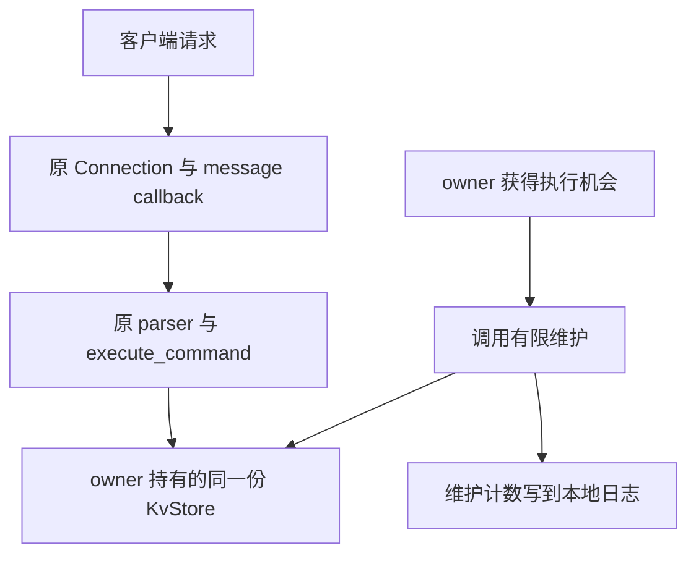
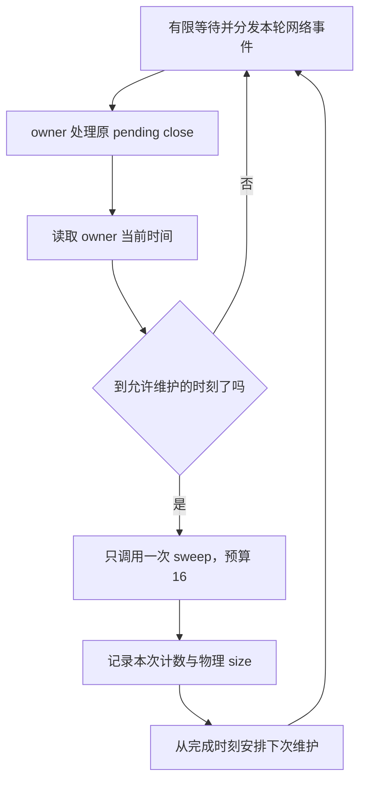

# Week13 Day5：让过期清理在原服务器里真正运行

> 版本：2026-10-20，依据 Day4 整日验收与当前服务器入口生成
> 前置：Day4 整日正式通过 99/100，R1 历史 100/100；组件与命令层保持
> 今日产出：升级原 `mini_redis_server.cpp`，接入有限维护，并验证真实 TCP 上的 TTL
> 学习方式：R1 先打通运行机会；R2 解释维护频率；R3 补齐时间控制与网络证据

[TOC]

---

# Part 1：前情提要

## 1. 今天让没人访问的 key 也能被服务器回收

**把昨天的 `sweep_expired()` 接到正在运行的 Mini Redis：客户端不发请求时，服务器也会检查一小批记录，回收到期项。**

先看一个完整场景：

```text
A：SET day5:short value
A：EXPIRE day5:short 2
A、B 都保持连接，但暂时不发请求
两秒以后：这个 key 失效
服务器主动维护：把它从 map 删除
B 随后 GET：得到不存在
A、B 随后 PING：仍然得到 PONG
```

这里需要两份不同的证据。**GET 返回不存在，证明命令已经尊重有效期；维护日志中的实际删除，证明无人访问时也发生了回收。**

今天先让这个过程运行起来，再把维护频率从网络事件数量中分离出来。

## 2. 从你的真实 Day4 接起

你已经完成：

- 原 KvStore 用自己拥有的 string 记录巡检边界，两轮之间删除 key 不会留下悬空迭代器。
- 每次只检查本轮预算与初始 size 中较小的数量，检查数和删除数分别返回。
- 一轮只取一次合法时刻；普通 SET 清旧期限，续期读取当前 deadline。
- 原 3 项加新补的 22 项维护测试，共 25 项。完整工程 CTest 124/124，相关 ASan/UBSan 与迭代器检查各 25/25。

这些是 **Day4 已有证据**，不是 Day5 已通过。今天不重写维护循环，也不再补一套同形 GTest。

当前服务器的事实也很明确：`main_()` 拥有一份 `store`，message callback 使用这份 store；外层循环仍调用 `loop.poll_once(-1)`。**维护组件已经存在，原入口却还没有调用它。**

## 3. 四个问题，贯穿今天

1. 所有客户端都安静以后，owner 怎样重新获得执行机会？
2. 网络很活跃时，维护怎样仍有机会，又不变成每条请求都清理一次？
3. 怎样证明记录是维护删掉的，而不是拿一个 GET 结果代替证据？
4. 一轮只检查 16 条，究竟限制了什么，为什么不能承诺服务器最多延迟 1ms？

R1 先解决第 1、3 项的主链；第 2 项的频率控制留给 R2/R3。第 4 项贯穿所有证据的解释。

## 4. 现在需要的两个名字

**Maintenance（维护）：由服务器 owner 主动发起的数据管理工作。** 今天它只调用已有的有限过期清理，不经过 RESP 命令入口，也不产生客户端回复。

**Bounded wait（有限等待）：没有网络事件时，等待也会在指定时间后返回。** owner 因而能重新执行自己的工作；事件提前到来时则可以提前返回。

后面出现的“100ms 间隔”和“16 条预算”控制不同事情：前者控制维护机会的频率，后者控制一次维护检查多少候选。它们都是本项目的教学参数，不是 Redis 的固定配置。

---

# Part 2：教程开始

## 5. 两个入口，仍然使用同一份 store

原请求链完全保留：

```text
Connection 收到 bytes
-> 原 RESP parser 交付完整 arguments
-> execute_command 操作 store
-> 原 encoder 生成回复
-> Connection 发送
```

新增的入口在 owner：它主动使用同一份 store 做维护。



图里是同一个用户态进程中的两种工作，不是两个线程。TCP 仍只负责传输 bytes；key 何时失效由 store 判断，owner 负责安排何时主动检查。

**key 到期不意味着 Connection 到期。** 两秒后可以删除验证码，但 A、B 的 TCP 连接仍应能够继续 PING。

## 6. Round1：升级现有服务器，不新建组件

Ubuntu 工程根目录仍为：

```text
/home/xgf/code/system-learning/cpp/week10
```

| 文件 | 今天的用途 |
|---|---|
| `apps/mini_redis_server.cpp` | 唯一核心实现增量：安排原网络循环与有限维护 |
| `tests/mini_redis_ttl_check.py` | 下面提供的进程外检查脚手架 |
| 原 `KvStore`、dispatcher、Reactor、Connection | 保持已通过的接口和行为 |
| 原 `CMakeLists.txt` | 已有 `mini_redis_server` target，今天不需要新 target |

程序启动后继续监听原端口 6380。A、B 连接后使用原命令；owner 另外调用维护，把结果写到进程的标准错误流。

程序持续服务；测试结束时手动终止自己启动的实例，进程资源由操作系统回收。默认 Ctrl-C 终止不承诺执行 C++ 析构链，本日不把它称作优雅停机。最外层捕获普通异常并返回 1 的路径仍保留。

**今天要做成的功能是：网络请求和少量维护在同一个 owner 中轮流取得执行机会。** 不增加后台线程，不把维护塞进某个客户端的 callback，也不复制一份 store。

## 7. 先确认手里的接口能做什么

### 7.1 `poll_once(timeout_ms)`：等待并处理一批网络事件

当前接口返回时，本轮取得的事件已经 dispatch，分发给相应 Channel。返回值是 event record 的条目数，不是 callback 调用次数。

| 参数或结果 | 当前工程中的含义 |
|---|---|
| `timeout_ms == -1` | 可以无限等待；没有事件就没有 timeout 返回 |
| 正数，例如 50 | 没有事件时等待指定毫秒量级，有事件可以提前返回 |
| `timeout_ms == 0` | 不等待，立即检查；不断空转调用会消耗 CPU |
| 返回正数 | 本轮取得这些 ready records，并已完成对应分发 |
| 返回 0 | 本轮没有 ready record；owner 仍能继续执行 |
| 失败 | 当前实现处理 EINTR，其余 epoll_wait 错误抛 `std::system_error` |

你的 `EventLoop` 已经有有限 timeout 和 EINTR 后重新计算剩余时间的路径，今天直接使用它。**参数限制的是网络等待，不包括随后执行 callback 的全部耗时。** 内核调度也可能使实际等待超过指定值。[Linux：epoll_wait 的 timeout 与返回值](https://man7.org/linux/man-pages/man2/epoll_wait.2.html)

### 7.2 `sweep_expired(max_examined)`：少量检查后返回

还是昨天的调用：

```cpp
// 调用片段：store 是 main_ 已拥有的原对象。
const auto result = store.sweep_expired(16);
```

`result.examined` 是本次检查的候选数，`result.removed` 是其中实际删除的到期记录数。空 store 返回 `{0,0}`；记录很多时，也只消耗这一份检查预算。

调用会改变 store 的物理记录和内部巡检位置；返回结果只拥有计数，不借用 node。owner 不需要拿到 cursor、修改 deadline，或自己再判断一次过期。

## 8. 本日约定：先打通，再收紧频率

### 8.1 两轮的边界

| 项目 | R1 主链 | R2/R3 最终目标 |
|---|---|---|
| 没有客户端发数据 | 维护仍会发生 | 保持，并保留可独立辨认的日志 |
| 网络等待 | 使用有限等待；本课选择最多等待 50ms 的配置 | 保持；不靠永久 `poll_once(0)` 空转 |
| 单次维护 | 最多检查 16 条 | 保持，不在同一轮反复调用直到清空 |
| 相邻维护的间隔 | 暂不要求严格按 100ms 控制 | 一次维护结束后，再等待约 100ms 才有资格执行下一次 |
| 请求连续到来 | 不破坏原服务 | 合法请求持续到来时，维护仍获得机会 |
| 落后几个间隔 | R1 暂不要求处理 | 本轮只做一次，不连续补跑旧次数 |

“约 100ms”是安排目标。网络等待、系统调度和已进入的 callback 都会影响实际执行时刻，**它不是实时期限保证**。先完成一份合法输入上的 R1，再处理频率与活跃流量，避免把所有调度细节一次压进首版。

### 8.2 用一行日志留下维护证据

每次维护成功结束，向 `std::cerr` 输出并结束这一行：

```text
MAINTENANCE ready=0 examined=2 removed=1 size_before=2 size_after=1
```

| 字段 | 记录什么 |
|---|---|
| `ready` | 本轮 `poll_once` 已返回的 event record 数 |
| `examined`、`removed` | 这一次维护的原返回值 |
| `size_before`、`size_after` | 紧邻这次维护之前、之后的物理 size |

这些数字来自**同一次维护**。`size_before - size_after` 应等于 removed。`ready=0` 能标记没有网络事件的返回，正数则表明这轮有网络事件。

日志只用于本地观察，不进入 socket，不新增 DEBUG 命令。单线程下，在 owner 的这段连续操作之间没有另一个客户端线程修改 store。失败的维护不打印成功计数；观察期可以保留空表的 `{0,0}` 日志，后续性能测量前再关闭这类逐次输出。

### 8.3 错误怎样离开当前路径

| 情况 | 保留的行为 | 英文消息 |
|---|---|---|
| 非法 EXPIRE 数字 | dispatcher 返回 RESP Error，连接继续使用 | `ERR value is not an integer or out of range` |
| RESP framing 错误 | 保留原坏连接回复、flush 后关闭与 owner 清理 | 沿用原 protocol error 文本 |
| `poll_once` 抛系统异常 | 交给现有最外层 catch，报告后返回 1 | 保留 system_error 的原诊断 |
| 维护抛出异常 | 不伪造成功、不静默丢弃；沿现有入口报告并返回 1 | 保留原异常文本 |
| Python 检查出现不匹配、EOF 或超时 | 抛异常、非零退出，不打印 PASS | 脚手架注明具体场景 |

没有新增通用故障隔离或优雅停机机制。不要为了今天的维护，在循环里 catch 全部异常后继续伪装健康。

## 9. 开工所需的时间语法，先单独试一次

你在 Day2 已经接触过 `steady_clock`。今天 owner 也可能需要记住一个时间位置；先把类型与调用对齐，不要求重新学习 chrono 全章。

```cpp
// 只演示时间点、时长及比较；不实现服务器的调度循环。
#include <chrono>
#include <iostream>

int main() {
    using Clock = std::chrono::steady_clock;
    const auto captured = Clock::now();
    const auto later = captured + std::chrono::milliseconds{80};
    const auto gap = later - captured;
    const auto gap_ms =
        std::chrono::duration_cast<std::chrono::milliseconds>(gap).count();
    std::cout << gap_ms << ' ' << (later > captured) << '\n';
}
```

独立语法练习文件为 `chrono_point_demo.cpp`，最低运行入口是：

```bash
g++ -std=c++17 -Wall -Wextra -g chrono_point_demo.cpp -o /tmp/chrono_point_demo
/tmp/chrono_point_demo
```

应输出 `80 1`。没有 sleep；later 是由 captured 加上一个已知时长构造出来的。

这些调用都在 `<chrono>` 中：

- `Clock::now()` 返回本 clock 的 `time_point（时间点）`，不修改 store；`steady_clock::now()` 为 noexcept。
- `milliseconds{80}` 构造 80ms 的 `duration（时长）`。
- 时间点加时长得到另一个时间点；同一 clock 的时间点可以比较大小。
- 两个时间点相减得到时长；`duration_cast<...>(gap)` 转换时长单位，`.count()` 取该单位下的数值。整数转换可能截去不足一个单位的部分。

`steady_clock` 的时间点不会因手动校准日历时间而倒退，适合本课的进程内间隔。[C++17：steady_clock](https://timsong-cpp.github.io/cppwp/n4659/time.clock.steady)、[时间点运算与比较](https://timsong-cpp.github.io/cppwp/n4659/time.point)、[duration_cast](https://timsong-cpp.github.io/cppwp/n4659/time.duration.cast)

## 10. 一份可直接使用的 R1 检查脚手架

目标文件是 `tests/mini_redis_ttl_check.py`。**你独立实现的是服务器接入，不是下面这些 socket 读写和日志比对。** 脚手架不决定主循环怎样组织。

它只连接一个本日专用的新测试实例。没有其他客户端修改数据时，设置两条记录，其中一条到期；先从日志证明物理 size 从 2 变成 1，再查询命令结果。

```python
"""检查共享 TTL、无请求时的物理回收，以及原连接继续可用。"""
import argparse
from pathlib import Path
import re
import socket
import time


def require(condition, message):
    if not condition:
        raise RuntimeError(message)


def recv_exact(sock, size):
    data = bytearray()
    while len(data) < size:
        chunk = sock.recv(size - len(data))
        if not chunk:
            raise RuntimeError("unexpected EOF before complete reply")
        data.extend(chunk)
    return bytes(data)


def recv_line(sock):
    line = bytearray()
    while not line.endswith(b"\r\n"):
        line.extend(recv_exact(sock, 1))
        require(len(line) <= 4096, "reply line is too long")
    return bytes(line[:-2])


def read_reply(sock):
    line = recv_line(sock)
    require(bool(line), "empty reply line")
    tag, payload = line[:1], line[1:]
    if tag == b"+":
        return payload
    if tag == b"-":
        return ("error", payload)
    if tag == b":":
        return int(payload)
    require(tag == b"$", f"unsupported reply header: {line!r}")
    size = int(payload)
    if size == -1:
        return None
    require(0 <= size <= 1024 * 1024, "unexpected bulk length")
    data = recv_exact(sock, size + 2)
    require(data[-2:] == b"\r\n", "missing bulk terminator")
    return data[:-2]


def command(sock, *arguments):
    request = f"*{len(arguments)}\r\n".encode("ascii")
    for argument in arguments:
        request += f"${len(argument)}\r\n".encode("ascii")
        request += argument + b"\r\n"
    sock.sendall(request)
    return read_reply(sock)


TRACE = re.compile(
    r"MAINTENANCE ready=(\d+) examined=(\d+) removed=(\d+) "
    r"size_before=(\d+) size_after=(\d+)"
)


def maintenance_rows(trace, offset):
    rows = []
    for line in trace.read_bytes()[offset:].decode("utf-8").splitlines():
        match = TRACE.fullmatch(line)
        if match:
            row = tuple(map(int, match.groups()))
            ready, examined, removed, before, after = row
            require(examined == min(16, before), f"wrong budget: {row}")
            require(removed <= examined, f"wrong removal count: {row}")
            require(before - after == removed, f"wrong size delta: {row}")
            rows.append(row)
    return rows


def main():
    parser = argparse.ArgumentParser()
    parser.add_argument("--host", default="127.0.0.1")
    parser.add_argument("--port", type=int, default=6380)
    parser.add_argument("--trace", type=Path, required=True)
    args = parser.parse_args()
    address = (args.host, args.port)
    with socket.create_connection(address, timeout=3.0) as a, \
            socket.create_connection(address, timeout=3.0) as b:
        a.settimeout(3.0)
        b.settimeout(3.0)
        require(command(a, b"SET", b"day5:keep", b"keep") == b"OK", "SET keep")
        require(command(a, b"SET", b"day5:short", b"value") == b"OK", "SET short")
        require(command(b, b"GET", b"day5:short") == b"value", "shared value")
        require(command(b, b"PTTL", b"day5:keep") == -1, "permanent PTTL")
        require(command(a, b"EXPIRE", b"day5:short", b"2") == 1, "EXPIRE")
        ttl = command(b, b"PTTL", b"day5:short")
        require(isinstance(ttl, int) and 0 < ttl <= 2000, "positive PTTL range")

        offset = args.trace.stat().st_size
        stop = time.monotonic() + 5.0
        rows = []
        # 这里只读本地日志；A、B 不发送任何新网络请求。
        while time.monotonic() < stop:
            rows = maintenance_rows(args.trace, offset)
            if sum(row[2] for row in rows) >= 1:
                break
            time.sleep(0.05)
        require(sum(row[2] for row in rows) == 1, "no exact idle removal")
        require(any(row[0] == 0 and row[2:] == (1, 2, 1) for row in rows),
                "missing idle maintenance size 2 -> 1")

        # 物理回收证据已经成立，现在才检查后续命令和连接。
        require(command(b, b"GET", b"day5:short") is None, "expired GET")
        require(command(b, b"PTTL", b"day5:short") == -2, "expired PTTL")
        require(command(b, b"GET", b"day5:keep") == b"keep", "keep preserved")
        require(command(a, b"PING") == b"PONG", "A still usable")
        require(command(b, b"PING") == b"PONG", "B still usable")
    print("DAY5 R1 TTL + IDLE MAINTENANCE PASS")


if __name__ == "__main__":
    main()
```

`read_reply` 只处理本日会收到的 Simple String、Error、Integer、Bulk/Null，不实现通用 RESP 客户端。Error 用 `("error", message)` 与普通 bytes 区分；任何意外回复或 EOF 都会使检查失败。

几个与证据有关的 Python 动作：

- `with ... as a, ... as b` 保证离开作用域时关闭两个 socket；失败也会清理。
- `sendall` 交付全部请求 bytes，`recv_exact` 自己循环处理一次 recv 不够长的情况。
- `Path.stat().st_size` 记录当前日志字节位置；后续只检查这次位置之后的记录。
- `time.monotonic()` 给检查设置五秒观测窗口；`sleep(0.05)` 只让检查客户端暂停，不让服务器 sleep。

它先读日志，再发 GET，因此成功证据不依赖查询。日志必须使用本日格式、持续写入同一文件；运行中不要截断或轮转它。PASS 检查使用显式异常，不依赖会被 `python -O` 去掉的 assert。

## 11. 第一条编译与运行命令

在上述 Ubuntu 工程根目录：

```bash
cmake -S . -B build -DCMAKE_BUILD_TYPE=Debug
cmake --build build --target mini_redis_server
./build/mini_redis_server 2> /tmp/mini_redis_day5.trace
```

这条 server 命令保持前台运行；另一个终端运行：

```bash
python3 tests/mini_redis_ttl_check.py --trace /tmp/mini_redis_day5.trace
```

目标输出是 `DAY5 R1 TTL + IDLE MAINTENANCE PASS`，退出码 0。它是你接入后的目标，**不是当前 Day5 已通过的记录**。

当前源码把端口写在 `Acceptor acceptor(loop, 6380, 128)` 中。如果 6380 已被自己的旧测试实例占用，保留旧进程，给本日实例选一个空闲端口，同时让 checker 的 `--port` 对齐；今天不新增服务端命令行解析功能。停止本日自己启动的前台实例即可，不按进程名批量杀服务。

## 12. 到这里停止阅读：先完成 Round1

先在原 server 上打通：有限等待、有限维护、准确日志、共享 TTL 与空闲回收。保留 pending close 的原安全清理点，暂不追求严格的 100ms 调度。

记录自己真正遇到的问题，以及调用维护放在哪一段。Python 脚手架可以委托落地，不需要为重复 socket 语法消耗精力；核心接入由你完成。

**下面开始解释维护的执行频率。完成首版并检阅后再继续。** 本稿尚无你的 Day5 首版；R1 正式通过时，后半会按最新实现逐节定向校准，不把已经正确的部分再列成作业。

---

## 13. Round2：网络返回次数，为什么不能代表维护时间

先对照 R1 的日志问一个具体问题：**短时间内网络返回了很多轮，维护是否也跟着做了很多次？**

设本项目希望维护结束后至少间隔 100ms，再做下一次。下面是示意时间，不是你的实测：

```text
0ms：刚完成一次维护
20ms：网络事件返回
25ms：网络事件返回
30ms：网络事件返回
110ms：又有一轮返回
```

20、25、30ms 的网络工作可以照常执行；现在并没有到下一次维护的时间。到 110ms 才应获得下一份维护机会。

换成无人发数据，网络轮次就少了；换成密集请求，轮次又变多。**网络事件数量回答“发生了多少网络工作”，不能回答“是否已经过了 100ms”。**

另一端也要看清：如果只在 `poll_once()` 返回 0 时维护，持续提前到来的网络事件可能让这个分支一直不执行。维护长时间拿不到机会，这种现象叫 **starvation（饥饿）**。

所以最终需要两项彼此独立的判断：网络轮次照常处理，owner 也检查时间是否已经允许维护。不能拿 `ready == 0` 当成后一个问题的答案。

## 14. 先产生需求，再记住“下一次允许维护的时刻”

上一节真正缺少的信息是：**上一次维护结束以后，下一次最早什么时候可以执行？**

例如刚在 0ms 完成维护，间隔选择 100ms，就记住一个 100ms 的位置。后来一轮结束在 30ms，尚未到；结束在 110ms，已经到。这个位置属于 owner，不属于某个 key。

到这里再给它一个名字：`next_sweep_at`，下一次允许维护的时间点。使用你已经试过的 chrono：

```cpp
// 初始化片段：这是 owner 的维护时间，不是 key 的 deadline。
using LoopClock = std::chrono::steady_clock;
const auto interval = std::chrono::milliseconds{100};
auto next_sweep_at = LoopClock::now() + interval;
```

每轮重新得到当前时间点，与保存的位置比较；需要维护时才调用既有 store。调用结束后，从完成时刻重新向后安排 100ms：

```cpp
// 更新片段：放在本次维护及其记录已经完成的位置。
next_sweep_at = LoopClock::now() + interval;
```

这里保存的不是“还差几次网络循环”，而是一个可以与当前时刻直接比较的位置。网络返回快慢改变不了它的含义。

如果机器暂停后到了 350ms，旧位置仍是 100ms，本项目选择这轮只维护一次，再从完成时刻安排下一次。**不把错过的次数连续补跑。** 这是为了保持每轮维护工作有限所选的策略，不是所有定时任务都必须采用的唯一方案。

## 15. 接回你的 owner，原关闭路径保持

你当前 `poll_once()` 内部已经完成 dispatch；返回以后，原循环通过 pending close 删除 Connection 和对应 application flag。这个安全点保留。

新增关系可以放在下面这条纵向链中理解：



图把一种可行顺序走完整：无论本轮 ready 是 0 还是正数，都能到达时间判断。没有额外的 client request，也没有后台线程。

网络等待仍选择有限的 50ms 配置。即使下一次维护时间已经存在，也需要一个能让 owner 定期回来的等待入口。这个简单版本会多醒来一些轮次，本日接受这项取舍；不要求再实现一个按最近期限计算 timeout 的通用调度器。

如果一轮内某个 callback 自己做了很多工作，维护只能等它返回后再运行。图没有抢占 callback 的能力。**本日证明正常有限流量下的运行机会，不证明任意请求负载下的公平性或延迟上限。**

## 16. 两种时间，各自服务不同的问题

看同一个即将到期的 key：

| 保存在哪里 | 保存什么 | 回答什么 |
|---|---|---|
| `KvStore::node` | 这个 key 的 deadline，使用 store 的整数毫秒约定 | 当前还能不能使用 value？ |
| server owner | `next_sweep_at`，LoopClock 的时间点 | 现在能否再拿一份维护预算？ |

owner 只决定调用机会，真正检查每个 deadline 的仍是 `sweep_expired()`。它继续在内部读取自己的合法时间，沿你已经通过的 cursor 推进。

**不要把 PTTL、store 起点后的毫秒数与 owner 的 time_point 混着比较。** 即使都来自单调时钟，它们的表示和零点也未必一样。今天没有公开新的 store 时间接口，更没有把 key 的 deadline 搬进网络层。

两种预算也要分开：一次最多等待 50ms，不是一次最多执行 50ms；一次最多检查 16 条，也不是最多花 1ms。你当前每条还会做树查找，字符串比较与删除释放也有成本。

这些是需要理解的成本来源，**不是本次已测出的性能瓶颈**。真正的工作负载、定位与改动前后比较仍留 Week15。

## 17. 为什么这份日志能证明主动回收

R1 脚本先等以下事实成立：

```text
两条物理记录，其中一条带期限
-> A、B 停止发请求
-> ready=0 的维护返回 removed=1
-> 同一次维护 size 从 2 变为 1
-> 然后才 GET 与 PTTL
```

删除证据发生在新查询之前；两条仍连接着的客户端也没有因为 key 到期被关闭。这个顺序比单看最终 GET 更有区分力。

五秒是脚手架的观测容忍窗口，不是服务端“每五秒维护一次”的配置，也不是严格到期延迟承诺。若 VM 暂停、测试实例不是新进程或混入其他客户端，先保留日志、修正实验条件再运行；不要为了得到 PASS 改掉删除数或 size 的含义。

**此时可选回看小林《Redis 过期删除策略和内存淘汰策略有什么区别？》中“Redis 过期删除策略是什么？”的定期删除段与流程图。** 只用来对照“无人访问也检查、每次控制工作量”的取舍，读到“内存淘汰策略”二级标题之前停止；这部分 Day4 已熟悉则直接略过。[小林：过期删除策略](https://xiaolincoding.com/redis/module/strategy.html)

Redis 官方也区分访问触发的过期与主动检查。我们的 map 巡检、50/100ms 和 16 条预算是自己的教学实现，不能当成 Redis 的同款算法或固定参数。[Redis：How Redis expires keys](https://redis.io/docs/latest/commands/expire/#how-redis-expires-keys)

---

# Part 3：收尾、验证与验收

## 18. Round3：只把本日的时间控制收住

最终仍只有原 server 的一处增量，不新增清理组件。按 R2 完成这三件事：

1. 有限等待继续保留；网络返回为正数和 0，都能到达维护时间判断。
2. 用 owner 保存的时间位置控制下一次维护；一次结束以后再间隔约 100ms，不按事件次数推进时间。
3. 获得机会时只调用一次预算 16 的维护，记录这一次结果，不追赶补跑、不扫到空才返回。

已有 parser、命令返回、Connection 生命周期与 Day4 cursor 保持。`std::min` 所在源码显式包含 `<algorithm>` 这个旧小项可以顺手由你补上，但不为今天重写清理循环。

R1 检阅会把这里收缩成**你那版实际还剩的改动**。已经满足的动作直接保留，不因教程列了三项而再实现一遍。

## 19. 在同一份网络检查中补证据

下面都是前文机制的验证，不是新接口或新功能。继续使用 `tests/mini_redis_ttl_check.py`；重复命令、回复比对和日志读取可以委托给我，不要求你再手写一套客户端。

| 场景怎样建立 | 要观察的结果 | 证明什么 |
|---|---|---|
| 原 R1 两客户端、一个带期限 key，随后完全停止发请求 | 先看到维护实际删除，再查到不存在；两个原连接仍可 PING | 空闲机会与连接生命周期正确 |
| SET 旧值，EXPIRE 2，再 SET 新值；越过旧期限后由 B GET/PTTL | 新值保留，PTTL 为 -1 | 网络路径保留普通 SET 清旧期限 |
| SET 后 EXPIRE 1，在旧期限前重新 EXPIRE 3 | 越过旧期限仍能 GET，随后按新期限失效 | 最新期限通过真实命令生效；精确等号仍由 Day4 fake clock 证明 |
| 在 A 一次发送非法数字 EXPIRE 和下一条 PING；B 也 PING | A 依次收到原 Error 与 PONG，B 得 PONG，原 value/期限保持 | command error 不断开连接或偷偷改状态 |
| 新实例批量设置 37 个短期 key，准备完成后停止请求 | 后续多次日志累计回收 37，每次 examined 不超过 16 | 多轮预算确实完成积压；不能单次扫全表 |
| 另一个阶段持续发送间隔约 5ms 的 PING，覆盖至少两秒 | PING 正常；在有事件的轮次仍出现维护记录 | 不把维护只绑在 timeout 分支 |

批量阶段给准备过程留足有效期，例如 EXPIRE 3，日志观察窗口取到最后设置后的五秒。准备完成前若已经发生删除，保留实际日志并延长这次测试的有效期后重做，不能把没纳入窗口的删除硬补进累计数。

活跃阶段是一个有限的正确性场景，不统计 QPS、不声称测出 latency 或公平性。在日志中比较维护次数与观察时长，确认它没有跟着每条 PING 执行；正常机器上，连续两秒通常是十几到二十次量级，而不是几百次。这个量级用来发现明显失控，不当精确计时断言。

## 20. 构建、回归与内存检查

先在原工程运行全部回归：

```bash
cmake -S . -B build -DCMAKE_BUILD_TYPE=Debug
cmake --build build
cmake -E chdir build ctest --output-on-failure
```

最近一次 Day4 正式结果是 **124/124**，其中维护 25 项。本日没有新增 C++ test target；若测试集合未变，数量应保持，但最终记录仍以你当前实际发现和运行结果为准。

再运行原网络脚本和本日检查。旧 parser/byte-stream 证据无需重画；重点确认新主循环没有破坏连接和关闭路径。

本日复用原 sanitizer 构建方式，另建目录：

```bash
cmake -S . -B build-ttl-network-san \
  -DCMAKE_BUILD_TYPE=Debug \
  -DCMAKE_CXX_FLAGS="-fsanitize=address,undefined -fno-omit-frame-pointer" \
  -DCMAKE_EXE_LINKER_FLAGS="-fsanitize=address,undefined"
cmake --build build-ttl-network-san
cmake -E chdir build-ttl-network-san ctest --output-on-failure
./build-ttl-network-san/mini_redis_server 2> /tmp/mini_redis_day5_san.trace
```

另一个终端让同一检查指向 sanitizer 实例及其日志。先停下自己刚才启动的普通测试实例，或让两个实例使用不同端口；不能同时争抢 6380。

ASan/UBSan 看执行到的内存与部分未定义行为路径；日志和回复比对证明本日行为。没有报告不等于按时维护，也不等于性能已经改善。本日没有新增并发访问，不机械加入 TSan。

## 21. 五个收口问题

可指代码、口述或复用日志，不重抄一份流程总结。

1. A、B 都没有发请求时，你的 owner 为什么仍能从网络等待中回来？
2. ready 为正数时，为什么也要检查维护时间？反过来，为什么不能每次有事件就维护？
3. `next_sweep_at` 与某个 key 的 deadline 分别归谁、回答什么，能否直接混着比较？
4. 你的哪段日志发生在 GET 之前，证明了真实物理回收？它为什么没有证明 RSS 立即下降？
5. 一次只检查 16 条已经成立，为什么仍不能保证任意负载下服务器最多多延迟 1ms？

## 22. 今天收在哪里

今天结束时，你可以用自己的代码说明：**同一个 owner 既处理网络，也给有限维护安排时间；到期决定 value 的可见性，维护机会决定物理回收何时发生。**

主线停止在这个 V2 集成：原 long connection 保持，原错误与关闭语义保持，无请求也有回收证据。没有新增全量清理、内存淘汰、持久化或通用计时器。

Day6 再用场景区分过期、内存压力淘汰与缓存故障，并回到原 MySQL 实例观察事务第一层。理论线仍按 T10 的真实进度独立学习，不为了 TTL 日追加模型或 GPU 作业。
