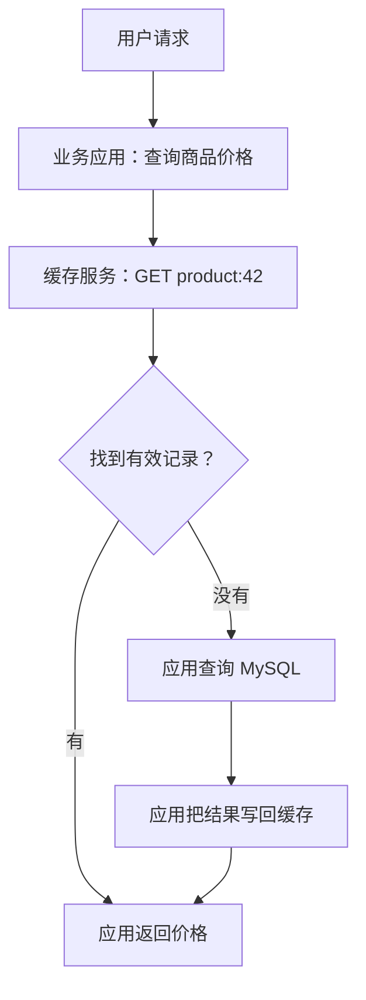
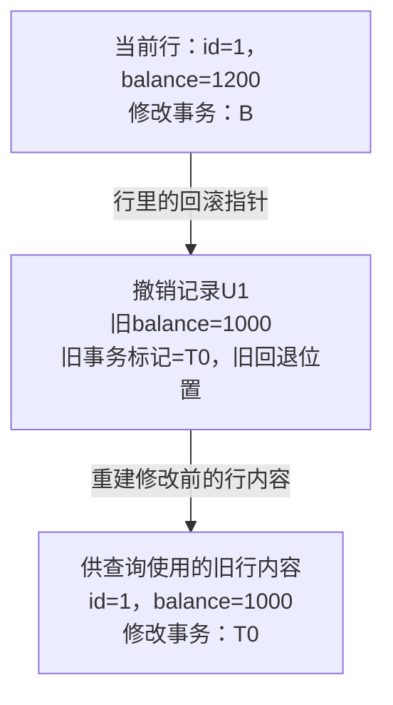

# Week13 Day6：缓存未命中以后，数据库怎样接住请求

> 版本：2026-10-21，依据Day5整日100/100后的实际进度生成。
> 今天是概念与SQL观察日：不新增C++组件，不改Mini Redis，不重画Reactor流程。
> 先完成R1再停下；R2/R3将在R1检阅后依据你的实际结果定向校准。

**今天做两件事：看清缓存失效怎样把压力传给数据库，再用两个MySQL窗口观察一组修改怎样提交、读到哪个版本、什么时候需要等待。**

最后留下几组真实SQL结果和自己的解释即可。一份你自己整理的`day6_note.md`足够，不另交总结文件，也不用手写并发测试框架。

[TOC]

# Part 1：前情提要与必要术语

## 1. 从已经完成的TTL往外看一层

你的Day5已经解决了一个具体问题：即使客户端不发请求，owner也能从`poll_once(50)`返回，在时间到达后调用`sweep_expired(16)`，主动回收过期记录。

最后的100ms从**上一次维护完成之后**重新安排。它控制维护机会的频率；16限制单轮检查条目数。今天直接复用这些结论，不再写一套清理器。

现在换一个业务：商品价格通常从缓存取，缓存没有时再查MySQL。

```text
商品42：缓存里有价格 -> 直接返回
商品42：缓存到期了 -> 应用查MySQL -> 把结果重新放入缓存 -> 返回
```

于是出现一个新问题：**缓存里的记录可以正确过期，但过期后突然到来的数据库请求，谁来控制？**

另一个问题在数据库内部。账户1给账户2转300元，需要两次修改：

```text
账户1：1000 -> 700
账户2：1000 -> 1300
```

只完成第一步就失败，总额便少了300。数据库需要把这两个动作组织成一个整体。今天的SQL实验就围绕这两条记录展开。

## 2. 今天的四个主问题

1. 查不存在的数据、一个热门key过期、大批key同时失效，为什么需要不同保护？
2. 两条`UPDATE`怎样一起保留或一起撤销？
3. B已经提交新余额，A再次查询时应该读到什么？这个答案受什么控制？
4. 普通查询可以返回时，为什么更新同一条记录却可能等待？等待怎样变成死锁？

R1先完成缓存场景和提交/回滚观察，再对第3题作出预测。R2解释读数并补上锁定读，R3做一次有界锁等待，把四个问题接起来。

## 3. 先分清今天图里的三个进程

下面是一个**用于讨论的业务架构**：



顺着图读：应用先问缓存；没有记录时，由**应用**查询MySQL。查询到的结果再由应用放回缓存。这一步叫**cache refill（缓存回填）**。

读到有效缓存叫**cache hit（缓存命中）**；缓存没给出有效记录叫**cache miss（缓存未命中）**。一次miss只是这条路径的分支，是否造成故障，还要看它把多少流量交给下游。

**你的Mini Redis目前是独立KV服务。** 它的`GET`找不到key就返回Null Bulk String，没有查询MySQL或自动回填的代码。图中“业务应用”不是现有message callback新增的职责，今天也不要求把这条架构实现出来。

MySQL实验使用另一个数据库进程。两个终端各运行一个`mysql`客户端，连接同一个数据库实例。每条连接形成一个**session（会话）**，保存自己的事务和会话设置。

### 3.1 session 是啥

**对，你的理解基本正确：在我们当前的 MySQL 直连实验里，session 就是服务器为这条客户端 connection 维护的一份会话上下文。**

这份上下文会记住：
- 当前使用哪个数据库。
- 会话设置，例如 `autocommit`、事务隔离级别。
- 当前是否正在执行事务，以及这个事务的状态。

**Connection 管连接，session 保存这条连接上的会话状态，transaction 是其中一次事务。**

例如，你打开 A 窗口连接 MySQL：

```text
建立连接 → 创建 session A
    ↓
开始事务 1 → UPDATE → SELECT → COMMIT
    ↓
session A 继续存在
    ↓
开始事务 2 → UPDATE → ROLLBACK
    ↓
session A 继续存在
    ↓
断开连接 → session A 结束
```

所以，**`COMMIT` / `ROLLBACK` 结束的是当前事务，会话仍然可以继续处理下一条命令。**

你查到自己尚未提交的修改，准确说是：**当前事务能够读取自己已经做出的修改。** 说“同一个 session”只确定了连接上下文，没有明确是在它先后执行的哪个事务里。

另外，一个 client 程序可以建立多条连接，因此也可以同时拥有多个 session。

# Part 2：教程开始

## Round1：先看业务压力，再亲手观察提交与读取

## 4. 请求的商品根本不存在，为什么每次仍要查库

假设商品999999从未存在。应用查缓存，没有；再查MySQL，也没有；下次同样重复。

```text
请求999999 -> 缓存miss -> MySQL不存在
请求999999 -> 缓存miss -> MySQL不存在
请求999999 -> 缓存miss -> MySQL不存在
```

缓存挡住了常见商品，却挡不住这些无效查询。**反复查询不存在的数据，流量持续到达下游**，这个问题叫**cache penetration（缓存穿透）**。

这里的**“下游”就是MySQL数据库**。“流量持续到达下游”指的是：**这些请求每次都要让MySQL执行一次查询，缓存没能替它减少工作量。**

先看最直接的改动：MySQL明确回答“商品不存在”后，应用把这个结论也缓存一小段时间。下次看到这条特殊记录，就可以直接返回不存在。这叫**negative caching（空结果缓存）**。

这条特殊记录要能与正常商品内容区分。它也应有较短TTL：否则后来新建了同编号商品，旧的“不存在”结论可能继续挡住新数据。数据库超时只说明这次查询失败，不能写成“商品不存在”。

还有两道常见保护：

- 先校验输入。商品编号格式明显非法时，应用直接拒绝。
- 维护一个“这个编号可能存在吗”的紧凑集合。它判断一定不存在时，就不必查库；判断可能存在时，再走正常查询。这种允许误报“可能存在”的结构叫**Bloom filter（布隆过滤器）**。

布隆过滤器不在今天实现。正确维护的标准模型允许false positive（误报存在），但不把已加入元素误判为不存在。若真实商品新增后没有同步加入过滤器，业务仍可能被过时信息挡住；“算法性质”和“数据更新是否及时”是两回事。

### 4.0 重建是什么

这里的**“重建”就是：从MySQL重新查出商品价格，再把价格写回缓存。**

比如商品42原来的价格缓存到期了：

```text
应用收到商品42的查询请求
→ 缓存里找不到有效价格
→ 查询MySQL，得到价格99元
→ 把“商品42：99元”重新写入缓存，并设置有效期
→ 向用户返回99元
```

这个“查数据库，再把缓存补回来”的过程，就叫**缓存重建**。重建的是缓存记录，**MySQL里的商品记录原本就存在。**

“同一个商品被重复重建”则是说：

**第一个请求还没来得及把价格写回缓存，后面的很多请求也都查到了miss，于是各自查一遍MySQL，再各自写一遍相同的缓存。**

本来一次查询、一次回填就能完成的工作，被许多请求重复做了。

## 5. 商品确实存在，只是一个热门key刚刚过期

现在是商品42。它在数据库里存在，并且有很多用户同时访问。

```text
热门价格缓存到期
-> 很多请求同时看到miss
-> 每个请求都各自查询MySQL
-> 同一个商品被重复重建
```

**一个热门key失效后，大量请求同时重建它**，叫**cache breakdown（缓存击穿）**。

一种保护是：同一时刻只让一个请求负责查询商品42并回填，其余请求等待这次结果，或按业务规则使用旧值。这里协调的是**同一个key的重建工作**，不是把整个缓存的所有请求排成一队。

另一种思路是在真正到期前刷新热门内容。若允许短暂旧值，可以把“对外还能使用多久”和“什么时候开始更新”分开设计。是否允许旧价格，必须先由业务决定。

这些策略会带来等待、刷新失败、旧值时效等新问题。今天理解它们分别减少了哪一类重复工作，不实现分布式锁，也不把“加个锁”当成所有场景的答案。

## 6. 许多key一起失效，或整个缓存不可用

假设应用在12:00导入十万个商品，全部设置一小时TTL。13:00附近，它们集中到期。大量不同商品的请求一起转向数据库。

另一个起点是缓存服务故障：原本能命中的商品也全部走向下游。

**大量缓存同时失去分流作用，下游承受集中流量**，叫**cache avalanche（缓存雪崩）**。

两种起因对应不同动作：

| 具体起因 | 可以先做什么 | 这一步解决什么 |
|---|---|---|
| 大量key在相近时刻到期 | 让TTL在业务允许的区间内错开，例如3600至3900秒 | 摊开集中重建时刻 |
| 缓存服务不可用 | 限制进入数据库的请求量，必要时返回简化结果或服务繁忙 | 保护下游容量 |
| 两者都可能发生 | 预先准备容量、监控与故障切换方案 | 降低故障传播范围 |

给TTL加入少量随机差异叫**jitter（抖动）**，这里用它错开到期；它不能让已经宕机的缓存恢复。**限流**控制允许通过的流量，**降级**是在压力下提供较弱但可接受的结果。两者都需要具体业务规则。

这三节共同关心的是：**miss来自哪里、涉及多少key、接下来谁承受工作量。** 不要求背三句定义。外部图解稍后在§19按场景查阅。

## 7. TTL还没到，内存却不够了，能删key吗

你的当前规则是：到达deadline，这条记录就不再有效。这个动作叫**expiration（过期）**，判断依据是时间。

再设想缓存只有有限内存，现有记录都还有效，新内容却放不下。系统可能按策略提前移走一些有效记录，为新内容腾空间。这叫**eviction（淘汰）**，判断依据是内存压力与保留策略。

| 现在的问题 | 处理依据 | 当前Mini Redis |
|---|---|---|
| 验证码已超过有效期 | TTL/deadline | 已实现失效判断与主动回收 |
| 缓存占用超过内存预算 | 内存上限与淘汰策略 | 尚未实现 |

如果需要淘汰，可以倾向移走最近很少使用的记录。**LRU（Least Recently Used，最近最少使用）**关注最近一次使用时间；**LFU（Least Frequently Used，最不经常使用）**关注访问频率。真实Redis使用近似策略，不是要求你在这里实现精确全局排序。

也可以选择**noeviction（不淘汰）**：达到限制后，对需要继续增长内存的写入返回错误，已有数据仍可读取。它不等于服务器停止处理全部命令。

这些是Redis的策略概念，不是给当前`KvStore`追加的任务。`maxmemory`的统计范围也不等于整个进程RSS。[官方淘汰说明](https://redis.io/docs/latest/develop/reference/eviction/)

## 8. 账户转账：为什么两条UPDATE需要一个共同边界

回到两条账户记录，各有1000元。账户1向账户2转300元，需要先扣300，再加300。

SQL里的`UPDATE`负责修改已有行。先看下面的语法示意，暂不执行；§9会准备这张账户表：

```sql
UPDATE accounts SET balance = balance - 300 WHERE id = 1;
```

`WHERE id = 1`指定账户1；右侧`balance - 300`从它当前的余额计算新值。语句成功会报告受影响行数，余额要再用`SELECT`查询。

问题在于：第一条成功，第二条还没成功，不能把这半笔转账当成最终结果。我们需要先划出一个范围，里面的修改最后一起保留，或者一起撤销。**这个范围就是transaction（事务）。**

今天只用三个控制语句：

| SQL | 当前动作 | 执行后怎样继续 |
|---|---|---|
| `START TRANSACTION;` | 在当前连接开始一组事务操作 | 后续修改暂不逐条提交 |
| `COMMIT;` | 提交这一组修改，结束本次事务 | 新事务按自己的可见性规则读取已提交结果 |
| `ROLLBACK;` | 撤销当前事务尚未提交的修改，结束本次事务 | 重新查询，确认原记录恢复 |

这三个语句通常返回`Query OK`，不会把账户表当作返回值。它们管理的是**当前会话**的事务，不会替另一个窗口提交。

默认的**autocommit（自动提交）**让事务外的一条成功修改独立提交。今天保留`autocommit=1`，用明确的`START TRANSACTION`圈住多条SQL。`@@autocommit`仍可能显示1，这不代表刚开始的显式事务不存在。[提交与回滚规则](https://dev.mysql.com/doc/refman/8.0/en/innodb-autocommit-commit-rollback.html)

## 9. 复用Day1环境，给Day6一张独立实验表

### 9.1 先准备表，不动Day1的索引实验

本日沿用Ubuntu中的MySQL **8.0.42 / InnoDB**、原Unix socket和`mysql_lab.sh`，不安装新数据库，不改系统服务。

新的[建表文件](../../database_labs/week13/mysql_transaction_setup.sql)只准备`infra_transaction_lab.accounts`，写入账户1和2，各1000元。`infra_index_lab.course_scores`、原索引、你的`a.txt`与`mysql_index_lab.sql`保持不变。

在Ubuntu shell中运行：

```bash
cd ~/code/system-learning/database_labs/week13
bash mysql_lab.sh start
bash mysql_lab.sh sql < mysql_transaction_setup.sql
```

正常应看到版本或`MYSQL LAB ALREADY RUNNING`，然后看到`id=1/2`、`balance=1000/1000`。**先确认两条初始记录，再开始实验。**

脚本里的`CHECK (balance >= 0)`要求每条余额非负；`ENGINE=InnoDB`选择支持本日事务机制的存储引擎。`CREATE ... IF NOT EXISTS`让已有库表保留，随后只重设两条教学账户。完整建表语法是提供的脚手架，不要求手抄。

**需要重跑setup时，先在A、B两个窗口分别`ROLLBACK;`并退出。** 它会重设这两条账户；不要在观察中途重跑，也不要重跑Day1的`mysql_index_setup.sql`。建表等语句可能隐式提交，因此建表步骤放在事务实验外。

### 9.2 打开两个一直保留的客户端

在两个Ubuntu终端分别运行：

```bash
cd ~/code/system-learning/database_labs/week13
bash mysql_lab.sh sql
```

把左窗口记作A、右窗口记作B。进入`mysql>`后，**两边各执行一次**：

```sql
USE infra_transaction_lab;
ROLLBACK;
SET SESSION autocommit = 1;
SET SESSION TRANSACTION ISOLATION LEVEL REPEATABLE READ;
SET SESSION innodb_lock_wait_timeout = 3;
SELECT CONNECTION_ID(), @@transaction_isolation, @@autocommit;
```

`USE`选择当前库。`SESSION`说明设置只作用于当前连接；`CONNECTION_ID()`返回这条连接的编号，两个窗口必须不同。其余两列应是`REPEATABLE-READ`和1。

这里先选定**REPEATABLE READ（可重复读，简称RR）隔离级别**。隔离级别规定并发事务之间的读取与修改规则；现在只把它作为实验条件，具体怎样影响读数，先观察再解释。

最后一项把等待InnoDB行锁的时间限制为约3秒，后面避免无限挂住。它不是所有SQL的总执行时限。

**后面A/B交错步骤必须在这两个持续连接里执行。** 每次`bash mysql_lab.sh sql -e ...`都会新建客户端连接，不能替代跨步骤保留的事务。SQL以分号结束；若只有`->`续行提示，先检查是否漏了分号。输入错了可用`\c`取消当前尚未发送的语句。

## 10. 先比较ROLLBACK和COMMIT

这些步骤先只在A操作，B暂时不动。每个查询前先写下你预计的两条余额，再执行。

### 10.1 修改两条记录，但最后撤销

```sql
START TRANSACTION;
UPDATE accounts SET balance = balance - 300 WHERE id = 1;
UPDATE accounts SET balance = balance + 300 WHERE id = 2;
SELECT id, balance FROM accounts ORDER BY id;
ROLLBACK;
SELECT id, balance FROM accounts ORDER BY id;
```

保留两次查询结果。注意`UPDATE`已执行过，事务内自己的查询也能观察到修改；再看`ROLLBACK`结束以后留下什么。

### 10.2 相同修改，这次提交

```sql
START TRANSACTION;
UPDATE accounts SET balance = balance - 300 WHERE id = 1;
UPDATE accounts SET balance = balance + 300 WHERE id = 2;
COMMIT;
SELECT id, balance FROM accounts ORDER BY id;
```

比较两轮最后结果。今天不用故意断电证明持久性，提交后的普通查询只证明这次提交路径，不证明完整崩溃恢复。

### 10.3 为双会话观察恢复固定起点

A、B先分别执行`ROLLBACK;`。然后只在A执行：

```sql
START TRANSACTION;
UPDATE accounts SET balance = 1000 WHERE id IN (1, 2);
COMMIT;
SELECT id, balance FROM accounts ORDER BY id;
```

确认两条都是1000，才进入下一节。这个重设只服务实验对照，不属于业务转账。

## 11. B已经提交，A第二次会读到什么

**先预测，暂时不读R2。** 本轮只改账户1，A不执行任何`UPDATE`。下面按步骤切换窗口，不要把整张表一次粘到某一边。

| 顺序 | 窗口 | 执行动作 |
|---|---|---|
| 1 | A | 开事务，查询账户1，保留事务不结束 |
| 2 | B | 开事务，把账户1改成1200，暂不提交 |
| 3 | A | 再查账户1，记为读数① |
| 4 | B | 提交 |
| 5 | A | 再查账户1，记为读数②，仍不结束事务 |
| 6 | A | 提交，开始新事务，再查账户1，记为读数③，然后结束 |

步骤1，A：

```sql
START TRANSACTION;
SELECT balance FROM accounts WHERE id = 1;
```

步骤2，B：

```sql
START TRANSACTION;
UPDATE accounts SET balance = 1200 WHERE id = 1;
```

步骤3，A。**先预测：会返回一个数，还是需要等B？若返回，会是多少？**

```sql
SELECT balance FROM accounts WHERE id = 1;
```

步骤4，B：

```sql
COMMIT;
```

步骤5，A。**先预测：B已经提交，A的读数②会不会变化？**

```sql
SELECT balance FROM accounts WHERE id = 1;
```

步骤6，A。**先预测：新事务的读数③会是什么？**

```sql
COMMIT;
START TRANSACTION;
SELECT balance FROM accounts WHERE id = 1;
COMMIT;
```

预测错误完全正常。保留“原预测 -> 实际结果 -> 待解释问题”，不要把原预测擦掉。连接编号可以不同，但A/B顺序、隔离级别和是否提交必须相同。

## 12. R1停止点

**到这里停止阅读，先交R1。**

需要的证据只有：

1. §10的回滚与提交结果。
2. §11的原预测、三个真实读数，以及两条不同连接编号。
3. 用自己的话区分§4～§6中三种流量：数据不存在、单个热点失效、大范围失去缓存；任选一个说明保护动作减少了什么工作。

结果可以直接保存在一份note里。终端输出、SQL注释、口述可以互相补足，不要求重写已解释清楚的内容。

R1不要求先会MVCC、Read View或锁分类。它要证明你确实跑过两条会话，而不是先背出R2的答案。当前不需要新增GTest，不需要运行C++构建，也不改`KvStore`。

---

## Round2：解释自己的读数，再让“准备修改”产生锁需求

**你的R1已正式通过98/100。** 最新笔记已经写对三个读数：B未提交时1000，B提交后A原事务仍是1000，A结束后新事务读到1200。三种缓存场景、空结果缓存、同key协调重建、TTL错峰与限流也已讲清，不再重复布置。

本轮沿着你剩下的一个疑问继续：**B确实已经提交了，为什么A还看不到？是不是必须A、B都提交？** 先把这件事讲通，再引入版本和锁。

这次先说明**RR和RC分别让你读到什么**，再解释数据库怎样做到。顺序是：**同一事务里重复查询的结果 -> 旧值从哪里来 -> 怎样选版本 -> 何时更新读取视角。** 讲通后，再换到第二个问题：准备修改账户时，怎样让相互冲突的修改有顺序。

## 13. R1先收住：一组修改怎样保留或撤销

你在§10已经观察到了两件事：**当前事务能读到自己刚做的修改；这组修改还没提交时，可以用ROLLBACK撤销。**

对应那笔转账：两条UPDATE执行后，本事务读到700、1300；ROLLBACK后恢复1000、1000。若提交同一组正确修改，则保留700、1300。原来没有保存的终端表格不用补抄。

所以，先把**transaction（事务）理解为这组操作共同提交或撤销的边界**。COMMIT提交当前这一组，ROLLBACK撤销尚未提交的当前这一组；后来的ROLLBACK不会撤销已经提交的上一轮。

这些动作由MySQL服务器执行。同一条session可以先后完成多个事务，§3.1已经说明它们的关系，这里直接复用。

**但“B已经提交”仍没有回答“A这次读哪个值”。** 你的另一组观察恰好把这个问题暴露出来：B提交了1200，A原事务的普通SELECT却仍返回1000。先把这种读取行为讲明白，再问它怎样实现。

## 14. RR与RC先看读数，再解释旧值从哪里来

本节沿用你的账户1：A只做普通SELECT，自己不修改这条记录。下面先看结果，不需要预先认识Read View或undo。

### 14.1 RR：同一事务重复读，别人提交修改后仍保持原读数

**可重复读，就是在同一个事务里重复做普通查询，别人中途提交的修改不会让你前后读到的值突然变化。** 英文是Repeatable Read，简称RR。这个名字强调的就是“重复读，仍保持原来的读取结果”。

放回你已经重新观察并保存的结果：

```text
A第一次普通查询：1000
B写入1200，但尚未提交
A普通查询：1000
B提交1200
A在原事务中普通查询：1000
A结束旧事务，再开新事务查询：1200
```

只盯住B提交以后的两行：**数据库已经接受了B的新值1200；A在原事务里普通查询，得到的仍是1000。** 这就是本例中“可重复读”的表现。

所以，B的提交已经完成，不是在等A批准。A结束旧事务以后，新事务里的查询就能看到1200；这一次A没有自己的修改要保留，用COMMIT或ROLLBACK结束都可以。

### 14.2 RC：别人提交以后，下一次普通查询可以看到新值

**读已提交，就是看不到别的事务尚未提交的修改；对方提交后，你下一次普通查询可以看到它的新值。** 英文是Read Committed，简称RC。

还用刚才的账户、两个窗口和操作顺序，只把隔离级别换成RC。下面RC一列是§18.1要验证的预期，不是你已经完成的实测：

| A查询时发生了什么 | RR，已有观察 | RC，后续对照的预期 |
|---|---|---|
| B已写1200，但还没提交 | 1000 | 1000 |
| B已提交，A还在原事务中 | 1000 | 1200 |
| A结束旧事务，新事务再查 | 1200 | 1200 |

**区别就在中间一行：B提交后，RR里的A继续读1000；RC里的A下一次读到1200。** 这两种并发读取规则叫事务隔离级别。它们规定别人修改数据时，我的查询会看到什么。

你在小林的定义处读懂的，正是这一层行为。想对照原文，现在只读[“事务的隔离级别有哪些？”](https://xiaolincoding.com/mysql/transaction/mvcc.html#事务的隔离级别有哪些)里RR和RC的两条说明，然后回到上表即可；不用先读完四种级别、幻读和Read View字段。

到这里先收住：**RR和RC的结果有什么区别，已经可以直接用1000/1200说明。** 接下来才问：“既然B已经把数据改成1200，数据库怎样还能把1000返回给A？”

### 14.3 先把“版本”摊开：同一条记录修改前后是什么样

**记录的一个版本，就是这条记录在某次修改后形成的内容。** 先看你熟悉的两个字段：

| 同一条账户记录 | id | balance |
|---|---|---|
| B修改之前 | 1 | 1000 |
| B执行UPDATE之后 | 1 | 1200 |

这里始终是账户1。`1000`是它修改前的余额，`1200`是修改后的余额；相对于这次UPDATE，前者叫旧版本，后者叫新版本。**新旧说的是修改先后，与余额数值大小无关。**

表里并没有因为这次UPDATE多出第二个账户。上表是在把同一行的两个历史状态并排展示。后面说“读旧版本”，就是读回`id=1, balance=1000`这份行内容。

**RR和RC是读取规则；1000和1200才是本例中不同版本里的余额。** B执行UPDATE时就已经产生了修改后的内容，是否COMMIT是另一件事。因此，一个较新的版本也可能来自尚未提交的事务，查询还要判断能不能采用它。

现在问题具体了：当前行已经改成1200，要让A继续读到1000，InnoDB得有办法还原修改前的内容。

### 14.4 undo log里有什么：用这一次UPDATE看撤销记录

先想一个你已经做过的动作：B把余额从1000改成1200，然后执行ROLLBACK。数据库要撤销这次修改，至少得知道**改的是哪条记录、被改字段原来是多少**。

**undo log（撤销日志）保存撤销修改所需的记录。** 对本次UPDATE，其中的一条记录保存了重建修改前行内容所需的信息。它是InnoDB管理的内部数据；下面把相关内容翻译成便于阅读的示意，并非真实日志文件格式。[官方Undo说明](https://dev.mysql.com/doc/refman/8.0/en/innodb-undo-logs.html)

把本次撤销记录叫作`U1`。为了说明“以前是谁写的”，再把设置初始1000且已经提交的事务叫作`T0`；这两个名字只是教学标记，不是你实测得到的编号。

> 对，**U1就是一条保存“撤销这次修改所需信息”的记录**。
>
> 比如这次把余额从 `1000` 改成 `1200`，撤销时需要知道改了哪条记录，以及怎样恢复修改前的内容。教材把保存这些信息的那条撤销记录叫作 `U1`。

| U1中与本例有关的信息 | 放回账户1看它的用途 |
|---|---|
| 对应的表和记录定位信息 | 找到accounts里的账户1 |
| 被修改字段的旧值 | 知道balance原来是1000 |
| 修改前的事务标记 | 重建后能知道1000这份内容来自T0 |
| 修改前的回退位置 | 如果还需要更早内容，能够继续追溯 |

记录的具体编码还包含引擎需要的其他字段，今天只跟这些信息的用途。旧事务标记和回退位置也会随旧值一起恢复，不能只把历史理解成一串没有来源的数字。[MySQL 8.0.42的Undo记录解析](https://github.com/mysql/mysql-server/blob/mysql-8.0.42/storage/innobase/trx/trx0rec.cc)

现在，同一份撤销信息可以服务两种动作：

- **B执行ROLLBACK：** 撤销B的修改，让这条记录恢复到修改前的状态。
- **A普通查询需要旧值：** 重建一份修改前的行内容供这次查询读取，返回1000。

**第二种动作不会把B已提交的1200改回1000。** 数据库保留B的修改，A这次查询得到的是重建出来的旧内容。这样，“给A看旧值”与“撤销B的修改”就分开了。

### 14.4.0 undo log 里记录的是，被修改前的旧值，来自哪个事务的修改，而不是来自哪个事务的提交

**因为一次修改就会产生需要回溯的旧内容，不必等到事务提交。** 看同一个事务连续修改两次，就很清楚。

假设账户余额原来是1000，由之前的事务T0写入，T0已经提交。

现在B开始事务，连续执行：

```sql
START TRANSACTION;

UPDATE accounts SET balance = 1100 WHERE id = 1;

UPDATE accounts SET balance = 1200 WHERE id = 1;

-- 注意：B还没有COMMIT
```

第一次修改时：

```text
1000 → 1100
```

数据库留下撤销信息U1，用来从1100重建修改前的1000。

第二次修改时：

```text
1100 → 1200
```

这次留下撤销信息U2，用来从1200重建修改前的1100。

于是可以沿着撤销信息回溯：

```text
当前内容1200       上一次内容1100       更早内容1000
修改者：B    →    修改者：B      →    修改者：T0
B尚未提交         B尚未提交           T0已经提交
```

**这里的1100已经是一个旧版本，但它从来没有被提交过。** 它只是B在同一个事务中，第一次修改后、第二次修改前的内容。

因此，描述这个版本时应说：

> **1100这份内容由事务B修改产生。**

如果说“1100来自事务B的提交”，就会让人误以为B曾经提交过1100，而这个例子里根本没有这次提交。Undo保存的是重建修改前内容所需的信息，行上的事务标记表示最后修改它的事务。[MySQL 多版本机制](https://dev.mysql.com/doc/refman/8.0/en/innodb-multi-versioning.html)

再接回A的普通查询：假设A的读取视角允许看到T0，但不能看到尚未提交的B，它会这样找：

```text
1200：B修改的，不可见
  ↓
1100：仍是B修改的，还是不可见
  ↓
1000：T0修改的，符合可见性条件
  ↓
返回1000
```

所以你原来的1000/1200例子里，1000恰好来自已提交的T0；**把表述改成“哪个事务修改”，是为了同时覆盖1100这种尚未提交的旧版本。**

### 14.5 查询怎样找到U1：从当前行回到修改前的内容

有了U1，还要知道从哪里找到它。InnoDB在底层行记录中维护两项相关信息：**谁最后修改了这一行，以及去哪里找这次修改的撤销记录。**

| 当前行里的信息 | B把余额改成1200以后 |
|---|---|
| 业务字段 | `id=1, balance=1200` |
| `DB_TRX_ID`，修改事务编号 | 标记这份内容由事务B写出 |
| `DB_ROLL_PTR`，回滚指针 | 定位到撤销记录U1 |

后两项由InnoDB内部维护，你建表时不需要自己添加。这里的“指针”是引擎定位Undo记录的位置引用。沿它找到U1，再使用旧字段值及旧标记，就能重建账户1修改前的内容。[InnoDB行版本结构](https://dev.mysql.com/doc/refman/8.0/en/innodb-multi-versioning.html)



图中间是真正保存的撤销信息，下面是利用它重建出的旧行内容。**它解释的是从1200怎样找回1000，还没有决定A应该拿哪一个。**

如果同一行又被修改，还可以沿相应的撤销信息逐步找回更早内容。把这种“当前行能够一路追溯历史状态”的关系叫作**version chain（版本链）**。画图时常把各份行内容画成链；实现上旧内容可以由Undo逐步重建，不要求每次都保存整行副本。

这里可对照小林[“事务A修改记录，形成版本链”](https://xiaolincoding.com/mysql/transaction/mvcc.html#事务-a-修改记录-形成版本链)附近的图。原文A修改、B读取；本课是B修改、A读取，按“修改者/读取者”对应，不互换你的实验窗口。只跟当前记录、回退箭头和旧内容这三部分即可。

### 14.6 哪一份可以返回给A：先问“这份内容是谁写的”

找回历史以后，查询有两个候选：B写出的1200，以及T0写出的1000。**选择版本，就是决定本次查询采用哪一份行内容。**

A第一次普通查询时，T0早已提交，而B后来的修改还没有发生。要维持RR的重复读取结果，A后面的查询就需要记住这一刻的事务状态，不能只检查“B现在是否已经提交”。

**Read View（读视图）是为普通查询保存的一份事务可见性信息，用来判断哪些事务写出的内容可以读。** “可见”在这里直接理解为：这份内容可以作为本次查询的结果。

这份信息主要记住两件事：

1. 建立视角时，哪些读写事务仍未提交。它们当时的未提交修改不能作为已提交结果读出。
2. 当时事务编号分配到了哪里。借助这个边界，可以识别之后才取得编号的事务，排除它们后来产生的修改。

再结合行里的修改事务编号，就能判断这份内容属于哪一种情况。今天先跟本例的判断过程；四个字段名和完整编号区间算法按需到附录图解，不要求现在背下来。

**回到B已经COMMIT、A仍在原RR事务的那次SELECT：**

| 查询走到哪一步 | 本例看到什么 | 接下来做什么 |
|---|---|---|
| 找到账户1的当前行 | balance是1200，修改事务是B | 检查B的修改是否属于A原来的读取视角 |
| 对照A保存的事务信息 | B的这次修改产生在该视角之后 | 本次不能采用1200，沿回滚指针找U1 |
| 用U1重建修改前内容 | balance是1000，修改事务是T0 | 再检查T0 |
| 对照同一份事务信息 | T0在A建立视角前已经提交 | 采用这份内容，SELECT返回1000 |

这里“B现在已经提交”与“B的修改是否属于A原来的视角”是两个判断。**RR下A继续使用原来的Read View，所以B后来COMMIT不会改写A已保存的判断依据。** 这才是继续读1000的具体过程。

换成RC，在B提交后的下一次普通查询前会建立新的Read View。此时B已经提交，1200在新的视角中可以采用；本例查到当前行就能返回1200，无需再追溯U1。两种规则使用同一套行与撤销信息，差别在于本次拿哪份Read View判断。[普通读取规则](https://dev.mysql.com/doc/refman/8.0/en/innodb-consistent-read.html)

### 14.7 把刚才的过程合起来，才叫MVCC

现在每个东西都有具体内容和用途了：

```text
B修改账户1：1000 -> 1200
-> 保存这次修改的撤销信息U1
-> 当前行记录修改者B和U1的位置

A普通查询：
-> 找到账户1，检查1200这份内容的修改者B
-> 按本次Read View判断能不能采用
-> 能采用就返回1200；不能采用就借助U1重建1000，再检查
```

**让普通查询借助历史版本和事务可见性信息读取数据，这套并发控制机制叫MVCC（Multi-Version Concurrency Control，多版本并发控制）。** 不是三个互不相干的知识点：Undo使历史可重建，行里的标记把历史连接起来，Read View帮助决定本次读取哪份内容。

**snapshot（快照）在这里指普通查询按某个时刻的可见性规则读到的数据状态。** Read View保存判断所需的事务信息，行内容从当前记录和Undo取得；不是把全表余额复制进Read View。

B提交以后，只要仍有读取视角可能需要本次UPDATE的旧内容，相关Undo就不能立刻清掉。等没有视角再需要这些旧内容，引擎才可以回收；所以历史也不是永远无限保留。[旧版本信息的保留条件](https://dev.mysql.com/doc/refman/8.0/en/innodb-multi-versioning.html)

下面保留你已经补充的RR说明，用它回看同一机制。§15只收住“什么时候建立或更换Read View”；§16再换到“我要修改当前记录”这个新问题。


## 15. A已经知道怎样找到1000，什么时候才能读到1200？

§14解释了A怎样沿版本链找到旧余额。现在还剩一个问题：**B已经提交1200，A总不能永远只看到1000。那么，A什么时候换一份读取视角？**

仍然只看账户1。A自己不修改它，所有查询都是普通SELECT。你原来的RR补充完整保留在附录B，正文从刚才的结果继续往下走。

### 15.1 沿着你已经观察到的三次读取走完

你的R1中，A第一次查询发生在B提交之前。这次查询建立了一份Read View，后面的普通查询继续使用它。

| A正在做什么 | 这次用哪份读取视角 | 为什么得到这个余额 |
|---|---|---|
| B尚未提交，A查询 | 第一次查询建立的视角 | B的新内容不可见，返回1000 |
| B已提交，A在原事务里再查 | 仍是刚才那份视角 | B提交不会改写这份视角，仍返回1000 |
| A结束旧事务，开新事务再查 | 这次查询建立新视角 | B在新视角建立前已提交，返回1200 |

**所以你最后看到1200，关键动作是结束A的旧事务，再进行新一轮读取。** 这不是让A批准B的修改：B的COMMIT已经完成了提交。

A这轮没有需要保留的修改，因此用COMMIT或ROLLBACK都能结束它。ROLLBACK撤销的是A自己的未提交修改，不会把B已经提交的1200变回1000。

### 15.2 RC只在这里换了一条规则

如果希望B提交后，A不用结束事务，下一次普通查询就能看到1200，该怎样改变刚才的过程？

答案是：**每次普通查询都重新建立读取视角。** 这就是RC在本例中的做法。第一次查时B没提交，得到1000；下一次查时B已提交，新视角就允许读到1200。

```text
同一个交错：A先查1000 -> B提交1200 -> A再查

RR：第二次沿用原视角 -> 1000
RC：第二次建立新视角 -> 1200
```

账户、UPDATE和版本链都没有换。**换的是下一次查询沿用旧视角，还是建立新视角。** R3只需要把隔离级别改成RC，再用原来的交错观察这个差异。

按可见性规则读取版本的普通非锁定查询，叫**consistent read（一致性读）**。因此手册把上面的区别写成：RR复用第一次一致性读的快照，RC每次一致性读取得新快照。现在这句话对应的是你刚才走过的具体过程。[MySQL读取规则](https://dev.mysql.com/doc/refman/8.0/en/innodb-consistent-read.html)

### 15.3 为什么还要强调“第一次查询”，而不是START那一刻？

看一个只改变先后顺序的假设，不需要另做实验：

```text
A：START TRANSACTION，但还没查询
B：把1000改成1200，COMMIT
A：第一次普通SELECT
```

**这时A在RR下也会从1200开始读。** 因为本课使用的普通START只开始事务；读取视角是在第一次一致性读时建立的。那时B已经提交了。

所以“重复读保持原来的结果”里的“原来”，在本实验中要落到**第一次普通查询建立的视角**。如果把START误当成固定数据的时刻，上面这个交错就会预测错。

到这里，“读哪个版本”已经解释完了。下一节换一个真正不同的业务动作：**我读完余额还要扣款，怎样保护读取之后、修改之前的这段过程？**

## 16. 我准备依据余额修改记录，怎样避免别人抢先改

### 16.1 查到余额，并不等于别人接下来不能改余额

假设业务要从账户1扣700。程序准备先查余额，确认够用，再计算扣款后的余额。下面是一个说明风险的假设交错，不是新增SQL作业：

| 顺序 | A准备扣700 | B准备扣500 |
|---|---|---|
| 1 | 普通查询得到1000，认为够扣 | |
| 2 | 还没写回结果 | 也读到1000，扣500后写回500并提交 |
| 3 | 按先前读数算出1000 - 700，把300写回 | |

如果程序照这种方式写回固定结果300，B先前的扣款效果就被覆盖了。**A曾经读到1000，不能保证它写回时余额还是1000。** 就算把查询换成RC，这段“查完以后到写回之前”的空隙也仍然存在。

这不是说所有扣款都必须先SELECT。可以用单条带条件的UPDATE设计扣款；这里专门讨论已经分成“读取、判断、修改”三步的业务。

### 16.2 让别人等到我用完这条记录

对这种三步业务，需要在读取时就保护好准备修改的记录：**读取当前记录并取得修改锁；在本事务结束前，其他事务的冲突修改先等待。** 这就是`SELECT ... FOR UPDATE`，也叫**locking read（锁定读）**。

把上面的业务改成这个顺序，含义就明确了：

```text
A：读取并锁住账户1 -> 判断余额 -> 完成扣款
B：想修改同一账户 -> 等A释放锁
A：COMMIT或ROLLBACK -> 释放锁
B：取得所需锁后，才能继续修改
```

**锁从成功取得开始保留到事务结束，不是SELECT一返回就释放。** 如果A来时别人已经持有冲突锁，A自己也需要等待。[锁定读规则](https://dev.mysql.com/doc/refman/8.0/en/innodb-locking-reads.html)

还有一个问题：A原来的普通查询看见1000，而当前行已经是1200，锁定读会拿哪一个？下面直接沿你的原实验看。

### 16.3 同一事务里，普通查询1000，锁定读1200

这组只观察两种查询，不执行刚才假设的扣款。先在两个窗口各`ROLLBACK;`，用§10.3在A把两条记录恢复为1000。两边保持RR，然后按顺序操作。

**第一步，A先普通查询。** 得到1000，同时建立这轮普通读取的视角：

```sql
START TRANSACTION;
SELECT balance FROM accounts WHERE id = 1;
```

**第二步，B把余额改成1200并提交。** 现在当前行是1200，但A刚才的视角仍然保留：

```sql
START TRANSACTION;
UPDATE accounts SET balance = 1200 WHERE id = 1;
COMMIT;
```

**第三步，A先重复普通查询，再做锁定读。** 先预测两个读数，再执行；最后ROLLBACK结束A并释放锁：

```sql
SELECT balance FROM accounts WHERE id = 1;
SELECT balance FROM accounts WHERE id = 1 FOR UPDATE;
ROLLBACK;
```

| A的动作 | 本例结果 | 数据库正在完成什么 |
|---|---|---|
| 普通SELECT | 1000 | 沿原Read View找可见版本 |
| SELECT ... FOR UPDATE | 1200 | 读取并锁住当前记录，供后续修改使用 |
| ROLLBACK | 结束A | A没有修改余额；释放所持锁，B的1200仍保留 |

**锁定读使用的是当前可用记录，所以也常称current read（当前读）。** 它不是把旧快照中的1000锁起来。若1200仍由另一个未结束事务修改并持锁，锁定读可能先等待，不能把“当前”理解为允许脏读。

因此，RR保护的是这组普通读取的稳定视角；准备修改时则按锁定读、UPDATE各自的规则处理。你原来“两个事务互相看不到”的概括，到这里就能改成带场景的理解。

本课查询的是**已存在的主键id=1**，先理解这条记录的锁。其他索引和范围条件可能扩大锁范围，后续再讲。接下来只剩一个没亲眼看见的行为：**A持锁以后，B到底在哪一步等住？**

## 17. R2停一下：读到旧值与阻止修改，是两件事

回到同一个账户，把刚才两步放在一起：

- **A普通查询仍得到1000时，B依然可以把当前行改成1200并提交。** A只是按原视角读取旧版本，没有阻止B修改。
- **A成功用FOR UPDATE锁住当前记录后，B再修改它就需要等待。** 这一次A取得了锁，要等A结束事务才释放。

前者解释“我读到什么”，后者解释“别人现在能不能改”。它们在同一个数据库里共同工作，各自解决一个问题。

能沿1000和1200讲清这个区别，就在这里停一下。R3只观察RC换视角、持锁后等待与释放；不用重抄R1，也不再新增总结作业。

---

## Round3：亲眼看见读取规则变化，以及锁的等待与释放

## 18. 最后只做两组短观察

你的RR观察已经通过，直接拿原来的三个读数作比较。下面沿同一张表、同样的A/B连接，把两个刚才解释过的行为看一遍：**RC怎样读到新值；持锁怎样让修改等待。**

### 18.1 只改隔离级别：RR换成RC

**这组只改变隔离级别，账户和执行顺序保持原样。** 两边先`ROLLBACK;`结束遗留事务，再在A按§10.3重设余额。两边各执行：

```sql
SET SESSION TRANSACTION ISOLATION LEVEL READ COMMITTED;
SELECT @@transaction_isolation;
```

显示`READ-COMMITTED`后，按§11原来的六步操作。**只记录A在下面三个位置的读数：**

| 观察位置 | 你已经保存的RR结果 | 这次RC的预期 | 这次为什么这样读 |
|---|---|---|---|
| B修改但还没COMMIT，A查询 | 1000 | 1000 | B的修改还未提交 |
| B已COMMIT，A原事务再查 | 1000 | 1200 | 这次查询取得新视角，能看见B的提交 |
| A结束旧事务，新事务再查 | 1200 | 1200 | 新查询同样能看见已提交的1200 |

对照的重点是**中间那一次**。你最初认为“B提交后A就能读到1200”，在RC的这个场景下成立；在原RR事务里则不成立。把这个条件补上，原先的疑惑就解释清楚了。

上表的RC列是教材预期，实际结果由你这次观察确认。完成后两边各执行下面两句，先结束事务，再恢复RR，供下一组使用：

```sql
ROLLBACK;
SET SESSION TRANSACTION ISOLATION LEVEL REPEATABLE READ;
```

至此完成第一组。后面不再改变隔离级别，而是让A真正持有锁。

### 18.2 A占住账户1，B的普通读与UPDATE有什么区别

**这次要看到同一个B连接：可以查余额，却暂时不能修改余额。** 这能把“读版本”和“申请修改锁”直接区分开。

**第一步，A取得锁并保持事务打开。** 两边各`ROLLBACK;`，A按§10.3重设为1000，然后在A执行：

```sql
START TRANSACTION;
SELECT balance FROM accounts WHERE id = 1 FOR UPDATE;
```

此时A没有扣钱，余额仍是1000；它只是把这条记录锁住了。**不要在A提交或回滚。**

**第二步，B先查，再尝试加1。** 第一行把B等待行锁的超时设置为3秒，让实验能自行返回，不会一直等着。切到B运行：

```sql
SET SESSION innodb_lock_wait_timeout = 3;
START TRANSACTION;
SELECT balance FROM accounts WHERE id = 1;
UPDATE accounts SET balance = balance + 1 WHERE id = 1;
```

观察两条语句的差别：普通SELECT返回1000；UPDATE需要修改锁，却发现A仍持有冲突锁，于是等待。A一直不结束，约3秒后B会报告：

```text
ERROR 1205 (HY000): Lock wait timeout exceeded; try restarting transaction
```

这句话的意思是：**B等锁超过了允许时间，这条UPDATE没有完成。** 这正是本组刻意构造的结果：A一直持锁，B的加1操作没能执行，余额仍是1000。

**第三步，先结束B这次失败的尝试，再让A释放锁。** 在本课实例的默认设置下，1205只回滚等待失败的语句，不会自动结束整个事务。因此B还需要明确执行ROLLBACK；以后若事务前面已有成功修改，这一步也会一起撤销它们。[错误处理规则](https://dev.mysql.com/doc/refman/8.0/en/innodb-error-handling.html)

先在B执行：

```sql
ROLLBACK;
```

再在A执行下面这句。A没有修改余额，所以提交后仍是1000；这一步在本实验中的关键作用是**结束事务、释放锁**：

```sql
COMMIT;
```

**第四步，B用新事务重试同一条UPDATE。** A的锁已经释放，这次应能完成。随后用你已经会的ROLLBACK恢复余额：

```sql
START TRANSACTION;
UPDATE accounts SET balance = balance + 1 WHERE id = 1;
SELECT balance FROM accounts WHERE id = 1;
ROLLBACK;
SELECT balance FROM accounts WHERE id = 1;
```

两个查询依次应得到1001、1000。前者说明B看得见自己的修改，后者说明回滚把这次加1撤销了。

整组真正新增的关系只有一条：**A持锁时B的UPDATE等住；A释放锁以后，同一条UPDATE能够完成。** B的普通查询能够返回，说明本例读取旧版本不需要先取得这把修改锁。

这里沿用教学实例未开启`innodb_rollback_on_timeout`的配置。如果开启该选项，超时会回滚整个事务，不能照搬“仅失败语句回滚”的判断。本节也只讨论记录上的读写冲突，不把普通查询概括成“绝不涉及任何类型的锁”。

### 18.3 等待怎样变成死锁

刚才B虽然在等，A却还能执行COMMIT。**因此A可以主动结束，解除B的等待。**

现在只在脑中改变交错，不增加实验：

| 顺序 | A | B |
|---|---|---|
| 1 | 已锁住账户1 | 已锁住账户2 |
| 2 | 还要修改账户2，等B释放 | |
| 3 | 仍在等B | 还要修改账户1，等A释放 |

这次双方都卡在等待里。把“谁在等谁”画出来，就形成一个环：


**双方都需要对方释放锁，才能继续，这种循环等待叫deadlock（死锁）。** §18.2的1205只证明B等锁超时，没有证明形成了这样的环。

InnoDB检测到死锁后，会选一个事务整体回滚，释放它的锁，让另一方有机会继续。假设选中了A，A此前已做的未提交修改也会撤销；应用若重试，就应重新执行A的整组业务，而不是只补最后一条SQL。[死锁处理](https://dev.mysql.com/doc/refman/8.0/en/innodb-deadlocks-handling.html)

这也说明两个错误要分开理解：**默认的锁超时只撤销失败语句；检测到死锁后，被选中的整个事务会被回滚。** 今天认识这个差别即可，不要求写死锁脚本或预测固定牺牲A还是B。

让事务尽量短，可以缩短占锁时间。双方都按账户1、账户2的顺序申请锁，可以避开上面这个反向申请的环；实际系统仍需处理可能发生的死锁。

## 19. 把两组观察放回同一个问题

现在如果有人问“另一个事务正在操作账户1，我还能做什么”，你可以先区分他问的是哪一个动作：

| 想做什么 | 沿哪条关系判断 |
|---|---|
| 普通查询余额 | 先看RR/RC，再看这次Read View允许读到哪个版本 |
| 锁定记录或修改余额 | 看能否取得所需锁；有冲突就可能等待 |
| 等待报错后继续业务 | 先分清回滚了语句还是整个事务，再清理或重试 |

这就是§15到这里的完整过程：**先解释什么时候能读到1200，再解释怎样保护修改，最后看冲突发生后怎样继续。**

需要第二种解释时，附录A按问题列出了小林的具体阅读位置。你可以只看卡住的那一段，不必为了收口再顺读几篇长文。

# Part 3：把今天的理解收住，结束实验

## 20. 今天交付什么，怎样结束实验

| 层次 | 今天留下什么 | 直接复用什么 |
|---|---|---|
| 业务场景 | 区分三种流量问题；解释TTL过期与内存淘汰的依据 | 本文图，不用再手画相同图 |
| R1，已通过98/100 | 原有三个RR读数与回滚观察 | 已保存的note，不补贴或重跑 |
| R2/R3，继续完成 | RC在哪次查询读到新值；B何时等锁、何时能修改 | 本文SQL与实际终端结果，不写自动化程序 |
| 笔记 | 这次真正想通的地方、预测差异和仍有的疑问 | SQL注释或口述可等效，不另交重复总结 |

只需保存能解释这两组现象的实际读数和错误。若结果不符，保留原输出，再按本节下方的排查表定位；不把预期数字抄成实测。此前R1的检阅详情保留在附录C，不影响今天继续学习。

收尾时两个`mysql>`窗口都执行：

```sql
ROLLBACK;
exit
```

回到shell后，如果这份教学实例没有被其他实验使用，只在一个窗口运行：

```bash
bash mysql_lab.sh stop
```

这会停止本地教学MySQL实例，保留数据，下次可以再启动。它不用于停止你的Mini Redis。

### 遇到异常怎样处理

| 现象 | 先做什么 |
|---|---|
| 启动/连接失败，例如`ERROR 2002` | 先确认工作目录与`start`输出；检查`~/.local/share/gpt-infra/mysql-lab/mysql.log`，不要修改系统MySQL或换端口安装另一套 |
| setup后不是两条1000 | 停在环境准备；确认库名和两边没有遗留事务，不继续套用预期结果 |
| A/B连接编号相同 | 检查是否其实在同一客户端里；重新建立两条独立连接 |
| §11结果不符 | 保留输出，逐项核对隔离级别、首次查询和COMMIT顺序；不要先改成答案 |
| §18.2以外出现锁等待或1205 | 两边明确ROLLBACK，记录当时步骤，再从固定起点重做；不要一律当作正常 |
| 出现1213死锁错误 | 当前不是安排好的死锁实测；记录交错，确认是否遗留操作，再重新开始完整事务 |

文件方式运行普通SQL出错时，保留非零退出码，不加`--force`把失败刷过去。§18.2在交互客户端里观察刻意的1205，然后明确清理事务；这是有预期的单独错误场景。

### 20.1 回到转账：刚才这些机制分别保护什么？

前面拆开观察了回滚、读取和锁。现在把它们放回同一笔转账：账户1扣300，账户2加300。你希望这笔业务满足什么？

第一，两条修改应该一起成功；中途放弃就一起撤销。第二，金额要转对，总额仍然守恒。第三，其他事务同时查或改账户时，结果也要遵守清楚的规则。第四，提交成功后，数据应该按系统承诺保存下来。

**这四个要求对应事务的ACID四项性质。** 它们不是四个新接口，而是给刚才的动作和后续恢复问题各起一个名字：

| 这笔转账需要什么 | 名称 | 当前怎样理解 |
|---|---|---|
| 两边修改共同保留或撤销 | Atomicity，原子性 | 不能留下半笔已提交转账 |
| 完成后仍满足业务与数据约束 | Consistency，一致性 | 例如总额守恒、余额非负；需要正确逻辑及约束共同维护 |
| 别的事务同时读写时，行为仍有明确规则 | Isolation，隔离性 | 本课用RR/RC解释普通读取，用锁解释冲突修改 |
| 成功提交的数据按系统保证恢复保留 | Durability，持久性 | 涉及日志、刷盘配置与硬件；今天没有做崩溃证明 |

其中“一致性”最容易误解。假设程序错误地给两个账户都加300，SQL可能完全合法，事务也可以成功提交，但总额已经不守恒。**事务机制不能代替正确的业务逻辑；应用与数据约束要一起保证转账规则。** 这里的“一致”指事务前后仍满足这些规则。

最后的持久性，今天还没有做故障验证。它需要日志、刷盘配置和硬件等共同支撑，Week14结合恢复再展开。现在知道它在回答“提交后故障了怎么办”即可，不新增实验或背诵任务。[InnoDB与ACID](https://dev.mysql.com/doc/refman/8.0/en/mysql-acid.html)

## 21. 六个收口问题

允许口述，已有实验和注释可等效，不要求再写一套答案。

前两问回到缓存，接下来三问回到今天的数据库实验，最后一问接回自己的Mini Redis。已经会解释的部分直接复用，不再逐题抄一遍。

### 缓存：多出来的数据库工作怎样产生

1. 重复请求不存在的商品，与一个热门商品刚过期，分别让数据库多做了什么？为什么保护方式不同？
2. `EXPIRE`按时删除记录，为什么仍然不能证明缓存不会雪崩？内存淘汰又在解决什么问题？

### 数据库：提交、读取与修改各回答什么

3. 两条转账UPDATE都执行过，ROLLBACK还能撤销什么？COMMIT以后再ROLLBACK呢？
4. RR实验里B提交后，A为什么仍是1000？换成RC，哪一次读数改变？
5. 本例普通SELECT与FOR UPDATE怎样读取、怎样影响后续修改？1205发生后为什么还明确ROLLBACK？

### 接回自己的项目：哪些能力已经有，哪些还没有

6. Mini Redis命令串行执行，与MySQL的事务隔离为什么不能画等号？

第6题从你已经写好的代码就能开始想：一条SET执行完，dispatcher再处理下一条GET。这保证了单条命令之间的执行顺序。

但今天的转账是一组动作：第一条UPDATE完成后，第二条还可能失败，需要撤销前面的修改。**“一条命令执行完再执行下一条”，和“几条命令组成一个共同提交或撤销的事务”，是不同的能力。** 各会话的版本视角、崩溃后的恢复，也各自需要对应机制；今天只作比较，不要求给Mini Redis补这些功能。

Day3的时间快照也可以放在这里对照：它保存一个`t`，让同一条命令对TTL使用相同时间；MySQL的Read View则用事务可见性信息决定查询能看见哪次修改。你可以借用“先确定观察范围”的思路，但不能把两份对象当成同一种实现。

## 22. 今天到这里，下一天只收新增关系

**R1已通过98/100，整日仍待R2/R3完成。** 本次只是把后半讲顺，没有代替你观察RC和锁等待，也没有更改通过状态。整日可以分两次完成。

今天的产出就是这几组SQL观察和你的理解，不新增C++、GTest或自动化脚本。MySQL驱动、缓存淘汰算法、`MULTI/EXEC`与事务引擎均不属于本日实现任务。

Day7回到当前Mini Redis V2，收住TTL、重设期限、分批维护与网络证据。旧Reactor/RESP流程不重画；虚函数补缺仍按原周规划放在V2核心收口之后，不提前挤进今天。

MySQL事务今天先走通这一层：提交与回滚、普通读取的版本选择、冲突修改的协调。Week14再结合持久化讲日志与恢复；复杂范围锁按后续项目需要补齐。

---

# 附录A：可选的图解与边界说明

**遇到具体疑问时，再选一段作为第二解释。** 缓存三种场景你已用114514和十万个商品解释清楚；如果版本选择还需要图，就先对照自己的1000/1200读数。不另抄一份文章，也不要求整章通关。

| 何时读 | 阅读位置 | 用它回答什么 | 今天停在哪里 |
|---|---|---|---|
| §4～§6讲完后，想补场景图时 | [什么是缓存雪崩、击穿、穿透？](https://xiaolincoding.com/redis/cluster/cache_problem.html)中的三个同名小节 | 每种保护在挡哪一种下游流量 | 看懂场景图与对应策略；不接着实现集群或读缓存一致性长专题 |
| §14.1～§14.2，想先抓住RR/RC的含义时 | [事务的隔离级别有哪些？](https://xiaolincoding.com/mysql/transaction/mvcc.html#事务的隔离级别有哪些)中的RR、RC两条定义 | 别人提交后，我在原事务里再查，会不会看到新值 | 对照本文1000/1200表即止；后续机制回正文继续 |
| §14.5～§14.6，想对照记录与版本链时 | [事务隔离级别是怎么实现的？](https://xiaolincoding.com/mysql/transaction/mvcc.html)的记录隐藏列图、“事务A修改记录，形成版本链”及后面两次读取 | 当前行怎么找到Undo，重建后又用谁的事务编号判断；原文A修改/B读取，本课角色相反 | 先跟本课1000/1200走完；四字段区间可按需补看，幻读/next-key lock不在今天展开 |
| §18.2观察后，想定位锁住的对象时 | [MySQL有哪些锁？](https://www.xiaolincoding.com/mysql/lock/mysql_lock.html)的“行级锁”开头和“Record Lock（记录锁）” | 把主键id=1的等待联系到索引记录 | 到记录锁为止，不继续穷举间隙锁、临键锁与意向锁兼容表 |

读图解时校准一个细节：某些概括会写“RR在事务启动时生成Read View”。本课普通`START TRANSACTION`场景，应按官方资料理解为**第一次一致性读建立**。`START TRANSACTION WITH CONSISTENT SNAPSHOT`则是另一种明确请求建立快照的用法，本日不增加这项实验。[一致性读取规则](https://dev.mysql.com/doc/refman/8.0/en/innodb-consistent-read.html)

本课锁实验精确查询已存在的主键id=1。其他条件与索引会影响锁范围，不能把这次结果推广成所有锁定读都只锁一个记录。

redo/undo/binlog的完整分工留给Week14结合恢复讲。今天只用到undo支持回滚和重建旧版本这一层，外部阅读也在这里停下。

---

# 附录B：原§15.0的RR补充，完整保留

以下是本轮润色前已有的补充原文，移到这里方便回看。正文§15承接§14继续推导，不要求再读一遍本附录。

### 15.0 RR

**RR 是 Repeatable Read（可重复读），一种事务隔离级别。**

它对应你刚才的实验：**同一个事务里，后续普通查询继续沿用第一次一致性读建立的视角。**

例如：

```text
A 开始事务
A 第一次 SELECT → 1000，建立读取视角
B 把值改为 1200，并提交
A 再次 SELECT   → 1000，继续使用原视角
A 结束事务
A 开新事务查询  → 1200，建立新视角
```

所以这里的“可重复读”指：**A 在这个事务中反复进行普通查询，能够继续读取原视角下的数据。**

与之对照，**RC 是 Read Committed（读已提交）**：每次普通查询都会建立新视角。因此 B 提交后，A 的下一次查询就能读到 `1200`。

这里讨论的是普通、非锁定的 `SELECT`；`SELECT ... FOR UPDATE` 等锁定读有另一套规则。

刚才已经知道，A继续读1000，是因为它沿用原来的读取视角。现在只问：**这份视角从哪次读取开始使用，后面是否更新？**

本课把按可见性规则读取版本的普通非锁定SELECT叫**consistent read（一致性读）**。你的A先START，再第一次普通查询得到1000。RR下，正是这次查询建立了读取视角；同一事务的后续一致性读继续复用它。[MySQL 8.0读取规则](https://dev.mysql.com/doc/refman/8.0/en/innodb-consistent-read.html)

# 附录C：此前R1检阅记录，只供追溯

下面保留此前的会话核对与题目记录，描述的是R1验收时的状态，不是本次润色重新执行了SQL，也不是额外作业。

本轮只读核对时，原两条教学连接编号为11与12，均为RR；原记录中的12承担A的读取角色，11承担B的更新角色。相关语句顺序与§11一致，但数据库近期语句记录不保存SELECT返回值。因此，三个读数以你重新观察后保存的note为证，不把工具查到的语句历史冒充输出，也不要求后续连接沿用这两个编号。

本次R1检阅时，各题处于下面的位置，不把整日问题倒算成R1未完成：

| 题号 | 已有证据与后续范围 |
|---|---|
| 1 | 正确。三种缓存场景与减少重复查询/重建的思路已在note中讲清 |
| 2 | 未单独回答。场景部分已讲对；TTL与内存淘汰的区别整日收口时确认 |
| 3 | 基本正确。ROLLBACK撤销未提交修改已理解；已提交的上一轮不被下一轮ROLLBACK撤销，见§13 |
| 4 | RR三个读数已正确保存；为什么这样、RC对照留给本轮后半 |
| 5 | 尚未回答，属于§16与§18新增观察，不扣R1 |
| 6 | 尚未单答，沿现有Mini Redis与本日事务观察比较，不额外写服务器 |

此前教材SQL曾在与现有环境相同版本的私有MySQL实例中验证。教材实测与用户R1验收是两类证据，不能互相替代。本次只改讲解，沿用原SQL，没有新运行数据库实验。
