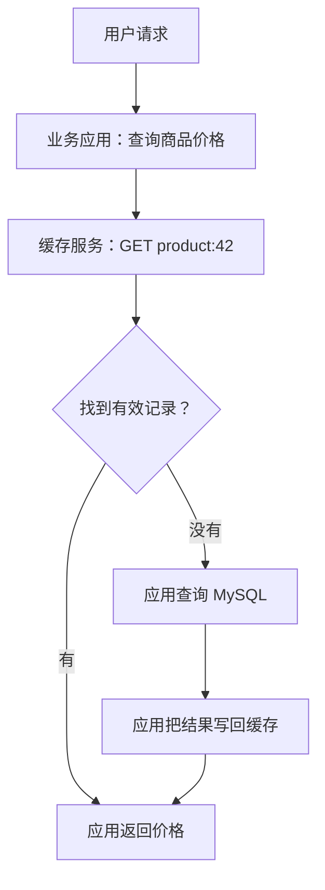
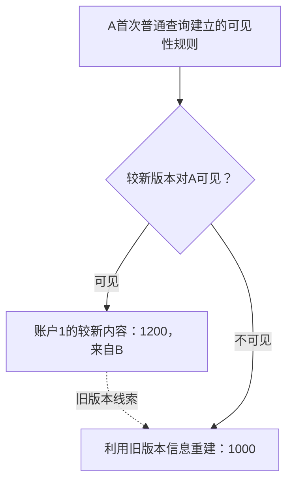

# Week13 Day6：缓存未命中以后，数据库怎样接住请求

> 版本：2026-10-21，依据Day5整日100/100后的实际进度生成。
> 今天是概念与SQL观察日：不新增C++组件，不改Mini Redis，不重画Reactor流程。
> 先完成R1再停下；R2/R3将在R1检阅后依据你的实际结果定向校准。

**今天做两件事：看清缓存失效怎样把压力传给数据库，再用两个MySQL窗口观察一组修改怎样提交、读到哪个版本、什么时候需要等待。**

最后留下几组真实SQL结果和自己的解释即可。一份你自己整理的`day6_note.md`足够，不另交总结文件，也不用手写并发测试框架。

[TOC]

# Part 1：前情提要与必要术语

## 1. 从已经完成的TTL往外看一层

你的Day5已经解决了一个具体问题：即使客户端不发请求，owner也能从`poll_once(50)`返回，在时间到达后调用`sweep_expired(16)`，主动回收过期记录。

最后的100ms从**上一次维护完成之后**重新安排。它控制维护机会的频率；16限制单轮检查条目数。今天直接复用这些结论，不再写一套清理器。

现在换一个业务：商品价格通常从缓存取，缓存没有时再查MySQL。

```text
商品42：缓存里有价格 -> 直接返回
商品42：缓存到期了 -> 应用查MySQL -> 把结果重新放入缓存 -> 返回
```

于是出现一个新问题：**缓存里的记录可以正确过期，但过期后突然到来的数据库请求，谁来控制？**

另一个问题在数据库内部。账户1给账户2转300元，需要两次修改：

```text
账户1：1000 -> 700
账户2：1000 -> 1300
```

只完成第一步就失败，总额便少了300。数据库需要把这两个动作组织成一个整体。今天的SQL实验就围绕这两条记录展开。

## 2. 今天的四个主问题

1. 查不存在的数据、一个热门key过期、大批key同时失效，为什么需要不同保护？
2. 两条`UPDATE`怎样一起保留或一起撤销？
3. B已经提交新余额，A再次查询时应该读到什么？这个答案受什么控制？
4. 普通查询可以返回时，为什么更新同一条记录却可能等待？等待怎样变成死锁？

R1先完成缓存场景和提交/回滚观察，再对第3题作出预测。R2解释读数并补上锁定读，R3做一次有界锁等待，把四个问题接起来。

## 3. 先分清今天图里的三个进程

下面是一个**用于讨论的业务架构**：



顺着图读：应用先问缓存；没有记录时，由**应用**查询MySQL。查询到的结果再由应用放回缓存。这一步叫**cache refill（缓存回填）**。

读到有效缓存叫**cache hit（缓存命中）**；缓存没给出有效记录叫**cache miss（缓存未命中）**。一次miss只是这条路径的分支，是否造成故障，还要看它把多少流量交给下游。

**你的Mini Redis目前是独立KV服务。** 它的`GET`找不到key就返回Null Bulk String，没有查询MySQL或自动回填的代码。图中“业务应用”不是现有message callback新增的职责，今天也不要求把这条架构实现出来。

MySQL实验使用另一个数据库进程。两个终端各运行一个`mysql`客户端，连接同一个数据库实例。每条连接形成一个**session（会话）**，保存自己的事务和会话设置。

# Part 2：教程开始

## Round1：先看业务压力，再亲手观察提交与读取

## 4. 请求的商品根本不存在，为什么每次仍要查库

假设商品999999从未存在。应用查缓存，没有；再查MySQL，也没有；下次同样重复。

```text
请求999999 -> 缓存miss -> MySQL不存在
请求999999 -> 缓存miss -> MySQL不存在
请求999999 -> 缓存miss -> MySQL不存在
```

缓存挡住了常见商品，却挡不住这些无效查询。**反复查询不存在的数据，流量持续到达下游**，这个问题叫**cache penetration（缓存穿透）**。

先看最直接的改动：MySQL明确回答“商品不存在”后，应用把这个结论也缓存一小段时间。下次看到这条特殊记录，就可以直接返回不存在。这叫**negative caching（空结果缓存）**。

这条特殊记录要能与正常商品内容区分。它也应有较短TTL：否则后来新建了同编号商品，旧的“不存在”结论可能继续挡住新数据。数据库超时只说明这次查询失败，不能写成“商品不存在”。

还有两道常见保护：

- 先校验输入。商品编号格式明显非法时，应用直接拒绝。
- 维护一个“这个编号可能存在吗”的紧凑集合。它判断一定不存在时，就不必查库；判断可能存在时，再走正常查询。这种允许误报“可能存在”的结构叫**Bloom filter（布隆过滤器）**。

布隆过滤器不在今天实现。正确维护的标准模型允许false positive（误报存在），但不把已加入元素误判为不存在。若真实商品新增后没有同步加入过滤器，业务仍可能被过时信息挡住；“算法性质”和“数据更新是否及时”是两回事。

## 5. 商品确实存在，只是一个热门key刚刚过期

现在是商品42。它在数据库里存在，并且有很多用户同时访问。

```text
热门价格缓存到期
-> 很多请求同时看到miss
-> 每个请求都各自查询MySQL
-> 同一个商品被重复重建
```

**一个热门key失效后，大量请求同时重建它**，叫**cache breakdown（缓存击穿）**。

一种保护是：同一时刻只让一个请求负责查询商品42并回填，其余请求等待这次结果，或按业务规则使用旧值。这里协调的是**同一个key的重建工作**，不是把整个缓存的所有请求排成一队。

另一种思路是在真正到期前刷新热门内容。若允许短暂旧值，可以把“对外还能使用多久”和“什么时候开始更新”分开设计。是否允许旧价格，必须先由业务决定。

这些策略会带来等待、刷新失败、旧值时效等新问题。今天理解它们分别减少了哪一类重复工作，不实现分布式锁，也不把“加个锁”当成所有场景的答案。

## 6. 许多key一起失效，或整个缓存不可用

假设应用在12:00导入十万个商品，全部设置一小时TTL。13:00附近，它们集中到期。大量不同商品的请求一起转向数据库。

另一个起点是缓存服务故障：原本能命中的商品也全部走向下游。

**大量缓存同时失去分流作用，下游承受集中流量**，叫**cache avalanche（缓存雪崩）**。

两种起因对应不同动作：

| 具体起因 | 可以先做什么 | 这一步解决什么 |
|---|---|---|
| 大量key在相近时刻到期 | 让TTL在业务允许的区间内错开，例如3600至3900秒 | 摊开集中重建时刻 |
| 缓存服务不可用 | 限制进入数据库的请求量，必要时返回简化结果或服务繁忙 | 保护下游容量 |
| 两者都可能发生 | 预先准备容量、监控与故障切换方案 | 降低故障传播范围 |

给TTL加入少量随机差异叫**jitter（抖动）**，这里用它错开到期；它不能让已经宕机的缓存恢复。**限流**控制允许通过的流量，**降级**是在压力下提供较弱但可接受的结果。两者都需要具体业务规则。

这三节共同关心的是：**miss来自哪里、涉及多少key、接下来谁承受工作量。** 不要求背三句定义。外部图解稍后在§19按场景查阅。

## 7. TTL还没到，内存却不够了，能删key吗

你的当前规则是：到达deadline，这条记录就不再有效。这个动作叫**expiration（过期）**，判断依据是时间。

再设想缓存只有有限内存，现有记录都还有效，新内容却放不下。系统可能按策略提前移走一些有效记录，为新内容腾空间。这叫**eviction（淘汰）**，判断依据是内存压力与保留策略。

| 现在的问题 | 处理依据 | 当前Mini Redis |
|---|---|---|
| 验证码已超过有效期 | TTL/deadline | 已实现失效判断与主动回收 |
| 缓存占用超过内存预算 | 内存上限与淘汰策略 | 尚未实现 |

如果需要淘汰，可以倾向移走最近很少使用的记录。**LRU（Least Recently Used，最近最少使用）**关注最近一次使用时间；**LFU（Least Frequently Used，最不经常使用）**关注访问频率。真实Redis使用近似策略，不是要求你在这里实现精确全局排序。

也可以选择**noeviction（不淘汰）**：达到限制后，对需要继续增长内存的写入返回错误，已有数据仍可读取。它不等于服务器停止处理全部命令。

这些是Redis的策略概念，不是给当前`KvStore`追加的任务。`maxmemory`的统计范围也不等于整个进程RSS。[官方淘汰说明](https://redis.io/docs/latest/develop/reference/eviction/)

## 8. 账户转账：为什么两条UPDATE需要一个共同边界

回到两条账户记录，各有1000元。账户1向账户2转300元，需要先扣300，再加300。

SQL里的`UPDATE`负责修改已有行。先看下面的语法示意，暂不执行；§9会准备这张账户表：

```sql
UPDATE accounts SET balance = balance - 300 WHERE id = 1;
```

`WHERE id = 1`指定账户1；右侧`balance - 300`从它当前的余额计算新值。语句成功会报告受影响行数，余额要再用`SELECT`查询。

问题在于：第一条成功，第二条还没成功，不能把这半笔转账当成最终结果。我们需要先划出一个范围，里面的修改最后一起保留，或者一起撤销。**这个范围就是transaction（事务）。**

今天只用三个控制语句：

| SQL | 当前动作 | 执行后怎样继续 |
|---|---|---|
| `START TRANSACTION;` | 在当前连接开始一组事务操作 | 后续修改暂不逐条提交 |
| `COMMIT;` | 提交这一组修改，结束本次事务 | 新事务按自己的可见性规则读取已提交结果 |
| `ROLLBACK;` | 撤销当前事务尚未提交的修改，结束本次事务 | 重新查询，确认原记录恢复 |

这三个语句通常返回`Query OK`，不会把账户表当作返回值。它们管理的是**当前会话**的事务，不会替另一个窗口提交。

默认的**autocommit（自动提交）**让事务外的一条成功修改独立提交。今天保留`autocommit=1`，用明确的`START TRANSACTION`圈住多条SQL。`@@autocommit`仍可能显示1，这不代表刚开始的显式事务不存在。[提交与回滚规则](https://dev.mysql.com/doc/refman/8.0/en/innodb-autocommit-commit-rollback.html)

## 9. 复用Day1环境，给Day6一张独立实验表

### 9.1 先准备表，不动Day1的索引实验

本日沿用Ubuntu中的MySQL **8.0.42 / InnoDB**、原Unix socket和`mysql_lab.sh`，不安装新数据库，不改系统服务。

新的[建表文件](../../database_labs/week13/mysql_transaction_setup.sql)只准备`infra_transaction_lab.accounts`，写入账户1和2，各1000元。`infra_index_lab.course_scores`、原索引、你的`a.txt`与`mysql_index_lab.sql`保持不变。

在Ubuntu shell中运行：

```bash
cd ~/code/system-learning/database_labs/week13
bash mysql_lab.sh start
bash mysql_lab.sh sql < mysql_transaction_setup.sql
```

正常应看到版本或`MYSQL LAB ALREADY RUNNING`，然后看到`id=1/2`、`balance=1000/1000`。**先确认两条初始记录，再开始实验。**

脚本里的`CHECK (balance >= 0)`要求每条余额非负；`ENGINE=InnoDB`选择支持本日事务机制的存储引擎。`CREATE ... IF NOT EXISTS`让已有库表保留，随后只重设两条教学账户。完整建表语法是提供的脚手架，不要求手抄。

**需要重跑setup时，先在A、B两个窗口分别`ROLLBACK;`并退出。** 它会重设这两条账户；不要在观察中途重跑，也不要重跑Day1的`mysql_index_setup.sql`。建表等语句可能隐式提交，因此建表步骤放在事务实验外。

### 9.2 打开两个一直保留的客户端

在两个Ubuntu终端分别运行：

```bash
cd ~/code/system-learning/database_labs/week13
bash mysql_lab.sh sql
```

把左窗口记作A、右窗口记作B。进入`mysql>`后，**两边各执行一次**：

```sql
USE infra_transaction_lab;
ROLLBACK;
SET SESSION autocommit = 1;
SET SESSION TRANSACTION ISOLATION LEVEL REPEATABLE READ;
SET SESSION innodb_lock_wait_timeout = 3;
SELECT CONNECTION_ID(), @@transaction_isolation, @@autocommit;
```

`USE`选择当前库。`SESSION`说明设置只作用于当前连接；`CONNECTION_ID()`返回这条连接的编号，两个窗口必须不同。其余两列应是`REPEATABLE-READ`和1。

这里先选定**REPEATABLE READ（可重复读，简称RR）隔离级别**。隔离级别规定并发事务之间的读取与修改规则；现在只把它作为实验条件，具体怎样影响读数，先观察再解释。

最后一项把等待InnoDB行锁的时间限制为约3秒，后面避免无限挂住。它不是所有SQL的总执行时限。

**后面A/B交错步骤必须在这两个持续连接里执行。** 每次`bash mysql_lab.sh sql -e ...`都会新建客户端连接，不能替代跨步骤保留的事务。SQL以分号结束；若只有`->`续行提示，先检查是否漏了分号。输入错了可用`\c`取消当前尚未发送的语句。

## 10. 先比较ROLLBACK和COMMIT

这些步骤先只在A操作，B暂时不动。每个查询前先写下你预计的两条余额，再执行。

### 10.1 修改两条记录，但最后撤销

```sql
START TRANSACTION;
UPDATE accounts SET balance = balance - 300 WHERE id = 1;
UPDATE accounts SET balance = balance + 300 WHERE id = 2;
SELECT id, balance FROM accounts ORDER BY id;
ROLLBACK;
SELECT id, balance FROM accounts ORDER BY id;
```

保留两次查询结果。注意`UPDATE`已执行过，事务内自己的查询也能观察到修改；再看`ROLLBACK`结束以后留下什么。

### 10.2 相同修改，这次提交

```sql
START TRANSACTION;
UPDATE accounts SET balance = balance - 300 WHERE id = 1;
UPDATE accounts SET balance = balance + 300 WHERE id = 2;
COMMIT;
SELECT id, balance FROM accounts ORDER BY id;
```

比较两轮最后结果。今天不用故意断电证明持久性，提交后的普通查询只证明这次提交路径，不证明完整崩溃恢复。

### 10.3 为双会话观察恢复固定起点

A、B先分别执行`ROLLBACK;`。然后只在A执行：

```sql
START TRANSACTION;
UPDATE accounts SET balance = 1000 WHERE id IN (1, 2);
COMMIT;
SELECT id, balance FROM accounts ORDER BY id;
```

确认两条都是1000，才进入下一节。这个重设只服务实验对照，不属于业务转账。

## 11. B已经提交，A第二次会读到什么

**先预测，暂时不读R2。** 本轮只改账户1，A不执行任何`UPDATE`。下面按步骤切换窗口，不要把整张表一次粘到某一边。

| 顺序 | 窗口 | 执行动作 |
|---|---|---|
| 1 | A | 开事务，查询账户1，保留事务不结束 |
| 2 | B | 开事务，把账户1改成1200，暂不提交 |
| 3 | A | 再查账户1，记为读数① |
| 4 | B | 提交 |
| 5 | A | 再查账户1，记为读数②，仍不结束事务 |
| 6 | A | 提交，开始新事务，再查账户1，记为读数③，然后结束 |

步骤1，A：

```sql
START TRANSACTION;
SELECT balance FROM accounts WHERE id = 1;
```

步骤2，B：

```sql
START TRANSACTION;
UPDATE accounts SET balance = 1200 WHERE id = 1;
```

步骤3，A。**先预测：会返回一个数，还是需要等B？若返回，会是多少？**

```sql
SELECT balance FROM accounts WHERE id = 1;
```

步骤4，B：

```sql
COMMIT;
```

步骤5，A。**先预测：B已经提交，A的读数②会不会变化？**

```sql
SELECT balance FROM accounts WHERE id = 1;
```

步骤6，A。**先预测：新事务的读数③会是什么？**

```sql
COMMIT;
START TRANSACTION;
SELECT balance FROM accounts WHERE id = 1;
COMMIT;
```

预测错误完全正常。保留“原预测 -> 实际结果 -> 待解释问题”，不要把原预测擦掉。连接编号可以不同，但A/B顺序、隔离级别和是否提交必须相同。

## 12. R1停止点

**到这里停止阅读，先交R1。**

需要的证据只有：

1. §10的回滚与提交结果。
2. §11的原预测、三个真实读数，以及两条不同连接编号。
3. 用自己的话区分§4～§6中三种流量：数据不存在、单个热点失效、大范围失去缓存；任选一个说明保护动作减少了什么工作。

结果可以直接保存在一份note里。终端输出、SQL注释、口述可以互相补足，不要求重写已解释清楚的内容。

R1不要求先会MVCC、Read View或锁分类。它要证明你确实跑过两条会话，而不是先背出R2的答案。当前不需要新增GTest，不需要运行C++构建，也不改`KvStore`。

---

## Round2：解释自己的读数，再让“准备修改”产生锁需求

## 13. 先把两组结果接回一个整体

§10第一轮在A里看到700、1300，回滚后恢复1000、1000。第二轮提交后保留700、1300。

因此两条SQL虽然逐条执行，最后仍由同一个事务边界决定是否保留。**ROLLBACK撤销的是尚未提交的这一组修改；已经提交的上一轮，不会被后来的ROLLBACK撤销。**

转账也要求总额始终符合业务规则。但数据库不会从“有两条UPDATE”自动猜出它们应该一减一加。应用仍要写正确逻辑，数据库约束也只检查已经声明的条件。

现在可以给四个要求命名，它们合称**ACID（事务可靠性的四项性质）**：

| 这笔转账需要什么 | 名称 | 当前怎样理解 |
|---|---|---|
| 两边修改共同保留或撤销 | Atomicity，原子性 | 不能留下半笔已提交转账 |
| 完成后仍满足业务与数据约束 | Consistency，一致性 | 例如总额守恒、余额非负；需要正确逻辑及约束共同维护 |
| 多个会话交错执行仍按约定处理 | Isolation，隔离性 | 读到哪个版本、修改时怎样协调，由隔离机制决定 |
| 成功提交的数据按系统保证恢复保留 | Durability，持久性 | 涉及日志、刷盘配置与硬件；今天没有做崩溃证明 |

这里的“一致性”讨论事务前后的有效状态，与分布式系统里“多个副本什么时候相同”不是同一个问题。今天也没有通过两次查询证明全部ACID性质。[InnoDB与ACID](https://dev.mysql.com/doc/refman/8.0/en/mysql-acid.html)

## 14. A没有拦住B，为什么还能读到1000

先对照你的§11结果。在本课固定条件下，读数①、②都是1000，读数③是1200。

```text
A第一次普通查询：1000
B写入1200，但尚未提交
A普通查询：1000
B提交1200
A在原事务中普通查询：1000
A结束旧事务，再开新事务查询：1200
```

如果每次都只读当前那一个数，B提交后A就应该立刻变成1200。实验说明，数据库还保留了能够恢复旧内容的信息，并且A有一套“这次允许看哪些修改”的规则。

把它画成当前例子的简化关系：



图里的虚线表示“可以依据旧信息找回先前内容”，实线表示本次读取的选择。虚线不是读到1200后还必须执行的一步，也不表示账户行同时存着两份完整表。

InnoDB用**undo log（撤销日志）**保存恢复先前行内容所需的信息；它既支持回滚，也能帮助读取旧版本。

**保留记录的多个版本，再按读取者的规则挑选可见版本**，叫**MVCC（Multi-Version Concurrency Control，多版本并发控制）**。[InnoDB版本信息](https://dev.mysql.com/doc/refman/8.0/en/innodb-multi-versioning.html)

这里还剩一个问题：A怎样判断“1200是自己这次应该看到的版本”？

它需要记下建立读取视角时，哪些事务还在进行、哪些修改已经可以读取。InnoDB把这样的可见性信息组织为**Read View（读视图）**。读取记录时，结合版本所属事务与这份视图判断；较新版本不符合，就沿旧版本信息继续找。

所以三者各有作用：

```text
版本信息：以前是什么内容
Read View：当前这次读取允许看哪些事务的修改
查询：用这套规则选择一个可见版本，返回balance
```

**snapshot（快照）描述这个读取视角，不是启动事务时复制整张accounts表。** 今天先把这条判断链走通，不要求记住Read View的全部内部字段。

## 15. 快照在什么时候建立，为什么不能只说“事务开始时”

本课使用普通`START TRANSACTION`，随后第一次执行普通`SELECT`。在RR下，**第一次一致性读建立快照，后续一致性读复用它**。“一致性读”在这里就是按可见性规则读取版本的普通非锁定查询。

B之后提交，不会让A原有的Read View自动换成新的。A结束事务，再进行新的读取，才换一份读取视角。[MySQL 8.0读取规则](https://dev.mysql.com/doc/refman/8.0/en/innodb-consistent-read.html)

两个需要就近记住的条件：

- A在本实验里没有修改账户1。事务通常能看到自己的修改，不能把本课结果背成“RR里所有查询永远返回相同值”。
- 普通`START TRANSACTION`本身不等于立即建立这个快照。若A先START，B随后提交，A再第一次普通查询，起点便不同。`WITH CONSISTENT SNAPSHOT`是另一种明确请求建立快照的用法，今天不额外练它。

**READ COMMITTED（读已提交，简称RC）**采用另一种时机：每次一致性读建立新的读取视角。因此在相同交错下，B提交之后A再次普通查询，可以读到1200。

R3只做一次RR/RC的单变量对照。**隔离级别改变的是并发规则，不是把数据库从单线程切换成多线程。** MySQL提供这两个级别之外的其他选择，今天不展开四级现象矩阵。

## 16. 我准备依据余额修改记录，怎样避免别人抢先改

普通查询返回一个版本，但业务若要“读余额 -> 判断够不够 -> 扣款”，读取后到写入前还有时间。另一个事务可能在中间修改同一账户。

此时需要一个新动作：**读出当前可用的记录，同时把这条记录的修改权占住，直到本次事务结束。** SQL用`SELECT ... FOR UPDATE`表达这次**locking read（锁定读）**。

它仍然返回查询行，但还会取得相应锁。`COMMIT`或`ROLLBACK`释放锁，之后其他事务才可以继续需要冲突锁的修改。若别人已经占有冲突锁，本次也可能等待。[锁定读规则](https://dev.mysql.com/doc/refman/8.0/en/innodb-locking-reads.html)

先在两个窗口各`ROLLBACK;`，用§10.3在A把两条记录恢复为1000。然后按下面顺序操作。

A：

```sql
START TRANSACTION;
SELECT balance FROM accounts WHERE id = 1;
```

B：

```sql
START TRANSACTION;
UPDATE accounts SET balance = 1200 WHERE id = 1;
COMMIT;
```

A里先预测两条查询的区别，再运行：

```sql
SELECT balance FROM accounts WHERE id = 1;
SELECT balance FROM accounts WHERE id = 1 FOR UPDATE;
ROLLBACK;
```

本例普通查询仍返回1000，锁定读返回1200。它要读取并锁住当前可用记录，不能拿旧快照里的1000当成当前可修改状态。**这类读取通常也叫current read（当前读）。** 这里“当前”不代表可以读取另一个事务尚未提交的1200；遇到未提交冲突仍可能先等。

这组SQL用于区分两种语义，不是建议业务随意混用新旧视角。`UPDATE`也不是先按旧快照取数再盲写；它会按自己的加锁与修改规则执行。

今天精确查询**已存在的主键id=1**，先观察对应索引记录的锁。范围查询可能涉及间隙等其他范围，留到后续锁专题，不把所有`FOR UPDATE`都说成“只锁一行”。

## 17. R2停一下：版本选择和修改协调分开了

走到这里，你应该能沿自己的结果说清两句话：

```text
普通SELECT：按当前读取视角挑选可见版本。
FOR UPDATE：读取当前可用记录，并占住相应修改锁直到事务结束。
```

**先能解释1000/1200的来源，再进入R3。** 这是阅读节奏上的暂停，不新增一份作业；R1通过后会按你的真实读数和疑问定向讲解。

---

## Round3：一次对照、一次等待，把机制留下证据

## 18. 最后只做两组短观察

下面验证的都是前面已经讲过的规则，不是新增一串功能。继续用同一张表、原A/B两条连接。

### 18.1 只改隔离级别：RR换成RC

两边先`ROLLBACK;`，再在A按§10.3重设余额。两边各执行：

```sql
SET SESSION TRANSACTION ISOLATION LEVEL READ COMMITTED;
SELECT @@transaction_isolation;
```

应显示`READ-COMMITTED`。**重新执行§11完全相同的六步**，尤其保留B尚未提交时的查询、B提交后的查询和A新事务的查询。

比较原RR的三个读数和本次RC的三个读数。预期RC为1000、1200、1200：变化发生在“B提交后，A原事务再次普通读取”这一处。

结束后两边各执行：

```sql
ROLLBACK;
SET SESSION TRANSACTION ISOLATION LEVEL REPEATABLE READ;
```

不要在未结束的事务里更换条件，也不要同时换查询、账户和隔离级别，否则难以判断是哪个变化造成了结果。

### 18.2 A占住账户1，B的普通读与UPDATE有什么区别

两边各`ROLLBACK;`，A按§10.3重设为1000。然后A：

```sql
START TRANSACTION;
SELECT balance FROM accounts WHERE id = 1 FOR UPDATE;
```

**A保留事务，不提交。** 此时切到B：

```sql
SET SESSION innodb_lock_wait_timeout = 3;
START TRANSACTION;
SELECT balance FROM accounts WHERE id = 1;
UPDATE accounts SET balance = balance + 1 WHERE id = 1;
```

先预测：哪条语句可以返回，哪条需要等待？运行时A不要抢先结束。预期普通查询返回1000，更新等待，约3秒后出现：

```text
ERROR 1205 (HY000): Lock wait timeout exceeded; try restarting transaction
```

**这是本节唯一刻意构造的错误。** 它说明B没有取得所需锁。错误后在B明确执行：

```sql
ROLLBACK;
```

再在A执行：

```sql
COMMIT;
```

最后回到B：

```sql
START TRANSACTION;
UPDATE accounts SET balance = balance + 1 WHERE id = 1;
SELECT balance FROM accounts WHERE id = 1;
ROLLBACK;
SELECT balance FROM accounts WHERE id = 1;
```

这次更新应成功；事务内读到1001，回滚后1000。它证明先前阻挡来自A尚未释放的锁，而不是这条`UPDATE`语法错误。

**默认情况下，锁等待超时通常只回滚失败的那条语句。** 所以本课显式`ROLLBACK`结束B整组事务，避免把早先成功的动作遗留在事务里。本实验实例未启用`innodb_rollback_on_timeout`；其他配置下要重新核对行为。[InnoDB错误处理](https://dev.mysql.com/doc/refman/8.0/en/innodb-error-handling.html)

普通一致性读在本例中不需要等A的行修改锁，不等于它完全不涉及任何类型的锁。今天观察的是这条已存在记录的读写关系。

### 18.3 等待怎样变成死锁

刚才只有B等A。A一旦结束，B就有机会继续。

如果A已经占有账户1，B已经占有账户2；A又申请账户2，B又申请账户1，会形成下面的环：


双方都等对方先释放，单靠继续等不能推进。**这种循环等待叫deadlock（死锁）。** 它和§18.2单向等待到超时不同。

InnoDB检测到死锁后会选择一个事务回滚。应用需要能够重新执行整个事务；不能只补上最后那条SQL，就当先前已回滚的动作还在。本日不要求你再写死锁并发脚本，也不要求预测固定由A还是B被选中。[死锁处理](https://dev.mysql.com/doc/refman/8.0/en/innodb-deadlocks-handling.html)

让事务尽量短、按统一账户顺序申请锁，都能减少这类冲突。它们是设计取舍，不是“有事务就不会死锁”的保证。

## 19. 现在去读图解，补的是对应机制，不是另开一门课

**先完成对应实验，再查下面的小节。** 这些是当天的定向补课提醒；笔记只加一个真正有用的新解释，不再抄一份文章。

| 何时读 | 阅读位置 | 用它回答什么 | 今天停在哪里 |
|---|---|---|---|
| §4～§6讲完后 | [什么是缓存雪崩、击穿、穿透？](https://xiaolincoding.com/redis/cluster/cache_problem.html)中的三个同名小节 | 每种保护在挡哪一种下游流量 | 看懂场景图与对应策略；不接着实现集群或读缓存一致性长专题 |
| §14～§16讲完后 | [事务隔离级别是怎么实现的？](https://xiaolincoding.com/mysql/transaction/mvcc.html)的“事务有哪些特性？”、“事务的隔离级别有哪些？”、“Read View 在 MVCC 里如何工作的？”及RR/RC示例图 | 把自己的1000/1200放回版本与可见性图中 | 内部字段先认用途；幻读/next-key lock综合题今天不展开 |
| §18.2观察后 | [MySQL有哪些锁？](https://www.xiaolincoding.com/mysql/lock/mysql_lock.html)的“行级锁”开头和“Record Lock（记录锁）” | 把主键id=1的等待联系到索引记录 | 到记录锁为止，不继续穷举间隙锁、临键锁与意向锁兼容表 |

读图解时校准一个细节：某些概括会写“RR在事务启动时生成Read View”。本课普通`START TRANSACTION`场景，应按官方资料理解为**第一次一致性读建立**。本课也没有声明所有锁定读都使用同一种范围锁；锁范围还受查询条件和索引等因素影响。

这里阅读帮助理解，不把外部整章通关变成Day6的额外门槛。redo/undo/binlog的完整分工留给Week14结合恢复讲；今天只用到undo支持回滚和重建旧版本这一层。

# Part 3：收尾、验证与验收

## 20. 今天交付什么，怎样结束实验

| 层次 | 今天必须留下什么 | 可以直接复用或委托什么 |
|---|---|---|
| 业务场景 | 区分三种流量问题；解释TTL过期与内存淘汰的依据 | 本文图，不用再手画相同图 |
| R1 | 提交/回滚结果、双会话RR预测与实际读数 | 已提供setup，不手写建库脚手架 |
| R2/R3 | 能解释版本选择；RC对照、锁等待/释放后的真实结果 | 原SQL与终端输出，不写自动化runner |
| 笔记 | 自己真正新增的理解、预测差异和疑问 | SQL注释或口述可等效，不重复创建summary |

实验成功靠具体结果判断：初始记录、隔离级别、连接身份、执行顺序和读数彼此对得上。**打印一个PASS不能代替这些证据。** SQL交互实验没有额外要求你实现自定义退出码程序。

收尾时两个`mysql>`窗口都执行：

```sql
ROLLBACK;
exit
```

回到shell后，如果这份教学实例没有被其他实验使用，只在一个窗口运行：

```bash
bash mysql_lab.sh stop
```

这会停止本地教学MySQL实例，保留数据，下次可以再启动。它不用于停止你的Mini Redis。

### 遇到异常怎样处理

| 现象 | 先做什么 |
|---|---|
| 启动/连接失败，例如`ERROR 2002` | 先确认工作目录与`start`输出；检查`~/.local/share/gpt-infra/mysql-lab/mysql.log`，不要修改系统MySQL或换端口安装另一套 |
| setup后不是两条1000 | 停在环境准备；确认库名和两边没有遗留事务，不继续套用预期结果 |
| A/B连接编号相同 | 检查是否其实在同一客户端里；重新建立两条独立连接 |
| §11结果不符 | 保留输出，逐项核对隔离级别、首次查询和COMMIT顺序；不要先改成答案 |
| §18.2以外出现锁等待或1205 | 两边明确ROLLBACK，记录当时步骤，再从固定起点重做；不要一律当作正常 |
| 出现1213死锁错误 | 当前不是安排好的死锁实测；记录交错，确认是否遗留操作，再重新开始完整事务 |

文件方式运行普通SQL出错时，保留非零退出码，不加`--force`把失败刷过去。§18.2在交互客户端里观察刻意的1205，然后明确清理事务；这是有预期的单独错误场景。

## 21. 六个收口问题

允许口述，已有实验和注释可等效，不要求再写一套答案。

1. 重复请求不存在的商品，与一个热门商品刚过期，分别让数据库多做了什么？为什么保护方式不同？
2. `EXPIRE`按时删除记录，为什么仍然不能证明缓存不会雪崩？内存淘汰又在解决什么问题？
3. 两条转账UPDATE都执行过，ROLLBACK还能撤销什么？COMMIT以后再ROLLBACK呢？
4. RR实验里B提交后，A为什么仍是1000？换成RC，哪一次读数改变？
5. 本例普通SELECT与FOR UPDATE怎样读取、怎样影响后续修改？1205发生后为什么还明确ROLLBACK？
6. Mini Redis命令串行执行，与MySQL的事务隔离为什么不能画等号？

第6题可以从自己的代码出发：单线程command dispatcher让一条命令完成后再进入下一条；它不自动提供“跨多条命令共同提交/回滚”、多个会话各自的版本视角或重启恢复。你本周实现的是TTL与维护，不是数据库全部事务能力。

今天也不把MySQL的Read View等同于Day3的时间快照：后者让一条命令使用同一个`t`判断期限，前者选择并发事务的可见记录版本。两者都要求明确观察范围，但保存的对象与规则不同。

## 22. 今天到这里，下一天只收新增关系

**今天新增的是“缓存外的下游压力”和“数据库内的事务视角”，不是又一版parser。** 先完成R1，休息后再读后半，整日可以拆成两次。

今天不实现MySQL驱动、Bloom filter、分布式锁、缓存淘汰、`MULTI/EXEC`或事务引擎。没有新C++修改，因此不为Day6新增构建目标或GTest。

Day7回到当前Mini Redis V2，收住TTL、重设期限、分批维护与网络证据。旧Reactor/RESP流程不重画；虚函数补缺仍按原周规划放在V2核心收口之后，不提前挤进今天。

本课SQL在与现有环境相同版本的私有MySQL实例中验证，属于**教材可运行性检查**。它不代替你的学习结果，也不提前登记Day6通过。MySQL事务这里只完成第一层；Week14会结合持久化补日志与恢复，复杂范围锁和面试追问继续按项目需要定向补齐。
