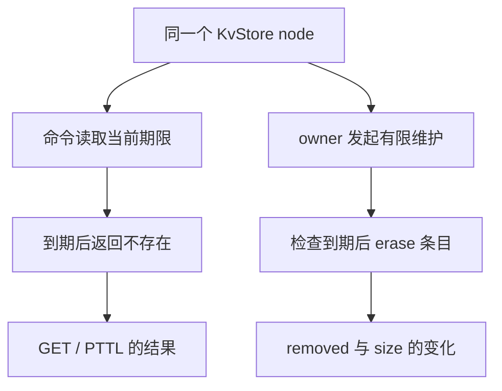

# Week13 Day7：收口 TTL V2，再看懂基类引用到底调用谁

> 生成：2026-10-23。Day1～Day6整日已通过；Day6为96/100，R1历史98/100。
> 今天先完成Mini Redis V2的新增关系收口，再补类、继承与虚函数。
> 项目部分复用已有代码和证据；语法部分只做一个独立的小实验，可分两次学习。
> 本文已生成，Day7尚未验收，Week13尚未整周通过。理论线T10已通过，下一步T11。
> 2026-10-26定向修订：保留本周收口与语法范围，重新展开每次调用、对象关系和术语的出现顺序。

[TOC]

---

# Part 1：前情提要与必要术语

## 1. 今天要得到什么

**先说明你的Mini Redis怎样让数据按时失效、随后回收；再用一个小程序看清：同一个函数接到不同对象，怎样分别打印文字和累加字节。**

项目部分从你已经写好的行为出发。假设可控时钟当前为1000ms，`code`的期限为1100ms：

```text
now = 1099：GET code 仍能返回内容
now = 1100：GET code 应按不存在处理
此时记录可能仍在 map 中
稍后的 sweep 检查到它：从 map 删除这条记录
```

这几步分别由谁完成，你已经在Day2～Day5写过。今天把它们接成一段能独立说明的因果链，已有笔记和口述可以直接作为证据。

本周收口以后，再处理你之前明确提过的C++缺口。设想有两种对象，都能处理一段文字：一种打印文字，另一种只统计字节。我们希望调用者统一写一次`write(text)`，实际工作由传入的对象决定。后半就沿这个问题讲继承与虚函数。

建议分两段：V2收口约30～45分钟；语法补缺约90～150分钟，可以另找一次完整精力来做。时间是阅读建议，完成度看理解与证据。

## 2. 从你的真实进度接起

本次生成已只读核对Ubuntu原工程：

```text
/home/xgf/code/system-learning/cpp/week10
```

当前实现已经具备下面这些能力：

| 你已经完成的部分 | 今天直接复用什么 |
|---|---|
| `KvStore::node`保存`value`和`deadline` | `-1`表示无期限，其他合法期限与当前毫秒时刻比较 |
| `EXPIRE/PTTL`及命令内统一取时 | 秒转毫秒、期限范围检查、重复key语义与错误边界 |
| `sweep_expired()` | 自有string记录排序边界，每次用`upper_bound()`重新定位 |
| 原服务器维护入口 | `poll_once(50)`，到时只清理一次，预算16条，完成后再安排100ms |
| Day1与Day6数据库观察 | 查询路径、提交/回滚，以及RR/RC、锁等待的理解 |

Day5最终验收已有完整构建、CTest 124/124、相关ASan/UBSan和真实网络证据。包括无人访问时回收、覆盖清旧期限、续期、错误后继续，以及37条记录按16/16/5检查回收。这些标为**已有验收证据**，不会因为今天生成教程就变成今天的新运行。

你最新Day6笔记已经把Undo中的事务写成“修改者”，超时后的处理也改为`ROLLBACK`。今天沿最新版继续。RR的范围只需保留一句：**本例A自己不改账户1时，重复普通一致性读复用旧视角；本事务自己的修改仍可见。**

## 3. 四个主问题

1. 一条记录已经不能读取，却仍占着map条目，这两个状态分别由谁改变？
2. SET、DEL、再次EXPIRE以后，清理为什么仍能依据当前记录正确工作？
3. 网络等待、维护间隔、检查预算分别控制什么，已有证据支持哪些结论？
4. 同一个函数接到打印对象或计数对象时，怎样分别做对工作？如果还要负责保存、销毁这些对象，又需要什么？

前三个属于V2出口，第四个属于另记的基础补缺。V2已经成立的正确性不会因为语法补缺尚未做完而被撤销；补缺仍保留为明确待完成项，最迟Week16投递准备前闭环。

今天暂时只需唤起两个已有词：**deadline（到期时刻）决定记录何时失效；sweep（巡检清理）在获得执行机会时检查并回收一批记录。** 新的C++词放在具体调用出现之后解释。

---

# Part 2：教程开始

## Round1：把本周新增关系说清楚

## 4. R1的产出：沿一条记录走完，不再画全服务器

打开原来的`src/kv_store.cpp`、`src/command_dispatcher.cpp`和`apps/mini_redis_server.cpp`。先用它们说明下面这条短链：

```text
客户端指定有效时长
-> command handler 解释参数
-> KvStore 更新当前记录的期限
-> 后续命令判断这份内容是否仍有效
-> owner 在维护机会中回收已到期记录
```

输入仍来自已经通过的RESP parser；回复仍交给原Connection发送。今天的变化集中在进程内的应用层与store。TCP负责传字节，操作系统提供等待和收发能力；key的有效期由你的用户态程序决定。

R1可以用口述、已有note中的具体段落，或一份很短的新增笔记交付。下面四项是检查范围，**已经能用旧证据直接说明的项只引用位置，不重新抄答案**。不要求新增测试或生产代码。

### 4.1 同一个key，先失效，后回收

假设`code`是map中的唯一记录，`value="v1"`、`deadline=1100`。可控时钟从1099推进到1100，期间没有其他操作。

请分别判断：`get("code")`、`pttl("code")`、`size()`在1100时表达什么？随后调用一次预算为1的维护，会改变哪个事实？

解释时把“业务上能不能用”和“容器里有没有条目”分开。指到你的实现即可，无须再写一个模拟循环。

### 4.2 旧期限到达时，现在已经存着新值

沿同一条记录改变一个条件：在1090时执行普通`SET code v2`，然后时间来到1100。

请说明SET改了node中的哪些内容，维护随后读取哪一份期限。如果改成1090时续期到1300，判断依据又是什么？

最后关联你Day4笔记里的数轴理解：如果清理保存的边界key已被外部DEL删掉，为什么下一次仍能找到后继？原来的iterator方案依赖了什么？

### 4.3 客户端不说话，谁还能执行维护

从你当前的`for (;;)`里指出：owner在哪一行等待，何时回来，在哪一行判断维护时间。

再说明50ms、100ms、16各自控制什么。这里不要求重新观察全套网络场景。引用Day5已有的“先看到删除日志、之后才GET”和双连接PING即可。

### 4.4 谁拥有这份时间状态

只追踪四个对象：node中的期限、store保存的时钟回调、命令临时取得的时刻、owner的`next_sweep_at`。

说明谁保存它、谁使用它，为什么EXISTS同一条命令可以重复用一个时刻，而owner又需要单独记住下一次维护机会。

## 5. 到这里停止阅读，先交R1

**R1只验收V2新增关系。** 你不需要先读虚函数才能提交，也不需要新建一份周总结来重复note。

本轮通过依据是：能沿自己的代码解释有效性、当前node状态、跨调用位置和维护机会；本周已通过的实现与测试继续作为依据。如果某一处解释卡住，再针对那一处读后半，不把整周重新做一遍。

后续正式检阅R1时，会再次读取你的最新源码、note和本文件增补，再定向校准R2/R3。下面是生成时按当前实现准备的解释。

---

## Round2：先收住V2，再补统一调用的语言机制

## 6. 命令查询和定期清理，怎样使用同一份记录

### 6.1 命令先判断能否使用，维护负责回收

你的`get()`找到node以后读取当前时刻。时刻已经到达期限，就返回`std::nullopt`；这个const成员函数并不erase条目。`pttl()`对同一失效状态返回`-2`。`size()`直接返回`data_.size()`，统计物理条目。

所以§4.1里，到1100时GET/PTTL已经报告失效，size仍然可以是1。维护检查到同一个node后才erase，size变为0。

**命令结果证明有效期规则，删除计数和size变化证明回收。** 你原来的网络checker先等`removed`和size变化，再发GET，这个顺序正是为了区分两件事。



图的两条分支都访问同一份node。在你的单线程owner里，它们按执行顺序发生；图表示两个调用入口，并不表示另起一个清理线程。

### 6.2 清理检查当前node，所以覆盖和续期自然生效

你的SET执行`data_[key]=node{value,-1}`。覆盖后node已经变成`v2`和无期限；1100只是旧内容曾经的期限，当前node不再保留它。

续期则更新当前node的deadline。清理随后看到1300，就根据1300判断。**清理保存的是遍历位置，期限始终从当前node读取。** 这解释了为什么当前设计不需要另一份旧到期删除计划。

### 6.3 保存key，是保存排序边界

你在Day4用数轴说明得很清楚：保存100表示“上一轮检查到这个边界”，随后在当前集合中寻找大于100的最小值。对应到代码，就是保存独立string，再调用`upper_bound(cursor)`。

假设上一轮最后检查`"b"`，外部DEL随后删掉`"b"`。下一轮仍然可以用值`"b"`查询当前map里的严格后继。这个string独立存在，所以不需要原node继续活着。

你当前初值为空string，到末尾就绕回begin。空key本身仍是合法数据；初始边界可以让它在绕回时被检查。稳定有限集合上，持续推进和不重复检查的证据已有Day4测试覆盖。数轴类比对应**排序关系**；字符串`"10"`和`"2"`按字符串规则排序，不能当成整数10和2。

### 6.4 key是否到期，与何时再清理一次，是两个判断

先沿你的代码问两个具体问题。

`code`的deadline是1100，store这次读到1100，便能判断它已失效。这里需要的是**记录期限和当前时刻处于同一套毫秒坐标中**。

owner却在问另一件事：上次清理刚结束，要等约100ms再允许下一次。它把这个未来时刻保存在`next_sweep_at`，每次poll回来比较一次。即使这一轮没有key到期，它也仍需要控制检查频率。

再把四个位置放回各自的问题：

| 位置 | 保存或取得的值 | 用它回答什么 |
|---|---|---|
| `node.deadline` | store时钟体系中的毫秒期限 | 这条记录现在是否有效 |
| `now_` | 可调用的取时函数 | 这次检查采用哪个当前时刻 |
| handler中的`now_ms` | 本条命令读出的一次时刻 | 多个key是否用同一时刻判断 |
| owner的`next_sweep_at` | steady_clock的下次允许时刻 | 现在是否该启动一轮维护 |

你的默认store clock从构造时保存的起点计算经过的毫秒。handler取到这个毫秒读数后，把同一个值传给各次`*_at`调用，所以一条EXISTS不会对两个key使用两个时刻。

owner直接保存`steady_clock`时间点，并和同类时间点比较。**store管数据在此刻是否有效，owner管此刻是否启动检查。** 它们不用互相减出一个差值。

当前主循环顺序是：poll返回，必要时维护，随后处理pending close。关闭清理仍在本轮事件分发返回以后执行；教程按你的实际顺序描述。

## 7. 现在能怎样介绍V2

你可以用自己的话把结果压缩为：原RESP String KV增加有效期，命令判断与主动回收共用当前node；用可控时钟证明边界，用真实TCP证明维护接入。给出证据时，再定位到具体层。

| 层次 | 已有证据 | 还不能由它推出什么 |
|---|---|---|
| store/命令 | 到期边界、覆盖续期、范围错误、命令一次取时 | 所有Redis选项都兼容 |
| sweep | 预算、推进、外部删除和当前node判断 | 整个请求路径已有延迟上界 |
| 网络 | idle回收、活跃时维护、错误后继续、长连接保留 | 已实现内存淘汰或下游重建协调 |
| 工程 | 已有完整回归及相关sanitizer检查 | 所有输入与故障都被穷尽证明 |
| MySQL | 三组EXPLAIN及事务观察/理解 | Mini Redis已经有数据库事务 |

你选择了用map做可控巡检。Redis官方描述了访问时发现过期和主动检查的机制，但具体数据结构和维护策略不是本项目这一圈map扫描。基本命令含义可以对齐，内部实现仍按你自己的证据说明。参考[Redis EXPIRE官方说明](https://redis.io/docs/latest/commands/expire/)中的“Refreshing expires”和“How Redis expires keys”；本次也核对了其[官方文档仓库正文](https://raw.githubusercontent.com/redis/redis-doc/master/commands/expire.md)。只读这两小节，停在“更新期限与两个发现入口”，不扩展成源码课。

`PTTL`的毫秒单位与`-1/-2`含义可在[官方PTTL说明](https://redis.io/docs/latest/commands/pttl/)核对。你当前表示把到达deadline就判为失效；不用为了追逐某个外部实现的毫秒细节，改动已公开并验证的本项目规则。

至此V2主问题已经闭合。接下来切换到原计划中的语法补缺：它回答“同一个调用入口怎样操作不同类型”，不改这套服务器。

## 8. 后半只沿一个场景：同一段文字，交给不同对象处理

后半用一个小场景贯穿：接收一段文字，或者把它打印出来，或者统计它有多少字节。

最终想得到的用法是：

```text
deliver(打印对象, "abc") -> 控制台出现 abc
deliver(计数对象, "abc") -> 那个计数对象增加 3
```

**`deliver`只写一次；换一个传入对象，具体工作跟着改变。** 今天的继承和虚函数就服务于这个目标。

先从“两个计数器各改各的数”开始。接着让不同对象能够交给同一个函数，再解决函数究竟执行哪一份实现，最后处理谁负责销毁。常见的虚表模型在这些行为都看懂以后解释。

本节到§16的完整示例都可单独编译。它们是讲解材料；最终练习只保留§18的一份`virtual_dispatch_lab.cpp`。已经能准确解释的小例子可以读过，不要求逐份抄写。

阅读分两步：先完成§9～§17的“创建 -> 借用 -> 调用 -> 结束”主链；再看附录A里原计划已有的访问规则、重载/隐藏和final对照。附录只调整阅读位置，不删除知识范围，也不增加第二份作业。

## 9. 一个类可以创建两份互不影响的状态

下面的程序创建两个计数器。它只输入固定字符串，输出两个字节计数，没有网络或文件资源。

示例A：`counter_demo.cpp`。

```cpp
#include <cstddef>
#include <iostream>
#include <string>

class Counter {
public:
    explicit Counter(std::size_t start) : bytes_(start) {}

    // Accumulate bytes in this object; text is only borrowed.
    void add(const std::string& text) {
        this->bytes_ += text.size();
    }

    std::size_t bytes() const { return bytes_; }

private:
    std::size_t bytes_;
};

int main() {
    Counter first(0);
    Counter second(10);
    Counter& reference = first;
    reference.add("abc");
    std::cout << first.bytes() << ' ' << second.bytes() << '\n';
}
```

### 9.1 先追踪这次3到底加到了哪里

程序输出`3 10`。沿main看三步：

1. `first(0)`创建第一份计数状态，起点是0；`second(10)`创建第二份，起点是10。
2. `reference`引用first，因此`reference.add("abc")`是在操作first。
3. `"abc"`有3个字节，first从0变成3；这次没有操作second，它仍是10。

**`Counter`规定怎样保存和修改计数；`first`和`second`才是两份具体计数器。** 前者叫**class（类）**，后两者分别叫**object（对象）**。`bytes_`是对象里面保存的成员数据。

### 9.2 同一份add代码，怎样知道这次修改first

进入`reference.add()`时，成员函数中的`this`指向first。因此`this->bytes_`访问的是first自己的计数。若调用`second.add()`，这次的`this`就指向second。

**`this`表示本次成员调用正在操作哪个对象。** 函数代码可以共用，每个对象的计数仍分别保存。这里省略`this->`写成`bytes_`，含义一样。

外部用`add()`和`bytes()`操作计数器，这两个函数放在`public`后，表示外部可以调用。`bytes_`放在`private`后，所以main不能直接写`first.bytes_ = 20`；Counter自己的成员函数可以操作它。

`bytes() const`是只读查询写法：这个函数通过当前对象读取计数，不修改本例的`bytes_`。更完整的访问权限规则按需回查小册，本节先跟住这一次计数。

### 9.3 初始的0和10从哪里来

创建first时，`Counter(std::size_t start)`接到0。冒号后的`bytes_(start)`先把成员初始化为0，然后才执行空的函数体。这个建立对象初始状态的函数叫**constructor（构造函数）**。

`explicit`限制自动转换。例如`Counter first(0)`明确创建计数器，可以；`Counter first = 0`想让整数自动转成Counter，会被拒绝。它不是本次“改谁的计数”的关键，看到两种写法的区别即可。

main结束时，两份局部计数器依次结束。C++在结束对象时执行**destructor（析构函数）**，再结束它的成员；本例编译器提供的析构足够。后面需要通过统一指针销毁不同对象时，我们再专门看析构调用。

## 10. 要让两种处理器共用入口，先让它们有共同的类型

现在有一个打印处理器。我们希望把它交给一个只认识“文字处理器”的函数。给这个共同类型起名`Sink`，表示接收并处理输出内容的一端；`ConsoleSink`表示打印到控制台的具体处理器。先看普通继承能提供什么，暂时还没有虚调用。

示例B：`inheritance_demo.cpp`。

```cpp
#include <iostream>
#include <string>

class Sink {
public:
    explicit Sink(int id) : id_(id) {}
    int id() const { return id_; }
    void write(const std::string&) { std::cout << "Sink\n"; }
private:
    int id_;
};

class ConsoleSink : public Sink {
public:
    ConsoleSink() : Sink(7) {}
    void write(const std::string& text) {
        std::cout << "Console: " << text << '\n';
    }
};

// Borrow the existing object through its Sink interface.
void deliver(Sink& sink, const std::string& text) {
    sink.write(text);
}

int main() {
    ConsoleSink console;
    std::cout << console.id() << '\n';
    console.write("hello");
    deliver(console, "hello");
}
```

输出依次是`7`、`Console: hello`、`Sink`。先看对象关系，再解释最后一行为什么没选Console。

创建`console`时，先执行`Sink(7)`，把编号初始化为7。`console.id()`使用这份编号，所以第一行输出7。直接调用`console.write("hello")`则使用ConsoleSink里写的函数，打印`Console: hello`。

这说明一个console里面既有Sink规定的编号，又能提供ConsoleSink自己的打印操作。代码中的`ConsoleSink : public Sink`建立这种类型关系，它叫**inheritance（继承）**。Sink叫**base class（基类）**；在它之上扩展的ConsoleSink叫**derived class（派生类）**。

```text
console：完整 ConsoleSink 对象
└─ Sink 基类部分：id_ = 7

deliver 的 Sink&：借用上面这一个对象的基类部分
```

这幅图表达一个对象内部的组成，不规定它们在内存中的字节位置。编号属于Sink的private成员，所以ConsoleSink也要通过公开的`id()`读取它。

现在看`deliver(console, "hello")`。`public Sink`允许外部把console交给接收`Sink&`的函数。`&`表明这里借用已有对象：函数里的sink和main里的console，访问的是同一个完整对象中的那份Sink部分。**没有创建第二份编号，也没有复制console。**

那么为什么最后只打印`Sink`？看deliver的函数体：它的参数写成`Sink&`，在这个位置使用的是Sink声明的操作。这里的write是普通成员函数，因此选中`Sink::write`。

**我们已经做到“能把console传进去”，但还没做到“传进去以后执行Console的write”。** 下一节只改变这一点。

访问权限的额外对照放在附录A.1。这里始终显式写`public`，先让同一条调用链完整走通。

## 11. virtual让同一个入口执行实际对象的实现

把共同操作声明为`virtual`，就可以让`deliver()`根据实际对象选择函数。示例C是完整独立程序，沿用上一节的文字处理场景，并增加计数处理器。

示例C：`dispatch_demo.cpp`。

```cpp
#include <cstddef>
#include <iostream>
#include <string>

class Sink {
public:
    virtual void write(const std::string&) { std::cout << "Sink\n"; }
};

class ConsoleSink : public Sink {
public:
    void write(const std::string& text) override {
        std::cout << "Console: " << text << '\n';
    }
};

class CountingSink : public Sink {
public:
    void write(const std::string& text) override { bytes_ += text.size(); }
    std::size_t bytes() const { return bytes_; }
private:
    std::size_t bytes_ = 0;
};

// Both calls use the same interface; no ownership is transferred.
void deliver(Sink& sink, const std::string& text) { sink.write(text); }

int main() {
    ConsoleSink console;
    CountingSink counter;
    deliver(console, "abc");
    deliver(counter, "abc");
    std::cout << "bytes=" << counter.bytes() << '\n';
}
```

### 11.1 第一次借console，第二次借counter

先暂时只看两次调用各做了什么：

```text
deliver(console, "abc")
  -> sink这次借到console
  -> sink.write("abc")进入ConsoleSink的write
  -> 打印 Console: abc

deliver(counter, "abc")
  -> sink这次借到counter
  -> sink.write("abc")进入CountingSink的write
  -> counter内部的bytes_从0变成3
```

最后main读取`counter.bytes()`，所以完整输出是：

```text
Console: abc
bytes=3
```

deliver的代码始终只有同一行`sink.write(text)`。它没有自己判断“是打印还是计数”，区别来自这次传入的对象。

让这个选择成立的关键，是Sink里的write加了`virtual`。**`virtual`把这个成员函数声明为虚函数：像本例这样通过基类引用调用时，使用所借对象为它提供的实现。** ConsoleSink和CountingSink各自提供write，叫对这个虚函数的**override（重写）**。代码里的override还承担一项编译检查，下一节专门看。

### 11.2 既然借到counter，为什么不能直接写sink.bytes()

在main里，`counter.bytes()`合法，因为CountingSink声明了bytes。但在deliver里面，编译器只按参数的`Sink&`检查代码。Sink声明了write，没有声明bytes。

如果在deliver里加入`sink.bytes()`，会编译失败。即使某次真的传进counter，也不能保证每次都有bytes：另一次传进来的console就没有这个计数接口。

因此要分开两个判断：

- **这行调用能不能写：** `sink.write(text)`能写，因为Sink公开声明了write。
- **合法调用最终执行谁：** write声明为virtual，所以本次借到counter就执行CountingSink的write，借到console就执行ConsoleSink的write。

这样你就能先理解：**函数允许使用的共同操作没有变，执行这些操作的具体对象可以变。**

### 11.3 现在才给这两个类型信息取名

先看不需要运行程序就能读到的信息：deliver的参数声明写着`Sink&`。编译器据此把函数体里的表达式`sink`按Sink检查。这个表达式在代码中确定的类型叫**static type（静态类型）**；本例是Sink，参数声明本身是Sink引用。

再看调用时实际借到的对象。main创建的console从头到尾都是ConsoleSink；counter从头到尾都是CountingSink。对于这里引用所访问的完整对象，它实际的类型叫**dynamic type（动态类型）**。

两次调用放在一起就是：

| 本次调用 | 函数体里的sink按什么类型检查 | 这次实际借到什么对象 | virtual write执行哪份实现 |
|---|---|---|---|
| `deliver(console, "abc")` | Sink | ConsoleSink | ConsoleSink的write |
| `deliver(counter, "abc")` | Sink | CountingSink | CountingSink的write |

“动态”在这里指调用时要看实际对象。**console没有先变成Sink再变回来；两次调用只是分别借用了两个已有对象。** 这些名称用来概括你刚才已经跟完的过程。

### 11.4 多态与分派，在本例各指哪件事

**同一个deliver调用方式，可以表现出打印和计数两种行为，这叫polymorphism（多态）。** 对这次virtual调用选择实际执行的write，则叫**dispatch（调用分派）**。

先能沿§11.1说清两次调用就够了，不需要把四个词连成一句定义背下来。本节只讨论对象已构造完成时的普通调用；构造和析构中的规则到§14用时间线单独解释。

目前main的两个局部变量负责对象存活，deliver只借用。先解决下一节的“怎样防止写错write”，再处理§13的“怎样统一拥有并销毁”。类型名称可查证[C++17静态类型定义](https://timsong-cpp.github.io/cppwp/n4659/defns.static.type)与[动态类型定义](https://timsong-cpp.github.io/cppwp/n4659/defns.dynamic.type)。

## 12. override帮你发现：名字相同，但没有接上原来的入口

上一节依赖一件事：派生类确实提供了与Sink同一个操作的实现。现在故意写错一次，看看编译器怎样帮你发现。

Sink接受一段string，你却在派生类写成接受int。调用者仍然会把文字交给Sink的write，所以这个接收整数的函数不能接替它。

加上override以后，这个误写在编译阶段就会被拒绝。下面是专门用于失败观察的完整程序，**预期编译失败，不运行**。

失败示例F1：`bad_override.cpp`。

```cpp
#include <string>
struct Sink {
    virtual void write(const std::string&) {}
};
struct BrokenSink : Sink {
    void write(int) override {}
};
int main() {}
```

找编译输出里含`override`和`does not override`的那一行。不同版本的完整措辞可以不同；关键是声明没有匹配基类虚函数，所以没有生成新的可运行程序。

**override是在请编译器检查：我写的这个函数，确实接替了基类已有的某个虚函数。** 去掉override并不能把错误签名变成重写，只会失去这次显式检查。若基类像本例这样有函数体，通过`Sink&`的字符串调用仍会执行基类版本。

本课照着基类的`void write(const std::string&)`提供实现即可。成员函数末尾的const等限定也参与匹配，不能随意加减。更完整的匹配与返回类型规则可在[C++17虚函数规则](https://timsong-cpp.github.io/cppwp/n4659/class.virtual)按需查证。

至此，“统一接收对象 -> 正确选择实现 -> 防止接口写错”已经走通。重载、名字隐藏和final继续保留在附录A.2～A.3；它们解释另一组编译现象，等主链走完再读，不在这里打断销毁问题。

## 13. 调用已经选对了，接着解决“必须提供实现”和“谁负责销毁”

### 13.1 如果漏写write，就不允许创建处理器

前面的Sink有一个演示用write，只打印`Sink`。现在希望一个真正可用的处理器必须明确选择怎样处理文字，不能漏写实现后悄悄回到这句通用输出。

可以把Sink中的那一行改为`virtual void write(const std::string& text) = 0;`。这表示：**这里只规定共同操作，具体处理器必须补出实现，才能创建那种对象。** 这样的函数叫**pure virtual function（纯虚函数）**。`= 0`是声明语法，不是让函数返回0。

改完以后，`ConsoleSink console;`仍可创建，因为它已经实现write；`Sink sink;`则会编译失败，因为它还没有可用的write实现。这种仍有纯虚函数待实现、不能直接创建实例的类，叫**abstract class（抽象类）**。

`Sink&`仍有用途：它借用的是已经完整实现write的ConsoleSink。**不能直接创建Sink，与能借用一个具体对象的Sink部分，是两件事。** §19给出只编译、不运行的对照。

### 13.2 如果调用者还要保存处理器，并负责最后销毁

目前deliver用`Sink&`借一次对象，调用结束就返回。假设现在要把处理器保存下来，并在结束时自动释放，可以复用你已经会的`unique_ptr`。

新问题在于：变量的类型统一写`unique_ptr<Sink>`，实际创建的却是ConsoleSink。我们要确认**它既能正确调用ConsoleSink的write，也能在结束时完整销毁ConsoleSink**。

下面只增加拥有和销毁这两个动作。Sink的析构前也写上virtual，原因随运行结果说明。

示例E：`owned_sink_demo.cpp`。

```cpp
#include <iostream>
#include <memory>
#include <string>

class Sink {
public:
    virtual void write(const std::string& text) = 0;
    virtual ~Sink() { std::cout << "destroy Sink\n"; }
};

class ConsoleSink : public Sink {
public:
    void write(const std::string& text) override {
        std::cout << "Console: " << text << '\n';
    }
    ~ConsoleSink() override { std::cout << "destroy ConsoleSink\n"; }
};

int main() {
    // The owner holds the complete ConsoleSink through the common interface.
    std::unique_ptr<Sink> owner = std::make_unique<ConsoleSink>();
    owner->write("hello");
}
```

输出按顺序是：

```text
Console: hello
destroy ConsoleSink
destroy Sink
```

第一行来自write，后两行才是结束过程。逐步对应：

1. `make_unique<ConsoleSink>()`创建一个完整的ConsoleSink。owner负责拥有它，指针入口统一按Sink使用。
2. main结束时，owner自动发起删除。它通过Sink指针执行这个动作。
3. Sink的析构是virtual，所以先执行ConsoleSink的析构函数体，打印第二行。
4. 随后结束派生成员，最后结束Sink基类部分，打印第三行。本例没有额外派生成员。

后两行表示**一个完整对象的两层先后结束**，不是同一个对象被删除两次。

**本例要通过`unique_ptr<Sink>`的默认删除方式销毁ConsoleSink，所以Sink必须有公开的虚析构。** 在C++17中，若删掉这里的virtual，再经Sink指针删除ConsoleSink，会成为未定义行为，也就是语言不再保证这次程序会怎样执行。不能把某次“只打印了一行”当成正确规则；错误删除不安排运行。

前面只用局部变量保存具体对象的示例不需要通过Sink删除；这次是新增加了“统一指针还负责销毁”的需求，才加入虚析构。抽象类仍然可以有成员和构造函数，它们属于具体派生对象中的基类部分。参考[抽象类](https://timsong-cpp.github.io/cppwp/n4659/class.abstract)与[C++17 delete规则](https://timsong-cpp.github.io/cppwp/n4659/expr.delete)。

## 14. 对象还没构造完，虚调用应该依靠哪一层

前面的virtual调用发生在完整对象已经构造好以后。现在只改变调用时机：把一次调用放进构造函数或析构函数。

比如刚在执行Base构造函数时，Derived自己的初始化还没完成。此时如果调用虚函数，应不应该使用Derived的实现？下面把`kind()`放在对象一生的五个位置，让打印结果回答这个问题。`kind`在这里就是“告诉我这次执行了哪一层”的小函数。

示例G：`lifetime_demo.cpp`。

```cpp
#include <iostream>
struct Base {
    Base() { std::cout << "Base ctor: " << kind() << '\n'; }
    virtual const char* kind() const { return "Base"; }
    virtual ~Base() { std::cout << "Base dtor: " << kind() << '\n'; }
};
struct Derived : Base {
    Derived() { std::cout << "Derived ctor: " << kind() << '\n'; }
    const char* kind() const override { return "Derived"; }
    ~Derived() override { std::cout << "Derived dtor: " << kind() << '\n'; }
};
int main() {
    Derived object;
    Base& reference = object;
    std::cout << "ready: " << reference.kind() << '\n';
}
```

输出顺序为：

```text
Base ctor: Base
Derived ctor: Derived
ready: Derived
Derived dtor: Derived
Base dtor: Base
```

| 当前执行到哪里 | kind这次返回什么 | 为什么在这一层 |
|---|---|---|
| Base构造函数 | Base | 正在建立Base部分，Derived层尚未完成 |
| Derived构造函数 | Derived | 已进入Derived这一层的构造 |
| main通过reference调用 | Derived | 完整Derived已构造好，回到前面普通虚调用的情形 |
| Derived析构函数 | Derived | 当前还在执行Derived层的收尾 |
| Base析构函数 | Base | Derived层已结束，正在收尾Base部分 |

因此规则可以从这五行收束出来：**构造/析构期间，对当前这个对象的虚调用，按当前正在构造/析构的这一层选择实现，不继续走向更派生的层。** 本例两层都写了自己的kind，所以分别打印Base或Derived。正常使用时按完整对象选择，建立或结束过程中按当前层选择；关键是调用发生在哪个阶段。

这里Base提供了实际函数体。不要把示例改成构造函数调用纯虚入口；那属于另一条非法使用边界，本课不执行。规则见[构造和析构期间的调用](https://timsong-cpp.github.io/cppwp/n4659/class.cdtor)。

## 15. 基类引用保留原对象，按值复制会创建另一个对象

前面说“引用不会复制对象”。现在只改变保存方式，对同一个Derived分别写`Base& reference = object`和`Base copy = object`。我们要看：这两种写法，最后调用的还是不是同一个对象？

下面让Base保存id=7，Derived再增加extra=9。两个字段使“复制了哪些内容”也能看出来。

示例H：`slicing_demo.cpp`。

```cpp
#include <iostream>
struct Base {
    int id = 7;
    virtual const char* kind() const { return "Base"; }
    virtual ~Base() = default;
};
struct Derived : Base {
    int extra = 9;
    const char* kind() const override { return "Derived"; }
};
int main() {
    Derived object;
    Base& reference = object;
    Base copy = object;
    std::cout << reference.kind() << ' ' << copy.kind() << '\n';
    std::cout << object.extra << ' ' << copy.id << '\n';
}
```

结果是`Derived Base`和`9 7`。先画出这时真正存在的对象：

```text
object：原来的Derived
  Base部分：id = 7
  自己增加的成员：extra = 9
  reference借用这里的Base部分

copy：新创建的Base
  id = 7
  没有extra成员
```

`reference.kind()`仍通过原来的Derived调用，所以得到Derived。`copy.kind()`操作的是新建的Base，所以得到Base。原object的extra仍为9；它没有被剪掉。

**从派生对象复制出一个基类值时，新对象只包含基类那部分内容，这叫object slicing（对象切片）。** 函数参数写成`void use(Base value)`也会创建这样的值；写成`Base&`则借用原对象。

这也解释了为什么统一保存多种派生对象时，经常使用`vector<unique_ptr<Base>>`，而不是`vector<Base>`：前者让指针拥有各自完整对象，后者的每个元素本来就只能是Base值。

## 16. 编译器通常怎样找到那个派生实现

现在语言行为已经站稳：基类引用不复制对象，虚调用仍能找到派生实现。剩下的问题是，机器执行到这个入口时，可以从哪里取得函数位置？

先想一个可行的实现办法：为ConsoleSink准备一份“write对应ConsoleSink::write”的函数地址信息；为CountingSink准备另一份“write对应CountingSink::write”的信息。每个对象关联到适合自己的那一份，调用时就有地方找到目标函数。

```text
基类引用借用 ConsoleSink 对象
        ↓
对象关联的虚表信息
        ↓
write 对应的入口
        ↓
ConsoleSink::write

另一个 CountingSink 对象
        ↓
另一份类型相关的入口信息
        ↓
CountingSink::write
```

图里那份保存虚函数入口的表，通常叫**vtable（虚函数表）**；对象中关联到这张表的指针，通常叫**vptr（虚表指针）**。名字是在概括刚才的“对象怎样找到对应函数地址”。

同一种具体类型的对象通常共享对应表信息，所以创建多个ConsoleSink，不需要每次复制一份write函数代码。

这是常见编译器模型。**C++标准保证调用行为，不固定vptr的字节偏移、虚表槽位数或对象大小。** 编译器还可能在已知具体类型时直接生成调用，消除间接查表。想看实际二进制约定，可选读[Itanium C++ ABI的虚表部分](https://itanium-cxx-abi.github.io/cxx-abi/abi.html#vtable)开头说明。ABI是Application Binary Interface（应用二进制接口），规定对象布局与调用等实现协作规则；本次理解这层作用即可停止。

当前先不做多继承布局、手工读虚表、虚继承和反虚拟化性能实验。只用合法的`sizeof/alignof`观察本编译器的大小与对齐，不能从一个数字反推所有成员的位置。

## 17. 回到你的Reactor：已有callback为什么可以继续用

你已经给Connection设置message callback，给Acceptor设置新连接callback。调用者握着一个可调用入口，具体行为来自之前注入的函数。

虚函数提供另一种组织方式：调用者握着基类引用或指针，具体行为来自实际对象的重写。两者都能把“何时调用”与“具体做什么”分开，但对象组织和拥有方式不同。

当前服务器已经用callback表达了关系，没有新增需求要求一组派生Connection类型。**这次掌握的是统一调用和生命周期的语言规则，服务器继续保留现有组成方式。** 不给Now、Channel、Connection加虚基类，也不因会了virtual就改已经通过的设计。

到这里可以停一次。若你能沿示例C说明“借到哪个对象、调用哪个实现”，再沿示例E说明“谁拥有、谁析构”，核心关系已经建立。独立小册可作第二解释：[第1～3章](../../杂教程/C++面试语法小册.md)，只回看当前卡住的小节，不另做一遍作业。

---

# Part 3：收尾、验证与验收

## Round3：一份调用实验，加上当前版本证据

## 18. 小实验到底要写什么

文件位置：

```text
/home/xgf/code/system-learning/cpp/week13/day7/virtual_dispatch_lab.cpp
```

这里只放独立语法练习，原服务仍在week10。程序输入是你在main里创建的两个具体对象；输出是它们通过同一入口调用的身份日志，以及退出作用域时的析构日志。无需socket、时钟、GTest或新CMake target。

请用一个`Task`基类和`FirstTask/SecondTask`两个派生类完成下表。名字可以按你的习惯调整。

| 逐步增加的动作 | 你要观察什么 | 这一步证明什么 |
|---|---|---|
| 给Task普通`label()`和虚`run()`；派生类提供同名label及各自run | 通过Task引用分别调用label/run，先写两次短预测再运行 | 普通成员选择与虚调用选择的区别 |
| 写`run_one(Task&)`，依次借用两个派生对象 | 同一个函数进入两个具体run | 参数都写Task引用，实际分别借到FirstTask和SecondTask |
| Task有虚析构，通过一个`unique_ptr<Task>`拥有派生对象 | 离开一个小作用域后，派生与基类析构各发生一次，顺序正确 | 统一拥有方式仍结束完整对象 |
| 临时把一个override参数写错，编译后改回 | 错误版本被编译器拒绝，正确版本可运行 | override能检查接口误写 |

每个run打印自己的身份就够了。`run_one`只借用对象，不保存引用；对象在调用期间由main中的变量或unique_ptr保持存活。最后加`VIRTUAL LAB PASS`时，前面的观察应已经核对，不能只打印标签代替实验。

纯虚、构造/析构调用和切片可以直接借§13～§15完整例子解释，不要求把它们全塞进Task。例子的输出已经给出，读过后说明原因即可，不把复述答案算成事前预测。如果你愿意用同一实验展示抽象接口，可以最后把Task的run改成纯虚，再保留能编译的派生实现；按值切片则用有具体基类实现的示例H观察。

附录A的额外语法只需能解释其中的调用变化，不要求再复制一份实验或测试框架。今天新增的唯一代码产出仍是这个Task小程序。

输出和注释已能解释的地方不再抄到note。记录你真正判断错的一行，以及修正后的原因即可。机械检查脚手架可以委托；调用和拥有关系由你说明。

## 19. 编译入口与错误读法

先在Ubuntu准备独立目录；若已经存在，只进入它，不覆盖已有文件：

```bash
mkdir -p /home/xgf/code/system-learning/cpp/week13/day7
cd /home/xgf/code/system-learning/cpp/week13/day7
```

创建并完成`virtual_dispatch_lab.cpp`以后运行：

```bash
g++ -std=c++17 -Wall -Wextra -g virtual_dispatch_lab.cpp -o virtual_dispatch_lab
./virtual_dispatch_lab
```

本课完整示例也使用相同参数，替换输入文件名和输出程序名；示例D已放到附录A.2。失败示例F1只检查编译：

```bash
g++ -std=c++17 -Wall -Wextra -g -fsyntax-only bad_override.cpp
```

`-fsyntax-only`让编译器检查源文件而不生成可执行文件。这个案例预期非零退出；失败来自override不匹配。运行旧二进制不能证明本次错误代码通过了编译。

你还可以在同一文件临时观察“抽象类不能创建对象”。下面F2也是完整的预期编译失败案例：

```cpp
struct Task {
    virtual void run() = 0;
    virtual ~Task() = default;
};
int main() {
    Task task;
}
```

编译器会指出Task是abstract类型，未提供run的具体实现。`Task*`或`Task&`本身可以声明；它们可以指向或引用派生对象。

若要合法观察对象大小，在实验main里打印`sizeof(Task)`、`sizeof(FirstTask)`和`alignof(FirstTask)`即可。`sizeof`是这种对象本身所占字节，`alignof`是对齐要求；输出数值只对本次编译器和目标平台负责。无需读取vptr，也无需获得某个固定数字才算通过。

## 20. V2的证据怎样收口

下面是§6～§7所述行为的证据定位，沿用本周已完成的检查。它们不是今天新加的一串功能。

| 要支持的判断 | 直接回查的已有证据 |
|---|---|
| 到期前可用、到期点失效，错误不污染旧状态 | `tests/kv_store_ttl_test.cpp`与Day2记录 |
| EXPIRE/PTTL回复、单位范围、命令内同一时刻 | `tests/ttl_command_test.cpp`与Day3记录 |
| 有预算巡检、删除后继续、copy/move回归 | `tests/kv_store_expiration_test.cpp`与Day4记录 |
| 无请求时回收、覆盖续期、连接继续 | `tests/mini_redis_ttl_check.py`与Day5网络验收 |
| 索引的三种访问观察、事务读写区别 | Day1和Day6原note/实验；后半理解证据按实际标记 |

收口时需要确认这些结果仍对应当前版本。若近期没有改动相关实现和测试，旧证据可以复用；有改动才按影响补跑。正式检阅时由Codex只读核对最新版本，必要的回归可由Codex完成，不让你重复编写checker。

手动运行原工程时，仍使用约定的入口：

```bash
cd /home/xgf/code/system-learning/cpp/week10
cmake -S . -B build -DCMAKE_BUILD_TYPE=Debug
cmake --build build
cmake -E chdir build ctest --output-on-failure
```

最后一行保持原来的CTest命令。看到`100% tests passed`时，还要看实际总数和退出状态；当前124项是本版已有数量，不是未来不可增加的常数。网络checker独立于这组CTest，不能把124/124当成TCP场景也刚刚重跑。

ASan/UBSan复用Day4/Day5覆盖路径的已有记录；后续若修改生命周期再针对变更复测。单线程TTL不因此新增TSan。今天也不测吞吐，不从巡检预算推导性能提升。

## 21. 六个收口问题，按已有证据回答

R1已经回答的项直接引用。后半语法题可以用实验输出和简短口述说明，不要求另写六篇笔记。

1. **有效与占用：** deadline已经到达，GET不存在但size仍大于0，这两份结果是否矛盾？分别由什么动作改变？
2. **当前状态：** 普通SET和再次EXPIRE以后，维护读哪一份期限？保存的巡检key已被删除，下一轮为什么仍能定位？
3. **执行机会：** 50ms、100ms、16分别限制什么？为什么不能据此承诺某条请求最多150ms完成？
4. **调用选择：** 把FirstTask交给`run_one(Task&)`时，对象复制了吗？为什么同一个函数里的普通label使用Task版本，而虚run可以使用FirstTask版本？先沿调用说明，再用静态/动态类型概括即可。
5. **对象结束：** `unique_ptr<Task>`怎样结束完整派生对象？构造期在基类里调用虚函数时采用哪一层实现？
6. **项目边界：** 你的TTL、内存淘汰、数据库事务和持久化分别解决什么问题？哪几项已经在当前Mini Redis实现，哪几项只是理解或后续计划？

第6题可复用Week12 Day7口述和昨天的note。MySQL普通读旧视角、锁定读、1205回滚已在Day6讲过；今天只把“已理解数据库机制”与“自己服务里已实现的功能”分清。

需要第二解释时，《图解MySQL》的[事务隔离与MVCC](https://xiaolincoding.com/mysql/transaction/mvcc.html)只回看“事务的隔离级别有哪些”中RR/RC的行为入口，再回到你1000/1000/1200的观察。它是卡住时的回查，不新增完整阅读任务。虚函数则使用§17的小册第1～3章，不同时刷整套面经。

## 22. 今天在哪里停，下一周为什么需要磁盘

Day7收口分开记录两件事：**V2核心关系与证据是否闭合；虚函数补缺是否完成。** 前者复用本周产出，后者以小实验和解释登记。若你把补缺分到另一次学习，就如实保留待完成状态。

今天没有要你新增的服务器功能。代码与note仍由你维护，教程只在获准范围内更新；首版补缺实验也由你独立写，机械检查可委托。

接下来Week14的问题是：进程退出以后，内存中的value和deadline都消失了，重新启动怎样恢复？这时才需要把可恢复的信息写到磁盘。

还有一个具体前置会随之出现：你当前deadline使用“从本次store起点经过多少毫秒”的坐标。新进程起点变了，直接保存一个旧毫秒数还不足以说明重启后何时到期。Week14会结合恢复任务重新讲清时间表示；今天先把这道问题带过去，不提前改clock或写AOF。

**停止点：能解释当前V2，知道证据在哪里，完成或明确登记独立虚函数补缺。** Week14仍按原规划进入AOF与恢复；Week15再做故障/性能，完整Week16以后再准备简历试投。理论线下一步T11，不因系统周数推进而登记理论通过。

---

# 附录A：主调用链走通后，再看三组语法对照

这里接住原§10、§12的补充内容。它们仍属于原定补缺范围，只是不会插在第一次理解“调用谁、销毁谁”的中间。沿现有例子说明即可，不新增产出文件。

## A.1 为什么例子一直显式写public继承

§10需要外部函数能够接收console：`deliver(console, "hello")`的参数是`Sink&`。本例写`class ConsoleSink : public Sink`，就是允许外部使用这种基类引用转换。

如果把这里的public改成private，main中的这次传参会因基类不可访问而编译失败。**继承存在，与外部可以把它当作基类使用，是两个判断。** `class`省略继承权限时默认private；`struct`默认public，所以示例显式写public来说明意图。

成员的protected是另一项访问规则：当基类希望某个成员可由派生类直接使用，但不开放给任意外部调用者时，可以把它放在protected下。例如Sink里的编号若是protected，ConsoleSink的成员函数可以直接访问自己对象中的这份编号。

本课编号仍为private，ConsoleSink通过公开的`id()`读取。private成员仍在对象里面，只是派生类不能直接用它的名字访问。protected还有限定访问对象等细则，回查小册即可，不把它记成“派生类可以操作任何基类对象的protected成员”。

## A.2 都叫write，怎样区分“接替原实现”和“多收一种输入”

§12的错误版本本来想接替字符串write，却误写成int。现在改变需求：**我们确实想同时接受整数和字符串**，那就应该保留两个不同的函数，而不是把它们当成一次重写。

下面NumberSink接受整数时打印number，接受字符串时沿用Sink的text。`using Sink::write`把基类的write也加入这个位置的候选；先带着它运行，再看删掉会怎样。

示例D：`lookup_demo.cpp`。

```cpp
#include <iostream>
#include <string>
struct Sink {
    virtual void write(const std::string&) { std::cout << "text\n"; }
};
struct NumberSink : Sink {
    using Sink::write;
    void write(int) { std::cout << "number\n"; }
};
int main() {
    NumberSink sink;
    sink.write(7);
    sink.write(std::string("abc"));
    Sink& base = sink;
    base.write("abc");
}
```

三行输出分别是number、text、text：

1. `sink.write(7)`给整数，选择NumberSink的整数函数。
2. `sink.write(std::string("abc"))`给字符串，选择using带进来的字符串函数。
3. `base.write("abc")`通过Sink引用调用字符串虚函数。NumberSink没有重写这个字符串函数，所以仍执行Sink的实现。

**同一个名字可以接受不同参数，调用时根据参数选函数，这叫overload（重载）。** 它和§11的重写不同：重写是在同一个虚函数操作上提供具体对象的实现。

再只删掉`using Sink::write`。第二行会编译失败：编译器在NumberSink中找到write这个名字后，看到的是接收int的版本，不再自动把基类同名函数一起拿来选择。这个现象叫**name hiding（名字隐藏）**。

恢复using以后，第二行又能编译。using解决的是“让哪些同名函数参加选择”；它并没有替字符串函数写一个新实现。第三行通过Sink引用调用的规则也没有改变。查证：[成员名字查找](https://timsong-cpp.github.io/cppwp/n4659/class.member.lookup)。

## A.3 如果这个实现不希望再被后继类更换

假设ConsoleSink已经确定了write的实现，并希望继续从它派生的类不能再重写write。可以把该成员声明的末尾写成`override final`。**final在这个位置表示：这个虚函数到此为止，后续派生类不能再重写。**

如果限制的是整个类型，写`class ConsoleSink final : public Sink`，表示不能再从ConsoleSink派生新类。这是两种不同的限制位置：一个管函数，一个管类。

两种限制都由编译器检查。它们不负责释放资源，也不改变当前server的设计；理解用途即可，不要求给原工程添加final。对应编译失败示例可查[C++17虚函数规则](https://timsong-cpp.github.io/cppwp/n4659/class.virtual)中的final段。
