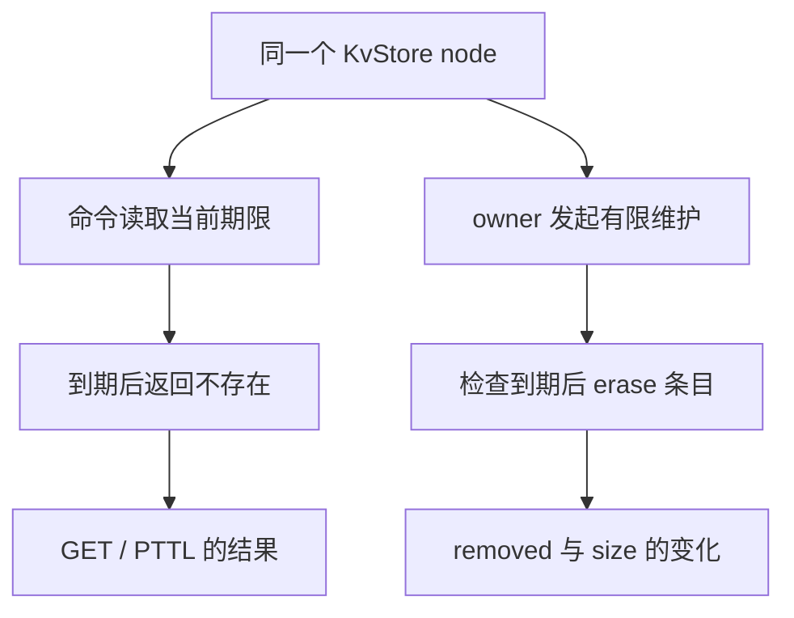

# Week13 Day7：收口 TTL V2，再看懂基类引用到底调用谁

> 生成：2026-10-23。Day1～Day6整日已通过；Day6为96/100，R1历史98/100。
> 今天先完成Mini Redis V2的新增关系收口，再补类、继承与虚函数。
> 项目部分复用已有代码和证据；语法部分只做一个独立的小实验，可分两次学习。
> 本文已生成，Day7尚未验收，Week13尚未整周通过。理论线继续T10 R1。

[TOC]

---

# Part 1：前情提要与必要术语

## 1. 今天要得到什么

**先说明你的Mini Redis怎样让数据按时失效、随后回收；再用一个小程序看清：同一个基类引用，为什么能够执行不同对象的实现。**

项目部分从你已经写好的行为出发。假设可控时钟当前为1000ms，`code`的期限为1100ms：

```text
now = 1099：GET code 仍能返回内容
now = 1100：GET code 应按不存在处理
此时记录可能仍在 map 中
稍后的 sweep 检查到它：从 map 删除这条记录
```

这几步分别由谁完成，你已经在Day2～Day5写过。今天把它们接成一段能独立说明的因果链，已有笔记和口述可以直接作为证据。

本周收口以后，再处理你之前明确提过的C++缺口。设想有两种对象，都能处理一段文字：一种打印文字，另一种只统计字节。我们希望调用者统一写一次`write(text)`，实际工作由传入的对象决定。后半就沿这个问题讲继承与虚函数。

建议分两段：V2收口约30～45分钟；语法补缺约90～150分钟，可以另找一次完整精力来做。时间是阅读建议，完成度看理解与证据。

## 2. 从你的真实进度接起

本次生成已只读核对Ubuntu原工程：

```text
/home/xgf/code/system-learning/cpp/week10
```

当前实现已经具备下面这些能力：

| 你已经完成的部分 | 今天直接复用什么 |
|---|---|
| `KvStore::node`保存`value`和`deadline` | `-1`表示无期限，其他合法期限与当前毫秒时刻比较 |
| `EXPIRE/PTTL`及命令内统一取时 | 秒转毫秒、期限范围检查、重复key语义与错误边界 |
| `sweep_expired()` | 自有string记录排序边界，每次用`upper_bound()`重新定位 |
| 原服务器维护入口 | `poll_once(50)`，到时只清理一次，预算16条，完成后再安排100ms |
| Day1与Day6数据库观察 | 查询路径、提交/回滚，以及RR/RC、锁等待的理解 |

Day5最终验收已有完整构建、CTest 124/124、相关ASan/UBSan和真实网络证据。包括无人访问时回收、覆盖清旧期限、续期、错误后继续，以及37条记录按16/16/5检查回收。这些标为**已有验收证据**，不会因为今天生成教程就变成今天的新运行。

你最新Day6笔记已经把Undo中的事务写成“修改者”，超时后的处理也改为`ROLLBACK`。今天沿最新版继续。RR的范围只需保留一句：**本例A自己不改账户1时，重复普通一致性读复用旧视角；本事务自己的修改仍可见。**

## 3. 四个主问题

1. 一条记录已经不能读取，却仍占着map条目，这两个状态分别由谁改变？
2. SET、DEL、再次EXPIRE以后，清理为什么仍能依据当前记录正确工作？
3. 网络等待、维护间隔、检查预算分别控制什么，已有证据支持哪些结论？
4. 给一个函数传入基类引用以后，调用和销毁如何保留实际对象的行为？

前三个属于V2出口，第四个属于另记的基础补缺。V2已经成立的正确性不会因为语法补缺尚未做完而被撤销；补缺仍保留为明确待完成项，最迟Week16投递准备前闭环。

今天暂时只需唤起两个已有词：**deadline（到期时刻）决定记录何时失效；sweep（巡检清理）在获得执行机会时检查并回收一批记录。** 新的C++词放在具体调用出现之后解释。

---

# Part 2：教程开始

## Round1：把本周新增关系说清楚

## 4. R1的产出：沿一条记录走完，不再画全服务器

打开原来的`src/kv_store.cpp`、`src/command_dispatcher.cpp`和`apps/mini_redis_server.cpp`。先用它们说明下面这条短链：

```text
客户端指定有效时长
-> command handler 解释参数
-> KvStore 更新当前记录的期限
-> 后续命令判断这份内容是否仍有效
-> owner 在维护机会中回收已到期记录
```

输入仍来自已经通过的RESP parser；回复仍交给原Connection发送。今天的变化集中在进程内的应用层与store。TCP负责传字节，操作系统提供等待和收发能力；key的有效期由你的用户态程序决定。

R1可以用口述、已有note中的具体段落，或一份很短的新增笔记交付。下面四项是检查范围，**已经能用旧证据直接说明的项只引用位置，不重新抄答案**。不要求新增测试或生产代码。

### 4.1 同一个key，先失效，后回收

假设`code`是map中的唯一记录，`value="v1"`、`deadline=1100`。可控时钟从1099推进到1100，期间没有其他操作。

请分别判断：`get("code")`、`pttl("code")`、`size()`在1100时表达什么？随后调用一次预算为1的维护，会改变哪个事实？

解释时把“业务上能不能用”和“容器里有没有条目”分开。指到你的实现即可，无须再写一个模拟循环。

### 4.2 旧期限到达时，现在已经存着新值

沿同一条记录改变一个条件：在1090时执行普通`SET code v2`，然后时间来到1100。

请说明SET改了node中的哪些内容，维护随后读取哪一份期限。如果改成1090时续期到1300，判断依据又是什么？

最后关联你Day4笔记里的数轴理解：如果清理保存的边界key已被外部DEL删掉，为什么下一次仍能找到后继？原来的iterator方案依赖了什么？

### 4.3 客户端不说话，谁还能执行维护

从你当前的`for (;;)`里指出：owner在哪一行等待，何时回来，在哪一行判断维护时间。

再说明50ms、100ms、16各自控制什么。这里不要求重新观察全套网络场景。引用Day5已有的“先看到删除日志、之后才GET”和双连接PING即可。

### 4.4 谁拥有这份时间状态

只追踪四个对象：node中的期限、store保存的时钟回调、命令临时取得的时刻、owner的`next_sweep_at`。

说明谁保存它、谁使用它，为什么EXISTS同一条命令可以重复用一个时刻，而owner又需要单独记住下一次维护机会。

## 5. 到这里停止阅读，先交R1

**R1只验收V2新增关系。** 你不需要先读虚函数才能提交，也不需要新建一份周总结来重复note。

本轮通过依据是：能沿自己的代码解释有效性、当前node状态、跨调用位置和维护机会；本周已通过的实现与测试继续作为依据。如果某一处解释卡住，再针对那一处读后半，不把整周重新做一遍。

后续正式检阅R1时，会再次读取你的最新源码、note和本文件增补，再定向校准R2/R3。下面是生成时按当前实现准备的解释。

---

## Round2：先收住V2，再补统一调用的语言机制

## 6. 你的两个入口怎样使用同一份记录

### 6.1 命令先判断能否使用，维护负责回收

你的`get()`找到node以后读取当前时刻。时刻已经到达期限，就返回`std::nullopt`；这个const成员函数并不erase条目。`pttl()`对同一失效状态返回`-2`。`size()`直接返回`data_.size()`，统计物理条目。

所以§4.1里，到1100时GET/PTTL已经报告失效，size仍然可以是1。维护检查到同一个node后才erase，size变为0。

**命令结果证明有效期规则，删除计数和size变化证明回收。** 你原来的网络checker先等`removed`和size变化，再发GET，这个顺序正是为了区分两件事。



图的两条分支都访问同一份node。在你的单线程owner里，它们按执行顺序发生；图表示两个调用入口，并不表示另起一个清理线程。

### 6.2 清理检查当前node，所以覆盖和续期自然生效

你的SET执行`data_[key]=node{value,-1}`。覆盖后node已经变成`v2`和无期限；1100只是旧内容曾经的期限，当前node不再保留它。

续期则更新当前node的deadline。清理随后看到1300，就根据1300判断。**清理保存的是遍历位置，期限始终从当前node读取。** 这解释了为什么当前设计不需要另一份旧到期删除计划。

### 6.3 保存key，是保存排序边界

你在Day4用数轴说明得很清楚：保存100表示“上一轮检查到这个边界”，随后在当前集合中寻找大于100的最小值。对应到代码，就是保存独立string，再调用`upper_bound(cursor)`。

假设上一轮最后检查`"b"`，外部DEL随后删掉`"b"`。下一轮仍然可以用值`"b"`查询当前map里的严格后继。这个string独立存在，所以不需要原node继续活着。

你当前初值为空string，到末尾就绕回begin。空key本身仍是合法数据；初始边界可以让它在绕回时被检查。稳定有限集合上，持续推进和不重复检查的证据已有Day4测试覆盖。数轴类比对应**排序关系**；字符串`"10"`和`"2"`按字符串规则排序，不能当成整数10和2。

### 6.4 两份时间各自回答一个问题

| 位置 | 保存或取得的值 | 用它回答什么 |
|---|---|---|
| `node.deadline` | store时钟体系中的毫秒期限 | 这条记录现在是否有效 |
| `now_` | 可调用的取时函数 | 这次检查采用哪个当前时刻 |
| handler中的`now_ms` | 本条命令读出的一次时刻 | 多个key是否用同一时刻判断 |
| owner的`next_sweep_at` | steady_clock的下次允许时刻 | 现在是否该启动一轮维护 |

你的默认store clock从构造时保存的起点计算经过的毫秒；owner直接保存steady_clock的时间点。二者服务不同判断。handler把store给出的毫秒传回`*_at`；owner用自己的时间点比较维护机会，不拿这两类数值直接相减。

当前主循环顺序是：poll返回，必要时维护，随后处理pending close。关闭清理仍在本轮事件分发返回以后执行；教程按你的实际顺序描述。

## 7. 现在能怎样介绍V2

你可以用自己的话把结果压缩为：原RESP String KV增加有效期，命令判断与主动回收共用当前node；用可控时钟证明边界，用真实TCP证明维护接入。给出证据时，再定位到具体层。

| 层次 | 已有证据 | 还不能由它推出什么 |
|---|---|---|
| store/命令 | 到期边界、覆盖续期、范围错误、命令一次取时 | 所有Redis选项都兼容 |
| sweep | 预算、推进、外部删除和当前node判断 | 整个请求路径已有延迟上界 |
| 网络 | idle回收、活跃时维护、错误后继续、长连接保留 | 已实现内存淘汰或下游重建协调 |
| 工程 | 已有完整回归及相关sanitizer检查 | 所有输入与故障都被穷尽证明 |
| MySQL | 三组EXPLAIN及事务观察/理解 | Mini Redis已经有数据库事务 |

你选择了用map做可控巡检。Redis官方描述了访问时发现过期和主动检查的机制，但具体数据结构和维护策略不是本项目这一圈map扫描。基本命令含义可以对齐，内部实现仍按你自己的证据说明。参考[Redis EXPIRE官方说明](https://redis.io/docs/latest/commands/expire/)中的“Refreshing expires”和“How Redis expires keys”；本次也核对了其[官方文档仓库正文](https://raw.githubusercontent.com/redis/redis-doc/master/commands/expire.md)。只读这两小节，停在“更新期限与两个发现入口”，不扩展成源码课。

`PTTL`的毫秒单位与`-1/-2`含义可在[官方PTTL说明](https://redis.io/docs/latest/commands/pttl/)核对。你当前表示把到达deadline就判为失效；不用为了追逐某个外部实现的毫秒细节，改动已公开并验证的本项目规则。

至此V2主问题已经闭合。接下来切换到原计划中的语法补缺：它回答“同一个调用入口怎样操作不同类型”，不改这套服务器。

## 8. 先认识将要操作的对象

后半用一个小场景贯穿：接收一段文字，或者把它打印出来，或者统计它有多少字节。

调用者只想说“处理这段文字”。为了让它不必分别写两套调用逻辑，我们逐步找到统一入口。先从最熟悉的计数状态开始，之后每一步只增加一个关系。

本节到§16的完整示例都可单独编译。它们是讲解材料；最终练习只保留§18的一份`virtual_dispatch_lab.cpp`。已经能准确解释的小例子可以读过，不要求逐份抄写。

## 9. 一个类可以创建两份互不影响的状态

下面的程序创建两个计数器。它只输入固定字符串，输出两个字节计数，没有网络或文件资源。

示例A：`counter_demo.cpp`。

```cpp
#include <cstddef>
#include <iostream>
#include <string>

class Counter {
public:
    explicit Counter(std::size_t start) : bytes_(start) {}

    // Accumulate bytes in this object; text is only borrowed.
    void add(const std::string& text) {
        this->bytes_ += text.size();
    }

    std::size_t bytes() const { return bytes_; }

private:
    std::size_t bytes_;
};

int main() {
    Counter first(0);
    Counter second(10);
    Counter& reference = first;
    reference.add("abc");
    std::cout << first.bytes() << ' ' << second.bytes() << '\n';
}
```

结果为`3 10`。`Counter`这份类定义规定数据与操作；`first`、`second`是依照它创建的两个**object（对象）**。各自拥有一份`bytes_`，函数代码并不需要在每个对象里复制一份。

`reference`是first的引用，调用`reference.add()`仍然修改first。进入这个成员函数时，`this`指向当前被操作的对象。因此`this->bytes_`能明确指出这次改谁；你通常省略`this->`，含义相同。

`public`把操作提供给外部，`private`把数据访问限制在类成员及其友元等授权范围内。`bytes() const`表示这个查询不通过当前对象修改普通成员。这里的**class（类）**是类型规则，对象才保存这一次具体的状态。

`Counter(0)`调用**constructor（构造函数）**。冒号后的`bytes_(start)`先初始化成员，再执行函数体。`explicit`要求调用者明确构造这个对象，避免一个整数被隐式转成Counter。普通局部对象在作用域结束时执行**destructor（析构函数）**，随后结束其成员；本例编译器提供的析构已足够。你在UniqueFd/Connection里借对象结束释放资源，依赖的就是这个生命周期。

## 10. 要让两种处理器共用入口，先让它们有共同的类型

现在有一个打印处理器。我们希望把它交给一个只认识“文字处理器”的函数。给这个共同类型起名`Sink`，表示接收并处理输出内容的一端；`ConsoleSink`表示打印到控制台的具体处理器。先看普通继承能提供什么，暂时还没有虚调用。

示例B：`inheritance_demo.cpp`。

```cpp
#include <iostream>
#include <string>

class Sink {
public:
    explicit Sink(int id) : id_(id) {}
    int id() const { return id_; }
    void write(const std::string&) { std::cout << "Sink\n"; }
private:
    int id_;
};

class ConsoleSink : public Sink {
public:
    ConsoleSink() : Sink(7) {}
    void write(const std::string& text) {
        std::cout << "Console: " << text << '\n';
    }
};

// Borrow the existing object through its Sink interface.
void deliver(Sink& sink, const std::string& text) {
    sink.write(text);
}

int main() {
    ConsoleSink console;
    std::cout << console.id() << '\n';
    console.write("hello");
    deliver(console, "hello");
}
```

输出依次是`7`、`Console: hello`、`Sink`。先看对象关系，再解释最后一行为什么没选Console。

`ConsoleSink : public Sink`建立**inheritance（继承）**关系。Sink是**base class（基类）**，ConsoleSink是**derived class（派生类）**。这个ConsoleSink对象中包含一个Sink基类部分，里面保存编号7。

```text
console：完整 ConsoleSink 对象
└─ Sink 基类部分：id_ = 7

deliver 的 Sink&：借用上面这一个对象的基类部分
```

这幅图表达组成关系，不承诺成员在内存里的固定偏移。`Sink(7)`负责先构造基类部分；随后才进入派生类构造函数体。基类的private数据仍由基类成员访问，所以console通过`id()`取得编号，而不是直接访问`id_`。

**基类引用给已有对象提供一个基类视角。** 它没有新建Sink，也没有把ConsoleSink变成另一个对象。public继承让本例可以把ConsoleSink传给`Sink&`。

但在`deliver()`里，表达式`sink`的声明类型是Sink引用；`write()`还是普通成员函数，所以这里选中`Sink::write`。我们已经统一了入口类型，却还没实现“根据实际对象选择具体工作”。下一节只补这个能力。

补充访问规则：`protected`允许派生类按受保护访问规则使用成员；`private`成员仍属于基类部分，只是派生类不能直接访问。`class`默认私有继承，`struct`默认公开继承，本例显式写public。其他继承方式留在需要时查，不改变眼前调用链。

## 11. virtual让同一个入口执行实际对象的实现

把共同操作声明为`virtual`，就可以让`deliver()`根据实际对象选择函数。示例C是完整独立程序，沿用上一节的文字处理场景，并增加计数处理器。

示例C：`dispatch_demo.cpp`。

```cpp
#include <cstddef>
#include <iostream>
#include <string>

class Sink {
public:
    virtual void write(const std::string&) { std::cout << "Sink\n"; }
};

class ConsoleSink : public Sink {
public:
    void write(const std::string& text) override {
        std::cout << "Console: " << text << '\n';
    }
};

class CountingSink : public Sink {
public:
    void write(const std::string& text) override { bytes_ += text.size(); }
    std::size_t bytes() const { return bytes_; }
private:
    std::size_t bytes_ = 0;
};

// Both calls use the same interface; no ownership is transferred.
void deliver(Sink& sink, const std::string& text) { sink.write(text); }

int main() {
    ConsoleSink console;
    CountingSink counter;
    deliver(console, "abc");
    deliver(counter, "abc");
    std::cout << "bytes=" << counter.bytes() << '\n';
}
```

输出`Console: abc`和`bytes=3`。两次都经过同一个deliver，第一次执行ConsoleSink的打印，第二次执行CountingSink的累加。

**virtual（虚函数）规定：通过基类指针或引用进行普通虚调用时，使用实际对象对应的重写实现。** 这种选择过程叫**dispatch（调用分派）**；统一接口可以表现出不同对象的行为，叫**polymorphism（多态）**。

这里有两个类型信息：参数声明为`Sink&`，所以表达式`sink`以Sink这个**static type（静态类型）**访问对象；借到的完整对象的**dynamic type（动态类型）**分别是ConsoleSink和CountingSink。前者决定这个位置允许使用哪些接口，后者决定虚调用采用哪个重写实现。

所以`deliver()`里不能直接写`sink.bytes()`：Sink没有声明这个成员。虚函数改变的是已有虚接口的执行选择，不会把派生类全部接口自动暴露给基类调用者。

`override`告诉编译器“这项声明必须确实重写一个基类虚函数”，下一节用一个错误来说明它的价值。这里的两个完整对象都由main中的局部变量管理，deliver只借用；§13再加入“通过基类指针拥有并销毁”的需求。

## 12. override帮你发现：名字相同，但没有接上原来的入口

假设基类有`virtual void write(const std::string&)`，你却在派生类写成`void write(int)`。它们接受不同输入，原来的虚入口不会因此被替换。

加上override以后，这个误写在编译阶段就会被拒绝。下面是专门用于失败观察的完整程序，**预期编译失败，不运行**。

失败示例F1：`bad_override.cpp`。

```cpp
#include <string>
struct Sink {
    virtual void write(const std::string&) {}
};
struct BrokenSink : Sink {
    void write(int) override {}
};
int main() {}
```

找编译输出里含`override`和`does not override`的那一行。不同版本的完整措辞可以不同；关键是声明没有匹配基类虚函数，所以没有生成新的可运行程序。

参数列表、成员函数末尾的const及引用限定等要匹配相应重写规则。返回类型也受规则约束；本课的void沿用原签名即可。这里的override叫**重写**，与给同名函数增加不同参数的**overload（重载）**是两件事。

再看为什么派生类同名函数可能让原来的用法暂时找不到。示例D借同一个write入口说明查名字与虚调用是两个步骤。

示例D：`lookup_demo.cpp`。

```cpp
#include <iostream>
#include <string>
struct Sink {
    virtual void write(const std::string&) { std::cout << "text\n"; }
};
struct NumberSink : Sink {
    using Sink::write;
    void write(int) { std::cout << "number\n"; }
};
int main() {
    NumberSink sink;
    sink.write(7);
    sink.write(std::string("abc"));
    Sink& base = sink;
    base.write("abc");
}
```

输出`number`、`text`、`text`。NumberSink的`write(int)`提供了另一个参数入口，原字符串虚函数仍使用Sink实现。

如果删掉`using Sink::write`，直接对NumberSink查找write时先找到派生类同名声明，第二次字符串调用就不能采用基类那个入口。这叫**name hiding（名字隐藏）**。using把基类的write声明带回这个作用域，允许按参数选择；它本身不产生重写。

`final`则用于限制继续派生或继续重写。例如把某个重写写成`void write(const std::string&) final`，后续派生类再重写它会编译失败；`class ConsoleSink final`限制继续从这个类派生。先理解这些是编译期约束，不需要为当前服务器添加final。

查证时只看[C++17虚函数规则](https://timsong-cpp.github.io/cppwp/n4659/class.virtual)的override/final例子，以及[成员名字查找](https://timsong-cpp.github.io/cppwp/n4659/class.member.lookup)。第一次学习以这里的调用过程为主，不要求阅读整份标准。

## 13. 只有具体处理器能工作，统一接口还能负责正确销毁

现在Sink本身没有有用的处理策略。我们希望它只规定“具体处理器必须提供write”，而不让调用者创建一个只打印通用标记的Sink。

在虚函数声明后写`= 0`，就把它声明为**pure virtual function（纯虚函数）**。还有未完成纯虚入口的类是**abstract class（抽象类）**，不能单独创建对象，但可以用它的指针或引用访问具体派生对象。`= 0`是语法标记，不表示这个函数返回数字0。

接着考虑拥有关系：调用函数只借用`Sink&`已经够了；若另一个对象需要保存处理器并负责最后销毁，可以使用`std::unique_ptr<Sink>`。

示例E：`owned_sink_demo.cpp`。

```cpp
#include <iostream>
#include <memory>
#include <string>

class Sink {
public:
    virtual void write(const std::string& text) = 0;
    virtual ~Sink() { std::cout << "destroy Sink\n"; }
};

class ConsoleSink : public Sink {
public:
    void write(const std::string& text) override {
        std::cout << "Console: " << text << '\n';
    }
    ~ConsoleSink() override { std::cout << "destroy ConsoleSink\n"; }
};

int main() {
    // The owner holds the complete ConsoleSink through the common interface.
    std::unique_ptr<Sink> owner = std::make_unique<ConsoleSink>();
    owner->write("hello");
}
```

先打印`Console: hello`，离开作用域时再打印`destroy ConsoleSink`、`destroy Sink`。

沿一次结束过程看：owner结束，默认删除器通过Sink指针发起删除；虚析构把销毁入口带到ConsoleSink。派生析构函数体执行以后，派生成员继续析构，最后基类部分也结束。本例没有额外派生成员，所以日志只显示两层。

**通过基类指针多态删除派生对象时，基类需要合适的虚析构约定。** 在本课C++17和unique_ptr默认删除器的用法下，删掉基类析构上的virtual会使这种删除成为未定义行为。不要运行错误删除来观察“好像只打印一行”，那不是可靠规则。

一个类只被引用借用、从不通过基类删除时，可以采用其他受限制的设计；这里选择公开虚析构，是因为我们已经明确需要`unique_ptr<Sink>`拥有并销毁完整对象。

抽象类仍可以有数据成员、构造函数和普通成员函数；派生对象中仍有它的基类部分。抽象说的是不能把这个未完成接口单独实例化。参考[抽象类](https://timsong-cpp.github.io/cppwp/n4659/class.abstract)与[C++17 delete规则](https://timsong-cpp.github.io/cppwp/n4659/expr.delete)。

## 14. 对象还没构造完，虚调用应该依靠哪一层

前面的virtual调用发生在完整对象已经构造好以后。现在只改变调用时机：把一次调用放进构造函数或析构函数。

**构造/析构期间对当前对象的虚调用，选择当前正在构造/析构的这一层实现。** 基类构造时，派生层尚未建好；基类析构时，派生层已经结束。下面用同一个`kind()`观察这一点。

示例G：`lifetime_demo.cpp`。

```cpp
#include <iostream>
struct Base {
    Base() { std::cout << "Base ctor: " << kind() << '\n'; }
    virtual const char* kind() const { return "Base"; }
    virtual ~Base() { std::cout << "Base dtor: " << kind() << '\n'; }
};
struct Derived : Base {
    Derived() { std::cout << "Derived ctor: " << kind() << '\n'; }
    const char* kind() const override { return "Derived"; }
    ~Derived() override { std::cout << "Derived dtor: " << kind() << '\n'; }
};
int main() {
    Derived object;
    Base& reference = object;
    std::cout << "ready: " << reference.kind() << '\n';
}
```

输出顺序为：

```text
Base ctor: Base
Derived ctor: Derived
ready: Derived
Derived dtor: Derived
Base dtor: Base
```

对象经历“基类部分建立 -> 派生层建立 -> 完整使用 -> 派生层结束 -> 基类部分结束”。每一行放回这个时间线，就不需要记一条“构造时多态失效”的模糊口诀。

这里Base提供了实际函数体。不要把示例改成构造函数调用纯虚入口；那属于另一条非法使用边界，本课不执行。规则见[构造和析构期间的调用](https://timsong-cpp.github.io/cppwp/n4659/class.cdtor)。

## 15. 基类引用保留原对象，按值复制会创建另一个对象

前面一直传`Base&`。如果改为`Base copy = object`，发生的是一次新对象构造：从Derived中的Base部分复制内容，得到一个真正的Base对象。

这叫**object slicing（对象切片）**。原Derived没有被剪坏；是新建的Base只包含基类那一部分，原派生层的数据和行为不属于这个新对象。

示例H：`slicing_demo.cpp`。

```cpp
#include <iostream>
struct Base {
    int id = 7;
    virtual const char* kind() const { return "Base"; }
    virtual ~Base() = default;
};
struct Derived : Base {
    int extra = 9;
    const char* kind() const override { return "Derived"; }
};
int main() {
    Derived object;
    Base& reference = object;
    Base copy = object;
    std::cout << reference.kind() << ' ' << copy.kind() << '\n';
    std::cout << object.extra << ' ' << copy.id << '\n';
}
```

结果是`Derived Base`和`9 7`。引用仍指向原对象，新copy的实际类型就是Base。函数参数写成`void use(Base value)`也会产生这种按值复制；写成`Base&`则是借用。

这也解释了为什么统一保存多种派生对象时，经常使用`vector<unique_ptr<Base>>`，而不是`vector<Base>`：前者让指针拥有各自完整对象，后者的每个元素本来就只能是Base值。

## 16. 编译器通常怎样找到那个派生实现

现在语言行为已经站稳：基类引用不复制对象，虚调用仍能找到派生实现。剩下的问题是，机器执行到这个入口时，可以从哪里取得函数位置？

常见实现给多态对象关联一份函数入口信息。对象内保存的关联指针通常叫**vptr（虚表指针）**，它指向类型相关的**vtable（虚函数表）**。表里可以找到相应虚调用所需的函数入口。

```text
基类引用借用 ConsoleSink 对象
        ↓
对象关联的虚表信息
        ↓
write 对应的入口
        ↓
ConsoleSink::write

另一个 CountingSink 对象
        ↓
另一份类型相关的入口信息
        ↓
CountingSink::write
```

图只解释为什么“同一个调用入口”能走到不同实现。表通常由同一具体类型的对象共享，不是每创建一个对象就把所有函数代码复制进去。

这是常见编译器模型。**C++标准保证调用行为，不固定vptr的字节偏移、虚表槽位数或对象大小。** 编译器还可能在已知具体类型时直接生成调用，消除间接查表。想看实际二进制约定，可选读[Itanium C++ ABI的虚表部分](https://itanium-cxx-abi.github.io/cxx-abi/abi.html#vtable)开头说明。ABI是Application Binary Interface（应用二进制接口），规定对象布局与调用等实现协作规则；本次理解这层作用即可停止。

当前先不做多继承布局、手工读虚表、虚继承和反虚拟化性能实验。只用合法的`sizeof/alignof`观察本编译器的大小与对齐，不能从一个数字反推所有成员的位置。

## 17. 回到你的Reactor：已有callback为什么可以继续用

你已经给Connection设置message callback，给Acceptor设置新连接callback。调用者握着一个可调用入口，具体行为来自之前注入的函数。

虚函数提供另一种组织方式：调用者握着基类引用或指针，具体行为来自实际对象的重写。两者都能把“何时调用”与“具体做什么”分开，但对象组织和拥有方式不同。

当前服务器已经用callback表达了关系，没有新增需求要求一组派生Connection类型。**这次掌握的是统一调用和生命周期的语言规则，服务器继续保留现有组成方式。** 不给Now、Channel、Connection加虚基类，也不因会了virtual就改已经通过的设计。

到这里可以停一次。若你能沿示例C说明“借到哪个对象、调用哪个实现”，再沿示例E说明“谁拥有、谁析构”，核心关系已经建立。独立小册可作第二解释：[第1～3章](../../杂教程/C++面试语法小册.md)，只回看当前卡住的小节，不另做一遍作业。

---

# Part 3：收尾、验证与验收

## Round3：一份调用实验，加上当前版本证据

## 18. 小实验到底要写什么

文件位置：

```text
/home/xgf/code/system-learning/cpp/week13/day7/virtual_dispatch_lab.cpp
```

这里只放独立语法练习，原服务仍在week10。程序输入是你在main里创建的两个具体对象；输出是它们通过同一入口调用的身份日志，以及退出作用域时的析构日志。无需socket、时钟、GTest或新CMake target。

请用一个`Task`基类和`FirstTask/SecondTask`两个派生类完成下表。名字可以按你的习惯调整。

| 逐步增加的动作 | 你要观察什么 | 这一步证明什么 |
|---|---|---|
| 给Task普通`label()`和虚`run()`；派生类提供同名label及各自run | 通过Task引用分别调用label/run，先写两次短预测再运行 | 普通成员选择与虚调用选择的区别 |
| 写`run_one(Task&)`，依次借用两个派生对象 | 同一个函数进入两个具体run | 基类视角与实际对象类型可以不同 |
| Task有虚析构，通过一个`unique_ptr<Task>`拥有派生对象 | 离开一个小作用域后，派生与基类析构各发生一次，顺序正确 | 统一拥有方式仍结束完整对象 |
| 临时把一个override参数写错，编译后改回 | 错误版本被编译器拒绝，正确版本可运行 | override能检查接口误写 |

每个run打印自己的身份就够了。`run_one`只借用对象，不保存引用；对象在调用期间由main中的变量或unique_ptr保持存活。最后加`VIRTUAL LAB PASS`时，前面的观察应已经核对，不能只打印标签代替实验。

纯虚、构造/析构调用和切片可以直接借§13～§15完整例子做预测与解释，不要求把它们全塞进Task。如果你愿意用同一实验展示抽象接口，可以最后把Task的run改成纯虚，再保留能编译的派生实现；按值切片则用有具体基类实现的示例H观察。

输出和注释已能解释的地方不再抄到note。记录你真正判断错的一行，以及修正后的原因即可。机械检查脚手架可以委托；调用和拥有关系由你说明。

## 19. 编译入口与错误读法

先在Ubuntu准备独立目录；若已经存在，只进入它，不覆盖已有文件：

```bash
mkdir -p /home/xgf/code/system-learning/cpp/week13/day7
cd /home/xgf/code/system-learning/cpp/week13/day7
```

创建并完成`virtual_dispatch_lab.cpp`以后运行：

```bash
g++ -std=c++17 -Wall -Wextra -g virtual_dispatch_lab.cpp -o virtual_dispatch_lab
./virtual_dispatch_lab
```

本课示例A～H也使用相同参数，替换输入文件名和输出程序名。失败示例F1只检查编译：

```bash
g++ -std=c++17 -Wall -Wextra -g -fsyntax-only bad_override.cpp
```

`-fsyntax-only`让编译器检查源文件而不生成可执行文件。这个案例预期非零退出；失败来自override不匹配。运行旧二进制不能证明本次错误代码通过了编译。

你还可以在同一文件临时观察“抽象类不能创建对象”。下面F2也是完整的预期编译失败案例：

```cpp
struct Task {
    virtual void run() = 0;
    virtual ~Task() = default;
};
int main() {
    Task task;
}
```

编译器会指出Task是abstract类型，未提供run的具体实现。`Task*`或`Task&`本身可以声明；它们可以指向或引用派生对象。

若要合法观察对象大小，在实验main里打印`sizeof(Task)`、`sizeof(FirstTask)`和`alignof(FirstTask)`即可。`sizeof`是这种对象本身所占字节，`alignof`是对齐要求；输出数值只对本次编译器和目标平台负责。无需读取vptr，也无需获得某个固定数字才算通过。

## 20. V2的证据怎样收口

下面是§6～§7所述行为的证据定位，沿用本周已完成的检查。它们不是今天新加的一串功能。

| 要支持的判断 | 直接回查的已有证据 |
|---|---|
| 到期前可用、到期点失效，错误不污染旧状态 | `tests/kv_store_ttl_test.cpp`与Day2记录 |
| EXPIRE/PTTL回复、单位范围、命令内同一时刻 | `tests/ttl_command_test.cpp`与Day3记录 |
| 有预算巡检、删除后继续、copy/move回归 | `tests/kv_store_expiration_test.cpp`与Day4记录 |
| 无请求时回收、覆盖续期、连接继续 | `tests/mini_redis_ttl_check.py`与Day5网络验收 |
| 索引的三种访问观察、事务读写区别 | Day1和Day6原note/实验；后半理解证据按实际标记 |

收口时需要确认这些结果仍对应当前版本。若近期没有改动相关实现和测试，旧证据可以复用；有改动才按影响补跑。正式检阅时由Codex只读核对最新版本，必要的回归可由Codex完成，不让你重复编写checker。

手动运行原工程时，仍使用约定的入口：

```bash
cd /home/xgf/code/system-learning/cpp/week10
cmake -S . -B build -DCMAKE_BUILD_TYPE=Debug
cmake --build build
cmake -E chdir build ctest --output-on-failure
```

最后一行保持原来的CTest命令。看到`100% tests passed`时，还要看实际总数和退出状态；当前124项是本版已有数量，不是未来不可增加的常数。网络checker独立于这组CTest，不能把124/124当成TCP场景也刚刚重跑。

ASan/UBSan复用Day4/Day5覆盖路径的已有记录；后续若修改生命周期再针对变更复测。单线程TTL不因此新增TSan。今天也不测吞吐，不从巡检预算推导性能提升。

## 21. 六个收口问题，按已有证据回答

R1已经回答的项直接引用。后半语法题可以用实验输出和简短口述说明，不要求另写六篇笔记。

1. **有效与占用：** deadline已经到达，GET不存在但size仍大于0，这两份结果是否矛盾？分别由什么动作改变？
2. **当前状态：** 普通SET和再次EXPIRE以后，维护读哪一份期限？保存的巡检key已被删除，下一轮为什么仍能定位？
3. **执行机会：** 50ms、100ms、16分别限制什么？为什么不能据此承诺某条请求最多150ms完成？
4. **调用选择：** 把FirstTask交给`run_one(Task&)`时，对象复制了吗？普通label和虚run分别依据什么选择？
5. **对象结束：** `unique_ptr<Task>`怎样结束完整派生对象？构造期在基类里调用虚函数时采用哪一层实现？
6. **项目边界：** 你的TTL、内存淘汰、数据库事务和持久化分别解决什么问题？哪几项已经在当前Mini Redis实现，哪几项只是理解或后续计划？

第6题可复用Week12 Day7口述和昨天的note。MySQL普通读旧视角、锁定读、1205回滚已在Day6讲过；今天只把“已理解数据库机制”与“自己服务里已实现的功能”分清。

需要第二解释时，《图解MySQL》的[事务隔离与MVCC](https://xiaolincoding.com/mysql/transaction/mvcc.html)只回看“事务的隔离级别有哪些”中RR/RC的行为入口，再回到你1000/1000/1200的观察。它是卡住时的回查，不新增完整阅读任务。虚函数则使用§17的小册第1～3章，不同时刷整套面经。

## 22. 今天在哪里停，下一周为什么需要磁盘

Day7收口分开记录两件事：**V2核心关系与证据是否闭合；虚函数补缺是否完成。** 前者复用本周产出，后者以小实验和解释登记。若你把补缺分到另一次学习，就如实保留待完成状态。

今天没有要你新增的服务器功能。代码与note仍由你维护，教程只在获准范围内更新；首版补缺实验也由你独立写，机械检查可委托。

接下来Week14的问题是：进程退出以后，内存中的value和deadline都消失了，重新启动怎样恢复？这时才需要把可恢复的信息写到磁盘。

还有一个具体前置会随之出现：你当前deadline使用“从本次store起点经过多少毫秒”的坐标。新进程起点变了，直接保存一个旧毫秒数还不足以说明重启后何时到期。Week14会结合恢复任务重新讲清时间表示；今天先把这道问题带过去，不提前改clock或写AOF。

**停止点：能解释当前V2，知道证据在哪里，完成或明确登记独立虚函数补缺。** Week14仍按原规划进入AOF与恢复；Week15再做故障/性能，完整Week16以后再准备简历试投。T10按自己的进度继续，不因系统周数推进而登记理论通过。
