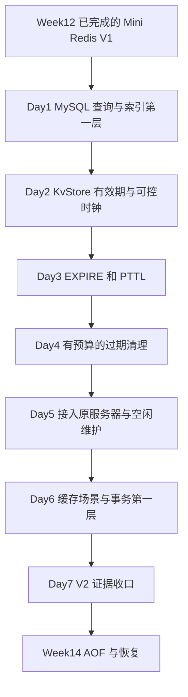

# Week13：Mini Redis V2，让 key 按时过期

> 版本：2026-10-11，依据 Week12 正式通过后的实际实现编排
> 系统主线：Week1~Week12 已完成，共 84 个正式通过单元；进入 Milestone E
> 本周产出：沿用现有 Mini Redis，增加 EXPIRE/PTTL、可控时钟和有限的过期清理
> AI 理论线：T1~T5 已通过，下一项 T6；本周主线不等待理论线补齐
> 当前状态：Day1 教程与独立 MySQL 脚手架已生成，R1 待学习验收；Week13 尚未通过

---

## 1. 这一周解决什么问题

**给一份已经能存取的数据加上有效期，并证明它什么时候还能读、什么时候已经失效。**

比如验证码只允许使用两分钟。现在你的 Mini Redis 能保存它，却会一直保存到有人 DEL 或进程退出。本周让客户端能够指定：这份数据只在一段时间内有效。

你在 Week12 Day7 已经说清楚了三种需求：

| 需求 | 本周位置 |
|---|---|
| 数据只在指定时间内有效 | 本周实现 TTL，即 Time To Live，生存时间 |
| 内存压力过大时删除部分数据 | 本周理解 eviction，内存淘汰；暂不实现策略 |
| 进程重启后恢复数据 | Week14 的 persistence，持久化 |

**本周主要新增的是数据的时间语义，不是再写一套网络服务器。**

另外，你目前对 Redis/MySQL 的了解还没有形成完整第一层。因此先用一个小表学会 MySQL 的查询与索引，再回到自己的 KV 服务；事务背景放在 TTL 接入完成后。数据库知识围绕具体问题展开，不另开一条厚重的全课程主线。

---

## 2. 从你的实际实现继续

本周继续维护 Ubuntu 中的同一个工程：

```text
/home/xgf/code/system-learning/cpp/week10
```

虽然目录名是 week10，它已经承载 Reactor、HTTP Server 和 Mini Redis。保留这个位置和现有 CMake targets，升级原组件，不复制一套 week13 服务器。

当前已经拥有：

| 实际组件 | 本周怎样继续使用 |
|---|---|
| `KvStore`，内部为 `std::map<std::string, std::string>` | 在原组件上增加有效期，具体内部表示仍由你设计 |
| `execute_command(KvStore&, arguments)` | 沿用六条已有命令，新增 EXPIRE/PTTL |
| owning reply string，即独立拥有 bytes 的回复字符串 | 保持已经生成的回复独立于后续 store 修改 |
| 每 Connection 独立的 input/output Buffer | 继续处理任意分片与发送积压 |
| 一份 server-owned KvStore，即服务器拥有的共享存储 | 两个客户端对同一 key 观察同一有效期 |
| owner 在 poll 返回后处理 pending close | 保留已有安全清理点 |
| `EventLoop::poll_once(timeout_ms)` | 在已有等待接口上安排维护机会 |

目前主循环使用无限等待。**当所有客户端都不发请求时，网络事件不能替你触发过期清理。** Day5 专门补上这一处新增关系。

Week12 已通过的 74 项 CTest、binary/pipeline、多客户端、协议错误隔离、有限慢读、fd 回落和写背压观察都保留。它们是原底座的证据；本周围绕新增时间语义补验证，不为形式重做旧图、旧表和整套旧实验。

Ubuntu 未安装全局 `mysql` 命令；Day1 已准备只开放本机 socket 的独立用户态实例，不改系统服务或现有 C++ 工程。建表、三组查询与脚手架启停已由 Codex 实测，入口见 [Day1](day1/day1.md) 与 [环境记录](../database_labs/week13/ENVIRONMENT.md)；这是教程可运行性检查，用户 R1 实验尚未验收。

---

## 3. 七个学习日的主线

| 学习日 | 今天解决的问题 | 主要产出 |
|---|---|---|
| Day1 | 除了按 key 找 value，数据库怎样按字段查询，索引怎样帮助查找？ | 一个 MySQL 小表、三组 EXPLAIN 对照 |
| Day2 | 怎样让同一份 value 在指定时刻失效，并精确测试边界？ | 原 KvStore 的有效期能力、可控时钟核心检查 |
| Day3 | 客户端怎样设置和查询有效期？ | EXPIRE/PTTL 两条命令及命令错误验证 |
| Day4 | 过期 key 永远无人访问，怎样回收它，又不一次做太多工作？ | 有预算的主动清理、进度与状态变化检查 |
| Day5 | 没有网络事件时维护怎样运行，两个客户端怎样看到过期？ | 服务器集成、空闲维护与进程外 TTL 检查 |
| Day6 | 过期、淘汰和缓存故障如何区分；MySQL 怎样组织一组修改？ | 缓存场景推演、最小事务/隔离观察 |
| Day7 | 新增时间语义是否有证据，能否解释自己的取舍？ | V2 差异收口、回归结果与 4~6 个代表口述问题 |

这些是七个**学习单元**，不是必须在七个自然日内完成的打卡。Day1 环境或 Day4 清理设计花得久，可以分开完成；不通过削减正确性或强行补齐理论线来赶表格。

本周关系只需要这一张图：



图中的新增关系都在 application/storage 层。Reactor 仍负责网络事件与生命周期，Connection 仍负责 bytes；key 的生存时间属于 KvStore 的数据语义。

---

## 4. 本周对外行为先定清楚

周规划确定功能范围。每日教程再把该日所需的文件名、函数签名、错误文本和最小使用例子写到 R1 闸门前；这里不提前指定成员字段、容器组合或清理算法。

### 4.1 只新增两条命令

| 命令 | 功能 | 回复 |
|---|---|---|
| `EXPIRE key seconds` | 给一个仍有效的 key 设置剩余生存秒数 | 成功处理为整数 1；key 不存在或已过期为 0 |
| `PTTL key` | 查询剩余生存毫秒数 | 有有效期时返回剩余毫秒；无有效期为 -1；不存在或已过期为 -2 |

已有 PING/ECHO/SET/GET/DEL/EXISTS 保留。EXPIRE 暂只支持这三个 arguments，不加入 NX/XX/GT/LT 等条件选项；本周也不扩大 SET 的选项集合。

有效的零或负 seconds 会让一个仍有效的 key 立即删除。非法整数或超出支持范围是 **command error，命令错误**：返回 Error reply，状态不因这次无效设置而被改写，同一连接仍能继续 PING。它们不是 RESP framing error。参考：[EXPIRE 官方语义](https://redis.io/docs/latest/commands/expire/)、[PTTL 返回值](https://redis.io/docs/latest/commands/pttl/)。

### 4.2 旧命令怎样面对过期 key

**到期的 key 在命令语义上已经不存在，即使它的内存尚未被回收。**

本项目冻结为：当前时间达到 deadline，即到期时刻，便失效。组件测试使用整数毫秒边界，明确区分到期前、恰好到期和到期后。

有效性按命令执行时判断；同一条多 key 命令采用一致的时间观测。GET 成功生成的 owning reply 仍是一份独立快照，之后 key 到期不会改写已排队的 reply bytes。

| 操作 | V2 行为 |
|---|---|
| GET 已过期 key | 返回 Null Bulk String |
| EXISTS 已过期 key | 这次 occurrence 不计入存在数量 |
| DEL 已过期 key | 不计入成功删除的有效 key 数量 |
| 普通 SET 覆盖 key | 保存新 value，并清除旧有效期 |
| 再次 EXPIRE | 以这次成功设置为准，替换原有效期 |
| DEL 后重新 SET 同名 key | 新数据不继承被删除数据的旧有效期 |

普通 SET 清除旧有效期与 Redis 的基本语义对齐。参考：[SET 官方文档](https://redis.io/docs/latest/commands/set/)。

当前 `size()` 等于物理保存的条目数。新增过期机制后，**物理条目数与当前有效 key 数可能不同**。每日教程必须明确相关观测接口的口径；不会把原 `size()` 无说明地改成 Redis DBSIZE，也不会用查询触发删除后才看到的数量证明后台清理已经运行。

### 4.3 时间必须可控制

测试应该能够把时间从 1000ms 推到 2999ms，再推到 3000ms，而不是等待机器真的睡两秒。这样的受控时间称为 **fake clock，测试时钟**；它和真实时钟通过同一份约定进入组件。

运行时采用适合进程内间隔的单调时钟，C++ 的 `std::chrono::steady_clock` 是对应入口。**单位换算、deadline 加法和 PTTL 的整数结果都必须有可表示范围。** Day2/Day3 在 R1 前明确支持范围与失败行为，保留你独立选择表示的空间。参考：[C++ 标准草案的 steady_clock 定义](https://eel.is/c++draft/time.clock.steady)、[接口参考](https://en.cppreference.com/w/cpp/chrono/steady_clock)。

本周进程内时间点服务于 TTL；Week14 保存到磁盘的时间表示需要单独设计。原样记录 steady_clock 时间点，不能自动解决重启后的恢复。

---

## 5. Day1：先看懂一个 MySQL 小表

### 今天为什么放在这里

你已经理解内存 KV：给一个 key，取一个 value。现在用“查出某门课程里分数满足条件的学生”建立关系数据库的第一层，再问：数据库必须逐行看，还是能借助索引少查一些？

**先看数据、执行查询，再引出索引。** 不从 B+ 树、MVCC 和一堆术语同时起步。

### 学到什么程度

- 看懂 table/row/column，即表、行、列；知道 schema 在当天例子里描述数据库命名空间或表结构时各指什么。
- 会读 `SELECT ... FROM ... WHERE ...`，知道选取哪些列、筛选哪些行。
- 理解 primary key，主键，用来唯一标识一行；同一张 InnoDB 表的数据怎样组织在 clustered index，聚簇索引中。
- 由“按另一个字段找一行”引出 secondary index，二级索引；看懂需要再找完整行的回表，以及只靠索引内容就能回答的 covering index，覆盖索引。
- 理解 B+ 树面向页、查找和范围访问的基本结构，不手写 B+ 树，不重学竞赛树操作。
- 会用 EXPLAIN 看数据库计划采用的访问方式。

### R1 产出与独立空间

在独立实验库里维护一个有主键、查询字段和额外 value 字段的小表。SQL 文件暂定 `database_labs/week13/mysql_index_lab.sql`；建库、生成数据和重复运行的脚手架可以由我提供。

你先写下查询将返回什么，再运行三组 EXPLAIN：

1. 二级索引建立前，按该字段查询。
2. 建立索引后，按相同条件查询需要额外 value 列的结果。
3. 使用同一索引、相同过滤条件，只查询它已经包含的列。

**学习产出是你读懂实际计划，不是独立手写几千条 INSERT。** 每组保留 SQL、实际 MySQL 版本、EXPLAIN 输出和一两句判断即可。

### R2/R3 怎样跟进

R1 后用你实际的 `type/key/rows/Extra` 解释三组路径。`rows` 是估计，`key` 才是被选择的索引；`Using index` 与 `Using index condition` 的含义分别讲清楚。参考：[EXPLAIN 输出](https://dev.mysql.com/doc/refman/8.4/en/explain-output.html)。

优化器会比较成本，小表或低选择性的条件可能仍采用扫描。教程不能预写“加索引就必然使用”；若实际结果不出现目标对照，再调整数据规模、分布或查询，并保留变化原因。EXPLAIN 本身也不证明查询速度提高了多少。

### 资料与停止位置

当天正文先完整讲解实验所需内容。外部材料用于对照：

- [InnoDB 聚簇/二级索引](https://dev.mysql.com/doc/refman/8.4/en/innodb-index-types.html)：读叶子保存什么、二级索引怎样定位主键。
- [小林：为什么 MySQL 采用 B+ 树作为索引](https://xiaolincoding.com/mysql/index/why_index_chose_bpuls_tree.html)：重点读“什么是 B+ 树”和“MySQL 中的 B+ 树”，熟悉的二叉树铺垫可以跳过。
- 本地《图解 MySQL》提供页、聚簇/二级索引和回表的图示，日教程选择图后补上图下注解。

停止于能解释三组查询；Buffer Pool 深层实现、复杂 JOIN、索引失效大全和 SQL 调优专项留待后续需要。

---

## 6. Day2：让 KvStore 拥有有效期

### 今日主问题

**同一个 key 在到期前还能读，恰好到期后就读不到，怎样让这个判断独立于机器运行速度？**

先用验证码的时间线讲清 value、当前时间和 deadline 三个对象。再引出 clock injection，时钟注入：组件通过可替换的时间来源获取当前时刻，测试因此能精确控制它。

### R1 产出

继续修改原 `include/mini_redis/kv_store.hpp` 与 `src/kv_store.cpp`。对外新增设置有效期、查询剩余时间所需能力；GET/EXISTS/DEL/SET 同时满足 §4 的行为。

Day2 教程会在闸门前给出完整的 public contract、小规模调用例子和 chrono 所需 API，解释每个接口做什么、失败如何表示。private representation 由你设计。

已有 `get/exists` 是 const。日教程会明确查询是否允许改变内部记录，并使约定与声明一致；不默默把原 const 接口当成可以随意修改内部状态。根据你的实际方案处理这次 API 演进，不为了迎合教程强行重写表示。

### 必须成立的核心证据

一个可控场景覆盖：

```text
固定起点设置 key 与有效期
-> 到期前 GET/EXISTS/PTTL 一致
-> 时间恰好到达 deadline
-> GET/EXISTS/PTTL 都按不存在处理
```

另用两条小检查覆盖普通 SET 清除旧有效期、删除后重建同名 key。具体测试实现可以委托，但你需要独立说明每一步为何得到对应结果。

### R2/R3 的新增量

按你的真实存储方式解释 lazy expiration，惰性过期：访问目标 key 时处理它是否已失效。明确“语义失效”和“内存回收”的两个时点，核对单位、时间范围及 owning value 的旧保证。

R3 明确给出你的实现还需要修改哪一处和补哪条证据；已经正确的方案保留，不再写一串通用“如果你这样实现”。

### 阅读边界

chrono 只学本日用到的 clock、time_point、duration 及单位转换。其首次英文出现都在具体时间线旁解释，并附小例子。今天不写后台线程或全局定时器框架。

---

## 7. Day3：客户端可以使用 EXPIRE/PTTL

### 今日主问题

**KvStore 已经知道时间，怎样把两个普通 RESP commands 接到它，而不动已经正确的协议 parser？**

### R1 产出

在原 `command_dispatcher` 中增加两个 handlers。仍由 `execute_command` 返回已编码回复 string，仍使用 `encode_resp_integer(std::int64_t)` 表达正数与 -1/-2。

R1 前说明 `seconds` 的整数输入规则，包括负号、空输入、非法字符和超出范围的例子；给出固定 Error 文本和执行失败时 store 的行为。已有 RESP 解析结果已经交付 owning arguments，不重复实现数字 framing。

新增功能只需这条应用链：

```text
已有 parser 交付完整 arguments
-> dispatcher 判断命令及参数
-> 原 KvStore 处理有效期
-> 已有 encoder 生成 reply bytes
```

### R2/R3 与证据

顺着你的 handler 讲清 command error 如何回到当前客户端，并保留下一条 PING。验证 EXPIRE 的 1/0、PTTL 三类返回值、非正有效期、再次设置、错误数字和错误参数数量。

重复表驱动 GTest 可以由我编写。你负责定义错误输入、预期回复以及“失败设置不会覆盖原 deadline”的判断依据。

命令名仍按原来的规则匹配；binary key/value 原样保留。新增时间参数是文本整数，并不把整条 request 改成 C-string。

资料只对照 §4 的三份 Redis 命令文档，不顺手扩写全部 Redis keyspace commands。

---

## 8. Day4：没人访问的过期 key 也要回收

### 今日主问题

**如果十万个验证码都已经失效，却再也无人 GET，它们占用的存储怎样释放？**

访问时判断保证“不读到失效值”；今天再增加 active expiration，主动过期清理：服务主动检查并回收到期记录。

### R1 产出

继续升级同一 KvStore，增加可以分批调用的维护能力。每次调用有明确的 work budget，工作预算：限制本轮检查的候选记录数，并能观察检查数和删除数。

对外要求是：

- 一次调用不超过本轮约定预算；口径包括为本轮枚举候选而检查的记录，限制检查工作而非仅限制删除数量。
- 在没有新增修改的有限数据集上，连续调用能覆盖待检查记录并清理到期项。
- 仍有效的数据、普通 SET 的新值和重新设置的有效期保持正确。

日教程在 R1 前给出接口与可观察结果。你选择如何推进检查，不先指定 heap、第二张 map、游标成员或完整算法步骤。

### R2/R3 与证据

R1 后才按你的方案讲解：为什么可能一直检查同一部分、删除如何影响遍历、旧到期信息如何与新值区分。采用你真实触及的例子，不列出所有候选方案的防错清单。

使用 fake clock 验证预算、连续推进和更新后的正确性。证据应能区分：本轮检查了多少、实际删除了多少、维护前后的物理记录数量怎样变化。

**删除条目只是释放相应对象；进程 RSS，即常驻内存大小，不保证立即同幅下降。** 本日不把条目数变化写成已经证明内存碎片或峰值优化。

今天先在组件层完成维护行为，不接 socket，不安排百万次 benchmark。

---

## 9. Day5：把维护接入原服务器

### 今日主问题

**客户端安静时，维护仍能获得执行机会；客户端活跃时，维护也不能一直挤占命令处理。**

### R1 产出

继续维护 `apps/mini_redis_server.cpp`，把 Day4 的有限维护接入原事件循环。仍是单线程使用 shared KvStore，仍保留每连接 input/output 和 deferred cleanup。

日教程给出可观察的空闲维护周期与单轮预算，不预先交付完整主循环。新增点是让已有网络等待与周期维护协调，不要求你重写 EventLoop 或加入通用 TimerQueue。

今天保留长连接：**client idle，客户端暂时不发数据，不等于 key 到期，也不等于连接应该被关闭。** 本周不新增自动踢掉空闲连接的产品策略。

### R2/R3 与证据

进程外 checker 暂定 `tests/mini_redis_ttl_check.py`，验证：

1. A 设置 key 和有效期，B 能查询同一状态；到期后两边按不存在处理。
2. 普通 SET 覆盖后，新值不会被旧有效期删掉。
3. 无效 EXPIRE 后当前连接可以继续 PING，其他客户端也正常。
4. 没有请求访问过期 key 时，维护仍运行并回收它。

第 4 条需要独立的维护计数或受控观测，不能先发 GET 触发惰性删除，再宣称主动清理成立。观测只暴露测试需要的事实，不为此添加公开 DEBUG 协议或重写服务器。

组件层的精确边界由 fake clock 证明；真实 TCP 检查使用短时间、合理容差和总 timeout，只证明运行时集成。先验预期应采用时间区间，而非要求调度器恰好在某一毫秒执行。

顺着实际主循环说明高活动量下何时调用维护，预算只控制该轮检查量，尚不能代表完整服务器的 latency 上限。

### shutdown 的当前范围

本周核对已有 Connection 关闭、owner 清理和进程终止的边界。停止进程后内存 KV 丢失；恢复留给 Week14。当前 fatal system error 仍可能终止服务器，不能把 TTL 接入后的通过声明扩成所有故障都只影响一条连接。

不新增 wire SHUTDOWN 命令、signal 控制框架或“等待全部 output 排空”的优雅停机机制。进程级 graceful shutdown，优雅停机，保留为后续故障/工程收口时明确评估的项目项；本周不声称已经具备它。

---

## 10. Day6：缓存为什么失效，事务为什么需要

这天以讲解和小观察为主，让前四天新增的时间语义与数据库使用连起来，减少连续硬写组件的负担。

### 第一段：从业务问题区分三种缓存故障

先把三种具体流量画出来，再给名称：

| 具体问题 | 对应概念 | 本周理解程度 |
|---|---|---|
| 请求反复查询根本不存在的数据，每次都打到下游 | cache penetration，缓存穿透 | 理解空结果缓存、参数校验和 Bloom filter 的用途与取舍 |
| 一个特别热门的 key 失效，大量请求同时去下游重建 | cache breakdown，缓存击穿 | 理解同一 key 的重建协调、预刷新等思路 |
| 大批 key 集中失效或缓存服务不可用，下游同时承压 | cache avalanche，缓存雪崩 | 理解错开到期、限流与降级的目标 |

**本项目目前没有下游数据库读取或缓存重建链。** 所以上面是系统问题模型，不能把 Mini Redis 的普通 GET miss 直接当成已经实现了这些防护。

再比较 expiration，按时间过期，与 eviction，内存压力下淘汰。只学目标与基本策略，暂不接入 LRU/LFU、内存池或 maxmemory。参考：[Redis key eviction](https://redis.io/docs/latest/develop/reference/eviction/)。

### 第二段：一组 SQL 修改怎样共同完成

用 Day1 的同一实验库，先观察一组 UPDATE 后 ROLLBACK，再观察 UPDATE 后 COMMIT。由“多个动作需要一起完成”引出 transaction，事务。

在具体例子上解释 ACID：Atomicity 原子性、Consistency 一致性、Isolation 隔离性、Durability 持久性。Consistency 指事务维护定义好的数据约束，不能简单等同于复制系统中的副本一致性。

随后用两个数据库 session，即两条独立会话，观察普通读、其他会话提交以及持锁修改之间的关系。教程明确所用 InnoDB isolation level，隔离级别，并区分普通快照读与锁定读。

由这个问题引出 MVCC，Multi-Version Concurrency Control，多版本并发控制：数据库利用记录版本与可见性规则支持读取；第一层只看懂版本链、快照和 Read View，可见性视图，分别承担什么职责。

最后画一条等待关系说明 lock/deadlock，锁与死锁。可用有 timeout 的两个会话小观察；手写并发 SQL runner 或完整死锁工具不是本日重点。

### 产出与停止位置

保留一份短 SQL/实际结果和自己的场景解释。脚手架可以委托，查询与事务的预期由你先判断。

学到能解释“为什么单线程 Mini Redis 的命令串行，不等于 MySQL 已经解决了多会话事务问题”。不实现 MULTI/EXEC，不为 KvStore 加事务，不细背所有 gap lock、next-key lock 组合。

资料定向到 [InnoDB 多版本机制](https://dev.mysql.com/doc/refman/8.4/en/innodb-multi-versioning.html)、[隔离级别](https://dev.mysql.com/doc/refman/8.4/en/innodb-transaction-isolation-levels.html)，配合小林“事务隔离级别是怎么实现的”里的事务/Read View 图。redo/undo/binlog 的日志分工在 Week14 结合恢复正式讲，不在这里展开第二套教程。

---

## 11. Day7：V2 收口，只复盘新增关系

### R1 产出

用代码位置、口述或一份短 note 说明：

- key 的 value、有效期、clock 分别由哪一层处理。
- 到期后何时不能读、何时释放记录，两者怎样由证据区分。
- SET/DEL/再次 EXPIRE 为什么不能被旧到期状态误伤。
- 主动维护怎样在网络空闲和活跃时得到执行机会。

不重画完整 Reactor/RESP 图，不再复制 Week12 的 parser -> dispatcher -> reply 流程。新增小时间线比一张全架构图更有价值；能口述清楚即可。

### R2/R3 收口

按你的真实 V2 对照 Redis 的命令语义和维护取舍，再确认下面的证据矩阵。旧通过结果与本次新运行分开记录，不把生成了 test 文件当成已经执行通过。

| 证据层 | 本周需要证明什么 |
|---|---|
| 可控时钟组件 | before/exact/after 到期边界、覆盖/删除/重新设置、状态更新和范围失败 |
| 命令层 | EXPIRE/PTTL exact reply，invalid command 不破坏有效状态与连接 |
| 维护层 | 单轮检查预算、有限稳定数据集的推进、无访问也能回收 |
| 网络层 | shared TTL、正常长连接、错误后继续、真实 clock 与维护集成 |
| 工程层 | 当前源码完整构建、原回归与新增 tests、相关 ASan/UBSan 覆盖 |
| 数据库观察 | 三组实际 EXPLAIN、最小 commit/rollback/隔离观察 |

项目继续使用：

```bash
cmake -S . -B build -DCMAKE_BUILD_TYPE=Debug
cmake --build build
cmake -E chdir build ctest --output-on-failure
```

新增 targets 和 sanitizer 入口在每日教程按当时工程给出。CTest 的正式入口继续使用第三行，不临时换成另一套命令风格。

当前仍单线程处理 store/connection，没有新增并发共享状态。ASan/UBSan 关注内存生命周期与未定义行为；TSan 不因为出现 TTL 就机械加入。

### 代表口述问题

最后选择 4~6 个，回答能挂到自己的实现或实验即可：

1. 到期记录仍在容器里，为什么 GET 已经必须返回不存在？两种时点怎样分别验证？
2. 旧有效期到达后，新 SET 的 value 为什么不会被删？你的证据经过了哪个状态变化？
3. fake clock 精确测试与真实 TCP 时间测试各证明什么？
4. 没有网络请求时，维护靠什么获得执行机会？本轮预算具体数的是什么？
5. 二级索引查询什么时候需要回表，什么时候覆盖？三组 EXPLAIN 怎样支持你的判断？
6. TTL、内存淘汰、事务与持久化分别解决什么问题？当前服务器具备其中哪一部分？

已经能解释且有代码/实验支持的问题直接收住，不抄标准答案，不把已过内容变成新的体力作业。

---

## 12. 资料如何使用

**每天先顺着当天教程读，外部资料在概念对应的位置查证；不先丢一份长阅读清单让你自行拼接。**

| 用在何处 | 主要材料 | 本周边界 |
|---|---|---|
| Day1 | MySQL 官方 EXPLAIN、InnoDB index；《图解 MySQL》索引图 | 一个表、三种查询路径 |
| Day2 | C++ chrono reference；验证码时间线 | 进程内时间、可控输入和范围 |
| Day3 | Redis EXPIRE/PTTL/SET 官方文档 | 本周所选基本命令语义 |
| Day4~5 | 自己的 KvStore/main 源码与维护观察 | 有限工作与实际运行机会 |
| Day6 | MySQL 官方 MVCC/isolation；《图解 MySQL》事务图；Redis eviction | 问题模型和第一层机制 |
| Day7 | 本周保存的代码、结果与差异口述 | 项目出口，不刷整本面试题 |

本地辅助图解：

- [《图解 MySQL》亮白版](C:/Users/FxorG/Desktop/小林coding图解网站合集PDF/图解MySQL-小林coding/图解MySQL-小林coding-亮白版-v2.0.pdf)。
- [《图解 Redis》亮白版](C:/Users/FxorG/Desktop/小林coding图解网站合集PDF/图解Redis-小林coding/图解Redis-小林coding-亮白版-v2.0.pdf)。

图片在 daily 正文中按具体问题选用，并解释图上对象和当前代码的联系。旧版本图解帮助建立直觉，命令语义和实验版本由官方材料、实际环境核对。本周 MySQL 参考链接使用 8.4 手册；Day1 在当前 Ubuntu 上实测的是隔离运行的 8.0.42 固定教学实例，daily 查证链接对齐 8.0 手册。版本和准备方式见环境记录，不把参考文档版本冒充已安装版本。

本周不新增 MIT 6.S081 lecture。完整通关的长期安排保持；文件/日志与恢复的连接在 Week14 按需要回查。CMU 15-445 仍用于后续数据库机制的定向补充，本周不要求同步完整课程或 BusTub labs。

---

## 13. AI 理论伴随线：按真实起点走

**你现在实际到 T5，下一项是 T6。** 不能因为系统进入 Week13，就在周规划中写成理论线已到 T10。

本周顺序：

```text
优先完成 T6：stable softmax 与相关数值路径
-> 进入 Ex1/T7 共用的线性回归 executable evidence
-> 有余力再推进 T8
```

你已经学会的多变量线性回归、gradient descent、feature scaling、正规方程、logistic regression 和 L2 regularization 不重讲。Ex1/T7 只提交一份等价实现，不重复造两份。

每天仍安排 30~60 分钟，周计划值 4~6 小时。按模块教程中的准确视频节号学习；本周不额外列一套 AI 视频，也不为 TTL 日插入 CUDA/serving 框架。

总规划的 Week13/T10 仍是协调目标，**当前缺口明确存在**。10 月下半根据 T6、Ex1/T7 和 T8 的真实产出再评估 T9/T10 能否接上；未完成的部分如实记账，不硬塞五个模块，也不让理论进度阻塞 TTL 工程。

---

## 14. 分工与每天的编排

主线教程继续保持原来的三 Part 与 R1/R2/R3。理论线的独立编排规则不会改变本周 daily。

| 你主要负责 | 我可以负责 |
|---|---|
| 理解需求、选择内部表示、独立实现第一版 | 查证资料、解释必要 API、提供构建入口 |
| 定义时间/状态/结果的判断依据 | 你已经能解释 oracle 后的重复 GTest 与 checker 脚手架 |
| 预测 EXPLAIN/事务实验，再解释实际结果 | 数据生成、SQL 连接与重复运行的机械部分 |
| 发现实现中的真实问题，修改自己的代码 | 只读 review、独立反例、按 R1 定向润色后半教程 |

代码默认只读。生成或检阅不替你修改生产实现、已有 tests 或 note；需要补 test 时按你的明确授权做。

每次 R1 正式通过，后半教程都从**当时最新文件**出发，逐节对照你的真实实现、想法和新增注解进行润色。R3 直接说明你要保留什么、修改什么、补哪条证据；保留你已经增补的内容，不拿旧版整篇覆盖。

性能仍在 Week15 建立正式 workload、测量和定位。你对 RESP 单次扫描的认识是有效的性能意识，但目前仍没有 HTTP/RESP 的可比 benchmark；本周主动清理的预算也只是可验证设计约束，不提前宣布吞吐或延迟提升。

---

## 15. Week13 出口与下一周

这一周通过时，应该可以说：

> 我在原有单线程 Reactor Mini Redis 上加入了 EXPIRE/PTTL，用可控时钟验证到期边界、覆盖和重新设置；用有限维护回收无人访问的过期记录，并验证真实 TCP 客户端共享有效期。另用一个 MySQL 小表观察索引查询路径，理解事务与缓存生命周期的第一层。

本周不新增另一套 parser、另一套网络底座、所有 Redis 命令、完整淘汰策略、事务引擎或性能项目。主要代码增量集中在原 store、dispatcher 和 server 维护接入处。

Week14 再回答：**进程退出后，怎样从磁盘恢复这些状态；有效期在重启时怎样解释？** 到时再进入 AOF，即 Append-Only File，追加式命令日志，以及恢复、尾部不完整记录和写盘边界。

先把“数据什么时候有效”做成可证明的 V2，再把“数据怎样跨进程存活”做成 V3。
