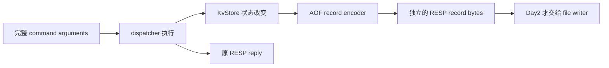

# Week14 Day1：把状态变化变成可重放的 RESP 记录

> 版本：2026-10-29，R1 已以 98/100 正式通过；下一步进入 R2
> 前置：Week13 整周已通过，Mini Redis V2 已有 RESP parser、dispatcher、KvStore 与 TTL
> 今日产出：不打开文件、不接服务器；只把已经确认的状态变化编码成独立、按字节保存的 RESP 记录
> 学习方式：R1 独立实现记录编码；R2 再区分“命令成功”和“状态真的改变”；R3 再统一相对期限与内部记录

[TOC]

---

# Part 1：前情提要

## 1. 今天只干一件事

**把一条已经确认的状态变化，变成以后可以重新执行的 bytes。**

先看你现在已经能完成的调用：

```text
客户端发送：SET code 1234
parser 得到：{"SET", "code", "1234"}
dispatcher 修改：KvStore["code"] = "1234"
server 回复：+OK\r\n
```

只要进程还活着，后面的 `GET code` 就能读到 `1234`。

但进程结束以后，`KvStore` 对象也消失。新进程只知道自己启动了，并不知道旧进程曾经执行过这次 `SET`。

今天先留下这样一段记录：

```text
*3\r\n
$3\r\n
SET\r\n
$4\r\n
code\r\n
$4\r\n
1234\r\n
```

真实内存里，它是一段连续 bytes。后面新进程把它交给现有 RESP parser，就能重新得到：

```text
{"SET", "code", "1234"}
```

Day3 才会真的执行这次恢复。今天只负责把记录造对。

## 2. 为什么不是把所有 request 都保存下来

连续发生四件事：

```text
SET code old
GET code
PTTL code
SET code new
```

退出前需要恢复的逻辑状态是：

```text
code -> new
并且没有 TTL
```

`GET` 和 `PTTL` 只观察状态。重启时再执行它们，不会帮助新 `KvStore` 长回旧状态。

因此今天先分成两类：

| 动作 | 是否需要恢复 | 今天怎样处理 |
|---|---:|---|
| 成功 `SET` | 是 | 留下 `SET key value` 记录 |
| 实际删除了有效 key 的 `DEL` | 是 | 留下原 key 顺序的 `DEL` 记录 |
| 成功设置期限的 `EXPIRE` | 是 | 后面转换成绝对到期时刻再记录 |
| `PING/ECHO/GET/EXISTS/PTTL` | 否 | 不产生记录 |

这张表先回答“哪些事实要带进新进程”。至于一次 `DEL` 或 `EXPIRE` 到底有没有生效，R2 会接着处理。

## 3. 三条时间线决定记录必须表达什么

### 3.1 两次覆盖必须保持顺序

```text
SET k old
SET k new
```

如果新进程按原顺序重做：

```text
空 store
-> k = old
-> k = new
```

最终状态正确。

如果记录顺序颠倒，最后会错误地得到 `old`。所以记录不只是保存参数，还要保留状态变化发生的顺序。

### 3.2 删除也必须留下

```text
SET k value
DEL k
```

只保存 `SET`，新进程会让已经删除的 key 重新出现。

因此有效的删除也是一条需要重做的状态变化。

### 3.3 相对期限不能原样留下

假设 12:00:00 执行：

```text
SET code 1234
EXPIRE code 120
```

原期限是 12:02:00。

如果 12:01:00 重启以后再执行一次 `EXPIRE code 120`，期限会被错误地延长到 12:03:00。

所以日志里不能把相对的“再活 120 秒”原样保存。它要写成类似：

```text
PEXPIREAT code 绝对的 Unix 毫秒时刻
```

`PEXPIREAT` 在这里表示“让 key 在某个绝对毫秒时刻到期”。

Unix 毫秒时刻是从 1970-01-01 00:00:00 UTC 起累计的毫秒数。它不随某个 Mini Redis 进程重新启动而归零。

R1 不计算这个时刻。R1 只提供一个明确入口：**给我已经算好的绝对到期时刻，我把它编码成记录。**

真正的双时钟转换留在 Week14 Day4。

## 4. 现在再给这两个动作命名

**AOF（Append-Only File，追加式文件）**：不断在文件末尾记录写操作；新进程启动时按顺序重新执行这些记录。

**Replay（重放）**：新进程读取旧记录，并把其中的状态变化重新应用到空 `KvStore`。

今天还没有 file，也没有 replay loop。我们只造 replay 将来要消费的一条记录。

[小林 Coding 的 AOF 讲解](https://xiaolincoding.com/redis/storage/aof.html#aof-%E6%97%A5%E5%BF%97)可以帮助建立“记录写操作，启动时再执行”的第一层直觉。

[Redis 官方持久化说明](https://redis.io/docs/latest/management/persistence/)用于校准边界：真实 Redis 用协议格式记录写操作，并提供本周不实现的同步策略、重写与多文件机制。

## 5. 四个主问题，贯穿今天

1. 一条记录为什么要保存命令名、参数数量和每个参数的 byte length？
2. key/value 里含 `\0` 或 `\r\n` 时，怎样保证恢复后一个 byte 都不变？
3. `DEL b a b` 为什么不能在编码时排序或去重？
4. 为什么今天只接收绝对期限，不在 encoder 里读取时钟？

R1 完成这四点的编码主链。R2/R3 再把它接到命令执行结果。

---

# Part 2：教程开始

## 6. 这个组件处在现有服务器的哪里

你当前的请求链是：

```text
Connection input bytes
-> RespRequestParser
-> vector<string> arguments
-> execute_command
-> KvStore 改变或保持
-> RESP reply bytes
-> Connection output
```

今天在“状态已经确认改变”之后增加一个纯函数组件：



图里的 encoder 不拥有 `KvStore`，也不拥有文件描述符。

它借用 key/value，返回自己拥有的 `std::string`。调用结束后，即使原 arguments 被销毁，返回的记录 bytes 仍然存在。

它运行在服务器进程的用户态。今天没有 system call，也没有 kernel page cache（内核页缓存）参与。

## 7. 为什么继续使用 RESP Array of Bulk Strings

客户端请求本来就是：

```text
Array
├─ Bulk String：command name
├─ Bulk String：argument 1
└─ Bulk String：argument 2 ...
```

例如 `SET code 1234`：

```text
*3\r\n              # 一共有 3 个元素
$3\r\nSET\r\n        # 第 1 项有 3 bytes
$4\r\ncode\r\n       # 第 2 项有 4 bytes
$4\r\n1234\r\n       # 第 3 项有 4 bytes
```

`$<length>` 的 length 数的是 bytes。parser 因此不需要在 payload（实际数据段）里寻找分隔符。

这正好适合已经支持的二进制 key/value：

```cpp
const std::string key{"k\0x", 3};
const std::string value{"v\r\nz", 4};
```

`\0` 和 payload 里的 CRLF 都只是数据。真正边界由前面的长度决定。

[Redis RESP 规范](https://redis.io/docs/latest/develop/reference/protocol-spec/)明确把客户端命令表示为 Bulk String 数组，并用长度前缀保持 binary-safe（按字节安全）。

## 8. Round1：新增独立的记录编码组件

### 8.1 文件与职责

Ubuntu 工程仍是：

```text
/home/xgf/code/system-learning/cpp/week10
```

本轮新增：

| 文件 | 只负责什么 |
|---|---|
| `include/mini_redis/aof_record.hpp` | 声明三种允许进入日志的记录入口 |
| `src/aof_record.cpp` | 把记录编码成 RESP Array of Bulk Strings |
| `tests/aof_record_test.cpp` | exact bytes 与 parser round-trip（编码后再解析回原参数）证据 |
| `CMakeLists.txt` | 新增 library 与测试 target |

保持不动：

- `command_dispatcher.cpp`
- `kv_store.cpp`
- `mini_redis_server.cpp`
- 原 parser、Connection 与 EventLoop

Day1 没有 AOF 文件路径，也不打开文件。文件 owner 从 Day2 才出现。

### 8.2 Public contract（公开接口约定）

`aof_record.hpp` 的公开接口固定为：

```cpp
#pragma once

#include <cstdint>
#include <string>
#include <string_view>
#include <vector>

std::string encode_aof_set(
    std::string_view key,
    std::string_view value);

std::string encode_aof_del(
    const std::vector<std::string>& keys);

std::string encode_aof_pexpireat(
    std::string_view key,
    std::int64_t unix_deadline_ms);
```

三个函数回答同一个问题：**如果上层已经确认发生了这类状态变化，写进日志的一条完整记录是什么？**

| 函数 | 输入 | 返回 | 不负责 |
|---|---|---|---|
| `encode_aof_set` | exact key/value bytes | `SET key value` 的独立 RESP bytes | 不修改 store，不判断 SET 是否成功 |
| `encode_aof_del` | 一个或多个 key，保持原顺序 | `DEL key...` 的独立 RESP bytes | 不查询哪些 key 当前存在 |
| `encode_aof_pexpireat` | key 与非负 Unix 毫秒时刻 | `PEXPIREAT key timestamp` 的独立 RESP bytes | 不读取时钟，不计算相对 TTL |

这里故意没有 `encode_aof_get`、`encode_aof_ping` 或 `encode_aof_pttl`。这些命令不创造需要恢复的状态。

这里也故意没有 `encode_aof_expire(key, seconds)`。相对秒数不能直接成为跨重启记录。

### 8.3 输入的所有权与返回值寿命

`std::string_view` 表示函数只在调用期间借用 key/value 的 byte range。

`const std::vector<std::string>&` 表示函数只在调用期间观察 DEL 的 keys，不复制或重排调用者的 vector。

返回类型是 `std::string`。它拥有完整记录：

```cpp
std::string make_record() {
    const std::string key{"k\0x", 3};
    const std::string value{"v\r\nz", 4};
    return encode_aof_set(key, value);
}

const std::string record = make_record();
// key 和 value 已销毁，record 仍拥有完整 bytes。
```

encoder 不能把 `string_view.data()` 保存到成员中，也不能返回指向输入的 pointer。

### 8.4 R1 的合法输入边界

R1 先完成合法路径：

- SET 接收任意 byte 内容的 key/value，包括空字符串、`\0` 和 CRLF。
- DEL 至少有一个 key，并保持数量、顺序和重复项。
- PEXPIREAT 接收非负 `std::int64_t` 绝对毫秒时刻。
- 输出必须是现有 `RespRequestParser` 能完整解析的一条记录。

空 DEL、负绝对时刻和超出 parser 上限的记录属于最终错误边界。R3 再统一补齐，不要求 R1 开始前同时处理。

## 9. 从三个具体调用读懂结果

### 9.1 SET：payload 里的特殊字节不能改变边界

```cpp
const std::string key{"k\0x", 3};
const std::string value{"v\r\nz", 4};

const std::string record = encode_aof_set(key, value);
```

预期 bytes 可以这样构造：

```cpp
const std::string expected =
    "*3\r\n"
    "$3\r\nSET\r\n"
    "$3\r\n" + key + "\r\n" +
    "$4\r\n" + value + "\r\n";
```

重点不是肉眼打印它。`\0` 可能让普通 C 字符串输出看起来提前结束。

真正证据是：

```text
record.size() 与 expected.size() 相等
record 每个 byte 与 expected 相等
parser 重新得到原 key/value
consumed_bytes == record.size()
```

### 9.2 DEL：顺序和重复项都属于原命令

```cpp
const std::vector<std::string> keys{"b", "a", "b"};
const std::string record = encode_aof_del(keys);
```

它表示：

```text
{"DEL", "b", "a", "b"}
```

数组元素数是 4，不是 3。command name 也占一个元素。

encoder 不排序，不去重。是否有 key 真被删除，由执行命令的上层决定；记录层只保存已经选定的状态变化及其原参数顺序。

### 9.3 PEXPIREAT：输入已经是绝对时刻

```cpp
const std::string record =
    encode_aof_pexpireat("code", 1'800'000'000'000LL);
```

parser 应重新得到：

```text
{"PEXPIREAT", "code", "1800000000000"}
```

encoder 做的是整数转十进制文本和 RESP 编码。

它没有权限自行调用 `steady_clock` 或 `system_clock`。否则同一输入可能因为调用时间不同而得到不同记录，组件也会同时混入时间策略。

[Redis EXPIRE 文档](https://redis.io/docs/latest/commands/expire/)说明过期信息以绝对 Unix 时间保存。我们的 Day4 会在自己的时钟模型里实现对应转换，不把真实 Redis 的全部实现直接搬进来。

## 10. R1 最小实现路线

先不要写 dispatcher 接线。按下面顺序完成组件：

1. 写出三个公开函数的声明。
2. 先让 `encode_aof_set("code", "1234")` 产生 exact bytes。
3. 把“命令名 + operands”收进同一个内部编码路径，避免三份长度逻辑。
4. 用同一路径完成 DEL，确认顺序和重复项保留。
5. 把绝对毫秒整数转成十进制 argument，完成 PEXPIREAT。
6. 用现有 parser 做一次 round-trip，确认输出真能成为未来的输入。

内部 helper、局部容器和拼接方式由你决定。

可以复用已有 `encode_resp_bulk_string()`。但最终数组元素数要由本条记录的实际参数数决定，不能把 payload 当 C 字符串，也不能用 `strlen` 计算 `std::string_view` 的长度。

## 11. R1 测试要证明什么

下面三项是核心 oracle（判定依据）。测试代码是机械脚手架；你需要能解释每项为什么成立。

### 11.1 SET exact bytes 与 round-trip

初始输入：

```cpp
key   = std::string{"k\0x", 3}
value = std::string{"v\r\nz", 4}
```

必须同时证明：

- exact record bytes 相等；
- parser 返回 `Complete`；
- arguments 精确等于 `SET`、原 key、原 value；
- `consumed_bytes == record.size()`。

这证明长度前缀决定边界，payload 中的 `\0` 和 CRLF 没有被误当作终止符。

### 11.2 DEL 保留参数序列

输入：

```text
b, a, b
```

解析后必须仍是：

```text
DEL, b, a, b
```

这证明 encoder 没有替命令层排序、去重或判断存在性。

### 11.3 PEXPIREAT 不保存相对秒数

输入绝对时刻 `1800000000000`。

解析后 command name 必须是 `PEXPIREAT`，最后一个 argument 必须是同一个十进制绝对毫秒值。

这个测试不能证明 wall clock 转换正确。它只证明 encoder 没有把接口悄悄退回相对 `EXPIRE`。

## 12. CMake 接入

在现有 `CMakeLists.txt` 的 Mini Redis 组件区域追加：

```cmake
add_library(aof_record
    src/aof_record.cpp
)

target_include_directories(aof_record PUBLIC
    ${CMAKE_CURRENT_SOURCE_DIR}/include/mini_redis
)

target_compile_options(aof_record PRIVATE
    -Wall
    -Wextra
    -g
)

target_link_libraries(aof_record PRIVATE
    resp_encoder
)

add_executable(aof_record_test
    tests/aof_record_test.cpp
)

target_compile_options(aof_record_test PRIVATE
    -Wall
    -Wextra
    -g
)

target_link_libraries(aof_record_test PRIVATE
    aof_record
    resp_request_parser
    GTest::gtest_main
    GTest::gtest
)

gtest_discover_tests(aof_record_test PROPERTIES TIMEOUT 5)
```

`aof_record` 的 public header 只暴露自己的三项函数，所以对 `resp_encoder` 使用 `PRIVATE` 即可。测试额外链接 parser，只为了验证 round-trip。

今天不把 `aof_record` 链进 `command_dispatcher` 或 `mini_redis_server`。R1 的独立边界因此仍然可见。

## 13. Round1 Reading Gate

完成 R1 后先停，不继续接文件或 server。

你应能回答：

1. 为什么 `SET k same` 即使 value 与旧值相同，将来仍可能需要记录？
2. 为什么 `GET/PTTL` 不应产生 AOF 记录？
3. 为什么 `DEL b a b` 的 encoder 不能排序或去重？
4. `encode_aof_pexpireat` 为什么只接收绝对时刻，而不读取 clock？
5. exact-byte 比较与 parser round-trip 分别证明什么？

R1 的 PASS 条件：

- 三个公开入口均能生成一条完整记录；
- SET 对 `\0` 与 CRLF 保持 exact bytes；
- DEL 保持参数序列；
- PEXPIREAT 明确保存绝对毫秒文本；
- 三类记录均被现有 parser 完整解析；
- 没有打开文件，没有修改 store，没有接网络。

---

## 14. Round2：命令执行成功，不等于状态一定改变

R1 已经把一件事情做完整了：上层给出已经选定的命令和参数，encoder 就返回一条自己拥有的 RESP record。

你的实际实现沿着同一条路径工作：

```text
SET / DEL / PEXPIREAT 的参数
-> 组成本次调用的局部 vector<string>
-> .cpp 内部 helper 编码 Array of Bulk Strings
-> 返回独立 std::string
```

helper 已放进 `aof_record.cpp` 的匿名命名空间。public header 只保留三个业务入口。这个边界说明 R1 只负责“怎样编码”，没有决定“本次命令是否值得记录”。

现在回到当前 `command_dispatcher.cpp`。

你现在的 `execute_command()` 只返回已经编码的 reply bytes：

```cpp
std::string execute_command(
    KvStore& store,
    const std::vector<std::string>& arguments);
```

这个返回值适合发给客户端，却不直接告诉持久化层“发生了哪种状态变化”。

不要把 wire reply（准备发给客户端的协议 bytes）再解析回来推断内部事实。先沿当前 handler 的真实结果判断：

| 命令 | 当前结果 | 是否生成记录 |
|---|---|---:|
| 合法 `SET k v` | 修改 value，并清除旧 TTL，回复 `+OK` | 总是 |
| `DEL a b`，返回删除数大于 0 | 至少一个有效 key 被删除 | 是，记录原完整 DEL |
| `DEL a b`，返回 0 | 没有新的逻辑状态变化 | 否 |
| `EXPIRE k n`，返回 1 | 当前有效 key 得到期限或被非正期限删除 | 是，需转换成可重放表示 |
| `EXPIRE k n`，返回 0 | 缺失或已失效 key 没有获得新期限 | 否 |
| read-only command | 只产生回复 | 否 |
| arity/range/protocol error | 命令没有按成功路径完成 | 否 |

Round2 的唯一问题是：**怎样让 application owner 得到“reply + 可选状态变化”，而不是从 wire reply 倒推？**

你当前的 handler 在修改 store 后只返回 reply，因此信息会在这里丢失：

```text
set_handler
-> store.set(...)
-> 只返回 +OK

del_handler
-> 算出 del_count
-> 只返回整数 reply

expire_handler
-> 得到是否成功修改期限
-> 只返回整数 reply
```

R2 只要求补回这一份丢失的信息：caller 仍能取得 reply，同时能知道是否存在一条待持久化的状态变化。具体使用小结果类型、callback 还是其他最小方案，由你根据当前代码设计；本课不预先强制 command hierarchy 或通用事件总线。

## 15. Round3：客户端命令与日志命令不是同一份文字

客户端发送：

```text
EXPIRE code 120
```

日志最终需要：

```text
PEXPIREAT code <absolute_wall_deadline_ms>
```

这个过程叫 **command normalization（命令规范化）**：客户端可以用一种方便的写法，日志把它收敛成恢复时语义明确的一种内部写法。

Round3 再补：

- relative EXPIRE 不能直接进入日志；
- 空 DEL 与负绝对时刻稳定失败；
- 超过现有 parser 限制的内部记录不能被生成；
- encoder 失败时不留下半条 record；
- 失败不能修改 store，也不能伪造成功 reply。

你当前的 `encode_aof_pexpireat()` 已经正确限定为“输入绝对毫秒，输出记录”。

它不读取 clock，也不负责把 `EXPIRE code 120` 换算成日历时刻。R3 先保证相对客户端命令不会被原样塞进日志。

真正的 wall clock 与 monotonic clock 换算仍留在 Day4。

Day1 仍然不解决：

- record 怎样完整写入 fd；
- `write()` 短写与 `EINTR`；
- `fsync/fdatasync`；
- 启动时怎样读取整个文件；
- wall clock 与 monotonic clock 怎样换算。

这些分别属于 Day2～Day4。

---

# Part 3：验证、记录与停止点

## 16. 构建与测试

在 Ubuntu 工程根目录：

```bash
cd /home/xgf/code/system-learning/cpp/week10
cmake -S . -B build
cmake --build build --target aof_record_test -j
cmake -E chdir build ctest --output-on-failure
```

最终仍使用约定的完整 CTest 命令。不要只运行新 executable 后就宣布全工程通过。

## 17. 本轮需要保存的证据

在 `week14/day1/day1_note.md` 记录：

1. 三类记录各自代表哪种已经发生的状态变化。
2. 一条 binary SET 的 key/value byte length，以及 round-trip 后的 arguments。
3. 为什么 read-only command 不产生记录。
4. 为什么相对 EXPIRE 不能原样重放。
5. 你的内部 helper 怎样保证 DEL 顺序和 owning output。
6. CTest 的实际结果；失败时保留第一条有效诊断。

今天的 note 重点是你对“什么值得恢复”和“记录怎样保持 exact bytes”的理解，不要求抄整篇教程。

## 18. 今天的停止边界

R1 已经闭合下面这条链：

```text
已确认的状态变化
-> AOF record encoder
-> 一条独立 RESP record
-> exact bytes 正确
-> 现有 parser 能完整还原 arguments
```

今天还没有证明：

- 命令执行后一定会调用 encoder；
- 记录已经进入文件；
- 回复客户端前已经满足同步边界；
- 新进程已经能恢复；
- TTL 能跨停机保持原到期时刻；
- 真实 Redis 的 AOF 行为已经被复刻。

接下来进入 R2：让当前 handler 在生成 reply 的同时，把“是否发生了可持久化状态变化”交给 application owner。文件追加仍然留给 Day2。
