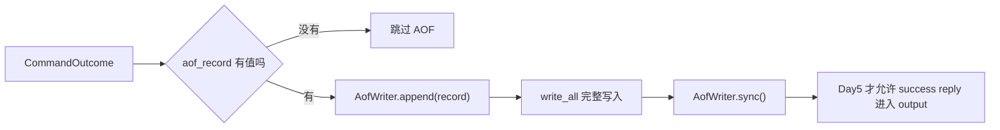

# Week14 Day2：把完整 AOF 记录一字节不丢地追加进文件

> 版本：2026-11-04，R1 99/100、R2 99/100、R3 97/100；Day2 整日以 97/100 正式通过，下一步生成 Week14 Day3
> 前置：Week14 Day1 已整日通过，R1 98/100、R2 98/100、R3 99/100
> 今日产出：一个拥有 AOF 文件描述符的 `AofWriter`，能完整追加记录并显式同步
> 学习方式：R1 先闭合正常追加；R2 再区分追加与同步；R3 最后验证短写和失败路径

[TOC]

---

# Part 1：今天为什么还需要一个文件写入组件

## 1. Day1 已经把什么交到了这里

Day1 的 `execute_command()` 现在会返回：

```cpp
struct CommandOutcome {
    std::string reply;
    std::optional<std::string> aof_record;
};
```

例如一次成功的 `SET code 1234` 会得到两份独立结果：

```text
reply
-> +OK\r\n

aof_record
-> *3\r\n$3\r\nSET\r\n$4\r\ncode\r\n$4\r\n1234\r\n
```

到这里，命令差异已经用完了。

SET handler 知道怎样生成 SET 记录。DEL handler 知道本次删除是否真的生效。
但记录生成以后，下一层只面对一段完整 bytes：

```text
有 aof_record
-> 追加这段 bytes

没有 aof_record
-> 跳过文件写入
```

所以 Day2 的组件不再判断命令，也不再访问 `KvStore`。

**今天只解决：怎样把 Day1 交来的完整 bytes，全部追加到同一个文件末尾。**

## 2. 直接调用一次 `write()`，问题出在哪里

先看一条 27 bytes 的记录：

```text
*3\r\n$3\r\nSET\r\n$1\r\nk\r\n$1\r\nv\r\n
```

如果直接写：

```cpp
::write(fd, record.data(), record.size());
```

你请求写 27 bytes，`write()` 可能只返回 10。

这个返回值表示：

```text
record[0..9]
-> 已经写入

record[10..26]
-> 仍然没有写入
```

只检查“返回值不是 -1”会把这次调用误判为成功。
下一条记录继续追加后，文件中间就会留下残缺命令。

恢复时，RESP parser 读到这里会得到 `NeedMore` 或 `Error`，后面的状态也无法可靠重放。

`write()` 成功返回正数但少于请求长度，叫
**short write（短写）**。

今天不是第一次学习短写。Week4 Day2 已经用 `copyfile` 处理过它。
今天把同一个能力放进 AOF，是因为短写现在会破坏一条可重放记录的边界。

## 3. 今天的四个问题

带着下面四个问题进入实现。每完成一轮，核销其中一部分。

1. `write()` 只写了前缀时，怎样继续写剩余 bytes，而不是重写前缀？
2. writer 析构后重新打开同一路径，旧记录为什么仍保留，新记录为什么接在末尾？
3. key/value 中含 `\0` 或 `\r\n` 时，怎样证明写入依据是长度，不是终止符？
4. append 或同步失败时，怎样让上层看见失败，而不是继续伪造成功？

R1 先解决前三个问题的正常路径。

R2 再回答“写完”和“满足同步边界”为什么不是一回事。

R3 最后让少见的短写、`EINTR` 和错误分支真的发生。

## 4. 组件在当前工程中的位置



R1 先实现图中的 `AofWriter` 与 `write_all`。
R2 再给同一个对象增加 `sync()`。

`CommandOutcome` 与 `AofWriter` 的正式接线留在 Day5。
这能让文件 I/O 先作为独立组件被验证。

---

# Part 2：从完整追加走到可观察的同步边界

# Round 1：先让一条记录完整进入文件

## 5. R1 到底要造什么

新增三个文件：

```text
include/mini_redis/aof_writer.hpp
src/aof_writer.cpp
tests/aof_writer_test.cpp
```

第一版 public contract（公开约定）保持很小：

```cpp
#pragma once

#include "unique_fd.hpp"

#include <string>
#include <string_view>

class AofWriter {
public:
    explicit AofWriter(const std::string& path);

    void append(std::string_view record);

private:
    UniqueFd fd_;
};
```

这两个入口分别完成：

```text
AofWriter(path)
-> 打开或创建 AOF 文件
-> 对象从此拥有这个 fd

append(record)
-> 借用 record 的 bytes
-> 返回前把 record.size() 个 bytes 全部交给 write()
```

`append()` 不保存传入的 `string_view`。
它只在本次调用期间借用数据，并在返回前完成写入循环。

`AofWriter` 也不需要自己写析构函数。
成员 `UniqueFd` 已经负责在对象析构时关闭 fd。

## 6. 构造函数为什么使用这四个 flag

打开文件时使用：

```cpp
O_WRONLY | O_CREAT | O_APPEND | O_CLOEXEC
```

逐个看它们服务什么行为。

### 6.1 `O_WRONLY`

writer 只负责写，不从这个 fd 读取日志。

### 6.2 `O_CREAT`

第一次启动时文件可能不存在。
此时创建它，并传入权限参数 `0644`。

### 6.3 `O_APPEND`

每次 `write()` 前，内核把本次写入位置放到文件末尾。

因此第二次打开同一路径时不会覆盖第一条记录。
这里不能使用 `O_TRUNC`，因为它会在打开时把旧日志清空。

### 6.4 `O_CLOEXEC`

以后进程若执行 `exec`，这个 fd 不会意外泄漏给新程序。

它不改变今天的追加算法，只把 fd 生命周期边界写得更明确。

构造函数检查 `open()` 返回值。
失败时保存当时的 `errno`，抛出 `std::system_error`。
这个异常同时保留错误码和调用语境，测试可以检查 `e.code()`：

```text
open 返回 -1
-> 立刻保存 errno
-> 构造 system_error
-> AofWriter 构造失败
```

失败的对象没有进入可用状态。

## 7. `write_all` 只维护一个状态

`append()` 内部需要一个小循环。

它只维护：

```text
offset = 已经成功写出的 byte 数
```

假设记录总长为 27：

```text
开始：offset = 0

第一次 write 返回 10
-> offset = 10

第二次 write 必须从 record.data() + 10 开始
-> 请求剩余 17 bytes

第二次返回 17
-> offset = 27
-> 全部完成
```

这就是循环不变量：

**每轮开始时，`record[0..offset-1]` 已经写出，
`record[offset..size-1]` 仍待写。**

伪代码如下：

```text
offset = 0

while offset < record.size():
    written = write(fd,
                    record.data() + offset,
                    record.size() - offset)

    written > 0
        offset += written

    written == -1 and errno == EINTR
        offset 不变，重试同一段

    written == -1 and errno != EINTR
        保存 errno，抛 system_error

    written == 0
        没有进展，抛 runtime_error
```

这里的 `fd` 是 borrowed fd（借用的文件描述符）。
`write_all` 使用它，但关闭责任仍属于 `AofWriter::fd_`。

### 7.1 为什么 `EINTR` 不推进 offset

`EINTR` 表示这次系统调用在报告写入 bytes 之前被信号打断。

它没有返回一个正的 byte count，所以调用者没有新的已完成前缀可以确认。
下一轮继续使用原来的 offset。

### 7.2 为什么返回 0 不能一直重试

当前仍有 bytes 待写，但 `write()` 返回 0：

```text
offset 没变
remaining 没变
```

直接 `continue` 会让循环永远停在原地。

因此本项目把“正长度写入得到 0”稳定视为无进展错误。

## 8. R1 的测试到底证明什么

R1 用两个测试分别回答两个问题。

### 8.1 文件还不存在时，writer 能否创建并精确追加

第一个测试是：

```cpp
const auto record = encode_aof_set("plain", "value");

AofWriter writer(path);
writer.append(record);

EXPECT_EQ(read_file_as_bytes(path), record);
```

调用前，`path` 指向的文件不存在。

构造成功说明 `O_CREAT` 路径可用。
读回结果与 `record` 逐字节相等，说明第一次追加没有丢失、重复或改写 bytes。

这个测试也真实暴露了一个构造问题：使用 `O_CREAT` 时必须向 `open()` 传入文件权限。
当前实现已经补为 `0644`。

### 8.2 重新打开后，旧记录是否保留，binary bytes 是否完整

第二个测试使用两条真实的 Day1 record：

```cpp
const auto first = encode_aof_set("plain", "value");

const std::string binary_key{"k\0x", 3};
const std::string binary_value{"v\r\n\0z", 5};
const auto second = encode_aof_set(binary_key, binary_value);
```

测试先创建一个合法的空文件，再走两个 writer 生命周期：

```cpp
{
    AofWriter writer(path);
    writer.append(first);
}

{
    AofWriter writer(path);
    writer.append(second);
}

EXPECT_EQ(read_file_as_bytes(path), first + second);
```

这个场景留下三份证据。

第一，第二个 writer 没有清空第一条记录。

第二，文件内容正好是两条输入的连接，没有重复前缀，也没有丢失后缀。

第三，binary key/value 中的 `\0` 与 CRLF 没有截断数据。
比较依据是 `std::string::size()` 所表达的 byte count。

测试中按 binary mode（二进制模式）读取文件。
不要用 `strlen()` 或把内容当作以 `\0` 结束的 C string。

两个测试分开以后，失败时能更快定位：

```text
第一个失败
-> 优先检查 open/create 与第一次 append

第二个失败
-> 优先检查 O_APPEND、重新打开和 binary length
```

### 8.3 这些测试还没有证明什么

测试进程能重新读到 bytes，只说明内核已经接受了写入并允许后续读取。

它还没有证明突然掉电后这些 bytes 一定存在。
这个差别在 R2 才讲。

### 8.4 R1 的实际验收结果

本轮保留用户的 production code、note 与 CMake，只补并运行 R1 测试。

实际证据是：

```text
focused AofWriterR1 tests
-> 2 / 2 PASS

full CTest regression
-> 140 / 140 PASS

fresh Debug build with -Werror
-> build clean
-> focused 2 / 2 PASS
```

R1 最终为 **99/100，正式通过**。

唯一保留的 1 分是 include hygiene（直接包含自己使用的声明）仍可更清楚。
这不影响本轮行为正确性，也不要求为了 R1 回头重写代码。

## 9. `.hpp`、`.cpp` 与 CMake 在这里怎样连起来

头文件只声明：

```text
AofWriter 有哪些公开成员
调用代码应该怎样使用它
```

源文件定义：

```text
构造函数怎样 open
append 怎样循环 write
错误怎样转换成异常
```

编译时，两份 `.cpp` 先各自产生 object file（目标文件）：

```text
src/aof_writer.cpp
-> aof_writer.cpp.o

tests/aof_writer_test.cpp
-> aof_writer_test.cpp.o
```

随后 linker（链接器）把测试中调用的符号，连接到
`aof_writer.cpp.o` 中的定义。

如果只 include header，却忘记把 `src/aof_writer.cpp` 加入 target：

```text
编译阶段
-> 看见声明，可以通过

链接阶段
-> 找不到 AofWriter::append 的定义
-> undefined reference
```

把下面 target 放在现有 AOF targets 附近：

```cmake
add_library(aof_writer
    src/aof_writer.cpp
)

target_include_directories(aof_writer PUBLIC
    ${CMAKE_CURRENT_SOURCE_DIR}/include/mini_redis
    ${CMAKE_CURRENT_SOURCE_DIR}/include/reactor
)

target_compile_options(aof_writer PRIVATE
    -Wall
    -Wextra
    -g
)

add_executable(aof_writer_test
    tests/aof_writer_test.cpp
)

target_compile_options(aof_writer_test PRIVATE
    -Wall
    -Wextra
    -g
)

target_link_libraries(aof_writer_test PRIVATE
    aof_writer
    aof_record
    GTest::gtest_main
    GTest::gtest
)

gtest_discover_tests(aof_writer_test PROPERTIES TIMEOUT 5)
```

`aof_writer` 本身不链接 `aof_record`。

writer 只接收 bytes。只有测试为了制造真实 record，才调用 Day1 encoder。

## 10. Round 1 停止点

先完成并验证：

```text
[x] AofWriter 打开或创建文件，且不截断旧内容
[x] fd 由 UniqueFd 拥有
[x] append 使用 offset 处理短写
[x] EINTR 不推进 offset
[x] write 返回 0 时不会死循环
[x] 两次打开后，文件 bytes 等于 first + second
[x] binary payload 未被截断
[x] aof_writer_test 进入 CTest
```

其中创建、重新打开、精确 bytes 与 CTest 已有动态证据。
短写、`EINTR` 与零进展分支当前由源码检阅确认；R3 再用可控返回值补动态证据。

到这里先停。

**R1 已正式通过。后续保留现有 header、source、tests 与 CMake，R2 只增加同步能力。**

你应该能脱离代码回答：

1. offset 表示已经写出的长度，还是剩余长度？
2. 第一次写出 10 bytes 后，下一次地址和长度分别是什么？
3. 为什么 `AofWriter` 不需要知道这条记录来自 SET 还是 DEL？
4. 为什么第二次打开不能带 `O_TRUNC`？

---

# Round 2：追加成功，不等于同步完成

## 11. R1 已经写完，为什么还要多一步

当前真实的 `AofWriter` 已经拥有构造函数与 `append()`。
R2 不重写这条追加路径，也不删除两个 R1 测试。

现在只给同一个对象增加一个动作：

```cpp
void sync();
```

R1 的 `append()` 成功返回后，这段数据通常已经进入 kernel page cache（内核页缓存）。

页缓存位于内核管理的内存中。后续读取同一文件时，内核可以直接返回这些新数据。
因此刚才的读回测试会通过。

但当前进程读得到，不等于存储设备已经完成这次写入。

把路径拆开：

```text
record 在用户内存
-> write_all
-> 内核接受完整 bytes
-> fdatasync
-> 设备报告本次同步完成
```

[`write(2)`](https://man7.org/linux/man-pages/man2/write.2.html)
明确说明，成功返回不保证数据已经提交到磁盘。

## 12. 为什么 `append()` 与 `sync()` 分成两个 API

Day5 的 application owner 需要看见下面这个顺序：

```text
writer.append(record)
-> writer.sync()
-> success reply 才进入 Connection output
```

如果 `append()` 内部把所有阶段都藏在一起，调用点看不出当前成功回复依赖哪条边界。

拆开后，两种承诺很清楚：

```text
append 返回
-> 当前 record 的全部 bytes 已经由 write_all 接受

sync 返回
-> 本项目选择的 fdatasync 边界已经成功
```

今天仍采用保守策略：每次需要持久化的状态变化都执行一次同步。
它的性能代价留在 Week15 用 workload 测量。

## 13. `fdatasync()` 在本项目里负责什么

`fdatasync(fd)` 要求把文件数据，以及后续正确读取这些数据所必需的 metadata（元数据）同步出去。

例如，追加让文件长度增加。新长度是以后读回新增 bytes 所必需的信息。

[`fdatasync(2)`](https://man7.org/linux/man-pages/man2/fsync.2.html)
不会为了本课额外要求所有无关 metadata 都同步。

实现仍按返回值分支：

```text
返回 0
-> 同步成功

返回 -1，errno == EINTR
-> 重试

返回 -1，其他 errno
-> 保存 errno，抛 system_error
```

R2 不需要增加 background thread（后台线程），
也不需要实现 flush policy enum（写回策略枚举）。

当前只有一个明确策略：调用者显式执行 `sync()`。

## 14. R2 怎样留下证据

先在正常文件上运行：

```cpp
AofWriter writer(path);
writer.append(record);
writer.sync();
```

预期是：

```text
append 不抛异常
sync 不抛异常
读回 bytes 仍等于 record
```

再用 `strace` 观察真实系统调用顺序：

```bash
strace -f \
  -e trace=openat,write,fdatasync,close \
  ./build/aof_writer_test \
  --gtest_filter='AofWriterR2.AppendAndSync'
```

你要找的是：

```text
openat(... O_WRONLY|O_CREAT|O_APPEND|O_CLOEXEC ...)
write(...)
fdatasync(...)
close(...)
```

系统调用次数不必硬编码。
`write_all` 允许一次或多次 `write()`，正确性看最终 bytes 与调用顺序。

这项实验也不冒充拔电测试。
它证明程序确实执行了选定系统调用，并正确处理了返回值。

## 15. Round 2 停止点

R2 通过前，你需要能解释：

1. 为什么刚写完就能读到，仍不等于已经满足同步边界？
2. `append()` 和 `sync()` 各自承诺到哪一步？
3. 为什么 Day5 必须在两步成功以后再安排 success reply？
4. 为什么当前选择每条状态修改都同步一次，但不提前声称这个策略性能足够？

---

# Round 3：让短写和错误路径真正发生

## 16. 正常文件测试为什么还不够

当前 R1 的 `write_all` 在 `.cpp` 内部直接调用真实 `::write`。
它的 offset 循环继续保留。

R3 只把“这一次底层调用返回什么”变成测试可控，
不会重写 R1 已经通过的文件 ownership、追加模式或循环规则。

在本机普通文件上，一条 27 bytes 的记录很可能一次 `write()` 就全部完成。

测试虽然通过，但下面这些分支可能从未执行：

```text
先短写，再继续
EINTR 后重试
返回 0 后结束
写入一部分后再报 EIO
fdatasync 报错
```

R3 的问题因此很具体：

**怎样让测试决定每一次底层调用返回什么？**

到这里才增加两个可替换入口：

```cpp
using WriteFn =
    std::function<ssize_t(int, const void*, std::size_t)>;

using SyncFn =
    std::function<int(int)>;
```

生产构造函数继续使用真实的 `::write` 与 `::fdatasync`。

测试构造函数接收两个 lambda，让测试能够安排返回顺序。
这里的 callable（可调用对象）就是可以像函数一样被调用的对象。
这只是给两个系统调用留可控入口，不扩展成通用 I/O framework（I/O 框架）。

最终接口可以收敛为：

```cpp
#include <cstddef>
#include <functional>
#include <sys/types.h>

class AofWriter {
public:
    using WriteFn =
        std::function<ssize_t(int, const void*, std::size_t)>;
    using SyncFn = std::function<int(int)>;

    explicit AofWriter(const std::string& path);

    AofWriter(
        const std::string& path,
        WriteFn write_fn,
        SyncFn sync_fn);

    void append(std::string_view record);
    void sync();

private:
    UniqueFd fd_;
    WriteFn write_fn_;
    SyncFn sync_fn_;
};
```

若你的最终接口使用一个小 `Ops` struct 保存这两个 callable，也可以。
验收看行为与所有权，不强制成员排版完全相同。

## 17. 场景一：先短写，再被打断，最后写完

让测试按下面顺序返回：

```text
第一次 write
-> 真实写入前 5 bytes
-> 返回 5

第二次 write
-> errno = EINTR
-> 返回 -1

第三次 write
-> 写完剩余 bytes
```

期望：

```text
append 正常返回
文件 bytes 精确等于原 record
调用次数为 3
没有重复前 5 bytes
```

这个 test 证明 `offset` 在短写后推进，在 `EINTR` 后保持。

## 18. 场景二：底层一直没有进展

让 write callable 在仍有 bytes 时直接返回 0：

```text
record 非空
-> write 返回 0
-> append 抛 runtime_error
```

测试同时限制调用次数。

只调用一次就抛错，证明代码没有原地无限重试。

## 19. 场景三：已经写入前缀，下一次才失败

安排：

```text
第一次 write
-> 写入前 5 bytes

第二次 write
-> errno = EIO
-> 返回 -1
```

`append()` 必须抛出 `std::system_error`，并保留 `EIO`。

文件中可能已经存在那 5 bytes 前缀。
writer 无法假装前一次系统调用没有发生，也不在今天自动回滚文件长度。

这正是 Day6 要处理 incomplete tail（不完整文件尾）的原因：

```text
完整旧记录
-> 新记录只留下前缀
-> 当前写入失败
-> 服务器不能回复成功
-> 下次启动只接受可验证的完整前缀
```

## 20. 场景四：record 已写完，但同步失败

让真实 write 完成，再让 sync callable：

```text
errno = EIO
return -1
```

`sync()` 应抛出带 `EIO` 的 `std::system_error`。

此时 record 可能已经能从页缓存读到。
但本项目选定的同步边界没有成功，所以 Day5 不能发送 success reply。

Day2 的 writer 只负责把失败交给调用者。
它不负责撤销已经修改的 `KvStore`。

Day5 会把 append/sync failure（追加或同步失败）接到
fatal path（致命失败路径）：
停止继续正常服务，并保留诊断。

## 21. 把四个场景压成验收表

前面已经逐个走过具体动作，现在再压缩：

| 场景 | 预期结果 | 证明什么 |
|---|---|---|
| `5 -> EINTR -> rest` | 完整 record，正常返回 | offset 推进与中断重试正确 |
| `0` | 立即抛无进展错误 | 循环不会空转 |
| `5 -> EIO` | 抛出保留 EIO 的 `system_error` | 部分文件尾不会被伪装成成功 |
| write 完成，sync 为 EIO | `sync()` 抛错 | append 成功与同步成功是两个状态 |

构造失败再留一条很小的证据：把 path 指向不存在的父目录，
确认构造函数抛出带 `ENOENT` 的 `std::system_error`。
这证明 `open()` 失败时不会留下一个看似可用的 writer。

## 22. Round 3 停止点

R3 通过时，下面这条链应该已经有可执行证据：

```text
完整 record
-> 一次或多次 write
-> 全部 bytes 已接受
-> fdatasync 成功
-> 调用者才得到完整成功
```

任何一步失败：

```text
-> 异常保留真实错误
-> 不伪造成功
-> 不无限循环
```

---

# Part 3：验证、笔记与今天的边界

## 23. 构建与测试

在 Ubuntu 工程根目录：

```bash
cd /home/xgf/code/system-learning/cpp/week10

cmake -S . -B build
cmake --build build --target aof_writer_test -j

cmake -E chdir build \
  ctest --output-on-failure \
  -R '^AofWriter'
```

局部 target 通过后，再运行完整回归：

```bash
cmake -E chdir build ctest --output-on-failure
```

不要提前写死“应有多少项测试”。
最终数量以本次实际 CTest 输出为准。

## 24. 今天的 note 只需要留下这条主干

在 `week14/day2/day2_note.md` 记录：

1. Day1 的完整 record 怎样成为 Day2 的输入。
2. `offset` 的含义，以及短写后下一次写入的地址和长度。
3. `AofWriter` 为什么拥有 fd，却只借用传入的 record。
4. `O_APPEND` 为什么保留旧日志，`O_TRUNC` 为什么不适合 AOF。
5. `append()` 与 `sync()` 分别承诺到哪里。
6. `5 -> EINTR -> rest` 的实际 offset 变化。
7. 为什么部分写入后再失败，文件尾可能已经不完整。
8. `.hpp` 有声明、`.cpp` 有定义、CMake target 负责把两者链接起来。
9. 实际 CTest 与 `strace` 结果；没有运行的证据不要补写成通过。

每节 AI Theory 结束后仍由你自己记笔记。
这条提醒不影响今天的 systems note。

## 25. 今天正式完成时，你能声称什么

可以声称：

```text
Day1 生成的一条完整 RESP AOF record
能够被 AofWriter 按 byte length 追加到文件末尾

短写和 EINTR 不会造成重复或漏写

append 与 fdatasync 的成功边界已经分开

open/write/sync failure 会作为异常交给调用者
```

今天仍未证明：

```text
新进程已经重放这些记录
TTL 已经跨重启保持原到期时刻
append/sync failure 已接进真实 server fatal path
不完整文件尾已经能够恢复或截断
新建文件的目录项在所有掉电模型下都已持久化
多进程或多线程同时写同一个 AOF 的整条记录原子性
```

当前项目只有一个 application owner 写这份 AOF。
`O_APPEND` 让每次独立 `write()` 从文件末尾开始，但 `write_all` 可能发出多次系统调用。
因此今天不把整个 record 宣称为并发 writer 下的原子追加单位。

## 26. Day3 从哪里继续

Day2 结束后，文件里已经有：

```text
[完整 SET record][完整 DEL record][完整 SET record]...
```

Day3 要解决下一件事：

```text
新进程启动
-> 读取文件 bytes
-> parser 每次取出一条 Complete record
-> 按 consumed_bytes 前进
-> 在空 KvStore 中重放
-> 恢复完成后才开始 listen
```

今天把 bytes 可靠留下。

下一天再让新进程真正使用它们。
