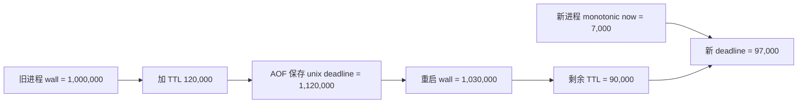

# Week14 Day4：让停机时间也从 TTL 里扣掉

> 版本：2026-11-04，教程提前生成，尚未开始学习
> 当前前置：Week14 Day1、Day2 已整日通过；Day3 R1 已以 96/100 正式通过，下一步 R2
> 今日产出：一个 AOF expiry bridge（AOF 期限桥接）组件，把绝对日历期限换成新进程的剩余 TTL
> 今日主线：写入绝对期限 -> 进程停机 -> 重启时扣掉停机时间 -> 写入新进程自己的单调期限

正式进入 Day4 前，必须先完成 Day3。

Day3 的实际函数名若与预生成稿不同，只校准接线处名称。

今天的时间语义、失败行为和测试目标不随名称改变。

[TOC]

---

# Part 1：为什么把 `EXPIRE code 120` 原样写进日志是错的

## 1. 先看我们真正想恢复的行为

假设服务器在这个时刻处理命令：

```text
当前日历时刻：1,000,000 ms
收到命令：EXPIRE code 120
TTL：120,000 ms
```

那么 `code` 应该在下面这个时刻失效：

```text
1,000,000 + 120,000
= 1,120,000 ms
```

服务器写完日志后停机。

30 秒后，新进程开始重放日志：

```text
重启日历时刻：1,030,000 ms
```

此时 `code` 真正还剩：

```text
1,120,000 - 1,030,000
= 90,000 ms
```

这些整数是为了便于手算的示例。

真实 Unix 时间戳会大很多。

## 2. 相对 TTL 为什么会把寿命重新开始

如果 AOF 中保存的是：

```text
EXPIRE code 120
```

新进程重放时会把它理解成：

```text
从现在开始，再活 120 秒
```

于是实际寿命变成：

```text
停机前已经活过的时间
+ 停机 30 秒
+ 重启后新算的 120 秒
```

这不是恢复旧状态。

这是在重启时重新送给 key 一份完整 TTL。

我们真正需要保存的是：

```text
code 应该在哪一个日历时刻失效
```

而不是：

```text
当时还剩多少毫秒
```

## 3. 日志里要保存哪一个数

Day1 已经实现：

```cpp
encode_aof_pexpireat("code", unix_deadline_ms)
```

它会产生：

```text
PEXPIREAT code 1120000
```

`PEXPIREAT` 的含义是：

```text
让这个 key 在指定的 Unix 毫秒时刻失效
```

这里的 `1,120,000` 是 absolute deadline（绝对到期时刻）。

它不是“再等 1,120,000 毫秒”。

Redis 官方也把 `PEXPIREAT` 的第二个参数定义为 Unix epoch
（Unix 纪元，即 1970-01-01 00:00:00 UTC）以来的毫秒数；
过去的时刻会立即删除 key：
[Redis PEXPIREAT](https://redis.io/docs/latest/commands/pexpireat/)。

本项目只把 `PEXPIREAT` 当成内部 AOF 记录。

今天不新增客户端可调用的完整 `PEXPIREAT` 命令。

## 4. 为什么不能把现有 `KvStore` deadline 直接写进文件

当前 `KvStore` 使用 `steady_clock`。

它保存的是 monotonic clock（单调时钟）上的期限。

假设旧进程中：

```text
old monotonic now = 500
TTL               = 120,000
old deadline      = 120,500
```

新进程可能从另一个单调时钟位置开始：

```text
new monotonic now = 7,000
```

旧进程的 `120,500` 不能直接放进新进程。

它们的起点不是同一个可持久化日历原点。

单调时钟适合回答：

```text
这一次运行期间，期限是否已经到达？
```

它不适合回答：

```text
另一轮进程启动后，现实世界已经走到几点？
```

## 5. 两种时钟各负责一段

今天第一次同时使用两种时间：

| 时间 | 本项目用来回答什么 | 是否写入 AOF |
|---|---|---|
| wall clock（墙上时钟） | 现实世界已经走到哪个 Unix 毫秒 | 写入绝对期限 |
| monotonic clock（单调时钟） | 当前进程内还剩多久、是否到期 | 不写入旧数值 |

墙上时钟在 C++ 中可由 `std::chrono::system_clock` 取得。

它能映射到现实日期和时间，类似你在系统中看到的当前时间。

它可能因为系统校时而向前或向后调整。

单调时钟不会倒退，更适合进程内计算持续时间。

两者的标准库角色可对照：
[C++ chrono clocks](https://en.cppreference.com/w/cpp/chrono)。

今天不让其中一个取代另一个。

我们只在 AOF 边界做一次转换。

## 6. 完整转换只走四步

写日志时：

$$
\text{unix\_deadline}
=
\text{old\_wall\_now}
+
\text{ttl}
$$

重放时：

$$
\text{remaining}
=
\max(0,
\text{unix\_deadline}
-
\text{new\_wall\_now})
$$

再交给新进程：

$$
\text{new\_monotonic\_deadline}
=
\text{new\_monotonic\_now}
+
\text{remaining}
$$

把示例代进去：

```text
old wall now       = 1,000,000
ttl                =   120,000
unix deadline      = 1,120,000

new wall now       = 1,030,000
remaining          =    90,000

new monotonic now  =     7,000
new store deadline =    97,000
```



图中的 `97,000` 只在新进程内部使用。

下一次重启仍然读取 AOF 中的 `1,120,000`。

---

# Part 2：先造一个只负责换算的期限桥

# Round 1：用固定整数证明停机 30 秒后只剩 90 秒

## 7. R1 到底要造什么

新增三个文件：

```text
include/mini_redis/aof_expiry.hpp
src/aof_expiry.cpp
tests/aof_expiry_test.cpp
```

这不是通用时间框架。

它只解决两个动作：

```text
在线正数 EXPIRE 的 TTL
-> 算出可以写进 AOF 的 Unix 绝对期限

AOF 中的 Unix 绝对期限
-> 算出重启时还剩多久
-> 交给当前 KvStore
```

第一版公开接口：

```cpp
#pragma once

#include "kv_store.hpp"

#include <cstdint>
#include <string>

using UnixTimeMs = std::int64_t;

UnixTimeMs checked_unix_deadline_ms(
    UnixTimeMs unix_now_ms,
    KvStore::TimeMs ttl_ms);

bool apply_aof_pexpireat(
    KvStore& store,
    const std::string& key,
    UnixTimeMs unix_deadline_ms,
    UnixTimeMs unix_now_ms);
```

`UnixTimeMs` 只是把这个整数的用途写进类型名。

它的底层仍是 `std::int64_t`。

## 8. 先看两个函数分别把结果交给谁

### 8.1 `checked_unix_deadline_ms`

调用：

```cpp
const UnixTimeMs deadline =
    checked_unix_deadline_ms(1'000'000, 120'000);
```

结果：

```text
deadline == 1,120,000
```

这个结果交给 Day1 的编码器：

```cpp
const std::string record =
    encode_aof_pexpireat("code", deadline);
```

它不修改 `KvStore`。

它只负责安全地完成：

```text
当前 Unix 毫秒 + 正 TTL
```

### 8.2 `apply_aof_pexpireat`

新进程先由 Day3 重放前面的 SET：

```cpp
KvStore::TimeMs new_monotonic_now = 7'000;
KvStore restored([&new_monotonic_now] {
    return new_monotonic_now;
});

restored.set("code", "1234");
```

然后应用绝对期限：

```cpp
const bool changed = apply_aof_pexpireat(
    restored,
    "code",
    1'120'000,
    1'030'000);
```

结果：

```text
changed == true
restored.pttl("code") == 90,000
```

这个函数会修改 `restored` 中 `code` 的期限。

它不生成 reply。

它也不生成新的 AOF record。

返回值只说明：

```text
这条期限记录是否作用在一个当前有效的 key 上
```

## 9. `checked_unix_deadline_ms` 应怎样判断

本函数只服务正数 `EXPIRE`。

Day1 已经规定：

```text
EXPIRE key 0
EXPIRE key -5
```

成功删除时记录成 `DEL`。

它们不进入本函数。

因此这里的顺序是：

```text
unix_now_ms < 0
-> invalid_argument

ttl_ms <= 0
-> invalid_argument

ttl_ms > int64_max - unix_now_ms
-> overflow_error

否则
-> return unix_now_ms + ttl_ms
```

先判断，再做加法。

不要先计算以后再检查结果。

## 10. `apply_aof_pexpireat` 应怎样换算

先验证两个墙上时钟整数：

```text
unix_deadline_ms >= 0
unix_now_ms >= 0
```

然后只从 `KvStore` 读取一次当前单调时刻：

```cpp
const KvStore::TimeMs monotonic_now_ms =
    store.read_time_ms();
```

如果绝对期限已经到达：

```text
unix_deadline_ms <= unix_now_ms
```

就把剩余 TTL 当成 0：

```cpp
return store.expire_ms_at(
    key,
    0,
    monotonic_now_ms);
```

当前 `KvStore` 对非正 TTL 的行为是立即删除有效 key。

如果期限还在未来：

```cpp
const KvStore::TimeMs remaining_ms =
    unix_deadline_ms - unix_now_ms;

return store.expire_ms_at(
    key,
    remaining_ms,
    monotonic_now_ms);
```

这里先确认 `deadline > now >= 0`。

所以减法结果一定是正数，也不会发生有符号下溢。

新单调期限的加法越界继续由现有 `expire_ms_at()` 检查。

## 11. R1 三个测试分别证明什么

测试文件至少需要：

```cpp
#include "aof_expiry.hpp"

#include <gtest/gtest.h>

#include <optional>
#include <string>
```

### 11.1 停机时间确实被扣掉

```cpp
TEST(AofExpiryR1Test,
     ThirtySecondsOfflineLeavesNinetySeconds) {
    constexpr UnixTimeMs kWriteUnixNow = 1'000'000;
    constexpr KvStore::TimeMs kTtlMs = 120'000;

    const UnixTimeMs deadline =
        checked_unix_deadline_ms(kWriteUnixNow, kTtlMs);
    ASSERT_EQ(deadline, 1'120'000);

    KvStore::TimeMs replay_monotonic_now = 7'000;
    KvStore restored([&replay_monotonic_now] {
        return replay_monotonic_now;
    });
    restored.set("code", "1234");

    ASSERT_TRUE(apply_aof_pexpireat(
        restored,
        "code",
        deadline,
        1'030'000));

    EXPECT_EQ(restored.pttl("code"), 90'000);

    replay_monotonic_now += 89'999;
    EXPECT_EQ(
        restored.get("code"),
        std::optional<std::string>("1234"));

    ++replay_monotonic_now;
    EXPECT_EQ(restored.get("code"), std::nullopt);
}
```

这个测试没有真的等待 30 秒或 90 秒。

它控制两个时钟整数，直接验证换算结果。

### 11.2 停机超过期限时立即删除

```cpp
TEST(AofExpiryR1Test,
     DeadlinePassedWhileOfflineDeletesRestoredKey) {
    KvStore::TimeMs replay_monotonic_now = 40;
    KvStore restored([&replay_monotonic_now] {
        return replay_monotonic_now;
    });
    restored.set("code", "1234");

    EXPECT_TRUE(apply_aof_pexpireat(
        restored,
        "code",
        1'120'000,
        1'121'000));

    EXPECT_EQ(restored.get("code"), std::nullopt);
    EXPECT_EQ(restored.size(), 0U);
}
```

这里返回 `true` 的意思是：

```text
期限记录确实让一个有效 key 发生了状态变化
```

它不是说 key 仍然存在。

### 11.3 后来的 SET 仍然清除旧期限

日志顺序可能是：

```text
SET code old
PEXPIREAT code 1120000
SET code new
```

最后一条 SET 应同时覆盖 value 和旧期限。

```cpp
TEST(AofExpiryR1Test,
     LaterSetClearsEarlierRestoredDeadline) {
    KvStore::TimeMs replay_monotonic_now = 7'000;
    KvStore restored([&replay_monotonic_now] {
        return replay_monotonic_now;
    });

    restored.set("code", "old");
    ASSERT_TRUE(apply_aof_pexpireat(
        restored,
        "code",
        1'120'000,
        1'030'000));
    ASSERT_EQ(restored.pttl("code"), 90'000);

    restored.set("code", "new");

    EXPECT_EQ(
        restored.get("code"),
        std::optional<std::string>("new"));
    EXPECT_EQ(restored.pttl("code"), -1);
}
```

这不是 Day4 新造的 SET 规则。

它证明现有 `KvStore::set()` 与新的期限重放可以按日志顺序组合。

## 12. R1 CMake 接入

```cmake
add_library(aof_expiry
    src/aof_expiry.cpp
)

target_include_directories(aof_expiry PUBLIC
    ${CMAKE_CURRENT_SOURCE_DIR}/include/mini_redis
)

target_compile_options(aof_expiry PRIVATE
    -Wall
    -Wextra
    -g
)

target_link_libraries(aof_expiry PUBLIC
    kv_store
)

add_executable(aof_expiry_test
    tests/aof_expiry_test.cpp
)

target_compile_options(aof_expiry_test PRIVATE
    -Wall
    -Wextra
    -g
)

target_link_libraries(aof_expiry_test PRIVATE
    aof_expiry
    GTest::gtest_main
    GTest::gtest
)

gtest_discover_tests(aof_expiry_test PROPERTIES TIMEOUT 5)
```

R1 不需要修改 server、`AofWriter` 或 EventLoop。

## 13. R1 构建与停止点

```bash
cd /home/xgf/code/system-learning/cpp/week10

cmake -S . -B build
cmake --build build --target aof_expiry_test -j

cmake -E chdir build \
  ctest --output-on-failure \
  -R '^AofExpiryR1'
```

R1 通过前，只回答四个问题：

1. 为什么相对 TTL 不能原样写进 AOF？
2. 为什么旧进程的单调时钟 deadline 不能跨重启使用？
3. `1,120,000 - 1,030,000` 的结果交给了谁？
4. 绝对期限已经过去时，为什么是删除而不是再设置一份 TTL？

做到这里先停。

不要提前修改 command dispatcher 或 Day3 replayer。

---

# Round 2：让 live EXPIRE 写绝对期限，让 replay 只恢复状态

## 14. R2 只接通两条路径

R1 已经会换算。

现在还有两个调用点没有使用它：

```text
客户端正数 EXPIRE
-> 当前仍然修改 KvStore
-> 但 aof_record 还是 nullopt

Day3 replay
-> 当前只支持 SET/DEL
-> 还不认识 PEXPIREAT
```

R2 的目标：

```text
live path（在线命令路径）
EXPIRE code 120
-> 修改当前 store 的相对 TTL
-> 返回 PEXPIREAT code <absolute unix ms>

replay path（重放路径）
PEXPIREAT code <absolute unix ms>
-> 只修改新 store
-> 不产生 reply
-> 不产生新 AOF record
```

这两条路径共享记录含义。

它们不能共享客户端 dispatcher 的全部副作用。

## 15. 墙上时钟怎样变成可测试输入

真实服务器需要读取当前 Unix 毫秒。

测试不能依赖电脑此刻几点。

因此为这一处依赖定义：

```cpp
#include <functional>

using UnixNow = std::function<UnixTimeMs()>;
```

生产路径使用系统墙上时钟。

测试路径传入固定 lambda：

```cpp
const UnixNow unix_now = [] {
    return UnixTimeMs{1'000'000};
};
```

这个 callback（回调）只在正数 `EXPIRE` 或重放 `PEXPIREAT` 时调用。

`GET`、`SET`、`PING` 不应该因为新增依赖而读取墙上时钟。

保留现有两参数 `execute_command()` 供 server 使用。

再增加一个可注入 `UnixNow` 的重载供测试和后续 owner 使用：

```cpp
CommandOutcome execute_command(
    KvStore& store,
    const std::vector<std::string>& arguments);

CommandOutcome execute_command(
    KvStore& store,
    const std::vector<std::string>& arguments,
    const UnixNow& unix_now);
```

两参数入口在内部使用真实系统墙上时钟。

三参数入口只替换这一处时间来源。

不要为了一个时间依赖创建通用 `CommandContext` 框架。

## 16. 正数 EXPIRE 的动作顺序

当前 `expire_handler()` 已经完成：

```text
完整整数解析
-> 秒转毫秒
-> 读取一次 KvStore 单调时刻
-> expire_ms_at
```

R2 只在状态修改前补齐绝对记录：

```text
1. 解析并验证 seconds
2. checked seconds * 1000，得到 ttl_ms
3. 读取一次 monotonic_now_ms
4. 调用 UnixNow，得到 unix_now_ms
5. checked_unix_deadline_ms，得到 unix_deadline_ms
6. encode_aof_pexpireat，先准备完整 record
7. store.expire_ms_at(key, ttl_ms, monotonic_now_ms)
8. key 有效并修改成功：返回 :1 与 record
9. key 不存在或已失效：返回 :0 与 nullopt
```

record 必须在第 7 步之前准备完。

否则 encoder 失败时，store 可能已经改变，却没有可追加的记录。

非正 `EXPIRE` 继续走 Day1 已通过的 `DEL` 规范化路径。

不要把它改成 `PEXPIREAT`。

`seconds * 1000` 或 `unix_now + ttl` 因用户给出的 TTL 过大而越界时，
继续返回现有 out-of-range command error（超出范围的命令错误）。

若 `UnixNow` 自己抛出时钟异常，则保留原异常。

不能把基础设施故障伪装成用户参数错误。

## 17. live path 的第一条证据

固定两种时钟：

```text
monotonic now = 500
unix now      = 1,000,000
EXPIRE code 2
```

期望：

```text
store PTTL
-> 2,000

aof_record arguments
-> ["PEXPIREAT", "code", "1002000"]
```

测试应真正用 `RespRequestParser` 解回 record。

不要只对字符串做模糊查找。

```cpp
TEST(AofExpiryR2Test,
     PositiveExpireEmitsAbsoluteReplayRecord) {
    KvStore::TimeMs monotonic_now = 500;
    KvStore store([&monotonic_now] {
        return monotonic_now;
    });
    ASSERT_EQ(
        execute_command(store, {"SET", "code", "1234"}).reply,
        "+OK\r\n");

    const UnixNow unix_now = [] {
        return UnixTimeMs{1'000'000};
    };

    const CommandOutcome outcome = execute_command(
        store,
        {"EXPIRE", "code", "2"},
        unix_now);

    ASSERT_EQ(outcome.reply, ":1\r\n");
    ASSERT_TRUE(outcome.aof_record.has_value());
    EXPECT_EQ(store.pttl("code"), 2'000);

    const RespRequestParser parser;
    const auto parsed = parser.parse(
        outcome.aof_record->data(),
        outcome.aof_record->size());

    ASSERT_EQ(parsed.status, RespParseStatus::Complete);
    EXPECT_EQ(
        parsed.arguments,
        (std::vector<std::string>{
            "PEXPIREAT", "code", "1002000"}));
    EXPECT_EQ(
        parsed.consumed_bytes,
        outcome.aof_record->size());
}
```

## 18. replay path 怎样加入 PEXPIREAT

Day3 的 `apply_replay_command()` 已经区分 SET 与 DEL。

R2 再增加一个分支：

```text
name == PEXPIREAT
```

这个分支按顺序做：

```text
参数数量必须是 3
-> 第三个参数必须是完整 int64 文本
-> 数值必须非负
-> 调用一次 UnixNow
-> apply_aof_pexpireat(store, key, deadline, unix_now)
```

这里不要调用 `execute_command()`。

`execute_command()` 会产生客户端 reply，并可能生成新 record。

replayer 只需要状态变化。

若 Day3 保留预生成接口，就给 `replay_aof_bytes()` 增加一个
接收 `UnixNow` 的重载：

```cpp
AofReplayResult replay_aof_bytes(
    KvStore& store,
    std::string_view aof_bytes);

AofReplayResult replay_aof_bytes(
    KvStore& store,
    std::string_view aof_bytes,
    const UnixNow& unix_now);
```

原两参数入口调用真实系统时钟。

测试使用固定时钟入口。

## 19. 一条日志从写入到重放的完整测试

测试场景：

```text
写入时 unix now = 1,000,000
EXPIRE 2 秒
AOF 保存 deadline = 1,002,000

重启时 unix now = 1,001,000
新进程 monotonic now = 7,000

恢复后 PTTL = 1,000
```

日志内容：

```text
SET code 1234
PEXPIREAT code 1002000
```

最终测试不是重新手调两个 store 方法。

它应调用 Day3 的 `replay_aof_bytes()`，证明 parser、顺序应用和期限桥已经接通。

重放函数没有 `AofWriter` 参数，也不返回 `CommandOutcome`。

这是“不再次写日志”的第一层结构证据。

运行测试还要确认：

```text
records_applied == 2
bytes_consumed == aof.size()
PTTL == 1,000
```

不要用“输入字符串没有变化”冒充没有重复追加。

若实际 Day3 设计把 writer 注入 replayer，必须改用
spy writer（记录调用次数的写入器替身）断言追加次数为 0。

## 20. R2 停止点

R2 完成后，你应能沿同一条 record 说明：

```text
正数 EXPIRE
-> 为什么先准备 PEXPIREAT bytes
-> 当前 store 怎样得到相对 TTL
-> 新进程为什么用墙上时钟扣掉停机时间
-> 剩余 TTL 怎样进入新单调时钟
-> replay 为什么不会再生成 record
```

到这里先跑 focused tests 和完整 CTest。

不要在 R2 顺手处理文件尾损坏或 server 接线。

---

# Round 3：用具体失败场景守住同一条转换链

## 21. R3 不是再学一组时间概念

R3 只攻击下面这条已理解的链：

```text
wall now + ttl
-> absolute deadline record
-> restart wall now
-> remaining ttl
-> new monotonic deadline
```

下面每个 case（测试场景）都要说明：

```text
调用前 store 是什么状态
哪一个整数触发失败
返回或异常是什么
哪一份旧状态必须保持
```

## 22. 场景一：写日志时绝对期限加法越界

调用前：

```text
code = old
PTTL(code) = 5,000
```

输入：

```text
unix now = int64_max - 500
ttl      = 1,000
```

`unix now + ttl` 无法用 `int64_t` 表示。

期望：

```text
返回现有 out-of-range command error
aof_record == nullopt
value 仍为 old
PTTL 仍为 5,000
```

这个测试证明 record 准备失败发生在状态修改之前。

另补一个基础设施故障场景：

```text
UnixNow 抛出 system_error
或返回 -1
```

这时不修改 store，也不产生成功 reply 或 record。

callback 抛异常时保留原异常。

callback 返回负数时，由期限桥抛 `invalid_argument`。

两者都不改成用户整数格式错误。

## 23. 场景二：重放时新单调期限加法越界

调用前：

```text
new monotonic now = int64_max - 50
code = old，无期限
```

AOF 表示还剩：

```text
100 ms
```

墙上时间减法可以成功。

但是：

```text
new monotonic now + 100
```

会越界。

期望：

```text
replay 失败并保留 overflow 原因
code 的 value 仍为 old
PTTL(code) 仍为 -1
server 尚未 listen
```

这个失败来自现有 `KvStore::expire_ms_at()`。

不要在桥接层把它改成“期限已经过去”。

## 24. 场景三：AOF 中的绝对时刻不是完整整数

分别测试：

```text
PEXPIREAT code 12x
PEXPIREAT code ""
PEXPIREAT code -1
```

它们都是完整 RESP frame。

但它们不是本项目允许的 AOF 期限记录。

期望：

```text
replay 报错
不静默跳过
不把后面的记录继续应用
server 尚未 listen
```

`12x` 必须检查 `from_chars` 的结束指针到达文本末尾。

只看“前缀 12 能解析”是不够的。

## 25. 场景四：目标 key 不存在

日志可能出现：

```text
DEL code
PEXPIREAT code 1120000
```

第二条记录不应重新创建 key。

期望：

```text
apply_aof_pexpireat 返回 false
store 中仍没有 code
replay 继续处理后面的合法记录
```

这与 Redis `PEXPIREAT` 对不存在 key 返回 0 的行为一致。

## 26. 墙上时钟跳变是已知限制，不在今天伪装修复

绝对期限能让停机时间继续流逝。

它也会继承系统墙上时钟的变化：

```text
系统时间突然向前
-> key 可能提前过期

系统时间突然向后
-> key 可能比预期活得更久
```

Redis 官方同样提醒，绝对期限依赖稳定的计算机时钟：
[Redis EXPIRE：Expires and persistence](https://redis.io/docs/latest/commands/expire/)。

本项目明确接受这个限制。

今天不实现网络校时纠偏、双机时钟同步或逻辑时钟。

同一条 live 命令对 wall clock 和 monotonic clock 的读取也不是原子动作。

本学习版把它们作为同一次命令中相邻取得的两个时间快照。

测试用固定回调消除不确定性。

不要声称两种物理时钟在同一纳秒被读取。

---

# Part 3：构建、笔记与本日边界

## 27. 最终 CMake 关系

R2 接线后，依赖方向应保持：

```text
kv_store
   ^
   |
aof_expiry
   ^             ^
   |             |
command_dispatcher   aof_replay
   |             |
   +------ tests-+
```

`aof_expiry` 不依赖 command dispatcher。

`aof_expiry` 也不依赖 AofWriter。

因此 live path 与 replay path 都可以复用它，而不会形成环。

Day3 的 `aof_replay` target 建成后，再补：

```cmake
target_link_libraries(command_dispatcher PUBLIC
    kv_store
    resp_encoder
    aof_record
    aof_expiry
)

target_link_libraries(aof_replay PUBLIC
    kv_store
    resp_request_parser
    aof_expiry
)
```

Day3 的 `aof_replay` target 已经存在，但 Day4 仍要等 Day3 R2/R3 完整收口后再接线。
届时复用真实 target，不另造一套重放 library。

## 28. 最终测试顺序

先跑本日 focused tests：

```bash
cmake --build build \
  --target aof_expiry_test command_dispatcher_test aof_replay_test \
  -j

cmake -E chdir build \
  ctest --output-on-failure \
  -R '^(AofExpiry|CommandDispatcher|AofReplay)'
```

再跑完整回归：

```bash
cmake -E chdir build ctest --output-on-failure
```

不要提前写死总测试数。

以当次 CTest 的真实输出为准。

## 29. Day4 note 只保留一条转换链

在 `week14/day4/day4_note.md` 由你自己记录：

1. 为什么 `EXPIRE code 120` 不能原样持久化。
2. 为什么旧单调时钟 deadline 不能跨进程复用。
3. 写入时怎样从 wall now 与 TTL 得到 Unix deadline。
4. 重启时怎样得到 remaining TTL。
5. remaining TTL 怎样交给新进程 `KvStore`。
6. 绝对期限已经过去、key 不存在、后来 SET 覆盖时分别发生什么。
7. live path 为什么先准备 record 再修改 store。
8. replay path 为什么不能调用客户端 `execute_command()`。
9. 墙上时钟跳变为什么是本版明确限制。
10. 实际 focused CTest、完整 CTest 和 sanitizer 证据；没跑的不写成通过。

不需要抄整段代码。

最好自己画一次：

```text
old wall
-> persisted deadline
-> new wall
-> remaining
-> new monotonic deadline
```

## 30. 今天正式完成时能声称什么

可以声称：

```text
正数 EXPIRE 会留下绝对 Unix 毫秒期限记录

服务器停机期间流逝的时间
会在重放时从 TTL 中扣除

已过期的绝对期限不会让 key 复活

新进程只保存自己的单调期限

后来的 SET 仍会清除旧期限

重放 PEXPIREAT 不产生 reply 或新 AOF record

边界失败不会留下半次期限修改
```

今天仍不能声称：

```text
真实 Mini Redis server 已经启动前 replay

append/sync 失败与成功 reply 已经接成完整顺序

残缺 AOF 尾部已经能自动截断

中间损坏已经能修复

墙上时钟跳变已经被消除

实现等同于完整 Redis persistence
```

## 31. Day5 从哪里继续

Day4 完成后，组件链已经分别存在：

```text
command dispatcher
-> CommandOutcome.reply + optional aof_record

AofWriter
-> 完整追加与同步

AOF replay
-> 启动前恢复 SET/DEL/PEXPIREAT

aof_expiry
-> 双时钟期限转换
```

但真实 server 还没有把它们放进同一个 owner。

Day5 才解决：

```text
启动时先 replay，再 listen

运行时状态修改成功
-> append/sync 成功
-> 才排队成功 reply

append/sync 失败
-> 不再假装服务器仍然健康
```

今天只把 TTL 跨重启恢复正确。

不要提前改 Connection、EventLoop 或 close 流程。
