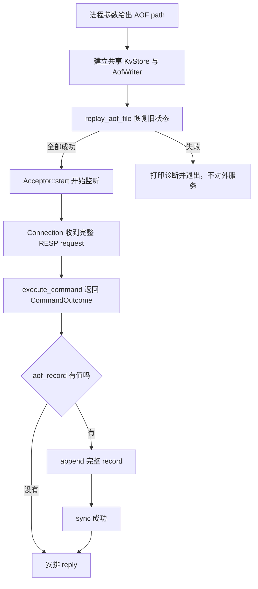

# Week14 Day5：把 AOF 恢复与写盘接回真实 Mini Redis

> 版本：2026-11-06，教程生成，R1 待开始
> 前置：Week14 Day1～Day4 已整日通过；Day4 R1/R2/R3 与整日均为 100/100
> 今日产出：原 `mini_redis_server` 接收一条 AOF 路径；启动时先恢复，运行时先追加并同步，再安排写命令的成功回复
> 学习方式：R1 独立完成 `main_()` 里的真实接线；R2 核对无状态变化命令与回复边界；R3 补启动失败、运行时致命失败和完整回归

[TOC]

---

# Part 1：四个组件都已经正确，为什么服务器重启后仍然是空的

## 1. 今天只解决一件事

Day1～Day4 已经分别完成：

```text
command dispatcher
-> 返回 reply 与 optional aof_record

AofWriter
-> 完整 append 一条 record
-> fdatasync 满足本项目选择的同步边界

AOF replayer
-> 从文件按顺序恢复 SET / DEL / PEXPIREAT

AOF expiry bridge
-> 把绝对 Unix 期限换成新进程的剩余 TTL
```

这些组件目前还没有进入真实服务器的同一条路径。

当前 `mini_redis_server.cpp` 处理一条完整命令时，大致只做：

```text
execute_command
-> 取出 outcome.reply
-> connection.send(reply)
```

`outcome.aof_record` 即使有值，也没有被交给 `AofWriter`。

服务器启动时也没有调用 `replay_aof_file()`。

所以现在仍会出现：

```text
客户端收到 SET 的 +OK
-> 当前 KvStore 中有值
-> AOF 没有新增记录
-> 进程结束
-> 新 KvStore 仍然是空的
```

**今天要把这些已经通过的组件接成一条真实路径。**

## 2. 先跟完一次成功写入和重启

假设启动命令是：

```bash
./build/mini_redis_server /tmp/week14-day5/appendonly.aof
```

第一次启动时，这个文件还不存在。

服务器要先让文件存在，再把其中已有记录重放到一份新的 `KvStore`。
空文件会恢复 0 条记录。

恢复成功以后，服务器才开始监听 6380 端口。

现在客户端发送：

```text
SET name FxorG
```

一条成功路径应当是：

```text
RESP parser 得到 arguments
-> execute_command 修改共享 KvStore
-> CommandOutcome 带回 +OK 与 SET record
-> AofWriter.append(record)
-> AofWriter.sync()
-> Connection::send(+OK)
```

客户端收到 `+OK` 后，测试结束这个服务器进程。

随后用同一条 AOF 路径启动新进程：

```text
new KvStore
-> replay appendonly.aof
-> 恢复 name = FxorG
-> replay 全部成功
-> 开始监听
```

这时：

```text
GET name
-> FxorG
```

今天所有代码、测试和验收都围绕这条链展开。

## 3. TTL 只是同一条链上的第二种记录

再看一条有期限的数据：

```text
SET code 1234
EXPIRE code 10
```

Day4 已经让第二条命令产生：

```text
PEXPIREAT code <绝对 Unix 毫秒期限>
```

如果服务器停机 2 秒后重启，重放时应该得到大约 8 秒的剩余 TTL。

Day5 不再实现时间换算。

它只负责保证 Day4 的 record 真正进入同一份 AOF，并在新进程监听前被重放。

## 4. 今天的四个主问题

1. 共享 `KvStore`、`AofWriter` 和每条 `Connection` 分别由谁拥有？
2. 为什么必须先完成 replay，再调用 `Acceptor::start()`？
3. 为什么有 AOF record 的命令要经过 `append -> sync -> send`，没有 record 的命令不用？
4. 一次停止与重启检查能证明什么，又不能证明什么？

现在再给两个动作命名。

**Application owner（应用层所有者）**：本项目中就是创建共享 `KvStore`、`AofWriter`、`Acceptor` 和全部 `Connection`，并把它们连接起来的 `main_()` 作用域。它不一定要被改造成一个新 class。

**Fatal path（致命失败路径）**：AOF 追加、同步或启动恢复失败以后，服务器不再继续正常处理请求，而是让异常到达最外层，打印诊断并以非零状态退出。

---

# Part 2：把同一份状态、日志和回复接成一条路径

# Round 1：先让真实服务器完成一次可恢复的停止与重启

## 5. R1 的全局坐标

R1 不改 RESP、Reactor 或 TTL 组件。

它只在 application owner 中接线：



图里只有两条新增连接：

```text
启动路径：AOF file -> replayer -> shared KvStore -> listen
运行路径：CommandOutcome.aof_record -> writer -> reply
```

## 6. 哪些对象必须活多久

当前每条 `Connection` 都会在 message callback 中借用共享状态。

Day5 后，它还要借用同一个 `AofWriter` 与墙上时钟 callback。

所以 owner 至少要保证：

```text
KvStore
AofWriter
UnixNow
```

在全部 `Connection` 存活期间都有效。

每条连接继续只拥有自己的：

```text
connected fd
input Buffer
output Buffer
Channel
连接关闭状态
```

不要给每条连接各造一份 store 或 writer。

否则不同客户端会看见不同数据，日志顺序也不再对应全局状态修改顺序。

当前服务器只有一个 event-loop 线程。

一个 callback 完成以后才会处理下一个 callback，所以本版不需要给 `AofWriter` 再加 mutex。

`fdatasync()` 会阻塞这条 event-loop 线程。

这是本版为了得到清楚恢复边界而接受的代价，Week15 再测量它。

## 7. R1 的程序入口约定

把服务器入口调整为：

```bash
./build/mini_redis_server <aof_path>
```

例如：

```bash
./build/mini_redis_server /tmp/week14-day5/appendonly.aof
```

R1 要求：

| 场景 | 预期行为 |
|---|---|
| 恰好给出一条可用路径，文件不存在 | 创建空 AOF，恢复 0 条，然后开始监听 |
| 路径指向已有合法 AOF | 先恢复全部记录，再开始监听 |
| 参数数量错误 | 打印简短 usage，非零退出 |
| 父目录不存在或文件无法打开 | 保留系统错误，非零退出，不监听 |
| replay 失败 | 保留恢复诊断，非零退出，不监听 |

Day3 的 `replay_aof_file()` 明确要求文件已经存在。

因此首次启动时，owner 必须先让目标文件存在。

现有 `AofWriter(path)` 已经使用 `O_CREAT | O_APPEND` 打开文件，可以完成这一步。

随后 `replay_aof_file()` 再用自己的只读 fd 读取同一路径。

不要把所有 `open()` 失败都当成“空数据库”。

父目录写错和权限错误仍然是启动失败。

## 8. 现有接口怎样在 owner 中分工

今天不需要发明新的持久化抽象。

已经通过的接口各做一件事：

```cpp
AofWriter writer(aof_path);
```

它打开或创建文件，并在对象存活期间拥有 append fd。

```cpp
replay_aof_file(store, aof_path, unix_now);
```

它读取已有文件，把状态恢复到传入的 `store`，并返回应用记录数与消费字节数。

```cpp
const auto outcome = execute_command(store, arguments, unix_now);
```

它执行一条在线命令，返回 reply 与可选的完整 AOF record。

```cpp
writer.append(*outcome.aof_record);
writer.sync();
```

这两步只在 record 有值时调用。

```cpp
connection.send(outcome.reply.data(), outcome.reply.size());
```

它把 reply bytes 复制进该连接的发送路径。

`send()` 返回不等于客户端已经收到全部 bytes。

Day5 只规定：**写命令的成功 reply 进入 Connection 之前，AOF append 与本项目选择的 sync boundary 已经成功。**

## 9. 启动顺序只认一个可观察边界

现有 `Acceptor` 构造函数会创建 socket 并完成 `bind()`。

真正的 `listen()` 在：

```cpp
acceptor.start();
```

中发生。

所以 R1 的硬约束是：

```text
replay 全部成功
-> 才能调用 acceptor.start()
```

你可以选择在 replay 前后构造 `Acceptor` 对象。

但在恢复成功以前，不能调用 `start()`，也不能进入 poll loop。

这样，即使日志前半已经写入临时 `KvStore`、后半随后报错，也没有客户端能看到这份半恢复状态。

## 10. 一条在线命令怎样决定是否写 AOF

owner 不再重新判断命令名。

它只读取 `CommandOutcome`：

| `aof_record` | owner 的动作 | 典型命令 |
|---|---|---|
| `nullopt` | 不调用 writer，直接安排 reply | PING、GET、命令错误、没有生效的 DEL/EXPIRE |
| 有完整 bytes | append、sync，二者成功后再安排 reply | 成功 SET、实际删除的 DEL、成功 EXPIRE |

命令差异已经在 dispatcher 内部消耗完。

owner 不从 `+OK`、`:1` 或错误字符串反推是否需要写日志。

如果 `append()` 或 `sync()` 抛异常，不要在 message callback 中把异常吞掉后继续服务。

当前异常路径已经能完成：

```text
AofWriter 抛异常
-> Connection 的 callback 边界提交关闭请求并重新抛出
-> EventLoop 不吞异常
-> main_() 退出
-> main() 打印诊断并返回 1
```

R1 不需要另造 fatal flag 或通用 error framework。

## 11. R1 只修改哪些文件

独立实现范围：

```text
apps/mini_redis_server.cpp
CMakeLists.txt
```

`mini_redis_server` target 需要链接已存在的：

```cmake
aof_writer
aof_replay
```

继续保留原来的：

```cmake
acceptor
connection
resp_request_parser
command_dispatcher
```

R1 不修改：

```text
KvStore
CommandOutcome
AofWriter
AOF replayer
Connection
EventLoop
RESP parser / encoder
```

如果接线时发现这些已通过接口确实无法表达当前需求，先说明具体阻塞，再决定是否改接口。

不要为了“结构更漂亮”提前重构整台服务器。

## 12. R1 的真实停止与重启检查

机械 socket、RESP 和子进程脚手架可以由 Codex 补全。

你需要能解释下面每一步为什么存在。

### 12.1 建立两种需要恢复的状态

checker 使用自己创建的临时目录和 AOF path。

第一次启动前确认文件不存在。

服务器开始监听后，用两个客户端完成：

```text
Client A:
SET <binary-key> <binary-value>

Client A:
SET day5:alive value
EXPIRE day5:alive 10

Client A:
SET day5:gone value
EXPIRE day5:gone 1

Client B:
GET <binary-key>
```

binary key/value 中至少各包含一个 `\0` 或 `\r\n`。

Client B 的 GET 先证明两个连接仍共享同一份 store。

每条写命令都要先收到精确成功 reply，checker 才能结束进程。

如果 reply 还没到就直接终止进程，这条命令是否完成会变得不确定，不能拿来验证 Day5 的承诺。

### 12.2 停止旧进程并让现实时间继续走

checker 只终止自己启动的服务器进程。

不要按端口 `pkill`，也不要误杀用户原有终端里的进程。

旧进程退出后等待约 1.3 秒。

这样：

```text
day5:gone 的 1 秒期限
-> 已经过期

day5:alive 的 10 秒期限
-> 仍有正的剩余时间
```

### 12.3 用同一份文件启动新进程

第二个进程必须使用完全相同的 AOF path。

开始监听以后检查：

| 操作 | 预期 | 证明什么 |
|---|---|---|
| `GET <binary-key>` | exact binary value | SET record 按字节恢复 |
| `PTTL day5:alive` | `0 < ttl < 10000` | 停机时间已从绝对期限中扣除 |
| `GET day5:gone` | null bulk string | 停机期间到期的数据没有复活 |
| `PTTL day5:gone` | `-2` | 新 store 把它视为不存在 |
| `DEL <binary-key>` | `1` | 恢复出的数据能继续被在线命令修改 |
| 再次 `GET <binary-key>` | null bulk string | DEL 的在线行为仍正常 |
| A、B 分别 `PING` | 两次 PONG | 重放没有破坏多连接服务 |

这份 checker 可以命名为：

```text
tests/mini_redis_aof_restart_check.py
```

它是可委托的 correctness test 脚手架，不替你完成 application owner 接线。

## 13. R1 构建、运行与停止点

先只构建真实服务器：

```bash
cd /home/xgf/code/system-learning/cpp/week10

cmake -S . -B build
cmake --build build --target mini_redis_server -j
```

手动启动时使用一个专用临时目录：

```bash
mkdir -p /tmp/week14-day5-manual
./build/mini_redis_server /tmp/week14-day5-manual/appendonly.aof
```

checker 补入后再运行：

```bash
python3 tests/mini_redis_aof_restart_check.py \
  --server ./build/mini_redis_server
```

R1 通过前，只回答五个问题：

1. 当前 `main_()` 中哪一个对象同时协调共享 store、writer 与连接回调？
2. 首次启动时，为什么要先让文件存在，再调用 `replay_aof_file()`？
3. `acceptor.start()` 为什么必须在 replay 成功以后？
4. `aof_record == nullopt` 时，owner 为什么不能自行猜测命令是不是写命令？
5. 为什么 checker 必须在收到写命令成功 reply 后，才结束旧进程？

做到这里先停。

不要提前修改 tail recovery、信号处理或 async writer。

---

# Round 2：核对没有状态变化的命令与真实回复边界

## 14. R1 成功以后，还要排除一次“所有命令都写盘”

R1 主要证明有 record 的命令能够恢复。

现在换一个问题：没有产生新状态的命令，会不会也触发 append 或 sync？

先让：

```text
SET k v
```

成功，并记录此时 AOF 文件长度为 `S`。

随后依次执行：

| 命令 | 预期 reply | AOF 文件长度 |
|---|---|---:|
| `PING` | PONG | `S` |
| `GET k` | `v` | `S` |
| `PTTL k` | `-1` | `S` |
| `DEL missing` | `0` | `S` |
| `EXPIRE missing 10` | `0` | `S` |
| `SET only-key` | wrong-number error | `S` |
| unknown command | unknown-command error | `S` |

这些命令的共同点不是“名字看起来像只读”。

共同点是 dispatcher 返回：

```text
aof_record == nullopt
```

owner 因此跳过 writer。

反过来，`SET k v` 即使新 value bytes 与旧 value 相同，仍可能清除旧 TTL。

只要 dispatcher 按现有 contract 返回 record，owner 就必须写入，不能自己用“值看起来没变”推翻它。

## 15. `sync()` 成功以后，回复只是进入发送路径

对有 record 的命令，顺序保持：

```text
execute_command
-> append
-> sync
-> connection.send
```

这里的最后一步不是“客户端已经收到”。

`Connection::send()` 可能立即写出全部 bytes，也可能把 suffix 留在 output Buffer，等下一次 `EPOLLOUT`。

因此本日准确承诺是：

```text
success reply 被安排以前
-> append 已经返回
-> sync 已经返回
```

仍然存在一个无法消除的窗口：

```text
sync 已成功
-> 进程在 reply 到达客户端前退出
```

此时重启后状态可能已经恢复，但客户端不知道本次命令是否成功。

本项目今天不实现请求 ID、去重或事务协议来消除这种不确定性。

## 16. R2 的最小证据与停止点

R2 只补三类证据：

1. 上表中的无 record 命令保持 AOF 长度不变，reply 仍然正确。
2. 有 record 的命令在收到成功 reply 后，文件长度已经增加，重启后状态可恢复。
3. 原 `mini_redis_protocol_check.py` 继续通过，证明 command error 仍可继续，protocol error 仍只关闭坏连接。

AOF 文件长度只能证明 append 后可观察到更多 bytes。

它不能单独证明 `fdatasync()` 已满足持久介质边界。

同步语义继续由 Day2 的注入测试、当前 source 顺序和后面的失败测试共同支持。

R2 到这里停止。

不要把 `GET`、`PING` 也变成同步操作，也不要为今天加入批量同步策略。

---

# Round 3：让启动失败和写盘失败不能伪装成健康服务器

## 17. 启动阶段的四个具体场景

### 17.1 首次启动

```text
AOF path 不存在
-> 创建空文件
-> replay 0 条
-> 开始监听
```

这是一条正常路径。

### 17.2 父目录不存在

```text
/tmp/not-created/appendonly.aof
```

若父目录没有创建，`AofWriter` 的 `open()` 应保留 `ENOENT`。

进程非零退出，6380 不开始监听。

### 17.3 AOF 中含完整但不允许重放的命令

例如文件中只有一条完整：

```text
GET k
```

RESP 格式合法，但它不是允许的 AOF 状态记录。

replay 应失败，进程非零退出，客户端不能看见半恢复 store。

### 17.4 AOF 最后一条不完整

当前 Day3 contract 会把它当作启动失败。

Day5 只证明服务器不会带着不确定状态开始监听。

Day6 才决定怎样识别最后一条完整记录，并处理可截断的尾部。

## 18. 运行时 append/sync 失败要证明什么

使用 Day2 已有的可控 `WriteFn` / `SyncFn`，最终要建立三条 owner 证据：

| 场景 | 预期 |
|---|---|
| outcome 有 record，append 抛 `EIO` | 不调用成功 reply 的发送动作；异常继续向外传播 |
| append 成功，sync 抛 `EIO` | 不调用成功 reply 的发送动作；异常继续向外传播 |
| outcome 没有 record | writer 的 write/sync callable 都不被调用；reply 正常安排 |

这些是测试场景，不是三项新功能。

具体怎样给 owner 留下最小测试接缝，要等 R1 实际代码出现后再决定。

不要为了测试先设计通用 persistence hierarchy，也不要把测试 callable 塞进生产命令行。

机械 GoogleTest 或 fault-injection 脚手架可以由 Codex 根据你的 R1 接口补全。

## 19. 关闭流程的准确边界

本日 restart checker 可以对自己启动的进程发送终止信号，并等待它退出。

它不要求新增 signal handler 或管理命令。

每一条被 checker 认可的写命令，都已经先收到成功 reply。

在本项目的顺序下，这意味着对应 record 的 `sync()` 已经返回。

默认信号终止时，操作系统会回收进程持有的 socket 与 AOF fd。

这不等于完成了一次应用层 graceful shutdown（优雅关闭）。

它也不证明突然断电、磁盘控制器缓存或文件系统故障下的数据一定存在。

C++ 异常导致的 fatal path 则会正常展开栈对象，`UniqueFd` 负责关闭已拥有的 fd。

两种退出方式不要混成一个结论。

## 20. R3 完整回归与停止点

最终至少运行：

```bash
cd /home/xgf/code/system-learning/cpp/week10

cmake -S . -B build
cmake --build build -j
ctest --test-dir build --output-on-failure

python3 tests/mini_redis_aof_restart_check.py \
  --server ./build/mini_redis_server
```

再启动一份由当前终端拥有的服务器，分别运行原网络检查：

```bash
python3 tests/mini_redis_smoke.py
python3 tests/mini_redis_protocol_check.py
```

如果运行 TTL checker，仍要把 server stderr 定向到它要求的 trace 文件。

不要让多个 checker 同时争用固定的 6380 端口。

R3 通过时，应有证据说明：

```text
合法旧日志
-> 恢复后才监听

在线有效写操作
-> append + sync 后才安排成功 reply

无状态变化命令
-> 不增加 AOF

启动日志非法
-> 非零退出且不监听

运行时 AOF 失败
-> 不伪造成功 reply，服务器不继续假装健康

原 RESP / multi-client / TTL maintenance
-> 继续工作
```

做到这里，Day5 才正式收口。

---

# Part 3：收尾、验证与验收

## 21. 今天的最终产出

必须完成：

```text
apps/mini_redis_server.cpp
-> 接收 AOF path
-> 首次启动可创建空文件
-> replay 成功后才 start listener
-> record 命令 append + sync 后才 send reply

CMakeLists.txt
-> mini_redis_server 链接 aof_writer 与 aof_replay

tests/mini_redis_aof_restart_check.py
-> 可由 Codex 在 R1 接口确定后补全
-> 真实启动、停止、等待、重启同一 AOF
```

今天不要求：

```text
AOF rewrite
background fsync
group commit
async writer thread
自动截断残缺尾部
修复中间损坏
signal-based graceful shutdown
Redis 兼容命令行或配置文件
```

## 22. 六道验收题

1. 为什么 `CommandOutcome` 已经有 record，当前旧 server 仍然不能恢复？
2. 首次启动时，怎样同时满足“路径不存在可以创建”和“其他打开错误不能伪装成空库”？
3. `Acceptor` 对象已经构造与真正开始 `listen()` 有什么区别？今天以哪一个调用作为对外服务边界？
4. 为什么 owner 只检查 `optional aof_record`，而不根据命令名或 reply 内容决定是否写日志？
5. `sync()` 成功后才调用 `Connection::send()`，能保证什么？为什么仍不能保证客户端一定知道结果？
6. restart checker 证明的是哪一种进程/文件恢复？它为什么不是断电持久性证明？

## 23. 笔记只保留今天真正新增的关系

建议在 `week14/day5/day5_note.md` 只记录：

1. 启动路径中 `AOF path -> replay -> KvStore -> listen` 的顺序。
2. 在线路径中 `CommandOutcome -> append -> sync -> send` 的顺序。
3. `KvStore`、`AofWriter`、`Connection` 分别归谁拥有。
4. 一条你实际遇到的接线或进程检查问题。

Day1～Day4 已经写过的 record 格式、short write、replay loop 和双时钟公式不重复抄写。

## 24. 今天能证明和不能证明的边界

今天可以证明：

```text
完整且合法的 AOF
-> 新进程在监听前恢复

成功回复已经进入发送路径的状态修改
-> 对应 append 与选定 sync boundary 已经成功

同一 AOF path 的停止与重启
-> SET / DEL / TTL 逻辑状态按现有 contract 恢复
```

今天不能证明：

```text
突然断电后所有硬件缓存都已落盘
sync 与 reply 之间没有不确定窗口
残缺尾部已经可恢复
中间损坏可以跳过
每次 fdatasync 的性能可以接受
完整等同于真实 Redis persistence
```

## 25. Day6 从哪里继续

Day5 结束后，真实 server 已经会读写同一份 AOF。

这时 Day2 留下的失败窗口终于会变成真实启动问题：

```text
旧完整 records
-> 新 record 只写了一部分
-> 进程退出
-> 下次启动读到 incomplete tail
```

Day6 才回答：

```text
怎样找到最后一条完整 record 的结束位置？
什么情况下可以只截掉文件尾？
为什么中间损坏不能按同一规则跳过？
截断以后为什么还需要同步新的文件长度？
```

今天不要提前实现这些策略。
