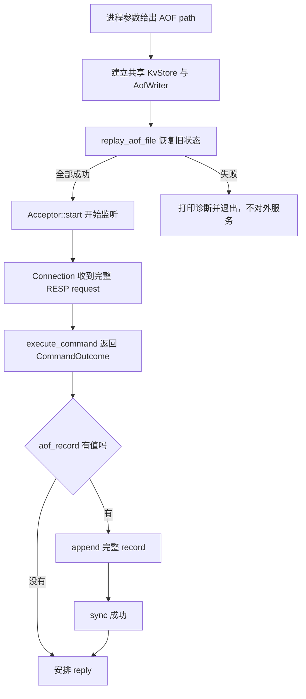

# R1

## 升级点

```text
我们的 application 的 mini redis 没有把返回的 aof 写到文件里；以及 mini redis 启动前没有先从 aof 恢复 kvstore。
```



## 怎么使用接口

### replay

```cpp
AofWriter writer(aof_path);
replay_aof_file(store, aof_path, unix_now);
```

### aof write

```cpp
const auto outcome = execute_command(store, arguments, unix_now);
writer.append(*outcome.aof_record);
writer.sync();
connection.send(outcome.reply.data(), outcome.reply.size());
```

### 启动顺序

replay 全部成功，才能调用 `acceptor.start()` 让我们的 acceptor 进入 listen

