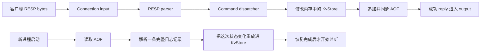
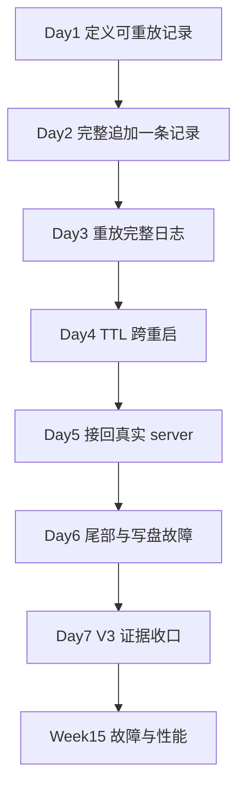

# Week14：Mini Redis V3，让进程重启后重新长回原来的状态

> 对齐日期：2026-11-02；Day1 R1 已以 98/100 正式通过，下一步进入 Day1 R2。
> 系统起点：Week13 已正式完成，当前 91 个整日通过、92 份 Daily 已生成。
> 理论起点：T1～T11 与 Theory Gate 1 已通过，T11 整课 98/100，下一步 T12；理论线不阻塞本周工程。
> Git：本周正式文件修改按 `MEMORY.md` §9.12 留下本地 commit；push 仍需单独授权。

本周继续使用 Ubuntu 中的同一个工程：

```text
/home/xgf/code/system-learning/cpp/week10
```

目录名不随周数改变。Reactor、RESP parser、command dispatcher、KvStore 和 TTL
都从这里继续演进，不复制一套服务器。

---

## 1. 这一周只解决一个主问题

先运行已经通过的服务器：

```text
SET code 1234
EXPIRE code 120
GET code
```

此时 `GET code` 能得到 `1234`。

现在结束进程，再重新启动：

```text
GET code
```

当前 V2 只能得到不存在。原因很直接：value 和 deadline 都只活在旧进程的内存里。
旧进程结束，这些对象也一起消失。

本周要得到的新行为是：

```text
旧进程执行成功的写操作
-> 留下一份磁盘记录
-> 新进程启动时读取这些记录
-> 按原顺序重新执行
-> KvStore 重新得到相同的逻辑状态
```

后面把“新进程按顺序重新执行日志中的写操作”简称为
**replay（重放）**。先把它理解成恢复动作即可：它不是播放网络流量，
而是在服务器对外服务前，把旧进程已经确认的状态变化重新做一遍。

这种“不断在文件末尾追加写操作，启动时再按顺序执行”的文件，叫
**AOF（Append-Only File，追加式文件）**。

这里先抓住它的行为：**记录改变状态的动作，重启时重做这些动作。**
文件格式、系统调用和写盘策略，都在这个目标已经清楚以后再出现。

[小林 Coding 的 AOF 讲解](https://xiaolincoding.com/redis/storage/aof.html#aof-%E6%97%A5%E5%BF%97)
也从这个行为进入：记录写命令，重启时重新执行。正文借用的是这个清楚的入口；
本周怎样表示 TTL、何时回复客户端和怎样处理坏文件，仍由我们的项目约束决定。

---

## 2. AOF 在现有服务器里处于哪一层

本周不是更换 application protocol，也不是重写 Reactor。

客户端仍然发送 RESP request。parser 仍把 bytes 还原成 arguments。
dispatcher 仍决定命令语义。KvStore 仍保存当前内存状态。

AOF 新增的是一条旁路：当一条命令真的改变了状态时，把这次变化也留到文件里。



`Connection` 不拥有 AOF。它只拥有一条连接的 input/output bytes。

AOF 与共享 `KvStore` 一样，属于 application owner。多个客户端修改的是同一份 store，
也必须按同一个全局顺序写入同一份日志。

恢复发生在 `listen/accept` 之前。否则客户端可能看见“只恢复了一半”的数据。

---

## 3. 本周继续复用哪些已通过能力

| 已有能力 | 本周怎样使用 |
|---|---|
| RESP2 Array of Bulk Strings parser | 同时解析网络 request 和 AOF 中的一条命令记录 |
| RESP encoder 与按字节保存的 string | AOF 继续按字节长度记录 key/value，允许 `\0` 和 `\r\n` |
| `consumed_bytes` | 重放一条后准确前进到下一条记录 |
| command dispatcher | 复用已经验证的 SET/DEL/EXPIRE 语义，不另造命令引擎 |
| server-owned `KvStore` | 重放的目标就是重新构造这份共享状态 |
| TTL 与可控 `Now` | 进程内判断继续使用；跨重启表示在 Day4 单独解决 |
| `UniqueFd` 与 RAII | AOF 文件描述符由对象拥有，析构时释放 |
| EventLoop/Connection | Day5 才接入；Day1～Day4 不碰网络底座 |
| 现有 CTest 与网络 checker | 作为回归证据，不为形式重写旧测试 |

Week13 的主动 sweep 不需要向 AOF 追加 `DEL`。
它只是在物理上清除已经按 deadline 失效的记录，并没有创造新的逻辑事实。

---

## 4. 哪些操作需要记录

### 4.1 记录成功建立新状态的写操作

| 命令或动作 | 是否进入 AOF | 原因 |
|---|---:|---|
| 成功执行的 SET | 是 | 它建立“这个 value 当前存在且没有 TTL”的状态；即使 value 字节相同，也可能清除旧 TTL |
| 实际删除有效 key 的 DEL | 是 | 重放后不能让旧 value 复活 |
| 成功设置期限的 EXPIRE | 是，但转换成绝对到期时刻 | 直接重放相对秒数会延长寿命 |
| PING/ECHO/GET/EXISTS/PTTL | 否 | 它们只观察状态，不产生要恢复的新状态 |
| 对缺失 key 的 DEL/EXPIRE | 返回未生效时不记录 | 重放不需要保存一次没有改变状态的操作 |
| passive/active expiry 的物理删除 | 否 | 到期事实已经由持久化期限表达 |

Daily 会根据当时 dispatcher 的真实返回值决定“怎样知道这次真的发生了状态变化”。
周规划不提前强塞一套新的通用 command hierarchy。

### 4.2 记录格式继续使用 RESP

假设成功执行：

```text
SET name xiaolin
```

对应记录可以继续使用你已经会解析的 RESP：

```text
*3\r\n
$3\r\n
SET\r\n
$4\r\n
name\r\n
$7\r\n
xiaolin\r\n
```

真实文件中没有上面的换行排版；它是一段连续 bytes。

这样做不是为了模仿格式而模仿。它直接复用了三项现有能力：

1. 每个 argument 有明确 byte length。
2. 二进制 key/value 不依赖 C 字符串结束符。
3. 现有 incremental parser 已经会区分 Complete、NeedMore 和 Error。

本周使用一份单文件 AOF。Redis 7.0 以后，真实 Redis 使用由 base file（基础文件）、
incremental files（增量文件）和 manifest（清单文件）组成的
multi-part AOF（多文件 AOF）。这是完成本项目闭环后的对照，不是本周实现目标。

---

## 5. TTL 为什么不能原样重放

假设 12:00:00 执行：

```text
EXPIRE code 120
```

12:00:30 进程退出，12:01:00 重启。

如果 AOF 里仍然保存 `EXPIRE code 120`，新进程会从 12:01:00 重新给它 120 秒。
这个 key 将活到 12:03:00，而原本应该在 12:02:00 到期。

所以文件里需要保存一个跨进程仍有意义的**绝对到期时刻**，例如 Unix 毫秒时间：

```text
PEXPIREAT code 179...000
```

`PEXPIREAT` 可以只是 AOF 内部的**统一日志表示**，后面简称
canonical record（规范化记录）。它把多种客户端写法收敛成恢复时只需理解的一种形式，
不要求本周把它开放成新的客户端命令。

恢复时做两步：

```text
remaining_ms = persisted_wall_deadline_ms - wall_now_ms

remaining_ms <= 0
-> 这份 key 在停机期间已经到期，删除此前 SET 重放出的当前 key

remaining_ms > 0
-> monotonic_deadline = monotonic_now_ms + remaining_ms
-> 继续交给现有 KvStore 管理
```

这里有两类时间，各做一件事：

| 时间 | 用途 |
|---|---|
| monotonic clock（单调时钟） | 进程运行期间测间隔，不因日历时间被校准而倒退 |
| wall clock（日历时钟） | 给磁盘留下跨进程可解释的绝对时刻 |

**不把 `steady_clock` 的整数值直接写盘。** 新进程的单调时钟起点与旧进程没有共同含义。

墙上时钟如果被人为大幅调整，TTL 解释也会受影响。这是本版明确限制，
不能把“可跨正常重启”写成“在所有时间异常下都精确”。

---

## 6. 一条成功回复究竟承诺到哪里

“调用 `write()` 成功”只说明内核接受了一些 bytes。
它不自动说明数据已经进入持久介质。

这正是[小林 Coding 的三种写回策略](https://xiaolincoding.com/redis/storage/aof.html#%E4%B8%89%E7%A7%8D%E5%86%99%E5%9B%9E%E7%AD%96%E7%95%A5)
与 Linux [`write(2)`](https://man7.org/linux/man-pages/man2/write.2.html)、
[`fsync(2)`](https://man7.org/linux/man-pages/man2/fsync.2.html) 在本周出现的原因：
先分清“内核收到了多少”和“何时满足选定同步边界”，再决定何时回复客户端。

本周沿同一次状态修改区分四个阶段：

```text
command 已改变内存状态
-> AOF record 已完整交给 write_all
-> fdatasync 返回成功
-> success reply 才进入 Connection output
```

学习版先采用保守而容易证明的策略：**每次被确认的状态修改都同步一次，
满足选定同步边界后才发送成功回复。** 性能代价留到 Week15 测量。

命令执行与日志写入是两个动作，中间永远存在失败窗口。本周不假装把它们变成了数据库事务。
最终 Daily 需要明确：

- 普通 command error 不改状态，也不记日志。
- AOF append 或 sync 失败后不能继续正常服务并返回成功。
- 当前进程应进入 fatal path（不可继续服务的致命失败路径），保留诊断并停止；
  重启时以可验证的 AOF 前缀恢复。
- crash 发生在同步成功与 reply 到达客户端之间时，客户端仍可能不知道结果是否已经生效。

因此，本周最多证明选定进程/文件故障模型下的恢复行为。
不宣称完整 Redis durability（持久性），也不宣称覆盖掉电、控制器缓存、文件系统 bug
和新文件目录项尚未同步等所有硬件故障。

---

## 7. 七个学习日怎样连成一条线

| 学习日 | 今天只解决的问题 | 主要产出 |
|---|---|---|
| [Day1](day1/day1.md) | 哪些状态变化必须留下，文件里的一条记录长什么样？ | R1已通过：按字节保存的RESP记录；下一步R2接回命令结果 |
| Day2 | 怎样把一整条记录可靠追加到一个由对象拥有的文件？ | AOF 写入组件、`write_all`、同步边界与构建入口 |
| Day3 | 新进程怎样按顺序读完整记录，重新得到 SET/DEL 状态？ | 完整日志重放、启动前恢复、重放时不重复记日志 |
| Day4 | TTL 在停机期间仍然流逝，怎样恢复剩余寿命？ | 绝对到期时刻、双时钟转换、受控时钟测试 |
| Day5 | 怎样把追加与重放接回原服务器，又不破坏连接与回复边界？ | 服务器接入、真实停止与重启检查 |
| Day6 | 最后一条只写了一半或日志中间损坏时，服务器怎样决定？ | 最后一条完整记录的位置、尾部策略、日志损坏与故障注入 |
| Day7 | 这套恢复到底证明了什么，与真实 Redis/MySQL 日志哪里相同、哪里不同？ | V3 收口、回归、恢复证据与限制说明 |



这些是七个学习单元，不是七个自然日打卡。
每份 Daily 仍在前一日通过后按真实 source、note 和反馈生成或定向润色。

---

## 8. [Day1：先决定“重启时要重做什么”](day1/day1.md)

> 当前状态：R1 已以 98/100 正式通过，Day1 整日尚未完成；通过数仍为 91。

### 今日主问题

同一个 `SET/GET` 场景里，为什么只保存 value 不够，保存所有 request 又是多余的？

先用三条短时间线判断：

```text
SET k old
SET k new

SET k v
DEL k

SET code 1234
EXPIRE code 120
```

逐条回答：新进程按什么顺序重做，才能得到退出前的最终逻辑状态？

### R1 独立产出

在不接文件和服务器的前提下，完成“状态变化 → 规范化 RESP 记录”的最小能力。

R1 必须覆盖：

- SET 的 key/value exact bytes，包括 `\0` 与 CRLF。
- DEL 的参数顺序。
- 只读命令不产生记录。
- EXPIRE 不直接保存相对秒数，而是为后续绝对期限记录留下明确入口。

Daily 会给完整 public contract、输入输出例子与必要 encoder API。
private representation 由你决定，不先给完整实现。

### R2/R3 怎样跟进

R2 让 application owner 同时取得 reply 与可选持久化事实：成功 SET 总是建立 value 与无 TTL 状态；
DEL/EXPIRE 只有真正生效时才留下对应事实，不能从 wire reply 倒推。

R3 再把“客户端怎样写”与“日志怎样统一保存”分开：客户端的
`EXPIRE code 120` 会变成内部的 `PEXPIREAT code <绝对时刻>`。
成功的非正 EXPIRE 统一记为 DEL。随后分别用空 DEL、负绝对时刻、整帧超限、无半条返回值和 store/reply 不提前提交的小场景收紧失败边界。
这些检查先于状态修改；双时钟换算仍留 Day4。
本日不打开文件、不接网络、不讨论重写。

---

## 9. Day2：把一整条记录追加到文件

### 今日主问题

`write(fd, data, size)` 不保证一次写完全部 bytes。
如果一条 RESP 记录只写进去前半段，下一次恢复就会在文件尾看到残缺命令。

因此先完成一个很小的 `write_all` 循环：

```text
还有 bytes 未写
-> write
-> 正数：前进 offset
-> 0：没有取得进展，按失败处理，不能原地无限循环
-> EINTR：同一位置重试
-> 其他错误：保留 errno 并失败
```

### R1 独立产出

新增最小 AOF file owner。它拥有一个 append fd，接收 Day1 已编码的完整 bytes。

证据不是“文件存在”，而是：

1. 依次追加两条记录。
2. 重新读取文件。
3. 文件 bytes 与两条输入的连接完全相同。
4. binary payload 不被文本 API 截断。

### C++ 补缺在真实位置出现

本日第一次新增 `.hpp/.cpp` 与 CMake source：

- 头文件声明“别人可以调用什么”。
- `.cpp` 提供非模板函数定义。
- 忘记把 `.cpp` 加入 target 时，编译各自成功但最终找不到定义，这是 link error（链接错误）。
- AOF fd 的 owner 复用 RAII；不为练习 special members（特殊成员函数）
  强写一套多余拷贝逻辑。

`static/extern/inline` 与模板定义可见性，只在当前文件真的触及时补最小第一层。

### R2/R3 怎样跟进

首版完成完整 append 后，再明确 `write()` 与 `fdatasync()` 的不同承诺，
并把 append/sync 失败保留为可观察错误。本日不接 command dispatcher。

---

## 10. Day3：启动时从完整日志恢复 SET/DEL

### 今日主问题

文件现在已经有正确 bytes，但新进程的 `KvStore` 仍然是空的。
谁读取它，什么时候读取，读取一条后怎样继续？

### R1 独立产出

完成第一版“完整日志重放”：

```text
empty KvStore
-> 读取 AOF bytes
-> parser 得到一条 Complete 记录
-> 按 consumed_bytes 前进
-> 应用这次状态变化
-> 继续下一条
-> EOF 时得到预期最终状态
```

先只闭合完整 SET/DEL 记录。

### 必须说清的两个边界

**重放发生在 listen 之前。** 失败时服务器不对外接受连接。

**重放不再次追加日志。** 否则启动一次，日志就会把自己再复制一遍。
可以使用明确的 replay path（重放路径）或 mode（模式），
但不能靠“碰巧没有 writer”隐藏语义。

### R2/R3 怎样跟进

补空文件、多条覆盖、删除、二进制记录和不支持的内部命令。
文件尾不完整与中间损坏留 Day6，本日先证明完整日志能恢复。

---

## 11. Day4：让 TTL 在停机期间继续流逝

### 今日主问题

重放 `EXPIRE code 120` 会把 120 秒重新开始计时。
这不是恢复旧状态，而是在重启时创造了更长寿命。

### R1 独立产出

增加 wall-clock absolute deadline 与现有 monotonic deadline 的转换。

受控时钟至少验证：

1. 写日志后停机 30 秒，重启只剩约 90 秒。
2. 停机超过原期限，重启后 key 不再有效。
3. SET 覆盖旧 value 时仍清除旧期限。
4. 重放绝对期限不会再次写入 AOF。

测试使用固定整数时刻，不真的 sleep 两分钟。

### R2/R3 怎样跟进

补 Unix 毫秒与剩余时长的范围检查、负/越界 wall time、转换加法溢出，
以及 wall clock 跳变的明确限制。不会把两个 clock 抽象成通用时间框架。

---

## 12. Day5：接回真实 Mini Redis server

### 今日主问题

组件各自正确以后，还要回答一条客户端写请求从进来到回复成功之间经过什么。

```text
parse + validate
-> 执行一次成功的状态修改
-> 追加规范化记录
-> meet selected sync boundary
-> enqueue success reply
```

若 append/sync 失败，不能继续正常服务并发出成功回复。
本版把它视为服务器无法继续工作的致命错误，避免在内存与日志已经可能分叉后假装健康。

### R1 独立产出

在原 application owner 中同时拥有一份 `KvStore` 与一份 AOF component。
启动阶段先重放，再 listen。

真实进程检查至少走通：

```text
start server with empty AOF
-> client SET binary key/value
-> client EXPIRE another key
-> stop process
-> wait a controlled interval
-> restart with same AOF
-> GET/DEL/PTTL observe recovered state
-> existing protocol and multi-client behavior remain healthy
```

机械 socket/RESP/restart checker 可以由 Codex 提供。
你需要能说明每一步的 oracle（判断依据）来自哪条 contract。

### R2/R3 怎样跟进

根据实际接入处理没有改变状态的命令、回复顺序、启动诊断与关闭流程。
不把网络检查冒充断电持久性测试。

---

## 13. Day6：最后一条只有一半，怎么办

### 13.1 先看两个完全不同的坏文件

场景 A：前两条完整，最后一条只有前缀。

```text
[complete SET][complete DEL][half SET]
```

这很像进程在追加最后一条时崩溃。parser 在 EOF 返回 NeedMore。

场景 B：中间出现完整但非法的 bytes，后面还有内容。

```text
[complete SET][malformed bytes][complete SET]
```

这不是“只差后半条”。如果静默跳过，后续状态是否可信已经无法判断。

### 13.2 本项目采用的策略

- 重放始终记录 `last_good_offset`，即最后一条完整、合法记录结束的位置。
- EOF 处的单个 incomplete tail 可以截断到该位置，并打印明确诊断；
  修复后的文件长度满足同步边界后，服务器才开始监听。
- parser Error、完整但非法的内部命令、或中间 corruption（日志损坏）让启动失败。
- 遇到这种致命损坏时不擅自改原文件；服务器也不开始监听。

这与 Redis 官方“可选择接受截断尾部、真正格式损坏则停止并修复”的第一层行为一致，
但本项目不实现 `redis-check-aof`。

### 13.3 R1/R2/R3 证据

R1 先完成 last-good tracking、最终残缺记录的截断，以及修复后文件长度的同步。

R2 再用故障注入区分部分写入、`ENOSPC`（设备空间不足）、`EIO`（输入输出错误）、
同步失败和中间格式损坏。

R3 收住三个状态：

```text
accepted by application
written to page cache（已写入内核页缓存）
synced under current policy
```

不把 `flush()`（刷新用户态缓冲）、`close()` 或正常进程退出，
自动等同于“所有故障下都已持久保存”。

---

## 14. Day7：只复盘 V3 新增的关系

### 本周自己的完整路径

你应该能从头说清：

```text
客户端状态修改
-> KvStore 当前状态改变
-> 规范化 RESP 记录
-> append and sync boundary
-> success reply
-> process exits
-> 新进程逐条解析记录
-> reconstructs values and deadlines
-> starts accepting clients
```

同时能解释：

- 为什么 GET 不进日志。
- 为什么相对时长的 EXPIRE 不能原样重放。
- 为什么恢复过程不能再追加日志。
- 为什么 incomplete tail 与 corrupted middle 采用不同策略。
- 为什么 `write()` 成功不等于已经证明完整持久性。

### 收口证据

| 证据 | 它证明什么 | 它不证明什么 |
|---|---|---|
| 精确记录组件测试 | 格式、顺序与二进制安全 | 真实重启已经接通 |
| 完整/损坏日志重放测试 | 恢复与失败策略 | 客户端回复顺序 |
| fake-clock TTL tests | 停机时间会扣除 | 系统时钟任意跳变仍精确 |
| stop/restart network checker | 新进程能提供恢复后的服务 | 断电与所有硬件缓存模型 |
| 注入追加/同步失败 | 致命失败路径不返回假成功 | 所有文件系统都具有同一故障行为 |
| 原 CTest 全量回归 | 没破坏已有可执行路径 | 不存在所有潜在 bug |

### 真实系统对照放在主闭环之后

自己的单文件 AOF 跑通后，再看三组差异：

1. **Redis RDB 与 AOF：** RDB 保存某个时刻的数据；AOF 保存状态变化并在启动时重放。
2. **真实 Redis AOF：** 有 always/everysec/no 三种同步策略、后台 rewrite（重写），
   Redis 7+ 使用多文件 AOF。对应边界以
   [Redis 官方持久化说明](https://redis.io/docs/latest/management/persistence/)为准。
3. **MySQL 三类日志：** undo 用于回滚与旧版本，redo 服务 InnoDB crash recovery，
   binlog 服务复制与 point-in-time recovery（时间点恢复）。
   它们不能都翻译成“数据库恢复日志”。

replication（复制）、sharding（分片）、consistency（一致性）与
RPC（远程过程调用）只建立最低词义，放在 Week16/后续系统设计语境。
本周不实现 Redis Cluster、Raft、分布式事务、AOF rewrite 或 RDB。

---

## 15. 参考材料只在问题已经出现时进入

**小林 Coding 帮你先看懂行为，官方资料校准边界，自己的测试才决定项目是否通过。**

这些链接不是 Day1 开始前要读完的附加作业。正文先让具体问题出现；
读到对应问题时只看能回答它的部分，然后立刻回到自己的实现与证据。

它们已经分别融进本周主线：

- §1 出现“进程重启后状态消失”时，才用小林的 AOF 入口帮助建立“记录写操作、启动时重做”。
- §6 问到“`write()` 成功究竟承诺什么”时，再使用正文已经嵌入的写回资料。
  此时只回答用户态数据、内核 page cache（页缓存）和同步边界的区别，
  不提前展开后台线程。
- Day7 发现 `SET k` 多次覆盖会让日志持续增长后，才看
  [小林：AOF 重写](https://xiaolincoding.com/redis/storage/aof.html#aof-%E9%87%8D%E5%86%99%E6%9C%BA%E5%88%B6)
  与 [Redis 官方持久化说明](https://redis.io/docs/latest/management/persistence/)。
  这里只建立“为什么需要重写”，本周不实现它。
- 比较 MySQL 日志时，先问“谁负责回滚、谁负责 InnoDB 崩溃恢复、谁负责复制与时间点恢复”，
  再看 [小林：MySQL 日志](https://xiaolincoding.com/mysql/log/how_update.html)、
  [MySQL redo log](https://dev.mysql.com/doc/refman/8.0/en/innodb-redo-log.html)、
  [undo log](https://dev.mysql.com/doc/refman/8.0/en/innodb-undo-logs.html) 与
  [binary log](https://dev.mysql.com/doc/refman/8.0/en/binary-log.html)。
  本周只分清角色和使用者，不展开两阶段提交源码。

小林文章用“Redis 先执行命令，再记录 AOF”帮助观察两个动作之间的失败窗口。
本项目仍要根据自己的单线程 dispatcher 和致命失败策略写出明确顺序，
不能把“真实 Redis 这样做”当成本项目天然正确的证明。

官方资料还帮助守住两条边界：真实 Redis 用协议格式记录写操作；
不完整的文件尾与日志中间损坏不是同一种故障。真实实现远比本项目复杂，
因此不能把这份单文件日志称为 Redis AOF 的复刻。

---

## 16. 本周明确不做什么

- 不新写 parser、Reactor、Connection 或第二份 KvStore。
- 不实现 RDB、AOF 重写、多文件清单或后台重写进程。
- 不实现复制、集群、Raft、分布式事务或多进程写入。
- 不把 `std::ofstream << string` 当作二进制安全或完整写入的证明。
- 不用长时间 sleep 测 TTL；继续使用受控时钟。
- 不把组件测试、进程重启测试和断电 durability 混成一个结论。
- 不在 Week14 提前做正式吞吐/延迟优化；性能 workload 与结论留 Week15。
- 不为了补 C++ 八股重写已经正确的 AOF/RAII 设计。

---

## 17. 分工、代码保护与每日校准

| 你主要负责 | 我可以负责 |
|---|---|
| 判断哪些状态变化必须恢复，选择第一版内部表示 | 查证 Redis/Linux/MySQL 资料，讲清必要 API |
| 实现 AOF 组件、重放与接入顺序 | 提供 CMake 接入、重复 GTest 和重启检查脚手架 |
| 解释每个失败用例的判断依据 | 注入部分写入/同步错误，保存可复现日志 |
| Week15 自己设计负载、定位瓶颈并捍卫性能结论 | 机械数据收集与绘图脚手架 |

用户代码、已有 tests、CMake 与 note 默认只读。
只有你明确授权时，我才直接补对应文件。

每个 R1 正式通过后，后半 Daily 必须根据当时最新实现、笔记、口述和真实失败定向润色。
保留你的新增内容，不用提前稿覆盖。

每次正式仓库文件发生变化，完成验证与全局对齐后留下本地 Git commit。
未经明确授权不 push。

---

## 18. AI 理论伴随线

T11 已用标量链完成 autograd（自动求导）并以 98/100 正式通过。

当前理论下一步是 T12：从 XOR 的线性局限推出隐藏表示、ReLU 与 MLP 训练，但不把 T12 变成 Week14 系统主线的硬阻塞条件。
T12～T21 文件存在只表示教材准备，不表示已经学会。

每个 AI Theory 整课结束后，仍提醒你亲自完成笔记。

---

## 19. Week14 出口与 Week15 入口

Week14 通过时，你应该能够准确地说：

> 我在原单线程 Reactor Mini Redis 上增加了一份按字节保存的追加式命令日志。
> 写操作满足本项目同步边界后才回复成功；新进程在监听前按顺序重放，恢复 value、删除和
> 跨停机 TTL。恢复能区分可截断的不完整文件尾与必须停止启动的日志损坏，
> 并通过组件、故障注入和真实 stop/restart 场景留下证据。

同时必须主动补上限制：

> 这是一份教学用单文件 AOF，不含真实 Redis 的重写、多文件 AOF、RDB、复制与集群。
> 当前测试证明的是规定故障模型下的恢复，不是所有硬件和文件系统下的完整 durability。

Week15 再回答：

```text
每次状态修改同步一次到底有多贵？
恢复时间怎样随日志增长？
瓶颈在 parser、allocation、map、syscall 还是磁盘？
怎样用固定负载、延迟/吞吐量和 profiler（性能分析器）证明？
```

先把“能恢复、失败时不撒谎”做成 V3，再谈怎样让它更快。
