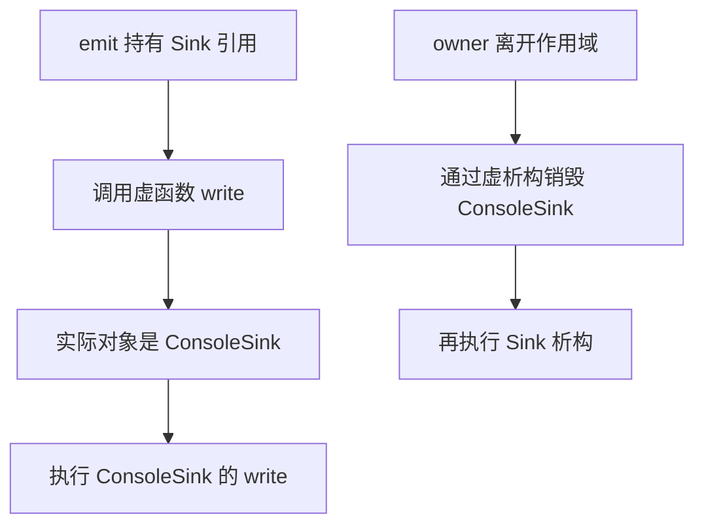

# C++ 面试语法小册：从类与对象走到继承、多态和资源管理

**先看懂“对象是什么、谁在调用它”，再理解继承和虚函数。** 这本册子把本地面经里常见的 C++ 语言问题整理成可独立阅读的讲义；不要求先打开 Reactor 源码才能读懂。

第一次建立面向对象的直觉，顺着第 1~3 章读：类与对象 -> 构造/析构 -> 继承与基类引用 -> 虚函数。已有基础的小节可以跳过，之后按目录查阅。Week13~Week15 的项目补缺安排照旧；小册不是新的 daily，不额外增加一套验收作业。

| 遇到的问题 | 直接查哪里 | 怎样阅读 |
|---|---|---|
| class 定义了什么？对象、成员、this 是什么？ | 第 1 章：类与对象 | 面向对象的起点 |
| 派生对象里为什么还有一个基类部分？ | 第 2 章：继承 | 接在第 1 章之后 |
| 基类指针为什么能调用派生实现？销毁时调用谁？ | 第 3 章：虚函数与对象模型 | 接在第 2 章之后 |
| 头文件已经 include，为什么还报 undefined reference？ | 第 4 章：编译链接与关键字 | 多文件语法问题 |
| std::move 做了什么？传参后资源由谁拥有？ | 第 5 章：移动、转发与资源生命周期 | 已懂对象创建/结束后读 |
| const/noexcept/default/delete 分别在约束什么？ | 第 6 章：类接口上的约定 | 配合第 1/5 章 |
| sizeof 很小，为什么进程却用了很多内存？ | 第 7 章：对象布局与容器内存 | 区分对象与额外分配 |
| shared_ptr、捕获和 atomic 能保证什么？ | 第 8 章：共享对象与并发边界 | 先理解所有权，再读同步 |
| auto/decltype、模板、lambda、cast 是怎样用的？ | 第 9 章：泛型与表达式语法 | 独立小例子，按问题查阅 |
| 面试题具体对应哪一章？ | 第 10 章：题型索引与范围 | 查漏，不作为背诵清单 |

示例使用 C++17。完整示例可以单独放到临时 `.cpp` 中运行：

```bash
g++ -std=c++17 -Wall -Wextra -g demo.cpp -o demo
./demo
```

第 4 章是多文件例子；第 8 章的线程例子加 `-pthread`。示例只观察语言机制，不需要修改你的 Connection、KvStore 或 ThreadPool。`T&&` 的例子若暂时看不顺，先看第 9 章的模板入口，再回第 5 章。

[TOC]

---

## 1. 类与对象：把一份状态和操作它的规则放在一起

### 1.1 为什么要有 class

假设你需要两个互不影响的计数器。只写一个全局 count，每次操作都会修改同一份状态；把 count 作为函数参数传来传去，又容易让调用者直接把它改乱。

**class（类）定义一种类型：这种类型有哪些数据，以及允许怎样操作这些数据。object（对象）是按该类型创建的具体实例。** 一个类可以创建多个对象，每个对象通常各有自己的非静态数据成员。

先看两个计数器：

```cpp
#include <iostream>

class Counter {
public:
    explicit Counter(int start) : value_(start) {}

    Counter& add(int delta) {
        value_ += delta;
        return *this;
    }

    int value() const {
        return value_;
    }

private:
    int value_;
};

int main() {
    Counter first(10);
    Counter second(0);

    Counter* pointer = &first;
    Counter& reference = first;
    pointer->add(2);
    reference.add(3);
    second.add(1);

    std::cout << first.value() << ' ' << second.value() << '\n';
}
```

输出 `15 1`。Counter 是类型，first/second 是两个对象；两者的 value_ 是不同的成员。pointer 和 reference 都访问 first，因此两次 add 累加在同一个对象上。

```text
first 对象：value_ = 15  <- pointer、reference 都访问它
second 对象：value_ = 1
Counter 类型：规定上述对象有哪些成员、怎样调用它们
```

### 1.2 先读懂这几种写法

| 写法 | 在例子中做什么 |
|---|---|
| `class Counter { ... };` | 定义类型；类定义末尾有分号 |
| `Counter first(10);` | 创建对象，并调用构造函数 |
| `first.value()` | 通过对象调用成员函数 |
| `Counter* pointer = &first;` | 保存对象地址；这里 `&first` 取地址 |
| `pointer->add(2)` | 通过指针访问对象成员，等价于 `(*pointer).add(2)` |
| `Counter& reference = first;` | 给现有对象建立引用，不创建第二个 Counter |
| `Counter::` | 指定 Counter 的作用域，例如在类外定义成员函数时使用 |

**this 是当前成员调用所针对对象的指针。** `first.add(2)` 执行时，this 指向 first；`second.add(1)` 执行时，this 指向 second。`return *this` 返回当前对象的引用，可支持连续调用 `first.add(2).add(3)`。

静态成员函数没有这种当前对象参数，所以没有 this；静态成员的详细使用见第 4 章。不要把 this 当成一个自动新建的对象。

`int value() const` 中末尾的 const 表明这是一个只读查询入口，不能直接修改该对象的非 mutable 成员。mutable 是允许在 const 调用中修改某个成员的标记；本例并未使用。先按“查询不改变计数器状态”理解，const 的不同层次在第 6 章展开。

### 1.3 public/private/protected 是谁可以使用成员

计数器希望外部通过 add/value 操作，而不是直接随意改 value_。因此把操作开放，把状态保留在类内部。这种把状态与访问规则一起组织的方式叫 **encapsulation（封装）**。

| 访问级别 | 第一层理解 |
|---|---|
| public，公开 | 外部调用者也可以使用 |
| private，私有 | 该类的成员与被授权的友元可以使用 |
| protected，受保护 | 在 private 之外，还允许派生类等按继承访问规则使用 |

权限是编译期规则，不是给内存加密。同一类的成员也可以访问另一个同类对象的 private 成员，权限并不是“只能访问自己的那一份”。

**C++ 的 class 与 struct 都能定义构造、成员函数、继承和虚函数。** 主要语言差别是默认权限：class 默认 private 成员/继承，struct 默认 public 成员/继承。不能记成“struct 只有数据，class 才能有方法”。

`friend（友元）` 用于明确授权某个函数或类访问 private/protected 成员。友元函数可以是非成员函数，友元也不自动传递给朋友的朋友。用到时看 [友元教程](友元教程.md)，不为每个类默认添加友元。

### 1.4 构造先建立初始状态，函数体随后执行

`Counter(int start)` 是 constructor（构造函数）：名称与类相同，没有返回类型。`value_(start)` 是 member initializer list（成员初始化列表），在构造函数体执行前初始化 value_。

**初始化是创建成员并给它初始状态；赋值是修改一个已经存在的成员。** 对 string 等类成员，先默认构造、再在函数体赋值，与直接初始化是不同动作。

const 数据成员、引用成员，以及没有默认构造的类类型成员，必须通过合适的初始化建立。成员按类中**声明顺序**初始化，不按冒号后排列顺序；让初始化列表与声明顺序一致更容易读，也避免误用尚未初始化的成员。

例子的 `explicit（显式构造约定）` 允许 `Counter object(10)`，但不允许把一个 int 自动隐式转换成 Counter，例如 `Counter object = 10;`。这是让调用者明确“现在创建一个 Counter”，而不是执行时突然发生隐式转换。

这里只有带 int 参数的构造函数，所以 `Counter object;` 没有匹配入口。编译器不会因为你写了一个构造函数，就额外补出所有其他形式。默认/拷贝/移动的规则在第 6 章继续讲。

### 1.5 析构结束对象，并让成员按顺序结束

destructor（析构函数）写成 `~Counter()`。普通局部对象离开作用域时自动析构；它的成员也会结束。资源如何借这个过程收尾，在第 5 章的 RAII 里接着讲。

先用有输出的成员看清顺序：

```cpp
#include <iostream>
#include <string>

struct Member {
    std::string name;

    explicit Member(const std::string& label) : name(label) {
        std::cout << "construct " << name << '\n';
    }

    ~Member() {
        std::cout << "destroy " << name << '\n';
    }
};

struct Packet {
    Member header;
    Member body;

    Packet() : header("header"), body("body") {
        std::cout << "Packet constructor body\n";
    }

    ~Packet() {
        std::cout << "Packet destructor body\n";
    }
};

int main() {
    Packet packet;
}
```

输出：

```text
construct header
construct body
Packet constructor body
Packet destructor body
destroy body
destroy header
```

**先构造成员，再进入 Packet 构造函数体；先执行 Packet 析构函数体，再按反向顺序析构成员。** 这条链比一句“对象销毁了”更具体。

查证：[类成员](https://timsong-cpp.github.io/cppwp/n4659/class.mem)、[访问控制](https://timsong-cpp.github.io/cppwp/n4659/class.access)、[成员初始化](https://timsong-cpp.github.io/cppwp/n4659/class.base.init)、[explicit 构造](https://timsong-cpp.github.io/cppwp/n4659/class.conv.ctor)。

---

## 2. 继承：派生对象包含基类部分，并提供更具体的类型

### 2.1 从“这是一种什么对象”开始

假设 Resource 保存一个编号，Socket 是一种有编号、还能发送数据的 Resource。我们希望处理一般 Resource 的函数也能接受 Socket。

**inheritance（继承）让派生类型与基类建立类型关系。Derived（派生类）对象中包含 Base（基类）子对象。** 子对象是完整对象中的一个组成部分，不是自动另分配的一个指针对象。

```cpp
#include <iostream>

class Resource {
public:
    explicit Resource(int id) : id_(id) {}

    int id() const { return id_; }

private:
    int id_;
};

class Socket : public Resource {
public:
    explicit Socket(int id) : Resource(id) {}

    void send() const {
        std::cout << "socket " << id() << '\n';
    }
};

void identify(const Resource& resource) {
    std::cout << resource.id() << '\n';
}

int main() {
    Socket socket(42);
    Resource& base_reference = socket;
    Resource* base_pointer = &socket;

    identify(base_reference);
    std::cout << base_pointer->id() << '\n';
    socket.send();
}
```

输出 `42`、`42`、`socket 42`。`Socket : public Resource` 允许调用者把 Socket 借用为 Resource 引用/指针，仍在访问原 socket 里的基类部分，没有为这两个借用各创建一份 Resource。

示例 send 只打印对象编号，用来观察语言关系，不会创建或操作真实 TCP socket。

### 2.2 基类引用保留原对象，但它开放的接口有限

```text
一个完整 Socket 对象
    包含 Resource 部分：id_ = 42
    提供 Socket 自己的 send 行为

Resource& / Resource*：通过 Resource 接口访问同一对象
```

基类引用可以调用 Resource 接口，不能直接用它调用仅在 Socket 声明的 send。**指针/引用的类型决定编译器允许你使用哪些接口，实际对象决定下一章虚调用可以选中哪个实现。** 两个问题需要分开。

Socket 不能直接写 `id_`，因为它是 Resource 的 private 成员；但可以调用公开的 id()。**private 基类成员仍然存在于基类部分，只是派生类不能直接访问其名字。**

### 2.3 public/protected/private 继承改变访问关系

| 继承方式 | 基类 public 成员在派生类中的访问级别 | 基类 protected 成员在派生类中的访问级别 |
|---|---|---|
| public 继承 | public | protected |
| protected 继承 | protected | protected |
| private 继承 | private | private |

表格没有把基类 private 成员变成可直接访问：派生类仍不能直接访问它们。受保护成员还有关于访问对象的限制；当前先看懂自己派生对象中的成员关系，不背成“派生类能访问任何 Base 对象的 protected”。

**public 继承常表达“派生类型可按基类接口使用”。** protected/private 继承不能直接向任意外部调用者提供同样的隐式基类转换；它们更偏实现关系，不要只为复用几行代码就默认选继承。

### 2.4 先构造基类，后构造派生；结束时反过来

`Socket(int id) : Resource(id)` 明确告诉编译器怎样初始化基类部分。没有可用的基类默认构造时，派生构造需要提供合适参数。

对于这里的单继承场景：

```text
基类构造
-> 派生类成员按声明顺序构造
-> 派生构造函数体
-> 对象正常使用
-> 派生析构函数体
-> 派生成员反向析构
-> 基类析构
```

第 3 章会在这条链上加入虚调用，观察构造/析构每一层究竟执行哪个版本。先有对象状态，再问调用选择。

### 2.5 拥有一个对象，与是它的一种类型，怎样选择

Connection **拥有** Buffer，并不表示 Connection 是一种 Buffer。前者是 composition（组合），后者才是继承的类型关系。

把类写在成员里可以组合；继承则把基类部分纳入派生对象，并改变类型/访问关系。你现有的网络组件使用组合很自然；这个例子只建立语言直觉，不要求改造当前项目。

查证：[基类与派生类](https://timsong-cpp.github.io/cppwp/n4659/class.derived)、[基类访问控制](https://timsong-cpp.github.io/cppwp/n4659/class.access.base)、[初始化顺序](https://timsong-cpp.github.io/cppwp/n4659/class.base.init)。

---

## 3. 虚函数：同一个入口，调用不同对象的实现

### 3.1 先有一个需要统一调用的问题

假设要把一条日志交给不同的输出目标：一种打印到终端，另一种写入文件。调用者希望只写一次 `write(message)`，具体输出动作由收到调用的对象决定。

我们可以给这些对象规定一个共同的接口 `Sink`。`ConsoleSink` 是一种 Sink，因此可以通过 `Sink&` 或 `Sink*` 访问它。这种“某种对象是一种更一般的对象”的关系，用 **inheritance（继承）** 表达。

但问题还没结束：调用者手里只看到 `Sink&`，怎样选中 `ConsoleSink` 的实现？

**virtual（虚函数）让这种调用按实际对象的类型选择最终重写的函数。** 这种在运行时选择实现的方式，叫 dynamic dispatch（动态分派）。

### 3.2 看一次真实调用与销毁

```cpp
#include <iostream>
#include <memory>
#include <string>

struct Sink {
    virtual ~Sink() {
        std::cout << "Sink destroyed\n";
    }

    virtual void write(const std::string& message) = 0;

    void describe() const {
        std::cout << "Sink interface\n";
    }
};

struct ConsoleSink final : Sink {
    ~ConsoleSink() override {
        std::cout << "ConsoleSink destroyed\n";
    }

    void write(const std::string& message) override {
        std::cout << "console: " << message << '\n';
    }

    void describe() const {
        std::cout << "ConsoleSink implementation\n";
    }
};

void emit(Sink& sink) {
    sink.describe();
    sink.write("hello");
}

int main() {
    std::unique_ptr<Sink> owner = std::make_unique<ConsoleSink>();
    emit(*owner);
}
```

输出：

```text
Sink interface
console: hello
ConsoleSink destroyed
Sink destroyed
```

顺着对象看，就能解释四行输出：

1. `make_unique<ConsoleSink>()` 创建的是 ConsoleSink 对象；`owner` 通过基类类型拥有它。
2. `emit` 收到的引用类型是 `Sink&`。普通成员 `describe()` 根据这里的静态类型选择 Sink 版本。
3. `write()` 是虚函数，实际对象为 ConsoleSink，因此选择其 `write()`。
4. 离开 main 后，owner 销毁所拥有的对象。基类析构为虚函数，所以先执行派生析构，再执行基类析构。

**static type（静态类型）是编译器从表达式看到的类型；dynamic type（动态类型）是这里实际对象的类型。** `Sink&` 是前者，ConsoleSink 是后者。



图的上半是**函数调用**，下半是**对象销毁**。`emit` 借用对象，owner 才负责对象最后的结束。

### 3.3 override、重载、隐藏，分别在做什么

`override（重写检查）` 的作用是让编译器确认：这个函数确实重写了基类的虚函数。比如基类是 `write(const std::string&)`，你误写成 `write(int) override`，编译器会拒绝它。

| 情况 | 含义 | 例子 |
|---|---|---|
| override，重写 | 派生函数重写基类虚函数 | 上例的 `ConsoleSink::write` |
| overload，重载 | 同一作用域里同名函数有不同参数 | 同时提供 `write(int)` 和 `write(string)` |
| name hiding，名字隐藏 | 派生类的同名声明影响基类名字的查找 | 派生类只声明 `write(int)`，直接在派生对象上查找 write 时会隐藏基类同名集合 |

**名字一样，不足以构成重写。** 参数、const 等限定必须满足重写规则。`using Base::function;` 可以把基类的重载集合引入派生作用域；它处理名字查找，而不是创造一次新的重写。

`final（禁止继续派生或重写）` 写在类上，禁止再派生；写在虚函数上，禁止后续派生类继续重写该函数。

### 3.4 纯虚函数与抽象类为什么存在

`virtual void write(...) = 0;` 表示这里要求具体类型提供相应实现。这样的函数叫 **pure virtual function（纯虚函数）**。

像上例的 Sink，尚没有可供独立使用的完整具体行为，因此属于 abstract class（抽象类），不能直接创建 `Sink object;`。ConsoleSink 给出了最终实现，就可以创建对象，再借用 Sink 接口操作。

抽象类仍可以保存数据、实现普通函数，也可以实现其他虚函数。纯虚函数也可以有类外定义；`= 0` 表达抽象接口约定，不是“整个类只能有声明”。纯虚析构函数若被用到，还需要提供定义。

### 3.5 虚表：先解释语言行为，再看常见实现

在常见 GCC/Linux ABI 中，编译器会借助 **vptr（虚表指针）** 和 **vtable（虚函数表）** 实现这类调用：

```text
当前对象中的虚表指针
    -> 与该类型相关的虚表
    -> 对应虚函数的表项
    -> 最终实现
```

表不是给每个对象完整复制一份；多个同类型对象通常可以共享相关的表。对象持有用于找到它的指针。这是理解机器码的常见模型，具体布局由 ABI 决定；优化器也可能直接确定目标，省去实际查表。

**C++ 保证的是虚调用的语义，不规定所有平台都有同一个虚表布局。** 因此不能靠一句“对象头部固定有 8 字节 vptr”解释所有情况，也不需要手动强转对象去读取虚表。

### 3.6 构造与析构期间，先看对象正处于哪一层

构造派生对象时，先构造基类，再构造派生部分。基类构造阶段的虚调用只到当前基类这一层；析构则反过来逐层结束。

```cpp
#include <iostream>

struct Base {
    Base() {
        std::cout << "Base ctor -> ";
        show();
    }
    virtual ~Base() {
        std::cout << "Base dtor -> ";
        show();
    }
    virtual void show() const { std::cout << "Base\n"; }
};

struct Derived : Base {
    Derived() {
        std::cout << "Derived ctor -> ";
        show();
    }
    ~Derived() override {
        std::cout << "Derived dtor -> ";
        show();
    }
    void show() const override { std::cout << "Derived\n"; }
};

int main() {
    Derived object;
    std::cout << "normal call -> ";
    object.show();
}
```

输出：

```text
Base ctor -> Base
Derived ctor -> Derived
normal call -> Derived
Derived dtor -> Derived
Base dtor -> Base
```

这里没有执行纯虚函数调用。通过实际输出观察每一层，才能理解“构造/析构期间的对象状态”；只背“构造函数不能 virtual”并不能解释这条链。

### 3.7 按引用借用，与按值复制，是不同动作

```cpp
#include <iostream>

struct Base {
    virtual ~Base() = default;
    virtual const char* name() const { return "Base"; }
};

struct Derived : Base {
    const char* name() const override { return "Derived"; }
};

int main() {
    Derived original;
    const Base& borrowed = original;
    Base copied = original;
    std::cout << borrowed.name() << '\n';
    std::cout << copied.name() << '\n';
}
```

输出为 `Derived`、`Base`。引用仍借用原 Derived 对象；`Base copied = original` 则创建了一个新的 Base 对象，只复制原对象的基类部分。这叫 **object slicing（对象切片）**。

因此，要保持这类运行时多态，通常通过基类指针/引用操作原对象，而不是把它按值收成一个 Base。

### 3.8 放回你的 Reactor

你的 Connection **拥有** Channel、Buffer 和 UniqueFd，这是 composition（组合）。Channel 保存不同回调，用 `std::function` 调用它们。调用者使用统一的可调用接口，但并没有要求 Connection 继承 Channel。

虚函数适合“多个具体对象遵守同一个基类接口”的需求；组合与回调适合你当前的组件组织。学习这章，是为了理解并选择机制，不是给当前类统一加 virtual。

一个关键安全边界：在 C++17 中，若用基类指针 `delete` 实际派生对象，而该基类析构非虚，行为未定义。不要运行这种错误代码，再把一次“只打印 Base”当成可靠规则。

查证：[虚函数](https://timsong-cpp.github.io/cppwp/n4659/class.virtual)、[抽象类](https://timsong-cpp.github.io/cppwp/n4659/class.abstract)、[构造/析构](https://timsong-cpp.github.io/cppwp/n4659/class.cdtor)、[delete](https://timsong-cpp.github.io/cppwp/n4659/expr.delete)、[Itanium ABI 虚表布局](https://itanium-cxx-abi.github.io/cxx-abi/abi.html#vtable)。

---

## 4. 编译链接：声明告诉我能调用，定义提供真正执行的代码

### 4.1 为什么 include 了，还可能找不到函数

假设 main 要调用一个函数。**声明让编译器知道函数名称、参数和返回类型；定义提供函数体。** 只看到声明，可以编译出调用，但链接时仍要找到相应实现。

新建三个独立示例文件：

`counter.hpp`：

```cpp
#pragma once

extern int count;
void increment();

inline int twice(int value) {
    return value * 2;
}
```

`counter.cpp`：

```cpp
#include "counter.hpp"

int count = 0;

void increment() {
    ++count;
}
```

`main.cpp`：

```cpp
#include <iostream>
#include "counter.hpp"

int main() {
    increment();
    std::cout << count << ' ' << twice(count) << '\n';
}
```

在这三个文件所在的示例目录运行：

```bash
g++ -std=c++17 -Wall -Wextra -g -c counter.cpp -o counter.o
g++ -std=c++17 -Wall -Wextra -g -c main.cpp -o main.o
g++ main.o counter.o -o counter_demo
./counter_demo
```

输出 `1 2`。`-c` 生成 object file（目标文件），不完成链接；最后一条 g++ 链接命令把两个目标文件与所需标准库组合起来。

若最后只链接 `main.o`，就缺少 count/increment 的定义。出现 **undefined reference（引用了却找不到定义）**，应先查提供定义的 `.cpp` 是否加入 target、对应库是否链接，而不是再 include 一次头文件。

### 4.2 每个源文件并不是隔着头文件共用一次编译

每个 `.cpp` 加上展开的头文件，构成一个 **translation unit（翻译单元）**，分别编译。

```text
counter.cpp + 展开的 counter.hpp -> counter.o
main.cpp    + 展开的 counter.hpp -> main.o
两份目标文件                    -> counter_demo
```

`#pragma once` 防止同一个翻译单元里重复包含，不会自动把“两个 `.cpp` 都定义了同一个普通全局变量”合并成一次定义。

这就是 ODR，One Definition Rule（单一定义规则）要解决的问题之一：跨源文件怎样一致地声明和定义实体。普通非 inline 的外部函数/变量通常在一个源文件定义，其他地方声明；inline、模板等另有允许多处定义的条件。

### 4.3 static、extern、inline 各解决一件事

| 写法 | 在这里的动作 | 你会在哪里用到 |
|---|---|---|
| `extern int count;` | 声明某个外部变量，当前这一行不分配其定义 | 上面的头文件 |
| 命名空间作用域 `static int count;` | 让该变量具有内部链接，只属于当前翻译单元的实体 | 源文件私有状态 |
| 函数内 `static int count;` | 局部名字，静态存储期；函数再次调用时仍使用同一个对象 | 累计调用次数 |
| 类内静态成员 | 成员属于类，而不是每个实例各保存一份 | 类级计数器等 |
| `inline` 函数/变量 | 在满足规则时允许多个翻译单元包含定义，并仍表示同一实体 | 头文件中的小函数、C++17 inline 变量 |

例如 C++17 可在类里写 `inline static int count = 0;`。这是该类共享的一份静态成员，不是每个对象自带一个 count。

**inline 的语言语义不能只记成“展开代码、提高性能”。** 编译器可选择不展开 inline 函数，也可能展开没有 inline 的函数。跨文件定义一致性和机器码是否展开，是两个问题。

局部 static 在 C++11 以后具有线程安全的初始化保证；初始化后的 `++count` 是否安全，仍取决于后续访问的同步。把 static 写到共享变量前面不会替你加锁。

### 4.4 模板为什么常把函数体放在头文件

`template<class T>` 描述一族实现。编译器为实际 T 生成所需版本时，通常要能看到模板定义，所以常把函数体放在可包含的头文件。

这叫 template instantiation（模板实例化）。它发生在编译阶段；并不是运行时再挑一种 T。显式实例化可以把支持的具体版本集中到源文件，但这需要另外安排声明与实例化，不是随手把函数体移走。

回看：[.h 与 .cpp 教程](<.h 与 .cpp 教程.md>)、[模板与泛型](模板与泛型编程教程.md)。

静态库提供供链接使用的目标代码集合；动态库的加载与符号解析还涉及加载器。Week14 在 Ubuntu 的实际 AOF 工程中再看文件和符号，这里先把“编译成功”和“链接成功”分清。

查证：[GCC 编译阶段选项](https://gcc.gnu.org/onlinedocs/gcc/Overall-Options.html)、[ODR](https://timsong-cpp.github.io/cppwp/n4659/basic.def.odr)、[inline](https://timsong-cpp.github.io/cppwp/n4659/dcl.inline)、[static/extern](https://timsong-cpp.github.io/cppwp/n4659/dcl.stc)。

---

## 5. 移动与转发：传的是对象，转移的是它拥有的资源

### 5.1 先分清“换一个访问方式”与“资源真的转移”

你把 UniqueFd 交给 Connection，希望新 owner 负责最后关闭 fd，而旧 owner 不再关闭它。**移动构造/移动赋值负责落实这种资源转移；std::move 提供允许选择移动操作的表达式。**

```cpp
#include <iostream>
#include <memory>
#include <utility>

void inspect(int&) { std::cout << "lvalue\n"; }
void inspect(int&&) { std::cout << "rvalue\n"; }

template<class T>
void relay(T&& value) {
    inspect(value);
    inspect(std::forward<T>(value));
}

int main() {
    auto old_owner = std::make_unique<int>(7);
    auto new_owner = std::move(old_owner);
    std::cout << static_cast<bool>(old_owner) << ' ' << *new_owner << '\n';

    int number = 3;
    relay(number);
    relay(3);
}
```

输出：

```text
0 7
lvalue
lvalue
lvalue
rvalue
```

第一行说明 unique_ptr 的移动构造实际接管了对象，旧 unique_ptr 变空。这个“变空”是 unique_ptr 的契约；不能推广成任何 moved-from object（移动后的源对象）都为空。

对 std::string 等标准库对象，移动后通常只保证有效但状态未指定，除非相应接口给出更明确保证。**按照具体类型的契约理解移动后状态。**

### 5.2 左值/右值是在描述表达式

**value category（值类别）描述当前表达式以什么方式参与操作。** `number` 是 lvalue（左值）；`std::move(number)` 是 xvalue（将亡值，一种右值）；字面量 `3` 是 prvalue（纯右值）。

`int&& value` 声明了右值引用参数，但函数体中单独写 `value`，这个有名字的表达式仍是左值。所以上面 relay 的第一条 inspect 总是选左值版本。

`std::move(value)` 适合明确允许从它移动；**std::forward<T>(value) 按原来推导的 T 保留调用者传入的值类别。** relay 第二次调用因此能区分外面的 number 和字面量 3。

这里的 `T&&` 在 T 由调用推导等条件下是 forwarding reference（转发引用）。固定类型的 `std::string&&` 则是右值引用，不能看到两个 `&` 就全部叫转发引用。

### 5.3 RAII 把资源结束挂到对象结束

RAII（资源获取即初始化）的关键关系是：**对象负责自己拥有的资源，析构负责结束这份责任。**

```text
临时 UniqueFd 接住 accept 返回的 fd
-> 移动给 Connection 的成员
-> Connection 存活期间由该成员拥有 fd
-> Connection 析构
-> 成员析构
-> UniqueFd 关闭自己仍拥有的 fd
```

如果中途抛异常，已经完整构造的局部对象/成员在展开时会析构。整个对象的构造尚未完成时，不会执行这个未完成对象自己的析构函数；已构造成员仍负责收尾。因此把 fd 尽早纳入 RAII owner，比先拿裸 fd、很久以后才绑定 owner 更稳妥。

移动设计不一定要再写一份组件：先用你的 UniqueFd、ThreadPool submit 和 Connection 传参，指出哪一个对象创建、哪一份资源转手、旧 owner 变成什么状态就够了。

查证：[move/forward](https://timsong-cpp.github.io/cppwp/n4659/forward)、[拷贝与移动构造](https://timsong-cpp.github.io/cppwp/n4659/class.copy)、[构造失败时的清理](https://timsong-cpp.github.io/cppwp/n4659/except.ctor)。

---

## 6. 类接口上的约定：哪些操作可做，失败意味着什么

### 6.1 const 先看它约束的是哪一层

你只是查看 Buffer 的 readable bytes，不希望这个查询修改其逻辑状态，因此可以把查询成员标为 const。

| 写法 | 被约束的对象 |
|---|---|
| `const int* p` | 不能通过 p 修改所指 int；p 本身可以改指向 |
| `int* const p` | p 本身不能改指向；可通过它修改 int |
| `int readable() const` | 这个成员调用不能直接修改非 mutable 的成员 |
| `const std::unique_ptr<T> owner` | 不能移动/reset 该 owner；T 自身未因此变 const |

const 成员若保存了一个普通指针，不能改该指针成员的指向，但可能仍能修改它指向的外部对象。要读懂 const，先确认这一层到底是指针/owner，还是被指向的数据。

### 6.2 六个特殊成员：编译器可以帮忙，但要看类型条件

| 操作 | 发生什么 |
|---|---|
| 默认构造 | 不提供参数时怎样创建对象 |
| 析构 | 对象结束时怎样收尾 |
| 拷贝构造 | 从已有对象创建另一个对象 |
| 拷贝赋值 | 给已有对象赋入另一个对象的状态 |
| 移动构造 | 从可移动来源创建对象 |
| 移动赋值 | 给已有对象接入可移动来源的状态 |

`= default` 请求按规则生成默认实现，`= delete` 明确禁用某个操作。例如 unique_ptr 不允许拷贝，因此包含 unique_ptr 的类默认拷贝操作也可能被定义为删除。

回到第 1 章的 Counter：`Counter copied = original;` 创建一个新对象，属于拷贝构造；已有对象再执行 `existing = original;`，属于拷贝赋值；`Counter& alias = original;` 则只是引用原对象。**看起来都在“把 original 交过去”，实际动作分别是创建、修改和借用。** 默认拷贝按成员的拷贝规则进行：int 复制数值，string 复制自己的内容，裸指针通常只复制地址；复制指针不自动复制它指向的整块数据。

**用户声明析构函数会影响隐式移动操作的生成。** 不能看见一个析构函数只有几行，就假定编译器还会自动生成与原来相同的移动构造。需要移动时应核对声明、成员能力和所有权约定。

自定义 UniqueFd 尤其要小心：裸 int 的逐成员默认移动只是复制数字，不能自动清空原 owner。它通常需要自己落实移动后状态。成员已经是标准 RAII owner 的普通类，则优先让成员承担资源管理，减少自定义特殊成员。

回看：[copy assignment 与 constructor](<区分 copy assignment, constructor.md>)。

### 6.3 noexcept 与“我认为这里不会失败”不同

**noexcept 声明这条调用不会把异常传播出去。** 如果异常真的越过这样的函数边界，就会进入 `std::terminate`，终止程序；它不会自动把异常变成返回值。

移动操作的 noexcept 属性也会影响泛型库选择。比如一个可复制的元素，其移动可能抛异常时，vector 在重新分配存储时可能选择复制，以维护相应异常保证。若元素只能移动，情况又不同，不能背成“没有 noexcept 就绝对不会移动”。

查看某个调用是否具有不抛异常的声明，可以写 `noexcept(expression)`。这是一个布尔查询，不会实际执行该 expression。

```cpp
#include <iostream>

void safe_operation() noexcept {}
void ordinary_operation() {}

int main() {
    std::cout << noexcept(safe_operation()) << '\n';
    std::cout << noexcept(ordinary_operation()) << '\n';
}
```

输出 `1`、`0`。ordinary 的函数体虽然没有 throw，其声明仍是可能抛异常。这里观察的是接口属性，不是统计一次运行有没有发生异常。

查证：[特殊成员函数](https://timsong-cpp.github.io/cppwp/n4659/class.copy)、[异常声明](https://timsong-cpp.github.io/cppwp/n4659/except.spec)、[noexcept 查询](https://timsong-cpp.github.io/cppwp/n4659/expr.unary.noexcept)。

---

## 7. 对象大小：量到的是哪一块内存

### 7.1 sizeof(vector) 与它保存的 bytes 是两笔账

Buffer 里的 vector 对象保存管理信息，它的元素存储是另外一块动态内存。**sizeof 看 vector 对象本身，capacity 看当前可容纳的元素数量。**

对 `vector<char>`，`capacity() * sizeof(char)` 对应元素存储规模；仍不是分配器全部开销，也不是整个进程 RSS（驻留集大小，当前驻留在物理内存中的页总量）。

```cpp
#include <cstddef>
#include <iostream>
#include <vector>

struct EntryA {
    char tag;
    int count;
    char active;
};

struct EntryB {
    int count;
    char tag;
    char active;
};

int main() {
    std::cout << sizeof(EntryA) << ' ' << alignof(EntryA) << '\n';
    std::cout << sizeof(EntryB) << ' ' << alignof(EntryB) << '\n';

    std::vector<char> bytes(1000, 'x');
    std::cout << "vector object: " << sizeof(bytes) << '\n';
    std::cout << "size: " << bytes.size() << '\n';
    std::cout << "capacity bytes: " << bytes.capacity() * sizeof(char) << '\n';
}
```

你的环境可能看到 EntryA 大于 EntryB。**alignment（对齐）规定对象/成员的地址对齐要求，padding（填充）用于满足布局和对齐。** 成员排列会影响中间和末尾的空隙，具体数字以当前类型与编译器为准。

size 是当前元素数；capacity 是当前元素存储可容纳的数量。后两者会变化，vector 对象自身的 sizeof 不会因为装入 1000 个 char 而变成 1000。

### 7.2 vector 的扩容为什么牵涉旧 pointer

```text
旧元素存储容量不够
-> 分配新的存储
-> 复制/移动已有元素
-> 结束旧元素并释放旧存储
-> 旧存储中的 pointer/reference/iterator 失效
```

因此 peek 得到的指针只在相应 Buffer 契约允许的期间使用。是否发生过 reallocation（重新分配存储）决定一种具体失效情形；你的组件可以选择更保守地规定任何 non-const 操作后重新取 pointer。

`reserve(n)` 请求足够的元素容量，不会把 size 直接改为 n；`resize(n)` 则调整元素数，必要时创建/销毁元素。回看 [常用 STL API](<常用STL api.md>) 的 vector 部分。

### 7.3 string、容器与进程内存要分别观察

常见 std::string 实现有 SSO，Small String Optimization（短字符串优化）：较短内容放在 string 对象内部，较长内容再动态分配。具体阈值与布局依实现而定。

KvStore 当前使用 map，每个节点除了 key/value，还会有树结构与分配相关开销。reply string 自己拥有 bytes，output 又保存尚未发送的 bytes。这些都是需要实际拆开的内存来源。

“逻辑上删除了 key”“归还了分配”“RSS 下降了”是三个可分别观察的阶段。分配器可能保留可复用内存，所以不能只看进程 RSS 不降，就判断 delete 没有执行。

Week15 再根据真实负载判断优化哪一块。单次 sizeof 对照支持布局理解，不足以宣布吞吐或 latency（延迟）已经改善。

查证：[sizeof](https://timsong-cpp.github.io/cppwp/n4659/expr.sizeof)、[vector capacity](https://timsong-cpp.github.io/cppwp/n4659/vector.capacity)、[vector 插入及失效](https://timsong-cpp.github.io/cppwp/n4659/vector.modifiers)。

---

### 7.4 new/delete 与 malloc/free：对象生命与存储要分开

普通 `new T(arguments)` 通常先取得存储，再构造 T；`delete pointer` 则结束相应对象，再释放存储。**malloc 取得原始存储，free 归还原始存储，它们本身不会调用 C++ 构造/析构函数。**

这就是为什么包含 string 等类成员的对象，不能只 malloc 一块大小相同的内存就假定已经构造好了。placement new（在指定存储中构造对象）可以把存储与对象构造分开，但属于后续 allocator 专题，不在这里直接套进项目。

普通 new 分配失败通常抛 `std::bad_alloc`；malloc 返回空指针。`new[]/delete[]` 与单对象形式需正确匹配，后者不能替代前者。更常见的工程入口仍是 make_unique/vector 等 RAII owner，让资源结束动作跟随对象。

## 8. 共享对象：活着、能访问、能安全修改，是三件事

### 8.1 shared_ptr 先解决“谁负责最后销毁”

**shared_ptr 提供共享所有权：最后一个共享 owner 结束时，才销毁相应对象。** weak_ptr 保存观察关系，需要访问时用 `lock()` 尝试取得一份临时共享 owner。

```cpp
#include <iostream>
#include <memory>

int main() {
    auto first = std::make_shared<int>(7);
    auto second = first;
    std::weak_ptr<int> observer = first;

    first.reset();
    if (auto alive = observer.lock()) {
        std::cout << *alive << '\n';
    }

    second.reset();
    std::cout << observer.expired() << '\n';
}
```

输出 `7`、`1`。first 结束拥有时，second 仍让对象存活；if 内的 alive 也临时拥有对象。第二次 reset 后已没有共享 owner，因此 weak_ptr 能观察到对象已结束。

### 8.2 “shared_ptr 线程安全”要拆成三层

| 层次 | 正确理解 |
|---|---|
| 各线程自己的 shared_ptr 副本，共用控制块 | 可以并发复制/销毁这些不同副本，控制块负责所有权计数的同步 |
| 同一个 shared_ptr 变量 | 如果一个线程 reset、另一个同时读/写这个变量，需要同步；只读访问另论 |
| 指向的 T 对象 | T 的字段访问仍按 T 自己的同步约定；引用计数不会保护 `T::counter++` |

control block（控制块）维护共享/弱所有权等管理信息。**计数安全保证的是正确管理生命周期，不是任意业务数据都可以并发修改。**

C++17 对同一个共享指针变量需要专门的同步方式，例如锁或 shared_ptr 的原子访问接口；`std::atomic<std::shared_ptr<T>>` 是 C++20 入口，不直接套到当前 C++17 项目。

### 8.3 捕获只保存访问方式，生命周期要靠 owner

`[value]` 保存一份捕获值，`[&value]` 保存对外部对象的访问，`[this]` 保存 this 指针。后两种捕获不会延长外部对象的生命。

```text
注册 callback
-> owner 保持被访问对象存活
-> callback 执行并访问对象
-> 到安全清理点注销/移除访问入口
-> owner 销毁对象
```

这条生命周期关系对应你现有的 deferred cleanup（延后到安全点清理）。不是看到 `[this]` 就必须换成 shared_ptr；先核对谁拥有对象、谁还能调用回调、什么时候移除调用入口。

回看：[lambda capture](<lambda capture.md>)、[几种 cast](<几种 cast.md>)。后者可辅助理解指针转换，但改变指针类型本身不会取得所有权。

### 8.4 atomic 发布状态：先建立一个最小单次交接

假设 producer 写好一份结果，consumer 看到 ready 后再读取结果。需要保证 consumer 看到 ready 时，也能观察到先前写入的数据。

**release（发布）/acquire（获取）可以为这种有匹配关系的访问建立同步。** 下例中，获取读取看到发布写入的 true，才建立相应的 happens-before（先发生于关系）。

```cpp
#include <atomic>
#include <iostream>
#include <thread>

int main() {
    int result = 0;
    std::atomic<bool> ready{false};

    std::thread producer([&] {
        result = 42;
        ready.store(true, std::memory_order_release);
    });

    std::thread consumer([&] {
        while (!ready.load(std::memory_order_acquire)) {
            std::this_thread::yield();
        }
        std::cout << result << '\n';
    });

    producer.join();
    consumer.join();
}
```

Linux 编译命令：

```bash
g++ -std=c++17 -Wall -Wextra -g -pthread demo.cpp -o demo
./demo
```

输出 `42`。result 的写入发生在发布之前；consumer 在匹配的获取之后读取它，中间有同步关系。这个例子只做一次交接，两个线程结束前 result/ready 都还活着。

若 producer 在发布后又无同步地改 result，旧的 ready 不会自动保护下一轮读写。mutex（互斥锁）适合保护一组需要共同更新的状态；atomic（原子对象）按其操作和内存序提供相应保证。volatile 不是普通线程共享数据的同步工具。

你当前 Mini Redis 的命令/store 仍在单线程路径上，不因学这段例子就给所有字段加 atomic。先去 Week7~8 的真实并发组件检查这些关系。

查证：[shared_ptr](https://timsong-cpp.github.io/cppwp/n4659/util.smartptr.shared)、[内存序](https://timsong-cpp.github.io/cppwp/n4659/atomics.order)、[线程同步关系](https://timsong-cpp.github.io/cppwp/n4659/intro.races)。

---

## 9. 类型推导、模板、lambda 与转换：读懂一条表达式

### 9.1 auto 推导声明类型，decltype 查询表达式类型

写 `auto` 是让编译器根据初始化表达式推导声明类型。**auto 本身是推导规则，不等于“自动保留引用”。** 按值 auto 通常去掉被复制值的顶层 const/引用，想借用原对象则明确写 auto& 等形式。

`decltype（类型查询）` 读取表达式对应的类型。对未加括号的名字有特殊规则；对一般表达式会结合其值类别处理，因此 `decltype(number)` 与 `decltype((number))` 可能不同。

```cpp
#include <iostream>
#include <type_traits>

constexpr int square(int value) {
    return value * value;
}

int main() {
    const int original = 3;
    auto copied = original;
    auto& borrowed = original;
    decltype(original) another = 4;
    decltype((copied)) alias = copied;
    alias = 9;

    static_assert(std::is_same_v<decltype(copied), int>);
    static_assert(std::is_same_v<decltype(borrowed), const int&>);
    static_assert(std::is_same_v<decltype(alias), int&>);

    std::cout << copied << ' ' << borrowed << ' ' << another << ' ' << alias << '\n';
    constexpr int limit = square(4);
    int runtime_value = 5;
    std::cout << limit << ' ' << square(runtime_value) << '\n';
}
```

输出 `9 3 4 9`、`16 25`。alias 引用 copied，所以给 alias 赋值就修改了 copied。

`static_assert（编译期断言）` 让编译器检查条件，`std::is_same_v` 在这里判断两个类型是否相同。constexpr 函数可以用于常量表达式计算，也可以接收运行时值；**它提供常量求值的能力，不强迫每次调用都在编译时执行。** constexpr 变量的初始化则要满足常量表达式要求。

查证：[auto 推导](https://timsong-cpp.github.io/cppwp/n4659/dcl.spec.auto)、[decltype](https://timsong-cpp.github.io/cppwp/n4659/dcl.type.simple)、[constexpr](https://timsong-cpp.github.io/cppwp/n4659/dcl.constexpr)。

### 9.2 模板描述一族实现，运算符也可以对应函数

需要对 int、string 或自己的类型做“把两个值合起来”，但不想为每个类型复制同一个函数，可以用模板描述这族实现。

```cpp
#include <iostream>
#include <string>

template<class T>
T combine(const T& left, const T& right) {
    return left + right;
}

struct Amount {
    int value;

    friend Amount operator+(const Amount& left, const Amount& right) {
        return Amount{left.value + right.value};
    }
};

int main() {
    std::cout << combine(2, 3) << '\n';
    std::cout << combine(std::string("hi"), std::string("!")) << '\n';
    std::cout << combine(Amount{2}, Amount{3}).value << '\n';
}
```

输出 `5`、`hi!`、`5`。模板中的 T 是类型参数；每次实际使用需要相应类型支持 `left + right`。第三种类型通过 **operator overloading（运算符重载）** 给 `+` 提供函数实现，所以同一模板也能使用它。

`friend operator+` 是定义在类里的非成员函数，不具有隐式 this。友元也允许它访问该类私有成员；本例的 value 公开，重点是看清运算符可以映射成一次函数调用。重载不能随意创造新运算符、改变原有优先级或把所有操作符都重载。

`template<class T>` 与 `template<typename T>` 在声明这种类型参数时等价。遇到依赖模板参数的嵌套类型名，有时需用 typename 告诉编译器它是类型；完整语法接 [模板与泛型编程教程](模板与泛型编程教程.md)，不在此复制整章。

面经里“模板能不能 virtual”要问清对象：**成员函数模板不能是虚函数；类模板里的普通成员函数可以是虚函数。** `Reader<int>` 是实例化后的具体类，并不会取消其普通虚函数的语言能力。

查证：[模板声明](https://timsong-cpp.github.io/cppwp/n4659/temp)、[成员函数模板](https://timsong-cpp.github.io/cppwp/n4659/temp.mem)、[运算符重载](https://timsong-cpp.github.io/cppwp/n4659/over.oper)。

### 9.3 lambda 把一段行为写成可调用对象

函数需要把“稍后执行的动作”传给另一个组件，就要把行为作为一个值保存。**lambda（匿名函数表达式）产生一个可调用的闭包对象，捕获值成为它保存的状态。**

```cpp
#include <functional>
#include <iostream>

int main() {
    int total = 1;
    auto snapshot = [total] { return total; };
    auto update = [&total](int delta) { total += delta; };

    update(4);
    std::function<int()> callback = snapshot;
    std::cout << callback() << ' ' << total << '\n';
}
```

输出 `1 5`。snapshot 创建时保存了 total 的副本；update 访问外面的同一个 total。`std::function<int()>` 用统一的“无参数、返回 int”的调用接口保存 snapshot，随后 `callback()` 调用它。

普通无捕获 lambda 可以转换为匹配的函数指针；捕获了状态的 lambda 一般不能这样转换。C++17 的 std::function 要求其保存目标可复制，因此 move-only callable（只能移动、不能复制的可调用对象）不能直接按同样方式塞进去。ThreadPool 的桥接问题正是这一层，但这里不重复设计旧组件。

更细的生命周期关系见第 8 章与 [lambda capture](<lambda capture.md>)；函数指针语法见 [函数指针](函数指针.md)。

查证：[lambda 表达式](https://timsong-cpp.github.io/cppwp/n4659/expr.prim.lambda)、[std::function](https://timsong-cpp.github.io/cppwp/n4659/func.wrap.func)。

### 9.4 四种 cast：转换目的决定选择

面试不会只关心你记住四个名字，还会问转换后指针是否真能安全访问对象。

| 转换 | 当前需要懂的用途与条件 |
|---|---|
| static_cast | 常规显式转换，例如浮点到整数、已知合法的类型关系；基类向派生类下转不会替你验证真实对象 |
| dynamic_cast | 对多态对象做运行时类型检查；指针形式失败返回 nullptr，引用形式失败抛 bad_cast |
| const_cast | 调整 const 等限定；是否可以修改最终对象，仍取决于原对象是否真正为 const |
| reinterpret_cast | 某些低层表示/指针转换；转换后的值不自动获得任意解引用或别名访问权限 |

`nullptr（空指针字面量）` 表示空指针，不是一个可调用成员函数的对象。空指针上的普通非静态成员调用也不能靠“没有用到 this，好像能打印”证明合法。

用合法多态对象看 dynamic_cast 的结果：

```cpp
#include <iostream>
#include <typeinfo>

struct Base {
    virtual ~Base() = default;
};
struct Derived : Base {};
struct Other : Base {};

int main() {
    Derived derived;
    Other other;
    Base* first = &derived;
    Base* second = &other;

    std::cout << (dynamic_cast<Derived*>(first) != nullptr) << '\n';
    std::cout << (dynamic_cast<Derived*>(second) != nullptr) << '\n';
    try {
        static_cast<void>(dynamic_cast<Derived&>(*second));
    } catch (const std::bad_cast&) {
        std::cout << "bad_cast\n";
    }
}
```

输出 `1`、`0`、`bad_cast`。Base 有虚析构，是多态类型；第二个实际对象是 Other，不能通过检查成为 Derived。

回看 [几种 cast](<几种 cast.md>)。把真正 const 的对象去掉限定后写入，或用错误的下转结果访问对象，属于需要避免的未定义行为，不把“这次没崩溃”作为正确性证据。

查证：[static_cast](https://timsong-cpp.github.io/cppwp/n4659/expr.static.cast)、[dynamic_cast](https://timsong-cpp.github.io/cppwp/n4659/expr.dynamic.cast)、[const_cast](https://timsong-cpp.github.io/cppwp/n4659/expr.const.cast)、[reinterpret_cast](https://timsong-cpp.github.io/cppwp/n4659/expr.reinterpret.cast)。

### 9.5 using、namespace 与 extern C：名字属于哪里

`namespace（命名空间）` 把名字组织在指定作用域里。`std::string` 表示 std 里的 string；`using Name = Type;` 为类型起别名，不创建一种全新的类型。

`extern "C"` 为函数等声明指定 C 语言链接，常用于 C/C++ 边界；它不等于把整个函数体按 C 语法重新编译，也不能自动解决两个语言之间的对象表示或所有权问题。实际使用时接口仍需双方约定类型与数据布局。

这与第 4 章的 `extern int count;` 不同：一个涉及语言链接，一个在示例中声明外部变量。别只因为都有 extern，就认为它们解决同一件事。

查证：[命名空间](https://timsong-cpp.github.io/cppwp/n4659/namespace.def)、[类型别名](https://timsong-cpp.github.io/cppwp/n4659/dcl.typedef)、[语言链接](https://timsong-cpp.github.io/cppwp/n4659/dcl.link)。

---

## 10. 面试题型与章节对照：找到缺口，再回讲解

本次对照本地 [200 篇主题汇总](../nowcoder_cpp_infra_aiinfra_200_recent.md)、[500 篇原问题汇总](../nowcoder_cpp_infra_aiinfra_500_recent3y_with_questions.md)，并参考已查证的腾讯后台/客户端实习题型。**这里覆盖常见语言基础主题，不声称包含 7216 条问题的全部答案。** 网络、数据库、性能问题仍由相应主线课程负责。

| 代表问题 | 回到哪里 | 要理解的关系 |
|---|---|---|
| class/struct 有何区别？this 是什么？ | 第 1 章 | 类型、对象、默认权限、当前调用对象 |
| 初始化列表为什么需要？成员初始化先后由什么决定？ | 第 1 章 | 成员创建先于函数体，顺序依声明 |
| public/private/protected 继承有什么区别？ | 第 2 章 | 基类部分存在、接口访问和外部转换分开 |
| 虚函数、纯虚函数、多态如何实现？ | 第 3 章 | 基类接口 -> 实际对象 -> 最终重写 |
| 虚析构、构造期虚调用、切片为什么不同？ | 第 3 章 | 对象生命周期和按值/按引用的差别 |
| static/extern/inline、头文件多次定义为何报错？ | 第 4 章 | 存储期、链接、翻译单元、ODR |
| move/forward、左值/右值、引用折叠是什么？ | 第 5 章 + 模板专题 | 表达式类别与具体对象/资源动作 |
| const/default/delete/noexcept、特殊成员如何生成？ | 第 6 章 | 被限制的对象层、成员能力和异常边界 |
| sizeof/对齐、new/malloc、容器扩容为什么重要？ | 第 7 章 | 对象生命、存储、布局与指针失效 |
| 智能指针线程安全吗？捕获引用安全吗？ | 第 8 章 | 控制块、指针变量、业务数据和存活期 |
| auto/decltype/constexpr、模板能否 virtual？ | 第 9 章 | 类型推导、实例化、具体虚函数与成员模板 |
| lambda/函数指针/std::function 怎样联系？ | 第 9 章 + 函数指针专题 | 可调用对象、捕获状态与统一调用接口 |
| 四种 cast、nullptr、extern C 各解决什么？ | 第 9 章 | 转换条件、实际对象与语言边界 |

CRTP（静态多态惯用法）、SFINAE（模板替换失败不报错的机制）、复杂模板元编程、多继承虚表布局、C++26 提案、完整 lock-free（无锁）/RCU（读复制更新）仍是后置专题。不会因为某份量化/社招面经出现，就把它们都加成当前必学内容。

### 与主线保持怎样的关系

详细时间安排仍见 [C++ 项目伴随补缺规划](../C++项目伴随补缺规划.md)：Week13 Day7 补类/继承/虚函数这条基础链，Week14 随 AOF 补编译链接与资源语法，Week15 随内存/性能补实际代价。**独立成册改变的是查阅与讲解顺序，不取消这些项目阶段的位置。**

这本册子先用完整小例子讲语言机制，再在必要处联系已有项目；daily 到对应时间点仍按你的实际实现定向讲解。读完一章不自动登记主线通过，也不要求额外写一套与 daily 重复的笔记。
